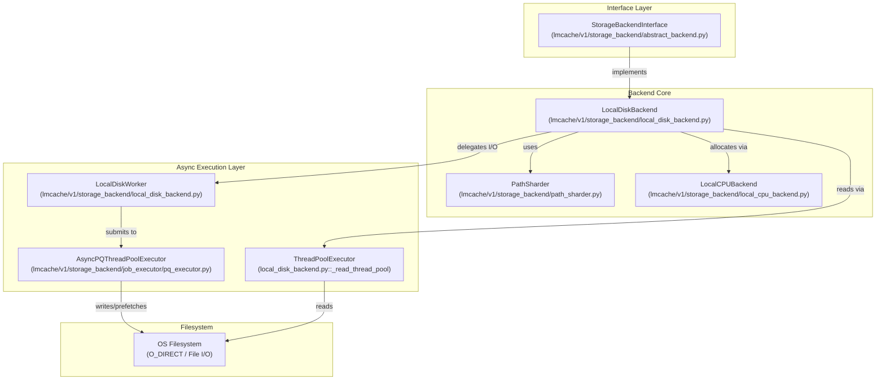
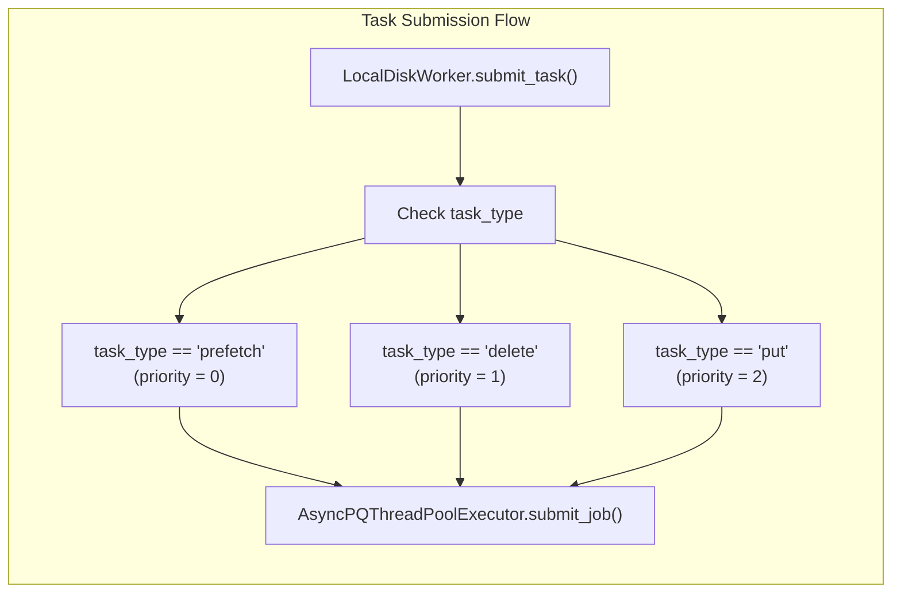

<!-- source: DeepWiki mcp.deepwiki.com · repo LMCache/LMCache · page 4.4 Local Disk Backend · fetched 2026-10-21 -->

# Local Disk Backend

<details>
<summary>Relevant source files</summary>

The following files were used as context for generating this wiki page:

- [docs/source/api_reference/configurations.rst](docs/source/api_reference/configurations.rst)
- [docs/source/kv_cache/storage_backends/cpu_ram.rst](docs/source/kv_cache/storage_backends/cpu_ram.rst)
- [docs/source/kv_cache/storage_backends/gds.rst](docs/source/kv_cache/storage_backends/gds.rst)
- [docs/source/kv_cache/storage_backends/local_storage.rst](docs/source/kv_cache/storage_backends/local_storage.rst)
- [docs/source/kv_cache/storage_backends/redis.rst](docs/source/kv_cache/storage_backends/redis.rst)
- [docs/source/kv_cache/storage_backends/weka.rst](docs/source/kv_cache/storage_backends/weka.rst)
- [lmcache/observability.py](lmcache/observability.py)
- [lmcache/v1/memory_management.py](lmcache/v1/memory_management.py)
- [lmcache/v1/storage_backend/__init__.py](lmcache/v1/storage_backend/__init__.py)
- [lmcache/v1/storage_backend/abstract_backend.py](lmcache/v1/storage_backend/abstract_backend.py)
- [lmcache/v1/storage_backend/gds_backend.py](lmcache/v1/storage_backend/gds_backend.py)
- [lmcache/v1/storage_backend/local_cpu_backend.py](lmcache/v1/storage_backend/local_cpu_backend.py)
- [lmcache/v1/storage_backend/local_disk_backend.py](lmcache/v1/storage_backend/local_disk_backend.py)
- [lmcache/v1/storage_backend/remote_backend.py](lmcache/v1/storage_backend/remote_backend.py)
- [lmcache/v1/storage_backend/storage_manager.py](lmcache/v1/storage_backend/storage_manager.py)
- [tests/test_observability.py](tests/test_observability.py)
- [tests/v1/data/gds.yaml](tests/v1/data/gds.yaml)
- [tests/v1/data/hipfile.yaml](tests/v1/data/hipfile.yaml)
- [tests/v1/data/hipfile_gds.yaml](tests/v1/data/hipfile_gds.yaml)
- [tests/v1/storage_backend/test_gds_backend.py](tests/v1/storage_backend/test_gds_backend.py)
- [tests/v1/storage_backend/test_local_cpu_backend.py](tests/v1/storage_backend/test_local_cpu_backend.py)
- [tests/v1/storage_backend/test_local_disk_backend.py](tests/v1/storage_backend/test_local_disk_backend.py)
- [tests/v1/storage_backend/test_storage_manager.py](tests/v1/storage_backend/test_storage_manager.py)
- [tests/v1/test_address_manager.py](tests/v1/test_address_manager.py)
- [tests/v1/test_cache_engine.py](tests/v1/test_cache_engine.py)
- [tests/v1/test_gds.py](tests/v1/test_gds.py)
- [tests/v1/test_memory_management.py](tests/v1/test_memory_management.py)

</details>


## Purpose and Scope

The `LocalDiskBackend` serves as LMCache's persistent storage tier, implementing a local disk cache layer that stores KV cache chunks on the filesystem. It acts as the L2 cache layer, sitting between the volatile memory cache (`LocalCPUBackend`) and remote storage or other backends. This backend provides asynchronous disk I/O with priority scheduling via the `LocalDiskWorker`, supports optional `O_DIRECT` usage for direct disk access to bypass OS caching, and enforces strict alignment of I/O operations according to filesystem block size.

This page explains the implementation and key components of the local disk backend, including the `LocalDiskBackend` and `LocalDiskWorker` classes, their asynchronous task scheduling approach, disk I/O mechanisms, and alignment requirements needed when `O_DIRECT` is enabled.

Sources: [lmcache/v1/storage_backend/local_disk_backend.py:42-139](), [lmcache/v1/storage_backend/local_disk_backend.py:167-171]()

---

## Architecture and Code Entities

The `LocalDiskBackend` implements LMCache's persistent disk cache operations by interfacing with underlying filesystem storage via asynchronous workers and thread pools. The following diagram shows major code entities and their relationships:



**Diagram: Local Disk Backend Code Entity Overview**

Sources:  
[lmcache/v1/storage_backend/local_disk_backend.py:42-187](), [lmcache/v1/storage_backend/abstract_backend.py:27-45](), [lmcache/v1/storage_backend/path_sharder.py:20-50](), [lmcache/v1/storage_backend/job_executor/pq_executor.py:15-60]()

---

## Core Components

### LocalDiskBackend Class

`LocalDiskBackend` inherits from `StorageBackendInterface` and manages KV cache storage mapping to disk metadata and filesystem paths. It selects local disk paths using the `PathSharder`, initializes asynchronous job executors, and interfaces with the `LocalCPUBackend` for buffer allocation during reads [lmcache/v1/storage_backend/local_disk_backend.py:119-197]().

Key attributes and roles:

| Attribute               | Type                     | Description                                                                                       | Code Reference                 |
|-------------------------|--------------------------|-------------------------------------------------------------------------------------------------|-------------------------------|
| `dict`                  | MutableMapping           | Cache mapping from `CacheEngineKey` to metadata managed with a configured eviction policy        | [lmcache/v1/storage_backend/local_disk_backend.py:134-135]() |
| `disk_worker`           | `LocalDiskWorker`        | Executes asynchronous put, prefetch, and delete tasks with prioritized task queues             | [lmcache/v1/storage_backend/local_disk_backend.py:176]() |
| `_read_thread_pool`     | ThreadPoolExecutor       | Thread pool dedicated to concurrent synchronous blocking disk read operations                   | [lmcache/v1/storage_backend/local_disk_backend.py:183-186]() |
| `local_cpu_backend`     | `LocalCPUBackend`        | Provides CPU memory buffers for reading cache chunks from disk                                  | [lmcache/v1/storage_backend/local_disk_backend.py:139]() |
| `path`                  | str                      | Filesystem directory used for the local disk cache, resolved by `PathSharder`                  | [lmcache/v1/storage_backend/local_disk_backend.py:145-151]() |
| `os_disk_bs`            | int                      | Filesystem block size (bytes), used for alignment in disk I/O                                  | [lmcache/v1/storage_backend/local_disk_backend.py:165-166]() |
| `use_odirect`           | bool                     | Flag to enable `O_DIRECT` usage for direct disk I/O bypassing OS caching                        | [lmcache/v1/storage_backend/local_disk_backend.py:167-171]() |

The class handles:

- Initialization of local cache directory paths and relevant locks.
- Management of in-flight disk write (`put`) and prefetch tasks with thread-safe lists and dictionaries.
- Current cache size tracking and capacity-based eviction (supported via configured cache policies).
- Integration with LMCache's asynchronous event loop and threading model.

Sources: [lmcache/v1/storage_backend/local_disk_backend.py:119-197]()

### LocalDiskWorker Class

The `LocalDiskWorker` manages asynchronous disk I/O jobs, scheduling tasks with different priorities via an `AsyncPQThreadPoolExecutor`. It tracks current disk write (`put_tasks`) and prefetch tasks concurrency with thread-safe structures [lmcache/v1/storage_backend/local_disk_backend.py:42-55]().

Key details:

- Uses explicit locks (`put_lock`, `prefetch_lock`) to safely add/remove tasks [lmcache/v1/storage_backend/local_disk_backend.py:46-50]().
- Priorities are assigned as: `prefetch` (priority 0), `delete` (priority 1), `put` (priority 2) [lmcache/v1/storage_backend/local_disk_backend.py:63-71]().
- Submits tasks to the executor, allowing concurrency and priority-driven task ordering [lmcache/v1/storage_backend/local_disk_backend.py:52]().
- Provides methods to register, check, and remove ongoing put tasks to prevent duplicate disk writes [lmcache/v1/storage_backend/local_disk_backend.py:80-110]().

Sources: [lmcache/v1/storage_backend/local_disk_backend.py:42-118]()

---

## Async I/O and Priority Task Execution

The backend uses the `LocalDiskWorker` class as the asynchronous execution engine. The worker submits tasks with different priorities into an asynchronous priority queue managed by `AsyncPQThreadPoolExecutor`. This executor ensures prefetch reads get highest priority, deletes next, and put operations lowest priority.

Task submission flow:



**Diagram: Local Disk Task Submission Flow**

- `submit_task()` is the main asynchronous interface to enqueue tasks [lmcache/v1/storage_backend/local_disk_backend.py:56-78]().
- Priority ordering ensures read-prefetching avoids being blocked by write operations [lmcache/v1/storage_backend/local_disk_backend.py:63-71]().
- Underlying `AsyncPQThreadPoolExecutor` manages the thread pool and task queue with priorities [lmcache/v1/storage_backend/local_disk_backend.py:52]().

Sources: [lmcache/v1/storage_backend/local_disk_backend.py:56-78]()

---

## File I/O, O_DIRECT Usage, and Alignment Requirements

### Filesystem Block Size Detection

The `LocalDiskBackend` uses `os.statvfs()` on the selected cache directory path to determine the filesystem's physical block size (`f_bsize`), which defines the atomic unit for disk I/O [lmcache/v1/storage_backend/local_disk_backend.py:165-166]().

```python
stat = os.statvfs(self.path)
self.os_disk_bs = stat.f_bsize
```

This block size is critical for correctly aligning disk read/write operations, particularly when using `O_DIRECT`.

### O_DIRECT Usage

- `O_DIRECT` is an optional mode controlled by the `use_odirect` flag read from `config.extra_config.get("use_odirect", False)` [lmcache/v1/storage_backend/local_disk_backend.py:167-171]().
- When enabled, disk reads and writes bypass the OS page cache, offering higher performance and reducing cache pollution in memory-heavy scenarios.
- Using `O_DIRECT` obligates strict alignment of:
  - File offsets
  - Transfer sizes
  - Memory buffer allocations

They must all be multiples of the filesystem block size (`os_disk_bs`).

### Alignment Constraints

- Any block of data read or written via `O_DIRECT` must be aligned in memory and on disk.
- The backend and underlying allocators must ensure buffers respect these alignment constraints.

### Path Sharding

- If multiple disk cache paths are provided in the configuration as comma-separated strings, the `PathSharder` resolves which path is used by a given backend instance, typically sharding by GPU index (`local_disk_path_sharding = "by_gpu"`).
- The resolved path is stored in `self.path` for all file I/O operations [lmcache/v1/storage_backend/local_disk_backend.py:145-151]().

Sources: [lmcache/v1/storage_backend/local_disk_backend.py:145-171]()

---

## Memory Management and Eviction

- The backend coordinates with `LocalCPUBackend` for memory allocation during retrieval operations. Loaded disk data is allocated as CPU memory objects before possible GPU transfer [lmcache/v1/storage_backend/local_disk_backend.py:139]().

- The cache policy configured (e.g., LRU) manages eviction candidates when the disk cache size exceeds `max_local_disk_size` (configured in GB, converted internally to bytes) [lmcache/v1/storage_backend/local_disk_backend.py:134](), [lmcache/v1/storage_backend/local_disk_backend.py:190-191]().

- Eviction triggers removal of cache entries from the internal dictionary and corresponding disk files to keep storage below capacity.

- An internal thread-safe dictionary manages keys mapped to metadata records representing on-disk cache items [lmcache/v1/storage_backend/local_disk_backend.py:135](), [lmcache/v1/storage_backend/local_disk_backend.py:141]().

Sources: [lmcache/v1/storage_backend/local_disk_backend.py:134-192]()

---

# Summary

The Local Disk Backend in LMCache provides a robust persistent L2 cache layer optimized for high concurrency and asynchronous disk operations. The `LocalDiskBackend` class manages filesystem paths and metadata tracking while delegating actual I/O tasks to the `LocalDiskWorker`, which uses a priority-based asynchronous executor model. Optional `O_DIRECT` enables direct disk access with strict memory and transfer size alignment requirements for performance-sensitive workloads.

This design effectively bridges fast CPU cache capabilities while preserving cache persistence on disk, enabling scalable KV cache management for large language model serving systems.

---

# References

- `lmcache/v1/storage_backend/local_disk_backend.py:42-139`  
- `lmcache/v1/storage_backend/local_disk_backend.py:167-171`  
- `lmcache/v1/storage_backend/abstract_backend.py:27-45`  
- `lmcache/v1/storage_backend/job_executor/pq_executor.py`  
- `lmcache/v1/storage_backend/path_sharder.py`  
- `lmcache/v1/storage_backend/local_cpu_backend.py`

---

