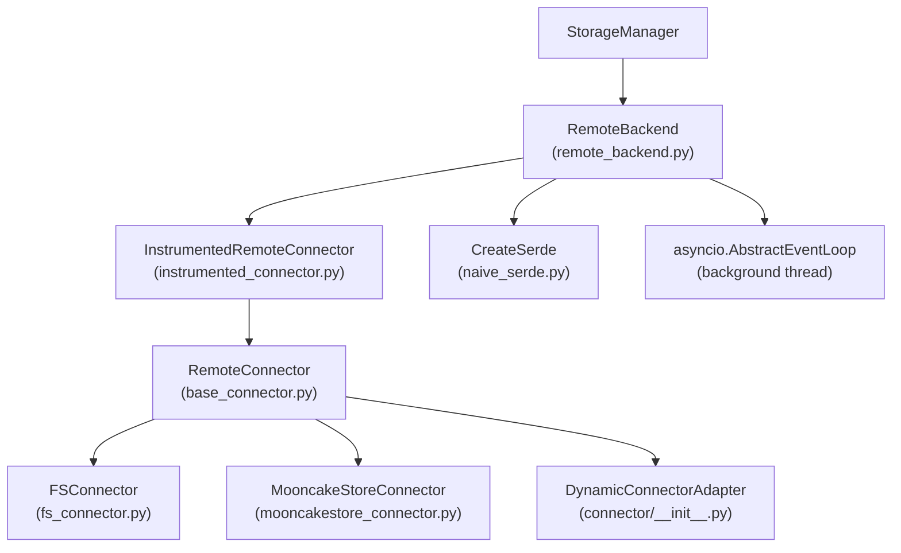
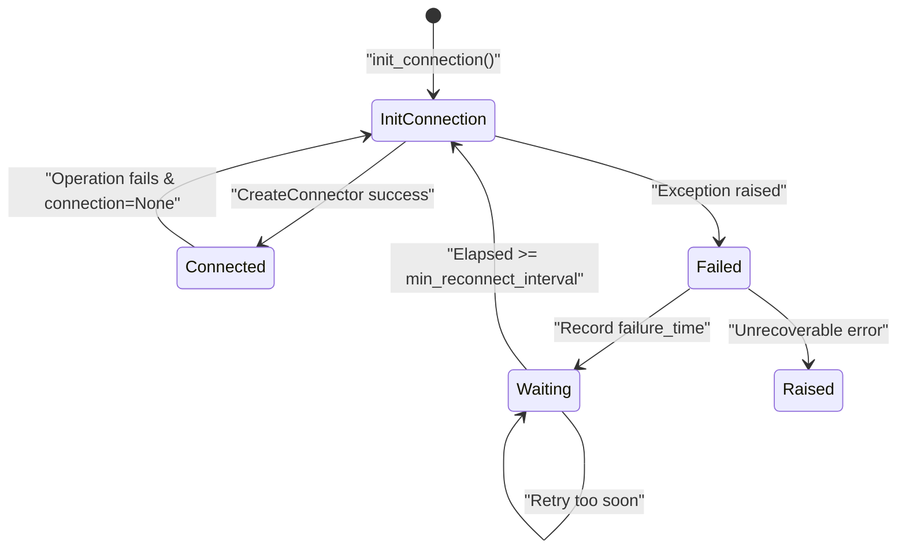
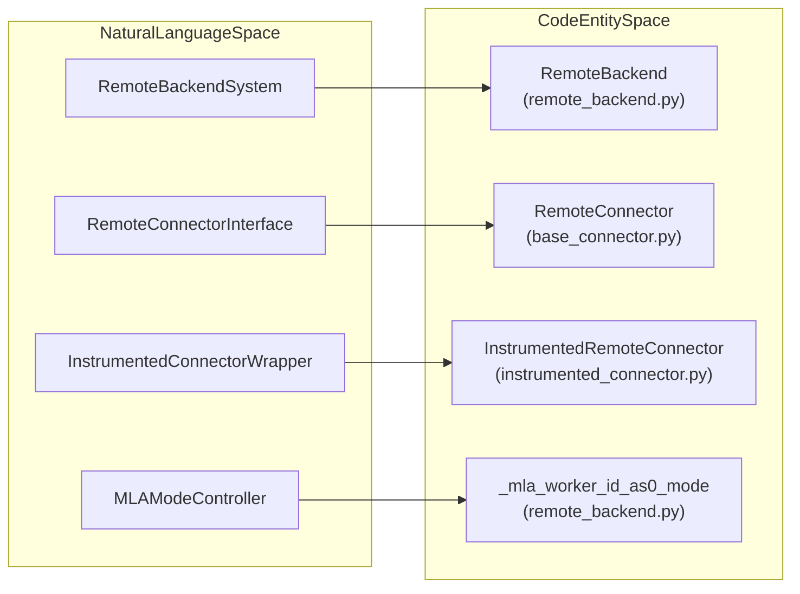
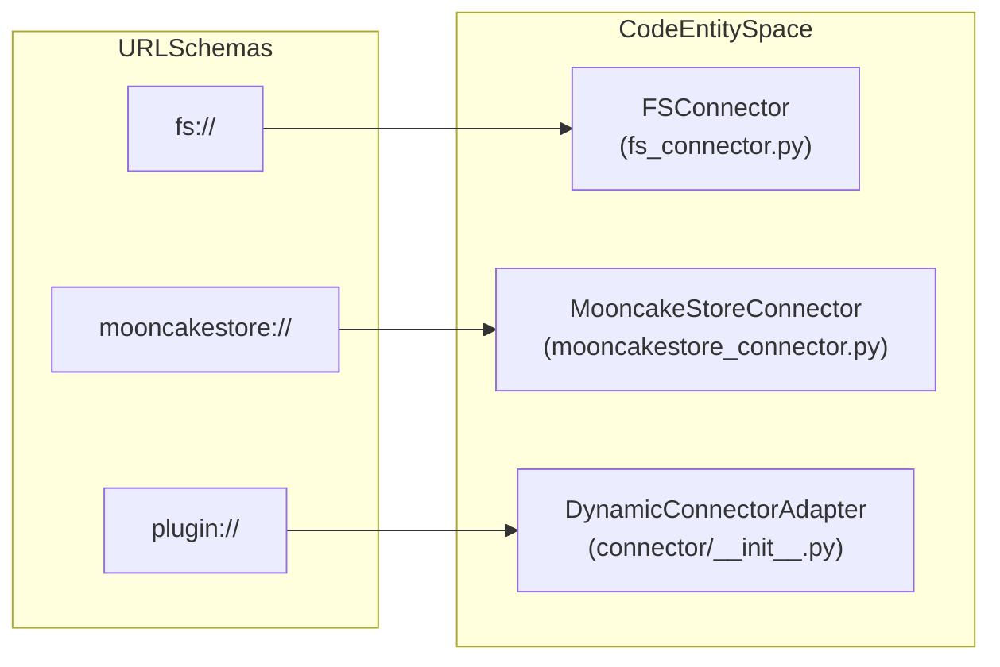

<!-- source: DeepWiki mcp.deepwiki.com · repo LMCache/LMCache · page 4.5 Remote Storage Backend · fetched 2026-10-21 -->

# Remote Storage Backend

<details>
<summary>Relevant source files</summary>

The following files were used as context for generating this wiki page:

- [docs/source/kv_cache/storage_backends/mooncake.rst](docs/source/kv_cache/storage_backends/mooncake.rst)
- [examples/kv_cache_reuse/remote_backends/mooncakestore/README.md](examples/kv_cache_reuse/remote_backends/mooncakestore/README.md)
- [examples/kv_cache_reuse/remote_backends/mooncakestore/mooncake.yaml](examples/kv_cache_reuse/remote_backends/mooncakestore/mooncake.yaml)
- [lmcache/observability.py](lmcache/observability.py)
- [lmcache/v1/memory_management.py](lmcache/v1/memory_management.py)
- [lmcache/v1/storage_backend/__init__.py](lmcache/v1/storage_backend/__init__.py)
- [lmcache/v1/storage_backend/abstract_backend.py](lmcache/v1/storage_backend/abstract_backend.py)
- [lmcache/v1/storage_backend/connector/__init__.py](lmcache/v1/storage_backend/connector/__init__.py)
- [lmcache/v1/storage_backend/connector/audit_connector.py](lmcache/v1/storage_backend/connector/audit_connector.py)
- [lmcache/v1/storage_backend/connector/base_connector.py](lmcache/v1/storage_backend/connector/base_connector.py)
- [lmcache/v1/storage_backend/connector/blackhole_connector.py](lmcache/v1/storage_backend/connector/blackhole_connector.py)
- [lmcache/v1/storage_backend/connector/fs_connector.py](lmcache/v1/storage_backend/connector/fs_connector.py)
- [lmcache/v1/storage_backend/connector/instrumented_connector.py](lmcache/v1/storage_backend/connector/instrumented_connector.py)
- [lmcache/v1/storage_backend/connector/lm_connector.py](lmcache/v1/storage_backend/connector/lm_connector.py)
- [lmcache/v1/storage_backend/connector/mock_connector.py](lmcache/v1/storage_backend/connector/mock_connector.py)
- [lmcache/v1/storage_backend/connector/mooncakestore_connector.py](lmcache/v1/storage_backend/connector/mooncakestore_connector.py)
- [lmcache/v1/storage_backend/local_cpu_backend.py](lmcache/v1/storage_backend/local_cpu_backend.py)
- [lmcache/v1/storage_backend/local_disk_backend.py](lmcache/v1/storage_backend/local_disk_backend.py)
- [lmcache/v1/storage_backend/remote_backend.py](lmcache/v1/storage_backend/remote_backend.py)
- [lmcache/v1/storage_backend/storage_manager.py](lmcache/v1/storage_backend/storage_manager.py)
- [tests/test_observability.py](tests/test_observability.py)
- [tests/v1/storage_backend/test_audit_connector.py](tests/v1/storage_backend/test_audit_connector.py)
- [tests/v1/storage_backend/test_local_cpu_backend.py](tests/v1/storage_backend/test_local_cpu_backend.py)
- [tests/v1/storage_backend/test_local_disk_backend.py](tests/v1/storage_backend/test_local_disk_backend.py)
- [tests/v1/storage_backend/test_storage_manager.py](tests/v1/storage_backend/test_storage_manager.py)
- [tests/v1/test_address_manager.py](tests/v1/test_address_manager.py)
- [tests/v1/test_memory_management.py](tests/v1/test_memory_management.py)

</details>


This page documents the architecture and implementation of the **Remote Storage Backend** in LMCache. The `RemoteBackend` is a core subsystem enabling LMCache to interface with various remote or external storage targets asynchronously, providing scalability, fault isolation, and extensibility across multiple remote storage types.

This page covers:
- The architecture of `RemoteBackend` and its interaction with `RemoteConnector` implementations.
- Connection lifecycle management and reconnection state machine.
- Asynchronous put and synchronous get data flows.
- The connector design pattern, including instrumented and audited wrappers.
- Serialization strategies and protocol metadata structures.
- Multi-Level Attention (MLA) mode handling for distributed worker coordination.

For broader context, see pages [4.1 Storage Backend Interface](), [4.2 Storage Manager](), and [4.8 Storage Connectors]().

---

## Architecture Overview

The `RemoteBackend` class acts as an asynchronous adapter between the LMCache `StorageManager` and one or more `RemoteConnector` implementations `[lmcache/v1/storage_backend/remote_backend.py:27-87]`.

- It runs an `asyncio` event loop on a dedicated background thread, dispatching remote storage operations without blocking inference execution threads.
- Remote operations are submitted as asynchronous coroutines on this event loop.
- `RemoteConnector` `[lmcache/v1/storage_backend/connector/base_connector.py:31-34]()` defines the abstract interface implemented by concrete storage backends such as `FSConnector` `[lmcache/v1/storage_backend/connector/fs_connector.py:24-30]()`, `RESPConnector`, `MooncakeStoreConnector` `[lmcache/v1/storage_backend/connector/mooncakestore_connector.py:18-22]()`, and other remote adapters.

### Component Relationship Diagram for Remote Storage Path



Sources:  
[lmcache/v1/storage_backend/remote_backend.py:27-87](),  
[lmcache/v1/storage_backend/connector/base_connector.py:31-34](),  
[lmcache/v1/storage_backend/connector/fs_connector.py:24-30](),  
[lmcache/v1/storage_backend/connector/mooncakestore_connector.py:18-22](),  
[lmcache/v1/storage_backend/connector/__init__.py:174-212]()

---

## RemoteBackend Initialization

The `RemoteBackend` class initializes connection parameters, background event loops, serialization codecs, and MLA worker settings `[lmcache/v1/storage_backend/remote_backend.py:27-102]`.

| Parameter           | Type                         | Description                                                                 |
|---------------------|------------------------------|-----------------------------------------------------------------------------|
| `config`            | `LMCacheEngineConfig`         | Engine configuration including `remote_url`, `remote_serde`, and extra options|
| `metadata`          | `LMCacheMetadata`             | Model metadata, chunk shapes, dtypes, and MLA flags                         |
| `loop`              | `asyncio.AbstractEventLoop`   | Background event loop for dispatching asynchronous connector operations     |
| `local_cpu_backend` | `Optional[LocalCPUBackend]`   | Local CPU allocator used to allocate `MemoryObj` instances upon retrieval  |
| `plugin_name`       | `Optional[str]`               | Optional plugin instance identifier for dynamic loading                     |

Sources:  
[lmcache/v1/storage_backend/remote_backend.py:27-102]()

---

## Connection Management and Reconnection Logic

The `init_connection()` method manages creating and resetting the remote connection `[lmcache/v1/storage_backend/remote_backend.py:119-162]`.

- It invokes the connector factory to obtain the appropriate `RemoteConnector` instance based on the URL scheme or plugin specification `[lmcache/v1/storage_backend/connector/__init__.py:214-250]`.
- If connection initialization raises an exception, the failure time (`self.failure_time`) is recorded.
- Reconnection attempts are throttled by `min_reconnect_interval` (default 10 seconds) to prevent busy loops during remote service outages.

### Reconnection State Machine



Sources:  
[lmcache/v1/storage_backend/remote_backend.py:119-162](),  
[lmcache/v1/storage_backend/connector/__init__.py:214-250]()

---

## Data Flow: Put Operations to Remote Storage

Remote writes (`put`) are executed asynchronously via non-blocking background tasks `[lmcache/v1/storage_backend/remote_backend.py:210-357]`.

### `submit_put_task` Flow

1. Checks whether `connection` is available and whether MLA worker-0 restriction applies (`_mla_worker_id_as0_mode`).
2. Deduplicates concurrent put requests for the same `CacheEngineKey` using `put_tasks`.
3. Increments the reference count (`memory_obj.ref_count_up()`) to keep the memory object valid during async execution.
4. Submits `connection.put(key, memory_obj)` to the event loop using `asyncio.run_coroutine_threadsafe`.

### Remote Put Sequence Diagram

```mermaid
sequenceDiagram
    participant Caller
    participant RB as "RemoteBackend"
    participant Loop as "asyncio.AbstractEventLoop"
    participant IRC as "InstrumentedRemoteConnector"
    participant RC as "RemoteConnector"

    Caller->>RB: "submit_put_task(key, memory_obj)"
    RB->>RB: "Check MLA & put_tasks duplication"
    RB->>RB: "memory_obj.ref_count_up()"
    RB->>Loop: "run_coroutine_threadsafe(connection.put)"
    Loop->>IRC: "IRC.put(...)"
    IRC->>RC: "RC.put(...)"
    RC-->>IRC: "Await completion"
    IRC->>IRC: "memory_obj.ref_count_down() & metrics"
    IRC-->>Loop: "Done"
    Loop->>RB: "put_callback(future)"
    RB->>RB: "put_tasks.remove(key)"
```

Sources:  
[lmcache/v1/storage_backend/remote_backend.py:210-357](),  
[lmcache/v1/storage_backend/connector/instrumented_connector.py:27-44]()

---

## Data Flow: Get Operations from Remote Storage

Unlike asynchronous puts, `get` operations block the calling thread until data is retrieved or a timeout occurs `[lmcache/v1/storage_backend/remote_backend.py:358-536]`.

- `get_blocking()` submits `connection.get(key)` to the background event loop and blocks on `future.result(config.blocking_timeout_secs)`.
- If MLA mode (`_mla_worker_id_as0_mode`) is active on a non-zero worker rank, the request key is automatically remapped to `worker_id=0`.
- Batched gets utilize `connection.batched_get()` if supported; otherwise, concurrent individual fetches are executed via `asyncio.gather()` `[lmcache/v1/storage_backend/remote_backend.py:450-536]`.

Sources:  
[lmcache/v1/storage_backend/remote_backend.py:358-536]()

---

## Connector Pattern and Implementations

The connector pattern decouples `RemoteBackend` from concrete storage protocols. The abstract base class `RemoteConnector` defines the required interface methods (`put`, `get`, `exists`, `list`, `close`) `[lmcache/v1/storage_backend/connector/base_connector.py:31-183]`.

| Connector Name | Protocol / Backend | Implementation Class |
|---|---|---|
| Filesystem (`fs://`) | Local or NFS file storage | `FSConnector` `[lmcache/v1/storage_backend/connector/fs_connector.py:24-30]()` |
| Redis (`resp://`) | Redis / Valkey RESP protocol | `RESPConnector` |
| Mooncake (`mooncakestore://`) | Distributed memory pool | `MooncakeStoreConnector` `[lmcache/v1/storage_backend/connector/mooncakestore_connector.py:18-22]()` |
| Dynamic Plugins (`plugin://`) | User-defined custom plugins | `DynamicConnectorAdapter` `[lmcache/v1/storage_backend/connector/__init__.py:174-182]()` |

Sources:  
[lmcache/v1/storage_backend/connector/base_connector.py:31-183](),  
[lmcache/v1/storage_backend/connector/fs_connector.py:24-30](),  
[lmcache/v1/storage_backend/connector/mooncakestore_connector.py:18-22](),  
[lmcache/v1/storage_backend/connector/__init__.py:174-182]()

---

## Serialization and Protocol Metadata

Remote storage payloads consist of:
1. A fixed-size binary metadata header encoding tensor shapes, data types, format, and total payload length `[lmcache/v1/protocol.py:163-208]`.
2. The raw serialized tensor bytes.

Connectors utilize metadata serialization utilities to pack and unpack tensor descriptors for wire compatibility.

Sources:  
[lmcache/v1/protocol.py:163-208]()

---

## Multi-Level Attention (MLA) Mode Handling

When Multi-Level Attention (MLA) is enabled (`use_mla=True`) across multiple worker ranks (`world_size > 1`), the remote backend can operate in `_mla_worker_id_as0_mode` `[lmcache/v1/storage_backend/remote_backend.py:75-82]`:

- **Role Partitioning:** Non-zero worker ranks skip remote `put` operations, as worker 0 acts as the canonical data owner.
- **Key Rewriting:** Non-zero worker ranks rewrite cache keys to target `worker_id=0` during `get` operations (`key.with_new_worker_id(0)`), enabling efficient cross-worker cache sharing and reducing storage overhead.

Sources:  
[lmcache/v1/storage_backend/remote_backend.py:75-82](),  
[lmcache/v1/storage_backend/remote_backend.py:168-170](),  
[lmcache/v1/storage_backend/remote_backend.py:239-242](),  
[lmcache/v1/storage_backend/remote_backend.py:372-373]()

---

## Connector Layer and Code Entity Mapping

The following diagrams bridge natural language descriptions to code entities within the LMCache codebase.

### Concept to Code Entity Mapping



Sources:  
[lmcache/v1/storage_backend/remote_backend.py:27-102](),  
[lmcache/v1/storage_backend/connector/base_connector.py:31-34](),  
[lmcache/v1/storage_backend/connector/instrumented_connector.py:16-25]()

### URL Scheme to Connector Class Mapping



Sources:  
[lmcache/v1/storage_backend/connector/fs_connector.py:24-30](),  
[lmcache/v1/storage_backend/connector/mooncakestore_connector.py:18-22](),  
[lmcache/v1/storage_backend/connector/__init__.py:174-182]()

---

## Lifecycle and Cleanup

When the cache engine shuts down, `RemoteBackend.close()` stops background threads and invokes the underlying connector's `close()` method to release network connections and file descriptors cleanly.

Sources:  
[lmcache/v1/storage_backend/remote_backend.py:625]()

---

# Summary

The `RemoteBackend` provides an asynchronous, extensible tier for remote KV cache storage in LMCache. Through the `RemoteConnector` interface, plugin factories, and instrumented wrappers, it supports diverse storage protocols (FS, Redis, Mooncake) while handling serialization and MLA distributed optimizations transparently.

---

