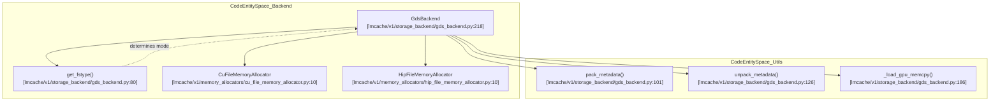
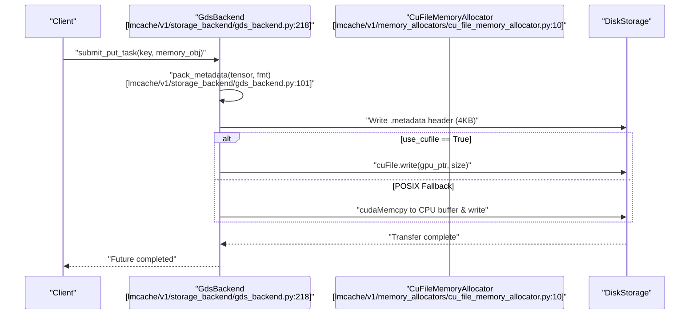

<!-- source: DeepWiki mcp.deepwiki.com · repo LMCache/LMCache · page 4.6 GPU Direct Storage Backend · fetched 2026-10-21 -->

# GPU Direct Storage Backend

Relevant source files

The following files were used as context for generating this wiki page:

- [docs/source/api_reference/configurations.rst](docs/source/api_reference/configurations.rst)
- [docs/source/kv_cache/storage_backends/cpu_ram.rst](docs/source/kv_cache/storage_backends/cpu_ram.rst)
- [docs/source/kv_cache/storage_backends/gds.rst](docs/source/kv_cache/storage_backends/gds.rst)
- [docs/source/kv_cache/storage_backends/local_storage.rst](docs/source/kv_cache/storage_backends/local_storage.rst)
- [docs/source/kv_cache/storage_backends/redis.rst](docs/source/kv_cache/storage_backends/redis.rst)
- [docs/source/kv_cache/storage_backends/weka.rst](docs/source/kv_cache/storage_backends/weka.rst)
- [lmcache/v1/gpu_connector/gds_backends/mufile.py](lmcache/v1/gpu_connector/gds_backends/mufile.py)
- [lmcache/v1/gpu_connector/gds_context.py](lmcache/v1/gpu_connector/gds_context.py)
- [lmcache/v1/platform/devices/musa/cache_context.py](lmcache/v1/platform/devices/musa/cache_context.py)
- [lmcache/v1/storage_backend/gds_backend.py](lmcache/v1/storage_backend/gds_backend.py)
- [tests/v1/data/gds.yaml](tests/v1/data/gds.yaml)
- [tests/v1/data/hipfile.yaml](tests/v1/data/hipfile.yaml)
- [tests/v1/data/hipfile_gds.yaml](tests/v1/data/hipfile_gds.yaml)
- [tests/v1/gpu_connector/gds_backends/test_mufile.py](tests/v1/gpu_connector/gds_backends/test_mufile.py)
- [tests/v1/gpu_connector/test_gds_context.py](tests/v1/gpu_connector/test_gds_context.py)
- [tests/v1/platform/devices/musa/test_musa_cache_context.py](tests/v1/platform/devices/musa/test_musa_cache_context.py)
- [tests/v1/storage_backend/test_gds_backend.py](tests/v1/storage_backend/test_gds_backend.py)
- [tests/v1/test_cache_engine.py](tests/v1/test_cache_engine.py)
- [tests/v1/test_gds.py](tests/v1/test_gds.py)

## Purpose and Scope

The GPU Direct Storage (GDS) backend in LMCache enables zero-copy data transfers directly between GPU memory and storage systems, bypassing host CPU memory and kernel page cache layers. It supports NVIDIA's `cuFile` API, AMD's `hipFile` API, and specialized storage environments. 

This page covers the implementation details of `GdsBackend`, `CuFileMemoryAllocator`, `cuFile` read/write operations, and the distinct operational modes: standard GDS, GDS_MT (multithreaded for filesystems like WekaFS), and POSIX fallback mode.

For foundational storage concepts, see [Storage Architecture](). For details on allocator design, see [Memory Management]().

Sources: `[lmcache/v1/storage_backend/gds_backend.py:218-250]()`, `[docs/source/kv_cache/storage_backends/gds.rst:1-20]()`

---

## Architecture Overview

The `GdsBackend` coordinates direct I/O by interacting with specialized GPU memory allocators and executing asynchronous read/write tasks. It inspects filesystem types to determine whether native GDS operations or fallback pathways should be invoked.

### System Architecture and Code Entities

Sources: `[lmcache/v1/storage_backend/gds_backend.py:80-218]()`, `[lmcache/v1/memory_allocators/cu_file_memory_allocator.py:10]()`, `[lmcache/v1/memory_allocators/hip_file_memory_allocator.py:10]()`

---

## GdsBackend Class and Operational Modes

`GdsBackend` inherits from `AllocatorBackendInterface` `[lmcache/v1/storage_backend/gds_backend.py:218]()`. Upon initialization, it inspects the filesystem type via `get_fstype()` `[lmcache/v1/storage_backend/gds_backend.py:80]()` to configure its execution modes:

- **GDS Mode**: Enabled when `cuFile` or `hipFile` libraries are available and the filesystem supports direct block/character I/O. Data transfers are performed via direct GPU-to-storage DMA.
- **GDS_MT Mode**: Activated on distributed high-performance filesystems such as WekaFS (`wekafs`) `[lmcache/v1/storage_backend/gds_backend.py:48]()`. It employs a `ThreadPoolExecutor` `[lmcache/v1/storage_backend/gds_backend.py:4]()` combined with `cuFile` operations and a `.weka1` data file suffix `[lmcache/v1/storage_backend/gds_backend.py:48]()` to achieve high parallelism.
- **POSIX Fallback Mode**: Used when `cuFile` or `hipFile` cannot be loaded or when operating on filesystems like `tmpfs` or `overlayfs`. It loads the GPU runtime `memcpy` symbol via `_load_gpu_memcpy()` `[lmcache/v1/storage_backend/gds_backend.py:186]()` to stage data through host memory.

Sources: `[lmcache/v1/storage_backend/gds_backend.py:80-250]()`

---

## CuFileMemoryAllocator and cuFile Operations

`CuFileMemoryAllocator` manages page-aligned GPU memory buffers required by the cuFile driver for direct I/O execution.

### Data Flow for Put Operations

Sources: `[lmcache/v1/storage_backend/gds_backend.py:101-124]()`, `[lmcache/v1/storage_backend/gds_backend.py:218-250]()`, `[lmcache/v1/memory_allocators/cu_file_memory_allocator.py:10]()`

---

## Metadata Management

KV cache objects stored via `GdsBackend` consist of a metadata sidecar file (`.metadata`) and a primary data file (`.kvcache.safetensors` or `.weka1`) `[lmcache/v1/storage_backend/gds_backend.py:46-48]()`. 

- `pack_metadata()` serializes tensor shape, dtype, data offsets, and memory format into a 4096-byte fixed-size buffer prefixed with an 8-byte length header `[lmcache/v1/storage_backend/gds_backend.py:101-124]()`.
- `unpack_metadata()` parses the binary buffer back into tensor metadata attributes `[lmcache/v1/storage_backend/gds_backend.py:126-144]()`.

Sources: `[lmcache/v1/storage_backend/gds_backend.py:46-144]()`

---

## Multi-Path and Thread Pool Configuration

To maximize throughput across multiple NVMe drives or high-performance mount points, `GdsBackend` supports multi-path sharding and parallel disk I/O:

- **Disk I/O Thread Pool**: Managed via a `ThreadPoolExecutor` where worker count is controlled by `extra_config.disk_io_threads` (default: 4) `[docs/source/kv_cache/storage_backends/gds.rst:61-70]()`.
- **Multi-Path Sharding**: Configured by providing a comma-separated list of paths in `gds_path` and setting `gds_path_sharding="by_gpu"`. Each GPU worker maps its write path via `device_id % num_paths`, while startup reads scan all configured paths `[docs/source/kv_cache/storage_backends/gds.rst:91-147]()`.

Sources: `[docs/source/kv_cache/storage_backends/gds.rst:61-147]()`

---

