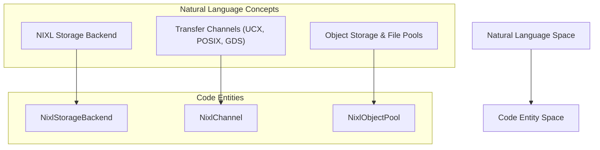
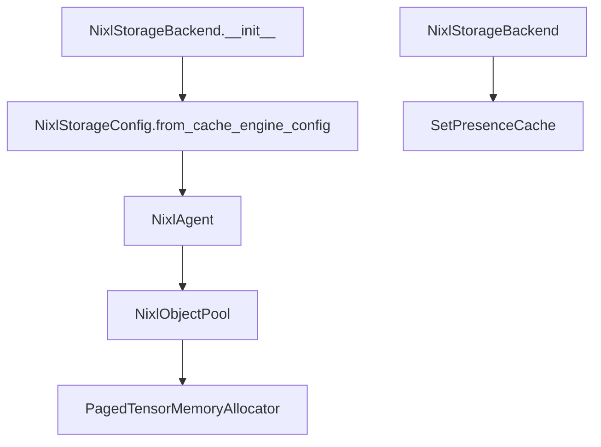
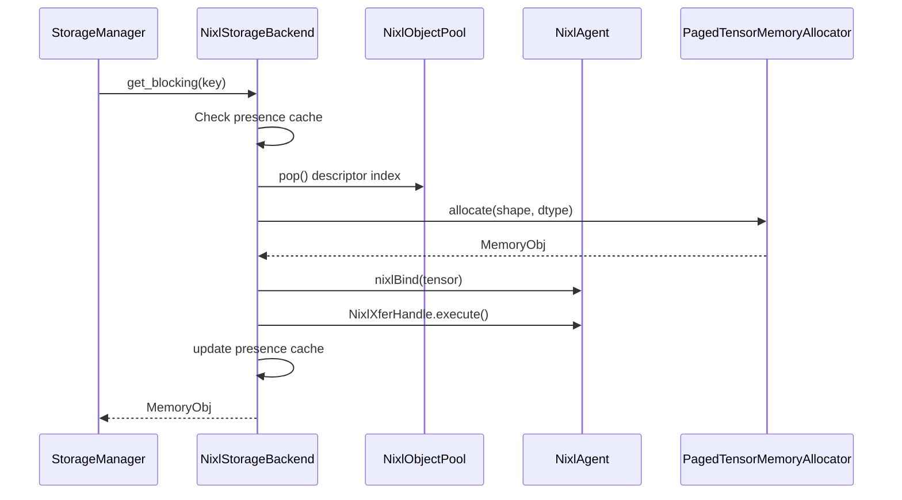

<!-- source: DeepWiki mcp.deepwiki.com · repo LMCache/LMCache · page 4.7 NIXL Storage Backend · fetched 2026-10-21 -->

# NIXL Storage Backend

Relevant source files

The following files were used as context for generating this wiki page:

- [docs/source/kv_cache/storage_backends/nixl.rst](docs/source/kv_cache/storage_backends/nixl.rst)
- [lmcache/v1/storage_backend/nixl_storage_backend.py](lmcache/v1/storage_backend/nixl_storage_backend.py)
- [tests/disagg/README.md](tests/disagg/README.md)
- [tests/disagg/test_nixl_cache_engine.py](tests/disagg/test_nixl_cache_engine.py)
- [tests/disagg/test_nixl_channel.py](tests/disagg/test_nixl_channel.py)
- [tests/disagg/test_nixl_storage_backend.py](tests/disagg/test_nixl_storage_backend.py)
- [tests/v1/data/nixl.yaml](tests/v1/data/nixl.yaml)
- [tests/v1/data/nixl_multipath.yaml](tests/v1/data/nixl_multipath.yaml)
- [tests/v1/storage_backend/test_fs_connector.py](tests/v1/storage_backend/test_fs_connector.py)
- [tests/v1/test_nixl_batched_contains.py](tests/v1/test_nixl_batched_contains.py)
- [tests/v1/test_nixl_doca_memos.py](tests/v1/test_nixl_doca_memos.py)
- [tests/v1/test_nixl_multipath.py](tests/v1/test_nixl_multipath.py)
- [tests/v1/test_nixl_put_refcount.py](tests/v1/test_nixl_put_refcount.py)
- [tests/v1/test_nixl_storage.py](tests/v1/test_nixl_storage.py)
- [tests/v1/test_remote_mla_worker_id_as0.py](tests/v1/test_remote_mla_worker_id_as0.py)

## Purpose and Scope

This page documents the **NIXL Storage Backend** (`NixlStorageBackend`) in LMCache, which leverages the NIXL (NVIDIA Inference Xfer Library) for high-performance transfer and storage of key-value cache data [docs/source/kv_cache/storage_backends/nixl.rst:10-15](), [lmcache/v1/storage_backend/nixl_storage_backend.py:40-60](). NIXL is a specialized library designed for accelerating point-to-point communications in AI inference pipelines, abstracting over various memory types (CPU, GPU) and storage backends with modular plugins. LMCache supports multiple NIXL backends including POSIX filesystems, NVIDIA GPU Direct Storage (GDS), and Object Storage (OBJ) [docs/source/kv_cache/storage_backends/nixl.rst:10-15](), [lmcache/v1/storage_backend/nixl_storage_backend.py:40-60]().

The backend enables efficient saving/loading of KV cache chunks, supports asynchronous operations, multi-path sharding, and integrates with LMCache’s memory allocators and cache management, offering a robust, high-throughput offload layer.

Sources: [docs/source/kv_cache/storage_backends/nixl.rst:10-15](), [lmcache/v1/storage_backend/nixl_storage_backend.py:40-60]()

---

## Overview and Transfer Channels

`NixlStorageBackend` is a storage backend tailored for LMCache to provide accelerated storage I/O for KV cache chunks via NIXL. It implements the `AllocatorBackendInterface` and interacts with:

- **NIXL Agent**: The core C++ API interface from the `nixl` Python bindings instantiating a storage agent (`NixlAgent`, `NixlDynamicStorageAgent`) [lmcache/v1/storage_backend/nixl_storage_backend.py:40-60](), [lmcache/v1/storage_backend/nixl_storage_backend.py:105-134]().
- **Descriptor Pools**: Descriptor pools (`NixlObjectPool`) that manage preallocated storage slots or descriptors to back object storage or files [lmcache/v1/storage_backend/nixl_storage_backend.py:244-306]().
- **Memory Allocator**: Typically `PagedTensorMemoryAllocator` or `MixedMemoryAllocator` for pinned host or GPU memory registration [lmcache/v1/storage_backend/nixl_storage_backend.py:69-72]().
- **Presence Cache**: Optional thread-safe DRAM cache to accelerate existence checks [docs/source/kv_cache/storage_backends/nixl.rst:72-78]().

The backend supports multiple concrete storage backends and transfer channels (such as **UCX**, **POSIX**, and **GDS**):
- **UCX**: Used in transfer channels (`NixlChannel`) for network-based communication and peer-to-peer data transfers [tests/disagg/test_nixl_channel.py:129-138]().
- **POSIX**: File-based storage backed by OS filesystem, supporting optional direct I/O [docs/source/kv_cache/storage_backends/nixl.rst:40-46]().
- **GDS / GDS_MT**: NVIDIA GPU Direct Storage with single-threaded or multithreaded modes [docs/source/kv_cache/storage_backends/nixl.rst:56-82]().
- **OBJ**: Object storage via S3-compatible APIs; supports dynamic storage mode and endpoint lists [docs/source/kv_cache/storage_backends/nixl.rst:80-120](), [tests/disagg/test_nixl_storage_backend.py:170-184]().

**Diagram: Mapping Natural Language Concepts to Code Entities**

Sources: [lmcache/v1/storage_backend/nixl_storage_backend.py:40-306](), [docs/source/kv_cache/storage_backends/nixl.rst:10-82](), [tests/disagg/test_nixl_channel.py:129-138]()

---

## Configuration (`nixl_backends`)

### NixlStorageConfig

The backend configuration is encapsulated by `NixlStorageConfig` which is constructed from the overall `LMCacheEngineConfig` and `LMCacheMetadata` via `NixlStorageConfig.from_cache_engine_config` [lmcache/v1/storage_backend/nixl_storage_backend.py:135-188](). It validates devices and options using `NixlStorageConfig.validate_nixl_backend` [lmcache/v1/storage_backend/nixl_storage_backend.py:154-162]():

| Parameter             | Description                                                                                                                    |
|-----------------------|--------------------------------------------------------------------------------------------------------------------------------|
| `buffer_size`         | NIXL buffer size for data transfer (only relevant in GPU mode; zero in CPU mode) [docs/source/kv_cache/storage_backends/nixl.rst:49-51]() |
| `buffer_device`       | Device string for the buffer memory, e.g., `"cpu"` or `"cuda:0"` [lmcache/v1/storage_backend/nixl_storage_backend.py:137-140]() |
| `pool_size`           | Number of precreated transfer descriptors; set to 0 for dynamic descriptor creation [docs/source/kv_cache/storage_backends/nixl.rst:53-54]() |
| `backend`             | NIXL backend type, e.g., `"POSIX"`, `"GDS"`, `"OBJ"` [docs/source/kv_cache/storage_backends/nixl.rst:59-60]() |
| `backend_params`      | Dict of backend-specific parameters such as S3 credentials for the OBJ backend [docs/source/kv_cache/storage_backends/nixl.rst:84-85]() |
| `dynamic_storage`     | Boolean indicating if dynamic mode is enabled (`pool_size == 0`) [lmcache/v1/storage_backend/nixl_storage_backend.py:142-152]() |
| `enable_presence_cache` | Whether to maintain a presence cache in DRAM to accelerate existence checks [docs/source/kv_cache/storage_backends/nixl.rst:72-73]() |
| `enable_async_put`    | Whether `put` operations should be performed asynchronously [lmcache/v1/storage_backend/nixl_storage_backend.py:144-144]() |
| `use_direct_io`       | Whether to open files with `O_DIRECT` in POSIX backend [docs/source/kv_cache/storage_backends/nixl.rst:45-45]() |
| `path`                | Storage root path or list of paths for multi-path sharding [docs/source/kv_cache/storage_backends/nixl.rst:55-56]() |
| `use_hugepages`       | Use Linux Hugepages for pinned buffer (requires pre-allocation in OS) [docs/source/kv_cache/storage_backends/nixl.rst:62-62]() |
| `presence_cache_only` | If true, `contains` queries only check the local presence cache, no remote query [docs/source/kv_cache/storage_backends/nixl.rst:74-75]() |
| `path_sharding`       | Strategy for path selection across multiple roots (e.g., `"by_gpu"`) [docs/source/kv_cache/storage_backends/nixl.rst:61-61]() |

Sources: [lmcache/v1/storage_backend/nixl_storage_backend.py:135-188](), [docs/source/kv_cache/storage_backends/nixl.rst:40-80]()

---

## Architecture and Initialization Flow

### Backend Initialization Flow

Upon creation, `NixlStorageBackend` converts the engine configuration into `NixlStorageConfig`, initializes a `NixlAgent` instance, configures the descriptor pools, and hooks up the memory allocators [lmcache/v1/storage_backend/nixl_storage_backend.py:360-480]().

**Diagram: NixlStorageBackend Initialization Sequence**

Sources: [lmcache/v1/storage_backend/nixl_storage_backend.py:360-480](), [docs/source/kv_cache/storage_backends/nixl.rst:40-80]()

---

## Backend Interface Implementation and Data Flow

### Key Methods in `NixlStorageBackend`

- **`batched_submit_put_task(keys, memory_objs)`**: Submits multiple KV cache chunks asynchronously or synchronously for storage based on `enable_async_put` [lmcache/v1/storage_backend/nixl_storage_backend.py:655-685]().
- **`get_blocking(key)`**: Retrieves a single block synchronously by allocating destination tensors, binding them via NIXL handles, and executing the transfer [lmcache/v1/storage_backend/nixl_storage_backend.py:687-740]().
- **`contains(key, pin=False)`**: Checks existence via local presence cache or remote NIXL query depending on configuration flags [lmcache/v1/storage_backend/nixl_storage_backend.py:600-619]().

**Diagram: GET Operation Data Flow**

Sources: [lmcache/v1/storage_backend/nixl_storage_backend.py:338-358](), [lmcache/v1/storage_backend/nixl_storage_backend.py:687-740]()

---

## Transfer Channels (`NixlChannel`)

The `NixlChannel` class is utilized in P2P and disaggregated prefill workflows to send and receive KV data via UCX or POSIX transfer channels [tests/disagg/test_nixl_channel.py:129-138](). It manages agent wrappers, executes a two-step metadata and descriptor handshake, and handles batched tensor transfers via `batched_send` and `batched_recv` [tests/disagg/test_nixl_channel.py:129-185]().

Sources: [tests/disagg/test_nixl_channel.py:129-185]()

---

