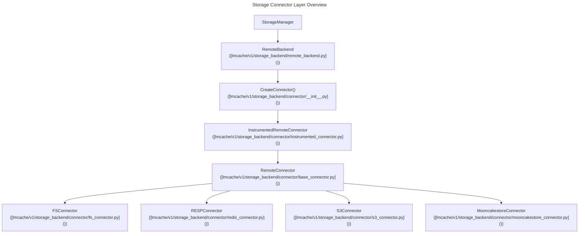
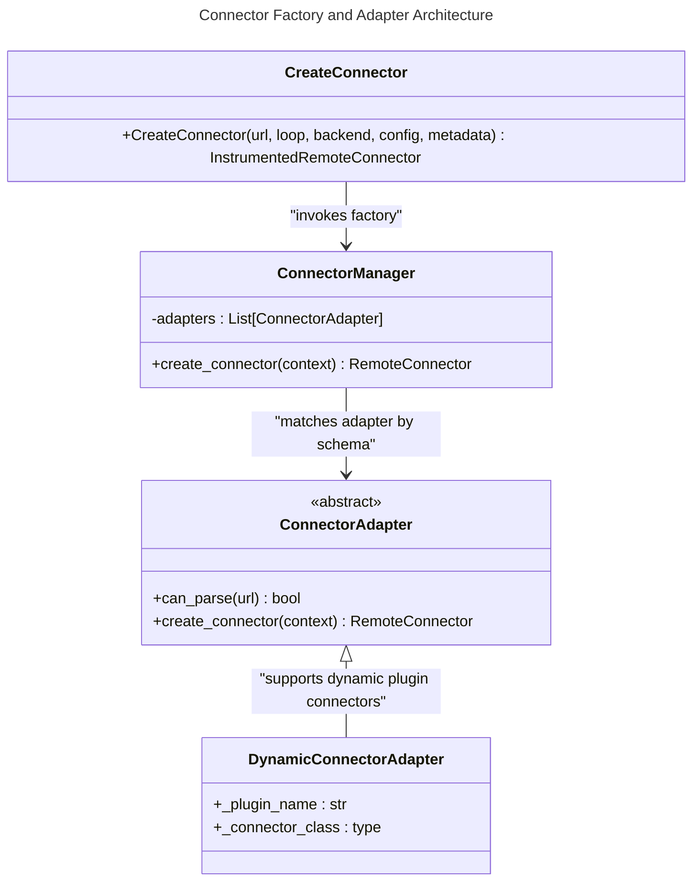

<!-- source: DeepWiki mcp.deepwiki.com · repo LMCache/LMCache · page 4.8 Storage Connectors · fetched 2026-10-21 -->

# Storage Connectors

Relevant source files

The following files were used as context for generating this wiki page:

- [.github/workflows/azure_integration.yml](.github/workflows/azure_integration.yml)
- [docs/source/kv_cache/storage_backends/azure.rst](docs/source/kv_cache/storage_backends/azure.rst)
- [docs/source/kv_cache/storage_backends/mock.rst](docs/source/kv_cache/storage_backends/mock.rst)
- [docs/source/kv_cache/storage_backends/mooncake.rst](docs/source/kv_cache/storage_backends/mooncake.rst)
- [docs/source/kv_cache/storage_backends/sagemaker_hyperpod.rst](docs/source/kv_cache/storage_backends/sagemaker_hyperpod.rst)
- [docs/source/kv_cache/storage_backends/valkey.rst](docs/source/kv_cache/storage_backends/valkey.rst)
- [examples/kv_cache_reuse/remote_backends/mooncakestore/README.md](examples/kv_cache_reuse/remote_backends/mooncakestore/README.md)
- [examples/kv_cache_reuse/remote_backends/mooncakestore/mooncake.yaml](examples/kv_cache_reuse/remote_backends/mooncakestore/mooncake.yaml)
- [examples/kv_cache_reuse/remote_backends/s3/README.md](examples/kv_cache_reuse/remote_backends/s3/README.md)
- [examples/kv_cache_reuse/remote_backends/s3/example.yaml](examples/kv_cache_reuse/remote_backends/s3/example.yaml)
- [examples/kv_cache_reuse/remote_backends/valkey/VALKEY_CONNECTOR_BENCHMARKING.md](examples/kv_cache_reuse/remote_backends/valkey/VALKEY_CONNECTOR_BENCHMARKING.md)
- [examples/kv_cache_reuse/remote_backends/valkey/benchmark_l2.py](examples/kv_cache_reuse/remote_backends/valkey/benchmark_l2.py)
- [examples/kv_cache_reuse/remote_backends/valkey/valkey.yaml](examples/kv_cache_reuse/remote_backends/valkey/valkey.yaml)
- [lmcache/v1/storage_backend/connector/__init__.py](lmcache/v1/storage_backend/connector/__init__.py)
- [lmcache/v1/storage_backend/connector/audit_adapter.py](lmcache/v1/storage_backend/connector/audit_adapter.py)
- [lmcache/v1/storage_backend/connector/audit_connector.py](lmcache/v1/storage_backend/connector/audit_connector.py)
- [lmcache/v1/storage_backend/connector/azure_adapter.py](lmcache/v1/storage_backend/connector/azure_adapter.py)
- [lmcache/v1/storage_backend/connector/azure_connector.py](lmcache/v1/storage_backend/connector/azure_connector.py)
- [lmcache/v1/storage_backend/connector/base_connector.py](lmcache/v1/storage_backend/connector/base_connector.py)
- [lmcache/v1/storage_backend/connector/blackhole_adapter.py](lmcache/v1/storage_backend/connector/blackhole_adapter.py)
- [lmcache/v1/storage_backend/connector/blackhole_connector.py](lmcache/v1/storage_backend/connector/blackhole_connector.py)
- [lmcache/v1/storage_backend/connector/eic_adapter.py](lmcache/v1/storage_backend/connector/eic_adapter.py)
- [lmcache/v1/storage_backend/connector/eic_connector.py](lmcache/v1/storage_backend/connector/eic_connector.py)
- [lmcache/v1/storage_backend/connector/external_adapter.py](lmcache/v1/storage_backend/connector/external_adapter.py)
- [lmcache/v1/storage_backend/connector/fs_adapter.py](lmcache/v1/storage_backend/connector/fs_adapter.py)
- [lmcache/v1/storage_backend/connector/fs_connector.py](lmcache/v1/storage_backend/connector/fs_connector.py)
- [lmcache/v1/storage_backend/connector/infinistore_adapter.py](lmcache/v1/storage_backend/connector/infinistore_adapter.py)
- [lmcache/v1/storage_backend/connector/infinistore_connector.py](lmcache/v1/storage_backend/connector/infinistore_connector.py)
- [lmcache/v1/storage_backend/connector/instrumented_connector.py](lmcache/v1/storage_backend/connector/instrumented_connector.py)
- [lmcache/v1/storage_backend/connector/lm_adapter.py](lmcache/v1/storage_backend/connector/lm_adapter.py)
- [lmcache/v1/storage_backend/connector/lm_connector.py](lmcache/v1/storage_backend/connector/lm_connector.py)
- [lmcache/v1/storage_backend/connector/mock_adapter.py](lmcache/v1/storage_backend/connector/mock_adapter.py)
- [lmcache/v1/storage_backend/connector/mock_connector.py](lmcache/v1/storage_backend/connector/mock_connector.py)
- [lmcache/v1/storage_backend/connector/mooncakestore_adapter.py](lmcache/v1/storage_backend/connector/mooncakestore_adapter.py)
- [lmcache/v1/storage_backend/connector/mooncakestore_connector.py](lmcache/v1/storage_backend/connector/mooncakestore_connector.py)
- [lmcache/v1/storage_backend/connector/redis_adapter.py](lmcache/v1/storage_backend/connector/redis_adapter.py)
- [lmcache/v1/storage_backend/connector/redis_connector.py](lmcache/v1/storage_backend/connector/redis_connector.py)
- [lmcache/v1/storage_backend/connector/s3_adapter.py](lmcache/v1/storage_backend/connector/s3_adapter.py)
- [lmcache/v1/storage_backend/connector/s3_connector.py](lmcache/v1/storage_backend/connector/s3_connector.py)
- [lmcache/v1/storage_backend/connector/sagemaker_hyperpod_adapter.py](lmcache/v1/storage_backend/connector/sagemaker_hyperpod_adapter.py)
- [lmcache/v1/storage_backend/connector/sagemaker_hyperpod_connector.py](lmcache/v1/storage_backend/connector/sagemaker_hyperpod_connector.py)
- [lmcache/v1/storage_backend/connector/valkey_adapter.py](lmcache/v1/storage_backend/connector/valkey_adapter.py)
- [lmcache/v1/storage_backend/connector/valkey_connector.py](lmcache/v1/storage_backend/connector/valkey_connector.py)
- [tests/conftest.py](tests/conftest.py)
- [tests/v1/storage_backend/test_audit_connector.py](tests/v1/storage_backend/test_audit_connector.py)
- [tests/v1/storage_backend/test_azure_connector.py](tests/v1/storage_backend/test_azure_connector.py)
- [tests/v1/storage_backend/test_azure_connector_azurite.py](tests/v1/storage_backend/test_azure_connector_azurite.py)
- [tests/v1/storage_backend/test_eic.py](tests/v1/storage_backend/test_eic.py)
- [tests/v1/storage_backend/test_valkey_connector.py](tests/v1/storage_backend/test_valkey_connector.py)
- [tests/v1/test_connector.py](tests/v1/test_connector.py)
- [tests/v1/test_staging_buffer.py](tests/v1/test_staging_buffer.py)

## Purpose and Scope
This page details the storage connector layer in LMCache, which bridges abstract cache operations (`put`, `get`, `exists`) on memory objects (`MemoryObj`) with concrete remote storage backend protocols. Storage connectors enable LMCache to support a wide variety of remote storage backends including filesystems, Redis, Valkey, Amazon S3, Mooncake, SageMaker HyperPod, EIC, Azure Blob Storage, HFBucket, and Bigtable. 

As a PARENT page, this document outlines the core interface contract, factory instantiation, plugin architecture, and backend implementations at a high level. Detailed operational and configuration info on connector wrappers, instrumentation, and auditing decorators are covered separately in [Connector Wrappers and Instrumentation](#4.8.1).

---

## Role in the Storage Stack

At a system level, remote storage backends interact exclusively via the `RemoteConnector` interface to perform persistence operations [lmcache/v1/storage_backend/connector/__init__.py:214-423](). The connector handles remote key existence checking, synchronous and asynchronous get/put, batch operations, and key listing.

Sources: [lmcache/v1/storage_backend/connector/__init__.py:214-423](), [lmcache/v1/storage_backend/connector/base_connector.py:31-35]()

---

## `RemoteConnector` Base Interface

All connector implementations inherit from the abstract base class `RemoteConnector` [lmcache/v1/storage_backend/connector/base_connector.py:31-183](). This interface defines the contract for remote key-value store backends:

- **Asynchronous Methods:**
  - `exists(key: CacheEngineKey) -> bool` – Asynchronously check if the key exists remotely.
  - `get(key: CacheEngineKey) -> Optional[MemoryObj]` – Asynchronously retrieve the data for a given key.
  - `put(key: CacheEngineKey, memory_obj: MemoryObj)` – Asynchronously store data associated with a key.
  - `list() -> List[str]` – Asynchronously list all keys available.

- **Synchronous Methods:**
  - `exists_sync(key: CacheEngineKey) -> bool` – Synchronous key existence check.

- **Additional Utilities:**
  - `reshape_partial_chunk()` helper to reshape memory objects for partial token chunks (non-full chunk transfers).
  - Support for batch operations (`batched_get`, `batched_put`, `batched_contains`, `batched_async_contains`) to improve throughput for capable backends.

Sources: [lmcache/v1/storage_backend/connector/base_connector.py:31-183]()

---

## Connector Discovery, Factory, and Plugin Architecture

The `CreateConnector` factory method initializes connector instances by matching the remote URL’s scheme to registered `ConnectorAdapter` instances [lmcache/v1/storage_backend/connector/__init__.py:157-213](). The architecture supports:

- **Static Adapter Registry:** Built-in adapters for common protocols (e.g., `redis://`, `fs://`, `s3://`).
- **Dynamic Plugin Adapters:** Custom connector classes can be dynamically loaded at runtime from user-supplied plugin configurations via `DynamicConnectorAdapter`.

Sources: [lmcache/v1/storage_backend/connector/__init__.py:157-213]()

---

## Remote Connector Implementations

LMCache provides a broad suite of built-in `RemoteConnector` implementations tailored to specific storage engines and protocols:

| Connector Class | Storage Type | Description |
|-----------------|--------------|-------------|
| `FSConnector` | Filesystem | Stores each key as a separate file on a local or networked filesystem [lmcache/v1/storage_backend/connector/fs_connector.py:24-30](). Employs atomic write semantics and optional `O_DIRECT` I/O optimizations [lmcache/v1/storage_backend/connector/fs_connector.py:100-120](). |
| `RESPConnector` | Redis (native RESP) | Uses a native `RESPClient` protocol client for Redis caches with zero-copy buffer techniques and priority job queues [lmcache/v1/storage_backend/connector/redis_connector.py:38-64](). |
| `RedisConnector` | Redis | Implements standard Redis connectivity, supporting URLs like `redis://`, `rediss://`, Unix sockets, and cluster modes [lmcache/v1/storage_backend/connector/redis_adapter.py:76-111](). |
| `ValkeyConnector` | Valkey/Glide | High-throughput distributed KV store adapter using GLIDE sync client and thread pools [tests/conftest.py:168-194](). |
| `S3Connector` | Amazon S3 | Connects to S3-compatible object stores using AWS CRT, with zero-copy upload via `MemoryViewStream` [lmcache/v1/storage_backend/connector/s3_connector.py:33-68](). |
| `MooncakestoreConnector` | Mooncake distributed store | Integrates with Mooncake’s distributed storage, supporting both new dict-based and legacy positional setup [lmcache/v1/storage_backend/connector/mooncakestore_connector.py:67-117](). |
| `SageMakerHyperPodConnector` | SageMaker HyperPod | Interfaces with SageMaker's specialized cache backend via shared memory and HTTP lease control. |
| `EICConnector` | EIC Storage | Connects to EIC storage backend. |
| `AzureConnector` | Azure Blob Storage | Azure-specific blob store connector supporting standard operations. |
| `HFBucketConnector` | Hugging Face Hub | Connects to Hugging Face cache storage. |
| `BigtableConnector` | Google Bigtable | Connects to Bigtable distributed storage. |

Sources:  
- [lmcache/v1/storage_backend/connector/fs_connector.py:24-182]()  
- [lmcache/v1/storage_backend/connector/redis_connector.py:38-203]()  
- [lmcache/v1/storage_backend/connector/s3_connector.py:33-68]()  
- [lmcache/v1/storage_backend/connector/mooncakestore_connector.py:67-117]()  

---

## Connector Wrappers and Instrumentation

All connectors created by the factory are by default wrapped inside an `InstrumentedRemoteConnector` decorator [lmcache/v1/storage_backend/connector/instrumented_connector.py:16-25](). This wrapper tracks detailed operation metrics including latency, throughput, and batch operation stats [lmcache/v1/storage_backend/connector/instrumented_connector.py:27-172](). 

For advanced auditing, metric collection, and decorator patterns, see the child page [Connector Wrappers and Instrumentation](#4.8.1).

Sources: [lmcache/v1/storage_backend/connector/instrumented_connector.py:16-193]()

---

## Summary

The Storage Connector layer in LMCache abstracts remote key-value storage behind a unified interface (`RemoteConnector`), allowing flexible integration with filesystems, cloud object stores, and high-performance KV stores through a robust factory and plugin architecture.

For detailed information and usage patterns on connector instrumentation and auditing decorators, please see the child page [Connector Wrappers and Instrumentation](#4.8.1).

---

## References

- Connector base and factory implementation: [lmcache/v1/storage_backend/connector/__init__.py:157-213]()  
- `RemoteConnector` interface and helpers: [lmcache/v1/storage_backend/connector/base_connector.py:31-183]()  
- Instrumented connector wrapper: [lmcache/v1/storage_backend/connector/instrumented_connector.py:16-193]()  
- Filesystem connector: [lmcache/v1/storage_backend/connector/fs_connector.py:24-182]()  
- Redis and RESP connectors: [lmcache/v1/storage_backend/connector/redis_connector.py:38-203]()  
- S3 connector: [lmcache/v1/storage_backend/connector/s3_connector.py:33-68]()  
- Mooncake connector and config: [lmcache/v1/storage_backend/connector/mooncakestore_connector.py:67-117]()

---

