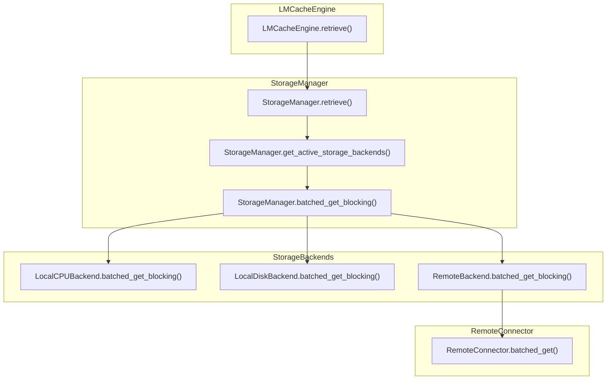
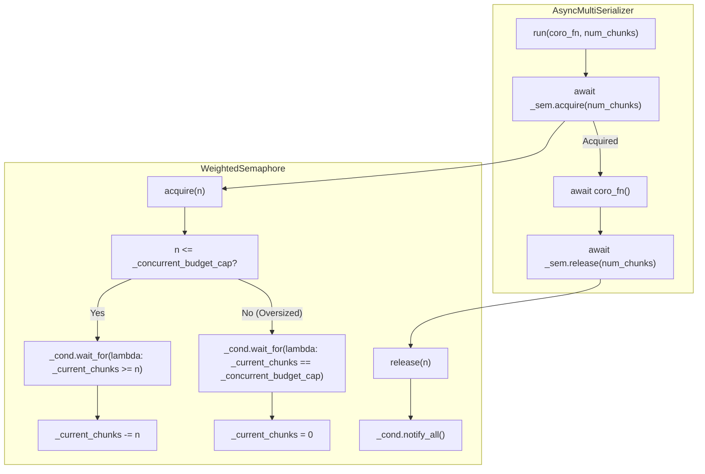
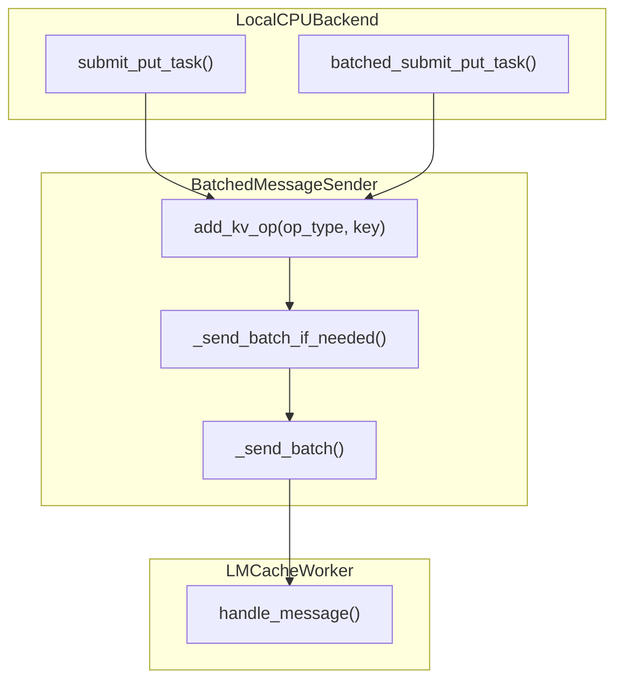
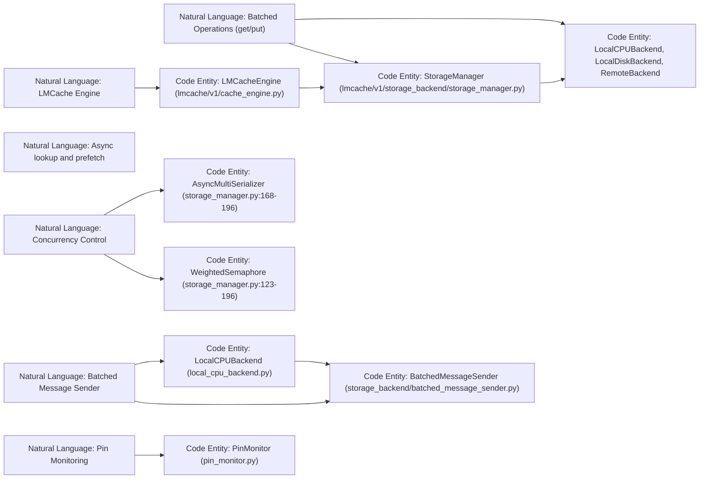

<!-- source: DeepWiki mcp.deepwiki.com · repo LMCache/LMCache · page 4.9 Batched Operations and Async Loading · fetched 2026-10-21 -->

# Batched Operations and Async Loading

Relevant source files

The following files were used as context for generating this wiki page:

- [lmcache/integration/base_service_factory.py](lmcache/integration/base_service_factory.py)
- [lmcache/observability.py](lmcache/observability.py)
- [lmcache/v1/internal_api_server/vllm/load_fs_chunks_api.py](lmcache/v1/internal_api_server/vllm/load_fs_chunks_api.py)
- [lmcache/v1/memory_management.py](lmcache/v1/memory_management.py)
- [lmcache/v1/pin_monitor.py](lmcache/v1/pin_monitor.py)
- [lmcache/v1/storage_backend/__init__.py](lmcache/v1/storage_backend/__init__.py)
- [lmcache/v1/storage_backend/abstract_backend.py](lmcache/v1/storage_backend/abstract_backend.py)
- [lmcache/v1/storage_backend/batched_message_sender.py](lmcache/v1/storage_backend/batched_message_sender.py)
- [lmcache/v1/storage_backend/local_cpu_backend.py](lmcache/v1/storage_backend/local_cpu_backend.py)
- [lmcache/v1/storage_backend/local_disk_backend.py](lmcache/v1/storage_backend/local_disk_backend.py)
- [lmcache/v1/storage_backend/remote_backend.py](lmcache/v1/storage_backend/remote_backend.py)
- [lmcache/v1/storage_backend/storage_manager.py](lmcache/v1/storage_backend/storage_manager.py)
- [tests/test_observability.py](tests/test_observability.py)
- [tests/v1/internal_api_server/test_load_fs_chunks.py](tests/v1/internal_api_server/test_load_fs_chunks.py)
- [tests/v1/storage_backend/test_batched_message_sender.py](tests/v1/storage_backend/test_batched_message_sender.py)
- [tests/v1/storage_backend/test_local_cpu_backend.py](tests/v1/storage_backend/test_local_cpu_backend.py)
- [tests/v1/storage_backend/test_local_disk_backend.py](tests/v1/storage_backend/test_local_disk_backend.py)
- [tests/v1/storage_backend/test_storage_manager.py](tests/v1/storage_backend/test_storage_manager.py)
- [tests/v1/storage_backend/test_storage_plugin.py](tests/v1/storage_backend/test_storage_plugin.py)
- [tests/v1/test_address_manager.py](tests/v1/test_address_manager.py)
- [tests/v1/test_memory_management.py](tests/v1/test_memory_management.py)

## Purpose and Scope

This page documents LMCache's batched operation patterns and asynchronous loading mechanisms, which are critical for achieving high throughput and low latency across multi-tier storage systems. These optimizations enable:

- **Batched I/O operations** (`batched_get`, `batched_put`, `batched_get_blocking`, `batched_submit_put_task`) across storage backends to amortize function call and network overhead `[lmcache/v1/storage_backend/abstract_backend.py:71-192]()`.
- **Asynchronous loading and prefetching** (`async_lookup_and_prefetch`) that overlap cache retrieval with model computation `[lmcache/v1/cache_engine.py:168-169]()`.
- **Smart memory allocation and concurrency control** using `WeightedSemaphore` and `AsyncMultiSerializer` to prevent deadlocks and fragmentation during parallel async requests `[lmcache/v1/storage_backend/storage_manager.py:123-196]()`.
- **Pin monitoring** (`PinMonitor`) to safeguard against memory leaks from abandoned asynchronous operations `[lmcache/v1/pin_monitor.py:28-188]()`.

For the overall storage architecture, see page 4. For individual backend implementations, see pages 4.3 (`LocalCPUBackend`), 4.4 (`LocalDiskBackend`), 4.5 (`RemoteBackend`), and 4.6 (`GdsBackend`).

Sources:
- `[lmcache/v1/storage_backend/storage_manager.py:123-196]()`
- `[lmcache/v1/storage_backend/abstract_backend.py:71-192]()`
- `[lmcache/v1/pin_monitor.py:28-188]()`

---

## Batched Operations (`batched_get` and `batched_put`)

### Overview

Batching multiple cache operations into a single API invocation is fundamental to LMCache's performance. Instead of issuing individual `put()` or `get()` calls for each KV chunk, the engine dispatches batched requests (`batched_get`, `batched_put`) to reduce per-operation overhead (such as lock acquisition, Python function call overhead, and network round-trips) and enable backend-specific vectorized I/O `[lmcache/v1/storage_backend/abstract_backend.py:71-192]()`.

### Interface Methods

The `StorageBackendInterface` and connector classes define explicit batched methods:

| Method | Purpose | Returns | Code Pointer |
| :--- | :--- | :--- | :--- |
| `batched_submit_put_task` | Store multiple KV chunks synchronously or via submission futures | `Union[List[Future], None]` | `[lmcache/v1/storage_backend/abstract_backend.py:71-101]()` |
| `batched_get_blocking` | Retrieve multiple KV chunks, blocking until completion | `List[Optional[MemoryObj]]` | `[lmcache/v1/storage_backend/abstract_backend.py:178-192]()` |
| `batched_async_contains` | Check existence of multiple keys asynchronously | `int` (hit count) | `[lmcache/v1/storage_backend/abstract_backend.py:142-159]()` |
| `batched_get_non_blocking` | Retrieve multiple KV chunks asynchronously | `List[MemoryObj]` | `[lmcache/v1/storage_backend/abstract_backend.py:161-174]()` |

Sources:
- `[lmcache/v1/storage_backend/abstract_backend.py:71-192]()`

### Execution Flow

Title: "Batched Get and Put Dispatch Flow"

The `LMCacheEngine.retrieve()` method delegates to `StorageManager.retrieve()` `[lmcache/v1/cache_engine.py:330-330]()`. The `StorageManager` queries active storage backends (`LocalCPUBackend`, `LocalDiskBackend`, `RemoteBackend`) and calls their respective `batched_get_blocking()` methods `[lmcache/v1/storage_backend/storage_manager.py:400-400]()`. For `RemoteBackend`, this further calls `RemoteConnector.batched_get()` `[lmcache/v1/storage_backend/remote_backend.py:200-200]()`. A similar flow applies to `batched_put` operations.

Sources:
- `[lmcache/v1/cache_engine.py:330-330]()`
- `[lmcache/v1/storage_backend/storage_manager.py:400-400]()`
- `[lmcache/v1/storage_backend/remote_backend.py:200-200]()`

---

## Concurrency Control (`WeightedSemaphore` and `AsyncMultiSerializer`)

### WeightedSemaphore

To prevent deadlocks and memory exhaustion when multiple concurrent requests allocate large blocks of memory inside `LocalCPUBackend`, LMCache utilizes `WeightedSemaphore` and `AsyncMultiSerializer` concurrency control primitives `[lmcache/v1/storage_backend/storage_manager.py:123-196]()`. This is especially important for large requests to avoid resource starvation.

- The **chunk budget** is computed by `allocator_backend.calculate_chunk_budget()`, derived from configuration parameters such as `max_local_cpu_size` and `chunk_size` `[lmcache/v1/storage_backend/storage_manager.py:181-181]()`.
- The **concurrent budget cap** is initialized as half of the chunk budget (`chunk_budget // 2`) to account for memory fragmentation and prevent full saturation when `save_unfull_chunk=False`, a heuristic based on LMCache's chunk allocation semantics `[lmcache/v1/storage_backend/storage_manager.py:127-129]()`.
- Requests asking for more chunks than the concurrent budget cap (`n > _concurrent_budget_cap`) are considered **oversized**. These requests wait until the semaphore's current chunk count equals the concurrent budget cap and then lock all chunks exclusively (`_current_chunks = 0`) to prevent starvation `[lmcache/v1/storage_backend/storage_manager.py:146-152]()`.
- Normal-sized requests (`n <= _concurrent_budget_cap`) wait until enough chunks are available and then decrement the semaphore accordingly `[lmcache/v1/storage_backend/storage_manager.py:143-145]()`.

Sources:
- `[lmcache/v1/storage_backend/storage_manager.py:123-196]()`

### AsyncMultiSerializer

`AsyncMultiSerializer` is a coroutine wrapper that uses `WeightedSemaphore` to serialize the execution of async coroutines requiring a number of chunks. This prevents simultaneous high memory use causing deadlocks, by waiting for chunk tokens to become available before running the coroutine `[lmcache/v1/storage_backend/storage_manager.py:168-196]()`. After coroutine completion, it releases the chunk tokens back to the semaphore `[lmcache/v1/storage_backend/storage_manager.py:185-195]()`.

Title: "Concurrency Management with WeightedSemaphore and AsyncMultiSerializer"

Sources:
- `[lmcache/v1/storage_backend/storage_manager.py:123-196]()`
- `[lmcache/v1/config.py:90-96]()`

---

## Async Loading and Prefetching (`async_lookup_and_prefetch`)

LMCache overlaps KV cache retrieval with model execution via asynchronous lookup and prefetch pipelines to improve throughput and reduce latency.

- The feature is enabled by the configuration option `enable_async_loading` in `LMCacheEngine` `[lmcache/v1/cache_engine.py:168-168]()`.
- `LMCacheAsyncLookupClient` implements a non-blocking PUSH-PULL pattern for lookup requests and responses using ZeroMQ IPC sockets `[lmcache/v1/lookup_client/lmcache_async_lookup_client.py:34-191]()`. It sends lookup requests asynchronously to lookup servers and processes responses in a background thread.
- This client maintains request status tracking per lookup ID, allowing the caller to poll for completion without stalling.
- The asynchronous architecture overlaps:
  - Lookup requests to the cache (often distributed or remote).
  - Prefetching of data from L2 storage tiers (remote or disk) into local CPU memory.
  - Model execution consuming the incremental cache fills.
- `StorageManager` coordinates prefetching in the background via the `PrefetchController` which loads chunks asynchronously `[lmcache/v1/storage_backend/storage_manager.py:321-345]()`.
- This async pipeline reduces stalls during cache misses by loading data proactively.

### Request Coordination: `RequestTracker`, `LoadSpec`, `SaveSpec`

These dataclasses provide structured state tracking of lookup and save operations, coordinating allowed load/save behavior during request scheduling in integration with vLLM `[lmcache/integration/vllm/vllm_v1_adapter.py:65-145]()`.

- `LoadSpec`: Tracks how many tokens are cached by vLLM (`vllm_cached_tokens`) and LMCache (`lmcache_cached_tokens`), and a flag `can_load` that permits performing load operations in this scheduler iteration `[lmcache/integration/vllm/vllm_v1_adapter.py:65-73]()`.
- `SaveSpec`: Tracks how many leading tokens to skip during saving and whether saving is allowed (`can_save`) `[lmcache/integration/vllm/vllm_v1_adapter.py:75-81]()`.
- `RequestTracker`: Manages request-level metadata like `req_id`, `prompt_len`, `token_ids`, `allocated_block_ids`, `num_saved_tokens`, `disagg_spec`, `mm_hashes`, `mm_positions`, `request_configs`, `is_decode_phase`, `skip_save`, and `num_lmcache_cached_tokens` `[lmcache/integration/vllm/vllm_v1_adapter.py:104-139]()`.

These specifications help coordinate access and update of cache entries without race conditions or redundant loads/saves during model inference `[lmcache/integration/vllm/vllm_v1_adapter.py:65-145]()`. They are essential to realize asynchronous and layered loading safely.

Sources:
- `[lmcache/v1/cache_engine.py:168-168]()`
- `[lmcache/v1/storage_backend/storage_manager.py:321-345]()`
- `[lmcache/integration/vllm/vllm_v1_adapter.py:65-145]()`

---

## Batched Message Sender

`BatchedMessageSender` is a utility for reducing the overhead of communicating individual KV admission or eviction messages to the cache controller (`LMCacheWorker`). It aggregates multiple ops and sends them as a batch `[lmcache/v1/storage_backend/batched_message_sender.py:20-75]()`.

### Details

- Used primarily in `LocalCPUBackend` when submitting put operations `[lmcache/v1/storage_backend/local_cpu_backend.py:94-103]()`.
- Operations (`OpType.ADMIT`, `OpType.EVICT`) on keys (`CacheEngineKey`) are enqueued via `add_kv_op()` `[lmcache/v1/storage_backend/local_cpu_backend.py:173-177]()`.
- When the batch reaches a configured size or a timeout, `_send_batch_if_needed()` triggers sending all enqueued messages together `[lmcache/v1/storage_backend/batched_message_sender.py:69-70]()`.
- The batch is sent atomically to `LMCacheWorker.handle_message()` for processing `[lmcache/v1/storage_backend/batched_message_sender.py:72-72]()`.
- This batching mechanism greatly reduces message passing overhead, lock contention, and network/RPC serialization costs.

Title: "Batched Message Sender Flow"

Sources:
- `[lmcache/v1/storage_backend/batched_message_sender.py:20-72]()`
- `[lmcache/v1/storage_backend/local_cpu_backend.py:94-103]()`
- `[lmcache/v1/storage_backend/local_cpu_backend.py:173-177]()`

---

## Pin Monitoring and Safety

Long-running or abandoned asynchronous operations risk leaving pinned memory objects unreleased, causing memory leaks. LMCache uses a global `PinMonitor` to detect and forcibly unpin such objects `[lmcache/v1/pin_monitor.py:28-188]()`.

- `PinMonitor` is a singleton managing a background monitoring thread `[lmcache/v1/pin_monitor.py:28-46]()`.
- Memory objects notify `PinMonitor` by calling `on_pin()` when pinned, registering themselves with timestamps `[lmcache/v1/pin_monitor.py:91-107]()`.
- The background thread periodically scans the registry for pinned objects exceeding a configured timeout (`pin_timeout_sec`) `[lmcache/v1/pin_monitor.py:120-188]()`.
- When a timeout is detected, `PinMonitor` forcibly resets the pinned object's count to zero (`_force_unpin_timeout_object()`), allowing it to be evicted, and logs an alert.
- This mechanism prevents indefinite retention of cache memory due to client-side failures or network partitioning during async lookups.

Sources:
- `[lmcache/v1/pin_monitor.py:28-188]()`

---

## Bridging Concepts to Code Entities

Title: "Mapping Natural Language Concepts to Core Code Entities"

Sources:
- `[lmcache/v1/cache_engine.py:83-184]()`
- `[lmcache/v1/storage_backend/storage_manager.py:123-196]()`
- `[lmcache/v1/storage_backend/local_cpu_backend.py:42-107]()`
- `[lmcache/v1/pin_monitor.py:28-188]()`

---

## Summary

LMCache achieves efficient, scalable cache management through careful design of batched operations and asynchronous loading:

- Batched API calls minimize I/O overhead and exploit backend-specific vectorization.
- Async loading via a dedicated async lookup client affords non-blocking cache requests and transparent prefetch pipelines.
- Concurrency control primitives prevent deadlocks and excessive memory fragmentation in parallel environments.
- Batched message sender reduces costly inter-component signaling.
- Pin monitor ensures safe and recoverable memory management, preventing leaks from abandoned asynchronous operations.

Together these mechanisms form the backbone of LMCache's high-throughput, low-latency cache serving architecture.

Sources:
- `[lmcache/v1/cache_engine.py:83-184]()`
- `[lmcache/v1/storage_backend/storage_manager.py:123-196]()`
- `[lmcache/v1/storage_backend/abstract_backend.py:71-192]()`
- `[lmcache/v1/storage_backend/batched_message_sender.py:20-72]()`
- `[lmcache/v1/storage_backend/local_cpu_backend.py:42-107]()`
- `[lmcache/v1/pin_monitor.py:28-188]()`

---

