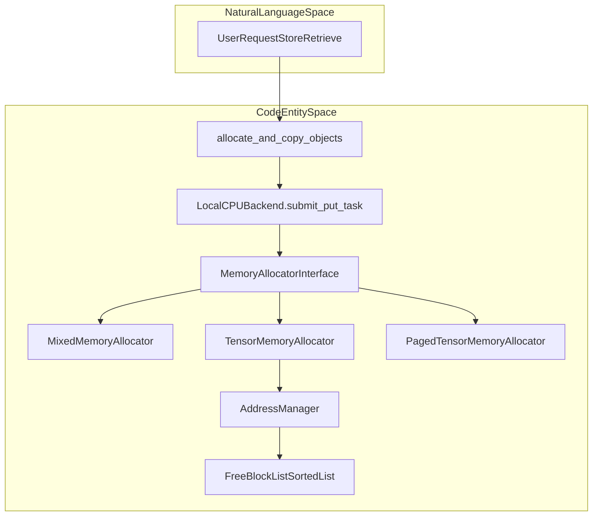
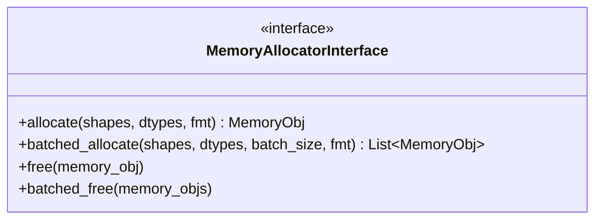
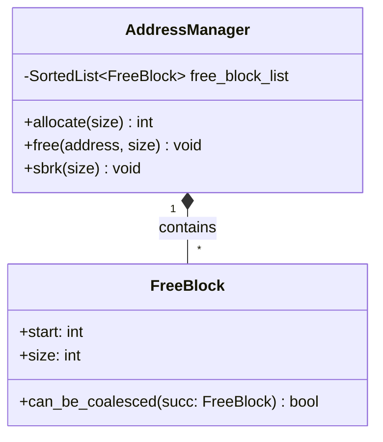
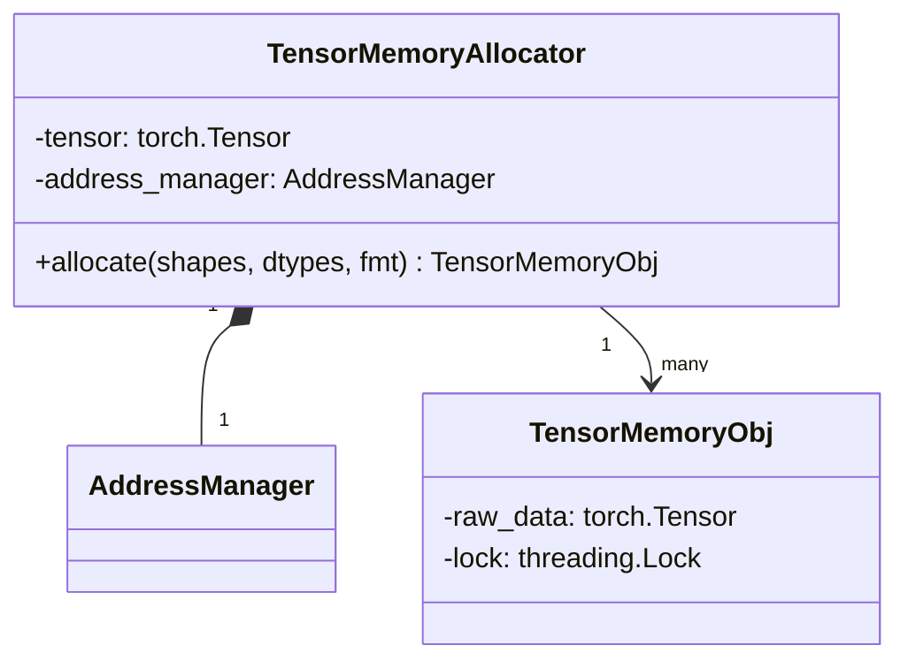
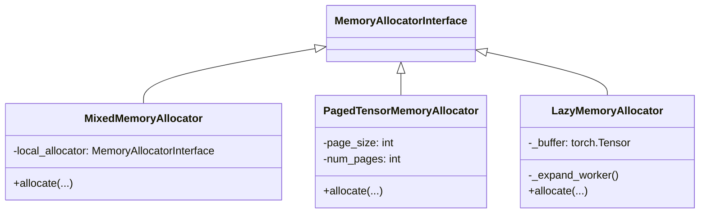
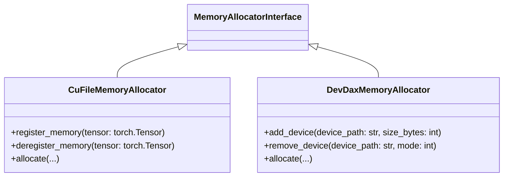

<!-- source: DeepWiki mcp.deepwiki.com · repo LMCache/LMCache · page 5.1 Memory Allocators · fetched 2026-10-21 -->

# Memory Allocators

<details>
<summary>Relevant source files</summary>

The following files were used as context for generating this wiki page:

- [docs/source/mp/multi_l1.rst](docs/source/mp/multi_l1.rst)
- [lmcache/cli/commands/bench/l2_adapter_bench/command.py](lmcache/cli/commands/bench/l2_adapter_bench/command.py)
- [lmcache/cli/commands/bench/l2_adapter_bench/data.py](lmcache/cli/commands/bench/l2_adapter_bench/data.py)
- [lmcache/observability.py](lmcache/observability.py)
- [lmcache/v1/distributed/config.py](lmcache/v1/distributed/config.py)
- [lmcache/v1/distributed/memory_manager/devdax_l1_memory_manager.py](lmcache/v1/distributed/memory_manager/devdax_l1_memory_manager.py)
- [lmcache/v1/distributed/memory_manager/l1_memory_manager.py](lmcache/v1/distributed/memory_manager/l1_memory_manager.py)
- [lmcache/v1/memory_allocators/devdax_memory_allocator.py](lmcache/v1/memory_allocators/devdax_memory_allocator.py)
- [lmcache/v1/memory_allocators/lazy_memory_allocator.py](lmcache/v1/memory_allocators/lazy_memory_allocator.py)
- [lmcache/v1/memory_management.py](lmcache/v1/memory_management.py)
- [lmcache/v1/storage_backend/__init__.py](lmcache/v1/storage_backend/__init__.py)
- [lmcache/v1/storage_backend/abstract_backend.py](lmcache/v1/storage_backend/abstract_backend.py)
- [lmcache/v1/storage_backend/local_cpu_backend.py](lmcache/v1/storage_backend/local_cpu_backend.py)
- [lmcache/v1/storage_backend/local_disk_backend.py](lmcache/v1/storage_backend/local_disk_backend.py)
- [lmcache/v1/storage_backend/remote_backend.py](lmcache/v1/storage_backend/remote_backend.py)
- [lmcache/v1/storage_backend/storage_manager.py](lmcache/v1/storage_backend/storage_manager.py)
- [tests/cli/commands/bench/l2_adapter_bench/test_data.py](tests/cli/commands/bench/l2_adapter_bench/test_data.py)
- [tests/test_observability.py](tests/test_observability.py)
- [tests/v1/distributed/test_devdax_l1_allocator.py](tests/v1/distributed/test_devdax_l1_allocator.py)
- [tests/v1/distributed/test_l1_memory_manager.py](tests/v1/distributed/test_l1_memory_manager.py)
- [tests/v1/distributed/test_l1_mlock.py](tests/v1/distributed/test_l1_mlock.py)
- [tests/v1/storage_backend/test_local_cpu_backend.py](tests/v1/storage_backend/test_local_cpu_backend.py)
- [tests/v1/storage_backend/test_local_disk_backend.py](tests/v1/storage_backend/test_local_disk_backend.py)
- [tests/v1/storage_backend/test_storage_manager.py](tests/v1/storage_backend/test_storage_manager.py)
- [tests/v1/test_address_manager.py](tests/v1/test_address_manager.py)
- [tests/v1/test_memory_management.py](tests/v1/test_memory_management.py)

</details>


This page documents the memory allocator subsystem in LMCache, responsible for managing CPU and GPU memory used for KV cache storage. It provides an in-depth overview of `MemoryAllocatorInterface`, specialized allocators (`TensorMemoryAllocator`, `MixedMemoryAllocator`, `CuFileMemoryAllocator`, `LazyMemoryAllocator`, `DevDaxMemoryAllocator`), and the `AddressManager` abstraction that manages virtual address spaces. The page covers allocator implementations, interactions, key methods, data flow, and thread-safety considerations.

For the data structures (`MemoryObj`, `MemoryFormat`) and higher level memory lifecycle (reference counting, pinning, eviction), see pages **5.2 Memory Objects and Formats** and **5.3 Reference Counting and Eviction**.

---

## Overview

In LMCache, each KV cache chunk held in CPU or GPU memory is a `MemoryObj` allocated through a `MemoryAllocatorInterface`. This interface abstracts memory lifecycle operations, allowing different allocator implementations tailored to various hardware capabilities and performance profiles.

The `LocalCPUBackend` is a primary consumer of these allocators for the hot cache tier, where allocated `MemoryObj`s represent pinned tensors or memory regions.

The architecture layers memory management from high-level cache engine operations down to raw pointer and address management. `TensorMemoryAllocator` exemplifies this by managing a large backing tensor split into sub-regions, tracked by an `AddressManager` free-list.

### Allocation Flow Diagram



Sources: `[lmcache/v1/storage_backend/local_cpu_backend.py:150-187]()`, `[lmcache/v1/memory_management.py:831-942]()`, `[lmcache/v1/storage_backend/storage_manager.py:64-121]()`

---

## MemoryAllocatorInterface

`MemoryAllocatorInterface` is the abstract base class defining the interface all LMCache memory allocators must implement. It manages the allocation and freeing of memory regions used to back `MemoryObj` instances.

### Interface Methods

| Method              | Signature                                                                                                        | Description                                                    |
|---------------------|-----------------------------------------------------------------------------------------------------------------|----------------------------------------------------------------|
| `allocate`          | `(shapes: list[torch.Size], dtypes: list[torch.dtype], fmt: MemoryFormat, eviction=True, busy_loop=True) -> MemoryObj` | Allocate a single `MemoryObj` for given shapes and dtypes.    |
| `batched_allocate`  | Similar to `allocate` but for a batch of allocations, returns a list of `MemoryObj`s.                           |
| `free`              | `(memory_obj: MemoryObj, busy_loop=True)`                                                                        | Free a single `MemoryObj`.                                     |
| `batched_free`      | `(memory_objs: list[MemoryObj], busy_loop=True)`                                                                | Free multiple `MemoryObj`s.                                    |

> Allocation outputs `MemoryObj` or its subclass instances. The interface does not expose raw pointers directly.

### Important Notes

- The allocator's `free` method is *not* called directly by users but invoked when the storage object's reference count reaches zero, as managed via `ref_count_down()` on `MemoryObj`.
- Allocators are governed by reference tracking, pinned status, and safe backing memory release protocols.



Sources: `[lmcache/v1/memory_management.py:831-942]()`, `[lmcache/v1/memory_management.py:539-541]()`

---

## AddressManager

`AddressManager` implements an internal virtual address space for allocators like `TensorMemoryAllocator`. It manages a flat heap of memory offsets (integers), tracking free blocks with a sorted free-list structure for efficient allocation and coalescing.

### Key Characteristics

- Uses a `SortedList` of `FreeBlock(start, size)` objects keyed by starting address to track free memory regions.
- Allocation applies first-fit strategy, aligning allocation sizes by a constant alignment (`ALIGN_BYTES = 4096`).
- On freeing, adjacent free blocks are coalesced to reduce fragmentation.
- Virtual heap space can be grown by calls to `sbrk(size)` which extends the heap and merges with the trailing free block if possible.
- Thread-safety is enforced by a per-instance lock accessed using the `@synchronized` decorator.

### Main Methods

| Method              | Description                                                       |
|---------------------|-------------------------------------------------------------------|
| `allocate(size)`    | Find a suitable free block for the requested size; remove or split the free block accordingly. |
| `free(address, size)` | Insert a freed block back to the free list, coalesce with neighbors if adjacent.                 |
| `sbrk(size)`       | Grow the heap by adding a new free block or merging with the last block.                         |

### AddressManager Class Diagram (internal logic)



Sources: `[lmcache/v1/memory_management.py:944-1173]()`, `[lmcache/v1/memory_management.py:136-145]()`

---

## TensorMemoryAllocator

`TensorMemoryAllocator` is a concrete implementation of `MemoryAllocatorInterface` which manages sub-allocations within a large backing `torch.Tensor`.

### Implementation Notes

- Holds a single contiguous large tensor as backing storage.
- Uses an internal `AddressManager` to partition the tensor into sub-regions upon allocation.
- Allocations return `TensorMemoryObj` instances which wrap views (`raw_data`) into sub-slices of the backing tensor to represent memory objects without copying.
- This approach avoids frequent malloc/free calls to the CUDA or CPU allocator, improving performance and fragmentation handling.

### Allocation Steps

1. User requests allocation by shape and dtype.
2. Size in bytes is computed.
3. `AddressManager.allocate` obtains an offset within the backing tensor.
4. A slice view (`tensor.narrow`) is created to represent the allocated region.
5. A `TensorMemoryObj` wrapping this slice is returned with appropriate metadata.

### Benefits

- Zero-copy slicing of the large tensor.
- Efficient bookkeeping of sub-regions and re-use.
- Backing storage memory only allocated once, reducing overhead.



Sources: `[lmcache/v1/memory_management.py:1176-1237]()`, `[lmcache/v1/memory_management.py:612-630]()`

---

## Paged, Mixed, and Lazy Allocators

LMCache supports additional specialized allocators to handle different memory and performance requirements:

### MixedMemoryAllocator

- A composite allocator delegating allocation requests across multiple underlying allocators, e.g., for CPU and GPU memory pools.
- It maintains mapping to an underlying allocator for each `MemoryObj` to redirect freeing.
- Used for heterogeneous setups where multiple memory types or NUMA nodes are active.

### PagedTensorMemoryAllocator

- Manages memory in a fixed page size segmented layout.
- Efficient for uniform KV blocks common in KV cache storage.
- Supports quick allocation of multiple fixed-size pages.

### LazyMemoryAllocator

- Allocates pinned CPU or NUMA memory lazily.
- Maintains an internal buffer starting from an initial size.
- Expands the buffer asynchronously up to a final size in chunks (`PIN_CHUNK_SIZE`).
- Reduces start-up cost and memory pressure by growing memory on demand.



Sources: `[lmcache/v1/memory_allocators/mixed_memory_allocator.py:29-29]()`, `[lmcache/v1/memory_allocators/paged_tensor_memory_allocator.py:29-29]`, `[lmcache/v1/memory_allocators/lazy_memory_allocator.py:59-79]()`

---

## CuFile, Device-DAX, and GDS Support

LMCache provides tailored allocators to support specialized hardware interfaces and persistent memory:

### CuFileMemoryAllocator

- Specialized for GPU-Direct Storage (GDS) on NVIDIA hardware.
- Manages registration with `cuFile` APIs to allow efficient DMA transfers between storage and GPU memory.
- Supports zero-copy memory regions mapped on GPU.

### DevDaxMemoryAllocator

- Allocates L1 memory objects from DRAM or Device-DAX memory-mapped persistent arenas.
- Supports runtime device addition and drain-based removal.
- Pools memory arenas per device path with concurrency control.
- Uses `host_mem_lock` to serialize mutable state changes including arena allocations.



Sources: `[lmcache/v1/memory_allocators/cu_file_memory_allocator.py:29-29]`, `[lmcache/v1/memory_allocators/devdax_memory_allocator.py:131-153]()`

---

## Allocator Class Hierarchy and Relationships

This diagram summarizes the main allocator classes, their inheritance from `MemoryAllocatorInterface`, and the internal composition with `AddressManager`.

```mermaid
classDiagram
    class MemoryAllocatorInterface {
        <<interface>>
        +allocate(shapes, dtypes, fmt) MemoryObj
        +batched_allocate(shapes, dtypes, batch_size, fmt) List~MemoryObj~
        +free(memory_obj)
    }
    class TensorMemoryAllocator {
        +tensor: torch.Tensor
        +address_manager: AddressManager
    }
    class MixedMemoryAllocator {
        +local_allocator: MemoryAllocatorInterface
    }
    class PagedTensorMemoryAllocator {
        +page_size: int
        +num_pages: int
    }
    class LazyMemoryAllocator {
        +_buffer: torch.Tensor
        +_expand_worker()
    }
    class DevDaxMemoryAllocator {
        +add_device(device_path, size_in_bytes)
        +remove_device(device_path, mode)
    }
    class AddressManager {
        +allocate(size)
        +free(address, size)
        +sbrk(size)
    }
    class CuFileMemoryAllocator {
        +register_memory(tensor)
        +deregister_memory(tensor)
    }
    
    subgraph InternalLogic["InternalLogic"]
        AddressManager
    end

    MemoryAllocatorInterface <|-- TensorMemoryAllocator
    MemoryAllocatorInterface <|-- MixedMemoryAllocator
    MemoryAllocatorInterface <|-- PagedTensorMemoryAllocator
    MemoryAllocatorInterface <|-- LazyMemoryAllocator
    MemoryAllocatorInterface <|-- DevDaxMemoryAllocator
    MemoryAllocatorInterface <|-- CuFileMemoryAllocator
    TensorMemoryAllocator *-- AddressManager
```

Sources: `[lmcache/v1/memory_management.py:831-1237]()`, `[lmcache/v1/memory_allocators/lazy_memory_allocator.py:59-167]()`, `[lmcache/v1/memory_allocators/devdax_memory_allocator.py:131-180]()`

---

## Thread Safety

LMCache enforces thread-safety across all allocator interfaces and internal components:

- **Method Synchronization Decorator:** The `@synchronized(lock_attr_name)` decorator serializes method execution by acquiring the lock attribute specified on the instance. Used categorically in `AddressManager` to protect free list mutations and heap growth operations (`[lmcache/v1/memory_management.py:59-75]()`).
- **Object-level Locks:** `TensorMemoryObj` objects include `threading.Lock` guards around their reference counting and pin state updates (`[lmcache/v1/memory_management.py:612-630]()`).
- **Allocator Arena Locks:** For arena-based allocators such as `DevDaxMemoryAllocator`, the `host_mem_lock` protects mutation of device arenas and allocation from arena-local pools (`[lmcache/v1/memory_allocators/devdax_memory_allocator.py:148-153]()`).

Sources: `[lmcache/v1/memory_management.py:59-75]()`, `[lmcache/v1/memory_management.py:612-630]()`, `[lmcache/v1/memory_allocators/devdax_memory_allocator.py:148-153]()`

---

