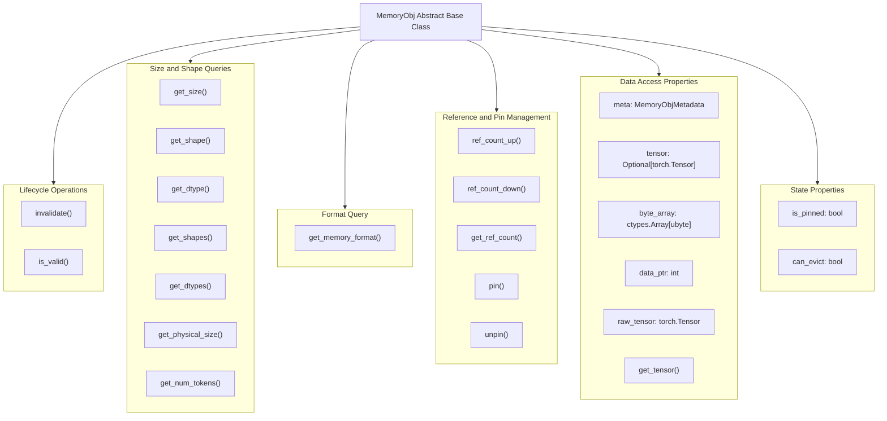
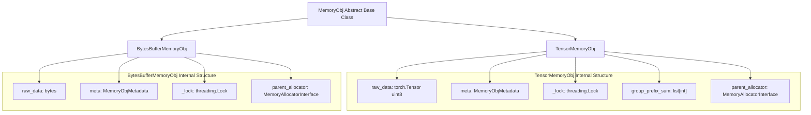
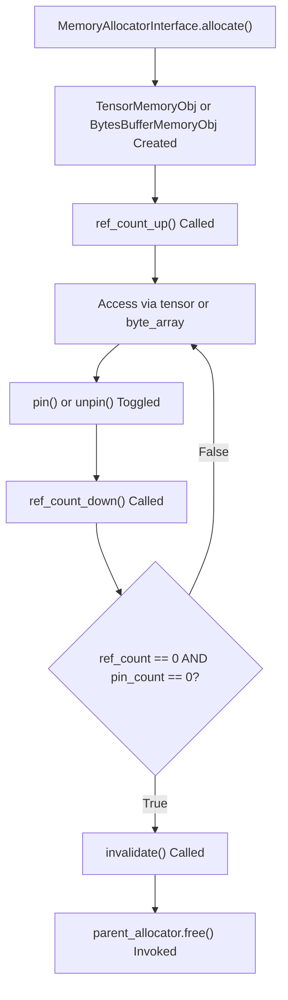

<!-- source: DeepWiki mcp.deepwiki.com · repo LMCache/LMCache · page 5.2 Memory Objects and Formats · fetched 2026-10-21 -->

# Memory Objects and Formats

Relevant source files

The following files were used as context for generating this wiki page:

- [docs/design/v1/gpu_connector/layout-invariant.md](docs/design/v1/gpu_connector/layout-invariant.md)
- [docs/design/v1/platform/devices/rbln/README.md](docs/design/v1/platform/devices/rbln/README.md)
- [lmcache/observability.py](lmcache/observability.py)
- [lmcache/v1/gpu_connector/kv_format/specs/nl_x_nb_bsv_bss.py](lmcache/v1/gpu_connector/kv_format/specs/nl_x_nb_bsv_bss.py)
- [lmcache/v1/memory_management.py](lmcache/v1/memory_management.py)
- [lmcache/v1/platform/devices/rbln/device_ops.py](lmcache/v1/platform/devices/rbln/device_ops.py)
- [lmcache/v1/platform/torch_ops/__init__.py](lmcache/v1/platform/torch_ops/__init__.py)
- [lmcache/v1/platform/torch_ops/_kv_format.py](lmcache/v1/platform/torch_ops/_kv_format.py)
- [lmcache/v1/platform/torch_ops/cachegen_kernels.py](lmcache/v1/platform/torch_ops/cachegen_kernels.py)
- [lmcache/v1/platform/torch_ops/completion_recorder.py](lmcache/v1/platform/torch_ops/completion_recorder.py)
- [lmcache/v1/platform/torch_ops/event_recorder.py](lmcache/v1/platform/torch_ops/event_recorder.py)
- [lmcache/v1/platform/torch_ops/mem_alloc.py](lmcache/v1/platform/torch_ops/mem_alloc.py)
- [lmcache/v1/platform/torch_ops/mem_kernels.py](lmcache/v1/platform/torch_ops/mem_kernels.py)
- [lmcache/v1/platform/torch_ops/mp_mem_kernels.py](lmcache/v1/platform/torch_ops/mp_mem_kernels.py)
- [lmcache/v1/platform/torch_ops/pos_kernels.py](lmcache/v1/platform/torch_ops/pos_kernels.py)
- [lmcache/v1/storage_backend/__init__.py](lmcache/v1/storage_backend/__init__.py)
- [lmcache/v1/storage_backend/abstract_backend.py](lmcache/v1/storage_backend/abstract_backend.py)
- [lmcache/v1/storage_backend/local_cpu_backend.py](lmcache/v1/storage_backend/local_cpu_backend.py)
- [lmcache/v1/storage_backend/local_disk_backend.py](lmcache/v1/storage_backend/local_disk_backend.py)
- [lmcache/v1/storage_backend/remote_backend.py](lmcache/v1/storage_backend/remote_backend.py)
- [lmcache/v1/storage_backend/storage_manager.py](lmcache/v1/storage_backend/storage_manager.py)
- [tests/test_observability.py](tests/test_observability.py)
- [tests/v1/platform/devices/rbln/test_rbln_kv_ops.py](tests/v1/platform/devices/rbln/test_rbln_kv_ops.py)
- [tests/v1/platform/test_torch_ops_blocked_scale.py](tests/v1/platform/test_torch_ops_blocked_scale.py)
- [tests/v1/storage_backend/test_local_cpu_backend.py](tests/v1/storage_backend/test_local_cpu_backend.py)
- [tests/v1/storage_backend/test_local_disk_backend.py](tests/v1/storage_backend/test_local_disk_backend.py)
- [tests/v1/storage_backend/test_storage_manager.py](tests/v1/storage_backend/test_storage_manager.py)
- [tests/v1/test_address_manager.py](tests/v1/test_address_manager.py)
- [tests/v1/test_memory_management.py](tests/v1/test_memory_management.py)

This page documents the memory object abstraction layer in LMCache, providing a unified interface for representing and managing KV cache data across heterogeneous memory tiers. It covers:

- The `MemoryFormat` enumeration that specifies layout formats (`KV_2LTD`, `KV_T2D`, `KV_MLA_FMT`, etc.) [lmcache/v1/memory_management.py:77-131]().
- The metadata structure `MemoryObjMetadata` that tracks logical and physical properties of memory objects [lmcache/v1/memory_management.py:146-214]().
- The base interface `MemoryObj` and its concrete implementations, such as `TensorMemoryObj` [lmcache/v1/memory_management.py:226-380](), [lmcache/v1/memory_management.py:429-476]().

For allocator details, see [Memory Allocators (5.1)](5.1). For lifecycle, ref counting, and eviction policies, see [Reference Counting and Eviction (5.3)](5.3).

Sources: [lmcache/v1/memory_management.py:1-214]()

---

## MemoryFormat Enumeration

The `MemoryFormat` enum specifies different logical layouts of KV cache tensors in memory, optimized for various model architectures and transfer patterns [lmcache/v1/memory_management.py:77-131]().

### Diagram: Format Mapping to Natural Language and Code Entities

```mermaid
graph TB
    subgraph CodeEntities["Code Entities in lmcache/v1/memory_management.py"]
        UNDEFINED["MemoryFormat.UNDEFINED"]
        KV_2LTD["MemoryFormat.KV_2LTD"]
        KV_T2D["MemoryFormat.KV_T2D"]
        KV_2TD["MemoryFormat.KV_2TD"]
        BINARY["MemoryFormat.BINARY"]
        BINARY_BUFFER["MemoryFormat.BINARY_BUFFER"]
        KV_MLA_FMT["MemoryFormat.KV_MLA_FMT"]
        EC_TD["MemoryFormat.EC_TD"]
        HS_TD["MemoryFormat.HS_TD"]
        TokenDim["token_dim()"]
    end
    
    subgraph NaturalLanguage["Usage Contexts in Natural Language Space"]
        FullStorage["Full KV Cache Storage Single Block"]
        LayerwiseProcessing["Layerwise KV Processing"]
        CacheBlending["Cache Blending"]
        MLAModels["Multi-Level Attention MLA Models"]
        CompressedBinary["Compressed Binary Formats"]
        EncoderCache["Encoder Cache"]
        HiddenStateStore["Hidden State Store"]
    end
    
    KV_2LTD --> FullStorage
    KV_T2D --> LayerwiseProcessing
    KV_2TD --> CacheBlending
    KV_MLA_FMT --> MLAModels
    BINARY --> CompressedBinary
    BINARY_BUFFER --> CompressedBinary
    EC_TD --> EncoderCache
    HS_TD --> HiddenStateStore
    KV_2LTD --> TokenDim
    KV_T2D --> TokenDim
    KV_MLA_FMT --> TokenDim
```

Sources: [lmcache/v1/memory_management.py:77-131]()

| Format           | Shape Description                      | Token Dimension | Primary Use Case                          |
|------------------|--------------------------------------|-----------------|-----------------------------------------|
| `KV_2LTD`        | `[2, num_layers, num_tokens, hidden_dim]` | 2               | Full non-layerwise KV cache storage     |
| `KV_T2D`         | `[num_tokens, 2, hidden_dim]`        | 1               | Layerwise KV processing without blending|
| `KV_2TD`         | `[2, num_tokens, hidden_dim]`         | 0               | Layerwise with cache blending            |
| `KV_MLA_FMT`     | `[1, num_layers, num_tokens, aligned_head_size]` | 2        | Multi-Level Attention (MLA) support      |
| `EC_TD`          | `[num_tokens, hidden_dim]`            | 0               | Encoder cache tensor format              |
| `HS_TD`          | `[num_tokens, hidden_dim]`            | 0               | Hidden-state store                       |
| `BINARY`         | Opaque compressed format              | 0               | Compressed binary serialization          |
| `BINARY_BUFFER`  | Raw bytes                            | 0               | Raw buffers, unstructured byte storage  |

The `token_dim()` method returns the index over which tokens vary, aiding uniform token-level processing across formats [lmcache/v1/memory_management.py:114-131]().

Sources: [lmcache/v1/memory_management.py:77-131]()

---

## MemoryObjMetadata

`MemoryObjMetadata` is a dataclass encapsulating both logical properties (tensor shape, dtype, format) and physical properties (memory address, allocated size) of a memory object. It supports serialization to and from dictionary form using `to_dict()` and `from_dict()` for transport and storage [lmcache/v1/memory_management.py:146-214]().

### Diagram: Metadata Components and Serialization

```mermaid
graph TD
    MemoryObjMetadata["MemoryObjMetadata"]
    
    subgraph LogicalProperties["Logical Properties"]
        Shape["shape: torch.Size"]
        Dtype["dtype: Optional[torch.dtype]"]
        Format["fmt: MemoryFormat"]
        CachedPositions["cached_positions: Optional[torch.Tensor]"]
        ShapesList["shapes: Optional[list[torch.Size]]"]
        DtypesList["dtypes: Optional[list[torch.dtype]]"]
    end
    
    subgraph PhysicalProperties["Physical Properties"]
        Address["address: int"]
        PhysicalSize["phy_size: int"]
    end
    
    subgraph StateProperties["State Properties"]
        RefCount["ref_count: int"]
        PinCount["pin_count: int"]
    end
    
    MemoryObjMetadata --> Shape
    MemoryObjMetadata --> Dtype
    MemoryObjMetadata --> Format
    MemoryObjMetadata --> CachedPositions
    MemoryObjMetadata --> ShapesList
    MemoryObjMetadata --> DtypesList
    MemoryObjMetadata --> Address
    MemoryObjMetadata --> PhysicalSize
    MemoryObjMetadata --> RefCount
    MemoryObjMetadata --> PinCount
    
    Serialization["Serialization via to_dict and from_dict"]
    MemoryObjMetadata -- "to_dict()" --> Serialization
    Serialization -- "from_dict()" --> MemoryObjMetadata
```

Sources: [lmcache/v1/memory_management.py:146-214]()

### Fields

| Field            | Type                           | Description                                      |
|------------------|--------------------------------|------------------------------------------------|
| `shape`          | `torch.Size`                   | Logical user-visible tensor shape               |
| `dtype`          | `Optional[torch.dtype]`         | Logical element data type                        |
| `address`        | `int`                         | Physical address/reference in allocator space   |
| `phy_size`       | `int`                         | Actual allocated physical size in bytes         |
| `ref_count`      | `int`                         | Reference count for the object's lifecycle       |
| `pin_count`      | `int`                         | Count of active pins (prevents eviction)         |
| `fmt`            | `MemoryFormat`                 | Memory layout format enum                         |
| `cached_positions`| `Optional[torch.Tensor]`       | Cache-specific position metadata (e.g., sparse) |
| `shapes`         | `Optional[list[torch.Size]]`   | Per-group shapes for heterogeneous layouts       |
| `dtypes`         | `Optional[list[torch.dtype]]`  | Per-group data types for heterogeneous layouts   |

Sources: [lmcache/v1/memory_management.py:146-214]()

---

## MemoryObj Interface

`MemoryObj` is an abstract base class defining the contract for all memory object implementations representing allocated tensor/buffer data [lmcache/v1/memory_management.py:226-380]().

### Diagram: MemoryObj Interface Contract

Sources: [lmcache/v1/memory_management.py:226-380]()

---

## Memory Object Implementations

LMCache provides primary implementations of `MemoryObj`: `TensorMemoryObj` and `BytesBufferMemoryObj`.

### Diagram: Concrete Memory Object Implementations

Sources: [lmcache/v1/memory_management.py:429-476](), [lmcache/v1/memory_management.py:663-716]()

### TensorMemoryObj

`TensorMemoryObj` wraps a contiguous 1D `torch.uint8` tensor buffer (`raw_data`) acting as physical storage. It manages heterogeneous layouts, provides typed tensor views via `get_tensor()`, uses thread synchronization locks, and maintains backlinks to its parent allocator for automated deallocation [lmcache/v1/memory_management.py:29-74](), [lmcache/v1/memory_management.py:429-476](), [lmcache/v1/memory_management.py:596-618]().

### BytesBufferMemoryObj

`BytesBufferMemoryObj` wraps a raw `bytes` buffer, used primarily for opaque binary data blobs without tensor formatting requirements [lmcache/v1/memory_management.py:663-716]().

Sources: [lmcache/v1/memory_management.py:429-476](), [lmcache/v1/memory_management.py:663-716]()

---

## Memory Object Lifecycle

The lifecycle of a `MemoryObj` follows strict reference counting and pinning protocols:

### Diagram: Reference Counting and Eviction Workflow

Sources: [lmcache/v1/memory_management.py:460-476](), [lmcache/v1/memory_management.py:514-531]()

---

## Integration with Storage Backends

| Backend          | Allocates MemoryObj? | Typical MemoryObj Type | Access Pattern / Usage                                         |
|------------------|---------------------|-----------------------|---------------------------------------------------------------|
| `LocalCPUBackend` | Yes                 | `TensorMemoryObj`     | Uses `.tensor` to load/store tensors between CPU and GPU buffer [lmcache/v1/storage_backend/local_cpu_backend.py:42-102]() |
| `LocalDiskBackend`| Indirect (via CPU)  | `TensorMemoryObj`     | Uses `.byte_array` for low-level file I/O serialization [lmcache/v1/storage_backend/local_disk_backend.py:119-197]() |
| `RemoteBackend`   | No (delegates)      | `MemoryObj`           | Uses `.tensor` for serialization to/from remote connectors [lmcache/v1/storage_backend/remote_backend.py:27-111]() |
| `StorageManager`  | Utility             | `MemoryObj`           | Uses `allocate_and_copy_objects()` utility for device transfers [lmcache/v1/storage_backend/storage_manager.py:64-120]() |

Sources:  
- [lmcache/v1/storage_backend/local_cpu_backend.py:42-102]()  
- [lmcache/v1/storage_backend/local_disk_backend.py:119-197]()  
- [lmcache/v1/storage_backend/storage_manager.py:64-120]()  
- [lmcache/v1/storage_backend/remote_backend.py:27-111]()

---

# Summary

The memory object and format subsystems in LMCache define a crucial abstraction layer enabling efficient management and transfer of KV cache tensors. The `MemoryFormat` enum provides schema flexibility, `MemoryObjMetadata` captures essential physical/logical attributes, and the `MemoryObj` interface sets comprehensive lifecycle and access contracts [lmcache/v1/memory_management.py:77-380]().

---

# References

- `MemoryFormat` enum and metadata: [lmcache/v1/memory_management.py:77-131](), [lmcache/v1/memory_management.py:146-214]()
- `MemoryObj` interface and implementations: [lmcache/v1/memory_management.py:226-380](), [lmcache/v1/memory_management.py:429-476](), [lmcache/v1/memory_management.py:600-618](), [lmcache/v1/memory_management.py:663-716]()
- Storage backends usage: [lmcache/v1/storage_backend/local_cpu_backend.py:42-102](), [lmcache/v1/storage_backend/local_disk_backend.py:119-197](), [lmcache/v1/storage_backend/remote_backend.py:27-111](), [lmcache/v1/storage_backend/storage_manager.py:64-120]()

---

