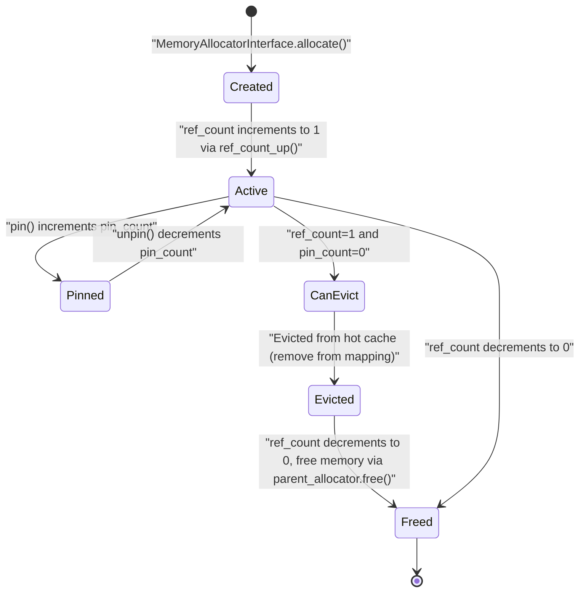
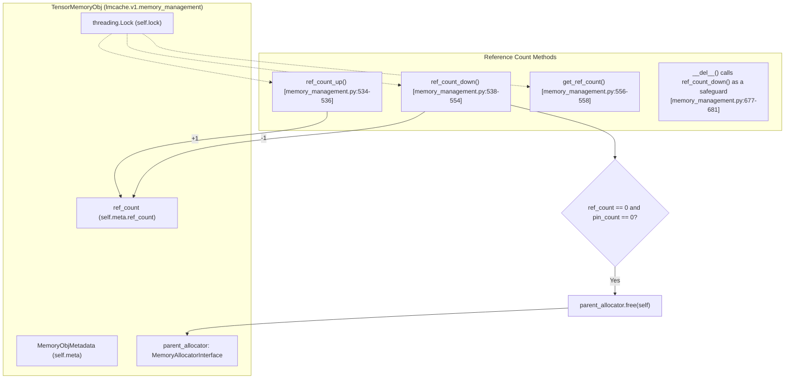
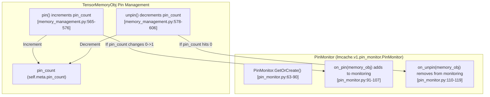
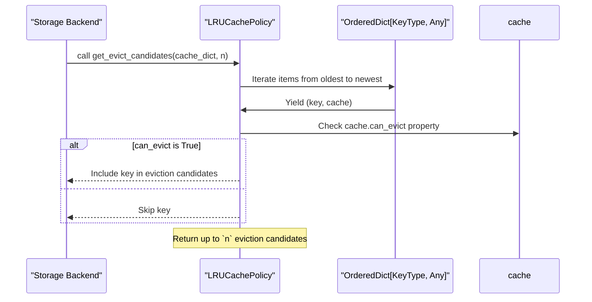
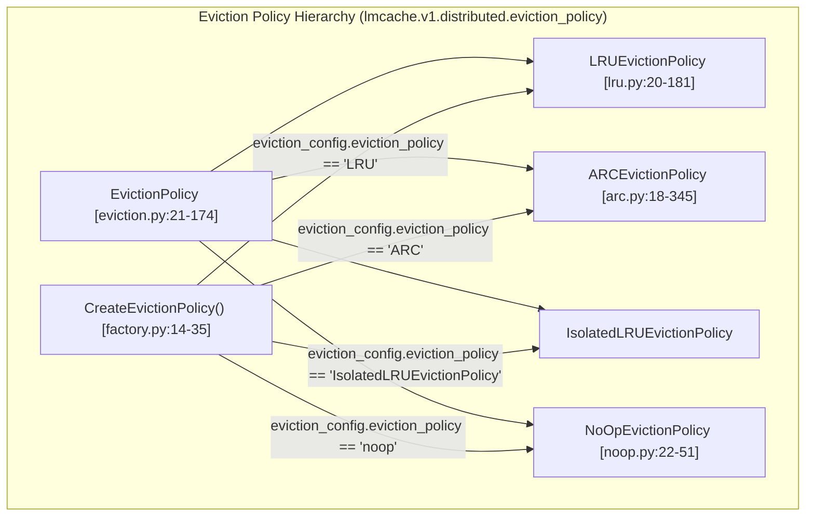

<!-- source: DeepWiki mcp.deepwiki.com · repo LMCache/LMCache · page 5.3 Reference Counting and Eviction · fetched 2026-10-21 -->

# Reference Counting and Eviction

Relevant source files

The following files were used as context for generating this wiki page:

- [lmcache/integration/base_service_factory.py](lmcache/integration/base_service_factory.py)
- [lmcache/v1/internal_api_server/vllm/load_fs_chunks_api.py](lmcache/v1/internal_api_server/vllm/load_fs_chunks_api.py)
- [lmcache/v1/pin_monitor.py](lmcache/v1/pin_monitor.py)
- [lmcache/v1/storage_backend/batched_message_sender.py](lmcache/v1/storage_backend/batched_message_sender.py)
- [lmcache/v1/storage_backend/cache_policy/__init__.py](lmcache/v1/storage_backend/cache_policy/__init__.py)
- [lmcache/v1/storage_backend/cache_policy/base_policy.py](lmcache/v1/storage_backend/cache_policy/base_policy.py)
- [lmcache/v1/storage_backend/cache_policy/fifo.py](lmcache/v1/storage_backend/cache_policy/fifo.py)
- [lmcache/v1/storage_backend/cache_policy/lfu.py](lmcache/v1/storage_backend/cache_policy/lfu.py)
- [lmcache/v1/storage_backend/cache_policy/lru.py](lmcache/v1/storage_backend/cache_policy/lru.py)
- [lmcache/v1/storage_backend/cache_policy/mru.py](lmcache/v1/storage_backend/cache_policy/mru.py)
- [lmcache/v1/storage_backend/job_executor/base_executor.py](lmcache/v1/storage_backend/job_executor/base_executor.py)
- [lmcache/v1/storage_backend/job_executor/pq_executor.py](lmcache/v1/storage_backend/job_executor/pq_executor.py)
- [tests/v1/__init__.py](tests/v1/__init__.py)
- [tests/v1/internal_api_server/test_load_fs_chunks.py](tests/v1/internal_api_server/test_load_fs_chunks.py)
- [tests/v1/storage_backend/test_batched_message_sender.py](tests/v1/storage_backend/test_batched_message_sender.py)
- [tests/v1/storage_backend/test_storage_plugin.py](tests/v1/storage_backend/test_storage_plugin.py)
- [tests/v1/test_cache_policy.py](tests/v1/test_cache_policy.py)

## Purpose and Scope

This document details LMCache's mechanisms for reference counting, pinning, eviction candidate selection, and cache eviction policies. It covers the implementation and interaction of `ref_count_up`/`ref_count_down`, `pin`/`unpin` methods, the `PinMonitor` timeout detection, how eviction candidates are selected across storage tiers, and the supported cache replacement policies (`LRU`, `LFU`, `FIFO`, `MRU`, `ARC`, and `IsolatedLRU`).

Sources: [lmcache/v1/memory_management.py:161-169](), [lmcache/v1/pin_monitor.py:28-165]()

---

## 1. Memory Object Lifecycle and Reference Counting

LMCache manages memory object lifecycles with two core counters on each `MemoryObj` / `TensorMemoryObj`:
- **Reference Count (`ref_count`)**: Tracks active uses of the object by various system components such as workers or asynchronous storage operations [lmcache/v1/memory_management.py:530-560]().
- **Pin Count (`pin_count`)**: Temporarily pins objects to prevent them from eviction during critical operations, like lookups or serving [lmcache/v1/memory_management.py:565-576]().

The eviction decisions respect these counts to maintain cache integrity, ensuring only unpinned, no-longer-used objects are evicted according to a configurable cache eviction policy.

An external `PinMonitor` background thread detects and forcibly unpins any objects pinned longer than a configured timeout to prevent memory leaks from "stuck" pinned objects [lmcache/v1/pin_monitor.py:28-165]().

### State Diagram and Code Entities

| State     | ref_count      | pin_count       | Description                                   |
|-----------|----------------|-----------------|-----------------------------------------------|
| Created   | 0              | 0               | Newly allocated by allocator                   |
| Active    | ≥ 1            | Any             | In use by engine or storage                   |
| Pinned    | ≥ 1            | > 0             | Temporarily protected from eviction           |
| CanEvict  | 1              | 0               | Ready for eviction (only cache holds a reference) |
| Evicted   | 1 → 0          | 0               | Removed from cache mapping, pending free       |
| Freed     | 0              | 0               | Memory has been released                        |

Sources: [lmcache/v1/memory_management.py:161-169](), [lmcache/v1/memory_management.py:654-659]()

---

## 2. Reference Counting Implementation

The class `TensorMemoryObj` maintains the reference counting, ensuring thread-safe incrementing and decrementing of `ref_count` [lmcache/v1/memory_management.py:530-560]().

### Key Methods and Flow (Code Entity Space)

- The `ref_count_up()` method atomically increments `ref_count` [lmcache/v1/memory_management.py:534-536]().
- The `ref_count_down()` decrements, and if it reaches zero with `pin_count` also zero, it calls `free()` on the parent allocator to release memory [lmcache/v1/memory_management.py:538-554]().
- The `get_ref_count()` provides current count safely [lmcache/v1/memory_management.py:556-558]().
- The `__del__()` method ensures memory release if the Python object is garbage collected prematurely [lmcache/v1/memory_management.py:670-682]().

All these methods are synchronized via a thread lock to prevent race conditions.

Sources: [lmcache/v1/memory_management.py:530-560](), [lmcache/v1/memory_management.py:670-682]()

---

## 3. Pin/Unpin Mechanism and PinMonitor

Pinning protects objects from eviction by incrementing a `pin_count`; unpinning decrements it, allowing eviction when count reaches zero [lmcache/v1/memory_management.py:565-606]().

### Pin and Unpin Methods

- Upon pinning, the object is registered with `PinMonitor` to enable timeout tracking [lmcache/v1/pin_monitor.py:91-107]().
- Unpinning removes it from monitoring when pin count reaches zero [lmcache/v1/pin_monitor.py:110-119]().

### PinMonitor Timeout Detection

`PinMonitor` runs a periodic background thread checking pinned objects for prolonged pins exceeding `pin_timeout_sec` [lmcache/v1/pin_monitor.py:28-165](). When detected, it forcibly unpins such objects to avoid stuck pins.

- Checks registered pinned objects under a thread lock [lmcache/v1/pin_monitor.py:120-150]().
- Calls `_force_unpin_timeout_object()` to reset pin count forcibly [lmcache/v1/pin_monitor.py:169-188]().
- Reports statistics using `LMCStatsMonitor` [lmcache/v1/pin_monitor.py:150-165]().

This mechanism safeguards against memory bloat due to leaks or logic errors causing objects to remain pinned indefinitely.

Sources: [lmcache/v1/pin_monitor.py:28-165](), [lmcache/v1/pin_monitor.py:169-188]()

---

## 4. Eviction Candidate Selection & Cache Policies

Eviction policies decide which keys to evict when cache resources are low, guided by the `can_evict` flag on objects [lmcache/v1/memory_management.py:654-659]().

### `can_evict` Property

An object is **evictable** only if:
- It is **not pinned**, i.e., `pin_count == 0` [lmcache/v1/memory_management.py:654-659]().
- Its reference count is exactly 1, meaning only the cache itself holds a reference (no active users) [lmcache/v1/memory_management.py:654-659]().

This ensures objects in active use or pinned are never evicted prematurely.

Sources: [lmcache/v1/memory_management.py:654-659]()

---

## 5. Cache Policy Interface and Implementations

LMCache defines multiple cache priorities via the `BaseCachePolicy` derived classes, selectable via the `get_cache_policy` factory [lmcache/v1/storage_backend/cache_policy/__init__.py:21-45]().

Supported policies:

| Policy Name | Description                     | Main Data Structure        | Update on Hit                         | Eviction Candidate Selection                     | Source File                              |
|-------------|--------------------------------|---------------------------|-------------------------------------|-------------------------------------------------|------------------------------------------|
| LRU         | Least Recently Used            | `OrderedDict`             | Moves key to end (most recent)      | Candidates from front (oldest) with `can_evict` | `cache_policy/lru.py` [16-81]()          |
| MRU         | Most Recently Used            | `OrderedDict`             | Moves key to end                    | Candidates from end (most recent) with `can_evict` | `cache_policy/mru.py` [13-62]()          |
| FIFO        | First-In First-Out            | `dict` (ordered in Python) | No effect on hit                   | Candidates from insertion order with `can_evict` | `cache_policy/fifo.py` [12-59]()          |
| LFU         | Least Frequently Used          | `SortedDict` + freq buckets | Increments frequency count          | Evicts keys with lowest frequency and `can_evict` | `cache_policy/lfu.py` [16-105]()          |

### LRU Cache Candidate Selection Flow

### Policy Factory

The `get_cache_policy(policy_name)` function returns a policy instance by matching the uppercase policy name to its implementation class in `POLICY_MAPPING` [lmcache/v1/storage_backend/cache_policy/__init__.py:13-45]().

Sources: [lmcache/v1/storage_backend/cache_policy/__init__.py:13-45](), [lmcache/v1/storage_backend/cache_policy/lru.py:16-81](), [lmcache/v1/storage_backend/cache_policy/mru.py:13-61](), [lmcache/v1/storage_backend/cache_policy/fifo.py:12-58](), [lmcache/v1/storage_backend/cache_policy/lfu.py:16-105]()

---

## 6. Distributed Eviction (V1 Architecture) and Policy Hierarchy

In LMCache V1, eviction coordination across the L1 (local) and L2 (remote) cache tiers is handled through the `EvictionPolicy` abstract base class, which listens to lifecycle events to maintain eviction state and issue eviction commands [lmcache/v1/distributed/eviction.py:21-174]().

### Eviction Policy Hierarchy (Code Entity Space)

- **`EvictionPolicy`**: Pure abstract base class defining methods like `on_keys_created`, `on_keys_touched`, `on_keys_removed`, and `get_eviction_actions` [lmcache/v1/distributed/eviction.py:21-174]().
- **`LRUEvictionPolicy`**: Implements least recently used key tracking with an `OrderedDict` and thread safety [lmcache/v1/distributed/eviction_policy/lru.py:20-50]().
- **`ARCEvictionPolicy`**: Adaptive Replacement Cache policy splitting resident keys between recent (`T1`) and frequent (`T2`) lists, using ghost lists (`B1`, `B2`) for adaptive sizing [lmcache/v1/distributed/eviction_policy/arc.py:18-64]().
- **`IsolatedLRUEvictionPolicy`**: Maintains isolated LRU lists per cache salt (e.g., per user isolation) [lmcache/v1/distributed/eviction_policy/isolated_lru.py]().
- **`NoOpEvictionPolicy`**: No-op implementation suitable for buffer-only modes where eviction is handled externally [lmcache/v1/distributed/eviction_policy/noop.py:22-31]().

Sources: [lmcache/v1/distributed/eviction.py:21-174](), [lmcache/v1/distributed/eviction_policy/lru.py:20-50](), [lmcache/v1/distributed/eviction_policy/arc.py:18-64](), [lmcache/v1/distributed/eviction_policy/noop.py:22-31](), [lmcache/v1/distributed/eviction_policy/factory.py:14-35]()

---

## 7. L2 Eviction Controller and Adapter Integration

L2 adapter eviction is opt-in and managed per-adapter via `L2EvictionController` and `L2AdapterEvictionState` [docs/design/v1/distributed/l2_adapters/l2_eviction.md:9-124]().

- **`L2AdapterListener`**: Interface receiving L2 adapter storage events (`on_l2_keys_stored`, `on_l2_keys_accessed`, `on_l2_keys_deleted`) [docs/design/v1/distributed/l2_adapters/l2_eviction.md:88-97]().
- **`L2EvictionPolicy`**: Bridge adapter events into policy `on_keys_*` calls via composition [docs/design/v1/distributed/l2_adapters/l2_eviction.md:126-136]().
- **`L2EvictionController`**: Runs a background thread iterating over active L2 adapters, checking usage against `trigger_watermark`, and requesting eviction batches via `get_eviction_actions()` [docs/design/v1/distributed/l2_adapters/l2_eviction.md:137-150]().

Sources: [docs/design/v1/distributed/l2_adapters/l2_eviction.md:9-150]()

---

# References

- `lmcache/v1/memory_management.py:161-169,530-560,565-606,654-659,670-682`  
- `lmcache/v1/pin_monitor.py:28-188`  
- `lmcache/v1/storage_backend/cache_policy/__init__.py:13-45`  
- `lmcache/v1/storage_backend/cache_policy/lru.py:16-81`  
- `lmcache/v1/storage_backend/cache_policy/mru.py:13-62`  
- `lmcache/v1/storage_backend/cache_policy/fifo.py:12-59`  
- `lmcache/v1/storage_backend/cache_policy/lfu.py:16-105`  
- `lmcache/v1/distributed/eviction.py:21-174`  
- `lmcache/v1/distributed/eviction_policy/lru.py:20-50`  
- `lmcache/v1/distributed/eviction_policy/arc.py:18-64`  
- `lmcache/v1/distributed/eviction_policy/noop.py:22-31`  
- `lmcache/v1/distributed/eviction_policy/factory.py:14-35`  
- `docs/design/v1/distributed/l2_adapters/l2_eviction.md:9-150`

---

