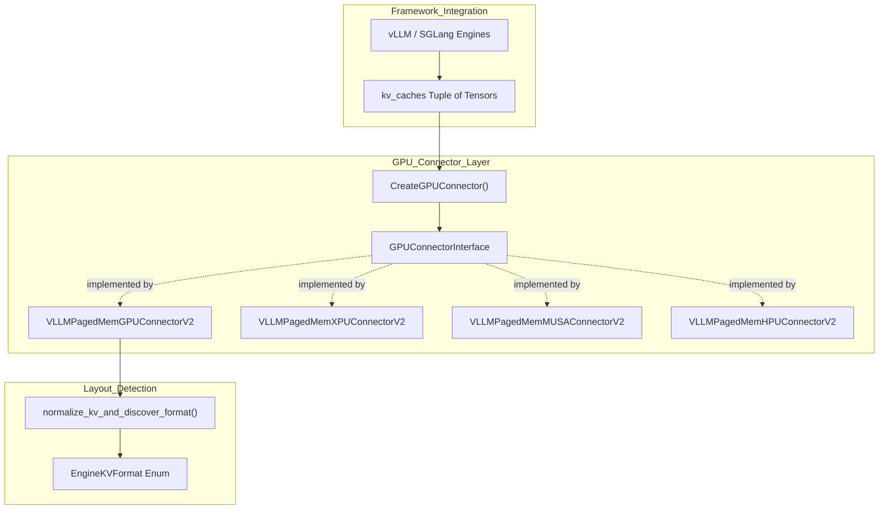
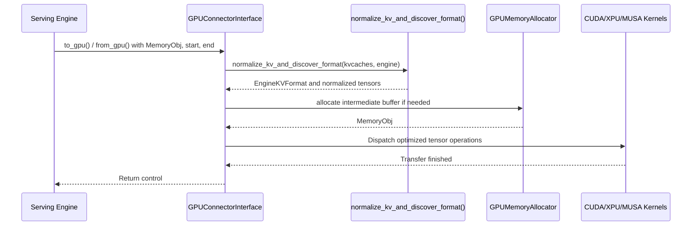

<!-- source: DeepWiki mcp.deepwiki.com · repo LMCache/LMCache · page 6 GPU Memory Transfer · fetched 2026-10-21 -->

# GPU Memory Transfer

Relevant source files

The following files were used as context for generating this wiki page:

- [benchmarks/musa/README.md](benchmarks/musa/README.md)
- [benchmarks/musa/bench_inprocess_transfer.py](benchmarks/musa/bench_inprocess_transfer.py)
- [lmcache/usage_context.py](lmcache/usage_context.py)
- [lmcache/v1/gpu_connector/__init__.py](lmcache/v1/gpu_connector/__init__.py)
- [lmcache/v1/gpu_connector/gpu_connectors.py](lmcache/v1/gpu_connector/gpu_connectors.py)
- [lmcache/v1/gpu_connector/hpu_connector.py](lmcache/v1/gpu_connector/hpu_connector.py)
- [lmcache/v1/gpu_connector/musa_connectors.py](lmcache/v1/gpu_connector/musa_connectors.py)
- [lmcache/v1/gpu_connector/utils.py](lmcache/v1/gpu_connector/utils.py)
- [lmcache/v1/gpu_connector/xpu_connectors.py](lmcache/v1/gpu_connector/xpu_connectors.py)
- [tests/benchmarks/test_musa_inprocess_benchmark.py](tests/benchmarks/test_musa_inprocess_benchmark.py)
- [tests/v1/test_gpu_connector.py](tests/v1/test_gpu_connector.py)
- [tests/v1/test_mem_kernels.py](tests/v1/test_mem_kernels.py)
- [tests/v1/test_musa_connector.py](tests/v1/test_musa_connector.py)
- [tests/v1/test_musa_native.py](tests/v1/test_musa_native.py)
- [tests/v1/test_musa_support.py](tests/v1/test_musa_support.py)
- [tests/v1/utils.py](tests/v1/utils.py)

## Purpose and Scope

This page provides a high-level overview of LMCache's GPU↔CPU memory transfer subsystem, which is essential for efficient key-value (KV) cache management during large language model (LLM) serving. The system facilitates copying KV cache data between GPU memory (used by inference frameworks like vLLM and SGLang) and CPU memory (used by hierarchical storage backends), allowing seamless storage management, offloading, and retrieval.

Key responsibilities of the GPU Memory Transfer system include:

1. **Memory Layout Abstraction:** Handling the conversion between diverse, framework-specific GPU memory layouts—such as paged, blocked, or compressed tensor formats—and LMCache's unified CPU storage format via layout detection and shape interpretation [lmcache/v1/gpu_connector/utils.py:20-58]().
2. **High-Performance Transfer Kernels:** Utilizing specialized CUDA/SYCL/XPU/MUSA kernels and pinned memory handling to optimize zero-copy or minimal-copy DMA operations across layers and devices [lmcache/v1/gpu_connector/gpu_connectors.py:148-182]().
3. **Layer Grouping and Slot Mapping:** Organizing KV cache layers by identity and translating logical token positions into physical GPU memory locations via slot mapping [lmcache/v1/gpu_connector/gpu_connectors.py:137-146]().

For details on each component, refer to the child pages:
- [GPU Connector Interface and KV Formats](#6.1)
- [Framework and Platform GPU Connectors](#6.2)
- [CUDA/SYCL Memory Kernels](#6.3)
- [Pinned Memory, SHM and Cache Contexts](#6.4)

Sources: [lmcache/v1/gpu_connector/utils.py:20-58](), [lmcache/v1/gpu_connector/gpu_connectors.py:45-182]()

---

## System Architecture

The GPU Memory Transfer subsystem is architected as a layered design bridging serving engine integrations and hardware-specific transfer primitives. The core abstraction is `GPUConnectorInterface` [lmcache/v1/gpu_connector/gpu_connectors.py:45-136](), implemented by multiple connector classes tailored for particular engine-device combinations.

At runtime, `CreateGPUConnector` dispatches based on engine type and device [lmcache/v1/gpu_connector/__init__.py:60-76](), instantiating connectors that normalize and discover KV layouts via `normalize_kv_and_discover_format` [lmcache/v1/gpu_connector/gpu_connectors.py:31-34]().

Diagram: System Architecture and Code Entities

Sources: [lmcache/v1/gpu_connector/__init__.py:60-76](), [lmcache/v1/gpu_connector/gpu_connectors.py:45-177](), [lmcache/v1/gpu_connector/utils.py:20-30]()

For detailed interface specifications, see [GPU Connector Interface and KV Formats](#6.1). For platform-specific implementations, see [Framework and Platform GPU Connectors](#6.2).

---

## Transfer Operation Flow

Transfer operations are executed over specific token ranges defined by `start` and `end` indices. The primary methods on `GPUConnectorInterface` are `to_gpu` and `from_gpu`, alongside batched variants `batched_to_gpu` and `batched_from_gpu` [lmcache/v1/gpu_connector/gpu_connectors.py:45-136]().

Diagram: Transfer Operation Execution Flow

Sources: [lmcache/v1/gpu_connector/gpu_connectors.py:45-98](), [lmcache/v1/gpu_connector/utils.py:20-30]()

For kernel implementation details, see [CUDA/SYCL Memory Kernels](#6.3). For host memory allocators, see [Pinned Memory, SHM and Cache Contexts](#6.4).

---

## Memory Layout and Geometry

LMCache handles multiple memory layouts (`KV_2LTD`, `KV_MLA_FMT`) and enforces strict contiguity checks via `assert_contiguous()` [lmcache/v1/gpu_connector/utils.py:42-58](). Platform-specific connectors handle synchronization appropriately, such as HPU's `htorch.core.mark_step()` [lmcache/v1/gpu_connector/hpu_connector.py:119-124]() and MUSA's boundary-safe copy handling [lmcache/v1/gpu_connector/musa_connectors.py:62-116]().

Sources: [lmcache/v1/gpu_connector/utils.py:42-58](), [lmcache/v1/gpu_connector/hpu_connector.py:119-124](), [lmcache/v1/gpu_connector/musa_connectors.py:62-116]()

---

## Summary of Sub-Topics and Navigation

| Sub-Topic | Description | See Page |
|---|---|---|
| GPU Connector Interface and KV Formats | Core interface definitions, `to_gpu`/`from_gpu` methods, and KV layout detection. | [GPU Connector Interface and KV Formats](#6.1) |
| Framework and Platform GPU Connectors | Framework connectors (vLLM, SGLang) and device variants (CUDA, XPU, HPU, MUSA). | [Framework and Platform GPU Connectors](#6.2) |
| CUDA/SYCL Memory Kernels | Native kernel modules (`lmcache.c_ops`, `lmcache_native`), multi-layer transfers, and slot mapping. | [CUDA/SYCL Memory Kernels](#6.3) |
| Pinned Memory, SHM and Cache Contexts | Host memory allocators (`PinMemoryAllocator`), CUDA registered memory, and cache contexts. | [Pinned Memory, SHM and Cache Contexts](#6.4) |

Sources: [lmcache/v1/gpu_connector/gpu_connectors.py:45-182](), [lmcache/v1/gpu_connector/utils.py:20-58]()

---

