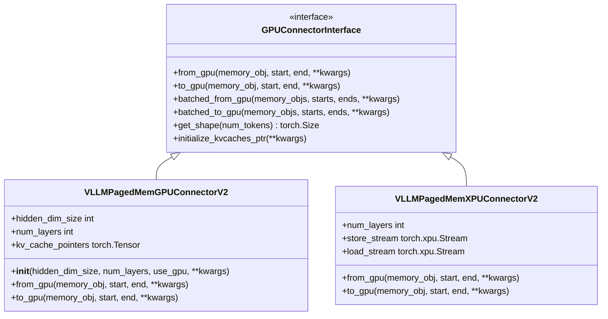
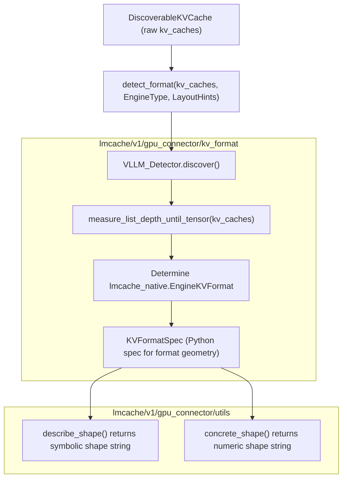
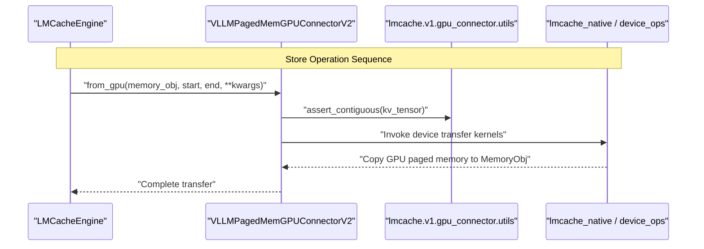

<!-- source: DeepWiki mcp.deepwiki.com · repo LMCache/LMCache · page 6.1 GPU Connector Interface and KV Formats · fetched 2026-10-21 -->

# GPU Connector Interface and KV Formats

Relevant source files

The following files were used as context for generating this wiki page:

- [csrc/engine_kv_format.h](csrc/engine_kv_format.h)
- [csrc/lmcache_native/pybind.cpp](csrc/lmcache_native/pybind.cpp)
- [docs/design/v1/gpu_connector/layout-invariant.md](docs/design/v1/gpu_connector/layout-invariant.md)
- [docs/design/v1/platform/devices/rbln/README.md](docs/design/v1/platform/devices/rbln/README.md)
- [lmcache/lmcache_native.pyi](lmcache/lmcache_native.pyi)
- [lmcache/v1/gpu_connector/kv_format/detectors/base.py](lmcache/v1/gpu_connector/kv_format/detectors/base.py)
- [lmcache/v1/gpu_connector/kv_format/detectors/sglang.py](lmcache/v1/gpu_connector/kv_format/detectors/sglang.py)
- [lmcache/v1/gpu_connector/kv_format/detectors/trtllm.py](lmcache/v1/gpu_connector/kv_format/detectors/trtllm.py)
- [lmcache/v1/gpu_connector/kv_format/detectors/vllm.py](lmcache/v1/gpu_connector/kv_format/detectors/vllm.py)
- [lmcache/v1/gpu_connector/kv_format/specs/base.py](lmcache/v1/gpu_connector/kv_format/specs/base.py)
- [lmcache/v1/gpu_connector/kv_format/specs/nl_x_nb_bsv_bss.py](lmcache/v1/gpu_connector/kv_format/specs/nl_x_nb_bsv_bss.py)
- [lmcache/v1/gpu_connector/kv_format/types.py](lmcache/v1/gpu_connector/kv_format/types.py)
- [lmcache/v1/platform/devices/rbln/device_ops.py](lmcache/v1/platform/devices/rbln/device_ops.py)
- [lmcache/v1/platform/torch_ops/__init__.py](lmcache/v1/platform/torch_ops/__init__.py)
- [lmcache/v1/platform/torch_ops/_kv_format.py](lmcache/v1/platform/torch_ops/_kv_format.py)
- [lmcache/v1/platform/torch_ops/cachegen_kernels.py](lmcache/v1/platform/torch_ops/cachegen_kernels.py)
- [lmcache/v1/platform/torch_ops/completion_recorder.py](lmcache/v1/platform/torch_ops/completion_recorder.py)
- [lmcache/v1/platform/torch_ops/event_recorder.py](lmcache/v1/platform/torch_ops/event_recorder.py)
- [lmcache/v1/platform/torch_ops/mem_alloc.py](lmcache/v1/platform/torch_ops/mem_alloc.py)
- [lmcache/v1/platform/torch_ops/mem_kernels.py](lmcache/v1/platform/torch_ops/mem_kernels.py)
- [lmcache/v1/platform/torch_ops/mp_mem_kernels.py](lmcache/v1/platform/torch_ops/mp_mem_kernels.py)
- [lmcache/v1/platform/torch_ops/pos_kernels.py](lmcache/v1/platform/torch_ops/pos_kernels.py)
- [tests/v1/gpu_connector/test_kv_format_classification.py](tests/v1/gpu_connector/test_kv_format_classification.py)
- [tests/v1/gpu_connector/test_kv_format_detection.py](tests/v1/gpu_connector/test_kv_format_detection.py)
- [tests/v1/gpu_connector/test_normalize_per_layer_formats.py](tests/v1/gpu_connector/test_normalize_per_layer_formats.py)
- [tests/v1/platform/devices/rbln/test_rbln_kv_ops.py](tests/v1/platform/devices/rbln/test_rbln_kv_ops.py)
- [tests/v1/platform/test_torch_ops_blocked_scale.py](tests/v1/platform/test_torch_ops_blocked_scale.py)
- [tests/v1/test_torch_ops.py](tests/v1/test_torch_ops.py)

## Purpose and Scope

The GPU Connector Interface (`GPUConnectorInterface`) defines the abstraction for transferring KV cache data between GPU memory (managed by serving engines such as vLLM, SGLang, and TRT-LLM) and CPU memory encapsulated in LMCache `MemoryObj` instances [lmcache/v1/gpu_connector/gpu_connectors.py:45-77](). This interface enables LMCache to efficiently offload KV tensors during cache store operations and reload them during retrieval, facilitating high-performance multi-device KV cache management.

Key responsibilities of the GPU Connector include:
- Managing data transfer between GPU paged KV cache layouts and the LMCache CPU memory abstraction [lmcache/v1/gpu_connector/gpu_connectors.py:46-76]().
- Discovering and normalizing the KV cache format for various serving engines using a shared detection and specification framework centered around `normalize_kv_and_discover_format` [docs/design/v1/gpu_connector/layout-invariant.md:5-10]().
- Implementing slot mapping and view permutation to ensure physical tensor layouts match expected kernel indexing orders [lmcache/v1/gpu_connector/gpu_connectors.py:137-146]().
- Supporting advanced features like layerwise pipelined transfers, multi-head latent attention (MLA), and device-specific optimizations for CUDA, XPU, HPU, and MUSA backends [lmcache/v1/gpu_connector/utils.py:71-94](), [lmcache/v1/gpu_connector/xpu_connectors.py:35-88]().

Sources: [lmcache/v1/gpu_connector/gpu_connectors.py:45-77](), [docs/design/v1/gpu_connector/layout-invariant.md:1-15]()

---

## Abstract Interface Design

### Core Responsibilities

The `GPUConnectorInterface` is an abstract base class defining the contract for GPU-CPU KV cache transfers [lmcache/v1/gpu_connector/gpu_connectors.py:45-134](). 

Implementations must provide:

- **Single transfers**:
  - `to_gpu(memory_obj, start, end, **kwargs)`: Copy a segment of CPU KV data into the GPU buffer [lmcache/v1/gpu_connector/gpu_connectors.py:47-60]().
  - `from_gpu(memory_obj, start, end, **kwargs)`: Retrieve a segment of GPU KV data into CPU memory [lmcache/v1/gpu_connector/gpu_connectors.py:62-77]().

- **Batched transfers**:
  - `batched_to_gpu(memory_objs, starts, ends, **kwargs)`: Batch upload multiple CPU `MemoryObj`s into GPU KV cache [lmcache/v1/gpu_connector/gpu_connectors.py:101-130]().
  - `batched_from_gpu(memory_objs, starts, ends, **kwargs)`: Batch download GPU KV segments into multiple CPU `MemoryObj`s [lmcache/v1/gpu_connector/gpu_connectors.py:80-98]().

- **Shape computation**:
  - `get_shape(num_tokens) -> torch.Size`: Compute the shape of a GPU tensor given the number of tokens [lmcache/v1/gpu_connector/gpu_connectors.py:132-135]().

Additionally, connectors handle the initialization and caching of device pointers to the serving engine's internal KV cache buffers through `initialize_kvcaches_ptr(**kwargs)` [lmcache/v1/gpu_connector/gpu_connectors.py:136-145](). 

To ensure correctness of underlying data views (coalesced memory accesses expected by native kernels), connectors rely on utility functions like `attempt_permute_to_contiguous_view()` and `assert_contiguous()` to confirm zero storage offset and contiguous tensors [lmcache/v1/gpu_connector/utils.py:42-58](), [lmcache/v1/gpu_connector/gpu_connectors.py:137-146]().

Sources: [lmcache/v1/gpu_connector/gpu_connectors.py:45-146](), [lmcache/v1/gpu_connector/utils.py:42-58]()

---

### Interface Methods Summary

| Method | Signature | Description |
|---|---|---|
| `to_gpu` | `(memory_obj, start, end, **kwargs)` | Store CPU memory object data into GPU paged KV cache [lmcache/v1/gpu_connector/gpu_connectors.py:47-60](). |
| `from_gpu` | `(memory_obj, start, end, **kwargs)` | Load GPU paged KV cache data into CPU memory object [lmcache/v1/gpu_connector/gpu_connectors.py:62-77](). |
| `batched_to_gpu` | `(memory_objs, starts, ends, **kwargs)` | Batch upload multiple CPU objects into GPU KV cache [lmcache/v1/gpu_connector/gpu_connectors.py:101-130](). |
| `batched_from_gpu` | `(memory_objs, starts, ends, **kwargs)` | Batch download multiple GPU KV segments to CPU objects [lmcache/v1/gpu_connector/gpu_connectors.py:80-98](). |
| `get_shape` | `(num_tokens) -> torch.Size` | Compute GPU tensor shape for given token count [lmcache/v1/gpu_connector/gpu_connectors.py:132-135](). |
| `initialize_kvcaches_ptr` | `(**kwargs)` | Initialize device pointers to engine KV cache buffers [lmcache/v1/gpu_connector/gpu_connectors.py:136-146](). |

Sources: [lmcache/v1/gpu_connector/gpu_connectors.py:45-146]()

---

### GPUConnectorInterface Class Hierarchy and Code Entities

Title: "GPU Connector Class Architecture"

Sources: [lmcache/v1/gpu_connector/gpu_connectors.py:44-177](), [lmcache/v1/gpu_connector/xpu_connectors.py:35-88]()

---

## KV Format Detection and Geometry Specs

### Engine KV Formats and Layout Invariant

LMCache centralizes recognition of KV cache memory layouts via detection functions that inspect raw nested KV cache tensor structures and metadata to produce a canonical normalized form and its `EngineKVFormat` identifier [csrc/engine_kv_format.h:10-14](). 

As established by the layout invariant specification, `normalize_kv_and_discover_format` serves as the single source of truth for parsing KV-cache layouts, returning both the canonical post-permute form and the discovered `EngineKVFormat` [docs/design/v1/gpu_connector/layout-invariant.md:5-11]().

The `EngineKVFormat` enum, defined in `csrc/engine_kv_format.h` and exposed by `lmcache.lmcache_native`, enumerates supported physical KV cache layouts [csrc/engine_kv_format.h:36-174](), [csrc/lmcache_native/pybind.cpp:29-50](). Each enum member's name symbolically encodes its shape organization:
- `NL_X_TWO_NB_BS_NH_HS`: Number of Layers (NL) × 2 (K and V planes) × Number of Blocks (NB) × Block Size (BS) × Number of Heads (NH) × Head Size (HS) [csrc/engine_kv_format.h:43-47]().
- `NL_X_NB_BS_HS`: MLA format with no K/V split [csrc/engine_kv_format.h:55-60]().

Each format maps to a corresponding `KVFormatSpec` subclass in `lmcache/v1/gpu_connector/kv_format/specs/` that defines geometry accessors and static layout facts (`is_cross_layer`, `is_kv_list`, `is_layer_list`, `is_mla`, `is_hnd`, etc.) [docs/design/v1/gpu_connector/layout-invariant.md:53-70](). These facts are mirrored in C++ within `csrc/engine_kv_format.h` to ensure device kernels and Python wrappers remain synchronized [docs/design/v1/gpu_connector/layout-invariant.md:66-70](), [tests/v1/gpu_connector/test_kv_format_classification.py:1-12]().

Sources: [docs/design/v1/gpu_connector/layout-invariant.md:1-125](), [csrc/engine_kv_format.h:10-174](), [tests/v1/gpu_connector/test_kv_format_classification.py:1-12]()

---

### Geometry Helpers and Utilities

Layout detection and format geometry helpers are organized under `lmcache/v1/gpu_connector/kv_format/` and exposed via facades:

| Function / Component | Module Path | Purpose |
|---|---|---|
| `detect_format` | `lmcache.v1.gpu_connector.kv_format.detection` | Orchestrates contiguous-view recovery and engine detector dispatch [docs/design/v1/gpu_connector/layout-invariant.md:39-51](). |
| `get_spec` / `get_spec_class` | `lmcache.v1.gpu_connector.kv_format.specs.registry` | Retrieves the `KVFormatSpec` instance or class for a given `EngineKVFormat` [docs/design/v1/gpu_connector/layout-invariant.md:43-46](). |
| `describe_shape` | `lmcache.v1.gpu_connector.kv_format.specs.base` | Renders the symbolic shape legend for an `EngineKVFormat` (e.g., `NL x [2, NB, BS, NH, HS]`) [lmcache/v1/gpu_connector/kv_format/specs/base.py:62-78](). |
| `concrete_shape` | `lmcache.v1.gpu_connector.kv_format.specs.base` | Renders the numeric shape string substituted with actual dimensions [lmcache/v1/gpu_connector/kv_format/specs/base.py:80-92](). |

Tokens in format names map to dimension labels and their meanings:

| Symbol | Meaning |
|---|---|
| NL | Number of layers [csrc/engine_kv_format.h:17]() |
| NB | Number of blocks/pages [csrc/engine_kv_format.h:18]() |
| BS | Block/page size [csrc/engine_kv_format.h:19]() |
| NH | Number of attention heads [csrc/engine_kv_format.h:21]() |
| HS | Head size [csrc/engine_kv_format.h:22]() |
| CS | Content size (per-head width, 2 * head size when K/V fused) [csrc/engine_kv_format.h:23]() |
| PBS | Page buffer size (NB * BS) [csrc/engine_kv_format.h:20]() |
| TWO | Literal 2 (K/V axis) [csrc/engine_kv_format.h:24]() |
| ONE | Literal 1 [csrc/engine_kv_format.h:25]() |

Sources: [docs/design/v1/gpu_connector/layout-invariant.md:32-51](), [lmcache/v1/gpu_connector/kv_format/specs/base.py:31-92](), [csrc/engine_kv_format.h:16-35]()

---

### KV Format Detection Pipeline

Title: "Format Detection Pipeline"

Sources: [lmcache/v1/gpu_connector/utils.py:18-187](), [lmcache/v1/gpu_connector/kv_format/detectors/vllm.py:43-134](), [csrc/engine_kv_format.h:36-174]()

---

## Concrete Implementations & Accelerator Variants

### VLLMPagedMemGPUConnectorV2

The `VLLMPagedMemGPUConnectorV2` class implements the standard vLLM paged KV cache layout on CUDA GPUs [lmcache/v1/gpu_connector/gpu_connectors.py:148-157]():
- Expects KV cache as a nested tuple of layers, where each layer is a `(K, V)` tensor tuple with shape `[num_blocks, block_size, num_heads, head_size]` [lmcache/v1/gpu_connector/gpu_connectors.py:152-154]().
- Compatible with LMCache's `MemoryFormat.KV_2LTD` in CPU memory objects [lmcache/v1/gpu_connector/gpu_connectors.py:156]().
- Supports use of intermediate GPU buffers for chunked transfers when `use_gpu=True` [lmcache/v1/gpu_connector/gpu_connectors.py:159-171]().

Sources: [lmcache/v1/gpu_connector/gpu_connectors.py:148-177]()

### XPU and Other Hardware Connectors

- `VLLMPagedMemXPUConnectorV2` adapts the CUDA connector pattern for Intel XPU devices, featuring use of asynchronous `torch.xpu.Stream`s for transfer concurrency and maintaining device pointers as `torch.uint64` tensors on CPU and GPU memory [lmcache/v1/gpu_connector/xpu_connectors.py:35-88]().

Sources: [lmcache/v1/gpu_connector/xpu_connectors.py:35-88]()

---

## Native Acceleration and Kernel Integration

GPU connectors interface with device-native kernels and CUDA/SYCL operations for efficient data transfer and format transformations via `lmcache_native` and platform op modules [csrc/lmcache_native/pybind.cpp:1-50](), [lmcache/v1/platform/torch_ops/mp_mem_kernels.py:10-21]().

- `assert_contiguous(tensor)` checks that a tensor has zero storage offset and is contiguous, ensuring kernel indexing correctness [lmcache/v1/gpu_connector/utils.py:42-58]().
- `need_gpu_interm_buffer(config)` detects when an intermediate GPU buffer is required for transfers depending on configuration flags like `enable_pd` [lmcache/v1/gpu_connector/utils.py:60-69]().
- `_normalize_paged_layers` parses raw paged buffer inputs or 1-D pointer tensors into canonical shapes based on the `KVFormatSpec` [lmcache/v1/platform/torch_ops/mp_mem_kernels.py:96-116]().

### GPU-to-CPU Data Flow

Title: "GPU Store Operation Sequence"

Sources: [lmcache/v1/gpu_connector/gpu_connectors.py:46-77](), [lmcache/v1/gpu_connector/utils.py:42-69](), [lmcache/v1/platform/torch_ops/mp_mem_kernels.py:96-116]()

---

