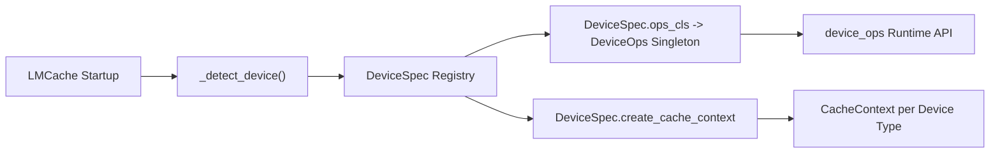
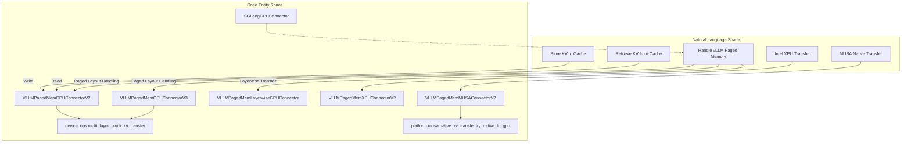
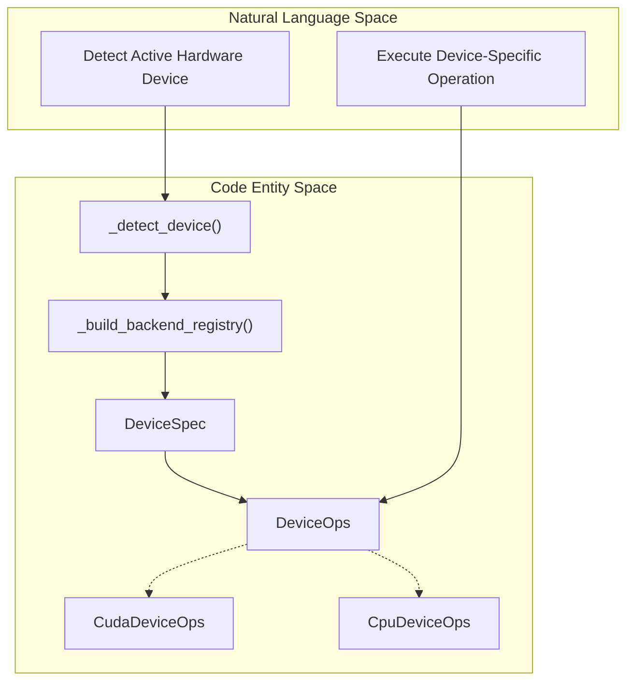

<!-- source: DeepWiki mcp.deepwiki.com · repo LMCache/LMCache · page 6.2 Framework and Platform GPU Connectors · fetched 2026-10-21 -->

# Framework and Platform GPU Connectors

Relevant source files

The following files were used as context for generating this wiki page:

- [benchmarks/musa/README.md](benchmarks/musa/README.md)
- [benchmarks/musa/bench_inprocess_transfer.py](benchmarks/musa/bench_inprocess_transfer.py)
- [lmcache/usage_context.py](lmcache/usage_context.py)
- [lmcache/v1/gpu_connector/__init__.py](lmcache/v1/gpu_connector/__init__.py)
- [lmcache/v1/gpu_connector/gpu_connectors.py](lmcache/v1/gpu_connector/gpu_connectors.py)
- [lmcache/v1/gpu_connector/hpu_connector.py](lmcache/v1/gpu_connector/hpu_connector.py)
- [lmcache/v1/gpu_connector/musa_connectors.py](lmcache/v1/gpu_connector/musa_connectors.py)
- [lmcache/v1/gpu_connector/utils.py](lmcache/v1/gpu_connector/utils.py)
- [lmcache/v1/gpu_connector/xpu_connectors.py](lmcache/v1/gpu_connector/xpu_connectors.py)
- [lmcache/v1/platform/__init__.py](lmcache/v1/platform/__init__.py)
- [lmcache/v1/platform/base/device_ops.py](lmcache/v1/platform/base/device_ops.py)
- [lmcache/v1/platform/devices/cpu/device_ops.py](lmcache/v1/platform/devices/cpu/device_ops.py)
- [lmcache/v1/platform/devices/cuda/device_ops.py](lmcache/v1/platform/devices/cuda/device_ops.py)
- [lmcache/v1/platform/devices/musa/device_ops.py](lmcache/v1/platform/devices/musa/device_ops.py)
- [lmcache/v1/platform/torch_ops/_tensor_from_ptr.py](lmcache/v1/platform/torch_ops/_tensor_from_ptr.py)
- [tests/benchmarks/test_musa_inprocess_benchmark.py](tests/benchmarks/test_musa_inprocess_benchmark.py)
- [tests/v1/platform/devices/cpu/test_cpu_tensor_from_ptr.py](tests/v1/platform/devices/cpu/test_cpu_tensor_from_ptr.py)
- [tests/v1/platform/devices/cuda/test_cuda_tensor_from_ptr.py](tests/v1/platform/devices/cuda/test_cuda_tensor_from_ptr.py)
- [tests/v1/platform/test_device_ops.py](tests/v1/platform/test_device_ops.py)
- [tests/v1/test_gpu_connector.py](tests/v1/test_gpu_connector.py)
- [tests/v1/test_mem_kernels.py](tests/v1/test_mem_kernels.py)
- [tests/v1/test_musa_connector.py](tests/v1/test_musa_connector.py)
- [tests/v1/test_musa_native.py](tests/v1/test_musa_native.py)
- [tests/v1/test_musa_support.py](tests/v1/test_musa_support.py)
- [tests/v1/utils.py](tests/v1/utils.py)

## Purpose and Scope

This document provides a technical overview of LMCache's GPU and accelerator connectors designed for framework-specific and platform-specific compatibility. These connectors bridge different LLM serving engines—such as vLLM and SGLang—and LMCache's internal representation of KV caches stored as `MemoryObj` instances.

The page details:
- Connector implementations for vLLM's paged memory layouts, including V2, V3, and layerwise variants.
- Connectors adapted for the SGLang serving engine.
- Connectors for heterogeneous accelerators such as Intel XPU, Habana HPU, Moore Threads MUSA, and other platforms.
- The platform abstraction mechanism (`DeviceOps` and `DeviceSpec`) that unifies and dispatches device-specific operations.

For foundational knowledge of the `GPUConnectorInterface` and KV format detection, see [6.1 GPU Connector Interface and KV Formats](). For related kernel implementations and low-level dispatch of memory transfers, see [6.3 CUDA/SYCL Memory Kernels]().

**Sources:** `[lmcache/v1/gpu_connector/gpu_connectors.py:44-145]()`, `[lmcache/v1/gpu_connector/__init__.py:1-186]()`

---

## Platform Abstraction and Device Registry

To support various hardware accelerators cleanly, LMCache employs a platform abstraction layer under `lmcache/v1/platform/`. This decouples device-specific conditional logic from the GPU connectors.

### Key Structural Components
- **Device Detection (`_detect_device`)**: Dynamically discovers active devices by probing PyTorch device attributes or respecting environment configuration overrides [lmcache/v1/platform/__init__.py:1-121]().
- **DeviceSpec Registry**: Backends register a `DeviceSpec` subclass to declare device types, provide accelerated operations via `DeviceOps`, and construct backend-specific cache contexts [lmcache/v1/platform/__init__.py:1-121]().
- **DeviceOps Abstraction**: Exposes polymorphic instance methods to execute native operations, common routines, and synchronization without hardcoding device checks [tests/v1/platform/test_device_ops.py:1-89]().

### Platform Device Resolution Architecture

**Sources:** `[lmcache/v1/platform/__init__.py:1-121]()`, `[tests/v1/platform/test_device_ops.py:1-89]()`

---

## vLLM Paged Memory Connectors

vLLM serves KV caches using paged memory layouts where key and value tensors are arranged in fixed-size blocks. LMCache supports multiple versions of connectors to handle evolving vLLM internal requirements.

### VLLMPagedMemGPUConnectorV2
- Expects `kvcaches` as a nested tuple: `[KVLayer, ...]`, where each `KVLayer` is a tuple `(KeyTensor, ValueTensor)` with shape `[num_blocks, block_size, num_heads, head_size]` [lmcache/v1/gpu_connector/gpu_connectors.py:148-177]().
- Produces or consumes `MemoryObj` instances formatted as `KV_2LTD` or `KV_MLA_FMT`.
- Maintains CPU tensors (`kv_cache_pointers`) and cached GPU-side pointers (`kv_cache_pointers_on_gpu`) to accelerate kernel invocation [tests/v1/test_gpu_connector.py:104-202]().

### VLLMPagedMemGPUConnectorV3 (Heterogeneous Layers)
- Designed to support heterogeneous layer groups (such as mixed precision or varying block structures in advanced models).
- Utilizes `KVLayerGroupsManager` to bucket layers by their shared identity properties (`LayerGroupIdentity`) into distinct transfer kernel groups [lmcache/v1/gpu_connector/gpu_connectors.py:364-539]().

**Sources:** `[lmcache/v1/gpu_connector/gpu_connectors.py:148-539]()`, `[tests/v1/test_gpu_connector.py:104-202]()`

---

## Layerwise GPU Connectors

Layerwise connectors enable pipelined data transfer, where KV transfers occur layer-by-layer concurrently with model execution.

### VLLMPagedMemLayerwiseGPUConnector
- Implements a generator interface yielding per-layer transfer tasks synchronously with model execution.
- Receives memory objects via generator `.send()` calls and executes `to_gpu`/`from_gpu` operations layer by layer [lmcache/v1/gpu_connector/gpu_connectors.py:937-1110]().

### VLLMBufferLayerwiseGPUConnector
- Supports advanced cache blending and RoPE (Rotary Position Embedding) recovery.
- Utilizes double-buffered GPU memory objects (`compute_gpu_buffer_obj` and `load_gpu_buffer_obj`) for concurrent staging and compute [lmcache/v1/gpu_connector/gpu_connectors.py:541-935]().

**Sources:** `[lmcache/v1/gpu_connector/gpu_connectors.py:541-1110]()`

---

## SGLang GPU Connectors

LMCache provides `SGLangGPUConnector` and `SGLangLayerwiseGPUConnector` for the SGLang serving engine, which relies on RadixAttention cache pools:
- Retrieves worker device info (`local_worker_id`) from `LMCacheMetadata` and sets the active device [lmcache/v1/gpu_connector/__init__.py:60-157]().
- Supports both standard and layerwise data transfers optimized for SGLang's internal block layout [lmcache/v1/gpu_connector/__init__.py:60-157]().

**Sources:** `[lmcache/v1/gpu_connector/__init__.py:60-157]()`

---

## XPU, HPU, and MUSA Variants

LMCache extends its connector architecture to support alternative hardware accelerators through dedicated backend modules.

### XPU Connector (Intel)
- `VLLMPagedMemXPUConnectorV2` uses PyTorch XPU APIs, managing streams via `torch.xpu.Stream` and handling index-copy memory transfers with `torch.uint64` pointer arrays [lmcache/v1/gpu_connector/xpu_connectors.py:35-143]().

### Habana HPU Connector
- `VLLMPagedMemHPUConnectorV2` adapts to Habana Gaudi devices by issuing `habana_frameworks.torch.htorch.core.mark_step()` calls to flush lazy execution graphs and synchronize streams correctly [lmcache/v1/gpu_connector/hpu_connector.py:48-185]().

### Moore Threads MUSA Connector
- `VLLMPagedMemMUSAConnectorV2` supports MUSA devices, validating supported vLLM formats and integrating with lazy memory allocators via pinned-boundary copy checks (`_copy_tensor_at_pin_boundaries`) [lmcache/v1/gpu_connector/musa_connectors.py:61-207]().

**Sources:** `[lmcache/v1/gpu_connector/xpu_connectors.py:35-143]`, `[lmcache/v1/gpu_connector/hpu_connector.py:48-185]()`, `[lmcache/v1/gpu_connector/musa_connectors.py:61-207]()`

---

## Memory Layout Discovery and Detection

LMCache centralizes layout detection using the `kv_format` package:
- `detect_format` inspects `kv_caches` structures to return an `EngineKVFormat` enum member [lmcache/v1/gpu_connector/utils.py:20-40]().
- Functions like `get_engine_kv_shape_description` and `get_concrete_engine_kv_shape` provide symbolic and numeric shape strings for diagnostics and logging [lmcache/v1/gpu_connector/utils.py:96-177]().

**Sources:** `[lmcache/v1/gpu_connector/utils.py:20-187]()`

---

## System Mapping: Natural Language to Code Entities

### Data Transfer Logic Mapping

**Sources:** `[lmcache/v1/gpu_connector/gpu_connectors.py:44-177]()`, `[lmcache/v1/gpu_connector/xpu_connectors.py:35-143]()`, `[lmcache/v1/gpu_connector/musa_connectors.py:61-207]()`

### Platform Dispatch Architecture Mapping

**Sources:** `[lmcache/v1/platform/__init__.py:1-121]()`, `[tests/v1/platform/test_device_ops.py:1-89]()`

---

## Comparison of Connector Features

| Feature | VLLM V2 | VLLM V3 | VLLM Layerwise | SGLang | XPU / HPU | MUSA |
|---|---|---|---|---|---|---|
| **Primary Class** | `VLLMPagedMemGPUConnectorV2` | `VLLMPagedMemGPUConnectorV3` | `VLLMPagedMemLayerwiseGPUConnector` | `SGLangGPUConnector` | `VLLMPagedMemXPUConnectorV2` | `VLLMPagedMemMUSAConnectorV2` |
| **Paged Memory** | Yes | Yes | Yes | Yes (Radix) | Yes | Yes |
| **MLA Support** | Yes | Yes | Yes | Yes | Yes | Yes |
| **Layerwise Transfer**| No | No | Yes | Optional | Optional | No |
| **Lazy Execution** | No | No | No | No | Yes (HPU `mark_step`) | Yes (MUSA boundary checks) |

**Sources:** `[lmcache/v1/gpu_connector/gpu_connectors.py:44-1240]()`, `[lmcache/v1/gpu_connector/__init__.py:1-186]()`, `[lmcache/v1/gpu_connector/hpu_connector.py:48-185]()`, `[lmcache/v1/gpu_connector/musa_connectors.py:61-207]()`

---

