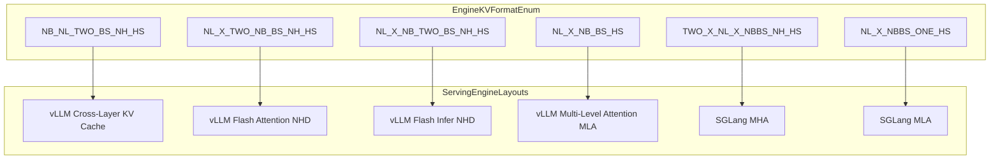
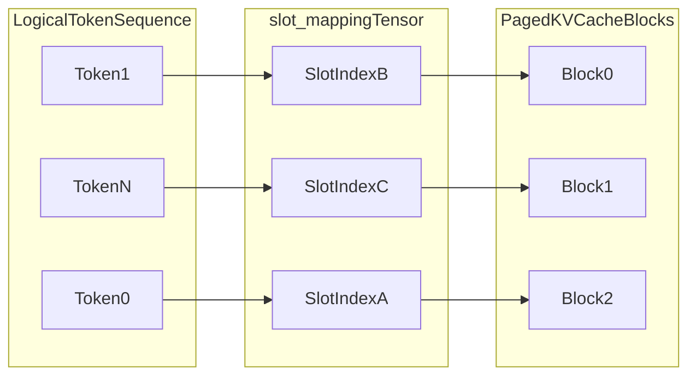

<!-- source: DeepWiki mcp.deepwiki.com · repo LMCache/LMCache · page 6.3 CUDA/SYCL Memory Kernels · fetched 2026-10-21 -->

# CUDA/SYCL Memory Kernels

Relevant source files

The following files were used as context for generating this wiki page:

- [.gitignore](.gitignore)
- [benchmarks/microbenchmark/bitmap_ops_benchmark.py](benchmarks/microbenchmark/bitmap_ops_benchmark.py)
- [csrc/cuda/mp_mem_kernels.cu](csrc/cuda/mp_mem_kernels.cu)
- [csrc/cuda/mp_mem_kernels.cuh](csrc/cuda/mp_mem_kernels.cuh)
- [csrc/cuda/transfer_plan_types.cuh](csrc/cuda/transfer_plan_types.cuh)
- [csrc/lmcache_native/bitmap.h](csrc/lmcache_native/bitmap.h)
- [csrc/lmcache_native/fold.cpp](csrc/lmcache_native/fold.cpp)
- [csrc/lmcache_native/fold.h](csrc/lmcache_native/fold.h)
- [csrc/sycl/mem_kernels_sycl.cpp](csrc/sycl/mem_kernels_sycl.cpp)
- [csrc/sycl/mem_kernels_sycl.h](csrc/sycl/mem_kernels_sycl.h)
- [csrc/sycl/mp_mem_kernels_sycl.cpp](csrc/sycl/mp_mem_kernels_sycl.cpp)
- [csrc/sycl/pybind_sycl.cpp](csrc/sycl/pybind_sycl.cpp)
- [docs/design/v1/distributed/bitmap_ops/README.md](docs/design/v1/distributed/bitmap_ops/README.md)
- [docs/design/v1/multiprocess/lmcache_driven_transfer_copy_paths.md](docs/design/v1/multiprocess/lmcache_driven_transfer_copy_paths.md)
- [docs/design/v1/platform/base/event_ipc_abstraction.md](docs/design/v1/platform/base/event_ipc_abstraction.md)
- [lmcache/__init__.py](lmcache/__init__.py)
- [lmcache/v1/distributed/bitmap_ops/__init__.py](lmcache/v1/distributed/bitmap_ops/__init__.py)
- [lmcache/v1/distributed/bitmap_ops/fold.py](lmcache/v1/distributed/bitmap_ops/fold.py)
- [lmcache/v1/gpu_connector/gpu_ops.py](lmcache/v1/gpu_connector/gpu_ops.py)
- [lmcache/v1/multiprocess/modules/blend/lookup.py](lmcache/v1/multiprocess/modules/blend/lookup.py)
- [lmcache/v1/multiprocess/modules/experimental/qstore.py](lmcache/v1/multiprocess/modules/experimental/qstore.py)
- [lmcache/v1/multiprocess/object_group_transfer.py](lmcache/v1/multiprocess/object_group_transfer.py)
- [lmcache/v1/platform/base/event_ipc.py](lmcache/v1/platform/base/event_ipc.py)
- [lmcache/v1/platform/devices/cuda/cache_context.py](lmcache/v1/platform/devices/cuda/cache_context.py)
- [setup.py](setup.py)
- [tests/v1/distributed/test_bitmap_ops.py](tests/v1/distributed/test_bitmap_ops.py)
- [tests/v1/multiprocess/test_batched_iteration_with_skip.py](tests/v1/multiprocess/test_batched_iteration_with_skip.py)
- [tests/v1/multiprocess/test_blend_observability.py](tests/v1/multiprocess/test_blend_observability.py)
- [tests/v1/multiprocess/test_blend_retrieve.py](tests/v1/multiprocess/test_blend_retrieve.py)
- [tests/v1/multiprocess/test_blend_store.py](tests/v1/multiprocess/test_blend_store.py)
- [tests/v1/multiprocess/test_direct_copy_planner_gpu.py](tests/v1/multiprocess/test_direct_copy_planner_gpu.py)
- [tests/v1/multiprocess/test_direct_copy_transfer_gpu.py](tests/v1/multiprocess/test_direct_copy_transfer_gpu.py)
- [tests/v1/platform/test_event_ipc.py](tests/v1/platform/test_event_ipc.py)
- [tests/v1/platform/test_isolated_ipc.py](tests/v1/platform/test_isolated_ipc.py)
- [tests/v1/test_cuda_ops_parity.py](tests/v1/test_cuda_ops_parity.py)
- [tests/v1/test_mp_mem_kernels.py](tests/v1/test_mp_mem_kernels.py)
- [tests/v1/test_xpu_sglang_connector.py](tests/v1/test_xpu_sglang_connector.py)

This page documents the CUDA and SYCL memory kernels and associated Python modules critical for high-performance data transfer and memory layout transformations between GPU paged memory (used by vLLM, SGLang, TensorRT-LLM, etc.) and LMCache’s internal storage formats. It covers the `lmcache.c_ops` and `lmcache_native` modules, the native GPU kernels implemented in CUDA and SYCL, the multi-layer KV transfer logic, bitmap prefix cache hit computations, and the slot mapping abstraction central to index translation.

---

## 6.3.1 Module Overview and Architecture

LMCache provides a unified interface for memory kernels used in GPU cache operations via two compiled extension modules:

- **`lmcache.c_ops` / `lmcache.cuda_ops`**: CUDA-based memory kernel bindings compiled from C++/CUDA sources, exposing functions for KV cache transfer, reshaping, and asynchronous memcpy operations.
- **`lmcache_native`**: A common pybind11 C++ extension exposing enums (`TransferDirection`, `EngineKVFormat`) and bitmap operators (fold/unfold) that underpin memory kernel logic.
- **`lmcache.xpu_ops`**: SYCL/XPU (Intel GPUs and similar accelerators) kernel bindings compiled from SYCL C++ sources providing largely equivalent functionality to the CUDA kernels but optimized for XPU devices.

The entry points for kernel calls are Python modules wrapped in C++ using pybind11:  
- SYCL kernels: exposed via `lmcache.xpu_ops` [csrc/sycl/pybind_sycl.cpp:22-125]()  
- CUDA kernels: exposed via `lmcache.cuda_ops` [csrc/cuda/pybind.cpp:22-125]()

Sources: [csrc/sycl/pybind_sycl.cpp:22-125](), [csrc/cuda/pybind.cpp:22-125]()

---

## 6.3.2 Key Enums and Data Formats

### TransferDirection

Defines the data flow direction for kernels:

| Enum             | Integer Value | Description                             |
|------------------|---------------|-------------------------------------|
| `H2D` (Host to Device) | 0             | LMCache host memory to GPU paged memory (loading)  |
| `D2H` (Device to Host) | 1             | GPU paged memory to LMCache host memory (saving)  |

The kernels use this to switch copy direction logic.  
Source: [csrc/kv_transfer_types.h:8-13]()

### EngineKVFormat

Enumerates the tensor layout formats used by various serving engines for KV cache tensors. This enum enables kernels and adapters to interpret and rearrange KV cache data correctly [docs/design/v1/gpu_connector/layout-invariant.md:1-127]().

The enum covers multiple common layouts:

| Format Name                        | Description                  | Example serving engine use                  |
|----------------------------------|------------------------------|---------------------------------------------|
| `NB_NL_TWO_BS_NH_HS`             | Cross-layer vLLM format       | vLLM cross-layer KV cache                    |
| `NL_X_TWO_NB_BS_NH_HS`           | Flash attention (vLLM NHD)    | vLLM non-MLA flash attention                 |
| `NL_X_NB_TWO_BS_NH_HS`           | Flash infer (vLLM NHD)        | vLLM non-MLA flash infer                     |
| `NL_X_NB_BS_HS`                  | MLA (Multi-Level Attention)   | vLLM MLA format                              |
| `TWO_X_NL_X_NBBS_NH_HS`          | SGLang MHA format             | SGLang MHA                                  |
| `NL_X_NBBS_ONE_HS`               | SGLang MLA format             | SGLang MLA                                  |

**Diagram: GPU KV Cache Layout Enum to Serving Engines**

Sources: [csrc/kv_transfer_types.h:1-13](), [docs/design/v1/gpu_connector/layout-invariant.md:1-127]()

---

## 6.3.3 Multi-Layer KV Transfer Kernels

### Purpose

`multi_layer_kv_transfer` performs batch transfer of key-value cache tensors spanning multiple transformer layers between the LMCache contiguous host memory layout and the serving engine’s paged GPU memory. It supports scattered token slot mappings for efficient reuse.

### Data Flow and Implementation

- Input tensors:
  - `key_value`: Contiguous LMCache memory object tensor or paged memory buffer.
  - `key_value_ptrs`: Block pointers (device pointers) to segments in GPU paged cache.
  - `slot_mapping`: A 1D tensor mapping each token to a physical slot index in the GPU paged memory.
  - Additional parameters: device type, buffer size, direction, engine KV format, and auxiliary dimensions (`block_size`, `head_size`), optimized per format.

- Kernel Threads:
  - Launched as 3D thread blocks [csrc/cuda/mp_mem_kernels.cu:15-32]():
    - `threadIdx.x` strides within single transfer units inside a head.
    - `threadIdx.y` selects the head dimension.
    - `threadIdx.z` partitions the block size dimension.

- Directionality:
  - **D2H (Device to Host)** kernel reads from paged GPU memory at offsets indexed via `slot_mapping` and writes into the LMCache contiguous layout.
  - **H2D (Host to Device)** kernel reverses direction.

- API Exposure:
  - **CUDA**: `cuda_ops.multi_layer_kv_transfer` [csrc/cuda/pybind.cpp:31-50]()  
  - **SYCL**: `xpu_ops.multi_layer_kv_transfer` [csrc/sycl/pybind_sycl.cpp:22-41](), implemented in [csrc/sycl/mem_kernels_sycl.cpp:1-150]().

Sources: [csrc/sycl/pybind_sycl.cpp:22-41](), [csrc/cuda/pybind.cpp:31-50](), [csrc/cuda/mp_mem_kernels.cu:12-32]()

---

## 6.3.4 Single-Layer Transfer Kernels

LMCache also provides dedicated kernels for single-layer KV cache transfers:

- **`single_layer_kv_transfer`**: Transfers KV cache tensors between LMCache format and vLLM-like in-GPU paged formats for one layer [csrc/sycl/mem_kernels_sycl.h:49-55]().
- **`single_layer_kv_transfer_sgl`**: Variant for SGLang with separate key and value caches managed independently [csrc/sycl/mem_kernels_sycl.h:56-62]().

Sources: [csrc/sycl/mem_kernels_sycl.h:49-62](), [csrc/cuda/pybind.cpp:62-85]()

---

## 6.3.5 Legacy/Unit-Test Kernels: load_and_reshape_flash & reshape_and_cache_back_flash

These kernels are primarily used in unit tests for validating zero-copy loading and extraction of KV cache slices.

- **`load_and_reshape_flash`**: Copies and rearranges KV keys and values from GPU paged cache to LMCache dense tensors, extracting a prefix range [csrc/sycl/mem_kernels_sycl.h:71-74]().
- **`reshape_and_cache_back_flash`**: Performs the inverse operation, scattering a dense memory object’s KV cache back into the GPU’s paged KV cache [csrc/sycl/mem_kernels_sycl.h:76-81]().

Sources: [csrc/sycl/mem_kernels_sycl.h:71-81](), [csrc/cuda/pybind.cpp:86-87]()

---

## 6.3.6 Slot Mapping: Logical to Physical Index Translations

The `slot_mapping` tensor is a 1D int64 tensor mapping each logical token position in a request to a physical slot index in the GPU paged memory blocks.

- The slot index corresponds to a block in the paged memory:  
  `block_index = slot_mapping[token_index] // block_size`

- During transfers, kernels use `slot_mapping` to perform scatter/gather via indirect pointers (`key_value_ptrs` or direct offsets) ensuring only relevant KV blocks for requested tokens are loaded or saved.

**Diagram: Slot Mapping from Logical Tokens to GPU KV Blocks**

Sources: [csrc/cuda/mp_mem_kernels.cu:30-100](), [lmcache/v1/multiprocess/object_group_transfer.py:1-50]()

---

## 6.3.7 Bitmap Operations for Prefix Cache Hit Computations

LMCache implements highly performance-optimized bitmap operators for multi-object group cache hit computation. These operators allow efficient intersection and windowing of per-group chunk presence bitmaps to determine served prefix lengths.

- **Fold**: Combine per-(group, chunk, rank) presence into a servable prefix length bitmap.
- **Highest set bit**: Returns the highest set prefix length bit, giving the effective longest servable prefix length.
- **Unfold**: Converts the prefix length back into per-group masks indicating which chunks each group must retain to serve that prefix.

**Diagram: Bitmap Operators Workflow**

Sources: [lmcache/v1/distributed/bitmap_ops/fold.py:90-180]()

---

## 6.3.8 lmcache.c_ops and lmcache_native Python Modules

- **`lmcache_native`** exposes fundamental enums (`TransferDirection`, `EngineKVFormat`) and compiled bitmap operations to Python, implemented in native C++ for performance and shared between CUDA and SYCL backends.
- **`lmcache.c_ops`** (alias for `lmcache.cuda_ops`) exposes CUDA memory kernels such as `multi_layer_kv_transfer`, `load_and_reshape_flash`, and `reshape_and_cache_back_flash`.
- **`lmcache.xpu_ops`** provides analogous public interfaces for the SYCL/XPU platform [csrc/sycl/pybind_sycl.cpp:22-125]().

Sources: [csrc/sycl/pybind_sycl.cpp:22-125](), [csrc/cuda/pybind.cpp:22-125]()

---

## 6.3.9 SYCL/XPU Kernel Design Notes

The SYCL implementation (`csrc/sycl/mem_kernels_sycl.cpp`) of memory kernels is carefully optimized for Intel GPUs and other XPU devices:

- Uses work-group size 256 threads, divisible into sub-groups of 16 to match native SIMD width.
- Kernel template parameters eliminate runtime branches.
- Integer division/modulo calculations on indices are hoisted out of inner loops.
- Supports 64-bit bulk transfers packing multiple FP16/FP32/int8 values per move.

Sources: [csrc/sycl/mem_kernels_sycl.cpp:1-154](), [csrc/sycl/mem_kernels_sycl.h:1-63]()

*End of "6.3 CUDA/SYCL Memory Kernels"*

---

