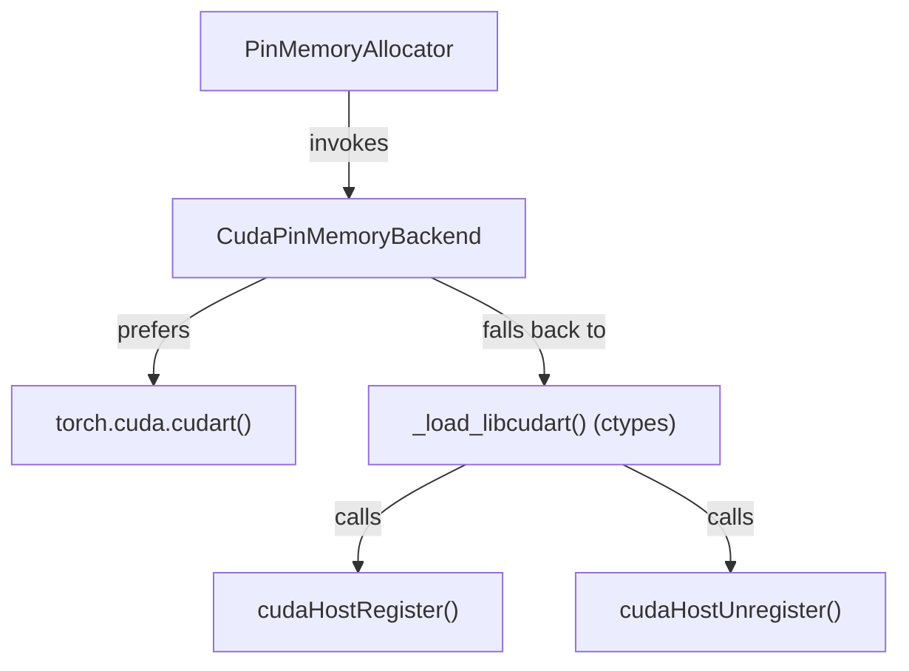
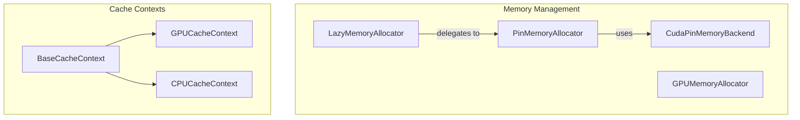
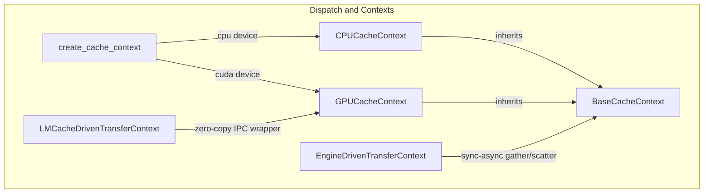

<!-- source: DeepWiki mcp.deepwiki.com · repo LMCache/LMCache · page 6.4 Pinned Memory, SHM and Cache Contexts · fetched 2026-10-21 -->

# Pinned Memory, SHM and Cache Contexts

Relevant source files

The following files were used as context for generating this wiki page:

- [.buildkite/k3_tests/amd/imported_event_lifetime.py](.buildkite/k3_tests/amd/imported_event_lifetime.py)
- [.buildkite/k3_tests/amd/pipeline.yml](.buildkite/k3_tests/amd/pipeline.yml)
- [.buildkite/k3_tests/amd/rocm10-mp-stress-container.sh](.buildkite/k3_tests/amd/rocm10-mp-stress-container.sh)
- [.buildkite/k3_tests/amd/run-ipc-event-probe.sh](.buildkite/k3_tests/amd/run-ipc-event-probe.sh)
- [.buildkite/k3_tests/amd/run-rocm10-mp-stress.sh](.buildkite/k3_tests/amd/run-rocm10-mp-stress.sh)
- [.buildkite/k3_tests/amd/run-unit-tests.sh](.buildkite/k3_tests/amd/run-unit-tests.sh)
- [.buildkite/scripts/amd-disk-guard.sh](.buildkite/scripts/amd-disk-guard.sh)
- [.buildkite/scripts/amd-vllm-bench.sh](.buildkite/scripts/amd-vllm-bench.sh)
- [lmcache/v1/platform/base/cache_context.py](lmcache/v1/platform/base/cache_context.py)
- [lmcache/v1/platform/cache_context.py](lmcache/v1/platform/cache_context.py)
- [tests/v1/platform/test_cache_context_dispatch.py](tests/v1/platform/test_cache_context_dispatch.py)
- [tests/v1/shm_allocator/test_shm_allocator.py](tests/v1/shm_allocator/test_shm_allocator.py)
- [tests/v1/storage_backend/test_nixl_shared_pool.py](tests/v1/storage_backend/test_nixl_shared_pool.py)
- [tests/v1/storage_backend/test_p2p_backend_with_controller.py](tests/v1/storage_backend/test_p2p_backend_with_controller.py)
- [tests/v1/storage_backend/test_raw_block_uring_cmd.py](tests/v1/storage_backend/test_raw_block_uring_cmd.py)

## Purpose and Scope

This page documents LMCache's handling of pinned (page-locked) memory, CUDA registered memory, shared memory (SHM) transports, and platform-specific cache context implementations. Pinned memory allocation is critical for efficient Direct Memory Access (DMA) transfers between CPU and GPU, which is a cornerstone for LMCache's low-latency KV cache management in large language model serving.

We cover the following components:

- `PinMemoryAllocator`, `LazyMemoryAllocator`, and `CudaPinMemoryBackend` for pinned CPU memory management with CUDA registration.
- GPU memory allocation for intermediate buffers via `GPUMemoryAllocator`.
- CPU shared memory transports using POSIX shared memory mapped tensors via `CpuShmTensorWrapper`.
- The `BaseCacheContext` interface and its per-platform subclasses (`GPUCacheContext` and `CPUCacheContext`).
- Multiprocess transfer context selection between engine-driven and LMCache-driven zero-copy IPC transfer modes.

Sources: `[lmcache/v1/platform/__init__.py:1-60]()`, `[lmcache/v1/platform/base/cache_context.py:1-202]`, `[lmcache/v1/platform/devices/cuda/pin_memory.py:50-175]()`

---

## Pinned Memory and CUDA Registered Memory

### PinMemoryAllocator and CudaPinMemoryBackend

The `PinMemoryAllocator` and its backend implementation `CudaPinMemoryBackend` are responsible for managing large contiguous blocks of pinned (page-locked) CPU memory, registered with CUDA to enable zero-copy DMA transfers.

- `CudaPinMemoryBackend` attempts to use `torch.cuda.cudart()` first as a lightweight binding `[lmcache/v1/platform/devices/cuda/pin_memory.py:76-95]()`.
- If torch cudart is unavailable, it dynamically loads `libcudart` via `ctypes` and binds `cudaHostRegister` and `cudaHostUnregister` `[lmcache/v1/platform/devices/cuda/pin_memory.py:17-48]()`.
- The `pin_memory(ptr, size, flags)` method registers memory regions and ensures that any registration failure is handled cleanly by reading the pending runtime error, preventing failures on subsequent thread kernel launches `[lmcache/v1/platform/devices/cuda/pin_memory.py:110-142]()`.

Sources: `[lmcache/v1/platform/devices/cuda/pin_memory.py:17-175]()`, `[tests/v1/platform/devices/cuda/test_cuda_pin_memory.py:24-41]()`

### LazyMemoryAllocator

`LazyMemoryAllocator` builds on `PinMemoryAllocator` by incrementally allocating and pinning host memory in background threads, from an initial small footprint up to a large configured maximum (`final_size`).

- Allocates in 64 MiB increments (`PIN_CHUNK_SIZE`) to reduce upfront memory pressure.
- Expands pinned memory pool asynchronously to absorb peak demand.
- Avoids long startup times and excessive pinned memory when workloads are dynamic.

Sources: `[docs/design/ARCHITECTURE_MULTI_HARDWARE.md:62-72]()`

---

## GPUMemoryAllocator

`GPUMemoryAllocator` manages memory on GPU devices used as intermediate staging buffers during GPU-to-CPU and CPU-to-GPU data copies.

- Allocates device tensors arranged in paged or contiguous layouts.
- Provides efficient buffers for GPU connectors (e.g., `VLLMPagedMemGPUConnectorV2`).
- Complies with `MemoryAllocatorInterface` to unify the allocation API for host and device memory.

Sources: `[docs/design/ARCHITECTURE_MULTI_HARDWARE.md:62-72]()`

---

## DMA Transfer and Shared Memory Transport

### Data Transfer Flow

LMCache data transfers KV cache tensors efficiently by combining:

- GPU kernel reshaping of tensors into DMA-friendly formats.
- Transfers from GPU KV cache buffers to pinned CPU buffers (DMA).
- Multiprocess shared memory mapping for zero-copy data sharing between LMCache server and worker processes.

Sources: `[lmcache/v1/multiprocess/transfer_context/worker_transfer.py:1-182]()`

### CPU Shared Memory Transport: CpuShmTensorWrapper

- The CPU KV cache transport wraps the shared memory region into CPU `torch.Tensor` instances, reconstructed via `torch.frombuffer()` over `ctypes` pointers.
- Shared memory segments are created under `/dev/shm/lmcache_kv_` namespace.
- This zero-copy IPC mechanism avoids data serialization and copies, allowing high throughput on CPU-only workloads or in multiprocess configurations.

Sources: `[lmcache/v1/multiprocess/transfer_context/worker_transfer.py:53-115]()`

---

## Cache Contexts

LMCache abstracts per-device cache context implementations with a unified `BaseCacheContext` interface, allowing platform-agnostic handling of KV cache tensor layouts, buffer staging, and transfer synchronization.

### BaseCacheContext Interface

- Abstract base class (`BaseCacheContext`) defined in `lmcache/v1/platform/base/cache_context.py` `[lmcache/v1/platform/base/cache_context.py:37-49]()`.
- Manages common metadata like KV cache tensor list (`kv_caches_`), device (`device_`), number of layers (`num_layers_`), block ID buffers (`block_ids_buffer_`), and shared state such as imported event tracking (`hold_imported_event`, `release_imported_event`) `[lmcache/v1/platform/base/cache_context.py:55-104]()`.
- Defines abstract properties and methods for device execution streams (`stream`, `cupy_stream`), maximum batch size, cleanup (`close()`), per-kernel-group KV pointers, temporary staging buffers, and shape/dtype calculations `[lmcache/v1/platform/base/cache_context.py:109-165]()`.

Sources: `[lmcache/v1/platform/base/cache_context.py:37-202]()`

### create_cache_context Dispatch Factory

- Function `create_cache_context` dynamically detects the device type from the `kv_caches` tensor list `[lmcache/v1/platform/cache_context.py:120-123]()`.
- Uses `get_device_spec(device_type)` to obtain the appropriate `DeviceSpec` `[lmcache/v1/platform/cache_context.py:124-131]()`.
- Calls the platform-specific `create_cache_context` hook registered on the `DeviceSpec` `[lmcache/v1/platform/cache_context.py:132-140]()`.
- Supports CPU, CUDA, and external third-party accelerator contexts transparently `[lmcache/v1/platform/cache_context.py:2-21]()`.

Sources: `[lmcache/v1/platform/cache_context.py:48-140]()`, `[lmcache/v1/platform/base/cache_context.py:37-202]()`

### GPUCacheContext and CPUCacheContext

- `GPUCacheContext`: Handles CUDA tensors backed by `CudaIPCWrapper`, manages temporary GPU staging buffers, uses CUDA streams for asynchronous memory operations, and integrates with `KVLayerGroupsManager`.
- `CPUCacheContext`: Provides CPU fallback with direct shared memory tensor backing (`CpuShmTensorWrapper`), stub stream objects for synchronous operations, and temporary CPU buffers.

Sources: `[lmcache/v1/platform/base/cache_context.py:37-202]()`, `[lmcache/v1/platform/cache_context.py:76-140]()`

---

# Summary Diagrams

### System to Code Entity Mapping: Memory Allocators and Cache Contexts

Sources: `[lmcache/v1/platform/base/cache_context.py:37-202]()`, `[lmcache/v1/platform/devices/cuda/pin_memory.py:50-175]()`

### Cache Context Factory Dispatch and Transfer Context Modes

Sources: `[lmcache/v1/platform/base/cache_context.py:37-202]()`, `[lmcache/v1/multiprocess/transfer_context/worker_transfer.py:53-115]()`, `[lmcache/v1/platform/cache_context.py:76-140]()`

# End of Page 6.4

---

