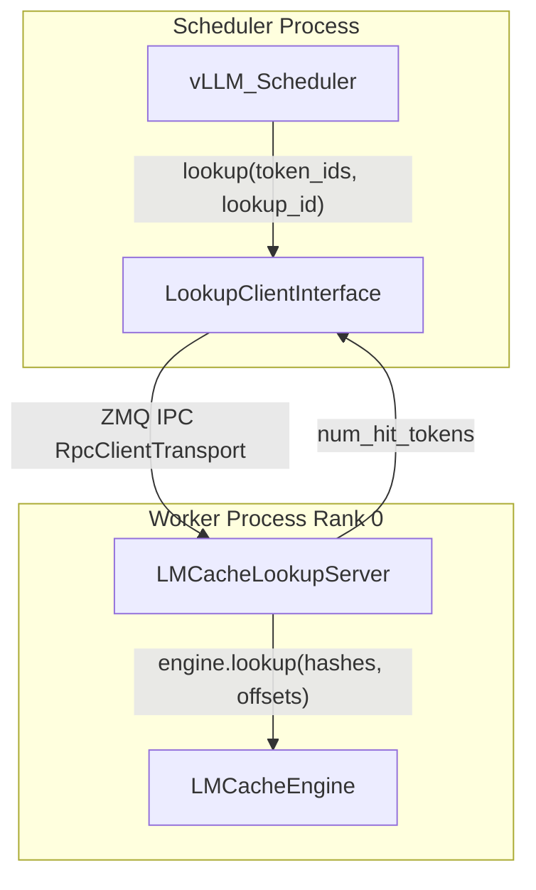
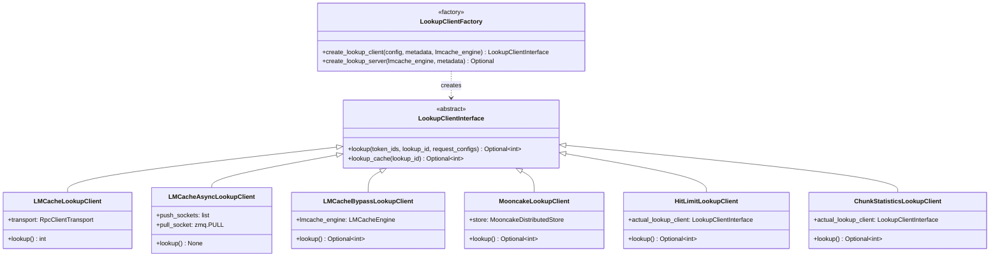
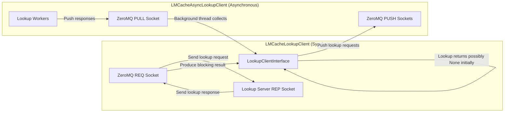
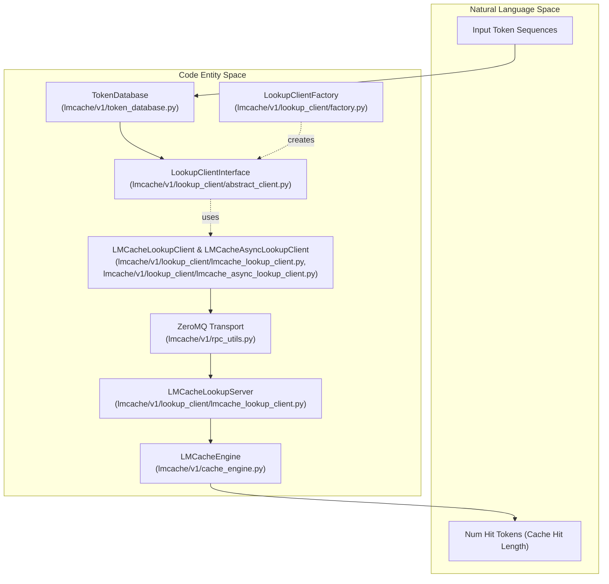
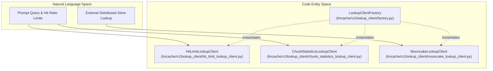

<!-- source: DeepWiki mcp.deepwiki.com · repo LMCache/LMCache · page 7 Distributed Lookup System · fetched 2026-10-21 -->

# Distributed Lookup System

Relevant source files

The following files were used as context for generating this wiki page:

- [lmcache/integration/vllm/utils.py](lmcache/integration/vllm/utils.py)
- [lmcache/integration/vllm/vllm_v1_adapter.py](lmcache/integration/vllm/vllm_v1_adapter.py)
- [lmcache/utils.py](lmcache/utils.py)
- [lmcache/v1/cache_engine.py](lmcache/v1/cache_engine.py)
- [lmcache/v1/config.py](lmcache/v1/config.py)
- [lmcache/v1/lookup_client/abstract_client.py](lmcache/v1/lookup_client/abstract_client.py)
- [lmcache/v1/lookup_client/chunk_statistics_lookup_client.py](lmcache/v1/lookup_client/chunk_statistics_lookup_client.py)
- [lmcache/v1/lookup_client/factory.py](lmcache/v1/lookup_client/factory.py)
- [lmcache/v1/lookup_client/hit_limit_lookup_client.py](lmcache/v1/lookup_client/hit_limit_lookup_client.py)
- [lmcache/v1/lookup_client/lmcache_async_lookup_client.py](lmcache/v1/lookup_client/lmcache_async_lookup_client.py)
- [lmcache/v1/lookup_client/lmcache_lookup_client.py](lmcache/v1/lookup_client/lmcache_lookup_client.py)
- [lmcache/v1/lookup_client/lmcache_lookup_client_bypass.py](lmcache/v1/lookup_client/lmcache_lookup_client_bypass.py)
- [lmcache/v1/lookup_client/mooncake_lookup_client.py](lmcache/v1/lookup_client/mooncake_lookup_client.py)
- [lmcache/v1/offload_server/zmq_server.py](lmcache/v1/offload_server/zmq_server.py)
- [lmcache/v1/rpc_utils.py](lmcache/v1/rpc_utils.py)
- [lmcache/v1/token_database.py](lmcache/v1/token_database.py)
- [tests/v1/lookup_client/test_chunk_statistics_lookup_client.py](tests/v1/lookup_client/test_chunk_statistics_lookup_client.py)
- [tests/v1/test_token_database.py](tests/v1/test_token_database.py)

This page provides a high-level overview of how LMCache determines KV cache prefix hits across multiple workers before retrieval. The distributed lookup system answers the core question: *for a given sequence of input tokens, how many of the corresponding KV cache chunks already exist in storage?* This information drives scheduling decisions in serving engines such as vLLM.

For detailed information on each component, refer to the respective child pages:  
- [Lookup Client Architecture](#7.1)  
- [Synchronous Lookup](#7.2)  
- [Asynchronous Lookup and Prefetching](#7.3)  
- [Specialized Lookup Clients](#7.4)  
- [Lookup Server](#7.5)

---

## Role in the Request Lifecycle

When the vLLM scheduler processes a new request, it interacts with an instance implementing the `LookupClientInterface` [lmcache/v1/lookup_client/abstract_client.py:10-24]() to query cached prefix lengths. The lookup client coordinates with `LMCacheLookupServer` or `LMCacheAsyncLookupServer` instances running across worker processes [lmcache/v1/lookup_client/lmcache_lookup_client.py:182-195](), [lmcache/v1/lookup_client/factory.py:102-144](). These servers query their local `LMCacheEngine` instances for chunk existence and return the number of cache hits.

### Diagram: Lookup Request Lifecycle

Sources: [lmcache/v1/lookup_client/abstract_client.py:10-77](), [lmcache/v1/lookup_client/lmcache_lookup_client.py:27-195]()

---

## Client-Server Decomposition

The distributed lookup system divides responsibilities between:

- **Client Side**: Runs on the scheduler process and implements `LookupClientInterface` [lmcache/v1/lookup_client/abstract_client.py:10-69](). It manages lookup IDs, preprocesses tokens into cache keys via the `TokenDatabase` abstraction [lmcache/v1/token_database.py:64-73](), and handles communication over transport layers such as ZeroMQ.  
- **Server Side**: Runs one or more lookup servers within worker processes [lmcache/v1/lookup_client/factory.py:102-144](). Each lookup server receives requests from clients, performs lookups on the local `LMCacheEngine`, and responds asynchronously or synchronously based on configuration [lmcache/v1/rpc_utils.py:116-174]().

IPC socket paths for communication are generated dynamically using `get_zmq_rpc_path_lmcache()`, which considers engine IDs, service roles, ports, and worker ranks to ensure correct socket naming and length constraints [lmcache/v1/rpc_utils.py:116-174]().

Sources: [lmcache/v1/lookup_client/abstract_client.py:10-69](), [lmcache/v1/lookup_client/factory.py:102-144](), [lmcache/v1/rpc_utils.py:116-174]()

---

## Client Hierarchy and Factory Pattern

LMCache uses a factory pattern to instantiate the appropriate lookup client and server implementations based on engine configuration (`LMCacheEngineConfig`) and metadata (`LMCacheMetadata`) [lmcache/v1/lookup_client/factory.py:36-144](). These include synchronous, asynchronous, bypass, and specialized clients.

### Diagram: Lookup Client Class Hierarchy

Sources: [lmcache/v1/lookup_client/abstract_client.py:10-69](), [lmcache/v1/lookup_client/factory.py:36-144](), [lmcache/v1/lookup_client/hit_limit_lookup_client.py:26-89](), [lmcache/v1/lookup_client/chunk_statistics_lookup_client.py:28-172]()

For further configuration and instantiation details, see [Lookup Client Architecture](#7.1). For descriptions of specialized clients, see [Specialized Lookup Clients](#7.4).

---

## Synchronous vs. Asynchronous Lookup Modes

LMCache supports two main communication patterns for lookups:

1. **Synchronous Lookup (`LMCacheLookupClient`)**: Uses a blocking ZeroMQ REQ-REP pattern where the client sends token hashes, awaits responses from all worker ranks, and determines the minimum number of hit tokens before proceeding [lmcache/v1/lookup_client/lmcache_lookup_client.py:27-161](). This simplifies coordination but can introduce blocking waits.

2. **Asynchronous Lookup (`LMCacheAsyncLookupClient`)**: Implements a PUSH-PULL pipeline over ZeroMQ sockets [lmcache/v1/lookup_client/lmcache_async_lookup_client.py:34-191](). The client sends lookup requests asynchronously and receives responses in a background thread, allowing prefetching and concurrent processing. Lookup results may initially return `None` (ongoing) before finalizing.

### Diagram: Synchronous vs Asynchronous Communication Patterns

Sources: [lmcache/v1/lookup_client/lmcache_lookup_client.py:27-161](), [lmcache/v1/lookup_client/lmcache_async_lookup_client.py:34-191]()

---

## Natural Language Space to Code Entity Space

### Diagram: Entity Mapping Overview 1

Sources: [lmcache/v1/lookup_client/abstract_client.py:10-69](), [lmcache/v1/lookup_client/factory.py:36-144](), [lmcache/v1/lookup_client/lmcache_lookup_client.py:27-161](), [lmcache/v1/lookup_client/lmcache_async_lookup_client.py:34-191](), [lmcache/v1/rpc_utils.py:116-174](), [lmcache/v1/token_database.py:64-73]()

### Diagram: Entity Mapping Overview 2

Sources: [lmcache/v1/lookup_client/factory.py:36-144](), [lmcache/v1/lookup_client/hit_limit_lookup_client.py:26-89](), [lmcache/v1/lookup_client/mooncake_lookup_client.py:22-96]()

---

## Child Pages

- **7.1 [Lookup Client Architecture](#7.1)** — Details on `LookupClientInterface`, `LookupClientFactory`, and the `lookup_server_worker_ids` configuration controlling which workers run lookup servers.  
- **7.2 [Synchronous Lookup](#7.2)** — Documentation of `LMCacheLookupClient`, the ZeroMQ REQ-REP pattern, and blocking lookup logic.  
- **7.3 [Asynchronous Lookup and Prefetching](#7.3)** — Explanation of `LMCacheAsyncLookupClient`, including PUSH-PULL socket patterns, prefetch pipelines, and response handling.  
- **7.4 [Specialized Lookup Clients](#7.4)** — Descriptions of decorator clients such as `HitLimitLookupClient`, `ChunkStatisticsLookupClient`, `LMCacheLookupClientBypass`, and external `MooncakeLookupClient`.  
- **7.5 [Lookup Server](#7.5)** — Details on the ZeroMQ lookup server implementations, offload server components, request processing, and response aggregation across distributed worker ranks.

---

