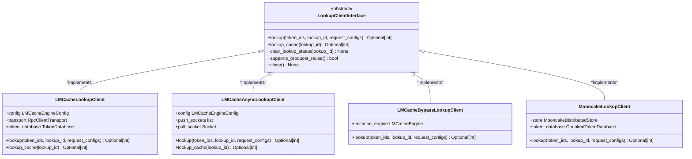
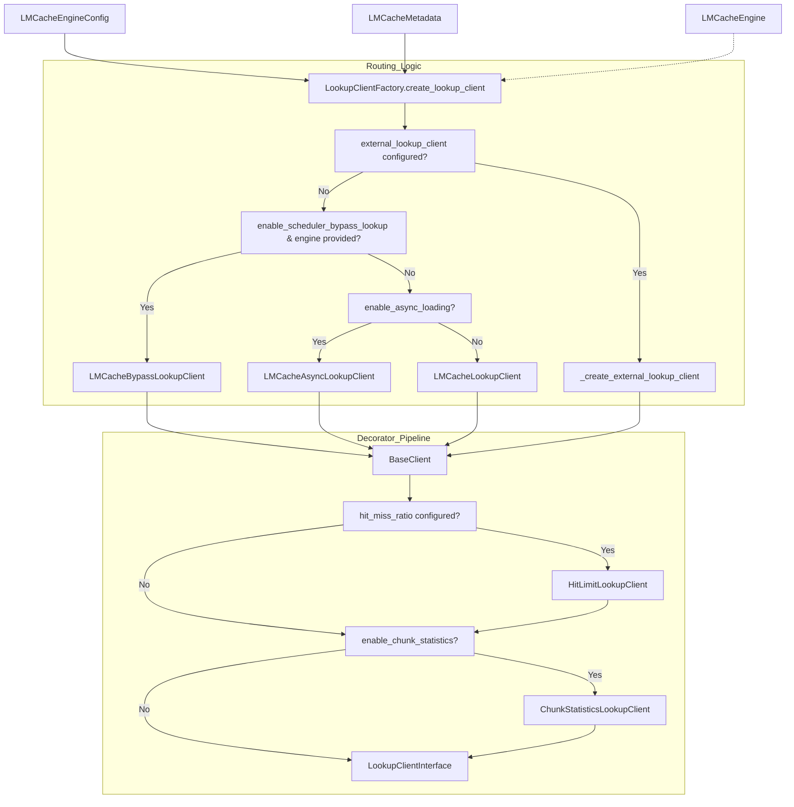
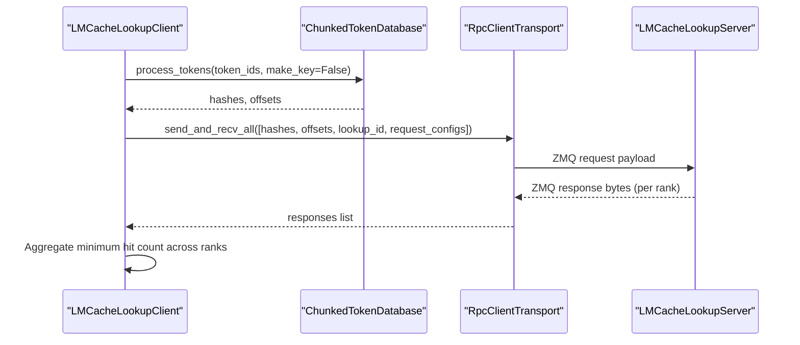

<!-- source: DeepWiki mcp.deepwiki.com · repo LMCache/LMCache · page 7.1 Lookup Client Architecture · fetched 2026-10-21 -->

# Lookup Client Architecture

<details>
<summary>Relevant source files</summary>

The following files were used as context for generating this wiki page:

- [lmcache/integration/vllm/utils.py](lmcache/integration/vllm/utils.py)
- [lmcache/integration/vllm/vllm_v1_adapter.py](lmcache/integration/vllm/vllm_v1_adapter.py)
- [lmcache/utils.py](lmcache/utils.py)
- [lmcache/v1/cache_engine.py](lmcache/v1/cache_engine.py)
- [lmcache/v1/config.py](lmcache/v1/config.py)
- [lmcache/v1/lookup_client/abstract_client.py](lmcache/v1/lookup_client/abstract_client.py)
- [lmcache/v1/lookup_client/chunk_statistics_lookup_client.py](lmcache/v1/lookup_client/chunk_statistics_lookup_client.py)
- [lmcache/v1/lookup_client/factory.py](lmcache/v1/lookup_client/factory.py)
- [lmcache/v1/lookup_client/hit_limit_lookup_client.py](lmcache/v1/lookup_client/hit_limit_lookup_client.py)
- [lmcache/v1/lookup_client/lmcache_async_lookup_client.py](lmcache/v1/lookup_client/lmcache_async_lookup_client.py)
- [lmcache/v1/lookup_client/lmcache_lookup_client.py](lmcache/v1/lookup_client/lmcache_lookup_client.py)
- [lmcache/v1/lookup_client/lmcache_lookup_client_bypass.py](lmcache/v1/lookup_client/lmcache_lookup_client_bypass.py)
- [lmcache/v1/lookup_client/mooncake_lookup_client.py](lmcache/v1/lookup_client/mooncake_lookup_client.py)
- [lmcache/v1/offload_server/zmq_server.py](lmcache/v1/offload_server/zmq_server.py)
- [lmcache/v1/rpc_utils.py](lmcache/v1/rpc_utils.py)
- [lmcache/v1/token_database.py](lmcache/v1/token_database.py)
- [tests/v1/lookup_client/test_chunk_statistics_lookup_client.py](tests/v1/lookup_client/test_chunk_statistics_lookup_client.py)
- [tests/v1/test_token_database.py](tests/v1/test_token_database.py)

</details>


## Purpose and Scope

The Lookup Client Architecture in LMCache defines an abstraction layer responsible for querying cache content availability in the distributed KV cache system. Lookup clients allow schedulers and workers to determine how many tokens from an input request exist in cache before actual generation or computation, facilitating intelligent prefill reuse and cache hit optimizations.

This page covers the key components:
- The abstract `LookupClientInterface` contract defined in `lmcache/v1/lookup_client/abstract_client.py` that specifies the required API for lookup clients.
- The `LookupClientFactory` in `lmcache/v1/lookup_client/factory.py` that creates client and server instances based on configuration.
- The `lookup_server_worker_ids` configuration that controls which worker ranks run lookup servers.
- Core client implementations and their data flow, including token processing and RPC communication.

Sources: [lmcache/v1/lookup_client/abstract_client.py:10-77](), [lmcache/v1/lookup_client/factory.py:36-145](), [lmcache/v1/lookup_client/lmcache_lookup_client.py:27-48]()

---

## LookupClientInterface Contract

The `LookupClientInterface` defines an abstract base class for all LMCache lookup clients [lmcache/v1/lookup_client/abstract_client.py:10-77](). It standardizes the API for performing token lookups and querying lookup status, enabling transparent substitution of different client implementations.

### Interface Methods

| Method | Purpose | Return Semantics |
| :--- | :--- | :--- |
| `lookup(token_ids, lookup_id, request_configs)` | Initiate a lookup request for the specified token IDs [lmcache/v1/lookup_client/abstract_client.py:13-17](). | Returns number of tokens found in cache (`int >= 0`), `-1` for miss, or `None` for ongoing async lookup [lmcache/v1/lookup_client/abstract_client.py:13-17](). |
| `lookup_cache(lookup_id)` | Query the current cache status for a previously issued lookup ID [lmcache/v1/lookup_client/abstract_client.py:19-21](). | Returns as above: `int`, `-1`, or `None` [lmcache/v1/lookup_client/abstract_client.py:19-21](). |
| `clear_lookup_status(lookup_id)` | Clear internal status/cache related to a lookup ID to avoid memory leaks [lmcache/v1/lookup_client/abstract_client.py:23-25](). | None |
| `supports_producer_reuse()` | Indicates if the client supports producer KV cache reuse mode [lmcache/v1/lookup_client/abstract_client.py:27-29](). | `True` or `False` |
| `close()` | Cleanup resources associated with the lookup client [lmcache/v1/lookup_client/abstract_client.py:31-33](). | None |

Sources: [lmcache/v1/lookup_client/abstract_client.py:10-77]()

### Class Diagram: Lookup Client Interface & Implementations (Code Entity Space)



Sources: [lmcache/v1/lookup_client/abstract_client.py:10-77](), [lmcache/v1/lookup_client/lmcache_lookup_client.py:27-179](), [lmcache/v1/lookup_client/lmcache_async_lookup_client.py:34-191](), [lmcache/v1/lookup_client/lmcache_lookup_client_bypass.py:21-102](), [lmcache/v1/lookup_client/mooncake_lookup_client.py:22-88]()

---

## Lookup Client Factory

The `LookupClientFactory` centralizes the creation logic for lookup client and server instances based on the engine configuration and metadata [lmcache/v1/lookup_client/factory.py:36-145](). It chooses and instantiates client implementations based on flags like `enable_async_loading`, `enable_scheduler_bypass_lookup`, and presence of an external lookup client URI [lmcache/v1/lookup_client/factory.py:61-88]().

### Client Creation Flow

1. If the config specifies `external_lookup_client`, create an external client via `_create_external_lookup_client()` [lmcache/v1/lookup_client/factory.py:61-68]().
2. Otherwise:
   - If `enable_scheduler_bypass_lookup` is enabled and the `lmcache_engine` instance is provided, create an `LMCacheBypassLookupClient` [lmcache/v1/lookup_client/factory.py:79-80]().
   - Else if `enable_async_loading` is enabled, create an `LMCacheAsyncLookupClient` [lmcache/v1/lookup_client/factory.py:81-82]().
   - Else create a synchronous `LMCacheLookupClient` using a ZMQ REQ-REP transport [lmcache/v1/lookup_client/factory.py:83-87]().

After creating the base client, optionally wrap it with decorators such as:
- `HitLimitLookupClient` if `hit_miss_ratio` is configured [lmcache/v1/lookup_client/factory.py:89-90]()
- `ChunkStatisticsLookupClient` if `enable_chunk_statistics` is enabled [lmcache/v1/lookup_client/factory.py:93-98]()

### Diagram: LookupClientFactory Routing and Decorator Wrapping (Code Entity Space)



Sources: [lmcache/v1/lookup_client/factory.py:36-99]()

---

## Configuration: `lookup_server_worker_ids`

This configuration controls which worker ranks run the lookup server instances in the distributed model parallel environment [lmcache/v1/lookup_client/lmcache_lookup_client.py:36-48](). It is crucial for workload efficiency and storage optimization, especially when using Multi-Level Attention (MLA) mode.

### Default and Custom Behavior

- **MLA Enabled (`use_mla=True`)**: Defaults to `[0]`—only rank 0 runs the lookup server by default, as MLA uses compressed KV cache shared by rank 0 [lmcache/v1/lookup_client/lmcache_lookup_client.py:41](), [lmcache/v1/token_database.py:119-120]().
- **MLA Disabled (`use_mla=False`)**: Defaults to `[]`—interpreted as running lookup servers on all workers [lmcache/v1/lookup_client/lmcache_lookup_client.py:40]().
- **Explicit List**: Users can specify a list of worker ranks like `[0, 3, 6]`, restricting lookup servers to those ranks [lmcache/v1/lookup_client/lmcache_lookup_client.py:46]().

### How Factory Uses This Config

The factory method `LookupClientFactory.create_lookup_server()` checks this list together with the current process's `worker_id` to decide if it should create a server instance or return `None` [lmcache/v1/lookup_client/factory.py:122-144]():

```python
lookup_server_worker_ids = config.get_lookup_server_worker_ids(
    metadata.use_mla, metadata.world_size
)

if config.external_lookup_client is None and (
    len(lookup_server_worker_ids) == 0
    or metadata.worker_id in lookup_server_worker_ids
):
    # Create LMCacheLookupServer or LMCacheAsyncLookupServer
```

Sources: [lmcache/v1/lookup_client/factory.py:122-144](), [lmcache/v1/lookup_client/lmcache_lookup_client.py:36-48]()

---

## Client Implementations Overview

### LMCacheLookupClient
- **Type**: Synchronous ZMQ REQ-REP based client [lmcache/v1/lookup_client/lmcache_lookup_client.py:27-30]().
- **Description**: Performs blocking lookup calls via an injected RPC transport (`RpcClientTransport`).
- **Token Database**: Uses either `ChunkedTokenDatabase` or `SegmentTokenDatabase` depending on `enable_blending` [lmcache/v1/lookup_client/lmcache_lookup_client.py:74-79]().
- **Handling Results**: Aggregates token hit counts from all ranks via `min(results)` to ensure consistent cache state across tensor/pipeline parallel ranks [lmcache/v1/lookup_client/lmcache_lookup_client.py:148-158]().
- **Status Tracking**: Maintains a `reqs_status` dictionary mapping lookup IDs to current hit token counts [lmcache/v1/lookup_client/lmcache_lookup_client.py:65]().

Sources: [lmcache/v1/lookup_client/lmcache_lookup_client.py:27-181]()

### LMCacheAsyncLookupClient
- **Type**: Asynchronous ZMQ PUSH-PULL client [lmcache/v1/lookup_client/lmcache_async_lookup_client.py:34-36]().
- **Description**: Uses PUSH sockets to send requests to multiple lookup servers and a PULL socket to receive asynchronous responses [lmcache/v1/lookup_client/lmcache_async_lookup_client.py:86-105]().
- **Threading**: Runs a background thread (`async-lookup-client-thread`) to process responses from workers [lmcache/v1/lookup_client/lmcache_async_lookup_client.py:145-150]().
- **Timeouts**: Supports `lookup_timeout_ms` after which requests are aborted and fallback to zero hits [lmcache/v1/lookup_client/lmcache_async_lookup_client.py:174-188]().

Sources: [lmcache/v1/lookup_client/lmcache_async_lookup_client.py:34-191]()

### LMCacheBypassLookupClient
- **Type**: Direct call bypass client [lmcache/v1/lookup_client/lmcache_lookup_client_bypass.py:21-25]().
- **Description**: Invokes the cache engine's `lookup` method directly without IPC or RPC, useful for MLA scenarios where only rank 0 performs lookups [lmcache/v1/lookup_client/lmcache_lookup_client_bypass.py:21-26]().
- **Token Processing**: Uses the `LMCacheEngine` token database directly [lmcache/v1/lookup_client/lmcache_lookup_client_bypass.py:50]().

Sources: [lmcache/v1/lookup_client/lmcache_lookup_client_bypass.py:21-102]()

### MooncakeLookupClient
- **Type**: External distributed KV store client [lmcache/v1/lookup_client/mooncake_lookup_client.py:22]().
- **Description**: Interfaces with the Mooncake distributed store (`MooncakeDistributedStore`) for cache presence queries [lmcache/v1/lookup_client/mooncake_lookup_client.py:30-32]().
- **Interaction**: Calls `batch_is_exist` for bulk key existence checks [lmcache/v1/lookup_client/mooncake_lookup_client.py:77]().

Sources: [lmcache/v1/lookup_client/mooncake_lookup_client.py:22-96]()

### HitLimitLookupClient (Decorator)
- **Type**: Decorator client [lmcache/v1/lookup_client/hit_limit_lookup_client.py:26]().
- **Description**: Limits the maximum returned hit ratio based on `hit_miss_ratio`, primarily used for testing or controlled partial cache hits [lmcache/v1/lookup_client/hit_limit_lookup_client.py:20-23]().

Sources: [lmcache/v1/lookup_client/hit_limit_lookup_client.py:26-94]()

### ChunkStatisticsLookupClient (Decorator)
- **Type**: Decorator client [lmcache/v1/lookup_client/chunk_statistics_lookup_client.py:28]().
- **Description**: Tracks chunk reuse statistics asynchronously via an `AsyncRecorder` using the strategy pattern [lmcache/v1/lookup_client/chunk_statistics_lookup_client.py:55-64]().

Sources: [lmcache/v1/lookup_client/chunk_statistics_lookup_client.py:28-172]()

---

## Data Flow: Token Processing to Network Transport

The lookup clients process raw token inputs through a `TokenDatabase` abstraction (`ChunkedTokenDatabase` or `SegmentTokenDatabase`) that converts sequences of token IDs into cache chunk hashes or segments for cache keying [lmcache/v1/token_database.py:64-73]().

- For **non-blending mode**, tokens are chunked in fixed-size blocks, hashed, and offsets are computed [lmcache/v1/lookup_client/lmcache_lookup_client.py:102-113]().
- For **blending mode**, token IDs are passed directly to accommodate embedding lookup requirements [lmcache/v1/lookup_client/lmcache_lookup_client.py:126-138]().

After token hashing, the client serializes the lookup request and transmits it to the remote lookup server via the transport layer, subsequently aggregating the rank-level responses [lmcache/v1/lookup_client/lmcache_lookup_client.py:140-161]().

### Sequence Diagram: Synchronous Lookup Token Processing and RPC Flow



Sources: [lmcache/v1/lookup_client/lmcache_lookup_client.py:89-160](), [lmcache/v1/token_database.py:64-73]()

---

## Summary Table: Key Classes & Roles

| Class | Role | Source |
| :--- | :--- | :--- |
| `LookupClientInterface` | Abstract lookup client contract | [lmcache/v1/lookup_client/abstract_client.py:10]() |
| `LookupClientFactory` | Factory for clients and servers | [lmcache/v1/lookup_client/factory.py:36]() |
| `LMCacheLookupClient` | Synchronous ZMQ REQ-REP lookup client | [lmcache/v1/lookup_client/lmcache_lookup_client.py:27]() |
| `LMCacheAsyncLookupClient` | Asynchronous ZMQ PUSH-PULL lookup client | [lmcache/v1/lookup_client/lmcache_async_lookup_client.py:34]() |
| `LMCacheBypassLookupClient` | Direct internal lookup client | [lmcache/v1/lookup_client/lmcache_lookup_client_bypass.py:21]() |
| `MooncakeLookupClient` | External Mooncake store lookup client | [lmcache/v1/lookup_client/mooncake_lookup_client.py:22]() |
| `HitLimitLookupClient` | Decorator limiting hit ratio for testing | [lmcache/v1/lookup_client/hit_limit_lookup_client.py:26]() |
| `ChunkStatisticsLookupClient` | Decorator tracking chunk reuse statistics | [lmcache/v1/lookup_client/chunk_statistics_lookup_client.py:28]() |
| `LMCacheLookupServer` | Server-side lookup request handler | [lmcache/v1/lookup_client/lmcache_lookup_client.py:182]() |
| `TokenDatabase` | Abstract token hashing & segmenting base | [lmcache/v1/token_database.py:64]() |

Sources: [lmcache/v1/lookup_client/abstract_client.py:10](), [lmcache/v1/lookup_client/factory.py:36](), [lmcache/v1/lookup_client/lmcache_lookup_client.py:27](), [lmcache/v1/lookup_client/lmcache_async_lookup_client.py:34](), [lmcache/v1/lookup_client/lmcache_lookup_client_bypass.py:21](), [lmcache/v1/lookup_client/mooncake_lookup_client.py:22](), [lmcache/v1/lookup_client/hit_limit_lookup_client.py:26](), [lmcache/v1/lookup_client/chunk_statistics_lookup_client.py:28](), [lmcache/v1/token_database.py:64]()

---

