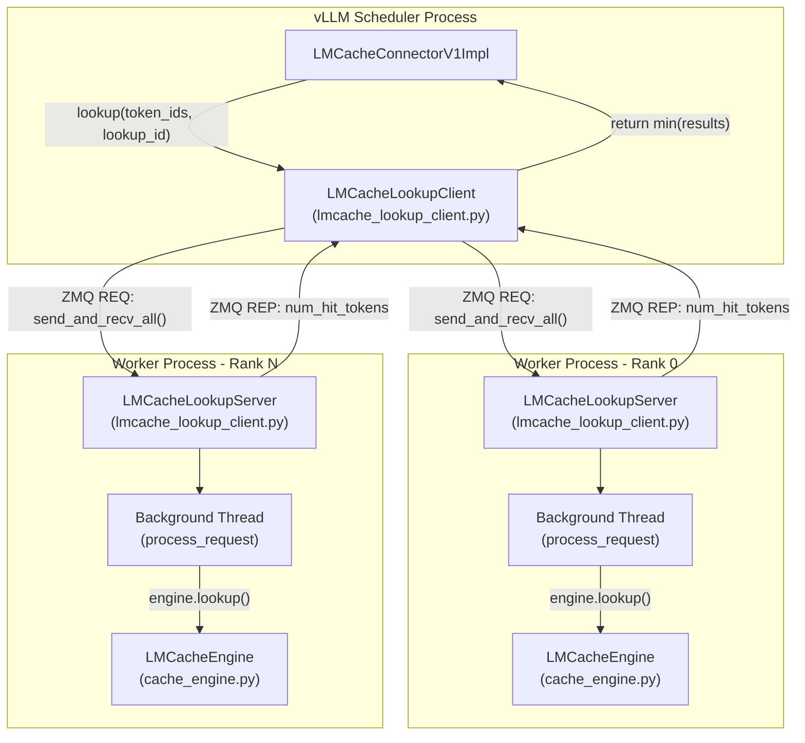
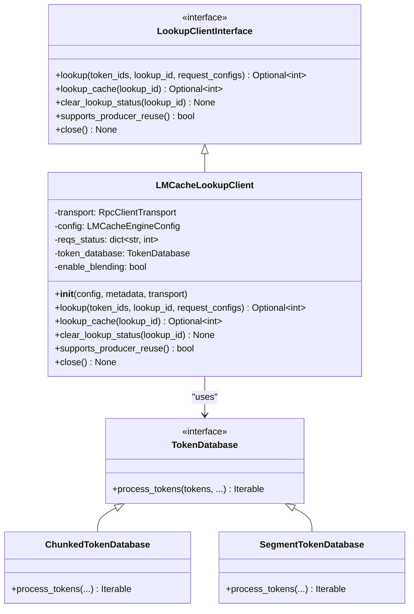
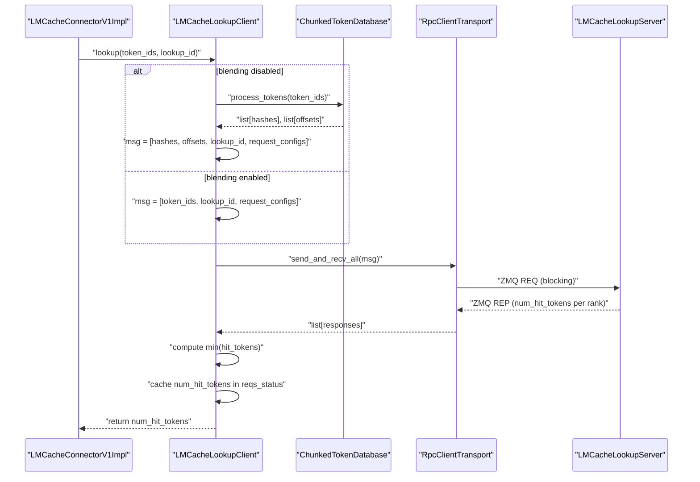
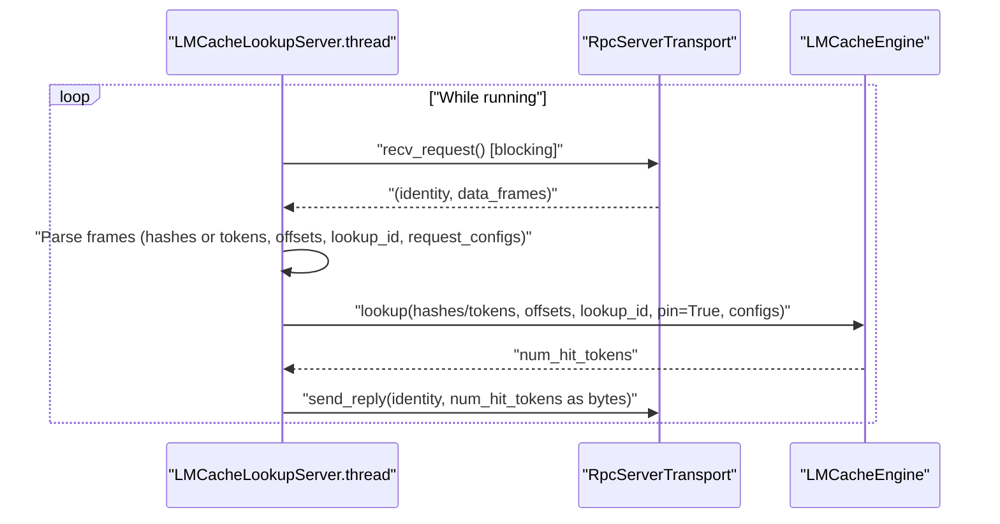

<!-- source: DeepWiki mcp.deepwiki.com · repo LMCache/LMCache · page 7.2 Synchronous Lookup · fetched 2026-10-21 -->

# Synchronous Lookup

Relevant source files

The following files were used as context for generating this wiki page:

- [examples/kubernetes/health_probe.py](examples/kubernetes/health_probe.py)
- [lmcache/integration/vllm/utils.py](lmcache/integration/vllm/utils.py)
- [lmcache/integration/vllm/vllm_v1_adapter.py](lmcache/integration/vllm/vllm_v1_adapter.py)
- [lmcache/utils.py](lmcache/utils.py)
- [lmcache/v1/cache_engine.py](lmcache/v1/cache_engine.py)
- [lmcache/v1/config.py](lmcache/v1/config.py)
- [lmcache/v1/distributed/serde/factory.py](lmcache/v1/distributed/serde/factory.py)
- [lmcache/v1/lookup_client/abstract_client.py](lmcache/v1/lookup_client/abstract_client.py)
- [lmcache/v1/lookup_client/chunk_statistics_lookup_client.py](lmcache/v1/lookup_client/chunk_statistics_lookup_client.py)
- [lmcache/v1/lookup_client/factory.py](lmcache/v1/lookup_client/factory.py)
- [lmcache/v1/lookup_client/hit_limit_lookup_client.py](lmcache/v1/lookup_client/hit_limit_lookup_client.py)
- [lmcache/v1/lookup_client/lmcache_async_lookup_client.py](lmcache/v1/lookup_client/lmcache_async_lookup_client.py)
- [lmcache/v1/lookup_client/lmcache_lookup_client.py](lmcache/v1/lookup_client/lmcache_lookup_client.py)
- [lmcache/v1/lookup_client/lmcache_lookup_client_bypass.py](lmcache/v1/lookup_client/lmcache_lookup_client_bypass.py)
- [lmcache/v1/lookup_client/mooncake_lookup_client.py](lmcache/v1/lookup_client/mooncake_lookup_client.py)
- [lmcache/v1/metadata.py](lmcache/v1/metadata.py)
- [lmcache/v1/offload_server/zmq_server.py](lmcache/v1/offload_server/zmq_server.py)
- [lmcache/v1/protocol.py](lmcache/v1/protocol.py)
- [lmcache/v1/rpc_utils.py](lmcache/v1/rpc_utils.py)
- [lmcache/v1/server/__main__.py](lmcache/v1/server/__main__.py)
- [lmcache/v1/standalone/__main__.py](lmcache/v1/standalone/__main__.py)
- [lmcache/v1/token_database.py](lmcache/v1/token_database.py)
- [tests/v1/lookup_client/test_chunk_statistics_lookup_client.py](tests/v1/lookup_client/test_chunk_statistics_lookup_client.py)
- [tests/v1/lookup_client/test_lmcache_lookup_client.py](tests/v1/lookup_client/test_lmcache_lookup_client.py)
- [tests/v1/standalone/test_parse_kvcache_shape_spec.py](tests/v1/standalone/test_parse_kvcache_shape_spec.py)
- [tests/v1/test_freeze_mode_integration.py](tests/v1/test_freeze_mode_integration.py)
- [tests/v1/test_remote_metadata.py](tests/v1/test_remote_metadata.py)
- [tests/v1/test_token_database.py](tests/v1/test_token_database.py)

## Purpose and Scope

This document describes the synchronous lookup implementation in LMCache's distributed lookup system. Synchronous lookup uses a ZeroMQ (ZMQ) REQ-REP pattern via an injected transport layer to perform blocking cache lookups across multiple workers. For asynchronous lookup with event-driven prefetching, see [7.3 Asynchronous Lookup and Prefetching](). For the abstract interface and factory pattern, see [7.1 Lookup Client Architecture]().

The synchronous lookup client (`LMCacheLookupClient`) sends lookup requests to lookup servers (`LMCacheLookupServer`) and waits for immediate responses. This is the default lookup mode when `enable_async_loading` is not set to `True` [lmcache/v1/lookup_client/factory.py:81-87](). It provides a straightforward request-response cycle but blocks the caller until all ranks respond or a timeout occurs.

Sources:  
[lmcache/v1/lookup_client/lmcache_lookup_client.py:27-48](),  
[lmcache/v1/lookup_client/factory.py:81-87]()

---

## Architecture Overview

The synchronous lookup system utilizes a ZeroMQ socket pattern where the client connects to multiple server ranks (worker processes). The communication follows a blocking REQ-REP (request-reply) pattern. The client sends a lookup request, waits for all worker ranks to respond, and then returns the minimum hit count found. This guarantees consistent cache hits available across all ranks.

### High-Level Communication Pattern

This pattern illustrates the `LMCacheLookupClient` acting as a requester, performing blocking calls to multiple `LMCacheLookupServer` instances, each backed by an `LMCacheEngine` that performs the actual cache lookups. The minimal number of hit tokens (verified across all ranks) is returned to the caller.

Sources:  
[lmcache/v1/lookup_client/lmcache_lookup_client.py:27-48](),  
[lmcache/v1/lookup_client/lmcache_lookup_client.py:182-216](),  
[lmcache/v1/lookup_client/factory.py:102-142]()

---

## LMCacheLookupClient Implementation

The `LMCacheLookupClient` class implements the `LookupClientInterface` for synchronous ZMQ-based cache lookups. It manages communication with multiple lookup server ranks via the injected `RpcClientTransport` and blocks until all responses are received.

### Class Structure and Initialization

- `LMCacheLookupClient` maintains an internal dictionary `reqs_status` to track request statuses by `lookup_id`, mapping to the number of hit tokens found [lmcache/v1/lookup_client/lmcache_lookup_client.py:59-65]().
- Depending on configuration (`enable_blending` flag), it initializes a `SegmentTokenDatabase` (blending-enabled) or a `ChunkedTokenDatabase` (standard chunked hashing) [lmcache/v1/lookup_client/lmcache_lookup_client.py:75-80]().
- The client uses an injected `RpcClientTransport`, abstracting the underlying ZMQ REQ socket communications [lmcache/v1/lookup_client/lmcache_lookup_client.py:32-34]().

Sources:  
[lmcache/v1/lookup_client/lmcache_lookup_client.py:27-80](),  
[lmcache/v1/token_database.py:64-73]()

### Initialization Process

The synchronous client is instantiated within the lookup client factory, usually when asynchronous loading is disabled:

1. The client receives the LMCache engine config, metadata, and a `RpcClientTransport` instance managing the ZMQ connections to worker ranks [lmcache/v1/lookup_client/lmcache_lookup_client.py:50-55]().
2. Based on the `enable_blending` config flag, the appropriate token database type is selected [lmcache/v1/lookup_client/lmcache_lookup_client.py:74-80]().
3. `reqs_status` is initialized as an empty dictionary to keep track of ongoing and completed request statuses [lmcache/v1/lookup_client/lmcache_lookup_client.py:59-65]().

Initialized here: [lmcache/v1/lookup_client/factory.py:81-87]()  
Constructor details: [lmcache/v1/lookup_client/lmcache_lookup_client.py:50-79]()

---

### Lookup Flow

The `lookup` method is the core blocking operation. It sends a request with token data, waits for responses from all ranks, and aggregates results [lmcache/v1/lookup_client/lmcache_lookup_client.py:89-161]().

1. **Token Processing:**  
   - If blending is **disabled**, it uses the token database to convert tokens into chunk hashes and offsets [lmcache/v1/lookup_client/lmcache_lookup_client.py:106-112]().  
   - If no hashes are returned (empty input), the client returns 0 immediately indicating no cached tokens are found [lmcache/v1/lookup_client/lmcache_lookup_client.py:116-117].  
   - If blending is **enabled**, the raw token IDs are sent directly (converted safely to a list if needed) [lmcache/v1/lookup_client/lmcache_lookup_client.py:128-133].

2. **Message Construction:**  
   The client packs a multi-part message containing either:  
   - `[hashes, offsets, lookup_id, request_configs]` (standard mode) or  
   - `[token_ids, lookup_id, request_configs]` (blending mode) [lmcache/v1/lookup_client/lmcache_lookup_client.py:119-138]().

3. **Blocking Send/Receive:**  
   The client calls `transport.send_and_recv_all(msg_buf)`, which sends the request to all worker ranks and blocks until all replies are received or a failure occurs [lmcache/v1/lookup_client/lmcache_lookup_client.py:140]().

4. **Response Handling:**  
   - If the transport returns an empty list (failure), the method returns 0 [lmcache/v1/lookup_client/lmcache_lookup_client.py:143-144].  
   - Otherwise, the client converts all rank responses (byte sequences) into integers — the number of hit tokens per rank [lmcache/v1/lookup_client/lmcache_lookup_client.py:146]().  
   - If results differ across ranks, a warning is emitted [lmcache/v1/lookup_client/lmcache_lookup_client.py:149-154]().  
   - The client returns the minimum number of hits across all ranks to ensure conservative cache usage [lmcache/v1/lookup_client/lmcache_lookup_client.py:158-159]() and caches this value in `reqs_status`.

### Sequence Diagram of Lookup

Sources:  
[lmcache/v1/lookup_client/lmcache_lookup_client.py:89-161]()

---

### Multi-Rank Result Aggregation

Received results from multiple workers may differ slightly due to model parallelism or partial caching. To ensure correctness:

- The client logs a warning if ranks disagree on hit counts [lmcache/v1/lookup_client/lmcache_lookup_client.py:149-154]().
- The final hit count is the minimum across all ranks, ensuring that only tokens cached on **all** ranks are considered hits; this prevents inconsistent reuse [lmcache/v1/lookup_client/lmcache_lookup_client.py:158-159]().

Sources:  
[lmcache/v1/lookup_client/lmcache_lookup_client.py:146-161]()

---

## LMCacheLookupServer Implementation

The `LMCacheLookupServer` runs inside worker processes responding to synchronous lookup requests via a ZMQ REP socket managed by an injected `RpcServerTransport`.

### Server Operation Details

1. **Background Thread Loop:**  
   A dedicated thread repeatedly calls `transport.recv_request()` to receive request messages in a blocking manner [lmcache/v1/lookup_client/lmcache_lookup_client.py:197-200]().

2. **Request Parsing:**  
   The server expects multipart ZMQ messages structured as:  
   - For standard mode: `[hashes, offsets, lookup_id, request_configs]`  
   - For blending enabled: `[tokens, lookup_id, request_configs]`  
   It verifies message length and decodes the last frames from bytes to string JSON formats [lmcache/v1/lookup_client/lmcache_lookup_client.py:204-213]().

3. **Lookup Execution:**  
   The server calls `lmcache_engine.lookup` providing either hashes and offsets (standard) or raw tokens (blending enabled). It pins the cache entries and performs the actual lookup in the local KV cache [lmcache/v1/lookup_client/lmcache_lookup_client.py:215-246]().

4. **Response:**  
   The number of hit tokens (int) is sent back as raw bytes via the ZMQ REP socket [lmcache/v1/lookup_client/lmcache_lookup_client.py:246-256](). This response is received synchronously by the client.

### Server Request Handling Flow

Sources:  
[lmcache/v1/lookup_client/lmcache_lookup_client.py:182-216]()

---

## Protocol and Message Format

The synchronous lookup communication uses multi-frame ZMQ messages with the following format:

| Frame Index | Content (Standard Chunked Mode) | Content (Blending Mode)          |
|-------------|---------------------------------|---------------------------------|
| 0           | List of chunk hashes (ints)     | Token IDs (List[int])            |
| 1           | List of offsets (ints)           | Lookup ID (string)               |
| 2           | Lookup ID (string)               | Request configs JSON string      |
| 3           | Request configs JSON string     | *(not present)*                 |

The response is a single ZMQ frame containing the number of hit tokens encoded as a big-endian integer [lmcache/v1/lookup_client/lmcache_lookup_client.py:146]().

This protocol ensures flexible support for blending mode while preserving backward compatibility with standard chunk hash lookups.

Sources:  
[lmcache/v1/lookup_client/lmcache_lookup_client.py:119-138]()

---

## Specialized Synchronous Clients

LMCache provides several synchronous lookup client variants via wrappers or different backend implementations:

### HitLimitLookupClient

- Used primarily for testing cache hit ratios [lmcache/v1/lookup_client/hit_limit_lookup_client.py:20-23]().
- Intercepts the result from the underlying `LMCacheLookupClient` [lmcache/v1/lookup_client/hit_limit_lookup_client.py:43-54]().
- Caps the maximum returned hit tokens based on `1 - hit_miss_ratio` configuration [lmcache/v1/lookup_client/hit_limit_lookup_client.py:26-80]().
- Helps simulate cache miss scenarios by limiting lookups artificially.

### ChunkStatisticsLookupClient

- Wraps a lookup client to collect chunk reuse statistics asynchronously [lmcache/v1/lookup_client/chunk_statistics_lookup_client.py:28-64]().
- Uses an internal `AsyncRecorder` to minimize blocking overhead [lmcache/v1/lookup_client/chunk_statistics_lookup_client.py:55-64]().
- Stops collecting after a configurable timeout or a number of unique chunks is collected [lmcache/v1/lookup_client/chunk_statistics_lookup_client.py:48-54]().
- Useful for monitoring and tuning cache usage patterns.

### LMCacheBypassLookupClient

- Instead of sending requests over ZMQ, directly calls the local `LMCacheEngine.lookup()` method [lmcache/v1/lookup_client/lmcache_lookup_client_bypass.py:21-26]().
- Enables cache lookup bypassing the communication for single-process or rank 0-only setups (e.g., Multi-Level Attention).
- Shares the same token database and blending logic as the engine [lmcache/v1/lookup_client/lmcache_lookup_client_bypass.py:49-51]().

### MooncakeLookupClient

- Specialized synchronous client for the Mooncake distributed storage backend [lmcache/v1/lookup_client/mooncake_lookup_client.py:22-32]().
- Uses Mooncake's batch existence check functionality to verify chunk presence remotely [lmcache/v1/lookup_client/mooncake_lookup_client.py:75-77]().
- Returns the prefix of tokens found in the distributed store, mimicking standard lookup semantics [lmcache/v1/lookup_client/mooncake_lookup_client.py:79-88]().
  
Sources:  
[lmcache/v1/lookup_client/factory.py:10-17](),  
[lmcache/v1/lookup_client/hit_limit_lookup_client.py:26-80](),  
[lmcache/v1/lookup_client/lmcache_lookup_client_bypass.py:21-96](),  
[lmcache/v1/lookup_client/mooncake_lookup_client.py:22-89]()

---

## Error Handling and Resilience

- **Transport Decoupling:**  
  The synchronous client does not directly deal with ZMQ internals since the `RpcClientTransport` manages connection setup, retries, and error recovery [lmcache/v1/lookup_client/lmcache_lookup_client.py:32-34]().

- **Inconsistent Multi-Rank Responses:**  
  When ranks report varying numbers of hit tokens, the client logs warnings but favors the minimum count to preserve correctness and conservative cache reuse [lmcache/v1/lookup_client/lmcache_lookup_client.py:149-164]().

- **Request Status Tracking and Cleanup:**  
  The client maintains cached lookup statuses per `lookup_id` to avoid repeated lookups for ongoing requests. The `clear_lookup_status()` method allows cleanup once a request completes or is aborted [lmcache/v1/lookup_client/lmcache_lookup_client.py:163-164]().

Sources:  
[lmcache/v1/lookup_client/lmcache_lookup_client.py:32-34](),  
[lmcache/v1/lookup_client/lmcache_lookup_client.py:149-164]()

---

# Summary

LMCache's synchronous lookup mechanism provides a blocking, distributed cache lookup via a well-defined ZMQ REQ-REP interaction between an `LMCacheLookupClient` and multiple `LMCacheLookupServer` instances. The client translates input tokens into hashes or sends raw tokens for blended cache lookups, sends requests in parallel to all worker ranks, and waits for consistent responses. The server performs cache lookups using the `LMCacheEngine` and replies with hit counts. This design prioritizes correctness and simplicity for synchronous cache hits in distributed inference serving.

# References

- `lmcache/v1/lookup_client/lmcache_lookup_client.py` [lines 27-180, 182-216]()  
- `lmcache/v1/lookup_client/factory.py` [lines 81-87, 102-142]()  
- `lmcache/v1/lookup_client/abstract_client.py` [lines 10-78]()  
- `lmcache/v1/lookup_client/hit_limit_lookup_client.py` [lines 26-80]()  
- `lmcache/v1/lookup_client/lmcache_lookup_client_bypass.py` [lines 21-96]()  
- `lmcache/v1/lookup_client/mooncake_lookup_client.py` [lines 22-89]()  
- `lmcache/v1/token_database.py` [lines 64-73]()

---

