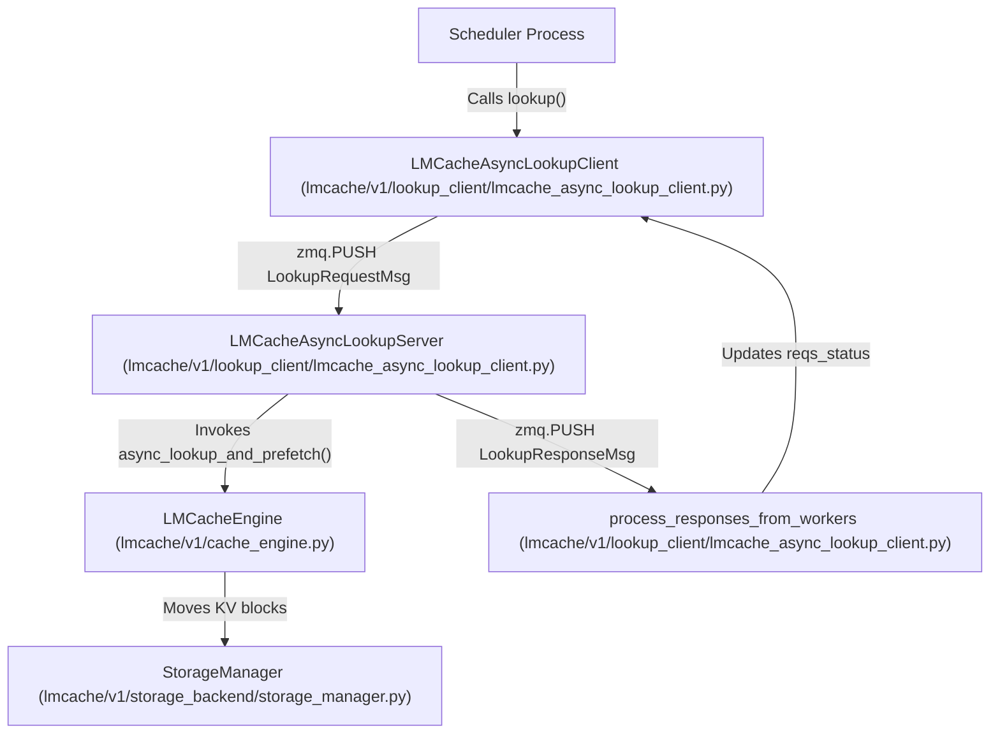
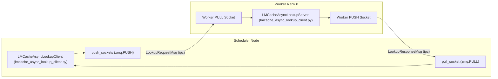
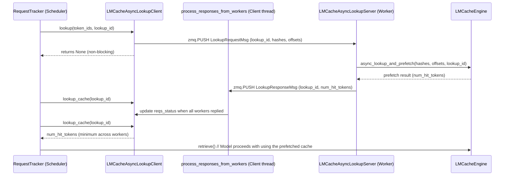

<!-- source: DeepWiki mcp.deepwiki.com · repo LMCache/LMCache · page 7.3 Asynchronous Lookup and Prefetching · fetched 2026-10-21 -->

# Asynchronous Lookup and Prefetching

Relevant source files

The following files were used as context for generating this wiki page:

- [lmcache/integration/vllm/utils.py](lmcache/integration/vllm/utils.py)
- [lmcache/integration/vllm/vllm_v1_adapter.py](lmcache/integration/vllm/vllm_v1_adapter.py)
- [lmcache/utils.py](lmcache/utils.py)
- [lmcache/v1/cache_engine.py](lmcache/v1/cache_engine.py)
- [lmcache/v1/config.py](lmcache/v1/config.py)
- [lmcache/v1/lookup_client/abstract_client.py](lmcache/v1/lookup_client/abstract_client.py)
- [lmcache/v1/lookup_client/chunk_statistics_lookup_client.py](lmcache/v1/lookup_client/chunk_statistics_lookup_client.py)
- [lmcache/v1/lookup_client/factory.py](lmcache/v1/lookup_client/factory.py)
- [lmcache/v1/lookup_client/hit_limit_lookup_client.py](lmcache/v1/lookup_client/hit_limit_lookup_client.py)
- [lmcache/v1/lookup_client/lmcache_async_lookup_client.py](lmcache/v1/lookup_client/lmcache_async_lookup_client.py)
- [lmcache/v1/lookup_client/lmcache_lookup_client.py](lmcache/v1/lookup_client/lmcache_lookup_client.py)
- [lmcache/v1/lookup_client/lmcache_lookup_client_bypass.py](lmcache/v1/lookup_client/lmcache_lookup_client_bypass.py)
- [lmcache/v1/lookup_client/mooncake_lookup_client.py](lmcache/v1/lookup_client/mooncake_lookup_client.py)
- [lmcache/v1/offload_server/zmq_server.py](lmcache/v1/offload_server/zmq_server.py)
- [lmcache/v1/rpc_utils.py](lmcache/v1/rpc_utils.py)
- [lmcache/v1/token_database.py](lmcache/v1/token_database.py)
- [tests/v1/lookup_client/test_chunk_statistics_lookup_client.py](tests/v1/lookup_client/test_chunk_statistics_lookup_client.py)
- [tests/v1/test_token_database.py](tests/v1/test_token_database.py)

This page documents `LMCacheAsyncLookupClient`, `LMCacheAsyncLookupServer`, and the non-blocking prefix cache lookup flow they implement. The asynchronous lookup system complements the synchronous REQ-REP pattern by enabling prefetching and overlapped cache loading to reduce load latencies during inference. For abstract client interfaces and client factory logic, see [Lookup Client Architecture](7.1).

---

## Purpose and Scope

`LMCacheAsyncLookupClient` implements a ZMQ-based PUSH-PULL asynchronous protocol to communicate with one or more async lookup servers running inside worker processes (`[lmcache/v1/lookup_client/lmcache_async_lookup_client.py:34-191]()`). When asynchronous loading is enabled (`enable_async_loading=True` in the engine config `[lmcache/v1/config.py]()`), the client sends lookup requests **without blocking**—it immediately returns `None` (`[lmcache/v1/lookup_client/abstract_client.py:10-77]()`). A background thread running inside the client collects responses as they arrive from worker servers. Workers handle lookup requests by invoking `LMCacheEngine.async_lookup_and_prefetch()`, which triggers a prefetch pipeline to move KV cache data from slower tiers (e.g., disk, remote storage) into local CPU memory before model layers consume it.

This asynchronous design overlaps lookup scheduling and data movement to effectively reduce cache load latency compared to synchronous blocking lookup calls.

Sources: [lmcache/v1/config.py](), [lmcache/v1/lookup_client/lmcache_async_lookup_client.py:34-299](), [lmcache/v1/cache_engine.py](), [lmcache/v1/lookup_client/abstract_client.py:10-77]().

---

## Comparison: Synchronous vs. Asynchronous Lookup

| Property                | `LMCacheLookupClient` (Synchronous)                                         | `LMCacheAsyncLookupClient` (Asynchronous)                            |
|-------------------------|-----------------------------------------------------------------------------|----------------------------------------------------------------------|
| ZMQ socket pattern      | REQ-REP (request blocks until response)                                    | PUSH-PULL (non-blocking request, async responses)                    |
| `lookup()` return type  | `int` — number of hit tokens (blocking)                                   | `None` initially, responses collected asynchronously                 |
| Background thread       | None                                                                       | Yes, thread continuously pulling results from worker responses      |
| Prefetching             | No                                                                        | Yes, via `async_lookup_and_prefetch`                                |
| Config flag             | `enable_async_loading=False`                                               | `enable_async_loading=True`                                          |
| Timeout support         | Via socket receive timeout (RCVTIMEO)                                     | Via wall-clock timeout for outstanding lookups, cancels stale lookups |

Sources: [lmcache/v1/lookup_client/lmcache_async_lookup_client.py:34-150](), [lmcache/v1/lookup_client/lmcache_lookup_client.py:27-161](), [lmcache/v1/rpc_utils.py:78](), [lmcache/v1/config.py]().

---

## Architecture Overview

Below is an overview diagram showing the interaction between the scheduler process, async lookup client, worker async lookup server, and the LMCache engine with its storage layers, linking natural language concepts to their concrete code entities.

**Asynchronous Lookup System Architecture and Code Entities**

- The scheduler calls `lookup()` on `LMCacheAsyncLookupClient` (`[lmcache/v1/lookup_client/lmcache_async_lookup_client.py:34]()`), which sends requests via ZMQ PUSH sockets to worker async servers (`[lmcache/v1/lookup_client/lmcache_async_lookup_client.py:145]()`).
- Workers asynchronously prefetch cache blocks via `LMCacheEngine.async_lookup_and_prefetch`.
- Workers send async results back via PUSH to the client’s single PULL socket (`[lmcache/v1/lookup_client/lmcache_async_lookup_client.py:99]()`).
- The client thread collects results and updates the `reqs_status` map (`[lmcache/v1/lookup_client/lmcache_async_lookup_client.py:132]()`).
- The scheduler uses repeated `lookup_cache()` calls to poll the async result (`[lmcache/v1/lookup_client/lmcache_async_lookup_client.py:159]()`).

Sources: [lmcache/v1/lookup_client/lmcache_async_lookup_client.py:34-151](), [lmcache/v1/lookup_client/lmcache_async_lookup_client.py:342-382](), [lmcache/v1/cache_engine.py]().

---

## Socket Topology

The asynchronous lookup uses two categories of ZeroMQ IPC sockets with fixed naming conventions derived for engine ID, service, RPC port, and rank (`[lmcache/v1/rpc_utils.py:116-174]()`):

**ZeroMQ IPC Socket Topology and Communication Classes**

- **Scheduler → Workers**: One `zmq.PUSH` socket per worker rank on paths named `"lookup_worker"` (`[lmcache/v1/lookup_client/lmcache_async_lookup_client.py:76-94]()`).
- **Workers → Scheduler**: All workers push responses to the scheduler's single `zmq.PULL` socket on path `"lookup_scheduler"` (`[lmcache/v1/lookup_client/lmcache_async_lookup_client.py:96-105]()`).

These paths use `get_zmq_rpc_path_lmcache` to generate safe IPC socket paths (`[lmcache/v1/rpc_utils.py:116-174]()`).

Sources: [lmcache/v1/lookup_client/lmcache_async_lookup_client.py:76-109](), [lmcache/v1/rpc_utils.py:116-174]().

---

## LMCacheAsyncLookupClient Details

Defined in `[lmcache/v1/lookup_client/lmcache_async_lookup_client.py:34-299]()`

### Key Data Members

| Member                | Type                           | Description                                                    |
|-----------------------|--------------------------------|----------------------------------------------------------------|
| `reqs_status`          | `dict[str, Optional[int]]`    | Maps `lookup_id` to number of hit tokens or `None` if pending  |
| `res_for_each_worker`  | `dict[str, list[int]]`         | Partial hit tokens from individual worker responses            |
| `first_lookup_time`    | `dict[str, float]`             | Timestamp to track lookup timeout                              |
| `aborted_lookups`      | `set[str]`                    | IDs of lookups canceled before completion                     |
| `push_sockets`         | List of ZMQ PUSH sockets      | Sockets connecting to workers for sending lookup requests      |
| `pull_socket`          | ZMQ PULL socket               | Single socket to receive async lookup responses from workers   |
| `token_database`       | Instance of `TokenDatabase`   | Used to chunk/process tokens for hashing                        |

### `lookup(token_ids, lookup_id, request_configs)`

- Processes input tokens using `token_database.process_tokens(..., make_key=False)` producing hash keys and offsets (`[lmcache/v1/token_database.py:64-122]()`).
- Creates a `LookupRequestMsg` with these hashes, offsets, `lookup_id`, and optional configs (`[lmcache/v1/lookup_client/async_lookup_message.py]()`).
- Sends identical request to **all** worker push sockets (`zmq.PUSH`) to parallel lookup servers (`[lmcache/v1/lookup_client/lmcache_async_lookup_client.py:202-209]()`).
- Immediately returns `None` to caller for non-blocking behavior (`[lmcache/v1/lookup_client/lmcache_async_lookup_client.py:210]()`).

### `lookup_cache(lookup_id)`

- Checks if async lookup replies for `lookup_id` have arrived by inspecting `reqs_status` (`[lmcache/v1/lookup_client/lmcache_async_lookup_client.py:159-190]()`).
- Returns:
  - `int` number of hit tokens if ready,
  - `None` if still pending,
  - `-1` if not found.
- If waiting too long (`lookup_timeout_ms` from config), forcibly cancels lookup and returns 0 (cache miss) (`[lmcache/v1/lookup_client/lmcache_async_lookup_client.py:177-189]()`).

### Asynchronous Response Handling

- A dedicated daemon thread (`process_responses_from_workers`) continuously pulls `LookupResponseMsg`s from the `pull_socket` (`[lmcache/v1/lookup_client/lmcache_async_lookup_client.py:145-151]()`).
- For each response:
  - Updates `res_for_each_worker` with partial results (`[lmcache/v1/lookup_client/lmcache_async_lookup_client.py:240-241]()`).
  - Once responses from **all workers** are received for a single `lookup_id`, computes the min hit token count (`[lmcache/v1/lookup_client/lmcache_async_lookup_client.py:242-256]()`).
  - Updates `reqs_status[lookup_id]` with this min result and removes temporary state (`[lmcache/v1/lookup_client/lmcache_async_lookup_client.py:257-260]()`).
- Cleanup messages are sent for aborted lookups to worker servers (`[lmcache/v1/lookup_client/lmcache_async_lookup_client.py:165-166]()`).

Sources: [lmcache/v1/lookup_client/lmcache_async_lookup_client.py:34-299](), [lmcache/v1/token_database.py:64-122]().

---

## LMCacheAsyncLookupServer Details

Defined in `[lmcache/v1/lookup_client/lmcache_async_lookup_client.py:302-407]()`

- Runs a background thread `process_requests_from_scheduler` that listens for two message types:
  - `LookupRequestMsg`: Invokes `lmcache_engine.async_lookup_and_prefetch(...)` to initiate prefetching (`[lmcache/v1/lookup_client/lmcache_async_lookup_client.py:355-370]()`). Replies are sent asynchronously back to the scheduler.
  - `LookupCleanupMsg`: Releases resources for aborted lookups (`[lmcache/v1/lookup_client/lmcache_async_lookup_client.py:372-377]()`).
- The server uses a ZMQ `zmq.PULL` socket to receive requests from the scheduler, and `zmq.PUSH` socket to send responses back (`[lmcache/v1/lookup_client/lmcache_async_lookup_client.py:319-338]()`).

Sources: [lmcache/v1/lookup_client/lmcache_async_lookup_client.py:302-407]().

---

## Message Types

Defined as msgspec structs in `async_lookup_message.py` (`[lmcache/v1/lookup_client/async_lookup_message.py]()`):

| Message Type        | Direction           | Fields                                   | Description                                       |
|---------------------|---------------------|-----------------------------------------|-------------------------------------------------|
| `LookupRequestMsg`  | Scheduler → Worker   | `lookup_id: str`, `hashes: List[int]`, `offsets: List[int]`, `request_configs: Optional[dict]` | Request to lookup and prefetch these keys        |
| `LookupCleanupMsg`  | Scheduler → Worker   | `lookup_id: str`                        | Request to cancel and clean up a pending lookup |
| `LookupResponseMsg` | Worker → Scheduler   | `lookup_id: str`, `num_hit_tokens: int`| Async lookup result                              |

Sources: [lmcache/v1/lookup_client/async_lookup_message.py]().

---

## Full Async Lookup and Prefetch Message Flow

**Full Async Lookup Sequence Flow**

This sequence shows how asynchronous lookup is overlapped with cache prefetching on workers and how the scheduler polls for ready results (`[lmcache/v1/lookup_client/lmcache_async_lookup_client.py:159-283]()`).

Sources: [lmcache/v1/lookup_client/lmcache_async_lookup_client.py:159-283](), [lmcache/v1/lookup_client/lmcache_async_lookup_client.py:355-407](), [lmcache/v1/cache_engine.py]().

---

## Factory Selection and Configuration Parameters

The async lookup client and server are automatically selected by `LookupClientFactory` if `config.enable_async_loading` is `True` (`[lmcache/v1/lookup_client/factory.py:71-82]()`). External lookup clients are incompatible with async loading and raise an error on such config combinations (`[lmcache/v1/lookup_client/factory.py:62-66]()`).

| Config Parameter          | Type         | Default | Description                                        |
|---------------------------|--------------|---------|--------------------------------------------------|
| `enable_async_loading`    | `bool`       | `False` | Enables async lookup lookup_client + server      |
| `lookup_timeout_ms`       | `int`        | `3000`  | Max timeout in ms for `lookup_cache()` polling   |
| `extra_config.lookup_backoff_time` | `float`  | `0.01` | Time (seconds) to sleep between `lookup_cache` polls |

Sources: [lmcache/v1/lookup_client/factory.py:62-87](), [lmcache/v1/config.py](), [lmcache/v1/lookup_client/lmcache_async_lookup_client.py:153-157]().

---

# Summary

The asynchronous lookup and prefetching system in LMCache uses `LMCacheAsyncLookupClient` and `LMCacheAsyncLookupServer` with a ZMQ PUSH-PULL socket topology to decouple cache lookup requests from result retrieval. This architecture enables overlapping network scheduling and storage prefetching to reduce effective load latency and improve throughput in large-scale distributed inference workloads.

Key benefits include:
- Non-blocking call sites enabling better throughput (`[lmcache/v1/lookup_client/abstract_client.py:10-77]`).
- Prefetch pipeline moving KV cache data ahead of inference (`[lmcache/v1/cache_engine.py]`).
- Aggregation of results across distributed ranks before reporting back (`[lmcache/v1/lookup_client/lmcache_async_lookup_client.py:145-200]`).
- Efficient communication via IPC sockets with carefully designed address mappings (`[lmcache/v1/rpc_utils.py:116-174]`).

This mechanism forms a critical foundation of LMCache's distributed KV cache management system.

Sources: [lmcache/v1/lookup_client/lmcache_async_lookup_client.py:34-299](), [lmcache/v1/lookup_client/factory.py:71-82](), [lmcache/v1/rpc_utils.py:116-174](), [lmcache/v1/cache_engine.py]().

---

