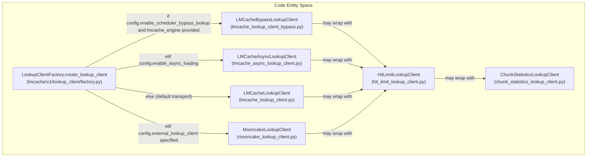
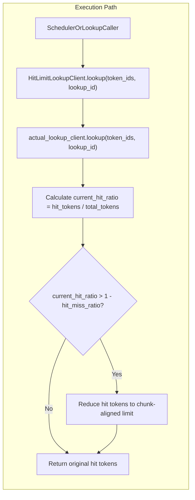
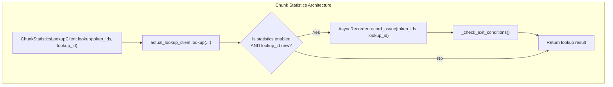
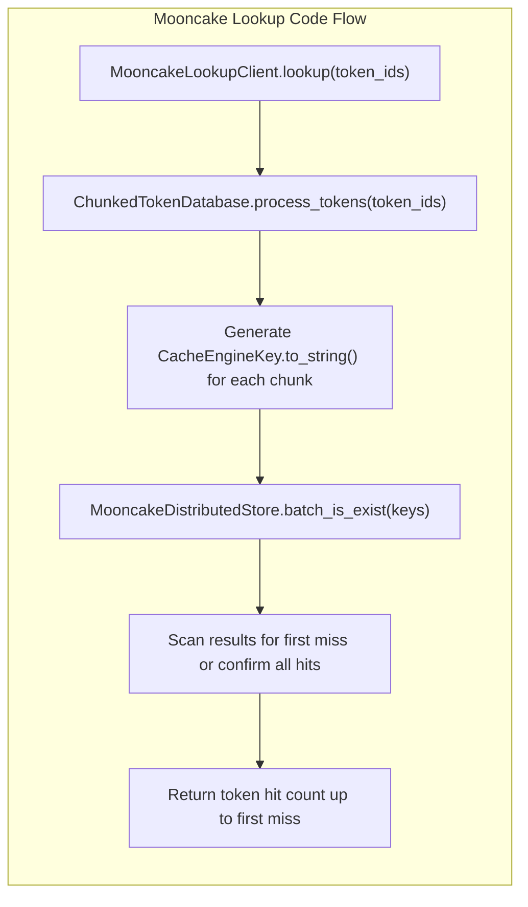
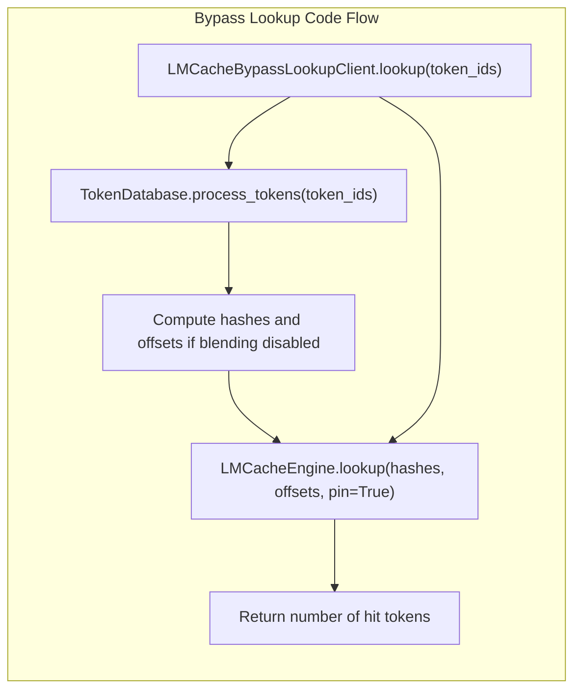

<!-- source: DeepWiki mcp.deepwiki.com · repo LMCache/LMCache · page 7.4 Specialized Lookup Clients · fetched 2026-10-21 -->

# Specialized Lookup Clients

Relevant source files

The following files were used as context for generating this wiki page:

- [lmcache/integration/vllm/utils.py](lmcache/integration/vllm/utils.py)
- [lmcache/integration/vllm/vllm_v1_adapter.py](lmcache/integration/vllm/vllm_v1_adapter.py)
- [lmcache/utils.py](lmcache/utils.py)
- [lmcache/v1/cache_engine.py](lmcache/v1/cache_engine.py)
- [lmcache/v1/config.py](lmcache/v1/config.py)
- [lmcache/v1/lookup_client/abstract_client.py](lmcache/v1/lookup_client/abstract_client.py)
- [lmcache/v1/lookup_client/chunk_statistics_lookup_client.py](lmcache/v1/lookup_client/chunk_statistics_lookup_client.py)
- [lmcache/v1/lookup_client/factory.py](lmcache/v1/lookup_client/factory.py)
- [lmcache/v1/lookup_client/hit_limit_lookup_client.py](lmcache/v1/lookup_client/hit_limit_lookup_client.py)
- [lmcache/v1/lookup_client/lmcache_async_lookup_client.py](lmcache/v1/lookup_client/lmcache_async_lookup_client.py)
- [lmcache/v1/lookup_client/lmcache_lookup_client.py](lmcache/v1/lookup_client/lmcache_lookup_client.py)
- [lmcache/v1/lookup_client/lmcache_lookup_client_bypass.py](lmcache/v1/lookup_client/lmcache_lookup_client_bypass.py)
- [lmcache/v1/lookup_client/mooncake_lookup_client.py](lmcache/v1/lookup_client/mooncake_lookup_client.py)
- [lmcache/v1/offload_server/zmq_server.py](lmcache/v1/offload_server/zmq_server.py)
- [lmcache/v1/rpc_utils.py](lmcache/v1/rpc_utils.py)
- [lmcache/v1/token_database.py](lmcache/v1/token_database.py)
- [tests/v1/lookup_client/test_chunk_statistics_lookup_client.py](tests/v1/lookup_client/test_chunk_statistics_lookup_client.py)
- [tests/v1/test_token_database.py](tests/v1/test_token_database.py)

This page documents the specialized and decorator lookup client implementations in LMCache: `HitLimitLookupClient`, `ChunkStatisticsLookupClient`, `LMCacheBypassLookupClient` (also known as `LMCacheLookupClientBypass`), and `MooncakeLookupClient` [lmcache/v1/lookup_client/factory.py:10-18](). It covers their implementation details, data flow, key classes, and composition via the `LookupClientFactory`.

For foundational knowledge on the `LookupClientInterface` abstract contract and the factory pattern used to instantiate clients, refer to [lmcache/v1/lookup_client/abstract_client.py:10-77](). For the default synchronous and asynchronous lookup clients, see [lmcache/v1/lookup_client/lmcache_lookup_client.py:27-181]() and [lmcache/v1/lookup_client/lmcache_async_lookup_client.py:34-191]() respectively.

---

## Overview and Composition Pattern

All specialized lookup clients implement the `LookupClientInterface` abstract base class defined in `lmcache/v1/lookup_client/abstract_client.py` [lmcache/v1/lookup_client/abstract_client.py:10-77](). These specialized clients fall into two broad categories:

| Category | Classes | Role |
| --- | --- | --- |
| **Decorator Wrappers** | `HitLimitLookupClient`, `ChunkStatisticsLookupClient` | Wrap an inner client instance (`actual_lookup_client`) to augment behavior, e.g., limiting hits or tracking usage statistics [lmcache/v1/lookup_client/hit_limit_lookup_client.py:26-89](), [lmcache/v1/lookup_client/chunk_statistics_lookup_client.py:28-172](). |
| **Alternative Base Clients** | `MooncakeLookupClient`, `LMCacheBypassLookupClient` | Replace the standard ZMQ transport layer with either external distributed stores or direct in-process LMCache engine calls [lmcache/v1/lookup_client/mooncake_lookup_client.py:22-96](), [lmcache/v1/lookup_client/lmcache_lookup_client_bypass.py:21-102](). |

The instantiation and composition of these clients are managed centrally by the `LookupClientFactory` class within the factory module [lmcache/v1/lookup_client/factory.py:36-100]().

### Diagram: Factory Client Construction & Code Entity Mapping

Sources: [lmcache/v1/lookup_client/factory.py:36-100](), [lmcache/v1/lookup_client/abstract_client.py:10-77]()

---

## HitLimitLookupClient

### Purpose and Implementation

The `HitLimitLookupClient` serves as a decorator that controls the upper bound of cache hit tokens reported to the caller. Primarily used for testing and simulation, it intercepts lookup results from an underlying client and applies hit miss ratio thresholds to simulate partial cache effectiveness without modifying the actual cached data [lmcache/v1/lookup_client/hit_limit_lookup_client.py:26-86]().

It is instantiated automatically by `LookupClientFactory` when the configuration property `hit_miss_ratio` is defined within `[0, 1]` [lmcache/v1/lookup_client/factory.py:89-91]().

### Data Flow in Lookup

When a lookup call is made:

1. Delegates to the inner client’s `lookup(...)` method to retrieve the actual hit token count.
2. Computes the current hit ratio by dividing the number of hit tokens by the total length of token inputs.
3. Compares this ratio to the configured upper bound `1 - hit_miss_ratio`.
4. If the current ratio exceeds the limit, it reduces the number of hit tokens to a chunk-aligned ceiling determined by the configured chunk size. This ensures cached hits reflect the capped ratio and stay aligned with chunk boundaries for correctness.
5. Returns the adjusted or original hit count.

Auxiliary methods like `lookup_cache`, `clear_lookup_status`, `supports_producer_reuse`, and `close` are simply proxied to the inner client [lmcache/v1/lookup_client/hit_limit_lookup_client.py:40-94]().

### Diagram: HitLimitLookupClient Execution Flow

Sources: [lmcache/v1/lookup_client/hit_limit_lookup_client.py:26-94](), [lmcache/v1/lookup_client/factory.py:89-91]()

---

## ChunkStatisticsLookupClient

### Purpose and Implementation

`ChunkStatisticsLookupClient` is a decorator client that gathers detailed cache reuse statistics for individual token chunks during lookup operations. It asynchronously records lookup events and chunk reuse patterns to avoid impacting the hot path performance [lmcache/v1/lookup_client/chunk_statistics_lookup_client.py:28-172]().

It uses an `AsyncRecorder` with configurable record strategies (e.g., Bloom filters, file hashing) to efficiently track:
- Total chunk counts
- Unique chunk counts
- Duplicate chunk counts
- Reuse rates, and other metrics relevant for cache analysis

It is enabled via the configuration flag `enable_chunk_statistics` and can auto-start and auto-stop based on configurable timeout or chunk target thresholds.

### Internal Architecture

- Lookup requests first delegate to the inner client for cache hit results.
- If statistics collection is enabled and the lookup is new, the token chunks are recorded asynchronously via `AsyncRecorder`.
- Periodic exit condition checks prevent indefinite metrics collection.
- The collected statistics can be queried or reset at runtime.

### Diagram: ChunkStatisticsLookupClient Architecture

Sources: [lmcache/v1/lookup_client/chunk_statistics_lookup_client.py:28-185]()

---

## MooncakeLookupClient

### Purpose and Implementation

`MooncakeLookupClient` is an alternative lookup client variant that interfaces directly with the external `MooncakeDistributedStore` to perform batched existence queries for cache keys, bypassing LMCache's internal ZMQ-based communication layer [lmcache/v1/lookup_client/mooncake_lookup_client.py:22-96]().

It is constructed via `LookupClientFactory` when the configuration parameter `external_lookup_client` is set with a URI in the `mooncakestore://` scheme format [lmcache/v1/lookup_client/factory.py:61-68]().

> **Note:**
> - This client does not support `enable_blending` mode, throwing an assertion otherwise [lmcache/v1/lookup_client/mooncake_lookup_client.py:56-58]().
> - As with all external lookup clients, asynchronous loading is disallowed [lmcache/v1/lookup_client/factory.py:62-65]().

### Data Flow in Lookup

1. The input `token_ids` are processed into a sequence of `CacheEngineKey` string representations using `ChunkedTokenDatabase`. This allows key chunking and hashing consistent with LMCache’s cache engine keying scheme.
2. A batch existence check for all keys is performed via `MooncakeDistributedStore.batch_is_exist(keys)` which returns a list of status integers indicating key presence.
3. The client scans the returned list to identify the first cache miss, terminating early and returning the token offset of the last cached chunk.
4. If all chunks exist, it returns the total token length.

### Diagram: MooncakeLookupClient Bridge to Code Entities

Sources: [lmcache/v1/lookup_client/mooncake_lookup_client.py:22-96](), [lmcache/v1/lookup_client/factory.py:61-68]()

---

## LMCacheBypassLookupClient

### Purpose and Implementation

The `LMCacheBypassLookupClient` (also termed `LMCacheLookupClientBypass`) skips all external ZMQ or network communication by directly using the in-process `LMCacheEngine` method calls for cache lookup. This direct call path is advantageous in scenarios such as Multi-Level Attention (MLA) or single-process environments where inter-process communication overhead is unnecessary [lmcache/v1/lookup_client/lmcache_lookup_client_bypass.py:21-102]().

It is created by the factory when `enable_scheduler_bypass_lookup` is set and an `LMCacheEngine` instance is provided [lmcache/v1/lookup_client/factory.py:79-80]().

### Data Flow in Lookup

- For non-blending mode, token indices are chunked and hashed via the owned `token_database`.
- The client calls the `lmcache_engine.lookup()` method directly, providing computed hashes, offsets, and lookup parameters with `pin=True`.
- For blending mode, the raw token IDs are forwarded directly to `lmcache_engine.lookup()`.
- The engine returns the number of matched cache tokens, which the client returns immediately.

Auxiliary functions like `close` and `supports_producer_reuse` reflect pass-through or constant-truth results within the bypass client [lmcache/v1/lookup_client/lmcache_lookup_client_bypass.py:97-102]().

### Diagram: LMCacheBypassLookupClient Bridge to Code Entities

Sources: [lmcache/v1/lookup_client/lmcache_lookup_client_bypass.py:21-102](), [lmcache/v1/lookup_client/factory.py:79-80]()

---

# Summary and Client Composition by `LookupClientFactory`

The `LookupClientFactory` dynamically constructs lookup clients incorporating these specialized clients based on configuration flags, layering decorators when necessary. This modular approach allows fine-grained tuning of cache lookup semantics, statistics collection, testing scenarios, and integration with external backends.

| Config Condition | Client Created |
| --- | --- |
| `external_lookup_client=mooncakestore://...` | `MooncakeLookupClient` |
| `enable_scheduler_bypass_lookup` | `LMCacheBypassLookupClient` |
| `enable_async_loading` | `LMCacheAsyncLookupClient` |
| Default | `LMCacheLookupClient` |
| `hit_miss_ratio` specified | `HitLimitLookupClient` wraps client |
| `enable_chunk_statistics` | `ChunkStatisticsLookupClient` wraps client |

Sources: [lmcache/v1/lookup_client/factory.py:36-100]()

---

