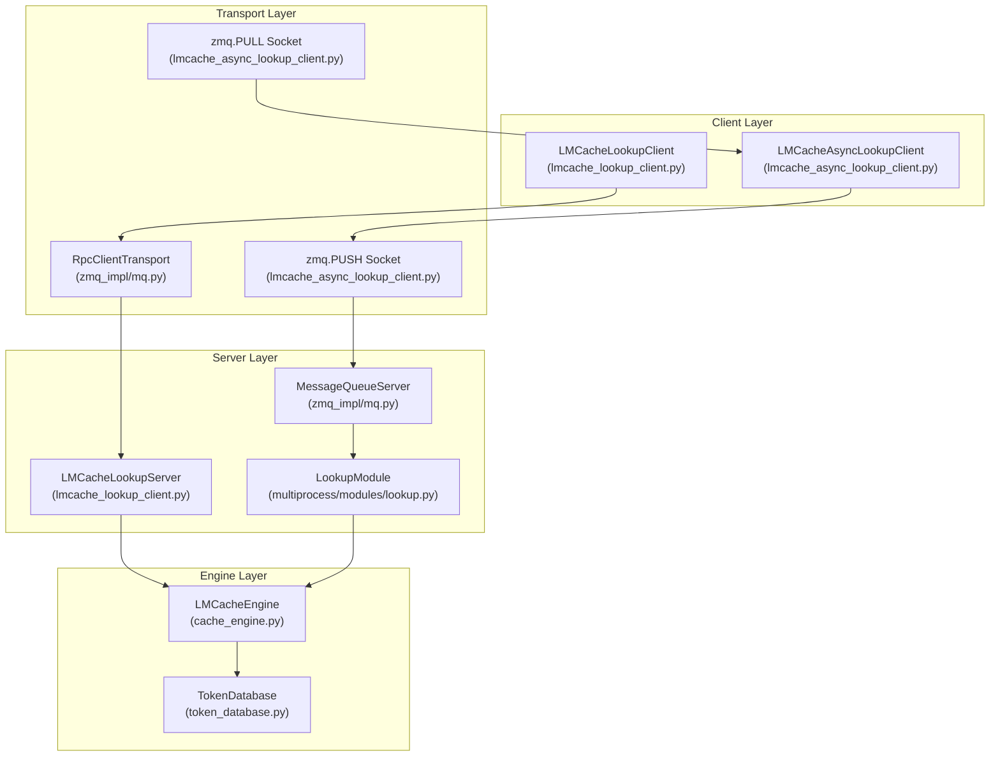
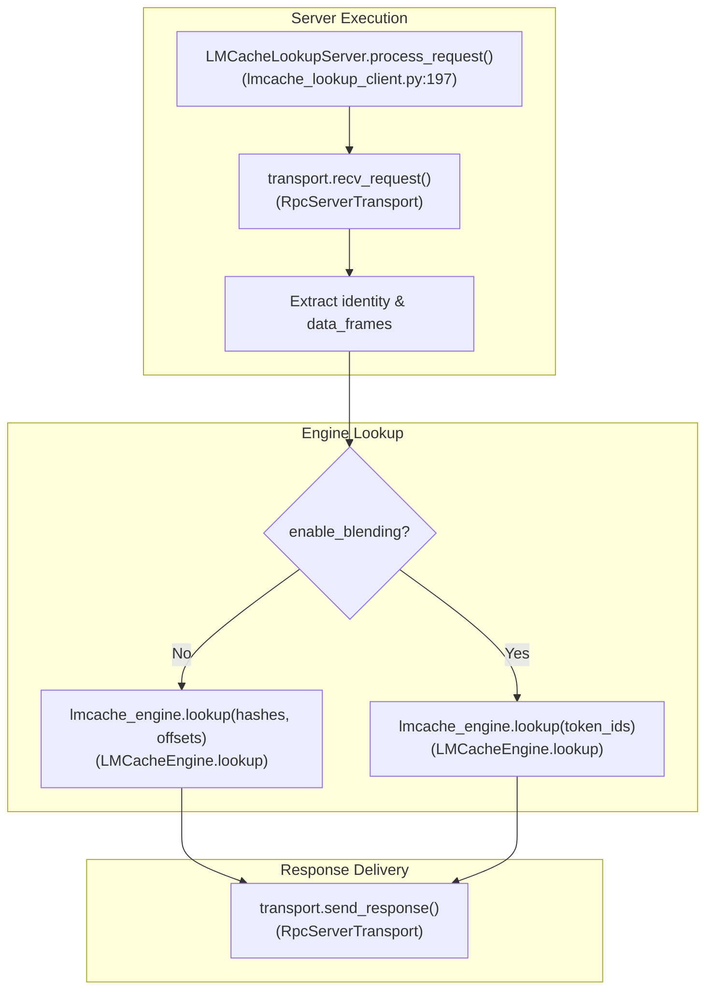
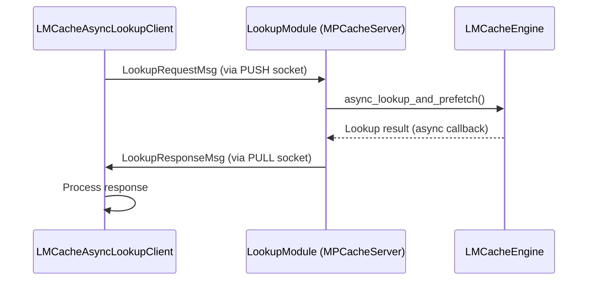
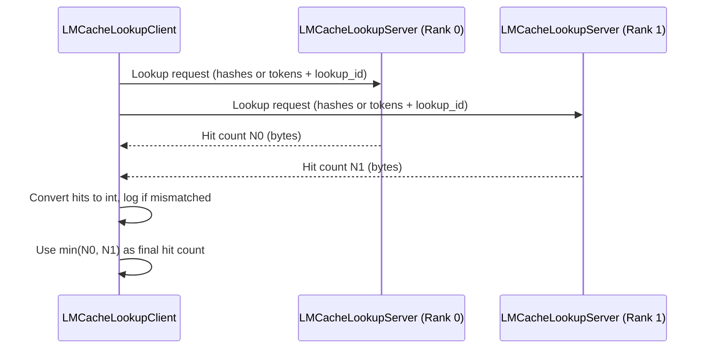

<!-- source: DeepWiki mcp.deepwiki.com · repo LMCache/LMCache · page 7.5 Lookup Server · fetched 2026-10-21 -->

# Lookup Server

Relevant source files

The following files were used as context for generating this wiki page:

- [docs/design/v1/multiprocess/transport/request_transport.md](docs/design/v1/multiprocess/transport/request_transport.md)
- [docs/source/cli/server.rst](docs/source/cli/server.rst)
- [lmcache/integration/vllm/utils.py](lmcache/integration/vllm/utils.py)
- [lmcache/integration/vllm/vllm_v1_adapter.py](lmcache/integration/vllm/vllm_v1_adapter.py)
- [lmcache/utils.py](lmcache/utils.py)
- [lmcache/v1/cache_engine.py](lmcache/v1/cache_engine.py)
- [lmcache/v1/config.py](lmcache/v1/config.py)
- [lmcache/v1/lookup_client/abstract_client.py](lmcache/v1/lookup_client/abstract_client.py)
- [lmcache/v1/lookup_client/chunk_statistics_lookup_client.py](lmcache/v1/lookup_client/chunk_statistics_lookup_client.py)
- [lmcache/v1/lookup_client/factory.py](lmcache/v1/lookup_client/factory.py)
- [lmcache/v1/lookup_client/hit_limit_lookup_client.py](lmcache/v1/lookup_client/hit_limit_lookup_client.py)
- [lmcache/v1/lookup_client/lmcache_async_lookup_client.py](lmcache/v1/lookup_client/lmcache_async_lookup_client.py)
- [lmcache/v1/lookup_client/lmcache_lookup_client.py](lmcache/v1/lookup_client/lmcache_lookup_client.py)
- [lmcache/v1/lookup_client/lmcache_lookup_client_bypass.py](lmcache/v1/lookup_client/lmcache_lookup_client_bypass.py)
- [lmcache/v1/lookup_client/mooncake_lookup_client.py](lmcache/v1/lookup_client/mooncake_lookup_client.py)
- [lmcache/v1/multiprocess/config.py](lmcache/v1/multiprocess/config.py)
- [lmcache/v1/multiprocess/custom_types.py](lmcache/v1/multiprocess/custom_types.py)
- [lmcache/v1/multiprocess/engine_context.py](lmcache/v1/multiprocess/engine_context.py)
- [lmcache/v1/multiprocess/http_server.py](lmcache/v1/multiprocess/http_server.py)
- [lmcache/v1/multiprocess/modules/lookup.py](lmcache/v1/multiprocess/modules/lookup.py)
- [lmcache/v1/multiprocess/request_handler.py](lmcache/v1/multiprocess/request_handler.py)
- [lmcache/v1/multiprocess/rpc.py](lmcache/v1/multiprocess/rpc.py)
- [lmcache/v1/multiprocess/server.py](lmcache/v1/multiprocess/server.py)
- [lmcache/v1/multiprocess/session.py](lmcache/v1/multiprocess/session.py)
- [lmcache/v1/multiprocess/transport/grpc_impl/method_registry.py](lmcache/v1/multiprocess/transport/grpc_impl/method_registry.py)
- [lmcache/v1/multiprocess/transport/zmq_impl/mq.py](lmcache/v1/multiprocess/transport/zmq_impl/mq.py)
- [lmcache/v1/offload_server/zmq_server.py](lmcache/v1/offload_server/zmq_server.py)
- [lmcache/v1/rpc_utils.py](lmcache/v1/rpc_utils.py)
- [lmcache/v1/token_database.py](lmcache/v1/token_database.py)
- [tests/v1/lookup_client/test_chunk_statistics_lookup_client.py](tests/v1/lookup_client/test_chunk_statistics_lookup_client.py)
- [tests/v1/multiprocess/test_cache_server.py](tests/v1/multiprocess/test_cache_server.py)
- [tests/v1/multiprocess/test_config.py](tests/v1/multiprocess/test_config.py)
- [tests/v1/multiprocess/test_custom_types.py](tests/v1/multiprocess/test_custom_types.py)
- [tests/v1/multiprocess/test_ext_server_module.py](tests/v1/multiprocess/test_ext_server_module.py)
- [tests/v1/multiprocess/test_free_locks.py](tests/v1/multiprocess/test_free_locks.py)
- [tests/v1/multiprocess/test_lookup_wait_prefetch.py](tests/v1/multiprocess/test_lookup_wait_prefetch.py)
- [tests/v1/multiprocess/test_mq.py](tests/v1/multiprocess/test_mq.py)
- [tests/v1/multiprocess/test_mq_handler_helpers.py](tests/v1/multiprocess/test_mq_handler_helpers.py)
- [tests/v1/multiprocess/test_session.py](tests/v1/multiprocess/test_session.py)
- [tests/v1/multiprocess/test_unified_touch.py](tests/v1/multiprocess/test_unified_touch.py)
- [tests/v1/test_token_database.py](tests/v1/test_token_database.py)

## Purpose and Scope

The Lookup Server is a core server-side component in LMCache responsible for handling cache lookup requests from distributed serving engine workers. It enables coordinated querying of the LMCache key-value cache managed by the `LMCacheEngine`, allowing multiple worker ranks in distributed inference setups (e.g., tensor parallelism, pipeline parallelism, or MLA) to determine cache hits and initiate prefetching when enabled.

This page details the internal implementation of LMCache's ZMQ-based lookup server mechanisms:
- The synchronous `LMCacheLookupServer` class which responds immediately to requests over a REQ-REP / ROUTER-DEALER socket ([lmcache/v1/lookup_client/lmcache_lookup_client.py:182-207]()).
- The asynchronous `LMCacheAsyncLookupClient` class (which acts as a client to an implicit async server, or rather, a PUSH-PULL based communication pattern) enabling efficient prefetch with separate PUSH-PULL socket channels ([lmcache/v1/lookup_client/lmcache_async_lookup_client.py:34-105]()).
- How the server integrates with the LMCache engine for request processing and response aggregation across worker ranks ([lmcache/v1/lookup_client/lmcache_lookup_client.py:140-162]()).

For background on client implementations and usage patterns, see sections 7.2 (Synchronous Lookup) and 7.3 (Asynchronous Lookup and Prefetching).

Sources:  
[lmcache/v1/cache_engine.py](),  
[lmcache/v1/lookup_client/lmcache_lookup_client.py:182-207](),  
[lmcache/v1/lookup_client/factory.py]()

---

## Architecture Overview

LMCache supports two primary lookup server modes selected by configuration and usage context, to balance synchronous latency vs. asynchronous throughput and prefetch functionality:

- **`LMCacheLookupServer`**: A synchronous, ZMQ-backed server responding to blocking lookup requests ([lmcache/v1/lookup_client/lmcache_lookup_client.py:182-193]()). Suitable for low-latency scenarios.
- **`LMCacheAsyncLookupClient`**: An asynchronous push-pull client that interacts with a server-side component (often within the `LookupModule` of the `MPCacheServer`) to enable background prefetch and deferred responses ([lmcache/v1/lookup_client/lmcache_async_lookup_client.py:34-105]()).

Instantiation of these servers is handled by `LookupClientFactory.create_lookup_server()` based on engine and metadata configuration ([lmcache/v1/lookup_client/factory.py]()).

Title: Lookup Server Component Mapping to Code Entities

Sources:  
[lmcache/v1/lookup_client/factory.py](),  
[lmcache/v1/lookup_client/lmcache_lookup_client.py:27-193](),  
[lmcache/v1/lookup_client/lmcache_async_lookup_client.py:34-105](),  
[lmcache/v1/multiprocess/modules/lookup.py]()

| Feature                | `LMCacheLookupServer`                  | `LMCacheAsyncLookupClient` (client-side)                  |
|------------------------|--------------------------------------|---------------------------------------------|
| Communication Pattern  | Synchronous REQ-REP / ROUTER          | Asynchronous PUSH-PULL                       |
| Transport              | `RpcServerTransport` (e.g., ZMQ ROUTER)            | Raw ZMQ PUSH/PULL sockets ([lmcache/v1/lookup_client/lmcache_async_lookup_client.py:86-105]()) |
| Prefetching Support    | No                                   | Yes, client initiates prefetch pipeline via server-side `LookupModule`|
| Response               | Immediate blocking reply               | Deferred response via PULL socket to client's processing thread|
| Use Case               | Low-latency blocking requirement      | High-throughput async prefetching            |

Sources:  
[lmcache/v1/lookup_client/factory.py](),  
[lmcache/v1/lookup_client/lmcache_async_lookup_client.py:86-105]()

---

## Synchronous Lookup Server Implementation

The `LMCacheLookupServer` class ([lmcache/v1/lookup_client/lmcache_lookup_client.py:182-193]()) implements a ZMQ ROUTER server that waits on synchronous cache lookup requests, processes them with the `LMCacheEngine`, and replies inline with the result.

### Key Components and Data Flow

- **Transport**: Injected `RpcServerTransport` handles message receiving and sending over ZMQ sockets ([lmcache/v1/lookup_client/lmcache_lookup_client.py:190-204]()).
- **Processing Thread**: A dedicated background thread runs `process_request()`, blocking on `recv_request()` calls ([lmcache/v1/lookup_client/lmcache_lookup_client.py:197-205]()).
- **Request Payload**:
  - For non-blending mode, the request includes a list of `hashes` and `offsets`.
  - For blending mode, token IDs are received directly ([lmcache/v1/lookup_client/lmcache_lookup_client.py:125-139]()).
  - `lookup_id`: A unique string identifier representing this lookup request.
  - `request_configs`: JSON string with optional request override parameters.

### Request Handling Flow

Upon receiving a request message:

1. Extract the identity and data frames from ZMQ frames ([lmcache/v1/lookup_client/lmcache_lookup_client.py:200-207]()).
2. Perform validation on the received frame structure and decode:
   - For non-blending: Lists of hashes and offsets are decoded.
   - For blending: Raw token IDs are deserialized.
   - Parse the `lookup_id` and `request_configs`.
3. Call the LMCache engine's lookup method with the appropriate input ([lmcache/v1/cache_engine.py]()).
4. Encode the hit token count as a big-endian response and send back through ZMQ ([lmcache/v1/lookup_client/lmcache_lookup_client.py:250-260]()).

Title: Synchronous Lookup Request Processing Flow with Code Entities

Sources:  
[lmcache/v1/lookup_client/lmcache_lookup_client.py:182-260](),  
[lmcache/v1/token_database.py]()

### Message Protocol and Framing

- The request consists of ZMQ multi-frame messages:
  1. List of token chunk hashes + offsets OR raw token IDs (for blending).
  2. `lookup_id` string bytes.
  3. `request_configs` JSON string bytes (may be empty).

- The response is encoded as a big-endian integer indicating the number of hit tokens ([lmcache/v1/lookup_client/lmcache_lookup_client.py:146-146]()).

Sources:  
[lmcache/v1/lookup_client/lmcache_lookup_client.py:146-146]()

---

## Asynchronous Lookup Server Implementation

When the configuration enables asynchronous loading/prefetching (`enable_async_loading`), the system instantiates the `LMCacheAsyncLookupClient` ([lmcache/v1/lookup_client/factory.py]()). This client interacts with a server-side component (typically the `LookupModule` within the `MPCacheServer`) via ZMQ PUSH-PULL sockets to handle lookup requests and perform background prefetching, allowing non-blocking cache lookups.

### Architecture and Data Flow

- **ZMQ Transport**:
  - The `LMCacheAsyncLookupClient` sends requests to workers over PUSH sockets ([lmcache/v1/lookup_client/lmcache_async_lookup_client.py:86-94]()).
  - The server-side `LookupModule` processes these requests and pushes responses back to the client via PULL sockets ([lmcache/v1/lookup_client/lmcache_async_lookup_client.py:96-105]()).

- **Message Handling**:
  - The client sends `LookupRequestMsg` messages carrying token IDs and lookup metadata ([lmcache/v1/lookup_client/async_lookup_message.py]()).
  - The server-side `LookupModule` calls `LMCacheEngine.async_lookup_and_prefetch()` to start asynchronous cache lookup and prefetch.
  - Upon completion, the server packs the hit count into a `LookupResponseMsg` and sends it back to the client.

- **Cleanup**:
  - `LookupCleanupMsg` is used to handle session termination or aborted requests, freeing resources ([lmcache/v1/lookup_client/async_lookup_message.py]()).

Title: Asynchronous Lookup Request Processing Flow (Client-Server Interaction)

Sources:  
[lmcache/v1/lookup_client/lmcache_async_lookup_client.py:69-105](),  
[lmcache/v1/multiprocess/modules/lookup.py]()

---

## Response Aggregation Across Worker Ranks

In distributed scenarios with multiple workers (ranks) holding shards of the cache, `LMCacheLookupClient` concurrently sends identical lookup requests to all worker servers (via the transport layer) and obtains multiple responses ([lmcache/v1/lookup_client/lmcache_lookup_client.py:140-160]()):

1. **Broadcast Requests**: The client's transport sends the query across all worker ranks ([lmcache/v1/lookup_client/lmcache_lookup_client.py:140-141]()).

2. **Receive Responses**: A list of byte payloads is collected, each encoding hit token count.

3. **Deserialize and Check Consistency**: Each response is converted to an integer ([lmcache/v1/lookup_client/lmcache_lookup_client.py:146-146]()). If the hit counts differ across ranks, a warning is logged ([lmcache/v1/lookup_client/lmcache_lookup_client.py:149-154]()).

4. **Safe Aggregation**: The minimum hit token count among all ranks is used as the final lookup result, ensuring correctness across pipeline and tensor parallel shards ([lmcache/v1/lookup_client/lmcache_lookup_client.py:155-161]()). This avoids overestimated cache hits due to asynchronous state variation.

Sources:  
[lmcache/v1/lookup_client/lmcache_lookup_client.py:140-162]()

---

## Configuration and Deployment

The lookup server selection and deployment is configurable with these key parameters:

| Parameter                | Description                                                                                              |
|--------------------------|----------------------------------------------------------------------------------------------------------|
| `enable_async_loading`   | Enables asynchronous lookup client with prefetch support (async server interaction). Defaults off for sync server.  |
| `lookup_server_worker_ids` | List of worker ranks to start lookup servers on. Empty means launch on all workers. Default `[0]` if MLA enabled ([lmcache/v1/lookup_client/lmcache_lookup_client.py:37-47]()). |
| `lookup_timeout_ms`      | Timeout for lookup requests in async client, in milliseconds ([lmcache/v1/lookup_client/lmcache_async_lookup_client.py:176-186]()). |
| `enable_blending`        | Enables segment-based token processing for advanced reuse and blending scenarios ([lmcache/v1/config.py:137-141]()).                        |

- The lookup server is started only on worker ranks matching `lookup_server_worker_ids`, enabling rank 0-only setups or full multi-rank deployments ([lmcache/v1/lookup_client/lmcache_lookup_client.py:37-48]()).

- In MLA (multi-level attention) mode, lookup servers typically run only on rank 0 to avoid redundant caching ([lmcache/v1/lookup_client/lmcache_lookup_client.py:40-45]()).

- The factory function `LookupClientFactory.create_lookup_server()` chooses the synchronous or asynchronous server based on config flags and rank ID ([lmcache/v1/lookup_client/factory.py]()).

Sources:  
[lmcache/v1/lookup_client/factory.py](),  
[lmcache/v1/lookup_client/lmcache_lookup_client.py:37-48](),  
[lmcache/v1/lookup_client/lmcache_async_lookup_client.py:176-186](),  
[lmcache/v1/config.py:137-141]()

---

# Summary

The LMCache Lookup Server is a critical distributed component enabling cache lookup and prefetch services in multi-rank inference servers. It provides both synchronous and asynchronous ZMQ-based implementations that interface tightly with the `LMCacheEngine`, support multi-rank response aggregation, and handle token/hashing data translations. Proper configuration allows efficient deployment at scale with rank affinity and MLA-aware optimizations.

Sources:  
[lmcache/v1/lookup_client/lmcache_lookup_client.py:182-207](),  
[lmcache/v1/lookup_client/lmcache_async_lookup_client.py:34-105]()

---

# References

- `LMCacheLookupServer` class: [lmcache/v1/lookup_client/lmcache_lookup_client.py:182-258]()
- `LMCacheAsyncLookupClient` (client-side of async lookup): [lmcache/v1/lookup_client/lmcache_async_lookup_client.py:34-149]()
- `LookupClientFactory.create_lookup_server()`: [lmcache/v1/lookup_client/factory.py]()
- Request processing in `LookupModule.lookup()`: [lmcache/v1/multiprocess/modules/lookup.py]()
- TokenDatabase abstraction for token processing: [lmcache/v1/token_database.py]()

---

