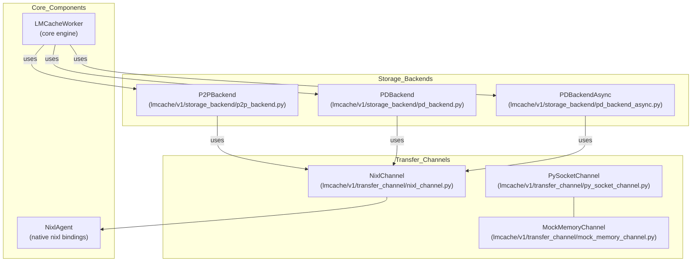
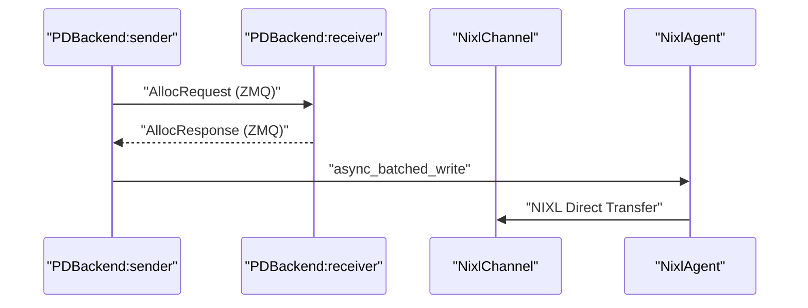

<!-- source: DeepWiki mcp.deepwiki.com · repo LMCache/LMCache · page 8 P2P Cache Sharing and Disaggregated Prefill · fetched 2026-10-21 -->

# P2P Cache Sharing and Disaggregated Prefill

Relevant source files

The following files were used as context for generating this wiki page:

- [lmcache/v1/storage_backend/p2p_backend.py](lmcache/v1/storage_backend/p2p_backend.py)
- [lmcache/v1/storage_backend/path_sharder.py](lmcache/v1/storage_backend/path_sharder.py)
- [lmcache/v1/storage_backend/pd_backend.py](lmcache/v1/storage_backend/pd_backend.py)
- [lmcache/v1/storage_backend/pd_backend_async.py](lmcache/v1/storage_backend/pd_backend_async.py)
- [lmcache/v1/transfer_channel/__init__.py](lmcache/v1/transfer_channel/__init__.py)
- [lmcache/v1/transfer_channel/abstract.py](lmcache/v1/transfer_channel/abstract.py)
- [lmcache/v1/transfer_channel/mock_memory_channel.py](lmcache/v1/transfer_channel/mock_memory_channel.py)
- [lmcache/v1/transfer_channel/nixl_channel.py](lmcache/v1/transfer_channel/nixl_channel.py)
- [lmcache/v1/transfer_channel/py_socket_channel.py](lmcache/v1/transfer_channel/py_socket_channel.py)
- [tests/v1/storage_backend/test_pd_backend_async.py](tests/v1/storage_backend/test_pd_backend_async.py)

This page provides a high-level overview of peer-to-peer (P2P) cache sharing and prefill-decode disaggregation architectures in LMCache. These topologies enable multi-instance and disaggregated LLM serving deployments to share KV cache blocks directly via high-performance data planes, coordination protocols, and dedicated storage backends.

Both architectures rely on a control plane (such as a central cache controller or a proxy server) to track chunk locations, combined with data plane transfer channels that move raw tensor data between worker memory spaces.

Sources: `lmcache/v1/storage_backend/p2p_backend.py:162-216()`, `lmcache/v1/storage_backend/pd_backend.py:174-183()`

---

## Architecture Overview

The P2P and Disaggregated Prefill (PD) subsystems coordinate across multiple layers:

- **Control Plane:** Responsible for cluster membership, peer discovery, chunk registration, and coordination.
- **Signaling Plane:** Implements remote procedure calls (RPC) using ZeroMQ (ZMQ) sockets for commands like allocator queries, peer initialization, and cache queries.
- **Data Plane:** Transfers raw tensor KV cache data between peers efficiently using specialized transfer channels such as `NixlChannel`, socket channels, or mock channels for testing.

This modular separation enables scaling to large fleets, supports multiple networking transports and protocols, and allows flexible deployment topologies.

### High-Level Code Architecture

Sources:  
- `lmcache/v1/storage_backend/p2p_backend.py:162-216()`  
- `lmcache/v1/storage_backend/pd_backend.py:174-183()`  
- `lmcache/v1/storage_backend/pd_backend_async.py:174-183()`  
- `lmcache/v1/transfer_channel/nixl_channel.py:66-96()`  
- `lmcache/v1/transfer_channel/mock_memory_channel.py`  
- `lmcache/v1/transfer_channel/py_socket_channel.py`

---

## P2P Storage Backend

The `P2PBackend` implements direct peer-to-peer cache sharing within LMCache. Rather than reading KV blocks from centralized storage backends for every request, workers can discover, locate, and fetch KV chunks from peers in the cluster, reducing remote storage latency and network bandwidth.

Key features include:

- Local peer discovery and initialization using `p2p_host` and `peer_init_ports`.
- Lookup and memory retrieval protocols built on asynchronous ZMQ request-reply messaging.
- Management of peer state and connection sockets via `PeerInfo` objects [lmcache/v1/storage_backend/p2p_backend.py:133-160]().
- Integration with the core engine's local CPU backend memory allocator to place received KV tensors directly.

This backend is enabled via the `enable_p2p` configuration flag and requires explicit configuration for peer initialization and lookup ports. It currently targets CPU-based memory and can be extended for GPU/local storage in the future.

For comprehensive documentation of `P2PBackend`, peer discovery, retry logic, and configuration parameters, see [P2P Storage Backend](#8.1).

Sources: `lmcache/v1/storage_backend/p2p_backend.py:162-216()`

---

## Transfer Channels

Transfer channels provide the high-performance data plane connecting LMCache nodes for raw tensor movement of KV cache blocks. Key channel implementations include:

- **NixlChannel:** A native integration leveraging NVIDIA’s NIXL API for zero-copy GPU and CPU transfers over UCX, POSIX, or other backends [lmcache/v1/transfer_channel/nixl_channel.py:66-96](). It manages peer memory registration and preps transfer descriptors.
- **PySocketChannel:** A socket-based ZMQ control plane channel designed for remote connection setup and handshakes [lmcache/v1/transfer_channel/py_socket_channel.py:55-62]().
- **MockMemoryChannel:** A single-process mock channel simulating data transfers inside the same process memory for testing [lmcache/v1/transfer_channel/mock_memory_channel.py:23-31]().

The `CreateTransferChannel` factory dynamically creates these channels based on configuration such as `transfer_channel` type and backend options [lmcache/v1/transfer_channel/__init__.py:10-20]().

These channels abstract away the complexity of physical data movement, enabling transparent KV block transfers while maintaining socket-level peer handshake protocols.

For detailed explanation of transfer channel types, protocol selection, Mooncake TE integration, and asynchronous/synchronous modes, see [Transfer Channels](#8.2).

Sources:  
- `lmcache/v1/transfer_channel/__init__.py:10-84()`  
- `lmcache/v1/transfer_channel/nixl_channel.py:66-96()`  
- `lmcache/v1/transfer_channel/mock_memory_channel.py`  
- `lmcache/v1/transfer_channel/py_socket_channel.py`

---

## Cache Controller

The cache controller architecture provides global orchestration across multi-instance LMCache deployments. Controlled by flags such as `enable_controller` and configured by `controller_url`, the controller coordinates:

- KV chunk registration and location tracking in a global key directory.
- Worker instance registration and heartbeat monitoring.
- Multi-instance synchronization including Freeze Mode to safely pause updates.
- Recovery mechanisms like full-sync of chunk metadata after failure.

The controller thus serves as the control plane arbiter, enabling consistent global KV cache state awareness and efficient peer discovery for P2P and disaggregated prefill traffic.

For more details on the cache controller internals, kv/registration controllers, synchronization modes, multi-instance coordination, and recovery, see [Cache Controller](#8.3).

Sources: `lmcache/v1/storage_backend/p2p_backend.py:162-216()`

---

## Disaggregated Prefill Backend

The `PDBackend` and `PDBackendAsync` support prefilling and decoding disaggregation (1P1D/xPyD), where prefill (sender) and decode (receiver) roles are split into dedicated nodes. These backends enable streaming generated KV cache chunks from one node to another without intermediate storage.

Features:

- Role-based configuration (`pd_role`) with "sender", "receiver", or "both" modes [lmcache/v1/storage_backend/pd_backend.py:113-118]().
- Buffer reservation and indexing to allocate memory slices for incoming KV data [lmcache/v1/storage_backend/pd_backend_async.py:98-105]().
- Proxy server notification to coordinate writes asynchronously [lmcache/v1/storage_backend/pd_backend.py:129-131]().
- Use of transfer channels (typically `NixlChannel`) to implement direct transfers.

This architecture enables reduced GPU memory pressure on decode nodes, smoother streaming pipelines, and efficient memory sharing.

### Disaggregated Prefill Data Flow

For detailed documentation on `PDBackend` features, proxy server interaction, buffer management, and examples of deployments in 1P1D and xPyD systems, refer to [Disaggregated Prefill Backend](#8.4).

Sources:  
- `lmcache/v1/storage_backend/pd_backend.py:41-86()`  
- `lmcache/v1/storage_backend/pd_backend.py:90-183()`  
- `lmcache/v1/storage_backend/pd_backend_async.py:45-95()`  
- `lmcache/v1/transfer_channel/nixl_channel.py:66-96()`  
- `tests/v1/storage_backend/test_pd_backend_async.py:1-50()`

---

# Summary

LMCache’s P2P Cache Sharing and Disaggregated Prefill subsystems offer distinct but complementary architectures for enhanced KV cache utilization:

- **P2P Backend:** Enables dynamic direct chunk sharing across peers for multi-instance fleet cache coherence.
- **Transfer Channels:** Provide flexible and performant data plane transports for raw tensor movement.
- **Cache Controller:** Coordinates multi-instance discovery, registration, and cache state tracking.
- **PD Backend:** Implements prefilling and decoding node separation with streaming of KV cache via specialized buffers.

Together, these components enable scalable, efficient distributed KV cache management suited for state-of-the-art large language model serving.

For detailed technical information, configuration options, and code documentation, dive into the child topic pages:

- [P2P Storage Backend](#8.1)
- [Transfer Channels](#8.2)
- [Cache Controller](#8.3)
- [Disaggregated Prefill Backend](#8.4)

Sources:  
- `lmcache/v1/storage_backend/p2p_backend.py:162-216()`  
- `lmcache/v1/storage_backend/pd_backend.py:174-183()`  
- `lmcache/v1/transfer_channel/__init__.py:10-84()`

---

