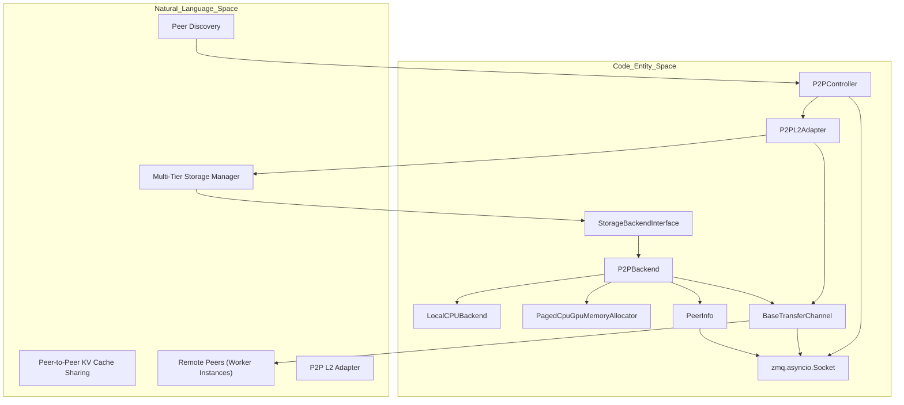
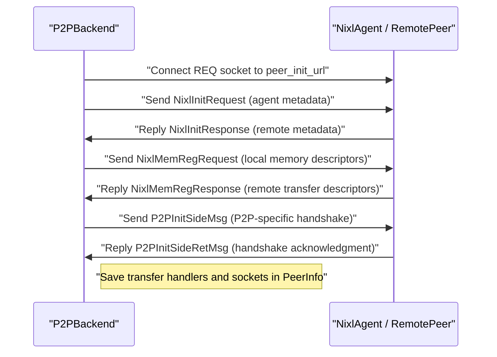
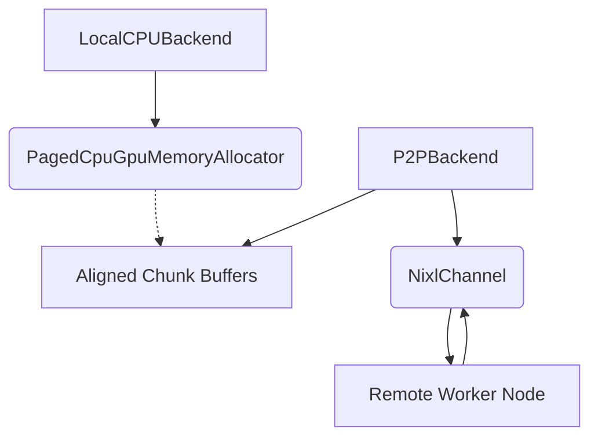
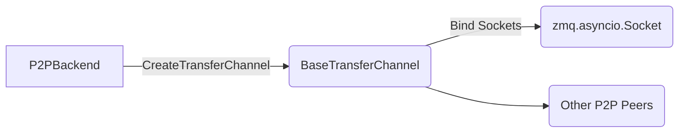
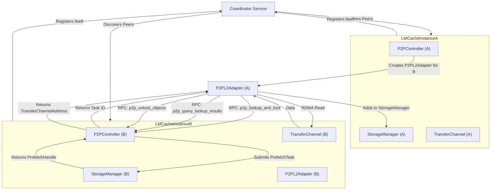

<!-- source: DeepWiki mcp.deepwiki.com · repo LMCache/LMCache · page 8.1 P2P Storage Backend · fetched 2026-10-21 -->

# P2P Storage Backend

<details>
<summary>Relevant source files</summary>

The following files were used as context for generating this wiki page:

- [docs/design/v1/distributed/l2_adapters/p2p_l2_adapter.md](docs/design/v1/distributed/l2_adapters/p2p_l2_adapter.md)
- [docs/design/v1/distributed/transfer_channel/overall.md](docs/design/v1/distributed/transfer_channel/overall.md)
- [lmcache/v1/distributed/l2_adapters/p2p_l2_adapter.py](lmcache/v1/distributed/l2_adapters/p2p_l2_adapter.py)
- [lmcache/v1/distributed/transfer_channel/abstract.py](lmcache/v1/distributed/transfer_channel/abstract.py)
- [lmcache/v1/distributed/transfer_channel/impl/nixl_impl.py](lmcache/v1/distributed/transfer_channel/impl/nixl_impl.py)
- [lmcache/v1/multiprocess/modules/p2p_controller.py](lmcache/v1/multiprocess/modules/p2p_controller.py)
- [lmcache/v1/storage_backend/p2p_backend.py](lmcache/v1/storage_backend/p2p_backend.py)
- [lmcache/v1/storage_backend/path_sharder.py](lmcache/v1/storage_backend/path_sharder.py)
- [lmcache/v1/storage_backend/pd_backend.py](lmcache/v1/storage_backend/pd_backend.py)
- [lmcache/v1/storage_backend/pd_backend_async.py](lmcache/v1/storage_backend/pd_backend_async.py)
- [lmcache/v1/transfer_channel/__init__.py](lmcache/v1/transfer_channel/__init__.py)
- [lmcache/v1/transfer_channel/abstract.py](lmcache/v1/transfer_channel/abstract.py)
- [lmcache/v1/transfer_channel/mock_memory_channel.py](lmcache/v1/transfer_channel/mock_memory_channel.py)
- [lmcache/v1/transfer_channel/nixl_channel.py](lmcache/v1/transfer_channel/nixl_channel.py)
- [lmcache/v1/transfer_channel/py_socket_channel.py](lmcache/v1/transfer_channel/py_socket_channel.py)
- [tests/v1/distributed/l2_adapters/test_p2p_l2_adapter.py](tests/v1/distributed/l2_adapters/test_p2p_l2_adapter.py)
- [tests/v1/distributed/transfer_channel/test_context_lifecycle.py](tests/v1/distributed/transfer_channel/test_context_lifecycle.py)
- [tests/v1/distributed/transfer_channel/test_factory.py](tests/v1/distributed/transfer_channel/test_factory.py)
- [tests/v1/distributed/transfer_channel/test_nixl_impl.py](tests/v1/distributed/transfer_channel/test_nixl_impl.py)
- [tests/v1/multiprocess/test_p2p_controller.py](tests/v1/multiprocess/test_p2p_controller.py)
- [tests/v1/storage_backend/test_pd_backend_async.py](tests/v1/storage_backend/test_pd_backend_async.py)

</details>


## Purpose and Scope
The P2P Storage Backend (`P2PBackend`) provides a peer-to-peer KV cache sharing facility across multiple LMCache worker instances or processes [lmcache/v1/storage_backend/p2p_backend.py:162-216](). This enables direct KV cache chunk retrieval from peer nodes in a distributed serving cluster without fallback to remote storage or expensive recomputations.

Key capabilities include peer discovery, connection and handshake management, low-latency memory transfers via zero-copy DMA/RDMA mechanisms, and concurrency-safe messaging protocols [lmcache/v1/storage_backend/p2p_backend.py:53-216](). This backend leverages LMCache’s transfer channels (e.g., `NixlChannel`) and tightly integrates with the local CPU memory allocator [lmcache/v1/storage_backend/p2p_backend.py:215-216](), [lmcache/v1/transfer_channel/nixl_channel.py:66-96]().

This page explains the detailed implementation of `P2PBackend`, key configuration options (`enable_p2p`, `p2p_host`, `p2p_init_ports`), peer discovery and lookup management, and related transfer channel mechanics. It also covers the `MP P2PController` and the `p2p L2 adapter` which facilitate peer discovery and integration into the distributed storage manager.

Sources: [lmcache/v1/storage_backend/p2p_backend.py:162-216](), [lmcache/v1/transfer_channel/nixl_channel.py:66-96]()

---

## Architecture Overview and Code Entity Mapping

`P2PBackend` is a specialization of `StorageBackendInterface` designed for distributed peer cache sharing [lmcache/v1/storage_backend/p2p_backend.py:38-40](), [lmcache/v1/storage_backend/p2p_backend.py:162-216](). It is instantiated within an event loop context and works in concert with the `LocalCPUBackend` [lmcache/v1/storage_backend/p2p_backend.py:164-170](), [lmcache/v1/storage_backend/p2p_backend.py:215-216]():

- It maintains peer connectivity information using the `PeerInfo` dataclass [lmcache/v1/storage_backend/p2p_backend.py:133-140](), [lmcache/v1/storage_backend/p2p_backend.py:206-206]().
- Uses a transfer channel (e.g., `NixlChannel`) for zero-copy network transfers [lmcache/v1/transfer_channel/__init__.py:10-63]().
- Coordinates requests and responses with peer nodes through asynchronous ZMQ sockets [lmcache/v1/storage_backend/p2p_backend.py:11-12](), [lmcache/v1/storage_backend/p2p_backend.py:139-139]().
- Maintains a local lookup cache mapping between KV keys and peer addresses for efficient routing [lmcache/v1/storage_backend/p2p_backend.py:202-204]().

Title: P2P Architecture and Code Entity Mapping


Sources: [lmcache/v1/storage_backend/p2p_backend.py:38-40](), [lmcache/v1/storage_backend/p2p_backend.py:133-140](), [lmcache/v1/storage_backend/p2p_backend.py:162-216](), [lmcache/v1/transfer_channel/abstract.py:21-22](), [lmcache/v1/multiprocess/modules/p2p_controller.py:153-177](), [docs/design/v1/distributed/l2_adapters/p2p_l2_adapter.md:1-11]()

---

## Configuration Parameters

Activating and configuring P2P Storage Backend involves specifying several configuration parameters in `LMCacheEngineConfig`, commonly via environment variables or YAML config files.

| Parameter | Env Variable | Description | Notes / Defaults |
|-----------|--------------|-------------|------------------|
| `enable_p2p` | `LMCACHE_ENABLE_P2P` | Enables peer-to-peer KV sharing backend. | Default: `False` |
| `p2p_host` | `LMCACHE_P2P_HOST` | Host IP used for P2P communication and transfer channels binding. | **Required if `enable_p2p` is true** [lmcache/v1/storage_backend/p2p_backend.py:175-175]() |
| `p2p_init_ports` | `LMCACHE_P2P_INIT_PORTS` | List of ports assigned to each TP rank for peer initialization socket. | **Required** [lmcache/v1/storage_backend/p2p_backend.py:176-176]() |
| `p2p_lookup_ports` | `LMCACHE_P2P_LOOKUP_PORTS` | List of ports per TP rank for peer lookup sockets. | **Required** [lmcache/v1/storage_backend/p2p_backend.py:177-177]() |
| `transfer_channel` | `LMCACHE_TRANSFER_CHANNEL` | Specifies underlying transfer channel implementation, such as `"nixl"` or `"mock_memory"`. | Default: `"nixl"` [lmcache/v1/transfer_channel/__init__.py:41-43]() |
| `p2p_socket_recv_timeout_ms` | `LMCACHE_P2P_SOCKET_RECV_TIMEOUT_MS` | Timeout for receiving messages on P2P sockets. | Default: `DEFAULT_SOCKET_RECV_TIMEOUT_MS` (5000 ms) [lmcache/v1/storage_backend/p2p_backend.py:180-182]() |
| `p2p_socket_send_timeout_ms` | `LMCACHE_P2P_SOCKET_SEND_TIMEOUT_MS` | Timeout for sending messages on P2P sockets. | Default: `DEFAULT_SOCKET_SEND_TIMEOUT_MS` (5000 ms) [lmcache/v1/storage_backend/p2p_backend.py:183-185]() |
| `p2p_max_retry_count` | `LMCACHE_P2P_MAX_RETRY_COUNT` | Maximum number of retries for P2P operations. | Default: `3` [lmcache/v1/storage_backend/p2p_backend.py:187-188]() |

Note: These config parameters are fetched from `LMCacheEngineConfig`’s extra config map using `.get_extra_config_value()` during `P2PBackend` construction [lmcache/v1/storage_backend/p2p_backend.py:180-188]().

Sources: [lmcache/v1/storage_backend/p2p_backend.py:173-188](), [lmcache/v1/transfer_channel/__init__.py:41-43]()

---

## Peer Discovery and Connection Management

`P2PBackend` keeps track of peers using an internal mapping of peer ID to `PeerInfo` objects [lmcache/v1/storage_backend/p2p_backend.py:206-206](). Each `PeerInfo` holds the peer’s initialization and lookup URLs, an asyncio lock to serialize lookup socket access, and the active ZMQ socket used for lookups [lmcache/v1/storage_backend/p2p_backend.py:133-140]().

### PeerInfo Data Structure

```python
@dataclass
class PeerInfo:
    peer_init_url: str
    peer_lookup_url: str
    lookup_lock: asyncio.Lock
    lookup_socket: zmq.asyncio.Socket
```

- `lookup_socket` is lazily initialized when communication is first attempted.
- URL updates dynamically trigger socket closure and recreation with new connection endpoints [lmcache/v1/storage_backend/p2p_backend.py:141-159]().

Sources: [lmcache/v1/storage_backend/p2p_backend.py:133-160]()

### Peer Connection Initialization Flow

Peer connections are established lazily when needed, asynchronously invoking the transfer channel’s lazy initialization routines [lmcache/v1/transfer_channel/nixl_channel.py:121-180]().

Key steps:

1. Create a temporary ZMQ `REQ` socket connecting to `peer_init_url` [lmcache/v1/transfer_channel/nixl_channel.py:129-135]().
2. Exchange transfer channel agent metadata and initialize remote agent registration (`NixlInitRequest`/`NixlInitResponse`) [lmcache/v1/transfer_channel/nixl_channel.py:138-148]().
3. Register local memory descriptors with the remote peer (`NixlMemRegRequest`/`NixlMemRegResponse`) [lmcache/v1/transfer_channel/nixl_channel.py:150-169]().
4. Exchange side initialization messages specific to P2P transfer (`P2PInitSideMsg`/`P2PInitSideRetMsg`) [lmcache/v1/transfer_channel/abstract.py:82-88]().
5. Store transfer handlers and update `PeerInfo` with initialized sockets for future lookups [lmcache/v1/transfer_channel/nixl_channel.py:169-170]().

Title: P2P Peer Connection Initialization Sequence


Sources: [lmcache/v1/storage_backend/p2p_backend.py:237-285](), [lmcache/v1/transfer_channel/nixl_channel.py:121-180](), [lmcache/v1/transfer_channel/abstract.py:82-88]()

### P2P Lookup and Messaging

When performing operations, `P2PBackend`:
- Checks the local lookup cache for known peer mappings of requested keys [lmcache/v1/storage_backend/p2p_backend.py:202-204]().
- Serializes and sends a `BatchedLookupAndGetMsg` containing keys and allocated memory indexes to the peer's lookup socket [lmcache/v1/storage_backend/p2p_backend.py:59-71]().
- Waits asynchronously for a `BatchedLookupAndGetRetMsg` response with the number of hit chunks [lmcache/v1/storage_backend/p2p_backend.py:73-78]().
- Handles error messages from peers using `P2PErrorMsg` with enumerated error codes (`P2PErrorCode`) [lmcache/v1/storage_backend/p2p_backend.py:102-122]().
- Similarly, for put tasks, sends a `BatchedLookupAndPutMsg` containing keys and memory indexes for writing cache data to a peer [lmcache/v1/storage_backend/p2p_backend.py:80-93]().

Sources: [lmcache/v1/storage_backend/p2p_backend.py:59-122](), [lmcache/v1/storage_backend/p2p_backend.py:202-204]()

---

## Memory Management for P2P

`P2PBackend` uses the local CPU backend’s memory allocator (`PagedCpuGpuMemoryAllocator`) to allocate memory regions aligned for KV cache chunks [lmcache/v1/storage_backend/p2p_backend.py:24-26](), [lmcache/v1/storage_backend/p2p_backend.py:215-216](). These buffers are critical for zero-copy direct memory access by remote peers.

- Memory is allocated as `MemoryObj` instances with metadata describing shapes, formats, and dtypes [lmcache/v1/storage_backend/p2p_backend.py:27-30]().
- The transfer channel is given the base pointer, buffer size, and alignment to register shared memory regions [lmcache/v1/transfer_channel/nixl_channel.py:73-94]().
- Peers use registered descriptors to fetch or push KV cache layers directly from/to these shared buffers, minimizing copy overhead.

Title: P2P Memory Allocation and Direct Transfer Flow


Sources: [lmcache/v1/storage_backend/p2p_backend.py:24-30](), [lmcache/v1/storage_backend/p2p_backend.py:215-216](), [lmcache/v1/transfer_channel/nixl_channel.py:66-96]()

---

## Storage Backend Interface Implementation Details

`P2PBackend` implements the `StorageBackendInterface` [lmcache/v1/storage_backend/p2p_backend.py:38-40](), [lmcache/v1/storage_backend/p2p_backend.py:162-216]() to provide core backend operations:

- **Batched Get (`batched_get_non_blocking`)**: Accepts a list of `CacheEngineKey` objects and pre-allocated memory objects, looks up responsible peers, constructs `BatchedLookupAndGetMsg` requests, and awaits asynchronous replies.
- **Batched Put (`batched_submit_put_task`)**: Sends cache data for a list of keys back to peers using `BatchedLookupAndPutMsg` and waits for completion confirmation.
- **Error Handling (`P2PErrorMsg`, `P2PErrorCode`)**: Handles server errors, unknown message types, and uninitialized remote transfer handlers gracefully [lmcache/v1/storage_backend/p2p_backend.py:102-122]().
- **Transfer Channel Factory**: Creates transfer channels via `CreateTransferChannel(channel_type, ...)` [lmcache/v1/transfer_channel/__init__.py:10-21](), abstracting underlying transport protocols such as `nixl` or `mock_memory` [lmcache/v1/transfer_channel/__init__.py:41-83]().

Title: P2PBackend Transfer Channel Integration


Sources: [lmcache/v1/storage_backend/p2p_backend.py:38-129](), [lmcache/v1/storage_backend/p2p_backend.py:162-216](), [lmcache/v1/transfer_channel/__init__.py:10-83]()

---

## MP P2PController and P2P L2 Adapter

In a multi-process (MP) LMCache setup, the `P2PController` [lmcache/v1/multiprocess/modules/p2p_controller.py:153-177]() manages peer discovery, adapter lifecycle, and serves lookup requests from other peers. It works in conjunction with the `P2PL2Adapter` [docs/design/v1/distributed/l2_adapters/p2p_l2_adapter.md:1-11]() to integrate P2P capabilities into the distributed storage manager.

### P2PController Responsibilities

The `P2PController` is responsible for:
- **Peer Discovery**: It polls a coordinator service (if configured) to discover other LMCache instances that have P2P enabled [lmcache/v1/multiprocess/modules/p2p_controller.py:198-200]().
- **Adapter Lifecycle**: For each discovered peer, it creates and manages a `P2PL2Adapter` instance. It also handles the removal of adapters for unresponsive peers [lmcache/v1/multiprocess/modules/p2p_controller.py:191-192](), [lmcache/v1/multiprocess/modules/p2p_controller.py:127-134]().
- **Lookup Serving**: It exposes RPC endpoints (`p2p_lookup_and_lock`, `p2p_query_lookup_results`, `p2p_unlock_objects`) to allow other peers to query and retrieve KV cache chunks from its local L1 cache [lmcache/v1/multiprocess/modules/p2p_controller.py:170-177](), [tests/v1/multiprocess/test_p2p_controller.py:68-89]().
- **Prefetch Task Submission**: When a peer requests a lookup, the controller submits a `PrefetchTaskSpec` to its local storage manager with `skip_l2=True` and `fetching_policy="full"` [tests/v1/multiprocess/test_p2p_controller.py:167-184](). This ensures the lookup only checks the local L1 cache.

### P2PL2Adapter Functionality

The `P2PL2Adapter` acts as a read-only L2 tier that treats a single peer cache server as its source [docs/design/v1/distributed/l2_adapters/p2p_l2_adapter.md:1-5]().
- **RPC Communication**: It uses a `RequestClient` to communicate with the peer's `P2PController` for `lookup-and-lock`, `query`, and `unlock` RPCs over ZMQ or gRPC [docs/design/v1/distributed/l2_adapters/p2p_l2_adapter.md:19-20]().
- **Data Transfer**: It leverages `TransferChannelContext` and `TransferChannelClient` to perform direct RDMA reads from the peer's L1 cache [docs/design/v1/distributed/l2_adapters/p2p_l2_adapter.md:21-22]().
- **Lifecycle**: The adapter follows a `lookup-and-lock` -> `query` -> `load` -> `unlock` lifecycle for retrieving data [docs/design/v1/distributed/l2_adapters/p2p_l2_adapter.md:26-43]().
- **No Store/Eviction**: The `P2PL2Adapter` does not support writing to a peer's L1 and has `max_capacity_bytes=0`, meaning it does not participate in global eviction policies [docs/design/v1/distributed/l2_adapters/p2p_l2_adapter.md:78-92]().

Title: P2PController and P2PL2Adapter Interaction


Sources: [lmcache/v1/multiprocess/modules/p2p_controller.py:153-177](), [tests/v1/multiprocess/test_p2p_controller.py:68-89](), [tests/v1/multiprocess/test_p2p_controller.py:167-184](), [docs/design/v1/distributed/l2_adapters/p2p_l2_adapter.md:1-5](), [docs/design/v1/distributed/l2_adapters/p2p_l2_adapter.md:19-22](), [docs/design/v1/distributed/l2_adapters/p2p_l2_adapter.md:26-43](), [docs/design/v1/distributed/l2_adapters/p2p_l2_adapter.md:78-92]()

---

## Summary

The `P2PBackend` offers a critical layer in the LMCache multi-tier caching system, enabling direct memory-to-memory KV chunk exchanges between distributed serving nodes with fine-grained concurrency control and robust connection management.

Its design leverages:
- Config-driven activation with explicit port and host configuration for TP rank-awareness [lmcache/v1/storage_backend/p2p_backend.py:173-199]().
- Peer discovery, connection, and lookup that minimize latency and duplicate requests [lmcache/v1/storage_backend/p2p_backend.py:133-159]().
- Robust transfer channel abstraction for zero-copy, high-performance data movement [lmcache/v1/transfer_channel/__init__.py:10-83]().
- Integration with local CPU backend memory and metadata management for chunk alignment [lmcache/v1/storage_backend/p2p_backend.py:215-216]().
- Asynchronous ZMQ socket handling to concurrently issue batched gets and puts with error recovery [lmcache/v1/storage_backend/p2p_backend.py:11-13](), [lmcache/v1/storage_backend/p2p_backend.py:59-122]().
- The `MP P2PController` and `P2PL2Adapter` for dynamic peer discovery and seamless integration into the distributed storage manager, allowing peers to act as read-only L2 cache tiers.

---

# References

- `P2PBackend` implementation: [lmcache/v1/storage_backend/p2p_backend.py:160-216]()
- `PeerInfo` dataclass: [lmcache/v1/storage_backend/p2p_backend.py:133-140]()
- `NixlChannel` initialization and lazy peer connection: [lmcache/v1/transfer_channel/nixl_channel.py:121-180]()
- Configuration fetching in `P2PBackend.__init__`: [lmcache/v1/storage_backend/p2p_backend.py:173-188]()
- P2P messaging classes and enums: [lmcache/v1/storage_backend/p2p_backend.py:53-129]()
- Transfer channel factory and implementation registration: [lmcache/v1/transfer_channel/__init__.py:10-83]()
- `P2PController` definition: [lmcache/v1/multiprocess/modules/p2p_controller.py:153-177]()
- `P2PL2Adapter` design documentation: [docs/design/v1/distributed/l2_adapters/p2p_l2_adapter.md:1-11]()

# Mermaid Diagrams Summary

Title: P2P Architecture and Code Entity Mapping


Title: P2P Peer Connection Initialization Sequence


Title: P2P Memory Allocation and Direct Transfer Flow


Title: P2PBackend Transfer Channel Integration


Title: P2PController and P2PL2Adapter Interaction


---

End of page.

---

