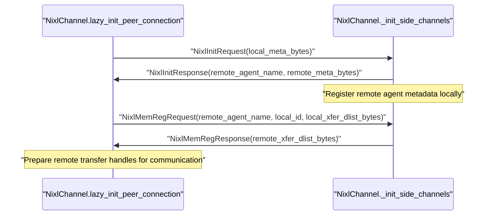
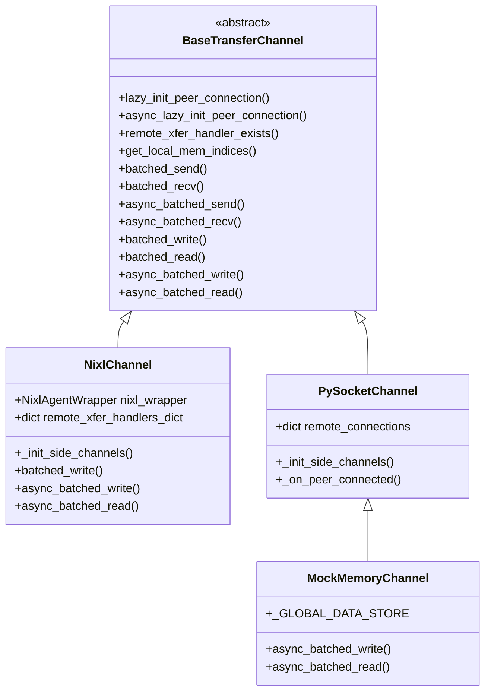
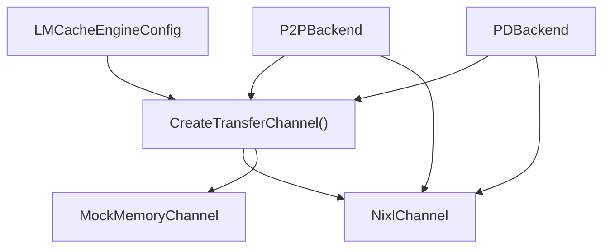

<!-- source: DeepWiki mcp.deepwiki.com · repo LMCache/LMCache · page 8.2 Transfer Channels · fetched 2026-10-21 -->

# Transfer Channels

<details>
<summary>Relevant source files</summary>

The following files were used as context for generating this wiki page:

- [docs/design/v1/distributed/l2_adapters/nixl_store.md](docs/design/v1/distributed/l2_adapters/nixl_store.md)
- [docs/source/mp/l2_storage/nixl.rst](docs/source/mp/l2_storage/nixl.rst)
- [lmcache/v1/distributed/l2_adapters/base.py](lmcache/v1/distributed/l2_adapters/base.py)
- [lmcache/v1/distributed/l2_adapters/config.py](lmcache/v1/distributed/l2_adapters/config.py)
- [lmcache/v1/distributed/l2_adapters/fs_l2_adapter.py](lmcache/v1/distributed/l2_adapters/fs_l2_adapter.py)
- [lmcache/v1/distributed/l2_adapters/mock_l2_adapter.py](lmcache/v1/distributed/l2_adapters/mock_l2_adapter.py)
- [lmcache/v1/distributed/l2_adapters/nixl_store_agents/__init__.py](lmcache/v1/distributed/l2_adapters/nixl_store_agents/__init__.py)
- [lmcache/v1/distributed/l2_adapters/nixl_store_agents/dynamic_nixl_store_agent.py](lmcache/v1/distributed/l2_adapters/nixl_store_agents/dynamic_nixl_store_agent.py)
- [lmcache/v1/distributed/l2_adapters/nixl_store_agents/file_dynamic_nixl_store_agent.py](lmcache/v1/distributed/l2_adapters/nixl_store_agents/file_dynamic_nixl_store_agent.py)
- [lmcache/v1/distributed/l2_adapters/nixl_store_dynamic_l2_adapter.py](lmcache/v1/distributed/l2_adapters/nixl_store_dynamic_l2_adapter.py)
- [lmcache/v1/distributed/l2_adapters/nixl_store_l2_adapter.py](lmcache/v1/distributed/l2_adapters/nixl_store_l2_adapter.py)
- [lmcache/v1/storage_backend/p2p_backend.py](lmcache/v1/storage_backend/p2p_backend.py)
- [lmcache/v1/storage_backend/path_sharder.py](lmcache/v1/storage_backend/path_sharder.py)
- [lmcache/v1/storage_backend/pd_backend.py](lmcache/v1/storage_backend/pd_backend.py)
- [lmcache/v1/storage_backend/pd_backend_async.py](lmcache/v1/storage_backend/pd_backend_async.py)
- [lmcache/v1/transfer_channel/__init__.py](lmcache/v1/transfer_channel/__init__.py)
- [lmcache/v1/transfer_channel/abstract.py](lmcache/v1/transfer_channel/abstract.py)
- [lmcache/v1/transfer_channel/mock_memory_channel.py](lmcache/v1/transfer_channel/mock_memory_channel.py)
- [lmcache/v1/transfer_channel/nixl_channel.py](lmcache/v1/transfer_channel/nixl_channel.py)
- [lmcache/v1/transfer_channel/py_socket_channel.py](lmcache/v1/transfer_channel/py_socket_channel.py)
- [tests/v1/distributed/test_l2_adapter_base.py](tests/v1/distributed/test_l2_adapter_base.py)
- [tests/v1/distributed/test_mock_l2_adapter.py](tests/v1/distributed/test_mock_l2_adapter.py)
- [tests/v1/distributed/test_nixl_store_dynamic_l2_adapter.py](tests/v1/distributed/test_nixl_store_dynamic_l2_adapter.py)
- [tests/v1/distributed/test_nixl_store_l2_adapter.py](tests/v1/distributed/test_nixl_store_l2_adapter.py)
- [tests/v1/distributed/test_report_status.py](tests/v1/distributed/test_report_status.py)
- [tests/v1/storage_backend/test_pd_backend_async.py](tests/v1/storage_backend/test_pd_backend_async.py)

</details>


Transfer channels provide LMCache with the low-level data transport capabilities necessary for efficient distributed KV cache operations, peer-to-peer (P2P) cache sharing, and disaggregated prefill architectures. This documentation describes the `transfer_channel` configuration, key implementations including Nixl channels, Mooncake TE support, socket channels, and protocol selection strategy.

---

## Purpose and Scope

This page details how LMCache configures and implements transfer channels as foundational communication pathways for moving cache data between different processes and nodes. These channels abstract away transport details from higher-level cache logic, enabling modular backend choices such as the NVIDIA NIXL library, Mooncake transfer engine, and simple socket-based channels. Core transfer channel classes, their handshake and data flow protocols, and selection criteria at runtime are systematically covered.

Sources: [lmcache/v1/transfer_channel/nixl_channel.py:66-180](), [lmcache/v1/storage_backend/p2p_backend.py:39-44](), [lmcache/v1/storage_backend/pd_backend.py:174-213]()

---

## 1. Transfer Channel Configuration

Transfer channels are configured primarily via the LMCache engine configuration under the `transfer_channel` or related keys in `extra_config`. For Nixl, relevant parameters include buffer size, device, backend types (e.g., UCX), pool size, and path sharding.

- `channel_type`: Determines the transfer channel class type, e.g., `"nixl"`, `"mock_memory"` for tests [lmcache/v1/transfer_channel/__init__.py:10-43]().
- `role`: Specifies the node role in data transfer — `"sender"`, `"receiver"`, or `"both"` [lmcache/v1/transfer_channel/__init__.py:10-30]().
- `buffer_ptr` and `buffer_size`: Address and capacity of a contiguous memory region backing transfers [lmcache/v1/transfer_channel/__init__.py:10-32]().
- `tp_rank`: Tensor-parallel rank identifying this worker instance [lmcache/v1/transfer_channel/__init__.py:10-34]().
- `peer_init_url`: Endpoint URI (`host:port`) used for peer initialization handshake [lmcache/v1/transfer_channel/__init__.py:10-35]().
- `device`: Memory device string (`"cpu"` or CUDA device like `"cuda:0"`) [lmcache/v1/transfer_channel/__init__.py:10-20]().
- `backends`: List of enabled NIXL backend protocols (e.g., `["UCX"]`) [lmcache/v1/transfer_channel/nixl_channel.py:80-84]().

| Configuration Parameter | Description | Typical Values |
|:------------------------|:------------------------------------------------|:------------------------------|
| `channel_type` | Channel transport implementation type | `"nixl"`, `"mock_memory"`, etc. |
| `role` | Transfer side role | `"sender"`, `"receiver"`, `"both"` |
| `buffer_ptr` | Pointer to transfer buffer memory | Memory address (integer) |
| `buffer_size` | Size in bytes of transfer buffer | Integer bytes |
| `tp_rank` | Local tensor-parallel rank | Integer |
| `peer_init_url` | Initialization endpoint for handshake | `"host:port"` string |
| `device` | Device string for memory | `"cpu"`, `"cuda:0"`, etc. |
| `backends` | List of backend protocols for NIXL | `["UCX"]`, `["POSIX"]`, etc. |

Sources: [lmcache/v1/transfer_channel/nixl_channel.py:66-120](), [lmcache/v1/transfer_channel/__init__.py:10-83]()

---

## 2. Nixl Transfer Channels

### 2.1 Overview

The `NixlChannel` class wraps the NVIDIA Inference Xfer Library (NIXL) to provide high-throughput, RDMA-capable tensor transfer between LMCache instances. It supports GPU-direct and CPU memory buffers and integrates closely with the LMCache memory allocator system [lmcache/v1/transfer_channel/nixl_channel.py:66-95]().

`NixlChannel` maintains internal state including:

- `nixl_wrapper`: Wraps the low-level NIXL agent managing memory registration and transfer descriptors [lmcache/v1/transfer_channel/nixl_channel.py:87-95]().
- `remote_xfer_handlers_dict`: A dictionary keyed by peer ID storing prepped NIXL transfer descriptor handles for remote memory regions [lmcache/v1/transfer_channel/nixl_channel.py:101-103]().
- ZMQ side channels: For control plane communication during initialization [lmcache/v1/transfer_channel/nixl_channel.py:105-116]().
- Threads managing asynchronous processing loops in async mode [lmcache/v1/transfer_channel/nixl_channel.py:106-116]().

### 2.2 Peer Initialization Protocol

Before any data transfer, two peers establish a handshake over ZeroMQ REQ-REP sockets [lmcache/v1/transfer_channel/nixl_channel.py:121-180]():

1.  **NIXL Initialization Request**: The local agent sends its metadata bytes with a `NixlInitRequest` [lmcache/v1/transfer_channel/nixl_channel.py:138-141]().
2.  **NIXL Initialization Response**: The remote agent replies with its metadata. The local agent registers the remote agent via `add_remote_agent` [lmcache/v1/transfer_channel/nixl_channel.py:143-147]().
3.  **Memory Registration**: The local node sends a `NixlMemRegRequest` containing transfer descriptor data [lmcache/v1/transfer_channel/nixl_channel.py:153-158]().
4.  **Memory Registration Response**: The remote agent responds with its serialized transfer descriptors, which the local agent preps for one-sided transfers via `prep_xfer_dlist` [lmcache/v1/transfer_channel/nixl_channel.py:160-169]().
5.  **Side Messages**: Optionally, additional side messages may be exchanged [lmcache/v1/transfer_channel/nixl_channel.py:171-177]().

This protocol ensures that transfer handles and descriptors for registered buffers are fully synchronized to enable subsequent zero-copy data movement.


Sources: [lmcache/v1/transfer_channel/nixl_channel.py:66-180]()

### 2.3 Data Transfer Methods

`NixlChannel` supports both synchronous and asynchronous batched data transfer operations [lmcache/v1/transfer_channel/nixl_channel.py:66-180]():

-   `batched_write`: Writes a batch of `MemoryObj`s to remote peers.
-   `batched_read`: Reads a batch of remote `MemoryObj`s into local storage.
-   Async variants: `async_batched_write` and `async_batched_read` leveraging asyncio/ZMQ event loops.

The channel maintains a dictionary of remote transfer handlers (`remote_xfer_handlers_dict`) to dispatch all one-sided NIXL memory operations [lmcache/v1/transfer_channel/nixl_channel.py:101-103]().

Sources: [lmcache/v1/transfer_channel/nixl_channel.py:66-180]()

---

## 3. Mooncake Transfer Engine

LMCache optionally supports the Mooncake transfer engine as a peer-to-peer transport alternative, implemented as `MooncakeTeTransferChannelClient` and corresponding server in `lmcache.v1.distributed.transfer_channel.impl.mooncake_te_impl`.

### 3.1 Protocol and Configuration

Mooncake TE uses TCP by default but can be configured to use high-performance RDMA via environment variables:

-   `MC_TE_PROTOCOL` set to `"rdma"` to enable RDMA transport.
-   `MC_TE_DEVICE` for specifying the RDMA device interface, e.g., `"mlx5_0"`.

A sample server launch command enabling RDMA:

```sh
MC_TE_PROTOCOL=rdma MC_TE_DEVICE=mlx5_0 \
    lmcache server \
    --host 0.0.0.0 --port 5555 \
    --p2p-advertise-url <NODE_IP>:8500 \
    --p2p-transfer-engine mooncake_te
```

Mooncake TE is part of the multi-process distributed transfer layer, integrated seamlessly with LMCache's P2P and disaggregated prefill subsystems.

Sources: [lmcache/v1/distributed/transfer_channel/impl/mooncake_te_impl.py:53-61]()

---

## 4. Socket Channels and Testing

### 4.1 PySocketChannel and MockMemoryChannel

`PySocketChannel` provides a ZeroMQ-backed transfer channel based on TCP socket transport. It manages socket connections, peer address mapping, and message handling using asyncio and threading [lmcache/v1/transfer_channel/py_socket_channel.py:55-90]().

`MockMemoryChannel` extends `PySocketChannel` as a fake channel for single-process testing [lmcache/v1/transfer_channel/mock_memory_channel.py:23-38](). Instead of network I/O, it uses a Python dictionary (`_GLOBAL_DATA_STORE`) keyed by peer URLs and memory indices to store tensor data [lmcache/v1/transfer_channel/mock_memory_channel.py:20-31]().

-   `async_batched_write`: Clones `MemoryObj.tensor` into `_GLOBAL_DATA_STORE` simulating network send [lmcache/v1/transfer_channel/mock_memory_channel.py:116-135]().
-   `async_batched_read`: Copies tensors from sender storage into local buffers simulating network receive [lmcache/v1/transfer_channel/mock_memory_channel.py:136-156]().

This mock channel allows end-to-end testing of transfer logic without the complexity of networking or RDMA.

Sources: [lmcache/v1/transfer_channel/mock_memory_channel.py:18-156](), [lmcache/v1/transfer_channel/py_socket_channel.py:55-90]()

---

## 5. Protocol Selection and Integration

### 5.1 Transfer Channel Factory

The `CreateTransferChannel` factory function selects and instantiates the appropriate transfer channel implementation based on configuration fields like `channel_type` [lmcache/v1/transfer_channel/__init__.py:10-83]().

-   `"nixl"` creates `NixlChannel` [lmcache/v1/transfer_channel/__init__.py:45-63]().
-   `"mock_memory"` creates `MockMemoryChannel` [lmcache/v1/transfer_channel/__init__.py:65-81]().

Distributed components such as `P2PBackend` and `PDBackend` invoke this factory to establish transfer channels tailored to their peer connectivity and workload requirements [lmcache/v1/storage_backend/p2p_backend.py:40](), [lmcache/v1/storage_backend/pd_backend.py:35]().

Sources: [lmcache/v1/transfer_channel/__init__.py:10-83]()

### 5.2 Integration with P2P Backend

`P2PBackend` uses transfer channels (commonly Nixl, optionally Mooncake TE) for executing one-sided remote reads for cache hits across peer nodes [lmcache/v1/storage_backend/p2p_backend.py:40](). This direct memory transfer reduces latency and avoids copies through intermediate layers.

Sources: [lmcache/v1/storage_backend/p2p_backend.py:162-216]()

### 5.3 Integration with Disaggregated Prefill (PDBackend)

For disaggregated prefill, `PDBackend` employs `NixlChannel` as a streaming transport between prefill ("sender") processes and decoder ("receiver") processes [lmcache/v1/storage_backend/pd_backend.py:35](). It achieves asynchronous streaming of KV cache blocks with background Nixl worker threads and queues [lmcache/v1/storage_backend/pd_backend.py:206-213]().

Sources: [lmcache/v1/storage_backend/pd_backend.py:174-213]()


Sources: [lmcache/v1/transfer_channel/abstract.py:21-218](), [lmcache/v1/transfer_channel/nixl_channel.py:66-180](), [lmcache/v1/transfer_channel/py_socket_channel.py:55-100](), [lmcache/v1/transfer_channel/mock_memory_channel.py:23-38]()


Sources: [lmcache/v1/storage_backend/p2p_backend.py:40](), [lmcache/v1/storage_backend/pd_backend.py:35](), [lmcache/v1/transfer_channel/__init__.py:10-83]()

---

## Summary

| Transfer Channel Type | Description | Typical Usage |
|:----------------------|:-------------------------------------------------------------|:--------------------------------------------------------------------------------------------------------------------------------------------------------------------------------------------------------------------------------------------------------------------------------------------------------------------------------------------------------------------------------------------------------------------------------------------------------------------------------------------------------------------------------------------------------------------------------------------------------------------------------------------------------------------------------------------------------------------------------------------------------------------------------------------------------------------------------------------------------------------------------------------------------------------------------------------------------------------------------------------------------------------------------------------------------------------------------------------------------------------------------------------------------------------------------------------------------------------------------------------------------------------------------------------------------------------------------------------------------------------------------------------------------------------------------------------------------------------------------------------------------------------------------------------------------------------------------------------------------------------------------------------------------------------------------------------------------------------------------------------------------------------------------------------------------------------------------------------------------------------------------------------------------------------------------------------------------------------------------------------------------------------------------------------------------------------------------------------------------------------------------------------------------------------------------------------------------------------------------------------------------------------------------------------------------------------------------------------------------------------------------------------------------------------------------------------------------------------------------------------------------------------------------------------------------------------------------------------------------------------------------------------------------------------------------------------------------------------------------------------------------------------------------------------------------------------------------------------------------------------------------------------------------------------------------------------------------------------------------------------------------------------------------------------------------------------------------------------------------------------------------------------------------------------------------------------------------------------------------------------------------------------------------------------------------------------------------------------------------------------------------------------------------------------------------------------------------------------------------------------------------------------------------------------------------------------------------------------------------------------------------------------------------------------------------------------------------------------------------------------------------------------------------------------------------------------------------------------------------------------------------------------------------------------------------------------------------------------------------------------------------------------------------------------------------------------------------------------------------------------------------------------------------------------------------------------------------------------------------------------------------------------------------------------------------------------------------------------------------------------------------------------------------------------------------------------------------------------------------------------------------------------------------------------------------------------------------------------------------------------------------------------------------------------------------------------------------------------------------------------------------------------------------------------------------------------------------------------------------------------------------------------------------------------------------------------------------------------------------------------------------------------------------------------------------------------------------------------------------------------------------------------------------------------------------------------------------------------------------------------------------------------------------------------------------------------------------------------------------------------------------------------------------------------------------------------------------------------------------------------------------------------------------------------------------------------------------------------------------------------------------------------------------------------------------------------------------------------------------------------------------------------------------------------------------------------------------------------------------------------------------------------------------------------------------------------------------------------------------------------------------------------------------------------------------------------------------------------------------------------------------------------------------------------------------------------------------------------------------------------------------------------------------------------------------------------------------------------------------------------------------------------------------------------------------------------------------------------------------------------------------------------------------------------------------------------------------------------------------------------------------------------------------------------------------------------------------------------------------------------------------------------------------------------------------------------------------------------------------------------------------------------------------------------------------------------------------------------------------------------------------------------------------------------------------------------------------------------------------------------------------------------------------------------------------------------------------------------------------------------------------------------------------------------------------------------------------------------------------------------------------------------------------------------------------------------------------------------------------------------------------------------------------------------------------------------------------------------------------------------------------------------------------------------------------------------------------------------------------------------------------------------------------------------------------------------------------------------------------------------------------------------------------------------------------------------------------------------------------------------------------------------------------------------------------------------------------------------------------------------------------------------------------------------------------------------------------------------------------------------------------------------------------------------------------------------------------------------------------------------------------------------------------------------------------------------------------------------------------------------------------------------------------------------------------------------------------------------------------------------------------------------------------------------------------------------------------------------------------------------------------------------------------------------------------------------------------------------------------------------------------------------------------------------------------------------------------------------------------------------------------------------------------------------------------------------------------------------------------------------------------------------------------------------------------------------------------------------------------------------------------------------------------------------------------------------------------------------------------------------------------------------------------------------------------------------------------------------------------------------------------------------------------------------------------------------------------------------------------------------------------------------------------------------------------------------------------------------------------------------------------------------------------------------------------------------------------------------------------------------------------------------------------------------------------------------------------------------------------------------------------------------------------------------------------------------------------------------------------------------------------------------------------------------------------------------------------------------------------------------------------------------------------------------------------------------------------------------------------------------------------------------------------------------------------------------------------------------------------------------------------------------------------------------------------------------------------------------------------------------------------------------------------------------------------------------------------------------------------------------------------------------------------------------------------------------------------------------------------------------------------------------------------------------------------------------------------------------------------------------------------------------------------------------------------------------------------------------------------------------------------------------------------------------------------------------------------------------------------------------------------------------------------------------------------------------------------------------------------------------------------------------------------------------------------------------------------------------------------------------------------------------------------------------------------------------------------------------------------------------------------------------------------------------------------------------------------------------------------------------------------------------------------------------------------------------------------------------------------------------------------------------------------------------------------------------------------------------------------------------------------------------------------------------------------------------------------------------------------------------------------------------------------------------------------------------------------------------------------------------------------------------------------------------------------------------------------------------------------------------------------------------------------------------------------------------------------------------------------------------------------------------------------------------------------------------------------------------------------------------------------------------------------------------------------------------------------------------------------------------------------------------------------------------------------------------------------------------------------------------------------------------------------------------------------------------------------------------------------------------------------------------------------------------------------------------------------------------------------------------------------------------------------------------------------------------------------------------------------------------------------------------------------------------------------------------------------------------------------------------------------------------------------------------------------------------------------------------------------------------------------------------------------------------------------------------------------------------------------------------------------------------------------------------------------------------------------------------------------------------------------------------------------------------------------------------------------------------------------------------------------------------------------------------------------------------------------------------------------------------------------------------------------------------------------------------------------------------------------------------------------------------------------------------------------------------------------------------------------------------------------------------------------------------------------------------------------------------------------------------------------------------------------------------------------------------------------------------------------------------------------------------------------------------------------------------------------------------------------------------------------------------------------------------------------------------------------------------------------------------------------------------------------------------------------------------------------------------------------------------------------------------------------------------------------------------------------------------------------------------------------------------------------------------------------------------------------------------------------------------------------------------------------------------------------------------------------------------------------------------------------------------------------------------------------------------------------------------------------------------------------------------------------------------------------------------------------------------------------------------------------------------------------------------------------------------------------------------------------------------------------------------------------------------------------------------------------------------------------------------------------------------------------------------------------------------------------------------------------------------------------------------------------------------------------------------------------------------------------------------------------------------------------------------------------------------------------------------------------------------------------------------------------------------------------------------------------------------------------------------------------------------------------------------------------------------------------------------------------------------------------------------------------------------------------------------------------------------------------------------------------------------------------------------------------------------------------------------------------------------------------------------------------------------------------------------------------------------------------------------------------------------------------------------------------------------------------------------------------------------------------------------------------------------------------------------------------------------------------------------------------------------------------------------------------------------------------------------------------------------------------------------------------------------------------------------------------------------------------------------------------------------------------------------------------------------------------------------------------------------------------------------------------------------------------------------------------------------------------------------------------------------------------------------------------------------------------------------------------------------------------------------------------------------------------------------------------------------------------------------------------------------------------------------------------------------------------------------------------------------------------------------------------------------------------------------------------------------------------------------------------------------------------------------------------------------------------------------------------------------------------------------------------------------------------------------------------------------------------------------------------------------------------------------------------------------------------------------------------------------------------------------------------------------------------------------------------------------------------------------------------------------------------------------------------------------------------------------------------------------------------------------------------------------------------------------------------------------------------------------------------------------------------------------------------------------------------------------------------------------------------------------------------------------------------------------------------------------------------------------------------------------------------------------------------------------------------------------------------------------------------------------------------------------------------------------------------------------------------------------------------------------------------------------------------------------------------------------------------------------------------------------------------------------------------------------------------------------------------------------------------------------------------------------------------------------------------------------------------------------------------------------------------------------------------------------------------------------------------------------------------------------------------------------------------------------------------------------------------------------------------------------------------------------------------------------------------------------------------------------------------------------------------------------------------------------------------------------------------------------------------------------------------------------------------------------------------------------------------------------------------------------------------------------------------------------------------------------------------------------------------------------------------------------------------------------------------------------------------------------------------------------------------------------------------------------------------------------------------------------------------------------------------------------------------------------------------------------------------------------------------------------------------------------------------------------------------------------------------------------------------------------------------------------------------------------------------------------------------------------------------------------------------------------------------------------------------------------------------------------------------------------------------------------------------------------------------------------------------------------------------------------------------------------------------------------------------------------------------------------------------------------------------------------------------------------------------------------------------------------------------------------------------------------------------------------------------------------------------------------------------------------------------------------------------------------------------------------------------------------------------------------------------------------------------------------------------------------------------------------------------------------------------------------------------------------------------------------------------------------------------------------------------------------------------------------------------------------------------------------------------------------------------------------------------------------------------------------------------------------------------------------------------------------------------------------------------------------------------------------------------------------------------------------------------------------------------------------------------------------------------------------------------------------------------------------------------------------------------------------------------------------------------------------------------------------------------------------------------------------------------------------------------------------------------------------------------------------------------------------------------------------------------------------------------------------------------------------------------------------------------------------------------------------------------------------------------------------------------------------------------------------------------------------------------------------------------------------------------------------------------------------------------------------------------------------------------------------------------------------------------------------------------------------------------------------------------------------------------------------------------------------------------------------------------------------------------------------------------------------------------------------------------------------------------------------------------------------------------------------------------------------------------------------------------------------------------------------------------------------------------------------------------------------------------------------------------------------------------------------------------------------------------------------------------------------------------------------------------------------------------------------------------------------------------------------------------------------------------------------------------------------------------------------------------------------------------------------------------------------------------------------------------------------------------------------------------------------------------------------------------------------------------------------------------------------------------------------------------------------------------------------------------------------------------------------------------------------------------------------------------------------------------------------------------------------------------------------------------------------------------------------------------------------------------------------------------------------------------------------------------------------------------------------------------------------------------------------------------------------------------------------------------------------------------------------------------------------------------------------------------------------------------------------------------------------------------------------------------------------------------------------------------------------------------------------------------------------------------------------------------------------------------------------------------------------------------------------------------------------------------------------------------------------------------------------------------------------------------------------------------------------------------------------------------------------------------------------------------------------------------------------------------------------------------------------------------------------------------------------------------------------------------------------------------------------------------------------------------------------------------------------------------------------------------------------------------------------------------------------------------------------------------------------------------------------------------------------------------------------------------------------------------------------------------------------------------------------------------------------------------------------------------------------------------------------------------------------------------------------------------------------------------------------------------------------------------------------------------------------------------------------------------------------------------------------------------------------------------------------------------------------------------------------------------------------------------------------------------------------------------------------------------------------------------------------------------------------------------------------------------------------------------------------------------------------------------------------------------------------------------------------------------------------------------------------------------------------------------------------------------------------------------------------------------.
---

## Summary

| Transfer Channel Type | Description | Typical Usage |
|-----------------------|-------------------------------------------------------------|----------------------------------------------------------------------------------------------------------------------------------------------------------------------------------------------------------------------------------------------------------------------------------------------------------------------------------------------------------------------------------------------------------------------------------------------------------------------------------------------------------------------------------------------------------------------------------------------------------------------------------------------------------------------------------------------------------------------------------------------------------------------------------------------------------------------------------------------------------------------------------------------------------------------------------------------------------------------------------------------------------------------------------------------------------------------------------------------------------------------------------------------------------------------------------------------------------------------------------------------------------------------------------------------------------------------------------------------------------------------------------------------------------------------------------------------------------------------------------------------------------------------------------------------------------------------------------------------------------------------------------------------------------------------------------------------------------------------------------------------------------------------------------------------------------------------------------------------------------------------------------------------------------------------------------------------------------------------------------------------------------------------------------------------------------------------------------------------------------------------------------------------------------------------------------------------------------------------------------------------------------------------------------------------------------------------------------------------------------------------------------------------------------------------------------------------------------------------------------------------------------------------------------------------------------------------------------------------------------------------------------------------------------------------------------------------------------------------------------------------------------------------------------------------------------------------------------------------------------------------------------------------------------------------------------------------------------------------------------------------------------------------------------------------------------------------------------------------------------------------------------------------------------------------------------------------------------------------------------------------------------------------------------------------------------------------------------------------------------------------------------------------------------------------------------------------------------------------------------------------------------------------------------------------------------------------------------------------------------------------------------------------------------------------------------------------------------------------------------------------------------------------------------------------------------------------------------------------------------------------------------------------------------------------------------------------------------------------------------------------------------------------------------------------------------------------------------------------------------------------------------------------------------------------------------------------------------------------------------------------------------------------------------------------------------------------------------------------------------------------------------------------------------------------------------------------------------------------------------------------------------------------------------------------------------------------------------------------------------------------------------------------------------------------------------------------------------------------------------------------------------------------------------------------------------------------------------------------------------------------------------------------------------------------------------------------------------------------------------------------------------------------------------------------------------------------------------------------------------------------------------------------------------------------------------------------------------------------------------------------------------------------------------------------------------------------------------------------------------------------------------------------------------------------------------------------------------------------------------------------------------------------------------------------------------------------------------------------------------------------------------------------------------------------------------------------------------------------------------------------------------------------------------------------------------------------------------------------------------------------------------------------------------------------------------------------------------------------------------------------------------------------------------------------------------------------------------------------------------------------------------------------------------------------------------------------------------------------------------------------------------------------------------------------------------------------------------------------------------------------------------------------------------------------------------------------------------------------------------------------------------------------------------------------------------------------------------------------------------------------------------------------------------------------------------------------------------------------------------------------------------------------------------------------------------------------------------------------------------------------------------------------------------------------------------------------------------------------------------------------------------------------------------------------------------------------------------------------------------------------------------------------------------------------------------------------------------------------------------------------------------------------------------------------------------------------------------------------------------------------------------------------------------------------------------------------------------------------------------------------------------------------------------------------------------------------------------------------------------------------------------------------------------------------------------------------------------------------------------------------------------------------------------------------------------------------------------------------------------------------------------------------------------------------------------------------------------------------------------------------------------------------------------------------------------------------------------------------------------------------------------------------------------------------------------------------------------------------------------------------------------------------------------------------------------------------------------------------------------------------------------------------------------------------------------------------------------------------------------------------------------------------------------------------------------------------------------------------------------------------------------------------------------------------------------------------------------------------------------------------------------------------------------------------------------------------------------------------------------------------------------------------------------------------------------------------------------------------------------------------------------------------------------------------------------------------------------------------------------------------------------------------------------------------------------------------------------------------------------------------------------------------------------------------------------------------------------------------------------------------------------------------------------------------------------------------------------------------------------------------------------------------------------------------------------------------------------------------------------------------------------------------------------------------------------------------------------------------------------------------------------------------------------------------------------------------------------------------------------------------------------------------------------------------------------------------------------------------------------------------------------------------------------------------------------------------------------------------------------------------------------------------------------------------------------------------------------------------------------------------------------------------------------------------------------------------------------------------------------------------------------------------------------------------------------------------------------------------------------------------------------------------------------------------------------------------------------------------------------------------------------------------------------------------------------------------------------------------------------------------------------------------------------------------------------------------------------------------------------------------------------------------------------------------------------------------------------------------------------------------------------------------------------------------------------------------------------------------------------------------------------------------------------------------------------------------------------------------------------------------------------------------------------------------------------------------------------------------------------------------------------------------------------------------------------------------------------------------------------------------------------------------------------------------------------------------------------------------------------------------------------------------------------------------------------------------------------------------------------------------------------------------------------------------------------------------------------------------------------------------------------------------------------------------------------------------------------------------------------------------------------------------------------------------------------------------------------------------------------------------------------------------------------------------------------------------------------------------------------------------------------------------------------------------------------------------------------------------------------------------------------------------------------------------------------------------------------------------------------------------------------------------------------------------------------------------------------------------------------------------------------------------------------------------------------------------------------------------------------------------------------------------------------------------------------------------------------------------------------------------------------------------------------------------------------------------------------------------------------------------------------------------------------------------------------------------------------------------------------------------------------------------------------------------------------------------------------------------------------------------------------------------------------------------------------------------------------------------------------------------------------------------------------------------------------------------------------------------------------------------------------------------------------------------------------------------------------------------------------------------------------------------------------------------------------------------------------------------------------------------------------------------------------------------------------------------------------------------------------------------------------------------------------------------------------------------------------------------------------------------------------------------------------------------------------------------------------------------------------------------------------------------------------------------------------------------------------------------------------------------------------------------------------------------------------------------------------------------------------------------------------------------------------------------------------------------------------------------------------------------------------------------------------------------------------------------------------------------------------------------------------------------------------------------------------------------------------------------------------------------------------------------------------------------------------------------------------------------------------------------------------------------------------------------------------------------------------------------------------------------------------------------------------------------------------------------------------------------------------------------------------------------------------------------------------------------------------------------------------------------------------------------------------------------------------------------------------------------------------------------------------------------------------------------------------------------------------------------------------------------------------------------------------------------------------------------------------------------------------------------------------------------------------------------------------------------------------------------------------------------------------------------------------------------------------------------------------------------------------------------------------------------------------------------------------------------------------------------------------------------------------------------------------------------------------------------------------------------------------------------------------------------------------------------------------------------------------------------------------------------------------------------------------------------------------------------------------------------------------------------------------------------------------------------------------------------------------------------------------------------------------------------------------------------------------------------------------------------------------------------------------------------------------------------------------------------------------------------------------------------------------------------------------------------------------------------------------------------------------------------------------------------------------------------------------------------------------------------------------------------------------------------------------------------------------------------------------------------------------------------------------------------------------------------------------------------------------------------------------------------------------------------------------------------------------------------------------------------------------------------------------------------------------------------------------------------------------------------------------------------------------------------------------------------------------------------------------------------------------------------------------------------------------------------------------------------------------------------------------------------------------------------------------------------------------------------------------------------------------------------------------------------------------------------------------------------------------------------------------------------------------------------------------------------------------------------------------------------------------------------------------------------------------------------------------------------------------------------------------------------------------------------------------------------------------------------------------------------------------------------------------------------------------------------------------------------------------------------------------------------------------------------------------------------------------------------------------------------------------------------------------------------------------------------------------------------------------------------------------------------------------------------------------------------------------------------------------------------------------------------------------------------------------------------------------------------------------------------------------------------------------------------------------------------------------------------------------------------------------------------------------------------------------------------------------------------------------------------------------------------------------------------------------------------------------------------------------------------------------------------------------------------------------------------------------------------------------------------------------------------------------------------------------------------------------------------------------------------------------------------------------------------------------------------------------------------------------------------------------------------------------------------------------------------------------------------------------------------------------------------------------------------------------------------------------------------------------------------------------------------------------------------------------------------------------------------------------------------------------------------------------------------------------------------------------------------------------------------------------------------------------------------------------------------------------------------------------------------------------------------------------------------------------------------------------------------------------------------------------------------------------------------------------------------------------------------------------------------------------------------------------------------------------------------------------------------------------------------------------------------------------------------------------------------------------------------------------------------------------------------------------------------------------------------------------------------------------------------------------------------------------------------------------------------------------------------------------------------------------------------------------------------------------------------------------------------------------------------------------------------------------------------------------------------------------------------------------------------------------------------------------------------------------------------------------------------------------------------------------------------------------------------------------------------------------------------------------------------------------------------------------------------------------------------------------------------------------------------------------------------------------------------------------------------------------------------------------------------------------------------------------------------------------------------------------------------------------------------------------------------------------------------------------------------------------------------------------------------------------------------------------------------------------------------------------------------------------------------------------------------------------------------------------------------------------------------------------------------------------------------------------------------------------------------------------------------------------------------------------------------------------------------------------------------------------------------------------------------------------------------------------------------------------------------------------------------------------------------------------------------------------------------------------------------------------------------------------------------------------------------------------------------------------------------------------------------------------------------------------------------------------------------------------------------------------------------------------------------------------------------------------------------------------------------------------------------------------------------------------------------------------------------------------------------------------------------------------------------------------------------------------------------------------------------------------------------------------------------------------------------------------------------------------------------------------------------------------------------------------------------------------------------------------------------------------------------------------------------------------------------------------------------------------------------------------------------------------------------------------------------------------------------------------------------------------------------------------------------------------------------------------------------------------------------------------------------------------------------------------------------------------------------------------------------------------------------------------------------------------------------------------------------------------------------------------------------------------------------------------------------------------------------------------------------------------------------------------------------------------------------------------------------------------------------------------------------------------------------------------------------------------------------------------------------------------------------------------------------------------------------------------------------------------------------------------------------------------------------------------------------------------------------------------------------------------------------------------------------------------------------------------------------------------------------------------------------------------------------------------------------------------------------------------------------------------------------------------------------------------------------------------------------------------------------------------------------------------------------------------------------------------------------------------------------------------------------------------------------------------------------------------------------------------------------------------------------------------------------------------------------------------------------------------------------------------------------------------------------------------------------------------------------------------------------------------------------------------------------------------------------------------------------------------------------------------------------------------------------------------------------------------------------------------------------------------------------------------------------------------------------------------------------------------------------------------------------------------------------------------------------------------------------------------------------------------------------------------------------------------------------------------------------------------------------------------------------------------------------------------------------------------------------------------------------------------------------------------------------------------------------------------------------------------------------------------------------------------------------------------------------------------------------------------------------------------------------------------------------------------------------------------------------------------------------------------------------------------------------------------------------------------------------------------------------------------------------------------------------------------------------------------------------------------------------------------------------------------------------------------------------------------------------------------------------------------------------------------------------------------------------------------------------------------------------------------------------------------------------------------------------------------------------------------------------------------------------------------------------------------------------------------------------------------------------------------------------------------------------------------------------------------------------------------------------------------------------------------------------------------------------------------------------------------------------------------------------------------------------------------------------------------------------------------------------------------------------------------------------------------------------------------------------------------------------------------------------------------------------------------------------------------------------------------------------------------------------------------------------------------------------------------------------------------------------------------------------------------------------------------------------------------------------------------------------------------------------------------------------------------------------------------------------------------------------------------------------------------------------------------------------------------------------------------------------------------------------------------------------------------------------------------------------------------------------------------------------------------------------------------------------------------------------------------------------------------------------------------------------------------------------------------------------------------------------------------------------------------------------------------------------------------------------------------------------------------------------------------------------------------------------------------------------------------------------------------------------------------------------------------------------------------------------------------------------------------------------------------------------------------------------------------------------------------------------------------------------------------------------------------------------------------------------------------------------------------------------------------------------------------------------------------------------------------------------------------------------------------------------------------------------------------------------------------------------------------------------------------------------------------------------------------------------------------------------------------------------------------------------------------------------------------------------------------------------------------------------------------------------------------------------------------------------------------------------------------------------------------------------------------------------------------------------------------------------------------------------------------------------------------------.

---

