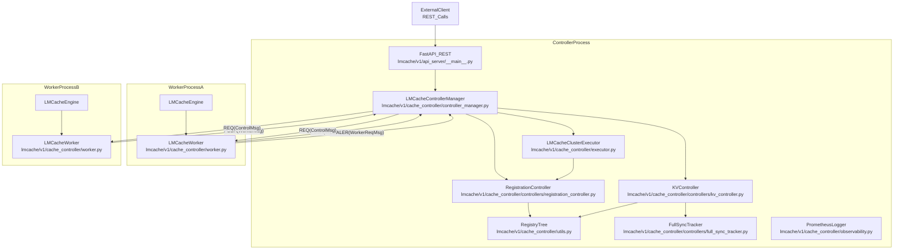
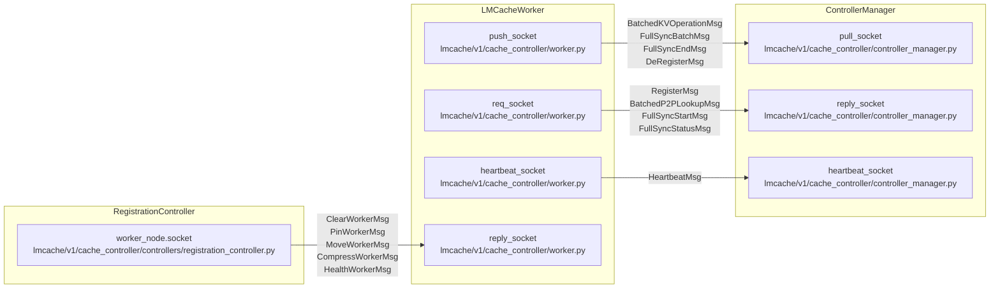
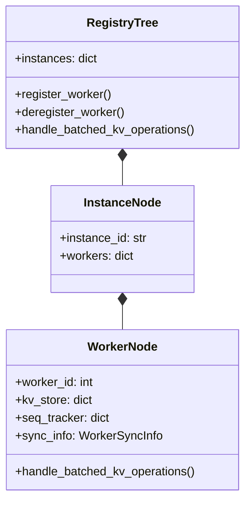
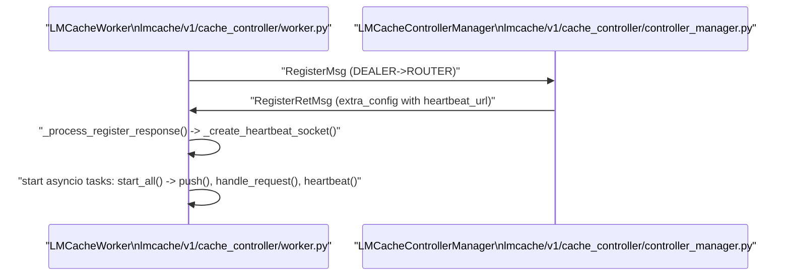

<!-- source: DeepWiki mcp.deepwiki.com · repo LMCache/LMCache · page 8.3 Cache Controller · fetched 2026-10-21 -->

# Cache Controller

Relevant source files

The following files were used as context for generating this wiki page:

- [docs/source/assets/lmcache-controller.png](docs/source/assets/lmcache-controller.png)
- [docs/source/kv_cache_management/check_finish.rst](docs/source/kv_cache_management/check_finish.rst)
- [docs/source/kv_cache_management/clear.rst](docs/source/kv_cache_management/clear.rst)
- [docs/source/kv_cache_management/compress.rst](docs/source/kv_cache_management/compress.rst)
- [docs/source/kv_cache_management/health.rst](docs/source/kv_cache_management/health.rst)
- [docs/source/kv_cache_management/index.rst](docs/source/kv_cache_management/index.rst)
- [docs/source/kv_cache_management/lookup.rst](docs/source/kv_cache_management/lookup.rst)
- [docs/source/kv_cache_management/move.rst](docs/source/kv_cache_management/move.rst)
- [docs/source/kv_cache_management/pin.rst](docs/source/kv_cache_management/pin.rst)
- [docs/source/kv_cache_management/query_worker_info.rst](docs/source/kv_cache_management/query_worker_info.rst)
- [docs/source/kv_cache_optimizations/compression/cachegen.rst](docs/source/kv_cache_optimizations/compression/cachegen.rst)
- [docs/source/kv_cache_optimizations/compression/index.rst](docs/source/kv_cache_optimizations/compression/index.rst)
- [lmcache/v1/api_server/__main__.py](lmcache/v1/api_server/__main__.py)
- [lmcache/v1/cache_controller/config.py](lmcache/v1/cache_controller/config.py)
- [lmcache/v1/cache_controller/controller_manager.py](lmcache/v1/cache_controller/controller_manager.py)
- [lmcache/v1/cache_controller/controllers/full_sync_tracker.py](lmcache/v1/cache_controller/controllers/full_sync_tracker.py)
- [lmcache/v1/cache_controller/controllers/kv_controller.py](lmcache/v1/cache_controller/controllers/kv_controller.py)
- [lmcache/v1/cache_controller/controllers/registration_controller.py](lmcache/v1/cache_controller/controllers/registration_controller.py)
- [lmcache/v1/cache_controller/executor.py](lmcache/v1/cache_controller/executor.py)
- [lmcache/v1/cache_controller/message.py](lmcache/v1/cache_controller/message.py)
- [lmcache/v1/cache_controller/observability.py](lmcache/v1/cache_controller/observability.py)
- [lmcache/v1/cache_controller/utils.py](lmcache/v1/cache_controller/utils.py)
- [lmcache/v1/cache_controller/worker.py](lmcache/v1/cache_controller/worker.py)
- [lmcache/v1/internal_api_server/controller/worker_info_api.py](lmcache/v1/internal_api_server/controller/worker_info_api.py)
- [lmcache/v1/utils/cache_utils.py](lmcache/v1/utils/cache_utils.py)
- [tests/v1/cache_controller/test_config.py](tests/v1/cache_controller/test_config.py)
- [tests/v1/cache_controller/test_registry_tree.py](tests/v1/cache_controller/test_registry_tree.py)

## Purpose and Scope

This page documents the distributed cache controller subsystem of LMCache, which coordinates KV cache metadata and operations across multiple LMCache instances in a cluster. It covers configuration options such as `enable_controller`, `controller_url`, and `lmcache_instance_id`, multi-instance coordination, `LMCacheControllerManager`, `KVController`, `RegistrationController`, `LMCacheWorker`, `RegistryTree`, Freeze Mode, the full-sync recovery mechanism, the message protocol, and the REST API.

For information about the P2P backend that uses the controller for peer lookup, see [8.1 P2P Storage Backend](). For information about the disaggregated prefill backend, see [8.4 Disaggregated Prefill Backend](). For Prometheus metrics exposed by the controller, see [9.1 Metrics and Statistics]().

Sources: [lmcache/v1/cache_controller/controller_manager.py:65-161](), [lmcache/v1/cache_controller/worker.py:64-185]()

---

## Architecture Overview

The cache controller is a standalone process that acts as a centralized metadata plane. LMCache engine instances (workers) push KV chunk admit/evict events to the controller. The controller tracks which chunks exist on which workers and handles orchestration commands (lookup, move, pin, clear) from external orchestrators via REST.

Diagram: Overall Controller Component Relationships (Natural Language to Code Entity Space)

Sources: [lmcache/v1/cache_controller/controller_manager.py:65-161](), [lmcache/v1/api_server/__main__.py:85-112](), [lmcache/v1/cache_controller/controllers/kv_controller.py:55-72](), [lmcache/v1/cache_controller/controllers/registration_controller.py:37-55](), [lmcache/v1/cache_controller/executor.py:48-59](), [lmcache/v1/cache_controller/worker.py:64-185](), [docs/source/kv_cache_management/index.rst:9-28]()

---

## ZMQ Socket Topology

The controller binds three ZMQ sockets. Workers connect to all three.

Diagram: ZMQ Socket Pattern and Code Entities

Sources: [lmcache/v1/cache_controller/controller_manager.py:93-127](), [lmcache/v1/cache_controller/worker.py:99-175](), [lmcache/v1/cache_controller/controllers/registration_controller.py:143-161](), [lmcache/v1/cache_controller/message.py:25-50]()

---

## Controller-Side Components

### LMCacheControllerManager

**File:** [lmcache/v1/cache_controller/controller_manager.py]()

`LMCacheControllerManager` is the top-level class that owns all controller state and runs multiple asyncio handlers concurrently to process worker messages, requests, and orchestrator commands.

| Method | Socket | Message Types Handled |
|--------|--------|-----------------------|
| `handle_worker_message` | PULL | `RegisterMsg`, `DeRegisterMsg`, `BatchedKVOperationMsg`, `FullSyncBatchMsg`, `FullSyncEndMsg` |
| `handle_worker_req_message` | ROUTER (reply) | `RegisterMsg`, `BatchedP2PLookupMsg`, `FullSyncStartMsg`, `FullSyncStatusMsg` |
| `handle_heartbeat_request` | ROUTER (heartbeat) | `HeartbeatMsg` only |
| `health_check` | — | Periodic deregister of timed-out workers |

Message routing inside `handle_worker_message`:
- `RegisterMsg` → calls `reg_controller.register` [lmcache/v1/cache_controller/controller_manager.py:163-164]()
- `DeRegisterMsg` → calls `reg_controller.deregister` [lmcache/v1/cache_controller/controller_manager.py:165-166]()
- `BatchedKVOperationMsg` → calls `kv_controller.handle_batched_kv_operations` [lmcache/v1/cache_controller/controller_manager.py:167-168]()
- `FullSyncBatchMsg` → calls `kv_controller.handle_full_sync_batch` [lmcache/v1/cache_controller/controller_manager.py:169-170]()
- `FullSyncEndMsg` → calls `kv_controller.handle_full_sync_end` [lmcache/v1/cache_controller/controller_manager.py:171-172]()

Message routing inside `handle_orchestration_message` handles orchestration control commands sent via the REST API:
- `LookupMsg` → `kv_controller.lookup`
- `ClearMsg` → `kv_controller.clear`
- `PinMsg` → `kv_controller.pin`
- `MoveMsg` → `kv_controller.move`
- `CompressMsg` and `DecompressMsg` → `kv_controller.compress` and `kv_controller.decompress`
- `HealthMsg` → `reg_controller.health`
- `QueryInstMsg` → `reg_controller.get_instance_id`
- `QueryWorkerInfoMsg` → `reg_controller.query_worker_info`
- `CheckFinishMsg` → `kv_controller.check_finish`

The `health_check` coroutine runs in a dedicated background thread named `controller-health-thread` that periodically scans all registered workers and deregisters any worker having a last heartbeat timestamp older than the configured timeout `lmcache_worker_timeout` [lmcache/v1/cache_controller/controller_manager.py:146-158]().

Sources: [lmcache/v1/cache_controller/controller_manager.py:65-190](), [lmcache/v1/cache_controller/message.py:36-56]()

---

### KVController

**File:** [lmcache/v1/cache_controller/controllers/kv_controller.py]()

`KVController` manages the core metadata about which KV chunks reside on which instance, worker, and location, and oversees batch operations and full-sync state.

#### Internal Data Model
It uses a `RegistryTree` data structure to hold the mapping `(instance_id, worker_id) → {location → set[chunk_hash]}` [lmcache/v1/cache_controller/controllers/kv_controller.py:64](). The `FullSyncTracker` tracks full synchronization state of workers [lmcache/v1/cache_controller/controllers/kv_controller.py:68-72]().

#### Key Responsibilities

| Method | Description |
|--------|-------------|
| `handle_batched_kv_operations` | Forwards batched admission/eviction operations from workers to the registry, discards incremental operations if the worker is currently in full sync Freeze Mode to prevent races [lmcache/v1/cache_controller/controllers/kv_controller.py:149-172](). |
| `handle_full_sync_start` | Invoked at the start of a full sync session, clears existing keys for the worker in the registry and marks it as syncing in the `FullSyncTracker` [lmcache/v1/cache_controller/controllers/kv_controller.py:176-192](). |
| `handle_full_sync_batch` | Accepts a batch of chunk hashes during full sync, storing them and updating progress in the tracker [lmcache/v1/cache_controller/controllers/kv_controller.py:200-219](). |
| `handle_full_sync_end` | Marks full sync completion, verifies total keys match, transitions worker from sync to idle [lmcache/v1/cache_controller/controllers/kv_controller.py:221-246](). |
| `clear`, `pin`, `compress`, `move`, `check_finish` | These cluster-level operations are routed via the cluster executor to the relevant instance workers [lmcache/v1/cache_controller/controllers/kv_controller.py:107-148](). |

A Freeze Mode mechanism is enforced during full sync to avoid conflicting incremental updates, ensuring metadata consistency.

Sources: [lmcache/v1/cache_controller/controllers/kv_controller.py:55-192](), [lmcache/v1/cache_controller/message.py:138-198]()

---

### RegistrationController

**File:** [lmcache/v1/cache_controller/controllers/registration_controller.py]()

The `RegistrationController` manages worker lifecycle events: register, deregister, heartbeat, and instance lookup by IP. It owns a `RegistryTree` instance, which is shared with `KVController` for unified state [lmcache/v1/cache_controller/controllers/registration_controller.py:40]().

| Method | Description |
|--------|-------------|
| `register(msg, extra_config)` | Handles worker registration: creates a REQ socket connection to the worker, records it in the `RegistryTree`, and returns registration confirmation. Can provide extra config such as `heartbeat_url` [lmcache/v1/cache_controller/controllers/registration_controller.py:102-170](). |
| `deregister(msg)` | Removes a worker from the registry and closes its socket to clean up [lmcache/v1/cache_controller/controllers/registration_controller.py:172-190](). |
| `heartbeat(msg)` | Updates worker heartbeat timestamp and connection liveness; if unknown, forces re-registration and issues a full-sync command to synchronize metadata [lmcache/v1/cache_controller/controllers/registration_controller.py:201-204](). |
| `health(msg)` | Delegates health check requests to the cluster executor [lmcache/v1/cache_controller/controllers/registration_controller.py:192-199](). |
| `get_instance_id(msg)` | Finds the instance ID associated with an IP address [lmcache/v1/cache_controller/controllers/registration_controller.py:90-100](). |

Sources: [lmcache/v1/cache_controller/controllers/registration_controller.py:37-204](), [lmcache/v1/cache_controller/message.py:51-83]()

---

### RegistryTree

**File:** [lmcache/v1/cache_controller/utils.py]()

`RegistryTree` is the central data structure representing instances and their workers:

- Each `InstanceNode` contains `worker_id` → `WorkerNode` [lmcache/v1/cache_controller/utils.py:200-204]().
- Each `WorkerNode` maintains per-location sets of chunk hashes (`kv_store`), sequence trackers, and synchronization state [lmcache/v1/cache_controller/utils.py:73-75]().

Diagram: RegistryTree Class Hierarchy and Relationships to Workers

WorkerNode provides operations like:

| Method | Description |
|--------|-------------|
| `handle_batched_kv_operations` | Applies admit/evict operations atomically, checks sequence order unless in full sync Freeze Mode [lmcache/v1/cache_controller/utils.py:82-160](). |
| `has_kv` | Return whether a specific chunk key exists in this worker at a location [lmcache/v1/cache_controller/utils.py:162-165](). |
| `clear_kv_store` | Remove all KV chunks and reset sequence trackers [lmcache/v1/cache_controller/utils.py:176-180](). |

Sources: [lmcache/v1/cache_controller/utils.py:59-196](), [lmcache/v1/cache_controller/message.py:111-156]()

---

### LMCacheClusterExecutor

**File:** [lmcache/v1/cache_controller/executor.py]()

`LMCacheClusterExecutor` is the executor interface forwarding cluster-wide orchestration messages (such as clear, pin, compress) to all workers of an instance.

- It obtains worker sockets from the `RegistrationController` and sends per-worker control messages (`ClearWorkerMsg`, `PinWorkerMsg`, etc.) asynchronously [lmcache/v1/cache_controller/executor.py:68-91]().
- Results are gathered and aggregated; for instance, token counts from each worker are validated to be consistent [lmcache/v1/cache_controller/executor.py:98-105]().

Common operations executed include:

| Method | Description |
|--------|-------------|
| `clear` | Sends clear commands to all workers under an instance [lmcache/v1/cache_controller/executor.py:61-107](). |
| `pin` | Sends pin commands to all workers [lmcache/v1/cache_controller/executor.py:109-157](). |
| `compress` | Sends compression commands to all workers for given tokens and method [lmcache/v1/cache_controller/executor.py:159-197](). |

Sources: [lmcache/v1/cache_controller/executor.py:48-197](), [lmcache/v1/cache_controller/message.py:33-50]()

---

## Worker-Side Component: LMCacheWorker

**File:** [lmcache/v1/cache_controller/worker.py]()

The `LMCacheWorker` runs within each engine process (typically one per TP rank). It manages communication with the controller and carries out assigned cache control functions.

### Communication Overview

- **Outbound:**
  - Push socket (PUSH) sends metadata update events (admit, evict, full-sync batches) to controller pull socket [lmcache/v1/cache_controller/worker.py:105-111]().
  - Request socket (DEALER) sends registration, lookup, full-sync start, and other request messages to controller router socket for synchronous reply [lmcache/v1/cache_controller/worker.py:113-115]().
- **Inbound:**
  - Reply socket (REP, bound locally) receives control commands (clear, pin, compress) from the controller executor and executes them on local LMCache engine [lmcache/v1/cache_controller/worker.py:169-175]().

### Initialization and Registration Flow

Sequence diagram:

Sources: [lmcache/v1/cache_controller/worker.py:64-185](), [lmcache/v1/cache_controller/message.py:51-67]()

---

## Configuration and Multi-Instance Coordination

The cache controller functionality is enabled and configured via specific parameters in the LMCache configuration system.

### `enable_controller`

This boolean flag activates the cache controller subsystem within LMCache. When set to `True`, it signals that LMCache instances must register with a central controller and participate in coordinated cache management. The worker requires the configuration parameter `lmcache_instance_id` as a unique string identifier for its instance context [lmcache/v1/cache_controller/worker.py:81-85]().

### `controller_url`

The controller URLs include:

- `controller_pull_url`: The TCP address where the controller binds a PULL socket to receive pushed worker messages. LMCache workers connect to this as PUSH clients [lmcache/v1/cache_controller/worker.py:99-111]().
- `controller_reply_url`: The TCP address where the controller binds a ROUTER socket to serve synchronous request/reply operations [lmcache/v1/cache_controller/worker.py:113-115]().

### `lmcache_instance_id`

A unique string identifier assigned to each LMCache deployment instance. This ID is mandatory when `enable_controller=True` and allows the controller to distinguish between different engine instances sharing the cluster [lmcache/v1/cache_controller/worker.py:81-85]().

Sources: [lmcache/v1/cache_controller/worker.py:81-115](), [lmcache/v1/cache_controller/controllers/registration_controller.py:73-82]()

---

## REST API

The cache controller exposes a REST API implemented using FastAPI in `lmcache/v1/api_server/__main__.py`.

**Exposed Endpoints:**

| Endpoint | Request Body Fields | Description |
|---|---|---|
| `POST /lookup` | `tokens: List[int]` | Lookup matching cache chunks across instances [lmcache/v1/api_server/__main__.py:177-200](). |
| `POST /clear` | `instance_id: str`, `location: str` | Clear KV cache chunks for an instance/location [lmcache/v1/api_server/__main__.py:202-227](). |
| `POST /pin` | `instance_id: str`, `location: str`, `tokens: List[int]` | Pin KV cache chunks for an instance/location [docs/source/kv_cache_management/pin.rst](). |
| `POST /compress` | `instance_id: str`, `location: str`, `method: str`, `tokens: List[int]` | Compress KV cache chunks for an instance/location [docs/source/kv_cache_management/compress.rst](). |
| `POST /decompress` | `instance_id: str`, `location: str`, `method: str`, `tokens: List[int]` | Decompress KV cache chunks for an instance/location [docs/source/kv_cache_management/compress.rst](). |
| `POST /move` | `instance_id: str`, `location: str`, `target_location: str`, `tokens: List[int]` | Move KV cache chunks for an instance/location to a target location [docs/source/kv_cache_management/move.rst](). |
| `POST /health` | `instance_id: str`, `worker_id: int` | Check the health status of cache workers [docs/source/kv_cache_management/health.rst](). |
| `POST /query_instance` | `ip: str` | Query the instance ID given an IP address [lmcache/v1/api_server/__main__.py:151-175](). |
| `POST /query_worker_info` | `instance_id: str`, `worker_id: int` | Query the worker information [lmcache/v1/internal_api_server/controller/worker_info_api.py](). |
| `POST /check_finish` | `event_id: str` | Check whether a (non-blocking) control event has finished [docs/source/kv_cache_management/check_finish.rst](). |

Sources: [lmcache/v1/api_server/__main__.py:85-207](), [docs/source/kv_cache_management/index.rst:40-51]()

---

## Full-Sync Mechanism and Freeze Mode

The full-sync mechanism is designed to handle recovery and consistency when LMCache workers restart or reconnect, ensuring the controller's metadata accurately reflects the actual cache state.

### Freeze Mode Safety Mechanism

When a worker enters a full sync session, it reports a `FullSyncStartMsg`. The controller sets the worker's sync state to `SYNCING`, and the `KVController` freezes accepting incremental batched KV operations from that worker, discarding them. This "Freeze Mode" prevents race conditions and divergence between the bulk full-sync stream and live updates [lmcache/v1/cache_controller/controllers/kv_controller.py:155-165]().

### Full-Sync Protocol

1. **Trigger:** When a `HeartbeatMsg` arrives from an unknown worker, the controller responds with a `FullSyncCommand` instructing the worker to start full sync.
2. **Start:** The worker sends a `FullSyncStartMsg` containing `sync_id`, expected total keys, and batch count [lmcache/v1/cache_controller/message.py:229-247]().
3. **Data Transfer:** Using `FullSyncSender`, the worker sends KV metadata in batches via `FullSyncBatchMsg` pushed to the controller pull socket [lmcache/v1/cache_controller/message.py:161-178]().
4. **Completion:** The worker sends `FullSyncEndMsg`, and `KVController` verifies total keys, clears Freeze Mode, and transitions back to `IDLE` [lmcache/v1/cache_controller/controllers/kv_controller.py:221-246]().

Sources: [lmcache/v1/cache_controller/controllers/kv_controller.py:155-192](), [lmcache/v1/cache_controller/utils.py:31-56](), [lmcache/v1/cache_controller/message.py:161-247]()

---

## Observability

`PrometheusLogger` in the controller component exports runtime metrics to Prometheus for monitoring KPIs related to cache state and operation health.

| Metric Name | Description |
|---|---|
| `lmcache:cache_controller_kv_pool_keys_count` | Number of chunk hashes currently tracked [lmcache/v1/cache_controller/observability.py:44-49](). |
| `lmcache:cache_controller_registered_workers_count` | Count of active registered workers [lmcache/v1/cache_controller/observability.py:51-56](). |
| `lmcache:cache_controller_pull_socket_message_count` | Total number of messages received on PULL socket [lmcache/v1/cache_controller/observability.py:57-62](). |
| `lmcache:cache_controller_reply_socket_message_count` | Total number of messages received on REPLY socket [lmcache/v1/cache_controller/observability.py:63-68](). |
| `lmcache:cache_controller_pull_socket_has_pending` | Whether PULL socket has pending messages (1=yes, 0=no) [lmcache/v1/cache_controller/observability.py:71-76](). |
| `lmcache:cache_controller_reply_socket_has_pending` | Whether REPLY socket has pending messages (1=yes, 0=no) [lmcache/v1/cache_controller/observability.py:77-82](). |
| `lmcache:cache_controller_pull_socket_active_requests` | Number of requests being processed from PULL socket [lmcache/v1/cache_controller/observability.py:85-90](). |
| `lmcache:cache_controller_reply_socket_active_requests` | Number of requests being processed from REPLY socket [lmcache/v1/cache_controller/observability.py:91-96](). |
| `lmcache:cache_controller_kv_op_seq_discontinuity_count` | Total count of KV operation sequence number discontinuities [lmcache/v1/cache_controller/observability.py:99-105](). |
| `lmcache:cache_controller_full_sync_workers_syncing` | Number of workers currently in full sync [lmcache/v1/cache_controller/observability.py:108-113](). |
| `lmcache:cache_controller_full_sync_workers_completed` | Number of workers that have completed full sync [lmcache/v1/cache_controller/observability.py:114-119](). |
| `lmcache:cache_controller_full_sync_global_progress` | Global full sync progress (0.0 to 1.0) [lmcache/v1/cache_controller/observability.py:120-125](). |
| `lmcache:cache_controller_full_sync_missing_batches_total` | Total count of missing batches across all syncing workers [lmcache/v1/cache_controller/observability.py:126-131](). |

Sources: [lmcache/v1/cache_controller/observability.py:23-145](), [lmcache/v1/cache_controller/controllers/kv_controller.py:74-95]()

---

# Summary

The Cache Controller subsystem of LMCache is a foundational distributed metadata orchestration layer that enables consistent and scalable KV cache management across a cluster of LMCache engine instances. It is configured via `enable_controller` and related URLs, orchestrates KV chunk state and orchestrator commands, coordinates multi-instance registration, and provides a robust full-sync recovery mode with Freeze Mode protection.

Sources: [lmcache/v1/cache_controller/controller_manager.py:65-161](), [docs/source/kv_cache_management/index.rst:1-35]()

---

# References

- [lmcache/v1/cache_controller/controller_manager.py]()
- [lmcache/v1/cache_controller/worker.py]()
- [lmcache/v1/cache_controller/controllers/kv_controller.py]()
- [lmcache/v1/cache_controller/controllers/registration_controller.py]()
- [lmcache/v1/cache_controller/utils.py]()
- [lmcache/v1/cache_controller/executor.py]()
- [lmcache/v1/cache_controller/observability.py]()
- [lmcache/v1/cache_controller/message.py]()
- [lmcache/v1/api_server/__main__.py]()
- [docs/source/kv_cache_management/index.rst]()

---

