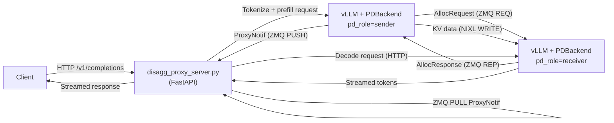
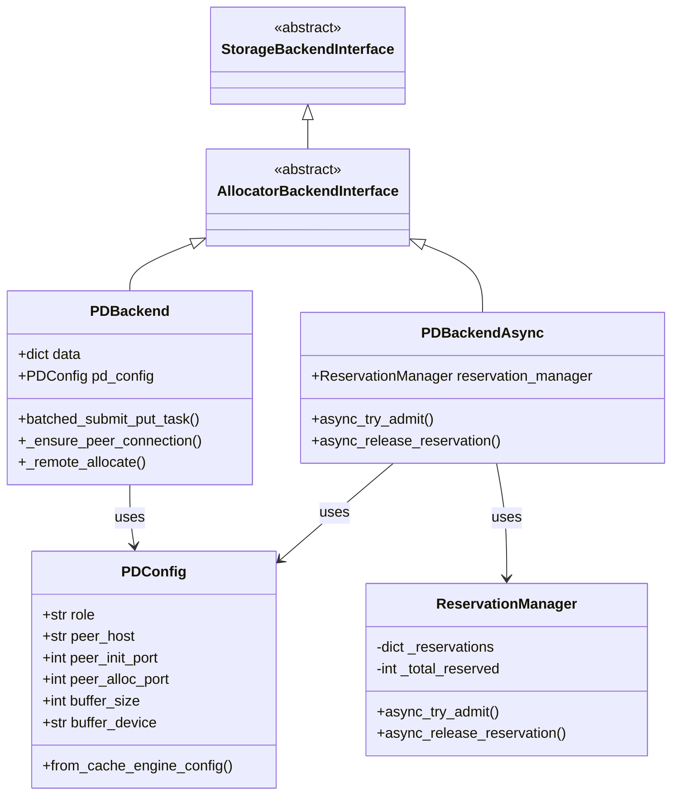

<!-- source: DeepWiki mcp.deepwiki.com · repo LMCache/LMCache · page 8.4 Disaggregated Prefill Backend · fetched 2026-10-21 -->

# Disaggregated Prefill Backend

Relevant source files

The following files were used as context for generating this wiki page:

- [docs/README.md](docs/README.md)
- [docs/source/api_reference/storage_backends.rst](docs/source/api_reference/storage_backends.rst)
- [docs/source/disaggregated_prefill/nixl/1p1d.rst](docs/source/disaggregated_prefill/nixl/1p1d.rst)
- [docs/source/disaggregated_prefill/nixl/xpyd.rst](docs/source/disaggregated_prefill/nixl/xpyd.rst)
- [docs/source/getting_started/quickstart/disaggregated_prefill.rst](docs/source/getting_started/quickstart/disaggregated_prefill.rst)
- [docs/source/getting_started/quickstart/share_kv_cache.rst](docs/source/getting_started/quickstart/share_kv_cache.rst)
- [docs/source/kv_cache/caching_policies.rst](docs/source/kv_cache/caching_policies.rst)
- [docs/source/kv_cache/storage_backends/infinistore.rst](docs/source/kv_cache/storage_backends/infinistore.rst)
- [examples/disagg_prefill/1p1d/README.md](examples/disagg_prefill/1p1d/README.md)
- [examples/disagg_prefill/1p1d/configs/lmcache-decoder-config.yaml](examples/disagg_prefill/1p1d/configs/lmcache-decoder-config.yaml)
- [examples/disagg_prefill/1p1d/configs/lmcache-prefiller-config.yaml](examples/disagg_prefill/1p1d/configs/lmcache-prefiller-config.yaml)
- [examples/disagg_prefill/1p1d/disagg_example_1p1d.sh](examples/disagg_prefill/1p1d/disagg_example_1p1d.sh)
- [examples/disagg_prefill/1p1d/disagg_vllm_launcher.sh](examples/disagg_prefill/1p1d/disagg_vllm_launcher.sh)
- [examples/disagg_prefill/README.md](examples/disagg_prefill/README.md)
- [examples/disagg_prefill/disagg_proxy_server.py](examples/disagg_prefill/disagg_proxy_server.py)
- [examples/disagg_prefill/xpyd/README.md](examples/disagg_prefill/xpyd/README.md)
- [lmcache/v1/storage_backend/p2p_backend.py](lmcache/v1/storage_backend/p2p_backend.py)
- [lmcache/v1/storage_backend/path_sharder.py](lmcache/v1/storage_backend/path_sharder.py)
- [lmcache/v1/storage_backend/pd_backend.py](lmcache/v1/storage_backend/pd_backend.py)
- [lmcache/v1/storage_backend/pd_backend_async.py](lmcache/v1/storage_backend/pd_backend_async.py)
- [lmcache/v1/transfer_channel/__init__.py](lmcache/v1/transfer_channel/__init__.py)
- [lmcache/v1/transfer_channel/abstract.py](lmcache/v1/transfer_channel/abstract.py)
- [lmcache/v1/transfer_channel/mock_memory_channel.py](lmcache/v1/transfer_channel/mock_memory_channel.py)
- [lmcache/v1/transfer_channel/nixl_channel.py](lmcache/v1/transfer_channel/nixl_channel.py)
- [lmcache/v1/transfer_channel/py_socket_channel.py](lmcache/v1/transfer_channel/py_socket_channel.py)
- [tests/v1/storage_backend/test_pd_backend_async.py](tests/v1/storage_backend/test_pd_backend_async.py)
- [tests/v1/storage_backend/test_pd_backend_buffer_alignment.py](tests/v1/storage_backend/test_pd_backend_buffer_alignment.py)

This page documents the internal architecture and implementation of LMCache’s **Disaggregated Prefill Backend** (`PDBackend` and `PDBackendAsync`). These backends enable an architecture where the compute-intensive **prefill** phase (computing the initial KV cache from text prompts) and the **decode** phase (autoregressive token generation) are decoupled and run on separate nodes or GPU pools. The prefill node pushes KV cache data directly into the decoder’s memory via a high-performance transfer channel (such as NIXL over NVLink, RDMA, or TCP).

---

## Purpose and Scope

The disaggregated prefill backend solves the computational imbalance in LLM serving where prefill requests cause latency spikes and disrupt ongoing decode steps. By isolating prefill onto dedicated producer instances and streaming the resulting KV cache to consumer decoder instances, the system achieves:
- Lower and more predictable Time-To-First-Token (TTFT)
- Stable inter-token latency during decoding
- Flexible, independent scaling of prefill and decode hardware resources

Sources:  
[docs/source/disaggregated_prefill/nixl/1p1d.rst:12-16](),  
[lmcache/v1/storage_backend/pd_backend.py:174-180]()

---

## Deployment Architecture

The disaggregated prefill system consists of three core components coordinated via ZeroMQ control channels and NIXL data transfers:
- **Prefiller(s)** (`pd_role: "sender"`): Compute KV cache from prompts.
- **Decoder(s)** (`pd_role: "receiver"`): Consume KV cache and generate tokens.
- **Proxy Server**: Coordinates client requests, load-balances across prefillers, and streams responses from decoders.

### Topology: 1 Prefiller, 1 Decoder (1P1D)

*Figure 1: Natural language to code entity mapping of the 1P1D disaggregated prefill workflow, showing interaction between FastAPI proxy, `PDBackend`, and `NixlChannel`.*

Sources:  
[docs/source/disaggregated_prefill/nixl/1p1d.rst:17-43](),  
[lmcache/v1/storage_backend/pd_backend.py:174-216]()

---

## Core Components and Code Entity Mapping

The disaggregated prefill storage backend is built around several core classes in `lmcache/v1/storage_backend/pd_backend.py` and `lmcache/v1/storage_backend/pd_backend_async.py`.

*Figure 2: Class hierarchy and code entity relationships for `PDBackend`, `PDBackendAsync`, `PDConfig`, and `ReservationManager`.*

Sources:  
[lmcache/v1/storage_backend/pd_backend.py:90-213](),  
[lmcache/v1/storage_backend/pd_backend_async.py:45-188]()

---

## Configuration Options: `enable_pd` and `pd_role`

The behavior of the PD backend is governed by configuration options parsed from `LMCacheEngineConfig`:
- `enable_pd` (`bool`): Activates the disaggregated prefill storage backend.
- `pd_role` (`str`): Specifies the instance role, which must be one of `"sender"`, `"receiver"`, or `"both"`.
  - `"sender"`: Acts as a prefiller; never saves local cache permanently, instead writing KV data directly to the peer receiver.
  - `"receiver"`: Acts as a decoder; listens for allocation requests, allocates local buffer slots, and receives KV data.
  - `"both"`: Bidirectional mode; can read cached KV from peers and write new KV to peers.

Sources:  
[lmcache/v1/storage_backend/pd_backend.py:113-140]()

---

## Buffer Configuration and Allocation

The transfer buffer acts as the staging area for inter-node KV cache transfers.

- `pd_buffer_size` (`int`): Upper bound of the transport buffer size in bytes, aligned to chunk sizes.
- `pd_buffer_device` (`str`): Device backing the buffer, typically `"cuda"` or `"cpu"`. Corrected per worker rank via `get_correct_device()`.
- **ReservationManager** (in `PDBackendAsync`): Manages admission control on the receiver side using asyncio conditions. It reserves `total_chunks` upfront per request ID to prevent deadlocks when multiple concurrent requests exhaust buffer space through partial allocations.

Sources:  
[lmcache/v1/storage_backend/pd_backend.py:121-171](),  
[lmcache/v1/storage_backend/pd_backend_async.py:98-188]()

---

## Message Protocol

Control signaling between sender and receiver relies on `msgspec.msgpack` structured messages transmitted over ZMQ sockets:

| Message Class | Direction | Description |
| :--- | :--- | :--- |
| `AllocRequest` | Sender → Receiver | Requests buffer allocation for KV chunk keys, shape, dtype, `req_id`, and `total_chunks` [lmcache/v1/storage_backend/pd_backend.py:47-55](). |
| `AllocResponse` | Receiver → Sender | Returns remote memory indices (`remote_indexes`) and already sent indices [lmcache/v1/storage_backend/pd_backend.py:57-65](). |
| `ProxyNotif` | Sender → Proxy | Notifies the proxy server that KV transfer is complete for `req_id` [lmcache/v1/storage_backend/pd_backend.py:67-69](). |
| `CancelNotif` | Sender → Receiver | Signals request abortion, causing the receiver to release reserved chunks [lmcache/v1/storage_backend/pd_backend_async.py:88-93](). |
| `CacheQueryRequest` | Sender → Receiver | Queries if specific block keys are already cached on the decoder [lmcache/v1/storage_backend/pd_backend.py:71-75](). |
| `CacheQueryResponse` | Receiver → Sender | Returns cached keys and their remote memory indices [lmcache/v1/storage_backend/pd_backend.py:77-82](). |

Sources:  
[lmcache/v1/storage_backend/pd_backend.py:41-86](),  
[lmcache/v1/storage_backend/pd_backend_async.py:45-95]()

---

## Proxy Server and Weighted Semaphore

The proxy server coordinates client requests in disaggregated prefill setups:
1. Receives client HTTP requests (`/v1/completions` or `/v1/chat/completions`) [examples/disagg_proxy_server.py:16-18]().
2. Distributes requests across available prefillers via round-robin load balancing [examples/disagg_proxy_server.py:139-170]().
3. Enforces concurrency limits using a **`WeightedSemaphore`**, where each request holds $\lceil L / \text{chunk\_size} \rceil$ slots until decoding starts, preventing decoder buffer exhaustion deadlocks [examples/disagg_proxy_server.py:34-80]().
4. Waits for the prefiller's `ProxyNotif`, then initiates decoding on the decoder instance and streams tokens back to the client [examples/disagg_proxy_server.py:205-207]().

Sources:  
[examples/disagg_proxy_server.py:34-80](),  
[docs/source/disaggregated_prefill/nixl/1p1d.rst:145-155]()

---

## NIXL-Based 1P1D and xPyD Examples

### 1P1D Setup
A single prefiller (port `7100`, GPU `0`) and a single decoder (port `7200`, GPU `1`) coordinated by a proxy server (port `9100`) [docs/source/disaggregated_prefill/nixl/1p1d.rst:17-43]().
- Prefiller config: `pd_role: "sender"`, `pd_buffer_size: 1073741824` (1GB) [docs/source/disaggregated_prefill/nixl/1p1d.rst:102-108]().
- Decoder config: `pd_role: "receiver"`, `pd_buffer_size: 2147483648` (2GB), `nixl_backends: [UCX]` [docs/source/disaggregated_prefill/nixl/1p1d.rst:126-134]().

### xPyD Setup
Multiple prefillers and decoders scaling horizontally. The proxy server uses CSV-based host/port pairing and round-robin dispatch to distribute compute-intensive prefill workloads across multiple GPUs [docs/source/disaggregated_prefill/nixl/xpyd.rst:12-22]().

Sources:  
[docs/source/disaggregated_prefill/nixl/1p1d.rst:17-140](),  
[docs/source/disaggregated_prefill/nixl/xpyd.rst:12-150]()

---

