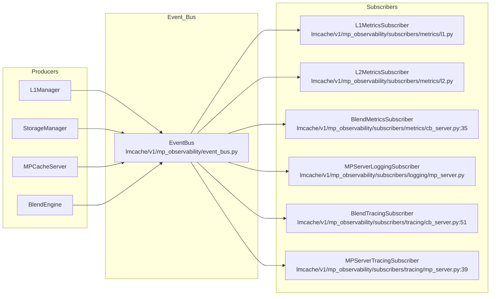

<!-- source: DeepWiki mcp.deepwiki.com · repo LMCache/LMCache · page 9 Observability and Monitoring · fetched 2026-10-21 -->

# Observability and Monitoring

Relevant source files

The following files were used as context for generating this wiki page:

- [docs/design/observability/request-event-span.md](docs/design/observability/request-event-span.md)
- [docs/design/v1/mp_observability/DEBUG.md](docs/design/v1/mp_observability/DEBUG.md)
- [docs/design/v1/mp_observability/EVENTS.md](docs/design/v1/mp_observability/EVENTS.md)
- [docs/design/v1/mp_observability/METRICS.md](docs/design/v1/mp_observability/METRICS.md)
- [docs/source/mp/observability/traces.rst](docs/source/mp/observability/traces.rst)
- [lmcache/v1/mp_observability/config.py](lmcache/v1/mp_observability/config.py)
- [lmcache/v1/mp_observability/event.py](lmcache/v1/mp_observability/event.py)
- [lmcache/v1/mp_observability/subscribers/logging/__init__.py](lmcache/v1/mp_observability/subscribers/logging/__init__.py)
- [lmcache/v1/mp_observability/subscribers/logging/l2.py](lmcache/v1/mp_observability/subscribers/logging/l2.py)
- [lmcache/v1/mp_observability/subscribers/metrics/__init__.py](lmcache/v1/mp_observability/subscribers/metrics/__init__.py)
- [lmcache/v1/mp_observability/subscribers/metrics/cb_server.py](lmcache/v1/mp_observability/subscribers/metrics/cb_server.py)
- [lmcache/v1/mp_observability/subscribers/metrics/l2.py](lmcache/v1/mp_observability/subscribers/metrics/l2.py)
- [lmcache/v1/mp_observability/subscribers/metrics/lookup.py](lmcache/v1/mp_observability/subscribers/metrics/lookup.py)
- [lmcache/v1/mp_observability/subscribers/tracing/__init__.py](lmcache/v1/mp_observability/subscribers/tracing/__init__.py)
- [lmcache/v1/mp_observability/subscribers/tracing/cb_server.py](lmcache/v1/mp_observability/subscribers/tracing/cb_server.py)
- [lmcache/v1/mp_observability/subscribers/tracing/mp_server.py](lmcache/v1/mp_observability/subscribers/tracing/mp_server.py)
- [tests/v1/mp_observability/subscribers/metrics/test_cb_server.py](tests/v1/mp_observability/subscribers/metrics/test_cb_server.py)
- [tests/v1/mp_observability/subscribers/metrics/test_l2.py](tests/v1/mp_observability/subscribers/metrics/test_l2.py)
- [tests/v1/mp_observability/subscribers/metrics/test_lookup.py](tests/v1/mp_observability/subscribers/metrics/test_lookup.py)
- [tests/v1/mp_observability/subscribers/tracing/test_cb_server.py](tests/v1/mp_observability/subscribers/tracing/test_cb_server.py)
- [tests/v1/mp_observability/subscribers/tracing/test_mp_server.py](tests/v1/mp_observability/subscribers/tracing/test_mp_server.py)
- [tests/v1/multiprocess/test_lookup_outcome_attribution.py](tests/v1/multiprocess/test_lookup_outcome_attribution.py)

This page provides an overview of LMCache's observability and monitoring systems, encompassing metrics collection via `LMCStatsMonitor`, health monitoring via `HealthMonitor`, operational endpoints exposed by the internal API server, and event-driven telemetry via the multiprocess `EventBus` [lmcache/observability.py:119-260](), [lmcache/v1/health_monitor/base.py:36-146](), [lmcache/v1/mp_observability/event_bus.py](). 

This is a parent page. For detailed subsystem documentation, see the child pages:
- [Metrics and Statistics](#9.1) — Document `LMCStatsMonitor`, `PrometheusLogger`, `mp_observability` metric subscribers, Grafana dashboards, and usage telemetry.
- [Health Monitoring](#9.2) — Explain `HealthMonitor`, `HealthCheck` auto-discovery, `RemoteBackendHealthCheck`, `FallbackPolicy`, and recovery mechanisms.
- [Internal API Server](#9.3) — Document `internal_api_server_enabled`, API endpoints (`/periodic-threads`, `/health`, `/config`, cache APIs), and monitoring interfaces.
- [Event Management and Tracing](#9.4) — Explain `EventManager`/`EventBus`, OpenTelemetry tracing subscribers, trace codecs, KV cache events, and trace recording/replay.

## System Architecture

The observability infrastructure of LMCache integrates two layers reflecting its hybrid single-process and multiprocess architecture.

- Single-process components rely on the `LMCStatsMonitor` to collect request-level stats, latency distributions, and memory usage.
- Multiprocess mode uses an event-driven **EventBus** delivering typed `Event` objects from producers to subscribers which capture metrics, logs, and traces via OpenTelemetry instrumentation [docs/design/v1/mp_observability/METRICS.md:5-15](), [lmcache/v1/mp_observability/config.py:28-33]().

### Observability Component Mapping Diagram

This diagram bridges natural language concepts with concrete code entities across the observability subsystems, making it easier to locate the relevant source code for each component.

```mermaid
graph TB
    subgraph "Single_Process_Engine"
        LocalCPUBackend["LocalCPUBackend"]
        RemoteBackend["RemoteBackend"]
        StorageManager["StorageManager"]
        LMCStatsMonitor["LMCStatsMonitor"]
        PrometheusLogger["PrometheusLogger"]
    end

    subgraph "Metrics_Collection"
        RetrieveRequestStats["RetrieveRequestStats"]
        StoreRequestStats["StoreRequestStats"]
        LookupRequestStats["LookupRequestStats"]
    end

    subgraph "Health_Monitoring"
        HealthMonitor["HealthMonitor"]
        HealthCheck["HealthCheck"]
        RemoteBackendHealthCheck["RemoteBackendHealthCheck"]
    end

    subgraph "MP_Observability"
        EventBus["EventBus"]
        L1MetricsSubscriber["L1MetricsSubscriber"]
        L2MetricsSubscriber["L2MetricsSubscriber"]
        BlendMetricsSubscriber["BlendMetricsSubscriber"]
        MPServerLoggingSubscriber["MPServerLoggingSubscriber"]
        MPServerTracingSubscriber["MPServerTracingSubscriber"]
        OTelInit["OTelInit"]
    end

    subgraph "Internal_API_Server"
        APIServer["APIServer"]
    end

    LocalCPUBackend --> LMCStatsMonitor
    RemoteBackend --> LMCStatsMonitor
    StorageManager --> LMCStatsMonitor

    LMCStatsMonitor --> RetrieveRequestStats
    LMCStatsMonitor --> StoreRequestStats
    LMCStatsMonitor --> LookupRequestStats

    HealthMonitor --> HealthCheck
    HealthCheck -.-> RemoteBackendHealthCheck

    EventBus --> L1MetricsSubscriber
    EventBus --> L2MetricsSubscriber
    EventBus --> BlendMetricsSubscriber
    EventBus --> MPServerLoggingSubscriber
    EventBus --> MPServerTracingSubscriber
    OTelInit --> PrometheusLogger

    APIServer --> PrometheusLogger

    classDef codeEntity fill:#f9f,stroke:#333,stroke-width:1px;
    class LocalCPUBackend,RemoteBackend,StorageManager,LMCStatsMonitor,RetrieveRequestStats,StoreRequestStats,LookupRequestStats,HealthMonitor,HealthCheck,RemoteBackendHealthCheck,EventBus,L1MetricsSubscriber,L2MetricsSubscriber,BlendMetricsSubscriber,MPServerLoggingSubscriber,MPServerTracingSubscriber,OTelInit,APIServer codeEntity;
```

Sources:  
[lmcache/observability.py:119-260](), [lmcache/v1/storage_backend/local_cpu_backend.py:42-122](), [lmcache/v1/storage_backend/remote_backend.py:27-114](), [lmcache/v1/health_monitor/base.py:36-146](), [lmcache/v1/health_monitor/checks/remote_backend_check.py:44-55](), [lmcache/v1/mp_observability/subscribers/metrics/cb_server.py:35](), [lmcache/v1/mp_observability/event_bus.py](), [docs/design/v1/mp_observability/METRICS.md:1-127](), [lmcache/v1/mp_observability/otel_init.py:30-181]()

---

## 9.1 Metrics Collection System

LMCache tracks detailed operational metrics through two complementary systems:

- **Single-process StatsMonitor**  
  The `LMCStatsMonitor` singleton aggregates detailed statistics about request lifecycles, such as latencies for lookup, retrieval, and storage, plus memory usage and cache hit rates. Storage backends feed L1/L2 operation stats directly into this monitor, which aggregates for reporting and alerting [lmcache/observability.py:38-260](), [lmcache/v1/storage_backend/local_cpu_backend.py:109-122](), [lmcache/v1/storage_backend/remote_backend.py:105-114]().

- **Multiprocess OpenTelemetry EventBus**  
  For multiprocess (MP) mode, metrics are captured using an event-published architecture. Core components like `L1Manager`, `StorageManager`, and `MPCacheServer` publish `Event` objects to an asynchronous `EventBus` [docs/design/v1/mp_observability/METRICS.md:5-15](). Subscribers such as `L1MetricsSubscriber` and `L2MetricsSubscriber` consume these events and update OpenTelemetry counters with the `lmcache_mp.` namespace prefix [docs/design/v1/mp_observability/METRICS.md:36-40](), [lmcache/v1/mp_observability/subscribers/metrics/l2.py:32-172](). Metrics include L1 cache hits, writes, evictions, L2 store submissions, prefetch loads, failure counters, and timeout counts [docs/design/v1/mp_observability/METRICS.md:1-127](), [lmcache/v1/mp_observability/subscribers/metrics/l2.py:32-172]().
  Specific metrics include:
  - `lmcache_mp.l1_read`, `lmcache_mp.l1_write`, `lmcache_mp.l1_evicted` for L1 operations [docs/design/v1/mp_observability/METRICS.md:78-113]().
  - `lmcache_mp.lookup_requested`, `lmcache_mp.lookup_hit`, `lmcache_mp.lookup_hit_l1`, `lmcache_mp.lookup_hit_l2` for lookup performance [lmcache/v1/mp_observability/subscribers/metrics/lookup.py:82-128]().
  - `grpc.client.*` and `grpc.server.*` for gRPC runtime metrics when `grpc_metrics_enabled` is true [docs/design/v1/mp_observability/METRICS.md:63-73](), [lmcache/v1/mp_observability/config.py:44-50]().

Metrics export supports two modes configured by `ObservabilityConfig` (notably `otlp_endpoint`) [lmcache/v1/mp_observability/config.py:28-65]():  
- **OTLP push mode**: Metrics and traces are pushed to an OpenTelemetry Collector (production) [docs/design/v1/mp_observability/METRICS.md:14-15](), [lmcache/v1/mp_observability/otel_init.py:81-94]().  
- **Prometheus pull mode**: A local `/metrics` HTTP endpoint serves collected metrics for Prometheus scraping (development/debug) [lmcache/v1/mp_observability/otel_init.py:102-131]().

For detailed subscriber classes, metrics names, and telemetry dashboards, see [Metrics and Statistics](#9.1).

Sources:  
[lmcache/observability.py:38-260](), [lmcache/v1/storage_backend/local_cpu_backend.py:109-122](), [lmcache/v1/storage_backend/remote_backend.py:105-114](), [docs/design/v1/mp_observability/METRICS.md:1-127](), [lmcache/v1/mp_observability/subscribers/metrics/l2.py:32-172](), [lmcache/v1/mp_observability/otel_init.py:44-181](), [lmcache/v1/mp_observability/config.py:28-65](), [lmcache/v1/mp_observability/subscribers/metrics/lookup.py:82-128]()

---

## 9.2 Health Monitoring System

Health monitoring in LMCache provides automated failure detection, reporting, and fallback actions to maintain robust service operation.

- The `HealthMonitor` supervises registered `HealthCheck` instances that probe storage backends and subsystems for failures and degraded states [lmcache/v1/health_monitor/base.py:36-146]().

- Specific health checks like `RemoteBackendHealthCheck` measure operation error rates and trigger fallback or recovery procedures upon excessive consecutive failures [lmcache/v1/health_monitor/checks/remote_backend_check.py:44-160]().

- In multiprocess mode, health-related anomaly counters for L1 and L2 are published as `Event` objects to the `EventBus` [docs/design/v1/mp_observability/EVENTS.md:36-62](). For instance, `L1_ALLOCATION_FAILED` and `L1_READ_FAILED` represent L1 cache failures that inform health monitoring dashboards and alerts [docs/design/v1/mp_observability/EVENTS.md:36-62](). `L2_PREFETCH_FAILED` indicates issues during L2 prefetching [docs/design/v1/mp_observability/EVENTS.md:131-139]().

This system integrates with the metrics collection to expose failure frequencies, usage ratios, and timeout events, enabling effective operational monitoring and automatic interventions.

For detailed design and usage, see [Health Monitoring](#9.2).

Sources:  
[lmcache/v1/health_monitor/base.py:36-146](), [lmcache/v1/health_monitor/checks/remote_backend_check.py:44-160](), [docs/design/v1/mp_observability/EVENTS.md:36-62](), [docs/design/v1/mp_observability/EVENTS.md:131-139]()

---

## 9.3 Internal API Server

LMCache exposes an internal HTTP API for runtime observability and management. This server offers several key monitoring and administrative endpoints:

| Endpoint            | Category       | Purpose                                                                                 |
|---------------------|----------------|-----------------------------------------------------------------------------------------|
| `/metrics`          | Metrics        | Exposes Prometheus metrics endpoint compatible with both single- and multiprocess mode, detailed in [METRICS.md](../../../docs/design/v1/mp_observability/METRICS.md#metrics) |
| `/periodic-threads` | Diagnostics    | Lists background periodic threads, their status, and health                              |
| `/health`           | Health         | Reports unified health status aggregates across storage tiers and subsystems            |
| `/config`           | Configuration  | Returns current LMCache engine configuration and MP observability settings [lmcache/v1/mp_observability/config.py:28-110]() |

The internal API supports live monitoring of the server's health, metrics consumption, and operational tasks without requiring direct access to logs or internal objects.

For details on enabling and working with these endpoints, see [Internal API Server](#9.3).

Sources:  
[lmcache/v1/mp_observability/config.py:28-110](), [docs/design/v1/mp_observability/METRICS.md:15]()

---

## 9.4 Event Management and Tracing

LMCache implements advanced observability through an EventBus-driven design in multiprocess mode, enabling detailed event capture, logging, and tracing for complex interactions.

- **EventBus Architecture:**  
  Core producers such as `L1Manager`, `StorageManager`, and `MPCacheServer` publish typed `Event` objects asynchronously to the `EventBus` [docs/design/v1/mp_observability/METRICS.md:8-9](). These events cover operations from cache reads and writes to eviction, prefetching, and timeout exceptions [lmcache/v1/mp_observability/event.py:15-111](). Event types include `L1_READ_FINISHED`, `L1_WRITE_FINISHED`, `L1_KEYS_EVICTED`, `MP_STORE_START`, `MP_RETRIEVE_START`, and `TIMEOUT_RAISED` [lmcache/v1/mp_observability/event.py:24-111]().

- **Subscribers:**  
  The bus fans out events to subscribers specialized for metrics (`L1MetricsSubscriber`, `L2MetricsSubscriber`), logging (`MPServerLoggingSubscriber`), and tracing (`MPServerTracingSubscriber`, `BlendTracingSubscriber`) [docs/design/v1/mp_observability/METRICS.md:10-13](), [docs/source/mp/observability/index.rst:4-7](). Subscribers transform events into OpenTelemetry counters, log entries, or trace spans, enabling multilayer observability [docs/design/v1/mp_observability/METRICS.md:10-13](), [lmcache/v1/mp_observability/subscribers/metrics/__init__.py:4-70](), [lmcache/v1/mp_observability/subscribers/logging/__init__.py:3-31]().

- **Tracing:**  
  Trace spans are created from START/END event pairs (e.g., `MP_STORE_START` and `MP_STORE_END`) for detailed latency breakdowns of cache operations [docs/design/v1/mp_observability/METRICS.md:13](), [lmcache/v1/mp_observability/event.py:70-71](). The `MPServerTracingSubscriber` creates a root `"request"` span for each session, nesting child spans like `mp.store`, `mp.retrieve`, and `mp.lookup_prefetch` [lmcache/v1/mp_observability/subscribers/tracing/mp_server.py:5-12](). Similarly, `BlendTracingSubscriber` creates a `"cb.request"` root span for Cache Blending operations [lmcache/v1/mp_observability/subscribers/tracing/cb_server.py:5-11](). Span closure is deferred until all GPU operations complete to prevent orphaned spans [docs/design/observability/request-event-span.md:33-49](). These distributed traces require an OTLP endpoint and are consumed by OpenTelemetry collector backends for end-to-end performance analysis [docs/source/mp/observability/index.rst:55-64]().

### EventFlow Diagram: Producers to Subscribers

This decoupled, event-driven design enables flexible extensibility for new observability modes and metrics while centralizing event production logic.

For full details, see [Event Management and Tracing](#9.4).

Sources:  
[docs/design/v1/mp_observability/METRICS.md:5-15](), [lmcache/v1/mp_observability/config.py:28-35](), [lmcache/v1/mp_observability/subscribers/metrics/__init__.py:4-70](), [lmcache/v1/mp_observability/event.py:15-158](), [docs/design/v1/mp_observability/EVENTS.md:13-114](), [docs/source/mp/observability/index.rst:101-140](), [lmcache/v1/mp_observability/subscribers/logging/__init__.py:3-31](), [lmcache/v1/mp_observability/event.py:24-111](), [lmcache/v1/mp_observability/subscribers/tracing/mp_server.py:5-12](), [lmcache/v1/mp_observability/subscribers/tracing/cb_server.py:5-11](), [docs/design/observability/request-event-span.md:33-49]()

---

This page serves as a concise overview and navigation hub for LMCache's observability and monitoring features. For comprehensive technical details, configuration options, and usage guidelines, please consult the dedicated child pages linked above.

---

