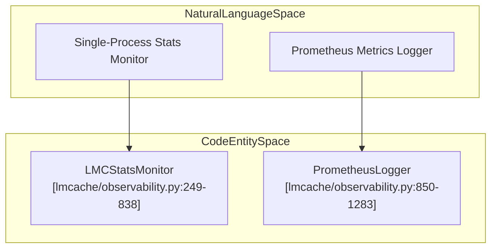
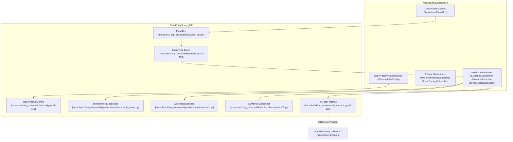

<!-- source: DeepWiki mcp.deepwiki.com · repo LMCache/LMCache · page 9.1 Metrics and Statistics · fetched 2026-10-21 -->

# Metrics and Statistics

Relevant source files

The following files were used as context for generating this wiki page:

- [docs/design/observability/request-event-span.md](docs/design/observability/request-event-span.md)
- [docs/design/usage_telemetry/continuous_metrics.md](docs/design/usage_telemetry/continuous_metrics.md)
- [docs/design/usage_telemetry/l2_metrics.md](docs/design/usage_telemetry/l2_metrics.md)
- [docs/design/v1/mp_observability/DEBUG.md](docs/design/v1/mp_observability/DEBUG.md)
- [docs/design/v1/mp_observability/EVENTS.md](docs/design/v1/mp_observability/EVENTS.md)
- [docs/design/v1/mp_observability/METRICS.md](docs/design/v1/mp_observability/METRICS.md)
- [docs/source/developer_guide/usage/usage_stats_collection.rst](docs/source/developer_guide/usage/usage_stats_collection.rst)
- [docs/source/mp/observability/traces.rst](docs/source/mp/observability/traces.rst)
- [examples/observability/README.md](examples/observability/README.md)
- [examples/observability/grafana/provisioning/dashboards/lmcache.json](examples/observability/grafana/provisioning/dashboards/lmcache.json)
- [examples/observability/otel-collector.yml](examples/observability/otel-collector.yml)
- [examples/observability/tempo.yml](examples/observability/tempo.yml)
- [lmcache/usage_telemetry/README.md](lmcache/usage_telemetry/README.md)
- [lmcache/usage_telemetry/continuous.py](lmcache/usage_telemetry/continuous.py)
- [lmcache/usage_telemetry/flush.py](lmcache/usage_telemetry/flush.py)
- [lmcache/usage_telemetry/l1_usage.py](lmcache/usage_telemetry/l1_usage.py)
- [lmcache/usage_telemetry/l2_usage.py](lmcache/usage_telemetry/l2_usage.py)
- [lmcache/usage_telemetry/messages.py](lmcache/usage_telemetry/messages.py)
- [lmcache/usage_telemetry/metric_specs.py](lmcache/usage_telemetry/metric_specs.py)
- [lmcache/usage_telemetry/mp_continuous.py](lmcache/usage_telemetry/mp_continuous.py)
- [lmcache/usage_telemetry/transport.py](lmcache/usage_telemetry/transport.py)
- [lmcache/v1/mp_observability/config.py](lmcache/v1/mp_observability/config.py)
- [lmcache/v1/mp_observability/event.py](lmcache/v1/mp_observability/event.py)
- [lmcache/v1/mp_observability/subscribers/logging/__init__.py](lmcache/v1/mp_observability/subscribers/logging/__init__.py)
- [lmcache/v1/mp_observability/subscribers/logging/l2.py](lmcache/v1/mp_observability/subscribers/logging/l2.py)
- [lmcache/v1/mp_observability/subscribers/metrics/__init__.py](lmcache/v1/mp_observability/subscribers/metrics/__init__.py)
- [lmcache/v1/mp_observability/subscribers/metrics/cb_server.py](lmcache/v1/mp_observability/subscribers/metrics/cb_server.py)
- [lmcache/v1/mp_observability/subscribers/metrics/l0_l1_throughput.py](lmcache/v1/mp_observability/subscribers/metrics/l0_l1_throughput.py)
- [lmcache/v1/mp_observability/subscribers/metrics/l2.py](lmcache/v1/mp_observability/subscribers/metrics/l2.py)
- [lmcache/v1/mp_observability/subscribers/metrics/l2_throughput.py](lmcache/v1/mp_observability/subscribers/metrics/l2_throughput.py)
- [lmcache/v1/mp_observability/subscribers/metrics/lookup.py](lmcache/v1/mp_observability/subscribers/metrics/lookup.py)
- [lmcache/v1/mp_observability/subscribers/tracing/__init__.py](lmcache/v1/mp_observability/subscribers/tracing/__init__.py)
- [lmcache/v1/mp_observability/subscribers/tracing/cb_server.py](lmcache/v1/mp_observability/subscribers/tracing/cb_server.py)
- [lmcache/v1/mp_observability/subscribers/tracing/mp_server.py](lmcache/v1/mp_observability/subscribers/tracing/mp_server.py)
- [tests/test_usage_telemetry.py](tests/test_usage_telemetry.py)
- [tests/v1/mp_observability/subscribers/metrics/test_cb_server.py](tests/v1/mp_observability/subscribers/metrics/test_cb_server.py)
- [tests/v1/mp_observability/subscribers/metrics/test_l0_l1_throughput.py](tests/v1/mp_observability/subscribers/metrics/test_l0_l1_throughput.py)
- [tests/v1/mp_observability/subscribers/metrics/test_l2.py](tests/v1/mp_observability/subscribers/metrics/test_l2.py)
- [tests/v1/mp_observability/subscribers/metrics/test_l2_throughput.py](tests/v1/mp_observability/subscribers/metrics/test_l2_throughput.py)
- [tests/v1/mp_observability/subscribers/metrics/test_lookup.py](tests/v1/mp_observability/subscribers/metrics/test_lookup.py)
- [tests/v1/mp_observability/subscribers/tracing/test_cb_server.py](tests/v1/mp_observability/subscribers/tracing/test_cb_server.py)
- [tests/v1/mp_observability/subscribers/tracing/test_mp_server.py](tests/v1/mp_observability/subscribers/tracing/test_mp_server.py)
- [tests/v1/multiprocess/test_lookup_outcome_attribution.py](tests/v1/multiprocess/test_lookup_outcome_attribution.py)
- [tests/v1/multiprocess/test_usage_telemetry_server.py](tests/v1/multiprocess/test_usage_telemetry_server.py)

This page documents the core metrics, statistics collection, telemetry, and observability infrastructure in LMCache. The system is built around several pillars: the `LMCStatsMonitor` singleton for operational statistics in single-process mode, `PrometheusLogger` for Prometheus format exposition, pre-provisioned Grafana dashboards, an asynchronous `EventBus` with OpenTelemetry (OTel) instrumentation for multi-process (MP) mode, and an anonymous usage telemetry package.

---

## Overview and Core Architecture

LMCache's observability stack operates across two primary execution paradigms:

1. **Single-Process Engine Mode**:  
   Collects synchronous statistics via `LMCStatsMonitor` and exposes them via `PrometheusLogger`.

2. **Multi-Process (MP) Mode**:  
   Decouples metric producers from consumers using an asynchronous `EventBus` and integrates OpenTelemetry SDK providers for instrumentation via OTLP push or Prometheus pull.

The diagram below maps these high-level functional components to their concrete code entities in the single-process engine:

Sources:  
`[lmcache/observability.py:249-1283]()`, `[lmcache/v1/mp_observability/otel_init.py:48-132]()`, `[docs/source/mp/observability/index.rst:4-15]()`

---

## Core Statistics Infrastructure

### Statistics Data Structure

In single-process mode, LMCache tracks metrics with structured dataclasses capturing request lifecycles, token counts, cache usage, latencies, and hit rates. The key dataclass is `LMCacheStats`, which aggregates interval statistics such as:

| Field Category       | Example Keys                              | Type         |
|----------------------|------------------------------------------|--------------|
| Counters             | `interval_retrieve_requests`, `interval_store_requests`, `interval_lookup_requests` | int          |
| Token Counters       | `interval_requested_tokens`, `interval_hit_tokens`, `interval_stored_tokens` | int          |
| Remote Metrics       | `interval_remote_read_bytes`, `interval_remote_write_bytes`, `interval_remote_ping_latency` | int/float    |
| Cache Usage          | `local_cache_usage_bytes`, `remote_cache_usage_bytes`, `local_storage_usage_bytes` | int          |
| Hit Rates            | `retrieve_hit_rate`, `lookup_hit_rate`   | float        |
| Latency Distributions| `time_to_retrieve`, `time_to_store`, `retrieve_speed` | List[float]  |

Additionally, several per-request classes (`LookupRequestStats`, `RetrieveRequestStats`, `StoreRequestStats`, `P2PTransferRequestStats`) capture fine-grained session details with profiling contexts for phases such as GPU transfer or token processing.

Sources:  
`[lmcache/observability.py:38-246]()`

### LMCStatsMonitor and on_* Methods

The `LMCStatsMonitor` is a thread-safe singleton consolidating statistics during LMCache operation. It provides APIs to register new requests and collect metrics snapshots:

| Method                | Description                                        | Source                     |
|-----------------------|--------------------------------------------------|----------------------------|
| `GetOrCreate()`       | Retrieve or create the singleton instance.       | `[lmcache/observability.py:831-834]()` |
| `on_lookup_request()` | Track a lookup request’s token count.             | `[lmcache/observability.py:332-349]()` |
| `on_retrieve_request()`| Track a KV retrieve session with profiling.      | `[lmcache/observability.py:376-395]()` |
| `on_store_request()`  | Track a KV store session with profiling.          | `[lmcache/observability.py:458-474]()` |
| `get_stats_and_clear()`| Return current snapshot of stats and reset.      | `[lmcache/observability.py:664-826]()` |

Sources:  
`[lmcache/observability.py:249-838]()`

---

## Prometheus Logger and Grafana Dashboards

### PrometheusLogger Integration

The `PrometheusLogger` translates LMCache internal metrics into Prometheus-native constructs—counters, gauges, and histograms—allowing export via a `/metrics` HTTP endpoint:

| Metric Name                   | Type      | Description                       | Source                         |
|------------------------------|-----------|---------------------------------|--------------------------------|
| `lmcache_num_retrieve_requests` | Counter   | Number of retrieve requests processed | `[lmcache/observability.py:886]()` |
| `lmcache_num_hit_tokens`         | Counter   | Total tokens served as hits      | `[lmcache/observability.py:890]()` |
| `lmcache_retrieve_hit_rate`      | Gauge     | Current retrieval hit rate       | `[lmcache/observability.py:919]()` |
| `lmcache_time_to_retrieve`       | Histogram | Latency distribution of retrieve | `[lmcache/observability.py:927]()` |

Sources:  
`[lmcache/observability.py:850-1283]()`

### Grafana Dashboards

Pre-provisioned Grafana dashboards visualize LMCache metrics. The main dashboard JSON includes panels monitoring:

- **Failure Rates:** L1 allocation failures, L1 read failures, and L2 prefetch failures—visualized as time series with alerts.  
- **L1 Eviction Loop:** Counters for eviction loop ticks and triggered runs, providing insight into cache eviction activity.

The dashboard JSON is located in `examples/observability/grafana/provisioning/dashboards/lmcache.json` and covers thousands of lines of detailed visualization configuration.

Sources:  
`[examples/observability/grafana/provisioning/dashboards/lmcache.json:1-3155]()`, `[docs/design/v1/mp_observability/METRICS.md:93-111]()`

---

## Multi-Process Mode Observability and OpenTelemetry

### EventBus Architecture and Configuration

In multi-process (MP) mode, observability is implemented asynchronously via an `EventBus` pub/sub system:

- **Producers** such as `L1Manager`, `StorageManager`, and `MPCacheServer` publish typed `Event` objects describing internal operations.
- **Subscribers** listen for specific event types and update OpenTelemetry metrics or loggers.
- The system supports multiple subscriber types, including logging, tracing, and metrics collectors.

The unified configuration for this observability stack is defined by the `ObservabilityConfig` dataclass, which exposes flags for enabling/disabling metrics, tracing, logging, sampling rates, endpoints, and service instance IDs.

Manual CLI argument parsing helpers are provided to add observability flags to the LMCache server CLI.

Sources:  
`[lmcache/v1/mp_observability/config.py:28-110]()`, `[lmcache/v1/mp_observability/event.py:15-158]()`, `[lmcache/v1/mp_observability/otel_init.py:48-132]()`, `[docs/design/v1/mp_observability/METRICS.md:1-115]()`

### OpenTelemetry Initialization

OpenTelemetry (`init_otel_metrics` and `init_otel_tracing`) setup in MP mode configures exporters and metric readers:

- **OTLP Push Mode**: Metrics and traces are pushed to a configured OTLP endpoint.
- **Prometheus Pull Mode**: An internal HTTP server exposes the `/metrics` endpoint for Prometheus scraping if no OTLP endpoint is specified.
- **gRPC Runtime Metrics**: Optionally registers gRPC runtime metrics via the `grpcio-observability` plugin.

This initialization occurs at MP server startup, ensuring that all subsequent published events are instrumented according to configuration.

Sources:  
`[lmcache/v1/mp_observability/otel_init.py:48-185]()`

### MP Observability Subscribers

LMCache provides a collection of metric subscribers that consume `EventBus` events and update OTel metrics:

- `L1MetricsSubscriber`: Tracks L1 cache read/write counts and eviction metrics.
- `L2MetricsSubscriber`: Tracks L2 storage adapter usage and throughput.
- `BlendMetricsSubscriber`: Monitors cache blend hits and misses.
- Additional subscribers cover timeouts, lookup metrics, transfer phase timings, and lifecycle events.

For tracing, `MPServerTracingSubscriber` creates a per-request root span, nesting child spans such as `mp.lookup_prefetch`, `mp.retrieve`, and `mp.store`. It defers span closure until asynchronous GPU callbacks complete, ensuring accurate request duration traces.

Sources:  
`[lmcache/v1/mp_observability/subscribers/metrics/__init__.py:1-70]()`, `[lmcache/v1/mp_observability/subscribers/tracing/mp_server.py:1-373]()`

---

## Anonymous Usage Telemetry

LMCache includes an anonymous, privacy-conscious usage telemetry package collecting environment information and engine configurations. This telemetry aids maintainers in prioritizing features and understanding deployment characteristics without tracking identifiable user data.

### Telemetry Message Types

Telemetry messages are defined as flat dataclasses and include:

- `UsageMessage`: Base class for general usage reports.
- `EnvMessage`: Reports hardware environment specifications.
- `EngineMessage`: Captures snapshot of single-process LMCache engine configuration.
- `MPServerMessage`: Captures multiprocess server configuration state.

These messages are serialized and sent asynchronously to configured telemetry servers, with facilities to respect user opt-outs.

Sources:  
`[lmcache/usage_telemetry/messages.py:1-214]()`, `[tests/test_usage_telemetry.py:1-202]()`

---

# Summary Table of Key Code Entities

| Component                       | Purpose                                           | Primary Code Location                               |
|--------------------------------|--------------------------------------------------|----------------------------------------------------|
| **LMCStatsMonitor**             | Single-process statistics aggregation             | `[lmcache/observability.py:249-838]`               |
| **PrometheusLogger**            | Export single-process metrics to Prometheus       | `[lmcache/observability.py:850-1283]`              |
| **EventBus**                   | Multi-process event dispatch                       | `[lmcache/v1/mp_observability/event_bus.py]`       |
| **ObservabilityConfig**         | MP observability config data class and CLI args   | `[lmcache/v1/mp_observability/config.py:28-110]`   |
| **OpenTelemetry init**          | Set up metrics and tracing providers               | `[lmcache/v1/mp_observability/otel_init.py:48-185]`|
| **MP Metrics Subscribers**      | Consume EventBus events, update OTel counters      | `[lmcache/v1/mp_observability/subscribers/metrics/__init__.py]` |
| **MP Tracing Subscribers**      | Create OTel spans per request                        | `[lmcache/v1/mp_observability/subscribers/tracing/mp_server.py]`|
| **Usage Telemetry Messages**    | Anonymous usage data reporting                       | `[lmcache/usage_telemetry/messages.py:1-214]`      |

---

By combining synchronous statistics for single-process mode with an asynchronous event-driven observability pipeline for multi-process mode, LMCache delivers rich metrics and tracing data suitable for operational monitoring, debugging, and optimization at scale.

Sources:  
- `[lmcache/observability.py:38-1283]()`  
- `[examples/observability/grafana/provisioning/dashboards/lmcache.json:1-3155]()`  
- `[docs/design/v1/mp_observability/METRICS.md:1-115]()`  
- `[lmcache/v1/mp_observability/config.py:28-196]()`  
- `[lmcache/v1/mp_observability/event.py:1-158]()`  
- `[lmcache/v1/mp_observability/otel_init.py:48-185]()`  
- `[lmcache/v1/mp_observability/subscribers/metrics/__init__.py:1-70]()`  
- `[lmcache/v1/mp_observability/subscribers/tracing/mp_server.py:1-373]()`  
- `[lmcache/usage_telemetry/messages.py:1-214]()`  
- `[tests/test_usage_telemetry.py:1-202]()`

---

