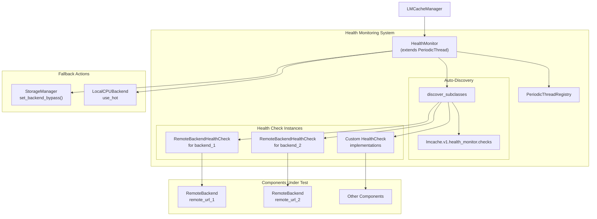
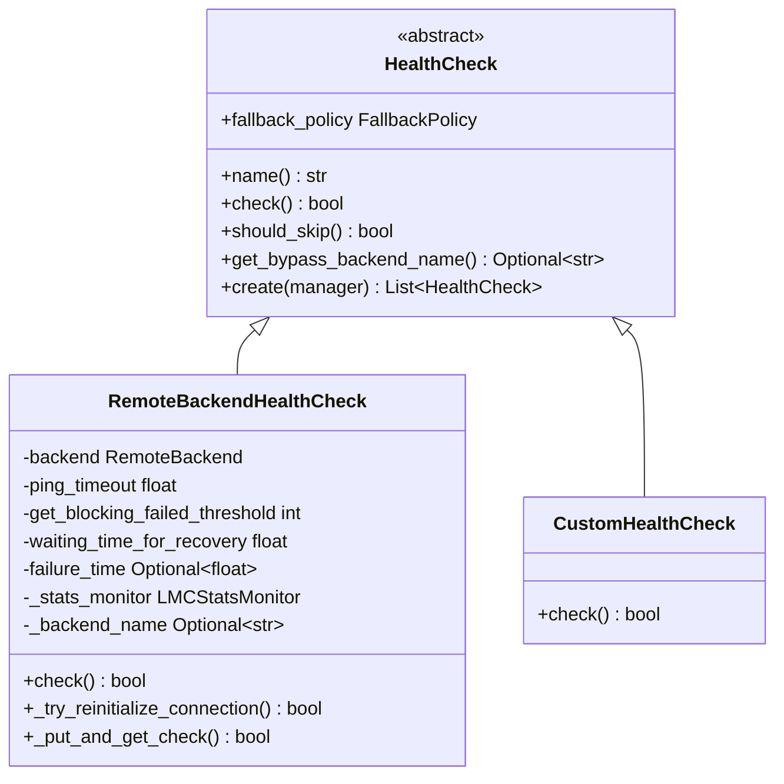
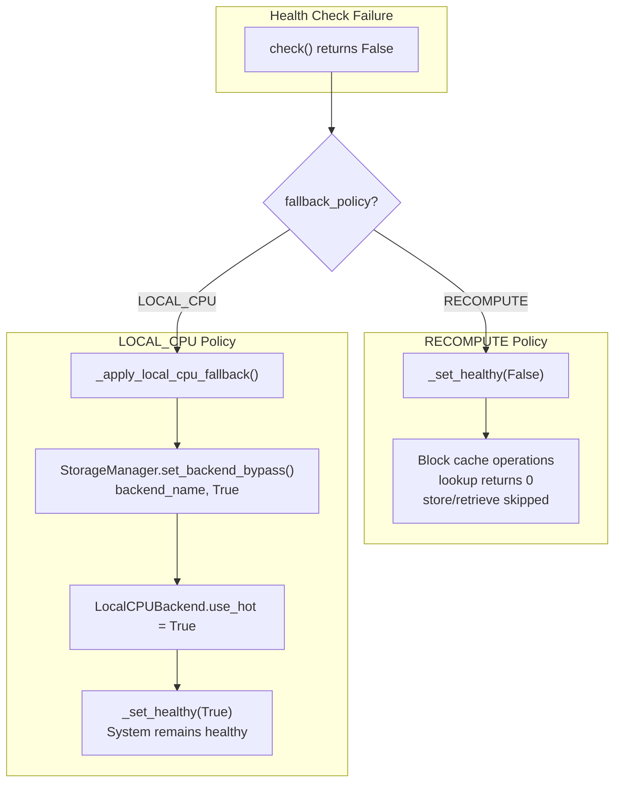
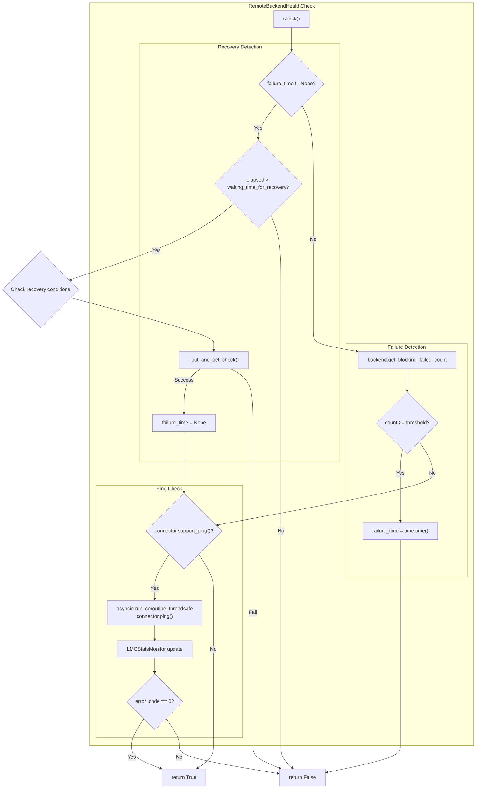
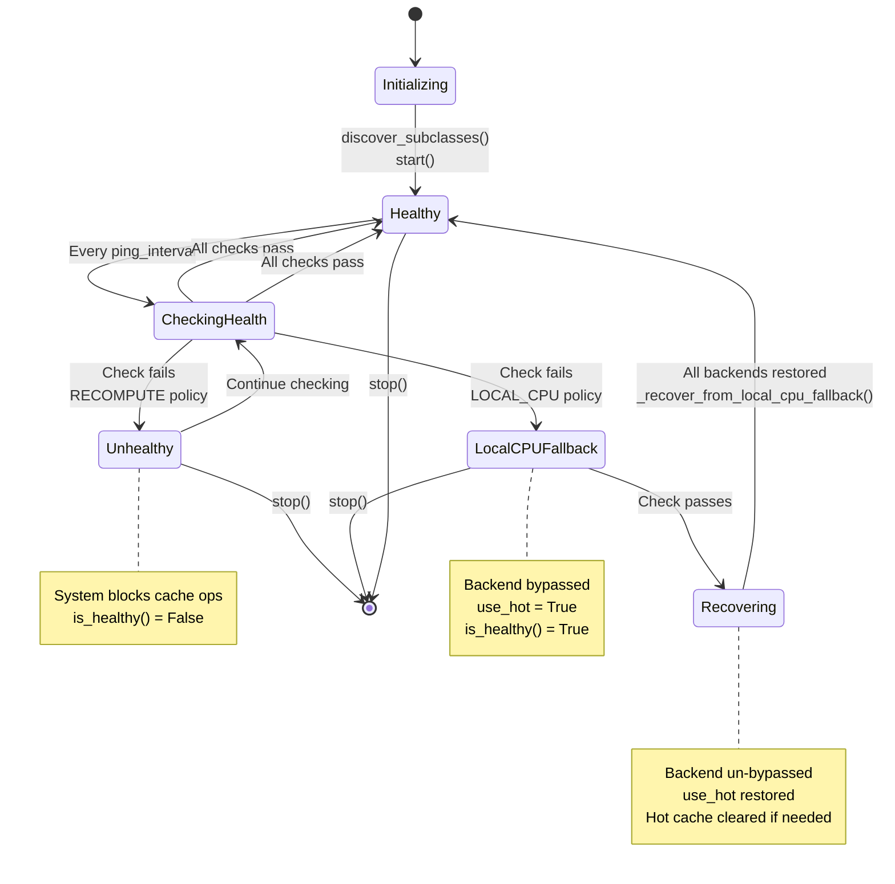
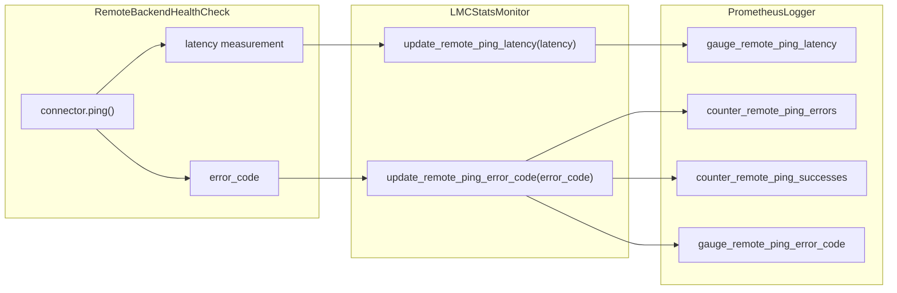
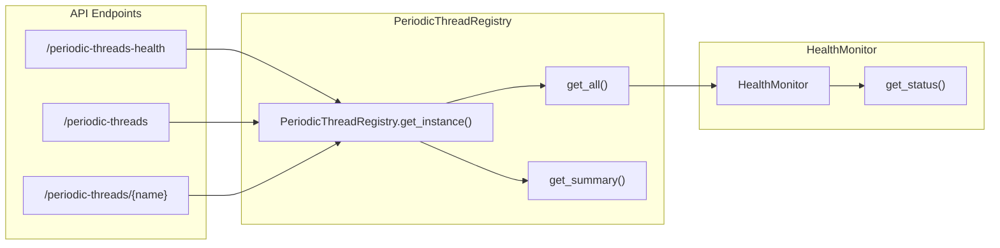

<!-- source: DeepWiki mcp.deepwiki.com · repo LMCache/LMCache · page 9.2 Health Monitoring · fetched 2026-10-21 -->

# Health Monitoring

<details>
<summary>Relevant source files</summary>

The following files were used as context for generating this wiki page:

- [docs/source/production/observability/frontend.rst](docs/source/production/observability/frontend.rst)
- [docs/source/production/observability/health_monitor.rst](docs/source/production/observability/health_monitor.rst)
- [docs/source/production/observability/index.rst](docs/source/production/observability/index.rst)
- [docs/source/production/observability/internal_api_server.rst](docs/source/production/observability/internal_api_server.rst)
- [docs/source/production/observability/periodic_thread_api.rst](docs/source/production/observability/periodic_thread_api.rst)
- [lmcache/v1/health_monitor/base.py](lmcache/v1/health_monitor/base.py)
- [lmcache/v1/health_monitor/checks/remote_backend_check.py](lmcache/v1/health_monitor/checks/remote_backend_check.py)
- [lmcache/v1/health_monitor/constants.py](lmcache/v1/health_monitor/constants.py)
- [lmcache/v1/internal_api_server/common/periodic_thread_api.py](lmcache/v1/internal_api_server/common/periodic_thread_api.py)
- [tests/cli/commands/test_server.py](tests/cli/commands/test_server.py)
- [tests/v1/internal_api_server/test_run_script.py](tests/v1/internal_api_server/test_run_script.py)
- [tests/v1/test_health_monitor.py](tests/v1/test_health_monitor.py)
- [tests/v1/test_health_monitor_fallback_recovery.py](tests/v1/test_health_monitor_fallback_recovery.py)

</details>


## Purpose and Scope

The Health Monitoring system provides continuous health checking of LMCache components, primarily remote storage backends. The `HealthMonitor` class detects failures, applies `FallbackPolicy` strategies to maintain system availability, and automatically recovers when backends become healthy again. This system is essential for production deployments where remote storage (Redis, Valkey, S3, Mooncake) may experience transient network or service failures.

**Key Components:**
- `HealthMonitor`: Central orchestrator extending `PeriodicThread` [lmcache/v1/health_monitor/base.py:146-183]().
- `HealthCheck`: Abstract base class for check implementations [lmcache/v1/health_monitor/base.py:36-73]().
- `RemoteBackendHealthCheck`: Built-in check for remote storage backends [lmcache/v1/health_monitor/checks/remote_backend_check.py:44-55]().
- `FallbackPolicy`: Enum defining recovery strategies (`RECOMPUTE`, `LOCAL_CPU`) [lmcache/v1/health_monitor/constants.py:10-15]().

For metrics collection and Prometheus integration, see page 9.1. For the Internal API Server that exposes health endpoints, see page 9.3.

Sources:  
[lmcache/v1/health_monitor/base.py:36-183](), [lmcache/v1/health_monitor/checks/remote_backend_check.py:44-55](), [lmcache/v1/health_monitor/constants.py:10-15]()

## Architecture Overview

The health monitoring system consists of three main components that work together to provide extensible, auto-discovered health checking. This diagram bridges natural language concepts to concrete code entities in `lmcache.v1.health_monitor.base` and `lmcache.v1.manager`.

### HealthMonitor System Components


Sources:  
[lmcache/v1/health_monitor/base.py:146-225](), [lmcache/v1/health_monitor/base.py:19-24]()

### HealthMonitor

`HealthMonitor` is the central orchestrator that runs as a `PeriodicThread` scheduled by a configurable ping interval. It is responsible for:

- Auto-discovery of all `HealthCheck` subclasses using module introspection and subclass discovery utilities [lmcache/v1/health_monitor/base.py:226-275]().
- Periodic execution of all registered health checks in a background thread (default interval 30s) [lmcache/v1/health_monitor/base.py:188-196]().
- Tracking overall health state, including transitions between healthy and unhealthy states [lmcache/v1/health_monitor/base.py:202-203]().
- Executing fallback policies based on each check's configured `FallbackPolicy` after failure detection [lmcache/v1/health_monitor/base.py:331-388]().
- Managing recovery and reverting fallbacks when backend health is restored [lmcache/v1/health_monitor/base.py:389-455]().

Thread-safe access to health status is ensured by `_health_lock`. The monitor also tracks backend bypass states used by fallback policies.

Sources:  
[lmcache/v1/health_monitor/base.py:146-568](), [lmcache/v1/health_monitor/constants.py:30]()

### HealthCheck Base Class

`HealthCheck` defines the interface for health checks. It is an abstract base class that mandates:

- `name() -> str`: Return the descriptive name of the check.
- `check() -> bool`: Perform the actual health verification, returning `True` if healthy.
- `fallback_policy: FallbackPolicy`: Property indicating fallback strategy for the check.
- `should_skip() -> bool`: Whether to skip the check (e.g., unsupported).
- `get_bypass_backend_name() -> Optional[str]`: Return backend name to bypass if the fallback is `LOCAL_CPU`.
- `create(manager) -> List[HealthCheck]`: Class method to instantiate health checks from the manager.

Health checks represent discrete system components and provide isolated, testable health logic.

### HealthCheck Class Hierarchy

Sources:  
[lmcache/v1/health_monitor/base.py:36-144](), [lmcache/v1/health_monitor/checks/remote_backend_check.py:44-83]()

### Auto-Discovery Mechanism

The `HealthMonitor` employs an auto-discovery process at startup:

1. Scans the package `lmcache.v1.health_monitor.checks` to find all available health check modules.
2. Uses `discover_subclasses` utility to find all classes subclassing `HealthCheck`.
3. Calls their `create(manager)` class method to instantiate checks relevant to the current LMCache deployment.
4. Registers all returned check instances for periodic execution.

This extensible design allows adding new health checks simply by implementing a subclass in the checks package.

Sources:  
[lmcache/v1/health_monitor/base.py:226-275](), [lmcache/v1/utils/subclass_discovery.py:25-25]()

## Fallback Policies

When a health check fails, the system applies a configured `FallbackPolicy` to maintain availability or consistency.

### Fallback Policy Decision Flow


Sources:  
[lmcache/v1/health_monitor/base.py:331-455](), [lmcache/v1/health_monitor/constants.py:10-15]()

### RECOMPUTE Policy

- Marks the whole system as **unhealthy** (`is_healthy() == False`).
- Cache operations are **disabled**: lookups yield no hits, store and retrieve operations are skipped.
- System falls back to **full recomputation** with no caching.
- This is the **default** policy.

Sources:  
[lmcache/v1/health_monitor/base.py:499-525](), [lmcache/v1/health_monitor/constants.py:13](), [lmcache/v1/health_monitor/constants.py:31]()

### LOCAL_CPU Policy

- Bypasses the failing backend by instructing `StorageManager` to bypass it.
- Enables `LocalCPUBackend.use_hot` to allow local in-memory caching.
- The system retains **healthy** status (`is_healthy() == True`).
- Cache operations continue through the local CPU backend only.

Sources:  
[lmcache/v1/health_monitor/base.py:331-388](), [lmcache/v1/health_monitor/constants.py:14]()

### Policy Configuration

Set fallback policy via the `extra_config` in the LMCache configuration:

```python
extra_config = {
    "fallback_policy": "local_cpu",  # or "recompute"
}
```

Sources:  
[lmcache/v1/health_monitor/checks/remote_backend_check.py:63-82](), [lmcache/v1/health_monitor/constants.py:24]()

## RemoteBackendHealthCheck

`RemoteBackendHealthCheck` is the built-in health check for remote storage backends, which monitors connectivity and operational health by pinging the remote connector and monitoring failed get operations. It manages failure and recovery periods with timing controls and fallback policy application.

### RemoteBackendHealthCheck Execution Flow


Sources:  
[lmcache/v1/health_monitor/checks/remote_backend_check.py:156-301]()

### Failure Detection Mechanisms

#### 1. get_blocking Failed Count

- `RemoteBackend` tracks a counter of failed synchronous get operations (`get_blocking_failed_count`).
- If this counter exceeds a configured threshold (`get_blocking_failed_threshold`, default 10), the backend is considered unhealthy, and the failure timestamp is recorded.
- The health check returns `False` indicating failure in such cases.

Sources:  
[lmcache/v1/health_monitor/checks/remote_backend_check.py:207-217](), [lmcache/v1/health_monitor/constants.py:32]()

#### 2. Ping Check

- If the backend connector supports ping, the health check performs an asynchronous ping operation.
- The ping result is awaited with a timeout (`ping_timeout`, default 5.0 seconds).
- Ping latency and error codes (success or failure) are reported to `LMCStatsMonitor`.
- If ping returns an error or times out, the health check returns `False`.

Sources:  
[lmcache/v1/health_monitor/checks/remote_backend_check.py:226-253](), [lmcache/v1/health_monitor/constants.py:18-19]()

### Recovery Mechanism

When the health check detects a failure, it waits a configurable recovery period (`waiting_time_for_recovery`, default 300s) before retrying:

- After the wait, it performs a verification by a put-and-get operation on the remote backend.
- If successful, it clears the failure timestamp allowing the system to return to normal operation.
- If not, health check continues reporting failure until recovery is observed.

Sources:  
[lmcache/v1/health_monitor/checks/remote_backend_check.py:184-204](), [lmcache/v1/health_monitor/checks/remote_backend_check.py:252-301](), [lmcache/v1/health_monitor/constants.py:33]()

### Automatic Instance Creation

The `RemoteBackendHealthCheck.create()` method scans all `RemoteBackend` instances from the LMCache engine's storage manager and creates one `RemoteBackendHealthCheck` instance per backend. This leverages lazy imports to avoid circular dependencies.

Sources:  
[lmcache/v1/health_monitor/checks/remote_backend_check.py:84-116]()

## Configuration Reference

Health monitoring options are configured through the `extra_config` dictionary in `LMCacheEngineConfig`. Key configuration options include:

| Configuration Key                | Default | Description                                           |
|--------------------------------|---------|-------------------------------------------------------|
| `ping_interval`                | `30.0`  | Seconds between periodic health check cycles          |
| `ping_timeout`                 | `5.0`   | Timeout in seconds for each ping operation             |
| `fallback_policy`              | `"recompute"` | Fallback policy to apply when a check fails (`"recompute"` or `"local_cpu"`) |
| `get_blocking_failed_threshold` | `10`    | Maximum allowed failed blocking get operations per interval |
| `waiting_time_for_recovery`   | `300.0` | Seconds to wait before retrying a previously failed backend |

Sources:  
[lmcache/v1/health_monitor/constants.py:22-33](), [lmcache/v1/health_monitor/checks/remote_backend_check.py:63-82]()

## Lifecycle and Recovery Flow

This diagram illustrates the lifecycle of the health monitor including state transitions based on check results and fallback policies.

### HealthMonitor Lifecycle and State Transitions


Sources:  
[lmcache/v1/health_monitor/base.py:509-550](), [lmcache/v1/health_monitor/base.py:389-455]()

### Fallback Application

If a health check with `LOCAL_CPU` fallback policy fails:

1. `_apply_local_cpu_fallback()` is invoked.
2. It retrieves the backend name requiring bypass.
3. It saves the original `use_hot` setting of `LocalCPUBackend` for later recovery.
4. Calls `StorageManager.set_backend_bypass(backend_name, True)` to bypass the remote backend.
5. Enables `LocalCPUBackend.use_hot = True` to activate fallback hot cache.
6. Marks system as healthy (the cache operations continue, but via local CPU backend only).

Sources:  
[lmcache/v1/health_monitor/base.py:331-388]()

### Recovery Process

When backend health is restored:

1. `_recover_from_local_cpu_fallback()` is called.
2. The backend bypass is removed by calling `StorageManager.set_backend_bypass(backend_name, False)`.
3. Only when all backends are recovered:
   - The original `use_hot` option on `LocalCPUBackend` is restored.
   - If hot cache was originally disabled, `LocalCPUBackend.clear()` flushes fallback cache data.
   
Sources:  
[lmcache/v1/health_monitor/base.py:389-455]()

## Metrics and Observability

The health monitoring system integrates with `LMCStatsMonitor` to collect metrics about backend pings and health status. These metrics feed into the Prometheus exporter for monitoring and alerting.

### Metrics Collection Flow


Sources:  
[lmcache/observability.py:1-600](), [lmcache/v1/health_monitor/checks/remote_backend_check.py:233-253]()

## API Endpoints

Health monitoring exposes HTTP API endpoints through the Internal API Server for inspection of periodic threads and overall system health.

### API Endpoints and PeriodicThread Integration


- `/periodic-threads`: Lists status of all registered periodic threads, with optional filtering by thread level and active/running state.
- `/periodic-threads/{name}`: Detailed information about a specific periodic thread.
- `/periodic-threads-health`: Quick aggregate health check, reporting if all critical/high importance threads are active.

Sources:  
[lmcache/v1/internal_api_server/common/periodic_thread_api.py:20-138](), [lmcache/v1/health_monitor/base.py:568](), [lmcache/v1/periodic_thread.py:1-217]()

---

