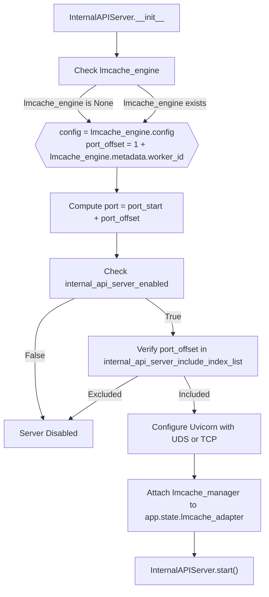
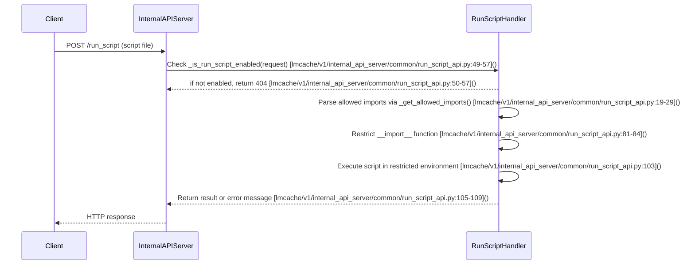
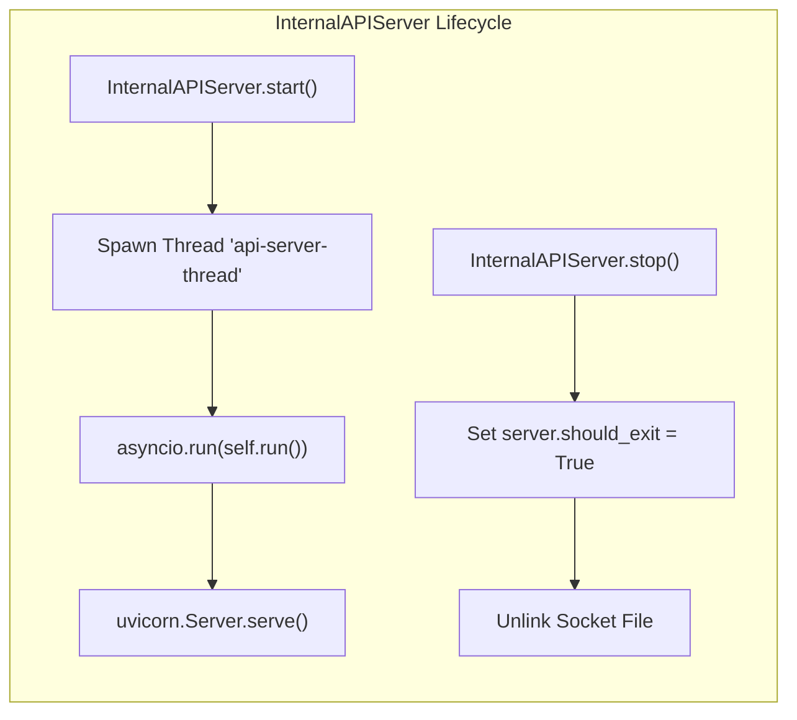

<!-- source: DeepWiki mcp.deepwiki.com · repo LMCache/LMCache · page 9.3 Internal API Server · fetched 2026-10-21 -->

# Internal API Server

<details>
<summary>Relevant source files</summary>

The following files were used as context for generating this wiki page:

- [docs/design/v1/multiprocess/http_api_extension.md](docs/design/v1/multiprocess/http_api_extension.md)
- [docs/design/v1/multiprocess/mp_runtime_plugin.md](docs/design/v1/multiprocess/mp_runtime_plugin.md)
- [docs/source/getting_started/quickstart/standalone_starter.rst](docs/source/getting_started/quickstart/standalone_starter.rst)
- [docs/source/internal_api_server/vllm_apis.rst](docs/source/internal_api_server/vllm_apis.rst)
- [lmcache/integration/vllm/vllm_service_factory.py](lmcache/integration/vllm/vllm_service_factory.py)
- [lmcache/v1/internal_api_server/api_server.py](lmcache/v1/internal_api_server/api_server.py)
- [lmcache/v1/internal_api_server/common/run_script_api.py](lmcache/v1/internal_api_server/common/run_script_api.py)
- [lmcache/v1/internal_api_server/utils.py](lmcache/v1/internal_api_server/utils.py)
- [lmcache/v1/internal_api_server/vllm/bypass_api.py](lmcache/v1/internal_api_server/vllm/bypass_api.py)
- [lmcache/v1/internal_api_server/vllm/cache_api.py](lmcache/v1/internal_api_server/vllm/cache_api.py)
- [lmcache/v1/internal_api_server/vllm/hot_cache_api.py](lmcache/v1/internal_api_server/vllm/hot_cache_api.py)
- [lmcache/v1/internal_api_server/vllm/lookup_api.py](lmcache/v1/internal_api_server/vllm/lookup_api.py)
- [lmcache/v1/manager.py](lmcache/v1/manager.py)
- [lmcache/v1/multiprocess/http_apis/common_api.py](lmcache/v1/multiprocess/http_apis/common_api.py)
- [lmcache/v1/multiprocess/mp_runtime_plugin_launcher.py](lmcache/v1/multiprocess/mp_runtime_plugin_launcher.py)
- [lmcache/v1/standalone/__init__.py](lmcache/v1/standalone/__init__.py)
- [lmcache/v1/standalone/manager.py](lmcache/v1/standalone/manager.py)
- [lmcache/v1/standalone/standalone_service_factory.py](lmcache/v1/standalone/standalone_service_factory.py)
- [lmcache/v1/utils/json_utils.py](lmcache/v1/utils/json_utils.py)
- [lmcache/v1/utils/router_discovery.py](lmcache/v1/utils/router_discovery.py)
- [tests/v1/internal_api_server/test_cache_clear.py](tests/v1/internal_api_server/test_cache_clear.py)
- [tests/v1/internal_api_server/test_hot_cache_api.py](tests/v1/internal_api_server/test_hot_cache_api.py)
- [tests/v1/internal_api_server/test_kvcache_check_api.py](tests/v1/internal_api_server/test_kvcache_check_api.py)
- [tests/v1/internal_api_server/test_lookup_api.py](tests/v1/internal_api_server/test_lookup_api.py)
- [tests/v1/internal_api_server/test_per_instance_app.py](tests/v1/internal_api_server/test_per_instance_app.py)
- [tests/v1/multiprocess/http_apis/__init__.py](tests/v1/multiprocess/http_apis/__init__.py)
- [tests/v1/multiprocess/http_apis/test_common_api.py](tests/v1/multiprocess/http_apis/test_common_api.py)
- [tests/v1/multiprocess/test_http_api_registry.py](tests/v1/multiprocess/test_http_api_registry.py)
- [tests/v1/test_manager.py](tests/v1/test_manager.py)

</details>


## Purpose and Scope

The Internal API Server is a FastAPI-based HTTP server embedded within LMCache to provide management, configuration, cache inspection, health monitoring, and observability endpoints. It facilitates internal operations such as querying cache status, clearing caches, monitoring periodic threads, fetching configuration details, and executing diagnostic scripts remotely in a controlled environment.

This document details the implementation of `InternalAPIServer` [lmcache/v1/internal_api_server/api_server.py:40-134](), its configuration options (`internal_api_server_enabled`), exposed REST endpoints (`/periodic-threads`, `/health`, `/config`, cache APIs), and monitoring interfaces.

Sources:
[lmcache/v1/internal_api_server/api_server.py:40-134]()

---

## Core Architecture and Implementation

The main server controller is the `InternalAPIServer` class, which initializes with a reference to `LMCacheManager` [lmcache/v1/internal_api_server/api_server.py:40-134]().

### Key Implementation Details:

- **Independent FastAPI instances**: Each `InternalAPIServer` instance creates a fresh `FastAPI` app via `_build_app()` with registered API routes. This avoids collisions in state when multiple internal API servers coexist in the same process [lmcache/v1/internal_api_server/api_server.py:25-37]().

- **API route registration**: Routes are automatically discovered and registered by the `APIRegistry` component [lmcache/v1/internal_api_server/api_registry.py:15-52]().

- **Server startup via Uvicorn**: The server uses `uvicorn.Server` configured with `uvloop` and `httptools` for performance [lmcache/v1/internal_api_server/api_server.py:81-108]().

- **App state adapter**: The `lmcache_manager` instance is stored on `app.state.lmcache_adapter` [lmcache/v1/internal_api_server/api_server.py:109]().

- **Background thread execution**: The server runs in a daemon thread named `"api-server-thread"` via `asyncio.run()` [lmcache/v1/internal_api_server/api_server.py:116-125]().

```mermaid
graph TB
    subgraph "Manager Space"
        LMCacheManager["LMCacheManager"]
        LMCacheEngine["LMCacheEngine"]
    end

    subgraph "Server Space"
        InternalAPIServer["InternalAPIServer"]
        FastAPI_app["FastAPI app"]
        APIRegistry["APIRegistry"]
        uvicorn_Server["uvicorn.Server"]
        Daemon_Thread["api-server-thread"]
    end

    subgraph "Endpoints Space"
        conf_api["conf_api.py<br/>/conf, /meta"]
        thread_api["periodic_threads_api.py<br/>/periodic-threads"]
        metrics_api["metrics_api.py<br/>/metrics"]
        loglevel_api["loglevel_api.py<br/>/loglevel"]
        run_script_api["run_script_api.py<br/>/run_script"]
        cache_api["cache_api.py<br/>/cache/*"]
        lookup_api["lookup_api.py<br/>/lookup/*"]
        bypass_api["bypass_api.py<br/>/bypass/*"]
        hot_cache_api["hot_cache_api.py<br/>/hot_cache/*"]
    end

    LMCacheManager -->|"instantiates"| InternalAPIServer
    LMCacheManager -->|"stored in app.state.lmcache_adapter"| FastAPI_app
    LMCacheEngine -->|"supplies config/metadata"| InternalAPIServer

    InternalAPIServer -->|"builds"| FastAPI_app
    InternalAPIServer -->|"invokes register_all_apis"| APIRegistry
    InternalAPIServer -->|"instantiates"| uvicorn_Server
    InternalAPIServer -->|"spawns daemon thread"| Daemon_Thread

    APIRegistry -->|"discovers and includes"| conf_api
    APIRegistry -->|"discovers and includes"| thread_api
    APIRegistry -->|"discovers and includes"| metrics_api
    APIRegistry -->|"discovers and includes"| loglevel_api
    APIRegistry -->|"discovers and includes"| run_script_api
    APIRegistry -->|"discovers and includes"| cache_api
    APIRegistry -->|"discovers and includes"| lookup_api
    APIRegistry -->|"discovers and includes"| bypass_api
    APIRegistry -->|"discovers and includes"| hot_cache_api

    Daemon_Thread -->|"executes asyncio.run(run())"| uvicorn_Server
```



Sources:
[lmcache/v1/internal_api_server/api_server.py:25-134](),
[lmcache/v1/internal_api_server/api_registry.py:15-52](),
[lmcache/v1/internal_api_server/vllm/cache_api.py:25](),
[lmcache/v1/internal_api_server/vllm/lookup_api.py:16](),
[lmcache/v1/internal_api_server/vllm/bypass_api.py:16](),
[lmcache/v1/internal_api_server/vllm/hot_cache_api.py:16]()

---

## Configuration System and Port Assignment

The internal API server is enabled and configured via options in `LMCacheEngineConfig`. The primary enabling flag is `internal_api_server_enabled` [lmcache/v1/internal_api_server/api_server.py:63-77]().

### Port and Socket Binding Logic

- The base port is given by `internal_api_server_port_start` (default 6999).
- Port offset calculation:
  - Scheduler (when `lmcache_engine` is `None`): offset `0` [lmcache/v1/internal_api_server/api_server.py:48]()
  - Worker with `worker_id`: offset = `1 + worker_id` [lmcache/v1/internal_api_server/api_server.py:52]()
- The final port is calculated as:
  ```python
  port = config.internal_api_server_port_start + port_offset
  ```
- Alternatively, if `internal_api_server_socket_path_prefix` is set, the server listens via Unix Domain Sockets at `{socket_path_prefix}_{port}` [lmcache/v1/internal_api_server/api_server.py:56-60]().

### Configuration Options Summary

| Parameter | Type | Description |
|---|---|---|
| `internal_api_server_enabled` | `bool` | Enables the internal API server. Defaults to `False`. |
| `internal_api_server_host` | `str` | Host address to bind the server (e.g., `"127.0.0.1"`). |
| `internal_api_server_port_start` | `int` | Starting port number base. Worker offset added to derive actual port. |
| `internal_api_server_socket_path_prefix` | `str` or `None` | Prefix for Unix domain socket path binding. |
| `internal_api_server_include_index_list` | `List[int]` or `None` | Whitelist of port offsets allowed to run the server. |



Sources:
[lmcache/v1/internal_api_server/api_server.py:40-77]()

---

## API Endpoints and Monitoring Interfaces

The Internal API Server exposes RESTful endpoints grouped into configuration, health monitoring, metrics, cache operations, and script execution.

### 1. Configuration & Metadata APIs
- `GET /conf` (or `/config`): Returns current LMCache configuration settings in JSON [docs/source/internal_api_server/vllm_apis.rst:127-148]().
- `POST /conf`: Updates one or more configuration values at runtime. This is an experimental feature [docs/source/internal_api_server/vllm_apis.rst:150-203]().
- `GET /meta`: Provides engine metadata including worker ID, model name, shape and dtype information [docs/source/internal_api_server/vllm_apis.rst:205-229]().
- `GET /lmc_version`: Get the LMCache library version string [docs/source/internal_api_server/vllm_apis.rst:22-36]().
- `GET /commit_id`: Get the LMCache git commit ID [docs/source/internal_api_server/vllm_apis.rst:39-50]().
- `GET /version`: Get full version info (version + commit ID) [docs/source/internal_api_server/vllm_apis.rst:53-65]().
- `GET /inference_info`: Get inference information including vLLM config and LMCache details [docs/source/internal_api_server/vllm_apis.rst:67-95]().
- `GET /inference_version`: Get the vLLM version information [docs/source/internal_api_server/vllm_apis.rst:98-119]().

### 2. Health and Monitoring APIs
- `GET /health`: Reports component health status and backend availability.
- `GET /periodic-threads`: Lists periodic maintenance threads with their running/active status, last run time, and interval. Supports filtering by severity level (`critical`, `high`, `medium`, `low`) [docs/source/internal_api_server/common_apis.rst:163-178]().
- `GET /metrics`: Exposes Prometheus metrics in standard exposition format [docs/source/internal_api_server/common_apis.rst:103-111]().
- `POST /metrics/reset`: Resets Prometheus metrics counters [docs/source/internal_api_server/common_apis.rst:118-127]().
- `GET /env`: Returns environment variables [docs/source/internal_api_server/common_apis.rst:130-141]().
- `GET /loglevel`: Returns current logging level [docs/source/internal_api_server/common_apis.rst:144-150]().
- `POST /loglevel`: Sets the logging level [docs/source/internal_api_server/common_apis.rst:153-160]().

### 3. Cache Management APIs
- `DELETE /cache/clear`: Clears cached KV data from the LMCache engine. Can be filtered by `locations` and `request_configs` [docs/source/internal_api_server/vllm_apis.rst:234-245](), [tests/v1/internal_api_server/test_cache_clear.py:38-88]().
- `GET /cache/kvcache/check`: Computes and returns checksums of KV cache slots for consistency checks. Supports chunking [lmcache/v1/internal_api_server/vllm/cache_api.py:27-63](), [tests/v1/internal_api_server/test_kvcache_check_api.py:100-151]().
- `GET /cache/kvcache/info`: Provides information about the KV cache, such as total slots, used slots, and free slots [lmcache/v1/internal_api_server/vllm/cache_api.py:65-101]().
- `POST /cache/kvcache/record_slot`: Enables or disables recording of KV cache slot usage [lmcache/v1/internal_api_server/vllm/cache_api.py:103-129]().
- `GET /cache/kvcache/slot_mapping`: Retrieves the current slot mapping [lmcache/v1/internal_api_server/vllm/cache_api.py:131-157]().
- `GET /cache/kvcache/slot_data`: Retrieves raw KV cache data for specified slots [lmcache/v1/internal_api_server/vllm/cache_api.py:159-200]().
- `GET /lookup/info`: Returns information about the lookup client/server configuration [tests/v1/internal_api_server/test_lookup_api.py:78-111]().
- `POST /lookup/close`: Closes the active lookup client or server [tests/v1/internal_api_server/test_lookup_api.py:113-132]().
- `POST /lookup/create`: Creates a new lookup client or server instance [tests/v1/internal_api_server/test_lookup_api.py:134-177]().
- `POST /lookup/recreate`: Recreates the lookup client or server [tests/v1/internal_api_server/test_lookup_api.py:179-200]().
- `GET /bypass/info`: Provides information about the bypass client [lmcache/v1/internal_api_server/vllm/bypass_api.py:27-49]().
- `POST /bypass/enable`: Enables the bypass client [lmcache/v1/internal_api_server/vllm/bypass_api.py:51-73]().
- `POST /bypass/disable`: Disables the bypass client [lmcache/v1/internal_api_server/vllm/bypass_api.py:75-97]().
- `GET /hot_cache/info`: Provides information about the hot cache [lmcache/v1/internal_api_server/vllm/hot_cache_api.py:27-49]().
- `POST /hot_cache/enable`: Enables the hot cache [lmcache/v1/internal_api_server/vllm/hot_cache_api.py:51-73]().
- `POST /hot_cache/disable`: Disables the hot cache [lmcache/v1/internal_api_server/vllm/hot_cache_api.py:75-97]().

### 4. Debug Script Execution
- `POST /run_script`: Executes caller-provided Python code in-process via a sandboxed environment (`_get_allowed_imports`, `_is_run_script_enabled`). Disabled by default [lmcache/v1/internal_api_server/common/run_script_api.py:31-107]().



Sources:
[docs/source/internal_api_server/vllm_apis.rst:22-245](),
[docs/source/internal_api_server/common_apis.rst:103-178](),
[lmcache/v1/internal_api_server/common/run_script_api.py:31-107](),
[lmcache/v1/internal_api_server/vllm/cache_api.py:27-63](),
[lmcache/v1/internal_api_server/vllm/cache_api.py:65-101](),
[lmcache/v1/internal_api_server/vllm/cache_api.py:103-129](),
[lmcache/v1/internal_api_server/vllm/cache_api.py:131-157](),
[lmcache/v1/internal_api_server/vllm/cache_api.py:159-200](),
[lmcache/v1/internal_api_server/vllm/bypass_api.py:27-97](),
[lmcache/v1/internal_api_server/vllm/hot_cache_api.py:27-97](),
[tests/v1/internal_api_server/test_cache_clear.py:38-88](),
[tests/v1/internal_api_server/test_kvcache_check_api.py:100-151](),
[tests/v1/internal_api_server/test_lookup_api.py:78-200]()

---

## Lifecycle Management and Control Methods

`InternalAPIServer` manages its worker threads via two primary control methods:

- **`start()`**: Spawns a daemon thread named `"api-server-thread"` running `asyncio.run(self.run())` with `uvicorn.Server` [lmcache/v1/internal_api_server/api_server.py:116-125]().
- **`stop()`**: Sets `server.should_exit = True` and cleans up Unix socket files if enabled [lmcache/v1/internal_api_server/api_server.py:127-134]().



Sources:
[lmcache/v1/internal_api_server/api_server.py:116-134]()

---

## References and Source Files

- `lmcache/v1/internal_api_server/api_server.py` [lmcache/v1/internal_api_server/api_server.py:25-134]()
- `lmcache/v1/internal_api_server/api_registry.py` [lmcache/v1/internal_api_server/api_registry.py:15-52]()
- `lmcache/v1/internal_api_server/common/run_script_api.py` [lmcache/v1/internal_api_server/common/run_script_api.py:19-109]()
- `lmcache/v1/internal_api_server/vllm/cache_api.py` [lmcache/v1/internal_api_server/vllm/cache_api.py:25-200]()
- `lmcache/v1/internal_api_server/vllm/lookup_api.py` [lmcache/v1/internal_api_server/vllm/lookup_api.py:16]()
- `lmcache/v1/internal_api_server/vllm/bypass_api.py` [lmcache/v1/internal_api_server/vllm/bypass_api.py:16]()
- `lmcache/v1/internal_api_server/vllm/hot_cache_api.py` [lmcache/v1/internal_api_server/vllm/hot_cache_api.py:16]()
- `docs/source/internal_api_server/vllm_apis.rst` [docs/source/internal_api_server/vllm_apis.rst:22-245]()
- `docs/source/internal_api_server/common_apis.rst` [docs/source/internal_api_server/common_apis.rst:103-178]()
- `tests/v1/internal_api_server/test_cache_clear.py` [tests/v1/internal_api_server/test_cache_clear.py:15-120]()
- `tests/v1/internal_api_server/test_kvcache_check_api.py` [tests/v1/internal_api_server/test_kvcache_check_api.py:100-151]()
- `tests/v1/internal_api_server/test_lookup_api.py` [tests/v1/internal_api_server/test_lookup_api.py:78-200]()

---

