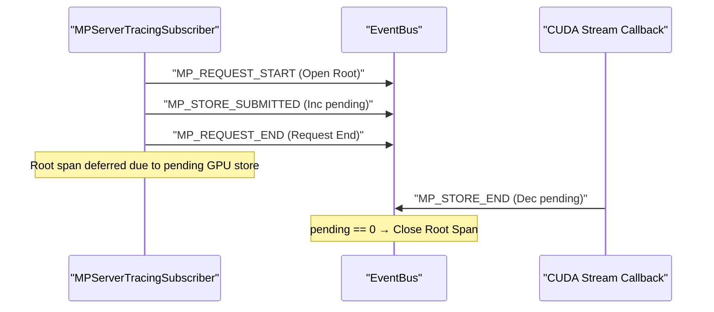
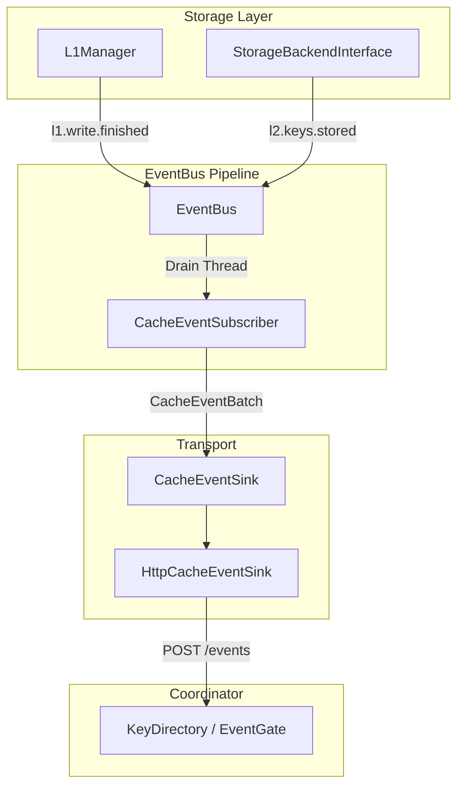
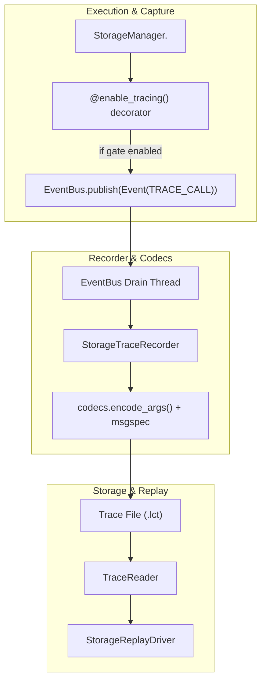

<!-- source: DeepWiki mcp.deepwiki.com · repo LMCache/LMCache · page 9.4 Event Management and Tracing · fetched 2026-10-21 -->

# Event Management and Tracing

<details>
<summary>Relevant source files</summary>

The following files were used as context for generating this wiki page:

- [docs/design/v1/mp_observability/event-bus.md](docs/design/v1/mp_observability/event-bus.md)
- [docs/source/mp/observability/index.rst](docs/source/mp/observability/index.rst)
- [docs/source/mp/tracing_and_debugging.rst](docs/source/mp/tracing_and_debugging.rst)
- [lmcache/v1/mp_observability/README.md](lmcache/v1/mp_observability/README.md)
- [lmcache/v1/mp_observability/event_bus.py](lmcache/v1/mp_observability/event_bus.py)
- [lmcache/v1/mp_observability/otel_init.py](lmcache/v1/mp_observability/otel_init.py)
- [lmcache/v1/mp_observability/subscribers/metrics/event_bus.py](lmcache/v1/mp_observability/subscribers/metrics/event_bus.py)
- [tests/v1/mp_observability/subscribers/logging/test_extra_stats.py](tests/v1/mp_observability/subscribers/logging/test_extra_stats.py)
- [tests/v1/mp_observability/subscribers/logging/test_mp_server.py](tests/v1/mp_observability/subscribers/logging/test_mp_server.py)
- [tests/v1/mp_observability/subscribers/metrics/test_engine.py](tests/v1/mp_observability/subscribers/metrics/test_engine.py)
- [tests/v1/mp_observability/subscribers/metrics/test_event_bus_self_metrics.py](tests/v1/mp_observability/subscribers/metrics/test_event_bus_self_metrics.py)
- [tests/v1/mp_observability/test_config.py](tests/v1/mp_observability/test_config.py)
- [tests/v1/mp_observability/test_event_bus.py](tests/v1/mp_observability/test_event_bus.py)
- [tests/v1/mp_observability/test_event_recorder.py](tests/v1/mp_observability/test_event_recorder.py)
- [tests/v1/mp_observability/test_otel_init.py](tests/v1/mp_observability/test_otel_init.py)

</details>


## Purpose and Scope

The Event Management and Tracing subsystem in LMCache establishes a comprehensive observability and asynchronous operation tracking framework for efficient distributed caching. This subsystem enables monitoring, diagnostics, and debugging at multiple layers:

1.  **EventManager (Async Operation Tracking):** Centralized lifecycle tracking of asynchronous KV storage operations such as loading and prefetching within the distributed storage manager. Maintains event states and supports transitions for long-running operations [lmcache/v1/storage_backend/storage_manager.py:288-309]().

2.  **MP Observability EventBus:** A high-throughput, thread-safe pub/sub event-dispatch system tailored for multiprocess environments. It decouples event producers (engines, storage layers, MP servers) from subscribers (metrics collectors, tracing exporters) via an internal queue and a background drain thread [lmcache/v1/mp_observability/event_bus.py:100-116]().

3.  **OpenTelemetry (OTel) Tracing Subscribers:** Implements subscribers that translate LMCache internal events into OTel spans for distributed tracing, enabling rich hierarchical view of operations. Notable components include `MPServerTracingSubscriber` for vLLM load/store spans and `BlendTracingSubscriber` for Cache Blending operations [lmcache/v1/mp_observability/subscribers/tracing/cb_server.py:1-156](), [lmcache/v1/mp_observability/subscribers/tracing/mp_server.py:1-112]().

4.  **KV Cache Events and Fleet Coordination:** Conversion of low-level storage events into serialized `CacheEventBatch` streams submitted to the MP Coordinator for coordination, fleet-wide replication, and eventual consistency of the cache directory [lmcache/v1/mp_coordinator/cache_events.py:50-120]().

5.  **Trace Recording and Replay:** Facilities to record operational event streams such as `StorageManager` calls and fleet cache events into compact binary trace files (`.lct`) with efficient codec serialization. Enables offline replay (`lmcache trace replay`) and inspection (`lmcache trace info`) for benchmarking, regression analysis, and debugging without GPU or full stack dependencies [docs/source/mp/tracing_and_debugging.rst:1-175]().

6.  **LMCStatsMonitor:** A singleton monitoring utility that tracks detailed per-request statistics for retrieve, store, and lookup phases of the V1 engine, providing latency and throughput metrics [lmcache/observability.py:330-611]().

Sources: [lmcache/v1/storage_backend/storage_manager.py:288-309](), [lmcache/v1/mp_observability/event_bus.py:100-116](), [lmcache/v1/mp_observability/subscribers/tracing/cb_server.py:1-156](), [lmcache/v1/mp_observability/subscribers/tracing/mp_server.py:1-112](), [lmcache/v1/mp_coordinator/cache_events.py:50-120](), [docs/source/mp/tracing_and_debugging.rst:1-175](), [lmcache/observability.py:330-611]()

---

## EventManager System (Async Tracking)

The core `EventManager` orchestrates tracking of asynchronous IO and cache operations within `StorageManager` to achieve fine-grained status coordination.

### Key Concepts

| Symbol | Description | Location |
| :----- | :---------- | :------- |
| `EventManager` | Registry tracking async operation states | `lmcache.v1.storage_backend.storage_manager` |
| `Event` | Represent an async activity instance | `lmcache.v1.storage_backend.storage_manager` |
| `EventStatus` | Enum: `ONGOING`, `DONE`, `NOT_FOUND` | `lmcache.v1.storage_backend.storage_manager` |
| `EventType` | Operation phases (e.g., `LOADING`) | `lmcache.v1.storage_backend.storage_manager` |

### Event State Lifecycle

Async operations like prefetches and loads start with event creation, transition through in-flight (`ONGOING`), and end with terminal states (`DONE` or `NOT_FOUND`). Events are removed when completed or abandoned.

```mermaid
stateDiagram-v2
    direction LR
    state "EventManager" as EM
    [*] --> "create_event(LOADING, id)" as S1
    S1 --> ONGOING
    ONGOING --> "update_event_status(..., DONE)" as S2
    ONGOING --> "update_event_status(..., NOT_FOUND)" as S3
    S2 --> "remove_event(...)" as S4
    S4 --> [*]
    S3 --> [*]
```

**Diagram: Event Status State Machine**

Sources: [lmcache/v1/storage_backend/storage_manager.py:288-309](), [lmcache/v1/storage_backend/storage_manager.py:560-629]()

---

## Multiprocess Observability EventBus

The `EventBus` subsystem provides a flexible, in-process pub/sub queue that asynchronously dispatches observability events produced by core modules to multiple subscribers, including those exporting OpenTelemetry metrics and trace spans.

### Architecture and Key Components

-   **EventBusConfig:** Controls whether the bus is enabled and the max event queue size (default 10,000) [lmcache/v1/mp_observability/event_bus.py:47-61]().
-   **Event:** Immutable data objects with event type, timestamp, session_id, and metadata [lmcache/v1/mp_observability/event.py:14-170]().
-   **EventSubscriber:** Abstract base for components that subscribe to specific event types [lmcache/v1/mp_observability/event_bus.py:68-93]().
-   **Publishers:** Components like `L1Manager`, `StorageManager`, and `MPCacheServer` produce events [lmcache/v1/mp_observability/event_bus.py:100-191]().
-   **Drain Thread:** A dedicated thread pops events off the internal deque and dispatches them to subscribers, decoupling producers from potentially slow consumers [lmcache/v1/mp_observability/event_bus.py:100-116]().
-   **Tail-Drop Backpressure:** If the queue is full, new events are dropped silently to avoid backpressure stalls or memory bloat [docs/design/v1/mp_observability/event-bus.md:98-100]().
-   **CUDA Stream Host Functions:** GPU stream events can be published asynchronously using `cudaLaunchHostFunc` native callbacks to avoid GIL and CUDA driver deadlocks [lmcache/v1/mp_observability/event_bus.py:184-191]().

```mermaid
graph TD
    subgraph "Producers"
        L1Manager["L1Manager"]
        StorageManager["StorageManager"]
        MPCacheServer["MPCacheServer"]
    end

    subgraph "EventBus Core [lmcache/v1/mp_observability/event_bus.py]"
        publish["EventBus.publish()"]
        publish_on_stream["EventBus.publish_on_stream()"]
        deque["collections.deque"]
        drain["EventBus._run() (Drain Thread)"]
    end

    subgraph "Subscribers [EventSubscriber]"
        L1Metrics["LookupMetricsSubscriber"]
        MPTracing["MPServerTracingSubscriber"]
        BlendTracing["BlendTracingSubscriber"]
    end

    L1Manager -->|publish(Event)| publish
    StorageManager -->|publish(Event)| publish
    MPCacheServer -->|publish_on_stream()| publish_on_stream
    publish_on_stream -->|CUDA Host Callback| publish
    publish -->|append| deque
    deque -->|popleft| drain
    drain -->|callback(event)| L1Metrics
    drain -->|callback(event)| MPTracing
    drain -->|callback(event)| BlendTracing
```

**Diagram: EventBus Code Entity Flow**

Sources: [lmcache/v1/mp_observability/event_bus.py:100-191](), [docs/design/v1/mp_observability/event-bus.md:10-33]()

### Event Data Model

-   Events carry an `EventType` enum value categorizing system operations (`L1_READ_FINISHED`, `SM_WRITE_FINISHED`, `MP_LOOKUP`, etc.) [lmcache/v1/mp_observability/event.py:14-170]().
-   Each event has a `session_id` for cross-cutting correlation across async operations [lmcache/v1/mp_observability/event.py:14-170]().
-   `metadata` is a flat dictionary (string keys, int/str values) supplying additional details [lmcache/v1/mp_observability/event.py:14-170]().
-   Timestamps are assigned at publication time to maintain accurate timeline ordering [docs/design/v1/mp_observability/event-bus.md:53-66]().

Sources: [lmcache/v1/mp_observability/event.py:14-170](), [docs/design/v1/mp_observability/event-bus.md:53-66]()

---

## OpenTelemetry Tracing Subscribers and Root Spans

LMCache integrates with OpenTelemetry to convert its internal event streams into detailed, standardized spans for distributed tracing.

### Key Subscribers

-   **MPServerTracingSubscriber:** Listens for high-level MP request events such as store and retrieve phases, creating per-request root spans (`"request"`) with child spans (`mp.store`, `mp.retrieve`, `mp.lookup_prefetch`) tagged for load/store operations [lmcache/v1/mp_observability/subscribers/tracing/mp_server.py:39-112](), [docs/design/observability/request-event-span.md:1-59]().

-   **BlendTracingSubscriber:** Dedicated to the Cache Blending (CB) subsystem, creates hierarchical OTel spans per blend request session (`"cb.request"`), managing nested spans for lookup, retrieve, scatter, and sub-phases [lmcache/v1/mp_observability/subscribers/tracing/cb_server.py:51-140]().

### Per-Request Root Spans and Deferral Protocol

Each session is wrapped in a per-request root span (`"request"` for standard MP path and `"cb.request"` for CacheBlend) that nests all child spans. Because certain operations involve asynchronous GPU work, root spans are opened eagerly at session start (`MP_REQUEST_START` / `CB_REQUEST_START`) but are held open until all pending GPU store/retrieve callbacks complete [lmcache/v1/mp_observability/subscribers/tracing/mp_server.py:140-167](), [docs/design/observability/request-event-span.md:32-58]().



**Diagram: Root Span Deferral Logic**

Sources: [lmcache/v1/mp_observability/subscribers/tracing/mp_server.py:39-167](), [docs/design/observability/request-event-span.md:1-59]()

---

## Metrics and Hit-Rate Attribution Subscribers

Observability subscribers translate high-frequency event streams into Prometheus-compatible OTel metrics.

### LookupMetricsSubscriber

Maintains OTel counters for L1+L2 token-level cache hit rates, driven by `MP_LOOKUP_PREFETCH_END` [lmcache/v1/mp_observability/subscribers/metrics/lookup.py:56-148]().
-   `lmcache_mp.lookup_requested`: Chunk-aligned tokens submitted for lookup (denominator).
-   `lmcache_mp.lookup_hit`: Tokens found in L1+L2 (numerator).
-   `lmcache_mp.lookup_hit_l1` / `lookup_hit_l2`: Partitioned token counts by storage tier.
-   `lmcache_mp.lookup_early_exit`: Lookups exiting before cache probes, labeled by `reason`.

### BlendMetricsSubscriber

Maintains OTel counters and duration histograms for cache blending operations (`lmcache_blend.*`), measuring wall-clock durations of sub-legs like fingerprint matching, prefix lookup, coordinator match, sparse prefetch, and scatter [lmcache/v1/mp_observability/subscribers/metrics/cb_server.py:35-124]().

### EngineMetricsSubscriber

Tracks the number of chunks loaded into the engine via `MP_RETRIEVE_END` events. This metric is tagged by `worker_id`, `model_name`, and `cache_salt` [lmcache/v1/mp_observability/subscribers/metrics/engine.py:69]().

### EventBusSelfMetricsSubscriber

Monitors the health of the `EventBus` itself, exposing gauges for `queue_depth`, `drain_lag_seconds`, and counters for `dropped_events_total` and `subscriber_exceptions_total` [lmcache/v1/mp_observability/subscribers/metrics/event_bus.py:35-61]().

Sources: [lmcache/v1/mp_observability/subscribers/metrics/lookup.py:56-148](), [lmcache/v1/mp_observability/subscribers/metrics/cb_server.py:35-124](), [lmcache/v1/mp_observability/subscribers/metrics/engine.py:69](), [lmcache/v1/mp_observability/subscribers/metrics/event_bus.py:35-61]()

---

## KV Cache Events and Fleet Coordination

Distributed cache consistency is maintained by converting local storage events into cache-event batches streamed to the fleet coordinator.

### Components and Data Flow

-   **Storage Layer:** `L1Manager` and `StorageBackendInterface` instances generate cache update events after read/write/delete operations [lmcache/v1/mp_coordinator/cache_events.py:50-120]().
-   **EventBus:** These events are published to the observability bus [lmcache/v1/mp_coordinator/cache_events.py:50-120]().
-   **CacheEventSubscriber:** Registered on the EventBus, this subscriber translates raw events into `CacheEventBatch` formats for transport [lmcache/v1/mp_coordinator/cache_events.py:50-120]().
-   **CacheEventSink:** Abstracts delivery mechanisms, e.g., HTTP transport [lmcache/v1/mp_coordinator/cache_events.py:50-120]().
-   **MP Coordinator:** Receives these event batches via REST endpoints, updating global cache directory and metadata [lmcache/v1/mp_coordinator/cache_events.py:50-120]().



**Diagram: Cache Event Emission Data Flow**

Sources: [lmcache/v1/mp_coordinator/cache_events.py:50-120](), [docs/design/v1/mp_coordinator/cache_events.md:1-110]()

---

## Trace Recording and Replay (`lmcache trace`)

Trace capture allows recording LMCache operational streams to binary files for offline inspection and replay. Replay runs recorded workloads deterministically without requiring GPUs or the full server stack [docs/source/mp/tracing_and_debugging.rst:109-138]().

### Architecture Overview

1.  **Decorator (`@enable_tracing`):** Wraps `StorageManager` API calls, emitting a single unified event `TRACE_CALL` with method qualifier and call arguments at entry time [docs/source/mp/tracing_and_debugging.rst:49-64]().
2.  **EventBus Pipeline:** Recorded events flow through the EventBus drain thread [docs/source/mp/tracing_and_debugging.rst:74-78]().
3.  **Trace Recorder:** Subscribers encode event arguments via codecs and write msgpack-framed binary records into `.lct` files [docs/source/mp/tracing_and_debugging.rst:74-78]().
4.  **Replay Driver:** Reads trace files using `TraceReader` and reissues storage operations respecting recorded inter-call timings [docs/source/mp/tracing_and_debugging.rst:134-138]().



**Diagram: Trace Capture and Replay Pipeline**

Sources: [docs/source/mp/tracing_and_debugging.rst:49-78](), [lmcache/cli/commands/trace/__init__.py:1-24]()

### Trace Levels and CLI Integration

-   `--trace-level storage`: Captures `StorageManager` public API calls [docs/source/mp/tracing_and_debugging.rst:30-38]().
-   `--trace-output`: Specifies the output path for the trace file [docs/source/mp/tracing_and_debugging.rst:30-38]().

CLI subcommands under `lmcache trace` include `info`, `replay`, and `replay-events` [docs/source/mp/tracing_and_debugging.rst:81-175](), [lmcache/cli/commands/trace/__init__.py:1-24]().

Sources: [docs/source/mp/tracing_and_debugging.rst:1-175](), [lmcache/cli/commands/trace/__init__.py:1-24]()

---

## OpenTelemetry SDK Initialization

The OpenTelemetry SDK is initialized based on the `ObservabilityConfig` [lmcache/v1/mp_observability/otel_init.py:55-138]().

-   **OTLP Push Mode:** If `otlp_endpoint` is set, metrics and traces are pushed to an OTel collector via `OTLPMetricExporter` [lmcache/v1/mp_observability/otel_init.py:88-108]().
-   **Prometheus Pull Mode:** If `otlp_endpoint` is `None`, metrics are served on a local `/metrics` endpoint via `PrometheusMetricReader` and `prometheus_client.start_http_server` [lmcache/v1/mp_observability/otel_init.py:110-138]().
-   **gRPC Metrics:** `init_grpc_otel_metrics` registers gRPC Python's OpenTelemetry metrics plugin if `enable_grpc_metrics` is true and `grpcio-observability` is installed (Linux only) [lmcache/v1/mp_observability/otel_init.py:140-177]().

Tracing requires an OTLP endpoint; there is no local fallback for spans [docs/source/mp/observability/index.rst:55-64]().

Sources: [lmcache/v1/mp_observability/otel_init.py:55-177](), [docs/source/mp/observability/index.rst:55-64]()

---

# References

-   `lmcache/v1/storage_backend/storage_manager.py:288-309,560-629`
-   `lmcache/v1/mp_observability/event_bus.py:100-191`
-   `lmcache/v1/mp_observability/subscribers/tracing/mp_server.py:39-112`
-   `lmcache/v1/mp_observability/subscribers/tracing/cb_server.py:51-140`
-   `lmcache/v1/mp_observability/subscribers/metrics/lookup.py:56-148`
-   `lmcache/v1/mp_observability/subscribers/metrics/cb_server.py:35-124`
-   `lmcache/v1/mp_observability/subscribers/metrics/engine.py:111-180`
-   `lmcache/v1/mp_observability/subscribers/metrics/event_bus.py:35-100`
-   `lmcache/v1/mp_coordinator/cache_events.py:50-120`
-   `docs/source/mp/tracing_and_debugging.rst:1-175`
-   `lmcache/cli/commands/trace/__init__.py:1-24`
-   `lmcache/observability.py:330-611`
-   `lmcache/v1/mp_observability/otel_init.py:55-177`
-   `docs/source/mp/observability/index.rst:55-64`

---

