# Page: Overview

# Overview

<details>
<summary>Relevant source files</summary>

The following files were used as context for generating this wiki page:

- [README.md](README.md)
- [docs/source/_static/custom.css](docs/source/_static/custom.css)
- [docs/source/_static/custom.js](docs/source/_static/custom.js)
- [docs/source/_templates/versioning.html](docs/source/_templates/versioning.html)
- [docs/source/api_reference/multimodality.rst](docs/source/api_reference/multimodality.rst)
- [docs/source/community/blogs.rst](docs/source/community/blogs.rst)
- [docs/source/community/faq.rst](docs/source/community/faq.rst)
- [docs/source/community/index.rst](docs/source/community/index.rst)
- [docs/source/community/meetings.rst](docs/source/community/meetings.rst)
- [docs/source/conf.py](docs/source/conf.py)
- [docs/source/getting_started/quickstart/index.rst](docs/source/getting_started/quickstart/index.rst)
- [docs/source/getting_started/quickstart/multimodality.rst](docs/source/getting_started/quickstart/multimodality.rst)
- [docs/source/getting_started/quickstart/offload_kv_cache.rst](docs/source/getting_started/quickstart/offload_kv_cache.rst)
- [docs/source/index.rst](docs/source/index.rst)
- [docs/source/llms.txt](docs/source/llms.txt)
- [docs/source/locale/zh_CN/LC_MESSAGES/community/faq.po](docs/source/locale/zh_CN/LC_MESSAGES/community/faq.po)
- [docs/source/locale/zh_CN/LC_MESSAGES/community/index.po](docs/source/locale/zh_CN/LC_MESSAGES/community/index.po)
- [requirements/docs.txt](requirements/docs.txt)
- [requirements/lint.txt](requirements/lint.txt)

</details>


## Purpose and Scope

This document provides a high-level introduction to LMCache, explaining its role in the LLM inference stack, core architectural components, and operational principles. It is intended to orient new users and developers to the system before diving into specific subsystems.

For detailed information on installation, quickstart examples, and basic configuration, see [Getting Started](#1.1) [docs/source/getting_started/quickstart.rst:1-155](). For documentation on the command-line interface, available subcommands, and usage patterns, see [CLI Reference](#1.2). For deep dives into storage backends, integration with serving engines, and configuration, refer to the respective child pages.

Sources: [README.md:51-56](), [docs/source/index.rst:20-21](), [docs/source/getting_started/quickstart.rst:1-155]()

## What is LMCache?

LMCache is a **KV cache management layer** for LLM inference [README.md:53-53](). It transforms the typically transient key-value (KV) cache generated during LLM inference into reusable, persistent **AI-native knowledge** that can be stored, monitored, and shared across multiple serving engine instances [README.md:53-56](). 

LMCache decouples KV cache management from specific inference engines by operating as an independent server process (`lmcache server`) [docs/source/getting_started/quickstart.rst:46-49](). This isolation eliminates fate-sharing—meaning cache survives engine crashes or restarts—and facilitates KV cache reuse across engine instances and requests with overlapping context [README.md:67-67](), [README.md:75-76]().

The primary benefits of LMCache include **reduced time-to-first-token (TTFT)** and **improved throughput** for workloads with long contexts, agentic multi-turn dialogue, or retrieval-augmented generation (RAG) patterns [README.md:53-54]().

### Key Features

- **Engine-independent deployment**: LMCache runs as a standalone daemon managing KV caches without dependency on the inference engine process [README.md:67-67](), [docs/source/getting_started/quickstart.rst:46-49]().

- **Persistent, tiered KV cache storage**: Offloads KV caches from GPU memory to a multi-tier hierarchy including CPU RAM, local disk, and various remote storage backends, enabling efficient reuse over requests, sessions, and different engine instances [README.md:69-70]().

- **Production-quality observability**: Implements a comprehensive observability stack with Kubernetes-compatible metrics, request and token-level cache hits, lifecycle tracking, and user-specific usage monitoring [README.md:71-72]().

- **Flexible, pluggable backends**: Supports diverse storage backends such as CPU RAM, SSD local storage, Redis/Valkey, Mooncake, InfiniStore, S3-compatible storage, NIXL, and NVIDIA GDS through unified interfaces [README.md:73-74]().

- **Non-prefix KV reuse**: Goes beyond traditional prefix caching by reusing cached KV blocks at arbitrary prompt positions, using the CacheBlend mechanism to selectively recompute tokens for quality and correctness [README.md:75-76]().

- **Disaggregated prefill and KV transfer**: Enables KV cache transfer between prefill and decode workers over high-speed interconnects (NVLink, RDMA) or TCP via transport layers like NIXL [README.md:77-78]().

- **Pluggable KV transformations (SERDE)**: Provides flexible serialization/deserialization interfaces to implement compression, token dropping, and custom KV cache formats [README.md:79]().

- **Multimodal model support**: Extends caching beyond language models to audio, image, and video encoders integrated in engines like vLLM V1 [README.md:46]().

Sources: [README.md:31-80](), [docs/source/index.rst:57-70](), [docs/source/getting_started/quickstart.rst:46-49]()

## System Architecture Overview

The system architecture of LMCache bridges the gap between high-level serving engines and low-level storage and GPU memory management. The following diagrams map natural language concepts and system components to concrete code entities and files to aid developers in navigating the codebase.

### Diagram: LMCache Component Architecture
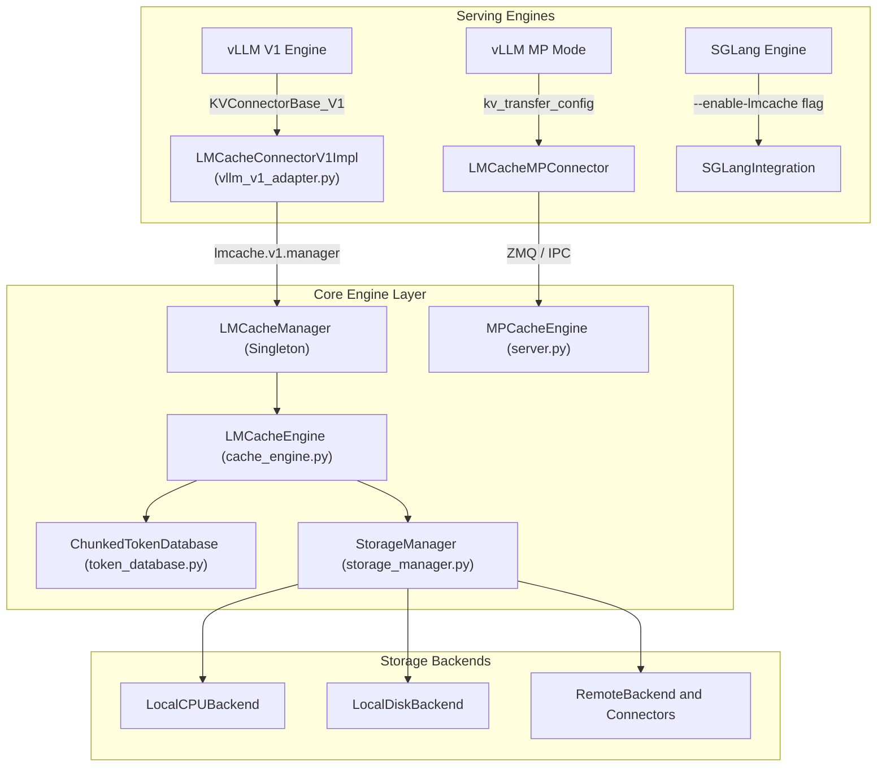
Sources: [README.md:67-74](), [docs/source/index.rst:57-70](), [docs/source/getting_started/quickstart.rst:23-29]()

### Diagram: Serving Engine Request Lifecycle (High-Level)
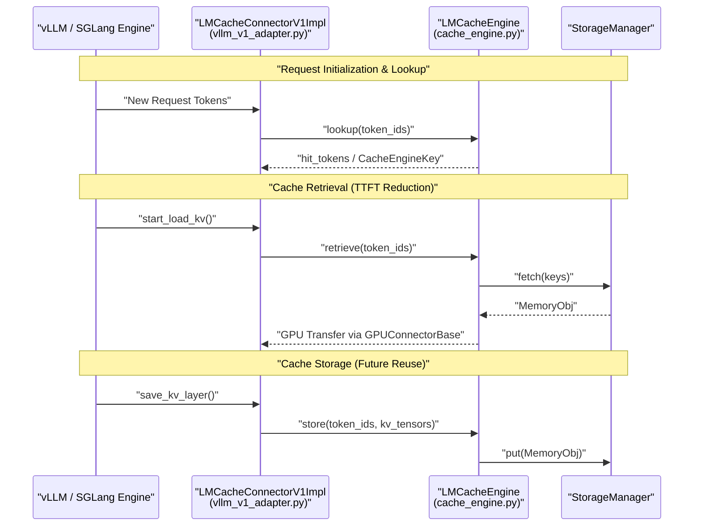
Sources: [README.md:33-75](), [docs/source/getting_started/quickstart/offload_kv_cache.rst:54-64](), [docs/source/getting_started/quickstart/offload_kv_cache.rst:157-164](), [docs/source/getting_started/quickstart.rst:21-29]()

## Core Components

- **LMCacheEngine**: Managed via `LMCacheEngine` (`lmcache.v1.cache_engine`), handling in-process KV cache operations, token chunking, and storage backend interaction [docs/source/getting_started/quickstart/offload_kv_cache.rst:89-92]().
- **Token Database and Chunking**: `ChunkedTokenDatabase` breaks token sequences into fixed-size chunks (default 256 tokens) [docs/source/getting_started/quickstart/offload_kv_cache.rst:40-40](); `SegmentTokenDatabase` supports separator-based splitting for non-prefix reuse [README.md:75]().
- **Storage Manager and Backends**: Coordinated by `StorageManager`, spanning `LocalCPUBackend`, `LocalDiskBackend`, and `RemoteBackend` plugins [README.md:69-74](), [docs/source/getting_started/quickstart/offload_kv_cache.rst:42-42]().

Sources: [README.md:69-74](), [docs/source/getting_started/quickstart/offload_kv_cache.rst:40-42](), [docs/source/getting_started/quickstart/offload_kv_cache.rst:89-92]()

## Integration with Serving Engines and Getting Started

LMCache supports vLLM (in-process `LMCacheConnectorV1` and multi-process `LMCacheMPConnector`), SGLang via `--enable-lmcache`, and TensorRT-LLM [README.md:55-56](), [docs/source/getting_started/quickstart.rst:23-29](). 

For comprehensive installation instructions, quickstart workflows, Docker containers, ROCm support, and vLLM version compatibility matrices, please review [Getting Started](#1.1). For details on the command-line interface tools, subcommands (`mock`, `metrics`, `bench`, `kvcache`, `query`, `describe`, `trace`, `server`, `coordinator`, `tool`), and execution options, see the [CLI Reference](#1.2).

Sources: [README.md:55-56](), [docs/source/getting_started/quickstart.rst:1-155]()

---

# Page: Getting Started

# Getting Started

<details>
<summary>Relevant source files</summary>

The following files were used as context for generating this wiki page:

- [.buildkite/k3_harness/resolve-pinned-sglang.sh](.buildkite/k3_harness/resolve-pinned-sglang.sh)
- [.buildkite/k3_tests/multiprocess/README.md](.buildkite/k3_tests/multiprocess/README.md)
- [.buildkite/k3_tests/multiprocess/scripts/engines/sglang.sh](.buildkite/k3_tests/multiprocess/scripts/engines/sglang.sh)
- [.github/scripts/pin-tested-sglang.sh](.github/scripts/pin-tested-sglang.sh)
- [.github/workflows/build_sglang_image.yml](.github/workflows/build_sglang_image.yml)
- [docker/Dockerfile](docker/Dockerfile)
- [docker/Dockerfile.sglang](docker/Dockerfile.sglang)
- [docker/Dockerfile.standalone](docker/Dockerfile.standalone)
- [docker/README.md](docker/README.md)
- [docker/example_run.sh](docker/example_run.sh)
- [docs/design/integration/sglang/assets/unified-radix-cache-runtime-flow.svg](docs/design/integration/sglang/assets/unified-radix-cache-runtime-flow.svg)
- [docs/design/integration/sglang/lmcache-unified-radix-cache.md](docs/design/integration/sglang/lmcache-unified-radix-cache.md)
- [docs/source/getting_started/installation.rst](docs/source/getting_started/installation.rst)
- [docs/source/getting_started/quickstart.rst](docs/source/getting_started/quickstart.rst)
- [docs/source/production/docker_deployment.rst](docs/source/production/docker_deployment.rst)
- [examples/sgl_integration/README.md](examples/sgl_integration/README.md)

</details>


## Purpose and Scope

This page provides a comprehensive guide for new users to install, configure, and quickly run LMCache. It covers installation options including PyPI pip installs and Docker images, with special attention to hardware-specific variants such as ROCm, Intel XPU, and Moore Threads MUSA [docs/source/getting_started/installation.rst:6-143](). You will learn how to launch LMCache with the recommended Multiprocess (MP) server mode and the alternative in-process mode for vLLM integration [docs/source/getting_started/quickstart.rst:23-29](). The page also includes configuration highlights, architecture data flows mapped to code modules, and a compatibility matrix detailing LMCache support across different vLLM versions and hardware platforms [docs/source/getting_started/installation.rst:17-126]().

Sources: [docs/source/getting_started/quickstart.rst:1-29](), [docs/source/getting_started/installation.rst:6-143]()

---

## Installation Guide

LMCache supports Linux with Python 3.9–3.13 and a variety of hardware accelerators including NVIDIA (Compute 7.0+), AMD Instinct (ROCm-enabled), Intel GPU/XPU, and Moore Threads MUSA [docs/source/getting_started/installation.rst:6-143]().

### Prerequisites

- **Operating System:** Linux
- **Python:** Version 3.9 to 3.13 [docs/source/getting_started/installation.rst:6]()
- **Hardware:**
  - NVIDIA GPUs with Compute Capability >= 7.0 (e.g., T4, A100, H100) [docs/source/getting_started/installation.rst:6]()
  - AMD GPUs with ROCm support (gfx942 for MI300X/MI325X, gfx950 for MI350X/MI355X) [docs/source/getting_started/installation.rst:69-70]()
  - Intel XPU accelerators [docs/source/getting_started/installation.rst:101-104]()
  - Moore Threads MUSA GPUs [docs/source/getting_started/installation.rst:137-140]()
- **Package Manager:** `uv` is recommended for virtual environment and dependency management [docs/source/getting_started/installation.rst:6]()

### Standard Installation

Install LMCache with vLLM and dependencies using `uv` or pip for an NVIDIA CUDA environment [docs/source/getting_started/quickstart.rst:17-19]():

```bash
uv venv --python 3.12
source .venv/bin/activate
uv pip install lmcache vllm
```

Optionally, add NIXL support (for disaggregated prefill and P2P sharing):

```bash
uv pip install lmcache[nixl]
```

To target specific CUDA versions (such as CUDA 12.9), refer to the GitHub releases [docs/source/getting_started/installation.rst:46-60]():

```bash
VERSION=0.4.3
uv venv --python 3.12
source .venv/bin/activate
uv pip install lmcache==${VERSION} \
    --extra-index-url https://download.pytorch.org/whl/cu129 \
    --find-links https://github.com/LMCache/LMCache/releases/expanded_assets/v${VERSION}-cu129 \
    --index-strategy unsafe-best-match
```

### ROCm and Hardware-Specific Wheels

- **ROCm (AMD Instinct GPUs):** Published on GitHub releases and ABI compatible with upstream vLLM ROCm images [docs/source/getting_started/installation.rst:67-73]():

```bash
docker run -it --device /dev/kfd --device /dev/dri \
    --group-add video --security-opt seccomp=unconfined \
    --entrypoint bash vllm/vllm-openai-rocm:v0.25.0

VERSION=0.5.3
pip install lmcache==${VERSION}+rocm7.2 --no-deps \
    --find-links https://github.com/LMCache/LMCache/releases/expanded_assets/v${VERSION}-rocm
```

- **Intel XPU:** ABI-matched wheels for Intel GPUs running on associated vLLM XPU container images [docs/source/getting_started/installation.rst:101-119]():

```bash
docker run -it --device /dev/dri --shm-size=4g \
    --entrypoint bash vllm/vllm-openai-xpu:v0.26.0

VERSION=0.5.3
pip install lmcache==${VERSION}+xpu --no-deps \
    --no-index \
    --find-links https://github.com/LMCache/LMCache/releases/expanded_assets/v${VERSION}-xpu
```

- **Moore Threads MUSA:** Distributed via GitHub Releases due to specialized SDK distribution requirements [docs/source/getting_started/installation.rst:137-144]().

Sources: [docs/source/getting_started/installation.rst:6-144](), [docs/source/getting_started/quickstart.rst:17-19]()

---

## Quickstart Examples

LMCache integrates with inference engines through dedicated connector mechanisms.

### 1. Multiprocess (MP) Mode — Recommended

In MP mode, LMCache runs as a standalone server daemon handling KV cache requests asynchronously from the inference engine via `LMCacheMPConnector` [docs/source/getting_started/quickstart.rst:23-26]().

**Start the LMCache server:** [docs/source/getting_started/quickstart.rst:47-49]()
```bash
lmcache server \
    --host localhost --port 5555 \
    --l1-size-gb 20 --eviction-policy LRU --chunk-size 16
```

**Start vLLM with the MP connector:** [docs/source/getting_started/quickstart.rst:67-69]()
```bash
vllm serve Qwen/Qwen3-8B \
    --port 8000 --kv-transfer-config \
    '{"kv_connector":"LMCacheMPConnector", "kv_role":"kv_both", "kv_connector_extra_config": {"lmcache.mp.host": "localhost", "lmcache.mp.port": 5555}}'
```

### 2. In-Process Mode

LMCache runs embedded inside the inference engine process via `LMCacheConnectorV1` [docs/source/getting_started/quickstart.rst:27-29]():

```bash
vllm serve Qwen/Qwen3-8B \
    --kv-transfer-config '{"kv_connector":"LMCacheConnectorV1","kv_role":"kv_both"}'
```

Sources: [docs/source/getting_started/quickstart.rst:23-69]()

---

## Basic Configuration Reference

Configuration options can be specified via YAML files or environment variables [docs/source/getting_started/quickstart.rst:109-138]().

| YAML Key          | Environment Variable      | Default | Description                              |
|-------------------|---------------------------|---------|------------------------------------------|
| `chunk_size`      | `LMCACHE_CHUNK_SIZE`       | 256     | Number of tokens per chunk in cache hashing [docs/source/getting_started/quickstart/offload_kv_cache.rst:39-40]() |
| `local_cpu`       | `LMCACHE_LOCAL_CPU`         | False   | Enable local CPU RAM storage backend [docs/source/getting_started/quickstart/offload_kv_cache.rst:41-42]() |
| `max_local_cpu_size`| `LMCACHE_MAX_LOCAL_CPU_SIZE`| N/A     | Maximum CPU RAM size in GB [docs/source/getting_started/quickstart/offload_kv_cache.rst:43-44]() |
| `remote_url`      | `LMCACHE_REMOTE_URL`        | N/A     | URL for remote storage backend           |

Sources: [docs/source/getting_started/quickstart/offload_kv_cache.rst:39-44]()

---

## Docker Deployment

LMCache provides multiple Docker images catering to different deployment topologies [docker/README.md:5-158]():
- `lmcache/vllm-openai:latest`: Full integration with vLLM and NIXL support [docker/README.md:7-13]()
- `lmcache/standalone:latest`: Standalone LMCache server daemon image [docker/README.md:71-76]()
- `lmcache/vllm-openai:lightweight`: Quick setup using PyPI wheels [docker/README.md:112-117]()

Example container execution:
```bash
docker run --runtime nvidia --gpus all \
  --ipc=host \
  lmcache/vllm-openai:latest \
  Qwen/Qwen3-8B \
  --kv-transfer-config \
  '{"kv_connector":"LMCacheConnectorV1","kv_role":"kv_both"}'
```

Sources: [docker/README.md:5-158]()

---

## Architecture and Data Flow

### Diagram: LMCache KV Cache Data Flow Architecture

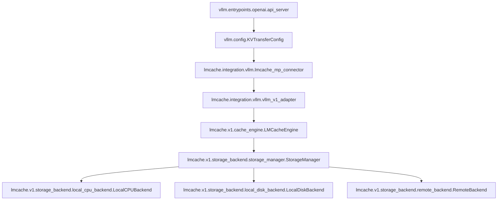
Sources: [docs/source/getting_started/quickstart.rst:23-67](), [docs/source/index.rst:54-70]()

### Diagram: Component Lifecycle and Code Entity Mapping

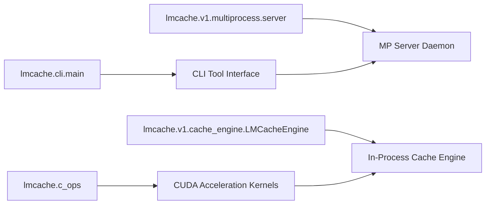
Sources: [docs/source/getting_started/quickstart.rst:46-48](), [docs/source/getting_started/quickstart.rst:152-155]()

---

## vLLM Compatibility Matrix

| Target                  | Status     | Notes                                                                                      |
|-------------------------|------------|--------------------------------------------------------------------------------------------|
| **vLLM v1 (CUDA)**      | ✅ Production | Primary integration via `LMCacheConnectorV1` and `LMCacheMPConnector` [docs/source/getting_started/quickstart.rst:21-29]() |
| **vLLM ROCm**           | ✅ Validated | Supported on AMD MI300X GPUs using ROCm builds [docs/source/getting_started/installation.rst:67-73]() |
| **vLLM XPU**            | ✅ Validated | Supports Intel GPUs with XPU wheels and containers [docs/source/getting_started/installation.rst:101-119]() |
| **vLLM Nightly**        | ✅ Supported | Builds daily against development branches for continuous validation [docker/Dockerfile:72]() |

Sources: [docs/source/getting_started/installation.rst:17-126](), [docker/Dockerfile:72](), [docs/source/getting_started/quickstart.rst:21-29]()

---

# Page: CLI Reference

# CLI Reference

<details>
<summary>Relevant source files</summary>

The following files were used as context for generating this wiki page:

- [docs/design/cli/commands.md](docs/design/cli/commands.md)
- [docs/design/cli/commands/describe.md](docs/design/cli/commands/describe.md)
- [docs/design/cli/commands/kvcache-command.md](docs/design/cli/commands/kvcache-command.md)
- [docs/design/cli/commands/query-command.md](docs/design/cli/commands/query-command.md)
- [docs/design/cli/framework-and-metrics.md](docs/design/cli/framework-and-metrics.md)
- [docs/source/cli/describe.rst](docs/source/cli/describe.rst)
- [docs/source/cli/index.rst](docs/source/cli/index.rst)
- [docs/source/cli/kvcache.rst](docs/source/cli/kvcache.rst)
- [docs/source/cli/query.rst](docs/source/cli/query.rst)
- [docs/source/developer_guide/cli.rst](docs/source/developer_guide/cli.rst)
- [examples/serde/fp8/run_serde_fp8_example.sh](examples/serde/fp8/run_serde_fp8_example.sh)
- [lmcache/cli/__init__.py](lmcache/cli/__init__.py)
- [lmcache/cli/commands/__init__.py](lmcache/cli/commands/__init__.py)
- [lmcache/cli/commands/base.py](lmcache/cli/commands/base.py)
- [lmcache/cli/commands/bench/__init__.py](lmcache/cli/commands/bench/__init__.py)
- [lmcache/cli/commands/describe.py](lmcache/cli/commands/describe.py)
- [lmcache/cli/commands/kvcache.py](lmcache/cli/commands/kvcache.py)
- [lmcache/cli/commands/mock.py](lmcache/cli/commands/mock.py)
- [lmcache/cli/commands/ping.py](lmcache/cli/commands/ping.py)
- [lmcache/cli/commands/query/_coordinator.py](lmcache/cli/commands/query/_coordinator.py)
- [lmcache/cli/commands/query/_request.py](lmcache/cli/commands/query/_request.py)
- [lmcache/cli/commands/query/coordinator_command.py](lmcache/cli/commands/query/coordinator_command.py)
- [lmcache/cli/http.py](lmcache/cli/http.py)
- [lmcache/cli/main.py](lmcache/cli/main.py)
- [lmcache/cli/metrics/__init__.py](lmcache/cli/metrics/__init__.py)
- [lmcache/cli/metrics/formatter.py](lmcache/cli/metrics/formatter.py)
- [lmcache/cli/metrics/metrics.py](lmcache/cli/metrics/metrics.py)
- [lmcache/cli/metrics/section.py](lmcache/cli/metrics/section.py)
- [tests/cli/commands/query/test_request.py](tests/cli/commands/query/test_request.py)
- [tests/cli/commands/test_directed_registration.py](tests/cli/commands/test_directed_registration.py)
- [tests/cli/test_describe.py](tests/cli/test_describe.py)
- [tests/cli/test_ping.py](tests/cli/test_ping.py)
- [tests/v1/cli/test_query_coordinator.py](tests/v1/cli/test_query_coordinator.py)

</details>


The `lmcache` command-line interface (CLI) provides a unified entry point for operators and developers to manage, monitor, and test the LMCache ecosystem. It replaces fragmented module execution patterns with a structured subcommand architecture discovered dynamically at runtime [lmcache/cli/commands/__init__.py:1-8](), [docs/source/cli/index.rst:4-6]().

## Overview

The CLI is designed with a pluggable command discovery system using `discover_subclasses`, allowing for easy extension of management capabilities [lmcache/cli/commands/__init__.py:11-35](), [docs/source/developer_guide/cli.rst:11-27](). It serves as the primary tool for:

*   Launching the multi-process cache server (`server`) [docs/source/cli/index.rst:52-54]().
*   Launching the multi-process coordinator (`coordinator`) [docs/source/cli/index.rst:55-56]().
*   Performing liveness checks (`ping`) and detailed status diagnostics (`describe`) [docs/source/cli/index.rst:57-60]().
*   Running sustained benchmarks via `bench` [docs/source/cli/index.rst:65-68]().
*   Making single-shot queries to inference engines or coordinators (`query`) [docs/source/cli/index.rst:61-64]().
*   Managing KV cache state on servers (`kvcache`) [docs/source/cli/index.rst:69-70]().
*   Managing per-salt cache quotas (`quota`) [docs/source/cli/index.rst:71-72]().
*   Inspecting and replaying storage trace files (`trace`) [docs/source/cli/index.rst:73-74]().
*   Running offline analysis tools like the cache simulator (`tool`) [docs/source/cli/index.rst:75-76]().
*   Providing mock servers or operations for testing (`mock`) [docs/source/cli/index.rst:4-7]().
*   Collecting and formatting metrics for diagnostics (`metrics`) [docs/source/cli/index.rst:80-88]().

Sources: [lmcache/cli/commands/__init__.py:1-8](), [docs/source/cli/index.rst:1-77](), [docs/source/developer_guide/cli.rst:11-27]()

## CLI Architecture & Auto-Discovery Framework

The CLI framework is implemented with two core classes in `lmcache/cli/commands/base.py`:

- `BaseCommand`: Abstract base class for leaf commands performing actual actions.
- `CompositeCommand`: A subclass for commands that group sub-subcommands dynamically (e.g., `bench`, `tool`) [docs/source/developer_guide/cli.rst:11-19]().

An auto-discovery mechanism dynamically finds command classes by scanning submodules and packages at runtime. This design allows adding new commands or subcommands by simply creating new `.py` files or sub-packages with `BaseCommand` subclasses, without any manual registration [docs/source/developer_guide/cli.rst:20-27]().

### Command Discovery and Execution Flow

1. **Top-Level Discovery:** When starting, `lmcache/cli/commands/__init__.py` invokes `discover_subclasses()` over its own package. It scans direct submodules and loads all concrete `BaseCommand` subclasses, excluding utility or abstract modules [lmcache/cli/commands/__init__.py:15-38](), [docs/source/developer_guide/cli.rst:39-64]().

2. **Nested Subcommands:** `CompositeCommand` subclasses found at top level (e.g., `bench`, `query`, `tool`, `trace`) discover their child commands similarly by scanning their own sub-packages when registering with `argparse`, supporting multi-level nested subcommands automatically [docs/source/developer_guide/cli.rst:82-102]().

3. **Execution:** The main CLI entry point creates the top-level parser, registers all discovered commands, parses user arguments, then dispatches to the relevant command’s `execute()` method.

Title: "CLI Component Architecture and Subclass Discovery"
```mermaid
graph TD
    subgraph "Entry_Point_Space"
        MAIN["lmcache/cli/main.py:main()"]
        REGISTRY["lmcache/cli/commands/__init__.py:ALL_COMMANDS"]
        DISCO_TOP["lmcache.v1.utils.subclass_discovery:discover_subclasses"]
    end

    subgraph "Code_Entity_Space"
        BASE["lmcache/cli/commands/base.py:BaseCommand"]
        COMP["lmcache/cli/commands/base.py:CompositeCommand"]
        SERVER_CMD["lmcache/cli/commands/server.py:ServerCommand"]
        COORD_CMD["lmcache/cli/commands/coordinator.py:CoordinatorCommand"]
        QUERY_COMP["lmcache/cli/commands/query/__init__.py:QueryCommand"]
        BENCH_COMP["lmcache/cli/commands/bench/__init__.py:BenchCommand"]
        KV_CMD["lmcache/cli/commands/kvcache.py:KVCacheCommand"]
        PING_CMD["lmcache/cli/commands/ping.py:PingCommand"]
        TRACE_COMP["lmcache/cli/commands/trace/__init__.py:TraceCommand"]
        TOOL_COMP["lmcache/cli/commands/tool/__init__.py:ToolCommand"]
        MOCK_CMD["lmcache/cli/commands/mock.py:MockCommand"]

        BENCH_SERVER["lmcache/cli/commands/bench/server_bench/command.py:ServerBenchCommand"]
        BENCH_L2["lmcache/cli/commands/bench/l2_adapter_bench/command.py:L2AdapterBenchCommand"]
        BENCH_ENGINE["lmcache/cli/commands/bench/engine_bench/command.py:EngineBenchCommand"]
    end

    MAIN -->|"imports"| REGISTRY
    REGISTRY -->|"populated_by"| DISCO_TOP

    DISCO_TOP -->|"instantiates"| SERVER_CMD
    DISCO_TOP -->|"instantiates"| COORD_CMD
    DISCO_TOP -->|"instantiates"| KV_CMD
    DISCO_TOP -->|"instantiates"| PING_CMD
    DISCO_TOP -->|"instantiates"| QUERY_COMP
    DISCO_TOP -->|"instantiates"| BENCH_COMP
    DISCO_TOP -->|"instantiates"| TRACE_COMP
    DISCO_TOP -->|"instantiates"| TOOL_COMP
    DISCO_TOP -->|"instantiates"| MOCK_CMD

    SERVER_CMD --|> BASE
    COORD_CMD --|> BASE
    KV_CMD --|> BASE
    PING_CMD --|> BASE
    MOCK_CMD --|> BASE
    
    QUERY_COMP --|> COMP
    BENCH_COMP --|> COMP
    TRACE_COMP --|> COMP
    TOOL_COMP --|> COMP
    COMP --|> BASE

    BENCH_COMP -->|"register() discovers"| BENCH_SERVER
    BENCH_COMP -->|"register() discovers"| BENCH_L2
    BENCH_COMP -->|"register() discovers"| BENCH_ENGINE
    BENCH_SERVER --|> BASE
    BENCH_L2 --|> BASE
    BENCH_ENGINE --|> BASE

    MAIN -->|"calls_register()"| BASE
    BASE -->|"calls add_arguments()"| ADD_ARGS["SubCommand.add_arguments()"]
    MAIN -->|"dispatches_to"| EXEC["SubCommand.execute()"]
```
Sources: [lmcache/cli/commands/__init__.py:11-38](), [docs/source/developer_guide/cli.rst:31-52](), [lmcache/cli/commands/base.py:14-43]()

### Key Classes and Their Responsibilities

| Class                | Role                                                                     | Definition Reference                   |
|----------------------|--------------------------------------------------------------------------|--------------------------------------|
| `BaseCommand`        | Abstract base for leaf CLI commands implementing actual functionality.   | [lmcache/cli/commands/base.py:17]()  |
| `CompositeCommand`   | Groups subcommands and auto-discovers nested commands for multi-level CLI navigation. | [lmcache/cli/commands/base.py:43]()  |
| `ServerCommand`      | Launches the LMCache multi-process cache server with ZMQ, HTTP frontend.| [lmcache/cli/commands/server.py:14]() |
| `CoordinatorCommand` | Launches the coordinator service tracking MP server fleets.              | [lmcache/cli/commands/coordinator.py:14]() |
| `BenchCommand`       | Groups benchmarks for engine, server, and L2 storage adapters.           | [lmcache/cli/commands/bench/__init__.py:14]() |
| `QueryCommand`       | Handles single-shot inference or fleet queries for coordinators.         | [lmcache/cli/commands/query/__init__.py:14]() |
| `DescribeCommand`    | Displays detailed status diagnostics for cache services or inference engines. | [lmcache/cli/commands/describe.py:20]() |
| `PingCommand`        | Lightweight liveness checker for LMCache and inference engines.          | [lmcache/cli/commands/ping.py:70]() |
| `KVCacheCommand`     | Manages KV cache lifecycle operations like clearing on servers.          | [lmcache/cli/commands/kvcache.py:13]() |
| `TraceCommand`       | Manages trace file inspection and replay for debugging and benchmarking. | [lmcache/cli/commands/trace/__init__.py:17]() |
| `ToolCommand`        | Runs offline tools such as cache simulators and analyzers.               | [lmcache/cli/commands/tool/__init__.py:17]() |
| `MockCommand`        | Provides mocks for testing workflows without hardware dependencies.       | [lmcache/cli/commands/mock.py:14]() |

Sources: [lmcache/cli/commands/base.py:14-43](), [lmcache/cli/commands/server.py:14-23](), [lmcache/cli/commands/bench/__init__.py:14-21](), [lmcache/cli/commands/describe.py:20-40](), [lmcache/cli/commands/ping.py:70-108](), [lmcache/cli/commands/trace/__init__.py:17-24]()

## Metrics Collection and Formatting Subsystem

The CLI commands leverage a centralized metrics subsystem implemented in `lmcache/cli/metrics/metrics.py`. This subsystem supports hierarchical collection of metrics data decoupled from rendering, enabling commands to emit either terminal-friendly tables or JSON machine-readable output through formatter handlers [lmcache/cli/metrics/metrics.py:30-180]().

Commands construct their metric sets using methods such as `add_section()`, `add_list_section()`, and `add_table()` and then invoke `emit()` to output results through the registered sinks [lmcache/cli/metrics/metrics.py:70-131]().

Title: "Metrics Data Flow and Output Formatting"
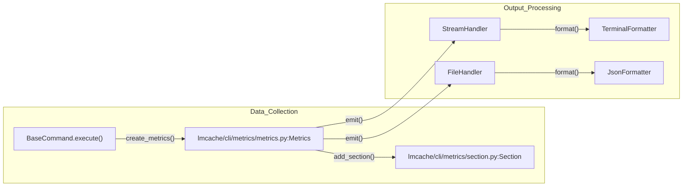
Sources: [lmcache/cli/metrics/metrics.py:32-180](), [docs/source/cli/index.rst:80-88]()

## Subcommand Reference and Usage Patterns

### `lmcache server`

Starts the multi-process LMCache server. This command initializes the entire stack, including message queue backends (ZMQ or gRPC), storage managers, HTTP admin frontend, worker pools, and GPU memory transfer mechanisms [lmcache/cli/commands/server.py:14-31](). Requires the full LMCache package with CUDA extensions installed [docs/source/cli/index.rst:28-32]().

Typical usage pattern:
```bash
lmcache server --config config.yaml
```
Sources: [lmcache/cli/commands/server.py:14-31](), [docs/source/cli/index.rst:28-32]()

---

### `lmcache coordinator`

Launches the multi-process coordinator service, which is responsible for fleet-wide instance registry, instance heartbeats, and maintaining a global key directory for distributed cache coherence [docs/source/cli/index.rst:54-55]().

Usage example:
```bash
lmcache coordinator --http-port 9300
```
Sources: [docs/source/cli/index.rst:54-55]()

---

### `lmcache describe`

Provides detailed runtime status introspection for either:

- **`kvcache`**: The multi-process LMCache KV cache service. This fetches `/status` JSON from the LMCache HTTP admin API and renders a comprehensive report including health status, L1 memory usage, registered model metadata, kernel group state, and L2 adapter details [lmcache/cli/commands/describe.py:154-175](), [docs/source/cli/describe.rst:4-65](), [docs/design/cli/commands/describe.md:1-145]().

- **`engine`**: The underlying inference engine (usually vLLM). This inspects endpoints `/v1/models`, `/health`, and `/metrics` for model info, context window size, health, and running requests count [docs/source/cli/describe.rst:66-97]().

Example command:
```bash
lmcache describe kvcache --url http://localhost:8000 --format json
```

The output can be rendered as human-readable terminal tables or JSON suitable for programmatic consumption.

Sources: [lmcache/cli/commands/describe.py:154-175](), [docs/source/cli/describe.rst:1-195](), [docs/design/cli/commands/describe.md:1-145]()

---

### `lmcache ping`

Performs fast liveness probes to check if an LMCache service or an inference engine is responsive. Internally does HTTP GET to `/healthcheck` (for `kvcache`) or `/health` (for `engine`) and measures round-trip time with potential error reporting [lmcache/cli/commands/ping.py:25-63]().

Example:
```bash
lmcache ping kvcache --url http://localhost:8080
```
The command exits with non-zero status if the target is unreachable or unhealthy.

Sources: [lmcache/cli/commands/ping.py:25-63]()

---

### `lmcache query`

Issues single-shot queries:

- To an inference engine (`query engine`), sending inference requests.
- To the MP coordinator (`query coordinator`), to inspect fleet-wide state and cache directories via read-only HTTP API calls.

The coordinator queries format aligned tables or JSON summarizing instances, usage, health, and key directory contents [docs/source/cli/index.rst:60-63](), [lmcache/cli/commands/query/_coordinator.py:126-208]().

Usage:
```bash
lmcache query engine --url http://localhost:8000 --prompt "Hello"
```
Sources: [docs/source/cli/index.rst:60-63](), [lmcache/cli/commands/query/_coordinator.py:126-208]()

---

### `lmcache bench`

Runs sustained benchmarks targeting:

- **`engine`**: vLLM inference engine throughput features varied cache reuse workloads.
- **`server`**: Full LMCache MP server stress tests with multi-rank concurrency.
- **`l2`**: Benchmarks individual L2 storage adapters for throughput and latency.

Benchmarks are implemented as leaf commands auto-discovered within `bench/` subpackage [docs/source/cli/index.rst:64-67](), [lmcache/cli/commands/bench/__init__.py:14-21]().

Example:
```bash
lmcache bench server --concurrency 8 --duration 60
```

Sources: [docs/source/cli/index.rst:60-67](), [lmcache/cli/commands/bench/__init__.py:14-21]()

---

### `lmcache kvcache`

Offers commands to manipulate in-memory KV cache state on a running server instance, such as clearing cache entries or refreshing cache metadata [docs/source/cli/index.rst:68-69]().

Usage:
```bash
lmcache kvcache clear --url http://localhost:8080
```
Sources: [docs/source/cli/index.rst:68-69]()

---

### `lmcache quota`

Manages per-salt cache quotas for capacity control and fair usage enforcement across tenants or clients [docs/source/cli/index.rst:70-71]().

Example:
```bash
lmcache quota set --salt user123 --limit 10000 --url http://localhost:8080
```
Sources: [docs/source/cli/index.rst:70-71]()

---

### `lmcache trace`

Manages the inspection and replay of LMCache storage trace files (`.lct`) which capture all `StorageManager` API calls in a live server run. Subcommands include:

- `info`: Summarize trace file metadata and operation counts.
- `replay`: Re-execute recorded operations in a controlled environment to reproduce behavior.
- `replay-events`: Replay cache-event streams to a running coordinator.

The trace records are produced by `lmcache server --trace-level` options. This command requires the full LMCache install due to dependencies on internal tracing components [lmcache/cli/commands/trace/__init__.py:1-24](), [docs/source/cli/trace.rst:1-185]().

Usage:
```bash
lmcache trace info path/to/trace.lct
lmcache trace replay path/to/trace.lct --l1-size-gb 10 --eviction-policy LRU
```
Sources: [lmcache/cli/commands/trace/__init__.py:1-24](), [docs/source/cli/trace.rst:1-185]()

---

### `lmcache tool`

Groups offline tools such as the cache simulator, providing analysis utilities that do not require a running server [docs/source/cli/index.rst:74-75]().

Example:
```bash
lmcache tool cache-simulator simulate --config config.yaml
```
Sources: [docs/source/cli/index.rst:74-75]()

---

### `lmcache mock`

Provides mock implementations and stub backend servers to facilitate testing of LMCache client interactions without requiring actual GPU hardware or full server setups [docs/source/cli/index.rst:4-7]().

Usage pattern:
```bash
lmcache mock server
```
Sources: [docs/source/cli/index.rst:4-7]()

---

## Summary

The `lmcache` CLI supports robust lifecycle management, observability, and testing capabilities via a well-structured, dynamically extensible subcommand hierarchy. It integrates the server runtime bootstrap, fleet coordination, cache inspection tools, benchmarking, trace replay, and offline analytics under a single entry point, designed for fast operation, scriptability, and consistent output formatting.

---

# Appendix: Example Workflow for `lmcache describe kvcache`

The `describe kvcache` command fetches the `/status` endpoint of a running LMCache server to produce a rich status overview. It uses the `DescribeCommand` and `KVCacheDescriber` classes to parse and format the output [lmcache/cli/commands/describe.py:150-175]().

Typical information surfaced by this command includes:

- **Health, endpoint URLs, engine type, chunk size**.
- **L1 cache capacity and usage** in GB with usage percent.
- **Eviction policy and cached object count.**
- **Registered models** with per-model info:
  - Model name, GPU world size, GPU IDs.
  - Number of layers, blocks, and cache size per token.
- **Kernel groups**:
  - Kernel group index, engine group index, object group index.
  - Slots per block, data type, MLA flag.
  - Attention backend active.
  - Engine KV shape description.
- **L2 adapters** including type, health, backend, stored object count, and pool usage.

Sample CLI usage:
```bash
lmcache describe kvcache --url http://localhost:8080
```
Sample output snippet:
```
============ LMCache KV Cache Service ============
Health:                                  OK
URL:                                     http://localhost:8080
Engine type:                             BlendEngine
Chunk size:                              256
L1 capacity (GB):                        60.00
L1 used (GB):                           42.30 (70.5%)
Eviction policy:                         LRU
Cached objects:                         1024
Active sessions:                          3
-- Model: llama ----------------------------
World size:                              1
GPU IDs:                                0
Num layers:                            32
Num blocks:                         2048
Cache size per token:              163840
--- Kernel group 0 -------------------------
Dtype:                             torch.float16
MLA:                                 False
Attention backend:     vLLM non-MLA flash attention
Engine KV shape:         NL x [2, NB, BS, NH, HS]
Engine KV tensor shape:  32 x [2, 2048, 16, 8, 128]
----------------------------------------------
```

Sources: [lmcache/cli/commands/describe.py:154-175](), [docs/source/cli/describe.rst:2-150](), [tests/cli/test_describe.py:1-207]()

---

This completes the detailed reference documentation for the `lmcache` command-line interface.

---

# Page: Core Engine Architecture

# Core Engine Architecture

<details>
<summary>Relevant source files</summary>

The following files were used as context for generating this wiki page:

- [lmcache/integration/vllm/utils.py](lmcache/integration/vllm/utils.py)
- [lmcache/integration/vllm/vllm_v1_adapter.py](lmcache/integration/vllm/vllm_v1_adapter.py)
- [lmcache/utils.py](lmcache/utils.py)
- [lmcache/v1/cache_engine.py](lmcache/v1/cache_engine.py)
- [lmcache/v1/config.py](lmcache/v1/config.py)
- [lmcache/v1/lookup_client/abstract_client.py](lmcache/v1/lookup_client/abstract_client.py)
- [lmcache/v1/lookup_client/chunk_statistics_lookup_client.py](lmcache/v1/lookup_client/chunk_statistics_lookup_client.py)
- [lmcache/v1/lookup_client/factory.py](lmcache/v1/lookup_client/factory.py)
- [lmcache/v1/lookup_client/hit_limit_lookup_client.py](lmcache/v1/lookup_client/hit_limit_lookup_client.py)
- [lmcache/v1/lookup_client/lmcache_async_lookup_client.py](lmcache/v1/lookup_client/lmcache_async_lookup_client.py)
- [lmcache/v1/lookup_client/lmcache_lookup_client.py](lmcache/v1/lookup_client/lmcache_lookup_client.py)
- [lmcache/v1/lookup_client/lmcache_lookup_client_bypass.py](lmcache/v1/lookup_client/lmcache_lookup_client_bypass.py)
- [lmcache/v1/lookup_client/mooncake_lookup_client.py](lmcache/v1/lookup_client/mooncake_lookup_client.py)
- [lmcache/v1/offload_server/zmq_server.py](lmcache/v1/offload_server/zmq_server.py)
- [lmcache/v1/rpc_utils.py](lmcache/v1/rpc_utils.py)
- [lmcache/v1/token_database.py](lmcache/v1/token_database.py)
- [tests/v1/lookup_client/test_chunk_statistics_lookup_client.py](tests/v1/lookup_client/test_chunk_statistics_lookup_client.py)
- [tests/v1/test_token_database.py](tests/v1/test_token_database.py)

</details>


## Purpose and Scope

This page provides a high-level overview of the central LMCache V1 engine architecture, which orchestrates the interaction between LLM serving frameworks and the multi-tier cache storage system. It introduces the core `LMCacheEngine` class [lmcache/v1/cache_engine.py:83](), the configuration subsystem [lmcache/v1/config.py:3](), token processing databases [lmcache/v1/token_database.py:64](), and metadata structures crucial to cache key generation and management [lmcache/v1/metadata.py:59]().

Each subsection here summarizes key components and conceptual flows, linking to more detailed child pages covering deeper technical insights:

- [LMCache Engine V1](#2.1) — Delve into `LMCacheEngine`, its store/retrieve operations, and layerwise variants.
- [Configuration System](#2.2) — Detailed explanation of `LMCacheEngineConfig` class, configuration sources hierarchy, options, and validation.
- [Token Database and Chunking](#2.3) — Explore token chunking implementations, chunk-based hashing, and separator-based splitting.
- [Cache Keys and Metadata](#2.4) — Define `CacheEngineKey` structure, hash usage, and metadata fields like model name and worker ID.

Sources: [lmcache/v1/cache_engine.py:83-98](), [lmcache/v1/config.py:1-9](), [lmcache/v1/token_database.py:64-68]()

---

## LMCacheEngine Overview

The heart of LMCache is the `LMCacheEngine` class [lmcache/v1/cache_engine.py:83](). This engine acts as the main orchestrator that transforms GPU KV caches from serving engines into CPU-resident `MemoryObj`s [lmcache/v1/cache_engine.py:86](), which it then asynchronously stores in multi-tier backends. Conversely, it retrieves memory objects from storage, transfers them back to GPU formats via specialized GPU connectors [lmcache/v1/cache_engine.py:90](), and supports intelligent KV prefetching to optimize latency.

The `LMCacheEngine` integrates multiple subsystems:

- **Configuration** via an `LMCacheEngineConfig` instance [lmcache/v1/cache_engine.py:110]().
- **Metadata management** (`LMCacheMetadata`) to capture runtime and model characteristics [lmcache/v1/cache_engine.py:111]().
- **Token databases** (`TokenDatabase`) to handle chunking and hashing of token streams [lmcache/v1/cache_engine.py:112]().
- **GPU Connectors** (`GPUConnectorInterface`) for format-specific conversions [lmcache/v1/cache_engine.py:113]().
- **Event management** (`EventManager`) and metrics for observability [lmcache/v1/cache_engine.py:169]().
- **Storage management orchestration** (`StorageManager`) working with various backends [lmcache/v1/cache_engine.py:179]().

### LMCache Engine Core Architecture (`LMCacheEngine`)

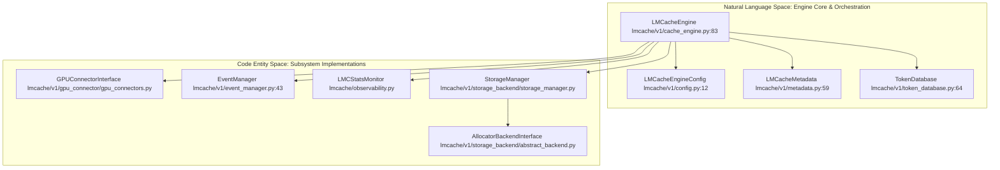

Sources: [lmcache/v1/cache_engine.py:83-180](), [lmcache/utils.py:35-42](), [lmcache/observability.py:20-120]()

This engine design abstracts cache management details from underlying serving engines and storage layers, enabling flexible integration and support for advanced usage scenarios, including layerwise KV transfer and multi-GPU coordination.

For detailed implementation of the engine methods and orchestration logic, see [LMCache Engine V1](#2.1).

Sources: [lmcache/v1/cache_engine.py:83-180](), [lmcache/utils.py:35-42](), [lmcache/observability.py:20-120]()

---

## Configuration System

LMCache’s configuration is built upon a dynamic, extensible system centered around the `LMCacheEngineConfig` class [lmcache/v1/config.py:3](). Configuration values are loaded and merged from multiple hierarchical sources:

- YAML config files, typically specified via `LMCACHE_CONFIG_FILE` environment variable [lmcache/v1/utils.py:182]().
- Environment variables.
- Command-line parameters and runtime overrides.
- Remote configuration services (optional) [lmcache/v1/utils.py:171]().

The configuration class is generated dynamically using `create_config_class()` [lmcache/v1/config_base.py:29](), based on a centralized dictionary of configuration schema and default values (`_CONFIG_DEFINITIONS`) [lmcache/v1/config.py:88]().

### Configuration Loading and Token Database Flow

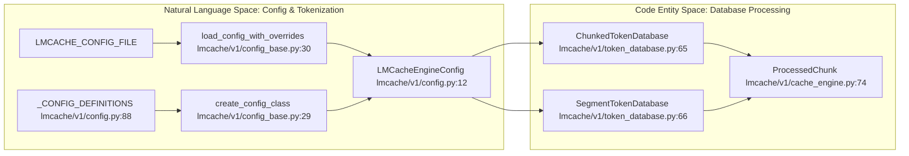

Sources: [lmcache/v1/config.py:88-245](), [lmcache/v1/config_base.py:29-32](), [lmcache/v1/token_database.py:64-68]()

This layered design provides flexible runtime adaptability and supports feature flags such as layerwise KV transfer, blending (multi-subsequence matching), P2P sharing, and controller integration.

For complete details on configuration loading priorities, options, validation, and runtime overrides, see [Configuration System](#2.2).

Sources: [lmcache/v1/config.py:88-245](), [lmcache/v1/config_base.py:29-32](), [lmcache/v1/token_database.py:64-68]()

---

## Token Database and Chunking

Token processing in LMCache is managed by the `TokenDatabase` abstraction [lmcache/v1/token_database.py:67](), responsible for splitting prompt tokens into manageable segments or chunks for hashing and caching.

Two main implementations support different cache strategies:

- **ChunkedTokenDatabase** [lmcache/v1/token_database.py:65](): Divides token streams into fixed-size blocks based on the `chunk_size` configuration [lmcache/v1/config.py:90](), facilitating uniform block hashing and bulk transfer.

- **SegmentTokenDatabase** [lmcache/v1/token_database.py:66](): Splits token sequences using configurable separator tokens (e.g., the blending special string `blend_special_str` [lmcache/v1/config.py:158]()) to enable cache blending features that handle subsequence reuse beyond prefixes.

These token databases emit chunks that are converted into cache keys and memory objects for storage, enabling fine-grained cache retrieval and partial reuse.

For further details on chunk-based hashing algorithms, data structures, and token database interfaces, see [Token Database and Chunking](#2.3).

Sources: [lmcache/v1/token_database.py:64-68](), [lmcache/v1/config.py:90](), [lmcache/v1/config.py:158]()

---

## Cache Keys and Metadata

LMCache utilizes `CacheEngineKey` objects [lmcache/utils.py:36]() as unique identifiers for cached KV entries. These keys encapsulate:

- Chunk hashes derived from token spans.
- Model names and runtime parameters.
- Distributed system attributes such as world size and worker ID.
- Data types and optional custom tags for fine-tuned cache differentiation.

Runtime and model metadata is stored in `LMCacheMetadata` [lmcache/v1/metadata.py:59](), which tracks system-wide constants including:

- Use of multi-level attention (MLA).
- Role (worker or scheduler).
- Device and accelerator details.

This metadata influences cache key generation, cache routing, and backend selection rules.

Together, keys and metadata enable consistent, collision-resistant cache lookups across workers and storage tiers.

For comprehensive information on hash generation, cache key construction, and metadata fields, see [Cache Keys and Metadata](#2.4).

Sources: [lmcache/utils.py:36](), [lmcache/v1/metadata.py:59](), [lmcache/v1/memory_management.py:52-57]()

---

# Summary

This page outlined the core LMCache engine architecture focusing on the main orchestrator class, configuration system, token processing strategies, and cache key/metadata management. These subsystems collectively enable scalable, efficient KV cache operations atop flexible storage backends, supporting advanced features like layerwise transfer, blending, and distributed coordination.

For detailed technical depth, please explore the dedicated child pages referenced throughout this overview.

Sources:  
[lmcache/v1/cache_engine.py:83-180](),  
[lmcache/v1/config.py:1-245](),  
[lmcache/v1/token_database.py:64-68](),  
[lmcache/utils.py:36-40](),  
[lmcache/v1/metadata.py:59-90](),  
[lmcache/v1/config_base.py:29-32]()

---

# Page: LMCache Engine V1

# LMCache Engine V1

<details>
<summary>Relevant source files</summary>

The following files were used as context for generating this wiki page:

- [lmcache/integration/vllm/utils.py](lmcache/integration/vllm/utils.py)
- [lmcache/integration/vllm/vllm_v1_adapter.py](lmcache/integration/vllm/vllm_v1_adapter.py)
- [lmcache/utils.py](lmcache/utils.py)
- [lmcache/v1/cache_engine.py](lmcache/v1/cache_engine.py)
- [lmcache/v1/config.py](lmcache/v1/config.py)
- [lmcache/v1/lookup_client/abstract_client.py](lmcache/v1/lookup_client/abstract_client.py)
- [lmcache/v1/lookup_client/chunk_statistics_lookup_client.py](lmcache/v1/lookup_client/chunk_statistics_lookup_client.py)
- [lmcache/v1/lookup_client/factory.py](lmcache/v1/lookup_client/factory.py)
- [lmcache/v1/lookup_client/hit_limit_lookup_client.py](lmcache/v1/lookup_client/hit_limit_lookup_client.py)
- [lmcache/v1/lookup_client/lmcache_async_lookup_client.py](lmcache/v1/lookup_client/lmcache_async_lookup_client.py)
- [lmcache/v1/lookup_client/lmcache_lookup_client.py](lmcache/v1/lookup_client/lmcache_lookup_client.py)
- [lmcache/v1/lookup_client/lmcache_lookup_client_bypass.py](lmcache/v1/lookup_client/lmcache_lookup_client_bypass.py)
- [lmcache/v1/lookup_client/mooncake_lookup_client.py](lmcache/v1/lookup_client/mooncake_lookup_client.py)
- [lmcache/v1/offload_server/zmq_server.py](lmcache/v1/offload_server/zmq_server.py)
- [lmcache/v1/rpc_utils.py](lmcache/v1/rpc_utils.py)
- [lmcache/v1/token_database.py](lmcache/v1/token_database.py)
- [tests/v1/lookup_client/test_chunk_statistics_lookup_client.py](tests/v1/lookup_client/test_chunk_statistics_lookup_client.py)
- [tests/v1/test_token_database.py](tests/v1/test_token_database.py)

</details>


## Purpose and Scope

This document details the `LMCacheEngine` class [lmcache/v1/cache_engine.py:83-98](), which serves as the core orchestration unit for LMCache V1, an LLM-serving KV cache management engine. The engine manages the full lifecycle of KV caches, including converting and storing GPU-side KV caches into CPU-side memory objects and persistent backends, retrieving cached data back to the GPU for reuse, and prefetching tokens to optimize latency performance.

The scope covers initialization of core components, primary store and retrieve operations, layerwise variants supporting pipelined GPU caching, health monitoring, freeze modes for cache safety, and integration with the lookup client system.

Sources: [lmcache/v1/cache_engine.py:83-98]()

---

## LMCacheEngine Class Overview

The `LMCacheEngine` class is the central orchestrator of LMCache's KV caching system [lmcache/v1/cache_engine.py:83-98](). It coordinates operations across memory allocators, GPU connectors, storage managers, and token databases:

- **Store path**: Takes GPU KV caches from the serving engine, converts them into CPU-resident `MemoryObj` instances, and writes them asynchronously to `StorageBackendInterface` implementations [lmcache/v1/cache_engine.py:86-89]().
- **Retrieve path**: Fetches `MemoryObj` instances from storage backends, handles broadcasting across ranks when using Multi-Level Attention (MLA), and transfers data back to GPU KV caches via `GPUConnectorInterface` [lmcache/v1/cache_engine.py:91-93]().
- **Prefetching**: Supports asynchronous prefetch managed through backend coordination to prevent conflicts with active retrieval requests [lmcache/v1/cache_engine.py:95-97]().

### System Components and Code Entities

Title: LMCacheEngine Architecture and Code Mappings
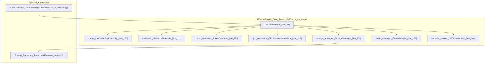

Sources: [lmcache/v1/cache_engine.py:83-227](), [lmcache/integration/vllm/vllm_v1_adapter.py:43-47]()

| Responsibility       | Implementation Location                                                        |
|----------------------|--------------------------------------------------------------------------------|
| KV cache lifecycle   | `store()`, `retrieve()`, `store_layer()`, `retrieve_layer()` methods [lmcache/v1/cache_engine.py:330-1080]() |
| Memory management    | Delegated to `StorageManager` for backend coordination [lmcache/v1/cache_engine.py:179]() |
| GPU/CPU data transfer| Via `GPUConnectorInterface`; optimized for KV layout and platform [lmcache/v1/cache_engine.py:113]() |
| Token chunking       | Through `TokenDatabase` interface for chunked key generation [lmcache/v1/cache_engine.py:112]() |
| Async orchestration  | `EventManager` handles async events and waits [lmcache/v1/cache_engine.py:169]() |
| Health status & freeze| Managed internally for cache readiness and frozen state [lmcache/v1/cache_engine.py:230-330]() |

Sources: [lmcache/v1/cache_engine.py:83-227](), [lmcache/integration/vllm/vllm_v1_adapter.py:43-47]()

---

## Initialization

### Parameters of `LMCacheEngine.__init__()` [lmcache/v1/cache_engine.py:100-108]()

| Parameter         | Type                          | Role/Description                                                  |
|-------------------|-------------------------------|------------------------------------------------------------------|
| `config`          | `LMCacheEngineConfig`           | Configuration parameters loaded from YAML/env [lmcache/v1/config.py:88-217]() |
| `metadata`        | `LMCacheMetadata`               | Model & deployment metadata (`worker_id`, `world_size`, etc.) [lmcache/v1/metadata.py:11-78]() |
| `token_database`  | `TokenDatabase`                 | Converts token sequences into cache keys/chunks [lmcache/v1/token_database.py:64-90]() |
| `gpu_connector`   | `GPUConnectorInterface`         | Interface for GPU-side transfer with layout awareness [lmcache/v1/cache_engine.py:113]() |
| `broadcast_fn`    | `Callable[[torch.Tensor, int], None]` | Broadcast tensors across ranks (MLA) [lmcache/v1/cache_engine.py:114]() |
| `broadcast_object_fn` | `Callable[[Any, int], Any]`  | Broadcast generic Python objects [lmcache/v1/cache_engine.py:115]() |

### Key Initialization Details

- **`save_only_first_rank`**: Config flag for MLA to reduce redundant saves on non-leader ranks [lmcache/v1/cache_engine.py:117-120]().
- **`LMCacheWorker` (`lmcache_worker`)**: Optional background worker for coordinating distributed cache control, P2P communication, and eviction management [lmcache/v1/cache_engine.py:144-161]().
- **Event Manager**: Initializes `EventManager` to track asynchronous store/retrieve progress [lmcache/v1/cache_engine.py:169]().
- **Storage Manager**: Instantiates `StorageManager` to coordinate underlying storage tiers ([lmcache/v1/cache_engine.py:179](), [lmcache/v1/storage_backend/storage_manager.py]()).

Sources: [lmcache/v1/cache_engine.py:100-227](), [lmcache/v1/config.py:88-217]()

---

## Store Operation

The `store()` method saves KV caches from GPU memory into LMCache-managed storage backends asynchronously.

### Store Operation Data Flow

Title: Store Operation Execution Flow
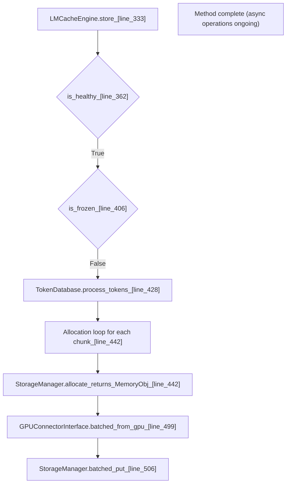

- **Health and Freeze Checks**: Verifies engine health via `is_healthy()` and ensures the cache is not frozen via `is_frozen()` ([lmcache/v1/cache_engine.py:362-406]()).
- **Token Processing**: Calls `token_database.process_tokens()` to generate chunk metadata and `CacheEngineKey` instances from input tokens ([lmcache/v1/cache_engine.py:428]()).
- **Allocation and Transfer**: Allocates CPU buffers via `storage_manager.allocate()` and invokes `gpu_connector.batched_from_gpu()` to copy data from GPU memory ([lmcache/v1/cache_engine.py:442-499]()).
- **Asynchronous Persistence**: Submits memory objects for storage via `storage_manager.batched_put()` ([lmcache/v1/cache_engine.py:506]()).

Sources: [lmcache/v1/cache_engine.py:333-527](), [lmcache/v1/token_database.py:64-90]()

---

## Retrieve Operation

The `retrieve()` method fetches cached KV data from storage backends and restores it on the GPU for reuse.

### Retrieve Operation Highlights

- **Prefix-Aligned Lookup**: Retrieves chunks up to the requested prefix length, stopping at the first missing chunk to maintain semantic correctness of prefix caching ([lmcache/v1/cache_engine.py:885-890]()).
- **Storage Tier Priority**: Queries storage backends in order of latency (local CPU hot cache, local disk, remote storage) ([lmcache/v1/cache_engine.py:896-906]()).
- **MLA Broadcast**: In Multi-Level Attention mode, rank 0 performs the retrieval and broadcasts the retrieved data to other ranks ([lmcache/v1/cache_engine.py:781-796]()).
- **GPU Restoration**: Uses `gpu_connector.batched_to_gpu()` to transfer CPU memory objects back into GPU KV cache slots.

Sources: [lmcache/v1/cache_engine.py:706-870]()

---

## Layerwise Store and Retrieve Operations

Layerwise variants (`store_layer()` and `retrieve_layer()`) implement generator-based pipelines that overlap GPU compute with cache I/O layer-by-layer, improving throughput for deep models.

### Layerwise Generation Pattern

Title: Layerwise Pipeline Sequence
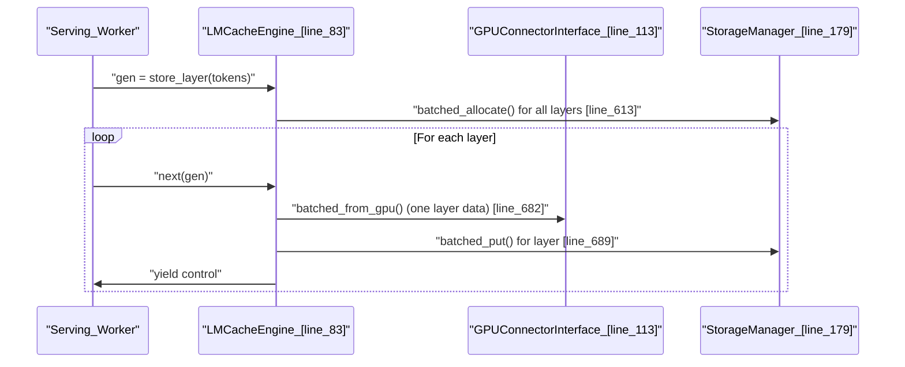

- `store_layer()` pre-allocates memory for all layers and yields control after processing each layer ([lmcache/v1/cache_engine.py:528-704]()).
- `retrieve_layer()` fetches and restores KV cache layer-by-layer using generators ([lmcache/v1/cache_engine.py:1006-1139]()).
- This pipeline design minimizes memory footprint peaks and enables execution overlap.

Sources: [lmcache/v1/cache_engine.py:528-704](), [lmcache/v1/cache_engine.py:1006-1139]()

---

## Health Monitoring and Freeze Mode

### Health Monitoring

- The engine uses `is_healthy()` to determine whether it is safe to execute cache operations ([lmcache/v1/cache_engine.py:252-268]()).
- Integrates with `HealthMonitor` to track backend liveness and handle failures gracefully.

### Freeze Mode

- Freeze mode switches the engine to read-only access, suppressing cache updates, evictions, and controller messages ([lmcache/v1/cache_engine.py:306-331]()).
- Useful for maintenance operations and preventing cache corruption during faults.

Sources: [lmcache/v1/cache_engine.py:230-331]()

---

## Lookup Client Integration

`LMCacheEngine` coordinates with lookup clients to check token availability and cache hits.

### Lookup Client System Mapping

Title: Lookup Client Code Entity Interaction
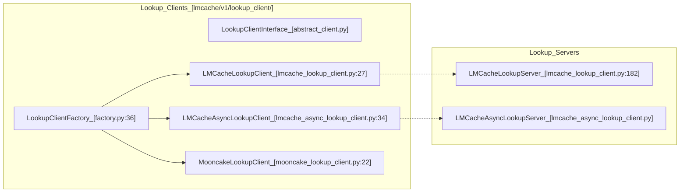

- Synchronous clients (`LMCacheLookupClient`) use ZMQ request-reply patterns for blocking hit queries ([lmcache/v1/lookup_client/lmcache_lookup_client.py:27-200]()).
- Asynchronous clients (`LMCacheAsyncLookupClient`) support non-blocking prefetching and pipelined checks ([lmcache/v1/lookup_client/lmcache_async_lookup_client.py:34-170]()).
- `LookupClientFactory` instantiates appropriate clients based on engine configuration ([lmcache/v1/lookup_client/factory.py:40-144]()).

Sources: [lmcache/v1/cache_engine.py:92-95](), [lmcache/v1/lookup_client/factory.py:40-144](), [lmcache/v1/lookup_client/lmcache_lookup_client.py:27-200](), [lmcache/v1/lookup_client/lmcache_async_lookup_client.py:34-170]()

---

## Summary

The LMCache V1 Engine (`LMCacheEngine`) manages KV cache lifecycles through:
- Asynchronous conversions between GPU tensors and CPU memory objects.
- Multi-tier backend orchestration via `StorageManager`.
- Layerwise pipelined execution for enhanced streaming throughput.
- Robust health monitoring, freeze modes, and client lookup coordination.

Sources:
- [lmcache/v1/cache_engine.py:83-1139]()
- [lmcache/v1/config.py:88-217]()
- [lmcache/v1/token_database.py:64-90]()
- [lmcache/integration/vllm/vllm_v1_adapter.py:43-47]()
- [lmcache/v1/lookup_client/factory.py:40-144]()

---

# Page: Configuration System

# Configuration System

<details>
<summary>Relevant source files</summary>

The following files were used as context for generating this wiki page:

- [docs/source/api_reference/configurations.rst](docs/source/api_reference/configurations.rst)
- [docs/source/developer_guide/architecture.rst](docs/source/developer_guide/architecture.rst)
- [docs/source/internal_api_server/common_apis.rst](docs/source/internal_api_server/common_apis.rst)
- [docs/source/internal_api_server/controller_apis.rst](docs/source/internal_api_server/controller_apis.rst)
- [docs/source/internal_api_server/internal_api_server.rst](docs/source/internal_api_server/internal_api_server.rst)
- [docs/source/kv_cache/storage_backends/cpu_ram.rst](docs/source/kv_cache/storage_backends/cpu_ram.rst)
- [docs/source/kv_cache/storage_backends/eic.rst](docs/source/kv_cache/storage_backends/eic.rst)
- [docs/source/kv_cache/storage_backends/gds.rst](docs/source/kv_cache/storage_backends/gds.rst)
- [docs/source/kv_cache/storage_backends/local_storage.rst](docs/source/kv_cache/storage_backends/local_storage.rst)
- [docs/source/kv_cache/storage_backends/redis.rst](docs/source/kv_cache/storage_backends/redis.rst)
- [docs/source/kv_cache/storage_backends/weka.rst](docs/source/kv_cache/storage_backends/weka.rst)
- [docs/source/production/observability/vllm_endpoint.rst](docs/source/production/observability/vllm_endpoint.rst)
- [lmcache/integration/sglang/sglang_adapter.py](lmcache/integration/sglang/sglang_adapter.py)
- [lmcache/integration/sglang/utils.py](lmcache/integration/sglang/utils.py)
- [lmcache/v1/config_base.py](lmcache/v1/config_base.py)
- [lmcache/v1/internal_api_server/vllm/conf_api.py](lmcache/v1/internal_api_server/vllm/conf_api.py)
- [lmcache/v1/storage_backend/gds_backend.py](lmcache/v1/storage_backend/gds_backend.py)
- [tests/v1/data/gds.yaml](tests/v1/data/gds.yaml)
- [tests/v1/data/hipfile.yaml](tests/v1/data/hipfile.yaml)
- [tests/v1/data/hipfile_gds.yaml](tests/v1/data/hipfile_gds.yaml)
- [tests/v1/data/test_config.yaml](tests/v1/data/test_config.yaml)
- [tests/v1/storage_backend/test_gds_backend.py](tests/v1/storage_backend/test_gds_backend.py)
- [tests/v1/test_cache_engine.py](tests/v1/test_cache_engine.py)
- [tests/v1/test_config.py](tests/v1/test_config.py)
- [tests/v1/test_gds.py](tests/v1/test_gds.py)

</details>


## Purpose and Scope

The Configuration System is the centralized mechanism for managing all LMCache engine and server settings [lmcache/v1/config.py:1-50](). It provides a flexible, hierarchical configuration loading system that supports YAML files, environment variables, remote configuration services, multiprocess (MP) server parameters, and runtime dynamic updates [lmcache/v1/config.py:15-80](), [lmcache/v1/config_base.py:1-46](). The configuration system is implemented primarily through the `LMCacheEngineConfig` class [lmcache/v1/config.py:1-236](), accompanied by `MPServerConfig` for multiprocess server settings [lmcache/v1/multiprocess/config.py:21-122](), and supported by utility functions for parsing and validation [lmcache/v1/config_base.py:50-220]().

Key implementation files include:
- `lmcache/v1/config.py` — `LMCacheEngineConfig` definition and parsing options [lmcache/v1/config.py:1-236]()
- `lmcache/v1/config_base.py` — Core configuration utilities, base classes, and `create_config_class()` factory [lmcache/v1/config_base.py:1-220]()
- `lmcache/v1/multiprocess/config.py` — `MPServerConfig` and multiprocess server parameters [lmcache/v1/multiprocess/config.py:1-175]()
- `lmcache/v1/internal_api_server/vllm/conf_api.py` — Runtime configuration API endpoints for dynamic config changes [lmcache/v1/internal_api_server/vllm/conf_api.py:1-147]()

Sources: `lmcache/v1/config_base.py:1-220]`, `lmcache/v1/multiprocess/config.py:1-175]`, `lmcache/v1/config.py:1-236]`, `lmcache/v1/internal_api_server/vllm/conf_api.py:1-147`()

---

## Configuration Loading Hierarchy

LMCache's configuration system loads settings from multiple sources in a well-defined precedence order to produce the final runtime configuration [tests/v1/test_config.py:18-105]().

### Data Flow and Precedence (Code Entity Space Bridge)

The following diagram bridges natural language configuration concepts to concrete code execution paths and functions in the codebase:

```mermaid
%%{init: {'theme': 'base', 'themeVariables': { 'fontSize': '16px', 'fontFamily': 'arial' }}}%%
flowchart TD
    Start[""Start Initialization""]
    CheckEnv[""Check Env: os.environ[LMCACHE_CONFIG_FILE]""]
    LoadYAML[""Load YAML: LMCacheEngineConfig.from_file()""]
    LoadEnv[""Load Env: LMCacheEngineConfig.from_env()""]
    ApplyEnv[""Apply Overrides: update_config_from_env()""]
    CheckRemote[""Check Remote Config URL""]
    FetchRemote[""Fetch Remote: fetch_remote_config()""]
    ApplyRemote[""Apply Remote: apply_remote_configs()""]
    Validate[""Validate Config: validate()""]
    FinalConfig[""Final Instance: LMCacheEngineConfig""]

    Start --> CheckEnv
    CheckEnv -->|"File Present"| LoadYAML
    CheckEnv -->|"No File"| LoadEnv
    LoadYAML --> ApplyEnv
    LoadEnv --> CheckRemote
    ApplyEnv --> CheckRemote
    CheckRemote -->|"Enabled"| FetchRemote
    CheckRemote -->|"Disabled"| Validate
    FetchRemote --> ApplyRemote
    ApplyRemote --> Validate
    Validate --> FinalConfig
```
Sources: `tests/v1/test_config.py:18-105]`, `lmcache/v1/config_base.py:1-46]`, `lmcache/v1/config.py:15-80`()

- **YAML file config:** When the `LMCACHE_CONFIG_FILE` environment variable is set, the configuration is loaded from the YAML file using `LMCacheEngineConfig.from_file()` [tests/v1/test_config.py:18-20]().
- **Environment variables:** If no file is present, the config loads from environment variables matching `LMCACHE_*` prefixes via `LMCacheEngineConfig.from_env()` [tests/v1/test_config.py:23-25]().
- **Environment overrides:** After file or env load, environment variables are applied as overrides through `update_config_from_env()` [tests/v1/test_config.py:94-100]().
- **Remote config:** If a remote config URL is configured, it is fetched and applied via `apply_remote_configs()` [tests/v1/config_base.py:13-15](), [tests/v1/test_config.py:12-14]().
- **Defaults:** Configuration keys missing are filled with default values defined in configuration definitions [lmcache/v1/config_base.py:218-250]().
- **Validation:** Final validation occurs before usage to ensure correctness [tests/v1/test_config.py:153-162]().

### Precedence Summary (High → Low):
1. Remote configuration service overrides (if enabled) [tests/v1/test_config.py:12-14]()
2. Environment variable overrides (`LMCACHE_*`) via `update_config_from_env()` [tests/v1/test_config.py:94-100]()
3. YAML configuration file settings via `from_file()` [tests/v1/test_config.py:18-20]()
4. Built-in default values via `from_defaults()` [tests/v1/test_config.py:78-85]()

Sources: `tests/v1/test_config.py:18-105]`, `lmcache/v1/config_base.py:1-46]`, `lmcache/v1/config.py:15-80`()

---

## LMCacheEngineConfig Implementation and Parsing

### Configuration Class Generation and Parsing

`LMCacheEngineConfig` is a dynamically generated dataclass created via the factory function `create_config_class()` in `lmcache/v1/config_base.py` [lmcache/v1/config_base.py:218-240](). It supports consistent type conversion, alias resolution, deprecation warning handling, environment overrides, and JSON/YAML loading [lmcache/v1/config_base.py:184-214]().

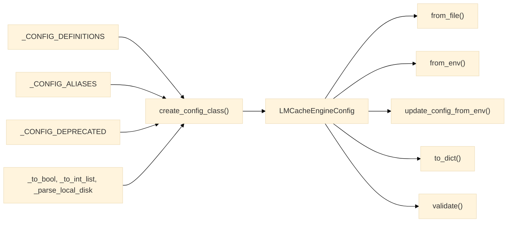
Sources: `lmcache/v1/config_base.py:50-220]`, `lmcache/v1/config.py:1-236]()`

- **`_CONFIG_DEFINITIONS`:** Holds all config keys, types, default values, and optional environment variable converters (`env_converter`) for safe casting [lmcache/v1/config_base.py:28-46]().
- **`_CONFIG_ALIASES`:** Maps deprecated or alternate config keys to current names [lmcache/v1/config_base.py:184-214]().
- **`_CONFIG_DEPRECATED`:** Tracks deprecated key warnings [lmcache/v1/config_base.py:184-214]().
- **Parsing utilities:** Helper functions like `_parse_local_disk`, `_to_int_list`, and `_parse_quoted_string` convert raw string inputs into typed Python objects [lmcache/v1/config_base.py:50-162]().
- **Class methods:**
  - `from_file()`: Load config from YAML/JSON file [tests/v1/test_config.py:19-19]()
  - `from_env()`: Load config from environment variables [tests/v1/test_config.py:24-24]()
  - `update_config_from_env()`: Update the instance with environment variable overrides [tests/v1/test_config.py:99-99]()
  - `validate()`: Check config correctness and constraints [lmcache/v1/config.py:1-236]()
  - `to_dict()`: Convert config to plain dictionary [lmcache/v1/config_base.py:167-168]()

Sources: `lmcache/v1/config_base.py:50-220]`, `lmcache/v1/config.py:1-236`()

---

## Configuration Options

The configuration options cover a wide range of system behaviors related to cache chunking, storage backends, persistence, network, and performance optimizations [docs/source/api_reference/configurations.rst:21-102]().

### Core Engine Settings

| Option | Environment Variable | Description | Default |
|---|---|---|---|
| `chunk_size` | `LMCACHE_CHUNK_SIZE` | Number of tokens per KV cache chunk [docs/source/api_reference/configurations.rst:33-35]() | 256 |
| `local_cpu` | `LMCACHE_LOCAL_CPU` | Enable CPU RAM caching of KV data [docs/source/api_reference/configurations.rst:36-38]() | true |
| `max_local_cpu_size` | `LMCACHE_MAX_LOCAL_CPU_SIZE` | Maximum size in GB for CPU cache [docs/source/api_reference/configurations.rst:39-41]() | 5.0 |
| `local_cpu_use_hugepages` | `LMCACHE_LOCAL_CPU_USE_HUGEPAGES` | Use Linux hugepages (2MB) for CPU pinned memory [docs/source/api_reference/configurations.rst:42-44]() | false |
| `local_disk` | `LMCACHE_LOCAL_DISK` | Paths (comma-separated) to local disk cache directories [docs/source/api_reference/configurations.rst:45-47]() | None |
| `local_disk_path_sharding` | `LMCACHE_LOCAL_DISK_PATH_SHARDING` | Sharding strategy across multiple disk paths ("by_gpu") [docs/source/api_reference/configurations.rst:48-50]() | "by_gpu" |
| `max_local_disk_size` | `LMCACHE_MAX_LOCAL_DISK_SIZE` | Max size in GB for disk cache [docs/source/api_reference/configurations.rst:51-53]() | 0.0 |
| `remote_url` | `LMCACHE_REMOTE_URL` | Remote KV cache storage URL ("redis://...", "lm://...", etc.) [docs/source/api_reference/configurations.rst:54-56]() | None |
| `remote_serde` | `LMCACHE_REMOTE_SERDE` | Remote serialization format ("naive", "cachegen") [docs/source/api_reference/configurations.rst:57-59]() | "naive" |
| `save_decode_cache` | `LMCACHE_SAVE_DECODE_CACHE` | Save decode KV cache [docs/source/api_reference/configurations.rst:60-62]() | false |
| `use_layerwise` | `LMCACHE_USE_LAYERWISE` | Enable layerwise pipelined KV cache retrieval/storage [docs/source/api_reference/configurations.rst:63-65]() | false |
| `save_unfull_chunk` | `LMCACHE_SAVE_UNFULL_CHUNK` | Save unfull (partial) chunks when storing [docs/source/api_reference/configurations.rst:66-71]() | false |
| `blocking_timeout_secs` | `LMCACHE_BLOCKING_TIMEOUT_SECS` | Timeout seconds for blocking cache operations [docs/source/api_reference/configurations.rst:72-74]() | 10 |
| `py_enable_gc` | `LMCACHE_PY_ENABLE_GC` | Enable Python GC during engine operations [docs/source/api_reference/configurations.rst:75-77]() | true |
| `cache_policy` | `LMCACHE_CACHE_POLICY` | Cache eviction policy ("LRU", "LFU", "FIFO") [docs/source/api_reference/configurations.rst:78-80]() | "LRU" |
| `numa_mode` | `LMCACHE_NUMA_MODE` | NUMA memory pinning mode (null/auto/manual) [docs/source/api_reference/configurations.rst:81-83]() | null |
| `extra_config` | `LMCACHE_EXTRA_CONFIG` | JSON dict for arbitrary backend-specific configs [docs/source/api_reference/configurations.rst:99-101]() | {} |

Sources: `tests/v1/test_config.py:22-105]`, `docs/source/api_reference/configurations.rst:23-130`()

---

## Multiprocess (MP) Server Configuration

For multiprocess deployments, `MPServerConfig` encapsulates server process parameters such as networking, thread pools, and instance identity [lmcache/v1/multiprocess/config.py:21-122]().

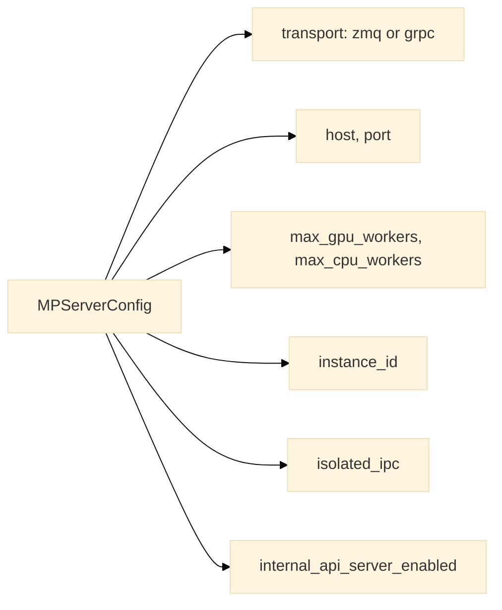
Sources: `lmcache/v1/multiprocess/config.py:21-122`()

- **Transport:** Network server transport layer type exposed (`zmq` or `grpc`) [lmcache/v1/multiprocess/config.py:21-122]().
- **Host/Port:** Address to bind the server for client connections [lmcache/v1/multiprocess/config.py:21-122]().
- **Max GPU/CPU workers:** Thread pool sizes for GPU (`STORE`, `RETRIEVE`) and CPU (`LOOKUP`) cache operations [lmcache/v1/multiprocess/config.py:21-122]().
- **Instance ID:** Stable string identifier for cluster membership and telemetry [lmcache/v1/multiprocess/config.py:21-122]().
- **Isolated IPC:** Enables operation in isolated container environments without shared IPC [lmcache/v1/multiprocess/config.py:21-122]().
- **Metrics:** Controls internal API server endpoints for observability [lmcache/v1/multiprocess/config.py:21-122]().

Sources: `lmcache/v1/multiprocess/config.py:21-122`()

---

## Runtime Configuration and Dynamic Updates

LMCache exposes an internal API server to inspect and modify configuration values at runtime [lmcache/v1/internal_api_server/vllm/conf_api.py:42-147]().

- **GET `/conf`:** Query config values, optionally filtered by comma-separated names [lmcache/v1/internal_api_server/vllm/conf_api.py:42-90]().
- **POST `/conf`:** Update config values dynamically with validation through `validate_and_set_config_value` [lmcache/v1/internal_api_server/vllm/conf_api.py:91-147](), [lmcache/v1/config_base.py:13-15]().

This enables adaptive tuning and troubleshooting without restarts, handled in the internal API server module `lmcache/v1/internal_api_server/vllm/conf_api.py` [lmcache/v1/internal_api_server/vllm/conf_api.py:1-147]().

Sources: `lmcache/v1/internal_api_server/vllm/conf_api.py:42-147]`, `lmcache/v1/config_base.py:13-15`()

---

## References and Source Files

- `lmcache/v1/config_base.py:1-220` — Base config utilities and class factory
- `lmcache/v1/config.py:1-236` — LMCacheEngineConfig class definition and parsing
- `lmcache/v1/multiprocess/config.py:1-175` — MPServerConfig and multiprocess server config
- `lmcache/v1/internal_api_server/vllm/conf_api.py:1-147` — Runtime config API endpoints
- `tests/v1/test_config.py:1-187` — Unit tests for configuration loading and env overrides
- `docs/source/api_reference/configurations.rst:1-130` — Configuration option documentation

Sources: `lmcache/v1/config_base.py:1-220]`, `lmcache/v1/config.py:1-236]`, `lmcache/v1/multiprocess/config.py:1-175]`, `lmcache/v1/internal_api_server/vllm/conf_api.py:1-147]`, `tests/v1/test_config.py:1-187]`, `docs/source/api_reference/configurations.rst:1-130`()

---

# Page: Token Database and Chunking

# Token Database and Chunking

<details>
<summary>Relevant source files</summary>

The following files were used as context for generating this wiki page:

- [lmcache/integration/vllm/utils.py](lmcache/integration/vllm/utils.py)
- [lmcache/integration/vllm/vllm_v1_adapter.py](lmcache/integration/vllm/vllm_v1_adapter.py)
- [lmcache/utils.py](lmcache/utils.py)
- [lmcache/v1/cache_engine.py](lmcache/v1/cache_engine.py)
- [lmcache/v1/config.py](lmcache/v1/config.py)
- [lmcache/v1/lookup_client/abstract_client.py](lmcache/v1/lookup_client/abstract_client.py)
- [lmcache/v1/lookup_client/chunk_statistics_lookup_client.py](lmcache/v1/lookup_client/chunk_statistics_lookup_client.py)
- [lmcache/v1/lookup_client/factory.py](lmcache/v1/lookup_client/factory.py)
- [lmcache/v1/lookup_client/hit_limit_lookup_client.py](lmcache/v1/lookup_client/hit_limit_lookup_client.py)
- [lmcache/v1/lookup_client/lmcache_async_lookup_client.py](lmcache/v1/lookup_client/lmcache_async_lookup_client.py)
- [lmcache/v1/lookup_client/lmcache_lookup_client.py](lmcache/v1/lookup_client/lmcache_lookup_client.py)
- [lmcache/v1/lookup_client/lmcache_lookup_client_bypass.py](lmcache/v1/lookup_client/lmcache_lookup_client_bypass.py)
- [lmcache/v1/lookup_client/mooncake_lookup_client.py](lmcache/v1/lookup_client/mooncake_lookup_client.py)
- [lmcache/v1/offload_server/zmq_server.py](lmcache/v1/offload_server/zmq_server.py)
- [lmcache/v1/rpc_utils.py](lmcache/v1/rpc_utils.py)
- [lmcache/v1/token_database.py](lmcache/v1/token_database.py)
- [tests/v1/lookup_client/test_chunk_statistics_lookup_client.py](tests/v1/lookup_client/test_chunk_statistics_lookup_client.py)
- [tests/v1/test_token_database.py](tests/v1/test_token_database.py)

</details>


This page documents the token database subsystem responsible for converting input token sequences into cache engine keys. The token database determines how tokens are partitioned (either into fixed-size chunks or variable-size segments) and how these partitions are hashed to generate cache keys. For information about how these cache keys are structured and used, see [Cache Keys and Metadata](2.4).

Sources: [lmcache/v1/token_database.py:64-73]()

## Overview

The token database provides an abstraction layer between raw token sequences and the cache storage system. Its primary responsibilities are:

1. **Partitioning**: Divide token sequences into cacheable units (chunks or segments).
2. **Hashing**: Generate unique identifiers for each partition using prefix-based hash functions.
3. **Masking**: Handle partially cached sequences by respecting token masks.
4. **Configuration**: Support multiple partitioning strategies based on use case.

The system provides two concrete implementations:
* `ChunkedTokenDatabase`: Fixed-size chunk partitioning for general caching [lmcache/v1/token_database.py:68-69]().
* `SegmentTokenDatabase`: Separator-based partitioning for cache blending scenarios [lmcache/v1/token_database.py:71-72]().

Sources: [lmcache/v1/token_database.py:64-73]()

## Class Hierarchy and Architecture

The `TokenDatabase` abstract base class defines the interface for token processing, while `ChunkedTokenDatabase` and `SegmentTokenDatabase` provide specific partitioning logic.

### Diagram: Token Database Entity Relationship (Code Entity Space)

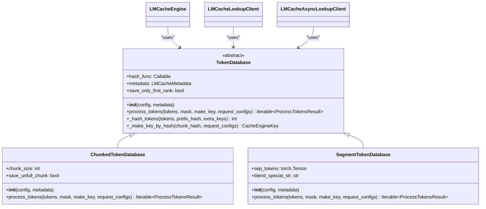

Sources: [lmcache/v1/token_database.py:64-122](), [lmcache/v1/lookup_client/lmcache_lookup_client.py:71-76](), [lmcache/v1/lookup_client/lmcache_async_lookup_client.py:118-122]()

## ChunkedTokenDatabase: Fixed-Size Partitioning

`ChunkedTokenDatabase` divides token sequences into fixed-size chunks (default configured by `chunk_size`) and processes tokens accordingly. Each chunk is hashed using a prefix-based chained hash where each chunk's hash includes the previous prefix hash, enabling context-sensitive hashing. This facilitates cache key generation that respects token sequence prefixes [lmcache/v1/token_database.py:292-323]().

### Chunk Processing Flow

- The token sequence is optionally masked to ignore tokens before the prefix length.
- Tokens are processed in contiguous chunks of size `chunk_size`.
- Optionally, an unfull chunk at the end can be preserved if `save_unfull_chunk` is `True`, otherwise it is ignored.
- Each chunk’s hash is computed by the chain: `prefix_hash = hash_func([prefix_hash, chunk tokens])`.
- For each chunk, a `CacheEngineKey` is constructed based on the chunk hash.

### Diagram: Chunking Logic Flow

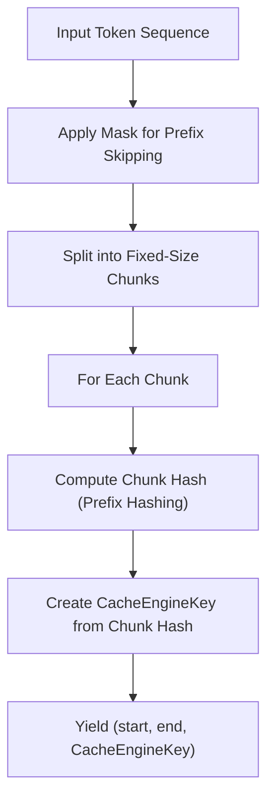

### Implementation Details

- **Chunk Size** is configurable via the `chunk_size` option in `LMCacheEngineConfig`.
- **Prefix Hash Chain**: Starts from the special `NONE_HASH` value which corresponds to the empty prefix.
- **Hash Normalization**: Hash function outputs that are bytes are normalized to 64-bit integers to match `CacheEngineKey` requirements.
- In multi-layer attention (MLA) scenarios, and when `save_only_first_rank` is enabled, the world size embedded in the key is forced to 1 to enable key sharing across ranks.
- The core methods are:
  - `_hash_tokens(...)` to compute prefix chained hashes.
  - `process_tokens(...)` which yields `(start_index, end_index, CacheEngineKey)` tuples for chunks.

Sources: [lmcache/v1/token_database.py:242-322](), [lmcache/v1/token_database.py:34-56](), [lmcache/v1/token_database.py:114-121]()

## SegmentTokenDatabase: Separator-Based Partitioning

`SegmentTokenDatabase` splits token sequences into segments based on a configured **separator token sequence** (`blend_special_str`). This form of splitting supports cache blending, allowing different prompt segments (e.g., system prompt, documents, queries) to be cached independently [lmcache/v1/token_database.py:421-448]().

### Separator Detection and Segment Construction

- The separator string is tokenized into `sep_tokens` and used as a delimiter.
- Token sequences are split at occurrences of `sep_tokens`.
- Each segment excludes the separator tokens themselves.
- Each segment is hashed **independently** with the prefix hash reset to `NONE_HASH` for each segment — allowing reorderability and independent reuse.
- The `process_tokens()` method yields `(start_index, end_index, CacheEngineKey)` tuples for segments.

### Diagram: Separator-Based Splitting Flow

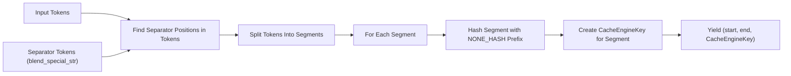

### Key Features

- Segments are variable length depending on separator occurrence.
- Segment hashes are prefix-independent (reset prefix hash each time) for blending flexibility.
- Supports a configurable separator string (`blend_special_str`) in the configuration.
- Primarily used when `enable_blending` is `True`.

Sources: [lmcache/v1/token_database.py:469-524](), [lmcache/v1/token_database.py:421-448](), [lmcache/v1/config.py:137-141]()

## Hash Function Integration

LMCache integrates closely with vLLM’s hash functions to maintain consistent hashing for tokens and chunks, which is critical for cache correctness.

### Selection Logic

The `_get_vllm_hash_func` method tries several import paths in priority order:

1. `vllm.utils.hashing.get_hash_fn_by_name` (vLLM versions >= PR#27151).
2. `vllm.utils.get_hash_fn_by_name` (vLLM versions < PR#27151).
3. Direct import of `sha256_cbor` or `sha256_cbor_64bit` (legacy fallback).
4. Python built-in `hash()` as last resort.

### NONE_HASH Initialization

- Attempts to initialize `NONE_HASH` by calling vLLM’s `kv_cache_utils.init_none_hash` when available (introduced in PR#20511).
- This sets the initial prefix hash to the same value used internally by vLLM for empty prefixes.
- If not available, it defaults to 0.

Sources: [lmcache/v1/token_database.py:90-109](), [lmcache/v1/token_database.py:123-176]()

## Cache Key Generation

Cache keys are instances of `CacheEngineKey` constructed from chunk/segment hashes along with contextual metadata.

### `_make_key_by_hash` Method

- Takes a chunk hash and optional request configs.
- Creates a `CacheEngineKey` with fields:
  - `chunk_hash` (64-bit int key)
  - Model name from `metadata`
  - World size and worker ID (with potential override if `save_only_first_rank` is set)
  - Data type, tags, and any other relevant metadata fields.

### Diagram: Cache Key Generation Data Flow (Code Entity Space)

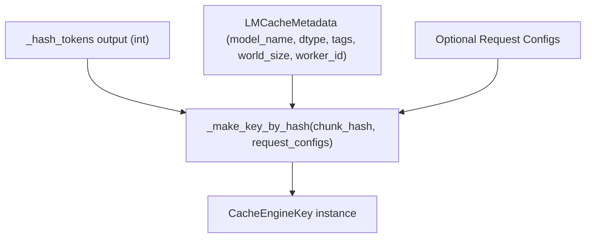

- Note: In MLA scenarios with `save_only_first_rank=True`, the `world_size` in the key is set to 1 to facilitate key sharing across ranks.

Sources: [lmcache/v1/token_database.py:209-221](), [lmcache/v1/token_database.py:114-121]()

## Lookup Client Integration

The token database implementations are directly used by various lookup client implementations, which convert raw tokens into cache keys or hashed tokens for communication.

| Lookup Client                  | Token Database Used          | Usage Description                                                     | Source Lines                          |
|-------------------------------|-----------------------------|----------------------------------------------------------------------|-------------------------------------|
| `LMCacheLookupClient`          | `ChunkedTokenDatabase` or `SegmentTokenDatabase` | Processes tokens into hashes or keys and sends lookup requests synchronously over ZMQ transport. | [lmcache/v1/lookup_client/lmcache_lookup_client.py:74-79, 102-113]() |
| `LMCacheAsyncLookupClient`     | `ChunkedTokenDatabase` or `SegmentTokenDatabase` | Similar to sync client but supports asynchronous prefetching and uses ZMQ PUSH/PULL messaging. | [lmcache/v1/lookup_client/lmcache_async_lookup_client.py:118-122]() |
| `LMCacheBypassLookupClient`    | Uses `LMCacheEngine`’s token database directly | Avoids RPC by doing in-process lookups using the token database and LMCacheEngine methods. | [lmcache/v1/lookup_client/lmcache_lookup_client_bypass.py:49-50, 55-91]() |
| `MooncakeLookupClient`         | `ChunkedTokenDatabase` only | Converts tokens to `CacheEngineKey` strings and uses batch existence queries on Mooncake distributed store. | [lmcache/v1/lookup_client/mooncake_lookup_client.py:59-88]() |

### Data Flow Diagram Bridging Natural Language Space to Code Entity Space


Sources: [lmcache/v1/lookup_client/lmcache_lookup_client.py:27-161](), [lmcache/v1/lookup_client/lmcache_async_lookup_client.py:34-191](), [lmcache/v1/lookup_client/lmcache_lookup_client_bypass.py:21-102](), [lmcache/v1/lookup_client/mooncake_lookup_client.py:22-96]()

## Specialized Lookup Wrappers

To extend lookup functionality, LMCache uses wrapper clients:

- **`HitLimitLookupClient`**: Used primarily for testing, it limits the number of returned hit tokens to simulate misses, controlled by a `hit_miss_ratio` parameter [lmcache/v1/lookup_client/hit_limit_lookup_client.py:26-89]().
- **`ChunkStatisticsLookupClient`**: Collects usage statistics on cache chunk reuse by asynchronously recording chunk identities to reduce inference overhead [lmcache/v1/lookup_client/chunk_statistics_lookup_client.py:28-159]().

These wrappers decorate existing lookup clients without changing the core token database or engine.

Sources: [lmcache/v1/lookup_client/hit_limit_lookup_client.py:26-89](), [lmcache/v1/lookup_client/chunk_statistics_lookup_client.py:28-171]()

---

This completes the detailed technical documentation of LMCache's token database and chunking mechanisms, describing how tokens are converted from raw sequences into cache keys through chunking and segmentation, hashing strategy integration, and connection with lookup clients for efficient caching.

Sources:  
[lmcache/v1/token_database.py:1-171, 231-324, 421-524]()  
[lmcache/v1/lookup_client/lmcache_lookup_client.py:27-161]()  
[lmcache/v1/lookup_client/lmcache_async_lookup_client.py:34-191]()  
[lmcache/v1/lookup_client/lmcache_lookup_client_bypass.py:21-102]()  
[lmcache/v1/lookup_client/mooncake_lookup_client.py:22-96]()  
[lmcache/v1/lookup_client/factory.py:36-99]()  
[lmcache/v1/lookup_client/hit_limit_lookup_client.py:26-89]()  
[lmcache/v1/lookup_client/chunk_statistics_lookup_client.py:28-171]()

---

# Page: Cache Keys and Metadata

# Cache Keys and Metadata

<details>
<summary>Relevant source files</summary>

The following files were used as context for generating this wiki page:

- [examples/kubernetes/health_probe.py](examples/kubernetes/health_probe.py)
- [lmcache/integration/vllm/utils.py](lmcache/integration/vllm/utils.py)
- [lmcache/integration/vllm/vllm_v1_adapter.py](lmcache/integration/vllm/vllm_v1_adapter.py)
- [lmcache/utils.py](lmcache/utils.py)
- [lmcache/v1/cache_engine.py](lmcache/v1/cache_engine.py)
- [lmcache/v1/config.py](lmcache/v1/config.py)
- [lmcache/v1/distributed/serde/factory.py](lmcache/v1/distributed/serde/factory.py)
- [lmcache/v1/lookup_client/abstract_client.py](lmcache/v1/lookup_client/abstract_client.py)
- [lmcache/v1/lookup_client/chunk_statistics_lookup_client.py](lmcache/v1/lookup_client/chunk_statistics_lookup_client.py)
- [lmcache/v1/lookup_client/factory.py](lmcache/v1/lookup_client/factory.py)
- [lmcache/v1/lookup_client/hit_limit_lookup_client.py](lmcache/v1/lookup_client/hit_limit_lookup_client.py)
- [lmcache/v1/lookup_client/lmcache_async_lookup_client.py](lmcache/v1/lookup_client/lmcache_async_lookup_client.py)
- [lmcache/v1/lookup_client/lmcache_lookup_client.py](lmcache/v1/lookup_client/lmcache_lookup_client.py)
- [lmcache/v1/lookup_client/lmcache_lookup_client_bypass.py](lmcache/v1/lookup_client/lmcache_lookup_client_bypass.py)
- [lmcache/v1/lookup_client/mooncake_lookup_client.py](lmcache/v1/lookup_client/mooncake_lookup_client.py)
- [lmcache/v1/metadata.py](lmcache/v1/metadata.py)
- [lmcache/v1/offload_server/zmq_server.py](lmcache/v1/offload_server/zmq_server.py)
- [lmcache/v1/protocol.py](lmcache/v1/protocol.py)
- [lmcache/v1/rpc_utils.py](lmcache/v1/rpc_utils.py)
- [lmcache/v1/server/__main__.py](lmcache/v1/server/__main__.py)
- [lmcache/v1/standalone/__main__.py](lmcache/v1/standalone/__main__.py)
- [lmcache/v1/token_database.py](lmcache/v1/token_database.py)
- [tests/v1/lookup_client/test_chunk_statistics_lookup_client.py](tests/v1/lookup_client/test_chunk_statistics_lookup_client.py)
- [tests/v1/lookup_client/test_lmcache_lookup_client.py](tests/v1/lookup_client/test_lmcache_lookup_client.py)
- [tests/v1/standalone/test_parse_kvcache_shape_spec.py](tests/v1/standalone/test_parse_kvcache_shape_spec.py)
- [tests/v1/test_freeze_mode_integration.py](tests/v1/test_freeze_mode_integration.py)
- [tests/v1/test_remote_metadata.py](tests/v1/test_remote_metadata.py)
- [tests/v1/test_token_database.py](tests/v1/test_token_database.py)

</details>


Purpose and scope: This page explains the `CacheEngineKey` structure, its hash generation mechanism, related metadata fields including `model_name`, `world_size`, `worker_id`, `dtype`, and `tags`. It covers how these keys uniquely identify cached KV tensors, support distributed serving scenarios, and integrate with LMCache’s storage and retrieval subsystems.

For usage of keys in cache operations (lookup, retrieve, store), see the core engine in `lmcache/v1/cache_engine.py` [lmcache/v1/cache_engine.py:83-184](). For token chunking and hash generation, refer to `lmcache/v1/token_database.py` [lmcache/v1/token_database.py:31-112]() and the `extract_request_configs_from_sampling_params` utility in the vLLM integration [lmcache/integration/vllm/utils.py:130-151]().

---

## Overview

LMCache manages cached KV tensors using structured cache keys encapsulated primarily by the `CacheEngineKey` dataclass. These keys carry extensive metadata about the model, distributed processing configuration, token chunk identity, and data type, enabling precise cache partitioning and retrieval across local/multi-process and multi-tier storage backends.

### Key class hierarchy and integration points

```mermaid
classDiagram
    class CacheEngineKey {
        +str fmt
        +str model_name
        +int world_size
        +int worker_id
        +int chunk_hash
        +torch.dtype dtype
        +Optional[dict] request_configs
        +Optional[tuple] tags
        +str _dtype_str
        +__hash__()
        +__eq__(other)
        +to_string() str
        +from_string(s) CacheEngineKey
        +to_dict() dict
        +from_dict(d) CacheEngineKey
        +split_layers(num_layers) List[LayerCacheEngineKey]
        +get_first_layer() LayerCacheEngineKey
        +with_new_worker_id(new_id) CacheEngineKey
    }
    
    class LayerCacheEngineKey {
        +int layer_id
        +__hash__()
        +__eq__(other)
        +to_string() str
        +from_string(s) LayerCacheEngineKey
        +split_layers(num_layers) List[LayerCacheEngineKey]
    }
    
    LayerCacheEngineKey --|> CacheEngineKey : "extends"
```

- `CacheEngineKey` is the primary key for full-model KV caches.
- `LayerCacheEngineKey` extends `CacheEngineKey` with `layer_id`, supporting layerwise cache granularity used in asynchronous or pipelined KV transfer.

Sources: [lmcache/utils.py:332-577]()

---

## CacheEngineKey Structure

### Fields and Purpose

| Field            | Type                | Description                                                                                 |
|------------------|---------------------|---------------------------------------------------------------------------------------------|
| `fmt`            | `str`               | Memory format string identifier (e.g., `"vllm"`, `"huggingface"`) used for backend layout |
| `model_name`     | `str`               | The LLM model name string, e.g., `"meta-llama/Llama-2-7b-hf"`                               |
| `world_size`      | `int`               | Number of workers across distributed setting                                               |
| `worker_id`       | `int`               | Rank of the worker that owns this cache partition                                         |
| `chunk_hash`      | `int`               | Integer hash of the token chunk sequence pooled                                     |
| `dtype`           | `torch.dtype`       | PyTorch data type of cached tensors                                                        |
| `request_configs` | `Optional[dict]`    | Optional dictionary of request specific configs (e.g., tags for partitioning)               |
| `tags`            | `Optional[tuple]`   | Immutable tuple of `(key, value)` pairs extracted from `request_configs` with `"lmcache.tag."` prefix |
| `_dtype_str`      | `str`               | Cached string form of `dtype` for serialization                                            |

### Tags and Request Configs

- `request_configs` may contain arbitrary parameters.
- Keys starting with `"lmcache.tag."` denote user-defined tags extracted during key initialization.
- Tags are stored as a sorted tuple `(key, value)` to ensure hash and equality consistency.

### Hash and Equality

`CacheEngineKey`'s hash function combines all critical fields including tags and format to guarantee unique cache entry identification:

```python
def __hash__(self):
    return hash((
        self.fmt,
        self.model_name,
        self.world_size,
        self.worker_id,
        self.chunk_hash,
        self._dtype_str,
        self.tags,
    ))
```

Equality compares all these fields to avoid collisions and allow usage as dictionary keys in storage backends.

Sources: [lmcache/utils.py:332-369]()

---

## Cache Key Serialization Format

Keys serialize to a compact string format for storage and communication.

```
fmt@model_name@world_size@worker_id@chunk_hash@dtype_str[@tag_key%tag_value...]
```

- The `@` symbol delimits core fields.
- Tags are appended as `@key%value` components.
- Example:

```
vllm@meta-llama/Llama-2-7b-hf@4@0@a3f5b2c1@half@user_id%alice@session%2024-01-15
```

### Parsing Logic

The utility function `parse_cache_key` dynamically detects whether the key represents a full-model `CacheEngineKey` or a per-layer key (`LayerCacheEngineKey`) by inspecting the number of fields and presence of a layer identifier.

```mermaid
graph LR
    subgraph NaturalLanguageSpace["NaturalLanguageSpace"]
        PStr["PromptQueryString"]
    end

    subgraph CodeEntitySpace["CodeEntitySpace"]
        K["CacheEngineKey"]
        S["to_string()"]
        F["fmt@model@ws@wid@hash@dtype@tags"]
        Parse["parse_cache_key()"]
        D1["CacheEngineKey.from_string()"]
        D2["LayerCacheEngineKey.from_string()"]
        K1["CacheEngineKey"]
        K2["LayerCacheEngineKey"]
    end

    PStr --> K
    K --> S
    S --> F
    F --> Parse
    Parse --> D1
    Parse --> D2
    D1 --> K1
    D2 --> K2
```

Sources: [lmcache/utils.py:316-329](), [lmcache/utils.py:385-448]()

---

## Data Type Mappings

LMCache supports various PyTorch dtypes and maps them to/from normalized strings for key serialization:

| PyTorch dtype               | String Name   | Protocol Int (Remote) |
|----------------------------|---------------|----------------------|
| `torch.float16` / `torch.half` | `"half"`      | 1 (half) / 2 (float16) |
| `torch.bfloat16`            | `"bfloat16"`  | 3                    |
| `torch.float32` / `torch.float` | `"float"`    | 4                    |
| `torch.int8`                | `"int8"`      | 6                    |
| `torch.float8_e4m3fn`       | `"fp8_e4m3"`  | 7                    |
| `torch.float8_e5m2`         | `"fp8_e5m2"`  | 8                    |

- The `_DTYPE_TO_STR` and `_STR_TO_DTYPE` mappings are defined in `lmcache/utils.py` to standardize these conversions.
- Remote backend protocol uses these integers in binary formats for compactness [lmcache/v1/protocol.py:41-53]().

Sources: [lmcache/utils.py:287-313](), [lmcache/v1/protocol.py:41-53]()

---

## LMCacheMetadata Class

This dataclass contains model-level metadata essential for engine configuration and key generation:

| Field              | Type         | Description                                                                      |
|--------------------|--------------|----------------------------------------------------------------------------------|
| `model_name`       | `str`        | Model name string used across components                                         |
| `world_size`        | `int`        | Number of distributed workers                                                    |
| `worker_id`         | `int`        | Rank identifier                                                                  |
| `kv_dtype`          | `torch.dtype`| Data type for KV caches                                                          |
| `kv_shape`          | `tuple`      | Shape of KV cache tensors `(num_layer, 2, chunk_size, num_kv_head, head_size)`   |
| `use_mla`           | `bool`       | Enabled Multi-Level Attention flag                                               |

This class is passed throughout engine initialization and is foundational for key derivation in multi-node distributed serving [lmcache/v1/metadata.py:20-73]().

Sources: [lmcache/v1/metadata.py:20-73]()

---

## LayerCacheEngineKey: Extension for Layerwise Caching

`LayerCacheEngineKey` inherits from `CacheEngineKey` and adds:

- `layer_id: int`: identifies the specific transformer layer chunk.

This enables specialized caching strategies in layerwise KV transfer scenarios supporting overlapped compute and I/O pipelines [lmcache/utils.py:500-504](), [lmcache/v1/cache_engine.py:171]().

### String Format

Layer keys serialize similarly, appending `layer_id` after `dtype`:

```
fmt@model_name@world_size@worker_id@chunk_hash@dtype_str@layer_id[@tag_key%tag_value...]
```

Sources: [lmcache/utils.py:526-534]()

---

## DiskCacheMetadata Structure

`DiskCacheMetadata` holds persistent storage info for on-disk cache entries:

| Field      | Type                 | Purpose                              |
|------------|----------------------|------------------------------------|
| `path`    | `str`                | On-disk file path                   |
| `size`    | `int`                | File size in bytes                  |
| `shape`   | `Optional[torch.Size]` | Tensor shape                       |
| `dtype`   | `Optional[torch.dtype]`| Tensor data type                   |
| `pin_count` | `int`                | Reference count for eviction policy |

This metadata supports synchronization and eviction for local disk backend [lmcache/utils.py:257-265]()

Sources: [lmcache/utils.py:257-265]()

---

## Remote and GDS Metadata Handling

### Binary Metadata Serialization

For remote backends and GPU Direct Storage (GDS), metadata is serialized as fixed-size binary buffers using Python’s `struct`:

```mermaid
graph TD
    subgraph GdsBackend["GdsBackend"]
        PM["pack_metadata()"]
        UM["unpack_metadata()"]
    end
    
    subgraph RemoteMetadataProtocol["RemoteMetadata"]
        RM["RemoteMetadata"]
        RM_S["serialize()"]
        RM_D["deserialize()"]
    end

    PM -->|struct.pack| B1["BinaryBuffer4KB"]
    B1 -->|struct.unpack| UM
    
    RM -->|struct.pack| B2["BinaryBuffer"]
    B2 -->|struct.unpack| RM_D
```

- GDS backend reserves 4KB for metadata header at file start [lmcache/v1/storage_backend/gds_backend.py:50-123]().
- `RemoteMetadata` handles packing shape, dtype, and flags into binary blobs for efficient remote communication [lmcache/v1/protocol.py:164-209]().

Sources: [lmcache/v1/storage_backend/gds_backend.py:50-123](), [lmcache/v1/protocol.py:164-209]()

---

## Token Hash Generation and Request Config Extraction

Token chunk hashes (`chunk_hash` in keys) originate from classes implementing `TokenDatabase`. The `ChunkedTokenDatabase` computes progressively cumulative hashes to enable prefix caching optimization.

- Hash normalization converts diverse algorithms (e.g., `sha256_cbor`) into 64-bit integer hashes via `_normalize_hash_to_int` [lmcache/v1/token_database.py:31-112]().
- Request configurations and tags embedded in sampling parameters are extracted for key inclusion via `extract_request_configs_from_sampling_params()` [lmcache/integration/vllm/utils.py:130-151]().

```mermaid
graph LR
    subgraph NaturalLanguageSpace["NaturalLanguageSpace"]
        T1["TokenChunk1"]
        T2["TokenChunk2"]
        SP["SamplingParams"]
    end

    subgraph CodeEntitySpace["CodeEntitySpace"]
        ERC["extract_request_configs_from_sampling_params()"]
        DB["ChunkedTokenDatabase"]
        HF["hash_func"]
        NH["NONE_HASH"]
        CEK["CacheEngineKey"]
    end

    SP --> ERC
    ERC --> CEK
    T1 --> DB
    T2 --> DB
    DB --> HF
    NH --> HF
    HF -->|normalize| H1["Hash1"]
    H1 --> HF
    HF -->|normalize| H2["Hash2"]
    H2 --> CEK
```

Sources: [lmcache/v1/token_database.py:31-112](), [lmcache/integration/vllm/utils.py:130-151](), [lmcache/utils.py:332]()

---

## Summary Table of Key Classes and Metadata Components

| Name                    | Location                          | Usage                                       |
|-------------------------|---------------------------------|---------------------------------------------|
| `CacheEngineKey`        | `lmcache/utils.py:332-498`       | Full-model cache key                         |
| `LayerCacheEngineKey`   | `lmcache/utils.py:500-577`       | Per-layer cache key                          |
| `LMCacheMetadata`       | `lmcache/v1/metadata.py:20-73`   | Engine-wide metadata                         |
| `DiskCacheMetadata`     | `lmcache/utils.py:257-265`       | Persistent on-disk cache info                |
| `RemoteMetadata`        | `lmcache/v1/protocol.py:164-209` | Remote backend binary metadata serialization |
| `parse_cache_key`       | `lmcache/utils.py:316-329`       | Parse and detect key type                     |

---

This structured key and metadata design ensures precise cache partitioning, consistent hash-based retrieval, and flexible support for advanced features like Multi-Level Attention (MLA) sharding, multi-process sharing, and blended cache layers.

Sources:  
[lmcache/utils.py:257-577](), [lmcache/v1/cache_engine.py:83-184](), [lmcache/v1/token_database.py:31-112](), [lmcache/v1/metadata.py:20-73](), [lmcache/integration/vllm/utils.py:130-151](), [lmcache/v1/protocol.py:41-53](), [lmcache/v1/storage_backend/gds_backend.py:50-123](), [lmcache/v1/protocol.py:164-209]()

---

# Page: Integration with Serving Engines

# Integration with Serving Engines

<details>
<summary>Relevant source files</summary>

The following files were used as context for generating this wiki page:

- [docs/source/developer_guide/architecture.rst](docs/source/developer_guide/architecture.rst)
- [docs/source/internal_api_server/common_apis.rst](docs/source/internal_api_server/common_apis.rst)
- [docs/source/internal_api_server/controller_apis.rst](docs/source/internal_api_server/controller_apis.rst)
- [docs/source/internal_api_server/internal_api_server.rst](docs/source/internal_api_server/internal_api_server.rst)
- [docs/source/kv_cache/storage_backends/eic.rst](docs/source/kv_cache/storage_backends/eic.rst)
- [docs/source/production/observability/vllm_endpoint.rst](docs/source/production/observability/vllm_endpoint.rst)
- [lmcache/integration/sglang/sglang_adapter.py](lmcache/integration/sglang/sglang_adapter.py)
- [lmcache/integration/sglang/utils.py](lmcache/integration/sglang/utils.py)
- [lmcache/integration/vllm/utils.py](lmcache/integration/vllm/utils.py)
- [lmcache/integration/vllm/vllm_v1_adapter.py](lmcache/integration/vllm/vllm_v1_adapter.py)
- [lmcache/utils.py](lmcache/utils.py)
- [lmcache/v1/cache_engine.py](lmcache/v1/cache_engine.py)
- [lmcache/v1/config.py](lmcache/v1/config.py)
- [lmcache/v1/config_base.py](lmcache/v1/config_base.py)
- [lmcache/v1/internal_api_server/vllm/conf_api.py](lmcache/v1/internal_api_server/vllm/conf_api.py)
- [lmcache/v1/lookup_client/abstract_client.py](lmcache/v1/lookup_client/abstract_client.py)
- [lmcache/v1/lookup_client/chunk_statistics_lookup_client.py](lmcache/v1/lookup_client/chunk_statistics_lookup_client.py)
- [lmcache/v1/lookup_client/factory.py](lmcache/v1/lookup_client/factory.py)
- [lmcache/v1/lookup_client/hit_limit_lookup_client.py](lmcache/v1/lookup_client/hit_limit_lookup_client.py)
- [lmcache/v1/lookup_client/lmcache_async_lookup_client.py](lmcache/v1/lookup_client/lmcache_async_lookup_client.py)
- [lmcache/v1/lookup_client/lmcache_lookup_client.py](lmcache/v1/lookup_client/lmcache_lookup_client.py)
- [lmcache/v1/lookup_client/lmcache_lookup_client_bypass.py](lmcache/v1/lookup_client/lmcache_lookup_client_bypass.py)
- [lmcache/v1/lookup_client/mooncake_lookup_client.py](lmcache/v1/lookup_client/mooncake_lookup_client.py)
- [lmcache/v1/offload_server/zmq_server.py](lmcache/v1/offload_server/zmq_server.py)
- [lmcache/v1/rpc_utils.py](lmcache/v1/rpc_utils.py)
- [lmcache/v1/token_database.py](lmcache/v1/token_database.py)
- [tests/v1/data/test_config.yaml](tests/v1/data/test_config.yaml)
- [tests/v1/lookup_client/test_chunk_statistics_lookup_client.py](tests/v1/lookup_client/test_chunk_statistics_lookup_client.py)
- [tests/v1/test_config.py](tests/v1/test_config.py)
- [tests/v1/test_token_database.py](tests/v1/test_token_database.py)

</details>


## Purpose and Scope

This page provides a high-level overview of how LMCache integrates with various LLM serving engines to manage, offload, and share KV caches across requests and instances. LMCache acts as an extension layer supporting two primary deployment patterns:

- **In-process mode**, where LMCache runs inside the serving engine process [lmcache/v1/cache_engine.py:146-166]().
- **Multiprocess (MP) mode**, where LMCache operates as a standalone service [lmcache/integration/sglang/sglang_adapter.py:67-140]().

These integrations enable LMCache to improve time-to-first-token (TTFT) and throughput by caching and reusing KV states efficiently while supporting hardware platforms like NVIDIA CUDA, AMD ROCm, and Intel XPU [lmcache/v1/cache_engine.py:146-166](), [lmcache/utils.py:49-68]().

**For detailed subsystem documentation, see the child pages:**

- [vLLM V1 Integration](#3.1) — Complete vLLM V1 integration architecture, `KVConnectorBase_V1` interface, and request lifecycle.
- [SGLang Integration](#3.2) — SGLang integration via `--enable-lmcache`, differences from vLLM, and Radix Attention Cache coordination.
- [Multi-Process Cache Server](#3.3) — `MPCacheEngine`, `MessageQueueServer` architecture, ZMQ/gRPC transport, `BlendEngine`, and HTTP frontend.
- [TensorRT-LLM Integration](#3.4) — NVIDIA TensorRT-LLM integration via KV Cache Connector API, in-process and multi-process modes.
- [Encoder Cache (Non-KV Cache)](#3.5) — Encoder Cache (EC) feature for multimodal encoder outputs, `LMCacheECConnector`, and `kv_codec` quantization format.

Sources: [lmcache/v1/cache_engine.py:146-166](), [lmcache/utils.py:49-68](), [lmcache/integration/sglang/sglang_adapter.py:67-140]()

---

## Integration Architecture

### Connector Pattern

LMCache integrates with serving engines using a **connector pattern**, whereby each engine exposes extension hooks allowing LMCache to intercept and manage KV cache operations. For example, in vLLM V1, this is implemented through the `KVConnectorBase_V1` interface, which the `LMCacheConnectorV1Impl` class implements to capture token loading and saving during inference [lmcache/integration/vllm/vllm_v1_adapter.py:14-18](). The `LMCacheManager` singleton oversees overall lifecycle management, initializing components like the `LMCacheEngine` and lookup clients [lmcache/v1/cache_engine.py:83-108]().

#### Diagram: Integration Architecture Code Bridge

```mermaid
graph TB
    subgraph "ServingEngineLayer"
        vLLM["vLLM_V1_Scheduler<br/>(vllm.v1.core.sched)"]
        SGLang["SGLang_Runtime<br/>(sglang.srt.managers)"]
    end
    
    subgraph "LMCacheIntegrationLayer"
        V1Adapter["LMCacheConnectorV1Impl<br/>(lmcache.integration.vllm.vllm_v1_adapter)"]
        SGLConnector["LMCacheConnector<br/>(lmcache.integration.sglang.sglang_adapter)"]
    end
    
    subgraph "LMCacheCore"
        Engine["LMCacheEngine<br/>(lmcache/v1/cache_engine.py)"]
        TokenDB["ChunkedTokenDatabase<br/>(lmcache/v1/token_database.py)"]
    end
    
    vLLM --> V1Adapter
    SGLang --> SGLConnector
    
    V1Adapter --> Engine
    SGLConnector --> Engine
    Engine --> TokenDB
```

Sources: [lmcache/integration/vllm/vllm_v1_adapter.py:14-18](), [lmcache/integration/sglang/sglang_adapter.py:143-185](), [lmcache/v1/cache_engine.py:83-108](), [lmcache/v1/token_database.py:64-73]()

---

### Hardware-Specific Operations

For efficient data movement of KV cache tensors, LMCache defines a hardware interface (`GPUConnectorInterface`) specifying GPU-to-CPU memory transfers and vice versa. This encapsulation supports multiple device backends transparently [lmcache/v1/cache_engine.py:44]().

| Component           | Purpose                                   | Code Entity                        |
|---------------------|-------------------------------------------|----------------------------------|
| GPU Connector       | Handles paged memory transfer between GPU and LMCache | `GPUConnectorInterface` [lmcache/v1/cache_engine.py:44]() |
| Token Hashing       | Converts token sequences into cache keys  | `TokenDatabase` [lmcache/v1/token_database.py:64]()  |
| Configuration System| Manages LMCache engine configuration      | `LMCacheEngineConfig` [lmcache/v1/config.py:12-32]() |

Sources: [lmcache/v1/cache_engine.py:44](), [lmcache/v1/token_database.py:64-73](), [lmcache/v1/config.py:12-32]()

---

## Supported Serving Engines

### vLLM V1 Integration

LMCache’s integration with vLLM is based on `LMCacheConnectorV1Impl` that implements the `KVConnectorBase_V1` interface. This connector tracks request metadata such as token IDs and manages load and save specifications for KV caches at a layer block granularity. It supports both in-process mode inside the vLLM process as well as multi-process mode communicating with a standalone LMCache server [lmcache/integration/vllm/vllm_v1_adapter.py:14-18]().

For comprehensive information, see the child page: [vLLM V1 Integration](#3.1).

Sources: [lmcache/integration/vllm/vllm_v1_adapter.py:14-18]()

---

### SGLang Integration

SGLang integrates with LMCache via the `--enable-lmcache` flag and initializes the engine using `init_lmcache_engine` and `LMCacheConnector` within the SGLang runtime [lmcache/integration/sglang/sglang_adapter.py:67-185](). It handles model configs, tensor parallel sizes, and KV pools for both standard and Multi-head Latent Attention (MLA) models.

For detailed design and runtime flow, refer to [SGLang Integration](#3.2).

Sources: [lmcache/integration/sglang/sglang_adapter.py:67-185]()

---

### TensorRT-LLM Integration

NVIDIA’s TensorRT-LLM integrates with LMCache through the KV Cache Connector API. LMCache connectors operate in both in-process and multiprocess modes, bridging TensorRT-LLM’s runtime cache mechanisms with LMCache’s multi-tier storage hierarchy.

For complete architecture and configuration patterns, see [TensorRT-LLM Integration](#3.4).

Sources: [lmcache/v1/cache_engine.py:83-108]()

---

### Multi-Process Cache Server

LMCache provides a multiprocess cache server architecture where clients communicate with lookup servers using `LMCacheAsyncLookupClient` or `LMCacheLookupClient`, created via `LookupClientFactory` [lmcache/v1/lookup_client/factory.py:36-100](). The server handles lookup and transfer operations across distributed ranks [lmcache/v1/lookup_client/lmcache_lookup_client.py:182-207]().

#### Diagram: Multi-Process Lookup Client-Server Architecture Code Bridge

```mermaid
graph TD
    subgraph "ServingEngineProcess"
        ClientFactory{{"LookupClientFactory<br/>(lmcache/v1/lookup_client/factory.py)"}}
        AsyncClient["LMCacheAsyncLookupClient<br/>(lmcache/v1/lookup_client/lmcache_async_lookup_client.py)"]
        SyncClient["LMCacheLookupClient<br/>(lmcache/v1/lookup_client/lmcache_lookup_client.py)"]
        ClientFactory --> AsyncClient
        ClientFactory --> SyncClient
    end

    subgraph "LMCacheMPServerProcess"
        ServerFactory{{"LookupClientFactory.create_lookup_server<br/>(lmcache/v1/lookup_client/factory.py)"}}
        AsyncServer["LMCacheAsyncLookupServer<br/>(lmcache/v1/lookup_client/lmcache_async_lookup_client.py)"]
        SyncServer["LMCacheLookupServer<br/>(lmcache/v1/lookup_client/lmcache_lookup_client.py)"]
        Engine["LMCacheEngine<br/>(lmcache/v1/cache_engine.py)"]
        TokenDB["ChunkedTokenDatabase<br/>(lmcache/v1/token_database.py)"]

        ServerFactory --> AsyncServer
        ServerFactory --> SyncServer
        AsyncServer --> Engine
        SyncServer --> Engine
        Engine --> TokenDB
    end

    AsyncClient -- "ZMQ_PUSH_PULL" --> AsyncServer
    SyncClient -- "ZMQ_REQ_REP" --> SyncServer
```

Sources: [lmcache/v1/lookup_client/factory.py:36-145](), [lmcache/v1/lookup_client/lmcache_async_lookup_client.py:34-105](), [lmcache/v1/lookup_client/lmcache_lookup_client.py:27-161](), [lmcache/v1/cache_engine.py:83-108](), [lmcache/v1/token_database.py:64-73]()

For in-depth details, see [Multi-Process Cache Server](#3.3).

---

### Encoder Cache (Non-KV Cache)

LMCache supports an Encoder Cache (EC) subsystem designed for multimodal models handling audio, images, and video data. EC caches encoder outputs to avoid redundant computations, configured via specialized configuration utilities [tests/v1/test_config.py:42-92]().

For details, see [Encoder Cache (Non-KV Cache)](#3.5).

Sources: [tests/v1/test_config.py:42-92]()

---

# Summary

LMCache integrates tightly with multiple LLM serving engines through connector abstractions and multiprocess communication layers. Its flexible architecture optimizes inference latency and cost across multiple deployment frameworks.

---

*Navigate to detailed integration pages for each serving engine:*

- [vLLM V1 Integration](#3.1)
- [SGLang Integration](#3.2)
- [Multi-Process Cache Server](#3.3)
- [TensorRT-LLM Integration](#3.4)
- [Encoder Cache (Non-KV Cache)](#3.5)

---

# Page: vLLM V1 Integration

# vLLM V1 Integration

<details>
<summary>Relevant source files</summary>

The following files were used as context for generating this wiki page:

- [lmcache/integration/vllm/utils.py](lmcache/integration/vllm/utils.py)
- [lmcache/integration/vllm/vllm_v1_adapter.py](lmcache/integration/vllm/vllm_v1_adapter.py)
- [lmcache/utils.py](lmcache/utils.py)
- [lmcache/v1/cache_engine.py](lmcache/v1/cache_engine.py)
- [lmcache/v1/config.py](lmcache/v1/config.py)
- [lmcache/v1/lookup_client/abstract_client.py](lmcache/v1/lookup_client/abstract_client.py)
- [lmcache/v1/lookup_client/chunk_statistics_lookup_client.py](lmcache/v1/lookup_client/chunk_statistics_lookup_client.py)
- [lmcache/v1/lookup_client/factory.py](lmcache/v1/lookup_client/factory.py)
- [lmcache/v1/lookup_client/hit_limit_lookup_client.py](lmcache/v1/lookup_client/hit_limit_lookup_client.py)
- [lmcache/v1/lookup_client/lmcache_async_lookup_client.py](lmcache/v1/lookup_client/lmcache_async_lookup_client.py)
- [lmcache/v1/lookup_client/lmcache_lookup_client.py](lmcache/v1/lookup_client/lmcache_lookup_client.py)
- [lmcache/v1/lookup_client/lmcache_lookup_client_bypass.py](lmcache/v1/lookup_client/lmcache_lookup_client_bypass.py)
- [lmcache/v1/lookup_client/mooncake_lookup_client.py](lmcache/v1/lookup_client/mooncake_lookup_client.py)
- [lmcache/v1/offload_server/zmq_server.py](lmcache/v1/offload_server/zmq_server.py)
- [lmcache/v1/rpc_utils.py](lmcache/v1/rpc_utils.py)
- [lmcache/v1/token_database.py](lmcache/v1/token_database.py)
- [tests/v1/lookup_client/test_chunk_statistics_lookup_client.py](tests/v1/lookup_client/test_chunk_statistics_lookup_client.py)
- [tests/v1/test_token_database.py](tests/v1/test_token_database.py)

</details>


## Purpose and Scope

This page documents the complete vLLM V1 integration architecture within LMCache, focusing on the interface `KVConnectorBase_V1` [lmcache/integration/vllm/vllm_v1_adapter.py:14-18](), request lifecycle management, and the orchestration between vLLM's KV transfer system and LMCache's caching engine (`LMCacheEngine`) [lmcache/v1/cache_engine.py:83-108](). It provides a high-level overview of the components involved and their interactions.

As a parent page, it links to five detailed child pages covering various aspects such as the connector implementation class, request lifecycle tracking, load/save operations, manager initialization, and hybrid KV cache group support:

- [LMCacheConnectorV1Impl](#3.1.1) — Detail the `LMCacheConnectorV1Impl` class, its interface methods, and integration with vLLM's KV transfer mechanism.
- [Request Lifecycle and Tracking](#3.1.2) — Explain `RequestTracker`, `ReqMeta`, `LoadSpec`/`SaveSpec` calculation, and request state transitions, plus lazy offload policies.
- [Load and Save Operations](#3.1.3) — Document `start_load_kv`, `wait_for_layer_load`, `save_kv_layer`, and `wait_for_save` methods and their interaction patterns.
- [LMCacheManager and Initialization](#3.1.4) — Explain `LMCacheManager` singleton pattern, start services, component initialization, and lifecycle management.
- [Hybrid KV Cache Groups and Layer Groups](#3.1.5) — Document `kv_layer_groups`, vLLM KV cache group edits, hybrid/DCP support, and group views used for hybrid attention models.

Sources: [lmcache/integration/vllm/vllm_v1_adapter.py:14-18](), [lmcache/v1/cache_engine.py:83-108]()

---

## Architecture Overview

LMCache integrates with vLLM V1 by implementing vLLM's KV transfer interface defined as `KVConnectorBase_V1` [lmcache/integration/vllm/vllm_v1_adapter.py:14-18](). The primary integration class, `LMCacheConnectorV1Impl`, acts as the bridge between vLLM's runtime scheduler and worker components and LMCache's core caching engine (`LMCacheEngine`) [lmcache/v1/cache_engine.py:83-108](). The connector manages cache lookup, retrieval, storage operations, and synchronization with LMCache's underlying storage backends and GPU connectors.

The core LMCache engine converts between vLLM's GPU KV cache tensors and memory-resident backend objects asynchronously. It supports prefetching, layered cache storage, and distributed retrieval.

Title: vLLM V1 Integration Architecture and Code Entities
```mermaid
graph TB
    subgraph "vLLM_V1_Runtime"
        Scheduler["vllm.v1.core.sched.scheduler.Scheduler"] -->|"get_num_new_matched_tokens<br/>build_connector_meta"| Connector["LMCacheConnectorV1Impl"]
        Worker["vllm.v1.worker.worker.Worker"] -->|"start_load_kv<br/>save_kv_layer"| Connector
    end

    subgraph "LMCache_Integration_Layer"
        Connector -->|"delegates via vllm_v1_adapter.py"| Manager["LMCacheManager"]
        Connector -->|"lookup/retrieve/store"| Engine["LMCacheEngine"]
    end

    subgraph "LMCache_Core_Engine"
        Engine -->|gpu_connector| GC["GPUConnectorInterface"]
        Engine -->|token_database| TD["TokenDatabase"]
        Engine -->|storage_manager| SM["StorageManager"]
        Manager -.->|"initializes singleton"| Engine
    end
```
Sources: [lmcache/integration/vllm/vllm_v1_adapter.py:14-18](), [lmcache/v1/cache_engine.py:83-108](), [lmcache/v1/manager.py:45-100]()

- **vLLM Runtime**: Scheduler and Worker invoke connector methods to manage KV caches during inference scheduling and generation.
- **LMCache Integration Layer**: `LMCacheConnectorV1Impl` delegates storage/retrieval requests to LMCache engine and lifecycle operations to `LMCacheManager` [lmcache/v1/manager.py:45-100]().
- **LMCache Core Engine**: Contains `LMCacheEngine` with GPU connector abstraction (`GPUConnectorInterface`), token database (`TokenDatabase`), and storage manager (`StorageManager`) [lmcache/v1/cache_engine.py:83-108]().

For a deep dive into the connector interface and implementation, see [LMCacheConnectorV1Impl](#3.1.1).

Sources: [lmcache/integration/vllm/vllm_v1_adapter.py:14-18](), [lmcache/v1/cache_engine.py:83-108](), [lmcache/v1/manager.py:45-100]()

---

## Request Lifecycle and State Tracking

The integration tracks each inference request passing through vLLM by mapping it to LMCache-specific metadata. This is crucial for correct cache lookup, enforcement of policies, and managing lazy offload or save behaviors.

- **RequestTracker**: Captures per-request state including prompt token IDs, token counts, allocated block IDs that represent cached segments, and multimodal hashes for hybrid models [lmcache/integration/vllm/vllm_v1_adapter.py:104-139]().
- **LoadSpec & SaveSpec**: Data classes specifying whether load/save operations are permitted by the scheduler at a given stage, and token counts relevant to cache hit or miss [lmcache/integration/vllm/vllm_v1_adapter.py:65-80]().
- **ReqMeta**: A packaging construct that consolidates request tracking data, load/save specs, and runtime flags for use during KV cache transfer calls.

Title: Request Tracking and Metadata Flow Code Entities
```mermaid
graph LR
    NR["NewRequestData"] -->|"RequestTracker.from_new_request()"| RT["RequestTracker"]
    RT -->|"from RequestTracker to ReqMeta"| RM["ReqMeta"]
    RM --> LS["LoadSpec"]
    RM --> SS["SaveSpec"]
```
Sources: [lmcache/integration/vllm/vllm_v1_adapter.py:65-205]()

Key points:
- Requests are initialized from `NewRequestData` objects emitted by vLLM's scheduler via `RequestTracker.from_new_request()` [lmcache/integration/vllm/vllm_v1_adapter.py:142-148]().
- The tracker maintains token/block mappings and multimodal features to enable specialized caching [lmcache/integration/vllm/vllm_v1_adapter.py:110-126]().
- Load and save specs (`LoadSpec`, `SaveSpec`) enable coordinated decisions if tokens should be loaded from or persisted to the cache [lmcache/integration/vllm/vllm_v1_adapter.py:65-80]().

For comprehensive details on request lifecycle, state transitions, and lazy offload policies, see [Request Lifecycle and Tracking](#3.1.2).

Sources: [lmcache/integration/vllm/vllm_v1_adapter.py:65-205]()

---

## Load and Save Operations

The transfer of KV cache layers between GPU memory and backend storage occurs at specific points in vLLM’s inference pipeline. These operations translate to coroutine or asynchronous calls in `LMCacheConnectorV1Impl`, enabling efficient overlap with inference scheduling.

Important methods:
- **`start_load_kv`**: Initiates asynchronous loading of cached KV tensors from LMCache backends based on request metadata and load specs.
- **`wait_for_layer_load`**: Provides synchronization primitives or yields control until layer-wise loading is completed.
- **`save_kv_layer`**: Stores computed KV cache layers from GPU to LMCache backend asynchronously, controlled by save specs and request flags.
- **`wait_for_save`**: Awaits completion of save operations, ensuring consistency before continuing.

These methods interact with `LMCacheEngine` for underlying storage backend management and interact closely with GPU connectors for tensor transfers [lmcache/v1/cache_engine.py:83-108]().

For detailed method signatures, interaction patterns, and coroutine examples, refer to [Load and Save Operations](#3.1.3).

Sources: [lmcache/integration/vllm/vllm_v1_adapter.py:14-18](), [lmcache/v1/cache_engine.py:83-108]()

---

## LMCacheManager and Initialization

`LMCacheManager` implements the singleton pattern to manage the lifecycle and initialization of the LMCache engine components within the vLLM integration context. It orchestrates configuration loading, starting backend services, and ensures components like GPU connectors and storage managers are initialized consistently.

Key aspects:
- Configuration is fetched securely using `lmcache_get_or_create_config` that supports environment variables, YAML files, and remote config fetching, following singleton principles [lmcache/integration/vllm/utils.py:163-186]().
- Services such as controller workers, storage backends, and event managers are started and managed centrally by `LMCacheManager` [lmcache/v1/manager.py:45-100]().
- Lifecycle operations, including start and stop routines aligned with vLLM worker processes, are encapsulated in the manager.

For usage patterns, initialization sequences, and singleton management, see [LMCacheManager and Initialization](#3.1.4).

Sources: [lmcache/v1/manager.py:45-100](), [lmcache/integration/vllm/utils.py:163-186]()

---

## Hybrid KV Cache Groups and Layer Groups

To support complex scenarios such as hybrid attention models, multi-layered caching, and disaggregated prefill/decode (DCP) architectures, LMCache includes support for KV cache groups organized in `kv_layer_groups`.

Details:
- Group views enable folding multiple KV cache groups selectively per request or model instance.
- Hybrid attention models can leverage these groups to organize key/value tensors for different modalities or layers.
- vLLM KV cache group edits allow customizing how cache segments are aggregated or split for load/save operations [lmcache/integration/vllm/vllm_v1_adapter.py:162-180]().

This support enables fine-grained cache control and optimizations suitable for large-scale or multimodal model serving.

For granular details on group views, multi-group block folding, and hybrid/DCP integration, see [Hybrid KV Cache Groups and Layer Groups](#3.1.5).

Sources: [lmcache/integration/vllm/vllm_v1_adapter.py:162-180]()

---

## Next Steps

Explore the detailed child pages for implementation and operational specifics:

- **[LMCacheConnectorV1Impl](#3.1.1)** — Dive into the connector class, its interface methods, and vLLM KV transfer integration.
- **[Request Lifecycle and Tracking](#3.1.2)** — Understand request metadata classes, state transitions, and the lazy offload policy.
- **[Load and Save Operations](#3.1.3)** — Learn the asynchronous loading and saving patterns along with layerwise execution details.
- **[LMCacheManager and Initialization](#3.1.4)** — Examine singleton management, services startup, and configuration pulling.
- **[Hybrid KV Cache Groups and Layer Groups](#3.1.5)** — Study specialized group views for hybrid models and layer grouping.

---

# Page: LMCacheConnectorV1Impl

# LMCacheConnectorV1Impl

<details>
<summary>Relevant source files</summary>

The following files were used as context for generating this wiki page:

- [lmcache/integration/vllm/utils.py](lmcache/integration/vllm/utils.py)
- [lmcache/integration/vllm/vllm_v1_adapter.py](lmcache/integration/vllm/vllm_v1_adapter.py)
- [lmcache/utils.py](lmcache/utils.py)
- [lmcache/v1/cache_engine.py](lmcache/v1/cache_engine.py)
- [lmcache/v1/config.py](lmcache/v1/config.py)
- [lmcache/v1/lookup_client/abstract_client.py](lmcache/v1/lookup_client/abstract_client.py)
- [lmcache/v1/lookup_client/chunk_statistics_lookup_client.py](lmcache/v1/lookup_client/chunk_statistics_lookup_client.py)
- [lmcache/v1/lookup_client/factory.py](lmcache/v1/lookup_client/factory.py)
- [lmcache/v1/lookup_client/hit_limit_lookup_client.py](lmcache/v1/lookup_client/hit_limit_lookup_client.py)
- [lmcache/v1/lookup_client/lmcache_async_lookup_client.py](lmcache/v1/lookup_client/lmcache_async_lookup_client.py)
- [lmcache/v1/lookup_client/lmcache_lookup_client.py](lmcache/v1/lookup_client/lmcache_lookup_client.py)
- [lmcache/v1/lookup_client/lmcache_lookup_client_bypass.py](lmcache/v1/lookup_client/lmcache_lookup_client_bypass.py)
- [lmcache/v1/lookup_client/mooncake_lookup_client.py](lmcache/v1/lookup_client/mooncake_lookup_client.py)
- [lmcache/v1/offload_server/zmq_server.py](lmcache/v1/offload_server/zmq_server.py)
- [lmcache/v1/rpc_utils.py](lmcache/v1/rpc_utils.py)
- [lmcache/v1/token_database.py](lmcache/v1/token_database.py)
- [tests/v1/lookup_client/test_chunk_statistics_lookup_client.py](tests/v1/lookup_client/test_chunk_statistics_lookup_client.py)
- [tests/v1/test_token_database.py](tests/v1/test_token_database.py)

</details>


## Purpose and Scope

**LMCacheConnectorV1Impl** serves as the core adapter class implementing the `KVConnectorBase_V1` interface for vLLM's v1 KV cache transfer mechanism [lmcache/integration/vllm/vllm_v1_adapter.py:14-18](). It bridges vLLM's scheduler and execution workers with LMCache's underlying cache engine (`LMCacheEngine`) [lmcache/v1/cache_engine.py:83](). The scope of this page covers the class implementation details, its interface methods, request lifecycle tracking structures, tensor registration, and asynchronous load/save operation pipelines.

---

## Purpose and Integration Architecture

The connector operates under two distinct execution contexts defined by vLLM's `KVConnectorRole` [lmcache/integration/vllm/vllm_v1_adapter.py:17]():
- **Scheduler Role (`KVConnectorRole.SCHEDULER`)**: Executes within the vLLM scheduler process to manage prefix cache hit lookups, request state tracking via `RequestTracker`, and metadata packaging (`ReqMeta`) [lmcache/integration/vllm/vllm_v1_adapter.py:104](), [lmcache/integration/vllm/vllm_v1_adapter.py:268]().
- **Worker Role (`KVConnectorRole.WORKER`)**: Executes within each vLLM model worker process to register GPU KV caches (`register_kv_caches`) [lmcache/integration/vllm/vllm_v1_adapter.py:731](), initialize the `LMCacheManager` [lmcache/v1/manager.py:48](), and execute asynchronous KV tensor retrievals (`start_load_kv`) [lmcache/integration/vllm/vllm_v1_adapter.py:741]() and saves (`save_kv_layer`) [lmcache/integration/vllm/vllm_v1_adapter.py:979]().

### System Architecture and Code Entity Mapping

Title: Component Mapping between vLLM V1 and LMCache Engine

```mermaid
graph TB
    subgraph "vLLM_v1_Engine_[vllm.v1]"
        Scheduler["Scheduler_[vllm.v1.core.sched.scheduler]"]
        Worker["Worker_[vllm.v1.worker.worker]"]
        KVCacheMgr["KVCacheManager_[vllm.v1.core.kv_cache_manager]"]
        PagedBuffer["Paged_KV_Buffer_[torch.Tensor]"]
    end
    
    subgraph "LMCacheConnectorV1Impl_[lmcache.integration.vllm.vllm_v1_adapter]"
        Connector["LMCacheConnectorV1Impl"]
        ReqTracker["RequestTracker"]
        LoadSpecs["load_specs"]
    end
    
    subgraph "LMCache_Core_[lmcache.v1]"
        Manager["LMCacheManager_[lmcache.v1.manager]"]
        Engine["LMCacheEngine_[lmcache.v1.cache_engine]"]
        LookupClient["LookupClientInterface_[lmcache.v1.lookup_client.abstract_client]"]
        GPUConnector["GPUConnectorInterface_[lmcache.v1.gpu_connector.gpu_connectors]"]
    end
    
    Scheduler -->|"schedule_requests"| Connector
    Worker -->|"register_kv_caches"| Connector
    Worker -->|"start_load_kv"| Connector
    Worker -->|"save_kv_layer"| Connector
    
    Connector -->|"manages"| ReqTracker
    Connector -->|"manages"| LoadSpecs
    Connector -->|"_manager"| Manager
    
    Manager -->|"lmcache_engine"| Engine
    Manager -->|"lookup_client"| LookupClient
    
    Connector -->|"from_gpu"| GPUConnector
    Connector -->|"to_gpu"| GPUConnector
    GPUConnector -->|"transfer"| PagedBuffer
    
    Engine -->|"retrieve"| GPUConnector
    Engine -->|"store"| GPUConnector
```

Sources: [lmcache/integration/vllm/vllm_v1_adapter.py:438-483](), [lmcache/v1/cache_engine.py:83-112](), [lmcache/integration/vllm/vllm_v1_adapter.py:731-738]()

---

## Class Structure and Initialization

### Constructor and Role-Based Setup

The `LMCacheConnectorV1Impl.__init__()` method performs role-dependent configuration loading and service initialization [lmcache/integration/vllm/vllm_v1_adapter.py:438-567]():
1. Loads the base configuration via `lmcache_get_or_create_config()` [lmcache/integration/vllm/utils.py:163]().
2. Parses any `kv_connector_extra_config` parameters prefixed with `lmcache.` to apply runtime overrides using `validate_and_set_config_value` [lmcache/v1/config_base.py:31]().
3. Instantiates `LMCacheManager` with the respective `KVConnectorRole` [lmcache/v1/manager.py:48]().
4. Initializes tracking dictionaries and container state variables depending on whether it runs on the scheduler or the worker.

| Constructor Component | Scheduler Role (`KVConnectorRole.SCHEDULER`) | Worker Role (`KVConnectorRole.WORKER`) |
|-----------------------|-------------------------------------------|----------------------------------------|
| `LMCacheManager`      | Configured for query/lookup operations only | Full engine and GPU connector lifecycle |
| `_request_trackers`   | Active `dict[str, RequestTracker]` tracking state | `None` (unused) |
| `kv_caches`           | `None` | Maps layer names to pinned GPU `torch.Tensor` KV buffers |
| `load_specs`          | Manages loading requirements | Tracks layerwise load execution state |

### Initialization Sequence

Title: LMCacheConnectorV1Impl Initialization Sequence

```mermaid
sequenceDiagram
    participant vLLM as "vLLM_Engine"
    participant Connector as "LMCacheConnectorV1Impl"
    participant Manager as "LMCacheManager"
    participant Config as "LMCacheEngineConfig"
    
    vLLM->>Connector: "__init__(vllm_config, role, parent)"
    
    Connector->>Config: "lmcache_get_or_create_config()"
    Config-->>Connector: "config"
    
    Connector->>Connector: "_apply_extra_config(config, vllm_config)"
    Note over Connector: "Extracts and applies 'lmcache.' overrides from kv_connector_extra_config"
    
    Connector->>Manager: "__init__(config, vllm_config, role, connector)"
    Manager-->>Connector: "manager_instance"
    
    Connector->>Manager: "start_services()"
    Note over Manager: "Starts Lookup Servers and plugin services"
    
    Connector->>Connector: "_init_connector_state(role, vllm_config, config)"
    Note over Connector: "Initializes structures like _request_trackers and load_specs"
```

Sources: [lmcache/integration/vllm/vllm_v1_adapter.py:438-567](), [lmcache/integration/vllm/utils.py:163-181]()

---

## Request Tracking Data Structures

`RequestTracker` manages the state of individual active requests on the scheduler side [lmcache/integration/vllm/vllm_v1_adapter.py:104](). It tracks token IDs, prompt lengths, allocated block IDs, multimodal features, and metadata configurations [lmcache/integration/vllm/vllm_v1_adapter.py:104-140](). 

`ReqMeta` is constructed via `ReqMeta.from_request_tracker()` to serialize request metadata across process boundaries to the model workers [lmcache/integration/vllm/vllm_v1_adapter.py:268-354]().

Title: RequestTracker and ReqMeta Structure

```mermaid
classDiagram
    class RequestTracker {
        +str req_id
        +int prompt_len
        +list token_ids
        +list allocated_block_ids
        +int num_saved_tokens
        +Optional disagg_spec
        +Optional mm_hashes
        +bool is_decode_phase
        +from_new_request() RequestTracker
        +update() None
    }
    
    class ReqMeta {
        +str req_id
        +list token_ids
        +torch.Tensor slot_mapping
        +Optional save_spec
        +Optional load_spec
        +Optional request_configs
        +from_request_tracker() ReqMeta
    }
    
    RequestTracker --> ReqMeta : "serializes into"
```

Sources: [lmcache/integration/vllm/vllm_v1_adapter.py:104-145](), [lmcache/integration/vllm/vllm_v1_adapter.py:268-354]()

---

## KV Cache Registration

### Method: `register_kv_caches`

The `register_kv_caches` method is invoked by the vLLM worker process during model initialization [lmcache/integration/vllm/vllm_v1_adapter.py:731-738](). It takes a dictionary of layer names mapping to pinned GPU `torch.Tensor` objects, enabling subsequent device-to-host and host-to-device transfers.

Title: KV Cache Registration Sequence

```mermaid
sequenceDiagram
    participant Worker as "vLLM_Worker"
    participant Connector as "LMCacheConnectorV1Impl"
    participant Manager as "LMCacheManager"
    
    Worker->>Connector: "register_kv_caches(kv_caches)"
    Note over Worker,Connector: "kv_caches: dict[str, torch.Tensor]"
    
    Connector->>Connector: "_build_kv_layer_groups()"
    
    Connector->>Manager: "post_init()"
    Note over Manager: "Initializes StorageManager and GPUConnector with tensor shapes"
```

Sources: [lmcache/integration/vllm/vllm_v1_adapter.py:568-588](), [lmcache/integration/vllm/vllm_v1_adapter.py:731-738]()

---

## Load and Save Orchestration

### Worker-Side Cache Load: `start_load_kv`

The `start_load_kv` method implements the interface for loading KV cache data for incoming requests [lmcache/integration/vllm/vllm_v1_adapter.py:741-872](). Depending on whether `use_layerwise` configuration is enabled [lmcache/v1/config.py:121](), it retrieves data layer-by-layer or via bulk retrieval calls through `LMCacheEngine.retrieve_layer` or `LMCacheEngine.retrieve` [lmcache/v1/cache_engine.py:408]().

### Worker-Side Cache Save: `save_kv_layer`

`save_kv_layer` is called during prefill iterations across transformer layers, initiating asynchronous transfers from GPU tensors to CPU/remote storage backends via `LMCacheEngine.store_layer` [lmcache/integration/vllm/vllm_v1_adapter.py:979-1054](), [lmcache/v1/cache_engine.py:346]().

Sources: [lmcache/integration/vllm/vllm_v1_adapter.py:741-872](), [lmcache/integration/vllm/vllm_v1_adapter.py:979-1054](), [lmcache/v1/cache_engine.py:346-440]()

---

## Multimodal and Blending Integration

- **Multimodal Hashing**: Input token IDs are processed using `apply_mm_hashes_to_token_ids` to embed modal-specific placeholder hashes into the key derivation stream [lmcache/integration/vllm/vllm_v1_adapter.py:364-373](), [lmcache/integration/vllm/utils.py:35]().
- **Cache Blending**: When `enable_blending` is enabled in `LMCacheEngineConfig` [lmcache/v1/config.py:137](), the connector builds an `LMCBlenderBuilder` and initializes a `SegmentTokenDatabase` to support partial prefix and content-based cache reuse [lmcache/v1/cache_engine.py:45](), [lmcache/v1/token_database.py:64]().

Sources: [lmcache/integration/vllm/vllm_v1_adapter.py:364-373](), [lmcache/integration/vllm/utils.py:35](), [lmcache/v1/config.py:137](), [lmcache/v1/cache_engine.py:45](), [lmcache/v1/token_database.py:64-73]()

---

## Summary of Key Methods

| Method | Role | Purpose | Reference |
|---|---|---|---|
| `get_num_new_matched_tokens` | Scheduler | Query LMCache via lookup client to calculate matching prefix token count | [lmcache/integration/vllm/vllm_v1_adapter.py:644-672]() |
| `build_connector_meta` | Scheduler | Serialize `ReqMeta` containing slot mapping and load/save specs | [lmcache/integration/vllm/vllm_v1_adapter.py:686-729]() |
| `start_load_kv` | Worker | Initiate cache retrieval via LMCache engine (layerwise or bulk) | [lmcache/integration/vllm/vllm_v1_adapter.py:741-872]() |
| `wait_for_layer_load` | Worker | Await and synchronize asynchronous layer load generator pipelines | [lmcache/integration/vllm/vllm_v1_adapter.py:874-910]() |
| `save_kv_layer` | Worker | Trigger asynchronous layerwise GPU-to-CPU cache storage | [lmcache/integration/vllm/vllm_v1_adapter.py:979-1054]() |
| `wait_for_save` | Worker | Synchronize and finalize pending cache save operations | [lmcache/integration/vllm/vllm_v1_adapter.py:1056-1081]() |

Sources: [lmcache/integration/vllm/vllm_v1_adapter.py:644-729](), [lmcache/integration/vllm/vllm_v1_adapter.py:741-910](), [lmcache/integration/vllm/vllm_v1_adapter.py:979-1081]()

---

# Page: Request Lifecycle and Tracking

# Request Lifecycle and Tracking

<details>
<summary>Relevant source files</summary>

The following files were used as context for generating this wiki page:

- [lmcache/integration/vllm/utils.py](lmcache/integration/vllm/utils.py)
- [lmcache/integration/vllm/vllm_v1_adapter.py](lmcache/integration/vllm/vllm_v1_adapter.py)
- [lmcache/utils.py](lmcache/utils.py)
- [lmcache/v1/cache_engine.py](lmcache/v1/cache_engine.py)
- [lmcache/v1/config.py](lmcache/v1/config.py)
- [lmcache/v1/lookup_client/abstract_client.py](lmcache/v1/lookup_client/abstract_client.py)
- [lmcache/v1/lookup_client/chunk_statistics_lookup_client.py](lmcache/v1/lookup_client/chunk_statistics_lookup_client.py)
- [lmcache/v1/lookup_client/factory.py](lmcache/v1/lookup_client/factory.py)
- [lmcache/v1/lookup_client/hit_limit_lookup_client.py](lmcache/v1/lookup_client/hit_limit_lookup_client.py)
- [lmcache/v1/lookup_client/lmcache_async_lookup_client.py](lmcache/v1/lookup_client/lmcache_async_lookup_client.py)
- [lmcache/v1/lookup_client/lmcache_lookup_client.py](lmcache/v1/lookup_client/lmcache_lookup_client.py)
- [lmcache/v1/lookup_client/lmcache_lookup_client_bypass.py](lmcache/v1/lookup_client/lmcache_lookup_client_bypass.py)
- [lmcache/v1/lookup_client/mooncake_lookup_client.py](lmcache/v1/lookup_client/mooncake_lookup_client.py)
- [lmcache/v1/offload_server/zmq_server.py](lmcache/v1/offload_server/zmq_server.py)
- [lmcache/v1/rpc_utils.py](lmcache/v1/rpc_utils.py)
- [lmcache/v1/token_database.py](lmcache/v1/token_database.py)
- [tests/v1/lookup_client/test_chunk_statistics_lookup_client.py](tests/v1/lookup_client/test_chunk_statistics_lookup_client.py)
- [tests/v1/test_token_database.py](tests/v1/test_token_database.py)

</details>


## Purpose and Scope

This page details the request lifecycle tracking mechanisms within LMCache, focusing on vLLM V1 integration. It explains the core data structures used to track inference requests (`RequestTracker`, `LoadSpec`, `SaveSpec`, `DisaggSpec`), how load and save specifications are calculated during scheduling, request state transitions, and lazy offload policies governing memory movement between GPU and CPU cache tiers.

Sources: [lmcache/integration/vllm/vllm_v1_adapter.py:64-197]()

---

## Request Tracking Components

LMCache manages per-request metadata and tracking using dedicated data classes defined in the vLLM V1 adapter module.

### RequestTracker

The `RequestTracker` class maintains the active state of an inference request during prompt prefill and streaming decode phases. It aggregates token IDs, vLLM block IDs, multimodal features, and request-specific configurations [lmcache/integration/vllm/vllm_v1_adapter.py:104-139]().

```python
@dataclass
class RequestTracker:
    req_id: str
    prompt_len: int
    token_ids: list[int]
    allocated_block_ids: list[int]
    num_saved_tokens: int = 0
    disagg_spec: Optional[DisaggSpec] = None
    mm_hashes: Optional[list[str]] = None
    mm_positions: Optional[list["PlaceholderRange"]] = None
    request_configs: Optional[dict] = None
    is_decode_phase = False
    skip_save: bool = False
    num_lmcache_cached_tokens: int = 0
```

Sources: [lmcache/integration/vllm/vllm_v1_adapter.py:104-139]()

### LoadSpec and SaveSpec

To coordinate cache loading and saving operations between vLLM's scheduler and LMCache's storage engine, LMCache computes `LoadSpec` and `SaveSpec` structures [lmcache/integration/vllm/vllm_v1_adapter.py:66-81]():

- `LoadSpec`: Specifies the number of tokens cached locally in vLLM (`vllm_cached_tokens`), the number cached in LMCache (`lmcache_cached_tokens`), and whether the scheduler permits loading (`can_load`).
- `SaveSpec`: Specifies leading tokens to skip (`skip_leading_tokens`) and whether saving is permitted (`can_save`).

```python
@dataclass
class LoadSpec:
    vllm_cached_tokens: int
    lmcache_cached_tokens: int
    can_load: bool

@dataclass
class SaveSpec:
    skip_leading_tokens: int
    can_save: bool
```

Sources: [lmcache/integration/vllm/vllm_v1_adapter.py:66-81]()

---

## Request Lifecycle Architecture

The following diagram illustrates how incoming requests are converted into `RequestTracker` instances and evaluated against the token database and LMCache storage backends.

```mermaid
graph TB
    subgraph "Natural Language Space"
        NewReq["New Inference Request"]
        SchedIter["vLLM V1 Scheduler Iteration"]
        KVTransfer["KV Cache Store / Retrieve"]
    end

    subgraph "Code Entity Space: lmcache.integration.vllm"
        Adapter["KVConnectorBase_V1 Implementation"]
        Tracker["RequestTracker.from_new_request()"]
        LoadCalc["LoadSpec Calculation"]
        SaveCalc["SaveSpec Calculation"]
    end

    NewReq --> Adapter
    Adapter -->|New Request Data| Tracker
    SchedIter --> LoadCalc
    SchedIter --> SaveCalc
    Tracker --> LoadCalc
    Tracker --> SaveCalc
    LoadCalc --> KVTransfer
    SaveCalc --> KVTransfer
```

*Figure 1: Component Architecture Bridging Request Lifecycle to Code Entities*

Sources: [lmcache/integration/vllm/vllm_v1_adapter.py:104-197]()

---

## Request State Transitions and Calculation

During each scheduling step, requests transition through states determined by local vLLM hit counts, LMCache lookup results, and block allocations.

```mermaid
stateDiagram-v2
    [*] --> Prefetching: New Request
    Prefetching --> WaitingForLoad: Lookup Hit / Load Spec Computed
    WaitingForLoad --> Ready: KV Loaded to GPU / Bypass Active
    Ready --> Decoding: Prefill Complete
    Decoding --> [*]: Request Finished
```

*Figure 2: Request State Machine during Inference*

Sources: [lmcache/integration/vllm/vllm_v1_adapter.py:104-197](), [lmcache/v1/lookup_client/lmcache_async_lookup_client.py:159-189]()

---

## Lazy Offload Policies

LMCache incorporates lazy offload policies to optimize memory movement between GPU HBM and CPU/remote storage tiers. Instead of eagerly offloading every completed token block, offload tasks are deferred and managed via asynchronous workers and backpressure mechanisms.

```mermaid
graph TD
    subgraph "Code Entity Space"
        Engine["LMCacheEngine"]
        StorageMgr["StorageManager"]
        Allocator["MixedMemoryAllocator"]
        Backend["LocalCPUBackend / RemoteBackend"]
    end

    Engine -->|Async Store Task| StorageMgr
    StorageMgr -->|Allocate Buffer| Allocator
    Allocator -->|Zero-Copy / Pin Transfer| Backend
```

*Figure 3: Lazy Offload Data Flow and Tier Coordination*

Sources: [lmcache/v1/cache_engine.py:83-140](), [lmcache/v1/storage_backend/storage_manager.py]()

---

# Summary

This page covered the request lifecycle and tracking mechanisms in LMCache:
- Core tracking primitives including `RequestTracker`, `LoadSpec`, and `SaveSpec`.
- Integration points with vLLM V1 scheduling and lookup clients.
- State machines governing request execution phases.
- Lazy offload policies balancing GPU memory pressure and asynchronous cache persistence.

Sources: [lmcache/integration/vllm/vllm_v1_adapter.py:64-197](), [lmcache/v1/cache_engine.py:83-140]()

---

# Page: Load and Save Operations

# Load and Save Operations

<details>
<summary>Relevant source files</summary>

The following files were used as context for generating this wiki page:

- [lmcache/integration/vllm/utils.py](lmcache/integration/vllm/utils.py)
- [lmcache/integration/vllm/vllm_v1_adapter.py](lmcache/integration/vllm/vllm_v1_adapter.py)
- [lmcache/utils.py](lmcache/utils.py)
- [lmcache/v1/cache_engine.py](lmcache/v1/cache_engine.py)
- [lmcache/v1/config.py](lmcache/v1/config.py)
- [lmcache/v1/lookup_client/abstract_client.py](lmcache/v1/lookup_client/abstract_client.py)
- [lmcache/v1/lookup_client/chunk_statistics_lookup_client.py](lmcache/v1/lookup_client/chunk_statistics_lookup_client.py)
- [lmcache/v1/lookup_client/factory.py](lmcache/v1/lookup_client/factory.py)
- [lmcache/v1/lookup_client/hit_limit_lookup_client.py](lmcache/v1/lookup_client/hit_limit_lookup_client.py)
- [lmcache/v1/lookup_client/lmcache_async_lookup_client.py](lmcache/v1/lookup_client/lmcache_async_lookup_client.py)
- [lmcache/v1/lookup_client/lmcache_lookup_client.py](lmcache/v1/lookup_client/lmcache_lookup_client.py)
- [lmcache/v1/lookup_client/lmcache_lookup_client_bypass.py](lmcache/v1/lookup_client/lmcache_lookup_client_bypass.py)
- [lmcache/v1/lookup_client/mooncake_lookup_client.py](lmcache/v1/lookup_client/mooncake_lookup_client.py)
- [lmcache/v1/offload_server/zmq_server.py](lmcache/v1/offload_server/zmq_server.py)
- [lmcache/v1/rpc_utils.py](lmcache/v1/rpc_utils.py)
- [lmcache/v1/token_database.py](lmcache/v1/token_database.py)
- [tests/v1/lookup_client/test_chunk_statistics_lookup_client.py](tests/v1/lookup_client/test_chunk_statistics_lookup_client.py)
- [tests/v1/test_token_database.py](tests/v1/test_token_database.py)

</details>


This page documents the KV cache load and save operations implemented in LMCache’s vLLM V1 integration layer (`lmcache/integration/vllm/vllm_v1_adapter.py`) [lmcache/integration/vllm/vllm_v1_adapter.py:1-197](). These methods orchestrate the movement of KV cache data between LMCache’s multi-tier storage backends and vLLM’s paged GPU memory buffers. Understanding these methods is crucial for grasping how `LMCacheConnectorV1Impl` seamlessly fetches and stores KV cache during inference requests, especially with performance optimizations like layerwise pipelining.

## Purpose and Scope

Load and save operations form the critical data-path bridge between vLLM’s execution engine and LMCache. This page covers:

- **Load operations**: `start_load_kv` and `wait_for_layer_load` methods that initiate and synchronize retrieval of cached KV tensors from LMCache into vLLM buffers [lmcache/integration/vllm/vllm_v1_adapter.py:736-959]().
- **Save operations**: `save_kv_layer` and `wait_for_save` methods that extract updated KV tensors and asynchronously store them into LMCache storage backends [lmcache/integration/vllm/vllm_v1_adapter.py:962-1106]().
- **Key data structures**: `LoadSpec`, `SaveSpec`, and `RequestTracker` which govern cache eligibility and transfer details [lmcache/integration/vllm/vllm_v1_adapter.py:65-197]().
- **Layerwise pipelining**: Handling iterative and overlapped load/save of individual model layers to hide latency [lmcache/v1/cache_engine.py:171-172]().
- **Interaction patterns**: How these methods use concurrency, generators, and metadata to serve low-latency KV cache operations [lmcache/integration/vllm/vllm_v1_adapter.py:736-1120]().

Sources: [lmcache/integration/vllm/vllm_v1_adapter.py:65-197](), [lmcache/v1/cache_engine.py:83-115]()

---

## Overview

The integration adapter class `LMCacheConnectorV1Impl` hooks into vLLM’s request execution lifecycle and manages bulk KV cache transfers through `LMCacheEngine` [lmcache/integration/vllm/vllm_v1_adapter.py:736-1120](). The connector uses request metadata (`ReqMeta`), load/save specs (`LoadSpec`, `SaveSpec`), and a `RequestTracker` to determine cache targets, initiate asynchronous retrievals, obtain updated KV tensors from GPU, and dispatch asynchronous saves [lmcache/integration/vllm/vllm_v1_adapter.py:65-197]().

### Diagram: Connector Execution Flow to Code Entities

```mermaid
graph TB
    SchedulerOutput["vllm.v1.core.sched.output.SchedulerOutput"] --> PrepareMeta["LMCacheConnectorV1Impl.prepare_metadata()"]
    PrepareMeta --> StartLoad["LMCacheConnectorV1Impl.start_load_kv()"]
    StartLoad --> WaitLoad["LMCacheConnectorV1Impl.wait_for_layer_load()"]
    WaitLoad --> ForwardContext["vllm.forward_context.ForwardContext"]
    ForwardContext --> SaveLayer["LMCacheConnectorV1Impl.save_kv_layer()"]
    SaveLayer --> WaitSave["LMCacheConnectorV1Impl.wait_for_save()"]
```

*Figure: Mapping of high-level runtime phases to specific methods in `LMCacheConnectorV1Impl` and vLLM context classes.*

Sources: [lmcache/integration/vllm/vllm_v1_adapter.py:736-1120]()

---

## Load Operations

Load operations retrieve cached KV tensors from LMCache storage backends (such as `LocalCPUBackend`, `LocalDiskBackend`, or `RemoteBackend`) and copy them into vLLM’s pre-allocated GPU buffers for model attention key-value cache reuse [lmcache/v1/storage_backend/__init__.py:111-168]().

### `start_load_kv` Method

The `start_load_kv` method is called early in the execution step to initiate cache retrieval [lmcache/integration/vllm/vllm_v1_adapter.py:736-750]().

#### Responsibilities

1. Iterate through request metadata (`ReqMeta`) to find requests with `LoadSpec.can_load == True` [lmcache/integration/vllm/vllm_v1_adapter.py:736-750]().
2. Calculate a `token_mask` that excludes tokens already cached locally in vLLM (`vllm_cached_tokens`) [lmcache/integration/vllm/vllm_v1_adapter.py:772-785]().
3. Fetch KV cache tensors by invoking `LMCacheEngine.retrieve()` for standard bulk loads or `LMCacheEngine.retrieve_layer()` to get a generator when `use_layerwise=True` [lmcache/v1/cache_engine.py:171-172]().

#### Diagram: Load Decision Logic in Code

```mermaid
graph TB
    CheckMeta["LoadSpec.can_load check"]
    CalcMask["Calculate token_mask excluding vllm_cached_tokens"]
    CheckLayerwise{"use_layerwise Config"}
    CheckBlend{"enable_blending Config"}
    
    DoBlend["LMCBlender.blend(...)"]
    DoLayerwise["LMCacheEngine.retrieve_layer(...)"]
    DoNormal["LMCacheEngine.retrieve(...)"]
    
    CheckMeta -->|"True"| CalcMask
    CalcMask --> CheckLayerwise
    CheckLayerwise -->|"True"| CheckBlend
    CheckBlend -->|"True"| DoBlend
    CheckBlend -->|"False"| DoLayerwise
    CheckLayerwise -->|"False"| DoNormal
```

*Figure: Conditional branching within `start_load_kv` dispatching to standard retrieval, layerwise generators, or `LMCBlender`.*

Sources: [lmcache/integration/vllm/vllm_v1_adapter.py:772-830](), [lmcache/v1/cache_engine.py:83-98]()

---

### `wait_for_layer_load` Method

The `wait_for_layer_load` method synchronizes and controls layerwise retrieval [lmcache/integration/vllm/vllm_v1_adapter.py:939-959]().

```python
def wait_for_layer_load(self, layer_name: str) -> None:
```

#### Behavior

- Advances layerwise load iterators by calling `next()` on stored coroutine/generator handles for each active request [lmcache/integration/vllm/vllm_v1_adapter.py:939-949]().
- Blocks execution until the current layer’s KV tensor blocks are successfully loaded into GPU `block_tables`.
- On the final layer, confirms that all requested tokens have been fully loaded [lmcache/integration/vllm/vllm_v1_adapter.py:953-959]().

Sources: [lmcache/integration/vllm/vllm_v1_adapter.py:939-959]()

---

## Save Operations

Save operations extract updated KV cache layers from GPU memory and asynchronously write them back into LMCache storage backends [lmcache/v1/cache_engine.py:83-115]().

### `save_kv_layer` Method

The `save_kv_layer` method handles persistence of KV tensors for a given attention layer [lmcache/integration/vllm/vllm_v1_adapter.py:962-1010]().

```python
def save_kv_layer(
    self,
    layer_name: str,
    kv_layer: torch.Tensor,
    attn_metadata: "AttentionMetadata",
    **kwargs,
) -> None:
```

#### Responsibilities

1. Check if caching is permitted via `SaveSpec.can_save` for the request [lmcache/integration/vllm/vllm_v1_adapter.py:975-977]().
2. Extract KV tensors from GPU memory using `GPUConnectorInterface` specialized logic [lmcache/v1/cache_engine.py:113-115]().
3. Forward the resulting `MemoryObj` representing the KV layer data to the asynchronous `StorageManager` pipeline for persistence [lmcache/v1/cache_engine.py:179-180]().

Sources: [lmcache/integration/vllm/vllm_v1_adapter.py:962-1010](), [lmcache/v1/cache_engine.py:113-180]()

---

### `wait_for_save` Method

The `wait_for_save` method blocks until all outstanding save operations complete [lmcache/integration/vllm/vllm_v1_adapter.py:1068-1106]().

```python
def wait_for_save(self) -> None:
```

#### Behavior

- Iterates through active asynchronous layerwise save futures or tasks [lmcache/integration/vllm/vllm_v1_adapter.py:1068-1106]().
- Cleans up internal tracking state upon completion [lmcache/integration/vllm/vllm_v1_adapter.py:1068-1106]().

Sources: [lmcache/integration/vllm/vllm_v1_adapter.py:1068-1106]()

---

## Request Metadata Structures

Caching operations rely on metadata classes that dictate token eligibility and transfer metrics [lmcache/integration/vllm/vllm_v1_adapter.py:65-197]().

### LoadSpec & SaveSpec Attributes

| Field               | Type    | Description                                          |
|---------------------|---------|------------------------------------------------------|
| `vllm_cached_tokens` | `int`   | Tokens already cached inside vLLM local cache       |
| `lmcache_cached_tokens` | `int` | Tokens cached and retrievable in LMCache             |
| `can_load`          | `bool`  | Flag whether cache load is allowed for this request   |
| `skip_leading_tokens`| `int`   | Number of tokens leading in prompt to skip on save   |
| `can_save`          | `bool`  | Flag whether cache save is allowed for this request  |

Sources: [lmcache/integration/vllm/vllm_v1_adapter.py:65-81]()

---

### RequestTracker Class Hierarchy

```mermaid
classDiagram
    class ReqMeta {
        +str req_id
        +list~int~ token_ids
        +Tensor slot_mapping
        +bool is_last_prefill
        +SaveSpec save_spec
        +LoadSpec load_spec
    }
    class LoadSpec {
        +int vllm_cached_tokens
        +int lmcache_cached_tokens
        +bool can_load
    }
    class SaveSpec {
        +int skip_leading_tokens
        +bool can_save
    }
    class RequestTracker {
        +str req_id
        +int prompt_len
        +list~int~ token_ids
        +from_new_request()
    }
    ReqMeta o-- LoadSpec
    ReqMeta o-- SaveSpec
    RequestTracker --> ReqMeta : tracks
```

*Figure: Class diagram showing `RequestTracker`, `ReqMeta`, `LoadSpec`, and `SaveSpec` relationships.*

Sources: [lmcache/integration/vllm/vllm_v1_adapter.py:65-197]()

---

## Interaction with vLLM Scheduler

Load and save operations are driven by metadata prepared from scheduler outputs [lmcache/integration/vllm/vllm_v1_adapter.py:1116-1318]().

### Diagram: Metadata Preparation Sequence

```mermaid
sequenceDiagram
    participant Sched as "vLLM Scheduler (SchedulerOutput)"
    participant Conn as "LMCacheConnectorV1Impl"
    participant Lookup as "LookupClientInterface"
    participant Tracker as "RequestTracker"
    
    Sched->>Conn: prepare_metadata(scheduler_output)
    Conn->>Conn: Extract request batches and token IDs
    loop For each new request
        Conn->>Lookup: lookup(token_ids)
        Lookup-->>Conn: hit stats and metadata
        Conn->>Conn: Build LoadSpec and SaveSpec
        Conn->>Tracker: from_new_request()
    end
    Conn-->>Sched: LMCacheConnectorMetadata
```

*Figure: Sequence of calls during `prepare_metadata` where lookup responses construct `LoadSpec`, `SaveSpec`, and `RequestTracker` instances.*

Sources: [lmcache/integration/vllm/vllm_v1_adapter.py:1116-1318]()

---

## Configuration Parameters Controlling Load/Save Behavior

| Parameter           | Class/Module           | Default | Description                                            |
|---------------------|-----------------------|---------|--------------------------------------------------------|
| `use_layerwise`     | `LMCacheEngineConfig`  | `False` | Enable iterative layerwise pipelined KV cache transfer |
| `save_decode_cache` | `LMCacheEngineConfig`  | `False` | Persist KV cache even during decode phases              |
| `enable_async_loading` | `LMCacheEngine`      | `False` | Enable non-blocking asynchronous prefetch loads         |

Sources: [lmcache/v1/config.py:121-130](), [lmcache/v1/cache_engine.py:168]()

# End of 3.1.3 Load and Save Operations

---

# Page: LMCacheManager and Initialization

# LMCacheManager and Initialization

<details>
<summary>Relevant source files</summary>

The following files were used as context for generating this wiki page:

- [docs/source/internal_api_server/vllm_apis.rst](docs/source/internal_api_server/vllm_apis.rst)
- [lmcache/integration/vllm/vllm_service_factory.py](lmcache/integration/vllm/vllm_service_factory.py)
- [lmcache/v1/internal_api_server/vllm/bypass_api.py](lmcache/v1/internal_api_server/vllm/bypass_api.py)
- [lmcache/v1/internal_api_server/vllm/hot_cache_api.py](lmcache/v1/internal_api_server/vllm/hot_cache_api.py)
- [lmcache/v1/internal_api_server/vllm/lookup_api.py](lmcache/v1/internal_api_server/vllm/lookup_api.py)
- [lmcache/v1/manager.py](lmcache/v1/manager.py)
- [lmcache/v1/standalone/manager.py](lmcache/v1/standalone/manager.py)
- [lmcache/v1/standalone/standalone_service_factory.py](lmcache/v1/standalone/standalone_service_factory.py)
- [tests/v1/internal_api_server/test_hot_cache_api.py](tests/v1/internal_api_server/test_hot_cache_api.py)
- [tests/v1/internal_api_server/test_lookup_api.py](tests/v1/internal_api_server/test_lookup_api.py)
- [tests/v1/test_manager.py](tests/v1/test_manager.py)

</details>


## Purpose and Scope

`LMCacheManager` is the central orchestrator responsible for managing the lifecycle and initialization of all LMCache internal components. It serves as an abstraction layer between the integration adapters (such as vLLM or standalone runners) and the lower-level LMCache implementation, providing a unified management interface. It handles the creation, initialization, and shutdown of the primary components including the cache engine, lookup clients and servers, internal API server for monitoring, health monitors, offload server, and runtime plugin launchers.

This page explains the singleton-like pattern of `LMCacheManager`, how components are initialized via the `BaseServiceFactory` pattern, the post-initialization lifecycle phase, and the management of services through `start_services()`.

Sources: [lmcache/v1/manager.py:1-54](), [lmcache/integration/vllm/vllm_service_factory.py:39-60](), [lmcache/v1/standalone/manager.py:22-80]()

---

## LMCacheManager Role and Components

`LMCacheManager` encapsulates the lifecycle management of multiple LMCache components and decouples the integration adapter from their complexity. It relies on a pluggable factory pattern with different `BaseServiceFactory` implementations (`VllmServiceFactory` for vLLM integrations and `StandaloneServiceFactory` for standalone mode) to tailor component creation to the runtime role and environment.

### Principal Components Managed by `LMCacheManager`

- **`LMCacheEngine`**: The core KV cache engine responsible for caching and retrieval operations [lmcache/v1/manager.py:48]().
- **`LMCacheMetadata`**: Stores model metadata such as worker IDs, kv_cache shape, and dtype [lmcache/v1/manager.py:26]().
- **`LookupClientInterface`**: Client-side component for distributed cache hits (only in scheduler role) [lmcache/v1/manager.py:49]().
- **Lookup Server** (`LMCacheLookupServer` or async variants): Handles prefix-based cache lookups (worker role) [lmcache/v1/manager.py:49]().
- **`ZMQOffloadServer`**: A server component to handle asynchronous offloads of cached KV tensors [lmcache/v1/manager.py:50]().
- **`InternalAPIServer`**: FastAPI-based HTTP server exposing internal APIs for stats, configuration, and management [lmcache/v1/manager.py:51]().
- **`RuntimePluginLauncher`**: Component managing external plugin processes for telemetry or cache warming [lmcache/v1/manager.py:52]().
- **`HealthMonitor`**: Monitors system components health and coordinates recovery [lmcache/v1/manager.py:53]().

These components are instantiated, stored, and exposed as read-only properties on the `LMCacheManager` instance, enabling safe access and management by integration adapters.

```mermaid
graph TB
    subgraph ManagerNamespace["Manager Namespace"]
        LMCacheManager["LMCacheManager (lmcache/v1/manager.py)"]
        StandaloneLMCacheManager["StandaloneLMCacheManager (lmcache/v1/standalone/manager.py)"]
    end

    subgraph FactoryNamespace["Factory Namespace"]
        VllmServiceFactory["VllmServiceFactory (lmcache/integration/vllm/vllm_service_factory.py)"]
        StandaloneServiceFactory["StandaloneServiceFactory (lmcache/v1/standalone/standalone_service_factory.py)"]
    end

    subgraph CoreNamespace["Core Engine Namespace"]
        LMCacheEngine["LMCacheEngine (_lmcache_engine)"]
        LMCacheMetadata["LMCacheMetadata (_lmcache_engine_metadata)"]
    end

    subgraph ServicesNamespace["Services Namespace"]
        InternalAPIServer["InternalAPIServer (_api_server)"]
        RuntimePluginLauncher["RuntimePluginLauncher (_runtime_plugin_launcher)"]
        HealthMonitor["HealthMonitor (_health_monitor)"]
        ZMQOffloadServer["ZMQOffloadServer (_offload_server)"]
        LookupClient["LookupClientInterface (_lookup_client)"]
        LookupServer["LMCacheLookupServer / LMCacheAsyncLookupServer (_lookup_server)"]
    end

    StandaloneLMCacheManager -->|"inherits"| LMCacheManager
    LMCacheManager --> LMCacheEngine
    LMCacheManager --> LMCacheMetadata
    LMCacheManager --> InternalAPIServer
    LMCacheManager --> RuntimePluginLauncher
    LMCacheManager --> HealthMonitor
    LMCacheManager --> ZMQOffloadServer
    LMCacheManager --> LookupClient
    LMCacheManager --> LookupServer

    VllmServiceFactory -.->|"creates components for"| LMCacheManager
    StandaloneServiceFactory -.->|"creates components for"| StandaloneLMCacheManager
```

**Diagram: LMCacheManager Component Hierarchy**

Sources: [lmcache/v1/manager.py:40-162](), [lmcache/v1/standalone/manager.py:22-63](), [lmcache/integration/vllm/vllm_service_factory.py:39-160](), [lmcache/v1/standalone/standalone_service_factory.py:24-86]()

---

## Initialization via Service Factory Pattern

The initialization process of `LMCacheManager` leverages a pluggable `BaseServiceFactory` interface that abstracts creation of LMCache components depending on the integration and runtime role (e.g., scheduler or worker).

During `LMCacheManager.__init__()`, the following factory methods are called sequentially to construct components [lmcache/v1/manager.py:92-103]():

1. `get_or_create_metadata()`: Provides the `LMCacheMetadata` instance describing model and parallelism info [lmcache/v1/manager.py:93]().
2. `get_or_create_lmcache_engine()`: Creates or fetches the singleton `LMCacheEngine` instance [lmcache/v1/manager.py:94]().
3. `maybe_create_lookup_client()`: Creates a lookup client for scheduler roles if applicable [lmcache/v1/manager.py:95]().
4. `maybe_create_lookup_server()`: Creates a lookup server for worker roles if applicable [lmcache/v1/manager.py:96]().
5. `maybe_create_offload_server()`: Initializes the offload server for async offloading [lmcache/v1/manager.py:97]().
6. `maybe_create_runtime_plugin_launcher()`: Creates the plugin launcher to start custom plugins [lmcache/v1/manager.py:98-100]().
7. `maybe_create_internal_api_server()`: Starts the internal HTTP API server for monitoring and management [lmcache/v1/manager.py:101-103]().

If any component creation raises an exception, it is caught, logged, and causes the manager to mark initialization as failed (`_init_failed = True`). This graceful fallback enables degraded operational modes such as forcing cache bypass or recompute-only behavior [lmcache/v1/manager.py:104-111]().

```mermaid
sequenceDiagram
    participant Caller as "Integration Adapter"
    participant Manager as "LMCacheManager.__init__ (lmcache/v1/manager.py)"
    participant Factory as "BaseServiceFactory (lmcache/integration/base_service_factory.py)"

    Caller->>Manager: "instantiate LMCacheManager(config, service_factory, ...)"
    Manager->>Factory: "get_or_create_metadata()"
    Factory-->>Manager: "LMCacheMetadata"
    Manager->>Factory: "get_or_create_lmcache_engine()"
    Factory-->>Manager: "LMCacheEngine"
    Manager->>Factory: "maybe_create_lookup_client()"
    Factory-->>Manager: "LookupClientInterface or None"
    Manager->>Factory: "maybe_create_lookup_server()"
    Factory-->>Manager: "LMCacheLookupServer or None"
    Manager->>Factory: "maybe_create_offload_server()"
    Factory-->>Manager: "ZMQOffloadServer or None"
    Manager->>Factory: "maybe_create_runtime_plugin_launcher()"
    Factory-->>Manager: "RuntimePluginLauncher or None"
    Manager->>Factory: "maybe_create_internal_api_server(lmcache_manager=self)"
    Factory-->>Manager: "InternalAPIServer or None"
    alt Exception during init
       Manager->>Manager: "set _init_failed=True with reason"
       Manager->>Manager: "log error and warn fallback to recompute"
    end
```

**Diagram: LMCacheManager Initialization Sequence Using Service Factory**

Sources: [lmcache/v1/manager.py:56-112](), [lmcache/v1/manager.py:91-103]()

---

## Post-Initialization and Health Monitoring

After all components are initialized and the runtime framework has registered KV caches (e.g., the GPU cache tensors), `LMCacheManager.post_init()` finalizes the setup process. This method is typically called once all workers or standalone runners complete initial engine registration.

Steps performed in `post_init()`:

- Calls `self._lmcache_engine.post_init()` to start any background tasks, initialize internal storage managers, and begin async event loops required by the engine [lmcache/v1/standalone/manager.py:73-75]().
- Initializes the `HealthMonitor` component using the service factory, which monitors the health and liveness of LMCache components at runtime [lmcache/v1/standalone/manager.py:77-78]().
- If initialization failed earlier, this step is skipped and any failure is logged [lmcache/v1/standalone/manager.py:64-70]().

```mermaid
graph TD
    LMCacheManagerPostInit["StandaloneLMCacheManager.post_init() (lmcache/v1/standalone/manager.py)"]
    LMCacheEnginePostInit["LMCacheEngine.post_init()"]
    HealthMonitorInit["_init_health_monitor() via Factory"]
    InitFailedFlag["_init_failed flag check"]

    InitFailedFlag -->|"if True"| SkipPostInit["Log warning & skip post_init"]
    InitFailedFlag -->|"if False"| LMCacheManagerPostInit
    LMCacheManagerPostInit --> LMCacheEnginePostInit
    LMCacheManagerPostInit --> HealthMonitorInit
```

Sources: [lmcache/v1/manager.py:181-184](), [lmcache/v1/standalone/manager.py:64-80]()

---

## Service Lifecycle Management

`LMCacheManager` provides lifecycle control for the hosted components through methods and properties, enabling integration adapters to start services and inspect internal state safely [lmcache/v1/manager.py:165-180]().

### `start_services()`

This method starts services that require active runtime loops post-creation [lmcache/v1/manager.py:165-180]():

- Starts the `InternalAPIServer`, enabling HTTP endpoints for cache stats, configuration, and management [lmcache/v1/manager.py:175-176]().
- Launches runtime plugins via the `RuntimePluginLauncher` [lmcache/v1/manager.py:178-179]().

Both components are optional and started only if created by the factory.

```mermaid
sequenceDiagram
    participant Manager as "LMCacheManager (lmcache/v1/manager.py)"
    participant API as "InternalAPIServer (lmcache/v1/internal_api_server/api_server.py)"
    participant Plugin as "RuntimePluginLauncher (lmcache/v1/plugin/runtime_plugin_launcher.py)"

    Manager->>API: "start()"
    Manager->>Plugin: "launch_plugins()"
```

### Property Accessors

All major components have read-only properties for safe external access [lmcache/v1/manager.py:115-162]():

| Property | Description |
|---|---|
| `lmcache_engine` | Returns the main `LMCacheEngine` instance [lmcache/v1/manager.py:116-118]() |
| `lmcache_engine_metadata` | Provides metadata about model and parallelism [lmcache/v1/manager.py:121-123]() |
| `lookup_client` | Lookup client interface (scheduler role) [lmcache/v1/manager.py:126-128]() |
| `lookup_server` | Lookup server instance (worker role) [lmcache/v1/manager.py:130-136]() |
| `offload_server` | ZMQ offload server instance [lmcache/v1/manager.py:138-140]() |
| `api_server` | Internal API HTTP server instance [lmcache/v1/manager.py:143-145]() |
| `health_monitor` | Runtime system health monitor [lmcache/v1/manager.py:147-150]() |
| `kv_caches` | Dictionary of currently loaded KV caches via connector [lmcache/v1/manager.py:153-156]() |
| `config` | `LMCacheEngineConfig` instance [lmcache/v1/manager.py:158-161]() |

Sources: [lmcache/v1/manager.py:115-180]()

---

## Summary

`LMCacheManager` is the central singleton-like manager for all LMCache internal components. It uses a factory pattern to modularly create role-specific components, manages initialization and error handling, provides a post-initialization phase for background services and health monitoring, and exposes controlled service lifecycle management methods. 

Integration adapters (such as vLLM or standalone runners) use `LMCacheManager` to abstract away the complex construction and coordination of the cache engine, lookup clients/servers, API servers, and runtime plugins, enabling a robust and extensible caching backend.

This modular pattern supports different runtime modes (scheduler, worker, standalone) transparently, offering a unified and maintainable interface for LMCache internal coordination.

---

# References

- `lmcache/v1/manager.py` Lines 1–184
- `lmcache/v1/standalone/manager.py` Lines 22–81
- `lmcache/integration/vllm/vllm_service_factory.py` Lines 1–185
- `lmcache/v1/standalone/standalone_service_factory.py`
- `lmcache/integration/base_service_factory.py`

---

# Page: Hybrid KV Cache Groups and Layer Groups

# Hybrid KV Cache Groups and Layer Groups

<details>
<summary>Relevant source files</summary>

The following files were used as context for generating this wiki page:

- [docs/design/integration/vllm/kv_cache_group_edits.md](docs/design/integration/vllm/kv_cache_group_edits.md)
- [docs/design/v1/mp_coordinator/blend_index.md](docs/design/v1/mp_coordinator/blend_index.md)
- [docs/source/mp/chunk_size_negotiation.rst](docs/source/mp/chunk_size_negotiation.rst)
- [docs/source/mp/hybrid_models.rst](docs/source/mp/hybrid_models.rst)
- [docs/source/recipes/deepseek_v41_flash.rst](docs/source/recipes/deepseek_v41_flash.rst)
- [docs/source/recipes/glm5_3.rst](docs/source/recipes/glm5_3.rst)
- [docs/source/recipes/kimi_k3.rst](docs/source/recipes/kimi_k3.rst)
- [docs/source/recipes/kimi_linear.rst](docs/source/recipes/kimi_linear.rst)
- [docs/source/recipes/qwen3_5.rst](docs/source/recipes/qwen3_5.rst)
- [docs/source/recipes/qwen3_8_flash_next.rst](docs/source/recipes/qwen3_8_flash_next.rst)
- [lmcache/integration/vllm/kv_cache_group_edits.py](lmcache/integration/vllm/kv_cache_group_edits.py)
- [lmcache/integration/vllm/kv_cache_groups.py](lmcache/integration/vllm/kv_cache_groups.py)
- [lmcache/v1/gpu_connector/kv_format/contiguity.py](lmcache/v1/gpu_connector/kv_format/contiguity.py)
- [lmcache/v1/kv_layer_groups.py](lmcache/v1/kv_layer_groups.py)
- [lmcache/v1/multiprocess/group_view.py](lmcache/v1/multiprocess/group_view.py)
- [tests/v1/gpu_connector/test_utils_shape_desc.py](tests/v1/gpu_connector/test_utils_shape_desc.py)
- [tests/v1/test_kv_cache_groups.py](tests/v1/test_kv_cache_groups.py)
- [tests/v1/test_kv_layer_groups_manager.py](tests/v1/test_kv_layer_groups_manager.py)
- [tests/v1/test_vllm_kv_cache_group_edits.py](tests/v1/test_vllm_kv_cache_group_edits.py)
- [tests/v1/test_vllm_kv_cache_groups.py](tests/v1/test_vllm_kv_cache_groups.py)

</details>


This page details the implementation and usage of hybrid KV cache groups and layer groups within LMCache, focusing on its integration with vLLM. It covers how LMCache handles models with interleaved attention types, the concept of `kv_layer_groups`, vLLM KV cache group edits, and support for hybrid/DCP (Distributed Cache Partitioning) models, including the group views used for hybrid attention models.

## Purpose and Scope

Modern large language models often employ hybrid attention mechanisms, such as interleaving sliding-window attention with full attention layers, Mamba/GDN linear attention, or sparse-MLA. This poses challenges for KV cache management, as different layers may have distinct caching requirements, page layouts, and block structures. LMCache addresses this by introducing concepts like "engine KV cache groups" and "LMCache KV groups" to efficiently manage and transfer KV cache data for these complex models. This page explains how LMCache identifies, groups, and processes these diverse KV cache structures, particularly in the context of vLLM integration.

Sources:
- [docs/source/mp/hybrid_models.rst:4-11]()
- [lmcache/integration/vllm/kv_cache_group_edits.py:2-12]()

## Hybrid Attention Models Overview

Some models interleave multiple attention types across their layers, commonly combining sliding-window attention with full attention, recurrent state caches, or indexer layers [docs/source/mp/hybrid_models.rst:4-7](). vLLM handles these with its hybrid KV cache manager, which partitions the model's layers into multiple KV cache groups, one for each attention behavior [docs/source/mp/hybrid_models.rst:6-7](). The `LMCacheMPConnector` supports these hybrid models by storing and retrieving KV cache for each group, ensuring prefix caching and KV reuse function seamlessly [docs/source/mp/hybrid_models.rst:9-11]().

LMCache automatically detects a model's KV cache groups during registration [docs/source/mp/hybrid_models.rst:110-111](). The `LMCacheMPConnector` advertises hybrid support to vLLM, ensuring vLLM's hybrid KV cache manager remains enabled without requiring manual fallback flags [docs/source/mp/hybrid_models.rst:113-118]().

Examples of validated hybrid-attention architectures include:
*   Gemma 3 & Gemma 4 (Sliding-window + full) [docs/source/mp/hybrid_models.rst:29-34]()
*   gpt-oss (Sliding-window + full) [docs/source/mp/hybrid_models.rst:35-37]()
*   Qwen3.5 / Qwen3.6 / Qwen3.8 series (Mamba / GDN + full) [docs/source/mp/hybrid_models.rst:38-40]()
*   Qwen3.8-Flash-Next (GDN linear-attention + QSA sparse full) [docs/source/mp/hybrid_models.rst:41-43]()
*   Kimi-Linear / Kimi K3 (KDA linear-attention + MLA full) [docs/source/mp/hybrid_models.rst:44-49]()
*   DeepSeek-V4-Flash / DeepSeek-V4.1-Flash (Sparse-MLA, multiple KV groups) [docs/source/mp/hybrid_models.rst:50-55]()
*   GLM 5.1 / 5.2 / 5.3 (Dynamic Sparse Attention) [docs/source/mp/hybrid_models.rst:56-61]()
*   MiniMax-M3 (Sparse attention + lightning indexer) [docs/source/mp/hybrid_models.rst:62-64]()

Sources:
- [docs/source/mp/hybrid_models.rst:4-11]()
- [docs/source/mp/hybrid_models.rst:29-64]()
- [docs/source/mp/hybrid_models.rst:110-118]()

## Core Concepts and Group Views

LMCache distinguishes between several key concepts for managing hybrid KV caches:

*   **Engine KV cache group**: A group defined by the serving engine (e.g., vLLM's `KVCacheConfig.kv_cache_groups`). Each represents a distinct paged-block address space where block IDs are meaningful only within that group [docs/design/integration/vllm/kv_cache_group_edits.py:8-10]().
*   **`EngineGroupInfo`**: LMCache's engine-neutral, `msgspec`-encoded record of an engine KV cache group [lmcache/v1/multiprocess/group_view.py:2-16](), [lmcache/v1/multiprocess/group_view.py:26-66](). It contains `engine_group_id`, `layer_indices`, `tokens_per_block`, `sw_size_tokens`, `extra_object_group_tag`, and `recurrent_state`.
*   **`KVLayerGroupInfo` (KernelGroupInfo)**: The server's runtime transfer-kernel dispatch unit [lmcache/v1/kv_layer_groups.py:158-172](). It is built from `EngineGroupInfo`s and the actual tensors, containing layer indices, `PageBufferShapeDesc`, dtype, and block metrics.
*   **`KernelGroupIdentity`**: A `NamedTuple` that uniquely identifies a set of kernel-equivalent layers [lmcache/v1/kv_layer_groups.py:59-66](). This identity determines which layers can be grouped together for a single kernel launch.

### `EngineGroupInfo` Structure

The `EngineGroupInfo` class [lmcache/v1/multiprocess/group_view.py:26-66]() is a frozen `msgspec.Struct` that describes one LMCache KV group:
*   `engine_group_id`: The ID of the engine group these layers belong to (dense integer starting from 0) [lmcache/v1/multiprocess/group_view.py:36-39]().
*   `layer_indices`: A tuple of registered KV tensor indices assigned to this group [lmcache/v1/multiprocess/group_view.py:40-42]().
*   `tokens_per_block`: Logical tokens covered by one paged chunk of this engine group [lmcache/v1/multiprocess/group_view.py:44-50]().
*   `sw_size_tokens`: Sliding window size in tokens, or `-1` for non-sliding-window attention [lmcache/v1/multiprocess/group_view.py:52-54]().
*   `extra_object_group_tag`: Connector-private extra-group tag under `--separate-object-groups` [lmcache/v1/multiprocess/group_view.py:56-60]().
*   `recurrent_state`: Boolean indicating if pages hold recurrent state snapshots (Mamba/GDN) rather than attention KV [lmcache/v1/multiprocess/group_view.py:62-66]().

Sources:
- [docs/source/mp/hybrid_models.rst:4-11]()
- [lmcache/v1/multiprocess/group_view.py:26-66]()
- [lmcache/v1/kv_layer_groups.py:59-66]()
- [lmcache/v1/kv_layer_groups.py:158-172]()

## vLLM KV Cache Group Edits

LMCache applies specialized edits to vLLM KV cache group specifications for Mamba-hybrid and sub-paged models via `lmcache/integration/vllm/kv_cache_group_edits.py` [lmcache/integration/vllm/kv_cache_group_edits.py:2-12](). These edits reinterpret registered tensors for correctness without memory copies.

### Applied Edits

1.  **Mamba State Pages**: Mamba / linear-attention layers register `[conv_state, ssm_state]` as two tensors packed contiguously into one page. The edit reinterprets each page as a single `bf16` tensor shaped `(num_blocks, 2, block_size, 1, head_size)` over the same storage [docs/design/integration/vllm/kv_cache_group_edits.md:39-48]().
2.  **Sub-paged Full Attention**: vLLM inflates logical block sizes across hybrid groups while hardware backends use smaller kernel block sizes. The edit re-views the tensor as `(num_kernel_pages / k, 2, logical_block_size, 1, head_size)` or via the rank-4 layout `(num_blocks, num_kv_heads, block_size, 2 * head_size)` [docs/design/integration/vllm/kv_cache_group_edits.md:49-108]().
3.  **Sub-paged MLA**: Re-pages MLA-style caches (rank-3 or rank-4 head/state major layouts) matching `spec.num_states` while preserving declared slot compression [docs/design/integration/vllm/kv_cache_group_edits.md:109-124]().

### Startup Validation

`validate_kv_cache_groups` rejects group specs that the transfer path cannot serve, such as `CrossAttentionSpec` and Mamba groups with `mamba_cache_mode` other than `"align"` or `"all"` [lmcache/integration/vllm/kv_cache_group_edits.py:129-170]().

Sources:
- [lmcache/integration/vllm/kv_cache_group_edits.py:2-12]()
- [lmcache/integration/vllm/kv_cache_group_edits.py:129-170]()
- [docs/design/integration/vllm/kv_cache_group_edits.md:39-124]()

## Data Flow and Registration

Title: HybridKVGroupRegistrationDataFlow
```mermaid
graph TD
    A["KVCacheConfig"] --> B["create_engine_group_infos_from_vllm"]
    B --> C["EngineGroupInfoList"]
    C --> D["REGISTER_KV_CACHE_IPC_Payload"]
    D --> E["ServerSideMsgspecDecode"]
    E --> F["KVLayerGroupsManager"]
    F --> G["KVLayerGroupInfoList"]
    G --> H["TransferKernelsDispatcher"]
```
Sources:
- [lmcache/integration/vllm/kv_cache_groups.py:2-2]()
- [lmcache/v1/multiprocess/group_view.py:26-35]()
- [lmcache/v1/kv_layer_groups.py:158-172]()

## Store, Retrieve, and Slicing Operations

During store and retrieve operations, vLLM reports block IDs per engine group. The worker adapter re-indexes these block IDs to match the `EngineGroupInfo` order using `expand_engine_block_ids` [lmcache/v1/multiprocess/group_view.py:144-163]().

### Scratch Specs and Token Slicing
Certain vLLM specs are marked `prefix_cacheable = False` (e.g., `CircularBufferSpec` and `KpoolTailSpec`). These are **scratch specs** that cover 0 tokens (`tokens_per_block = 0`) and are automatically skipped by LMCache during serialization and lookup [lmcache/integration/vllm/kv_cache_groups.py:35-54](). 

Block IDs are sliced per group according to `tokens_per_block` using group view utilities [lmcache/v1/multiprocess/group_view.py:144-163](). Cross-layer KV sharing models (e.g., Gemma 4) leave shared layers unregistered, tagging them with `EXCLUDED_ENGINE_GROUP` [lmcache/v1/kv_layer_groups.py:75-75]().

Sources:
- [lmcache/integration/vllm/kv_cache_groups.py:35-54]()
- [lmcache/v1/multiprocess/group_view.py:144-163]()
- [lmcache/v1/kv_layer_groups.py:75-75]()

## Natural Language Space to Code Entity Mapping

Title: HybridKVGroupCodeEntityMapping
```mermaid
graph TD
    NLP1["HybridAttentionModel"] --> Code1["vllm.v1.kv_cache_interface.KVCacheConfig"]
    Code1 --> Code2["lmcache.integration.vllm.kv_cache_groups.create_engine_group_infos_from_vllm"]
    Code2 --> Code3["lmcache.v1.multiprocess.group_view.EngineGroupInfo"]
    Code3 --> Code4["lmcache.v1.kv_layer_groups.group_layers_by_identity"]
    Code4 --> Code5["lmcache.v1.kv_layer_groups.KernelGroupInfo"]
    Code5 --> Code6["lmcache.v1.kv_layer_groups.KVLayerGroupsManager"]
```
Sources:
- [lmcache/integration/vllm/kv_cache_groups.py:2-2]()
- [lmcache/v1/multiprocess/group_view.py:26-35]()
- [lmcache/v1/kv_layer_groups.py:59-66]()
- [lmcache/v1/kv_layer_groups.py:78-155]()
- [lmcache/v1/kv_layer_groups.py:158-172]()

---

# Page: SGLang Integration

# SGLang Integration

<details>
<summary>Relevant source files</summary>

The following files were used as context for generating this wiki page:

- [docs/design/v1/multiprocess/kv_load_policy.md](docs/design/v1/multiprocess/kv_load_policy.md)
- [docs/source/developer_guide/architecture.rst](docs/source/developer_guide/architecture.rst)
- [docs/source/internal_api_server/common_apis.rst](docs/source/internal_api_server/common_apis.rst)
- [docs/source/internal_api_server/controller_apis.rst](docs/source/internal_api_server/controller_apis.rst)
- [docs/source/internal_api_server/internal_api_server.rst](docs/source/internal_api_server/internal_api_server.rst)
- [docs/source/kv_cache/storage_backends/eic.rst](docs/source/kv_cache/storage_backends/eic.rst)
- [docs/source/production/observability/vllm_endpoint.rst](docs/source/production/observability/vllm_endpoint.rst)
- [lmcache/integration/sglang/lmcache_mp_metadata.py](lmcache/integration/sglang/lmcache_mp_metadata.py)
- [lmcache/integration/sglang/sglang_adapter.py](lmcache/integration/sglang/sglang_adapter.py)
- [lmcache/integration/sglang/unified_kv_adapter.py](lmcache/integration/sglang/unified_kv_adapter.py)
- [lmcache/integration/sglang/unified_lmcache_mp_connector.py](lmcache/integration/sglang/unified_lmcache_mp_connector.py)
- [lmcache/integration/sglang/utils.py](lmcache/integration/sglang/utils.py)
- [lmcache/v1/config_base.py](lmcache/v1/config_base.py)
- [lmcache/v1/gpu_connector/kv_format/specs/nl_x_nb_bs_nh_hs.py](lmcache/v1/gpu_connector/kv_format/specs/nl_x_nb_bs_nh_hs.py)
- [lmcache/v1/internal_api_server/vllm/conf_api.py](lmcache/v1/internal_api_server/vllm/conf_api.py)
- [lmcache/v1/multiprocess/futures.py](lmcache/v1/multiprocess/futures.py)
- [lmcache/v1/multiprocess/kv_load_policy.py](lmcache/v1/multiprocess/kv_load_policy.py)
- [tests/v1/data/test_config.yaml](tests/v1/data/test_config.yaml)
- [tests/v1/multiprocess/test_futures.py](tests/v1/multiprocess/test_futures.py)
- [tests/v1/test_config.py](tests/v1/test_config.py)
- [tests/v1/test_unified_sglang_mp_connector.py](tests/v1/test_unified_sglang_mp_connector.py)

</details>


## Purpose and Scope

This page documents how LMCache integrates with the SGLang LLM serving engine via the `--enable-lmcache` flag and corresponding configuration options. It details configuration loading via `lmcache_get_config()` [lmcache/integration/sglang/utils.py:15-31](), engine initialization in `init_lmcache_engine()` [lmcache/integration/sglang/sglang_adapter.py:67-140](), adapter classes (`LMCacheConnector` and `UnifiedLMCacheMPConnector`), the SGLang unified KV adapter (`SGLangUnifiedKVAdapter`), differences from vLLM integration, and Radix Attention Cache coordination.

For vLLM integration, see [vLLM V1 Integration](). For the underlying engine, see [LMCache Engine V1]().

Sources: [lmcache/integration/sglang/sglang_adapter.py:67-212](), [lmcache/integration/sglang/utils.py:15-31](), [lmcache/integration/sglang/unified_lmcache_mp_connector.py:64-177](), [lmcache/integration/sglang/unified_kv_adapter.py:21-137]()

---

## Overview

LMCache attaches to SGLang as an external KV cache offloading layer. SGLang exposes its KV cache as separate key and value pool tensors per layer (`k_pool` and `v_pool`) or through its unified radix cache component structures. Adapter classes translate SGLang's pool-based APIs into operations on `LMCacheEngine` or standalone multiprocess request clients.

The integration supports both in-process embedded modes and multi-process decoupled modes. In multi-process mode, SGLang talks to a standalone LMCache server daemon via ZeroMQ or gRPC (`RequestClientFactory`), enabling process isolation and shared caching across multiple SGLang instances.

| File | Role / Code Entities |
|------|----------------------|
| `lmcache/integration/sglang/utils.py` | Config loading utility `lmcache_get_config()` and engine name constant `ENGINE_NAME` [lmcache/integration/sglang/utils.py:7-31]() |
| `lmcache/integration/sglang/sglang_adapter.py` | In-process adapter `LMCacheConnector`, `StoreMetadata`, `LoadMetadata`, and `init_lmcache_engine()` [lmcache/integration/sglang/sglang_adapter.py:50-140]() |
| `lmcache/integration/sglang/unified_lmcache_mp_connector.py` | Multi-process unified adapter `UnifiedLMCacheMPConnector`, request client binding, and asynchronous futures [lmcache/integration/sglang/unified_lmcache_mp_connector.py:64-177]() |
| `lmcache/integration/sglang/unified_kv_adapter.py` | SGLang KV pool adapter `SGLangUnifiedKVAdapter`, mapping `ComponentType` (`FULL`, `SWA`, `MAMBA`) to LMCache groups [lmcache/integration/sglang/unified_kv_adapter.py:21-137]() |

SGLang enables LMCache through the `--enable-lmcache` flag, while configuration is supplied via a YAML file specified by `--lmcache-config-file`.

Sources: [lmcache/integration/sglang/utils.py:7-31](), [lmcache/integration/sglang/sglang_adapter.py:50-140](), [lmcache/integration/sglang/unified_lmcache_mp_connector.py:64-177](), [lmcache/integration/sglang/unified_kv_adapter.py:21-137]()

---

## Configuration Loading and Engine Initialization

Configuration for SGLang mode is loaded through `lmcache_get_config()` in `lmcache/integration/sglang/utils.py` [lmcache/integration/sglang/utils.py:15-31](). If a config file path is provided, `LMCacheEngineConfig.from_file()` is invoked [lmcache/integration/sglang/utils.py:27](); otherwise, `LMCacheEngineConfig.from_defaults()` builds configuration from `LMCACHE_*` environment variables [lmcache/integration/sglang/utils.py:29]().

`init_lmcache_engine()` in `lmcache/integration/sglang/sglang_adapter.py` constructs the `LMCacheEngine` instance [lmcache/integration/sglang/sglang_adapter.py:67-140](). It inspects `model_config.num_hidden_layers` [lmcache/integration/sglang/sglang_adapter.py:105]() and determines MLA usage via `_model_uses_mla()` [lmcache/integration/sglang/sglang_adapter.py:107](). For MLA models, `kv_shape` is structured as `(num_layer, 1, chunk_size, 1, kv_head_dim)` [lmcache/integration/sglang/sglang_adapter.py:111](); for MHA models, it is structured as `(num_layer, 2, chunk_size, num_kv_head, head_dim)` [lmcache/integration/sglang/sglang_adapter.py:115]().

Sources: [lmcache/integration/sglang/utils.py:15-31](), [lmcache/integration/sglang/sglang_adapter.py:67-140]()

---

## Adapter Classes and Radix Attention Cache Coordination

### Diagram: SGLang Adapter Class Hierarchy and Code Entities

```mermaid
classDiagram
    direction TB
    class LMCacheConnector {
        +"lmcache_engine": LMCacheEngine
        +"sgl_config": ModelConfig
        +"tp_size": int
        +"rank": int
        +"kvcaches": List[Tensor]
        +"num_layer": int
        +"load_kv(load_metadata)" int
    }

    class UnifiedLMCacheMPConnector {
        +"mla_enabled": bool
        +"mla_only": bool
        +"page_size": int
        +"_sglang_kv_adapter": SGLangUnifiedKVAdapter
        +"_req_client": RequestClient
    }

    class SGLangUnifiedKVAdapter {
        +"token_to_kv_pool_allocator": Any
        +"req_to_token_pool": Any
        +"tree_components": tuple
        +"is_mla_enabled(model_config)" bool
        +"resolve_registered_groups()" list
        +"device_indices_by_group()" list
    }

    class StoreMetadata {
        +"token_ids": List[int]
        +"kv_indices": Tensor
        +"offset": int
        +"request_id": str
    }

    class LoadMetadata {
        +"token_ids": List[int]
        +"slot_mapping": Tensor
        +"offset": int
        +"prefix_pad": int
        +"request_id": str
    }

    LMCacheConnector <|-- UnifiedLMCacheMPConnector : "Multiprocess Mode"
    UnifiedLMCacheMPConnector --> SGLangUnifiedKVAdapter : "uses"
    LMCacheConnector ..> StoreMetadata : "uses"
    LMCacheConnector ..> LoadMetadata : "uses"
```

Sources: [lmcache/integration/sglang/sglang_adapter.py:49-65](), [lmcache/integration/sglang/sglang_adapter.py:143-208](), [lmcache/integration/sglang/unified_lmcache_mp_connector.py:64-177](), [lmcache/integration/sglang/unified_kv_adapter.py:21-137]()

---

### `LMCacheConnector` (In-Process Mode)

`LMCacheConnector` is the in-process connector used when LMCache is embedded into the same process as SGLang. It is initialized with:

- `sgl_config`: SGLang `ModelConfig` [lmcache/integration/sglang/sglang_adapter.py:146]().
- `tp_size`: Tensor parallel size [lmcache/integration/sglang/sglang_adapter.py:147]().
- `rank`: Local/global tensor parallel rank [lmcache/integration/sglang/sglang_adapter.py:148]().
- `k_pool`, `v_pool`: Lists of per-layer key and value tensors representing SGLang's KV caches [lmcache/integration/sglang/sglang_adapter.py:149-150]().
- `config_file`: Path to LMCache YAML configuration [lmcache/integration/sglang/sglang_adapter.py:151]().

The connector detects MLA usage and concatenates KV cache pools accordingly (`k_pool` alone if MLA, else `k_pool + v_pool`) for `kvcaches` [lmcache/integration/sglang/sglang_adapter.py:180](). It initializes the LMCache engine via `init_lmcache_engine()` and calls `post_init()` to bind the caches [lmcache/integration/sglang/sglang_adapter.py:168-183]().

The `load_kv()` method accepts `LoadMetadata`, converts token IDs and slot mappings to device tensors, and calls `lmcache_engine.retrieve()` to populate the KV caches from LMCache [lmcache/integration/sglang/sglang_adapter.py:189-207]().

Sources: [lmcache/integration/sglang/sglang_adapter.py:143-212]()

---

### `UnifiedLMCacheMPConnector` and `SGLangUnifiedKVAdapter` (Multi-Process Mode)

`UnifiedLMCacheMPConnector` is designed for multi-process mode, interacting with a standalone LMCache server daemon over ZeroMQ or gRPC transports [lmcache/integration/sglang/unified_lmcache_mp_connector.py:64-90](). 

It collaborates with `SGLangUnifiedKVAdapter` to map SGLang's unified radix cache components (`FULL`, `SWA`, `MAMBA`) into LMCache's group structures [lmcache/integration/sglang/unified_kv_adapter.py:21-137]().

Key mechanisms include:
- **Component Resolution**: `SGLangUnifiedKVAdapter.resolve_registered_groups()` inspects `tree_components` and `mamba_component` to organize full attention pools, sliding window attention (SWA) sub-pools, and recurrent state tensors [lmcache/integration/sglang/unified_kv_adapter.py:68-137]().
- **Geometry Validation**: It verifies that tokens per block are multiples of slots per block, and checks tensor continuity and device alignment across all registered KV tensors [lmcache/integration/sglang/unified_lmcache_mp_connector.py:113-170]().
- **Asynchronous Transport Clients**: `RequestClientFactory.create()` provisions the client to dispatch asynchronous lookups, retrievals, and store operations without blocking SGLang's event loop [lmcache/integration/sglang/unified_lmcache_mp_connector.py:88-90]().

Sources: [lmcache/integration/sglang/unified_lmcache_mp_connector.py:64-177](), [lmcache/integration/sglang/unified_kv_adapter.py:21-137]()

---

## Data Flow

### Diagram: SGLang Request KV Lifecycle and Code Entities

```mermaid
sequenceDiagram
    participant SGLang as "sglang.srt"
    participant Connector as "UnifiedLMCacheMPConnector"
    participant Adapter as "SGLangUnifiedKVAdapter"
    participant Daemon as "RequestClient"
    participant Storage as "LMCacheEngine"

    SGLang->>Connector: "lookup_kv(request_id, token_ids)"
    Connector->>Daemon: "lookup(token_ids)"
    Daemon->>Storage: "batched_get chunks"
    Daemon-->>Connector: "matched token count"
    Connector-->>SGLang: "num_matched_tokens"

    SGLang->>Connector: "retrieve_kv(request_id, token_ids, slot_mapping, offset)"
    Connector->>Adapter: "device_indices_by_group(full_indices)"
    Connector->>Daemon: "retrieve(slot_mapping)"
    Daemon-->>Connector: "multi_layer_block_kv_transfer"
    Connector-->>SGLang: "retrieved count"

    SGLang->>Connector: "store_kv_async(store_metadata)"
    Connector->>Daemon: "store(token_ids, tensors)"
    Daemon-->>Connector: "MessagingFuture[bool]"
```

Sources: [lmcache/integration/sglang/unified_lmcache_mp_connector.py:64-177](), [lmcache/integration/sglang/unified_kv_adapter.py:147-162]()

---

## GPU Connectors for SGLang

The GPU connector for SGLang is selected via the factory method `CreateGPUConnector()` with engine type `EngineType.SGLANG` [lmcache/integration/sglang/sglang_adapter.py:130](). It supports different KV cache memory layouts:

| Property / Hint          | Structure                                                                          | Description                          |
|-------------------------|------------------------------------------------------------------------------------|------------------------------------|
| `kv_list_layout` = "k_v" | 2 lists (key and value) of length `num_layers` each                               | SGLang MHA pool layout              |
| `tokens_per_block`       | Folded memory buffer split by chunks, suitable for multi-process caching          | Managed through multi-process daemon|
| `use_mla` (MLA flag)     | Tensor shape: `(num_layers, 1, chunk_size, 1, kv_head_dim)`                       | MLA-style layout for SGLang MLA usage|

Sources: [lmcache/integration/sglang/sglang_adapter.py:108-111](), [lmcache/integration/sglang/unified_lmcache_mp_connector.py:113-177](), [lmcache/integration/sglang/unified_kv_adapter.py:21-137]()

---

## Differences from vLLM Integration

- **KV Layout**: vLLM uses unified paged memory via `VLLMPagedMem` connectors, exposing a single contiguous KV cache. SGLang exposes split key and value pools per layer (`k_pool` and `v_pool`) or unified radix cache pools managed via `SGLangUnifiedKVAdapter` [lmcache/integration/sglang/unified_kv_adapter.py:70-137]().
- **Initialization Entrypoint**: SGLang integration is opt-in with the `--enable-lmcache` flag and initialized with `init_lmcache_engine()` [lmcache/integration/sglang/sglang_adapter.py:67-140](). vLLM uses an extended `KVConnectorBase_V1` plugin pattern.
- **Multi-Process Adapter**: SGLang's MP adapter (`UnifiedLMCacheMPConnector`) integrates closely with SGLang's radix cache tree components (`ComponentType.FULL`, `ComponentType.SWA`, `ComponentType.MAMBA`) and returns asynchronous `MessagingFuture` objects [lmcache/integration/sglang/unified_lmcache_mp_connector.py:64-177](), [lmcache/integration/sglang/unified_kv_adapter.py:80-134]().

Sources: [lmcache/integration/sglang/sglang_adapter.py:67-140](), [lmcache/integration/sglang/unified_lmcache_mp_connector.py:64-177](), [lmcache/integration/sglang/unified_kv_adapter.py:80-134]()

---

## Limitations and Notes

- **MLA Support**: MLA models require a positive KV cache row width (`kv_head_dim`) set in initialization [lmcache/integration/sglang/sglang_adapter.py:109-111](). This dimension may differ from the model attention head dimension.
- **Multi-Process IPC Requirements**: The multi-process adapter demands platform support for memory handle transfer, timeline semaphore event IPC, and a shared cache context. Without these, zero-copy sharing cannot be completed.
- **Tensor Continuity**: LMCache MP requires contiguous SGLang NHD or MLA tensors during multi-layer block transfers [lmcache/integration/sglang/unified_lmcache_mp_connector.py:122-125]().

Sources: [lmcache/integration/sglang/sglang_adapter.py:109-111](), [lmcache/integration/sglang/unified_lmcache_mp_connector.py:122-125]()

---

# Summary

The SGLang integration in LMCache is a specialized extension activated via `--enable-lmcache`. It adapts SGLang's KV cache layout and radix cache components (`SGLangUnifiedKVAdapter`) through an in-process connector (`LMCacheConnector`) or a multi-process adapter (`UnifiedLMCacheMPConnector`) connecting remotely to an LMCache daemon. This integration manages tokens at chunk-level granularity, supports MLA and MHA attention variants, and ensures efficient GPU transfers with zero-copy IPC where available.

Sources: [lmcache/integration/sglang/sglang_adapter.py:67-212](), [lmcache/integration/sglang/unified_lmcache_mp_connector.py:64-177](), [lmcache/integration/sglang/unified_kv_adapter.py:21-137]()

---

# References

- `lmcache/integration/sglang/utils.py:7-31`
- `lmcache/integration/sglang/sglang_adapter.py:1-212`
- `lmcache/integration/sglang/unified_lmcache_mp_connector.py:1-177`
- `lmcache/integration/sglang/unified_kv_adapter.py:1-137`

---

# Page: Multi-Process Cache Server

# Multi-Process Cache Server

<details>
<summary>Relevant source files</summary>

The following files were used as context for generating this wiki page:

- [docs/design/v1/multiprocess/transport/request_transport.md](docs/design/v1/multiprocess/transport/request_transport.md)
- [docs/source/cli/server.rst](docs/source/cli/server.rst)
- [docs/source/kv_cache/multiprocess_mode.rst](docs/source/kv_cache/multiprocess_mode.rst)
- [docs/source/mp/configuration.rst](docs/source/mp/configuration.rst)
- [docs/source/mp/deployment.rst](docs/source/mp/deployment.rst)
- [docs/source/mp/index.rst](docs/source/mp/index.rst)
- [examples/multi_process/lmcache-daemonset.yaml](examples/multi_process/lmcache-daemonset.yaml)
- [examples/multi_process/vllm-deployment.yaml](examples/multi_process/vllm-deployment.yaml)
- [lmcache/v1/multiprocess/config.py](lmcache/v1/multiprocess/config.py)
- [lmcache/v1/multiprocess/custom_types.py](lmcache/v1/multiprocess/custom_types.py)
- [lmcache/v1/multiprocess/engine_context.py](lmcache/v1/multiprocess/engine_context.py)
- [lmcache/v1/multiprocess/http_server.py](lmcache/v1/multiprocess/http_server.py)
- [lmcache/v1/multiprocess/modules/lookup.py](lmcache/v1/multiprocess/modules/lookup.py)
- [lmcache/v1/multiprocess/modules/management.py](lmcache/v1/multiprocess/modules/management.py)
- [lmcache/v1/multiprocess/request_handler.py](lmcache/v1/multiprocess/request_handler.py)
- [lmcache/v1/multiprocess/rpc.py](lmcache/v1/multiprocess/rpc.py)
- [lmcache/v1/multiprocess/server.py](lmcache/v1/multiprocess/server.py)
- [lmcache/v1/multiprocess/session.py](lmcache/v1/multiprocess/session.py)
- [lmcache/v1/multiprocess/transport/base.py](lmcache/v1/multiprocess/transport/base.py)
- [lmcache/v1/multiprocess/transport/grpc_impl/method_registry.py](lmcache/v1/multiprocess/transport/grpc_impl/method_registry.py)
- [lmcache/v1/multiprocess/transport/zmq_impl/mq.py](lmcache/v1/multiprocess/transport/zmq_impl/mq.py)
- [tests/v1/multiprocess/test_cache_server.py](tests/v1/multiprocess/test_cache_server.py)
- [tests/v1/multiprocess/test_client.py](tests/v1/multiprocess/test_client.py)
- [tests/v1/multiprocess/test_config.py](tests/v1/multiprocess/test_config.py)
- [tests/v1/multiprocess/test_custom_types.py](tests/v1/multiprocess/test_custom_types.py)
- [tests/v1/multiprocess/test_ext_server_module.py](tests/v1/multiprocess/test_ext_server_module.py)
- [tests/v1/multiprocess/test_free_locks.py](tests/v1/multiprocess/test_free_locks.py)
- [tests/v1/multiprocess/test_grpc_transport.py](tests/v1/multiprocess/test_grpc_transport.py)
- [tests/v1/multiprocess/test_lookup_wait_prefetch.py](tests/v1/multiprocess/test_lookup_wait_prefetch.py)
- [tests/v1/multiprocess/test_mq.py](tests/v1/multiprocess/test_mq.py)
- [tests/v1/multiprocess/test_mq_handler_helpers.py](tests/v1/multiprocess/test_mq_handler_helpers.py)
- [tests/v1/multiprocess/test_protocols.py](tests/v1/multiprocess/test_protocols.py)
- [tests/v1/multiprocess/test_session.py](tests/v1/multiprocess/test_session.py)
- [tests/v1/multiprocess/test_unified_touch.py](tests/v1/multiprocess/test_unified_touch.py)

</details>


This page documents the standalone multi-process cache server architecture introduced in LMCache v1. It covers the core `MPCacheServer` compositor [lmcache/v1/multiprocess/server.py:99-150](), the ZMQ/gRPC transport layers [lmcache/v1/multiprocess/config.py:25-56](), GPU shared memory management via CUDA IPC [tests/v1/multiprocess/test_cache_server.py:94-134](), the `BlendEngine` for content-based caching [lmcache/v1/multiprocess/config.py:57-81](), and the FastAPI HTTP frontend [lmcache/v1/multiprocess/http_server.py:68-180](). The multi-process cache server provides a scalable backend service that LLM serving engine workers communicate with over configured network transports [docs/source/mp/index.rst:10-13]().

For technical details on how serving engine workers connect and interact with this server, see [MPCacheEngine and Request Handlers](#3.3.1). For advanced IPC GPU sharing techniques, see [CUDA IPC and Zero-Copy Transfer](#3.3.2). The cache blending algorithms and kernels are covered in [BlendEngine and Content-Based Caching](#3.3.3). The HTTP frontend with FastAPI and management dashboard is documented in [MP HTTP API and Frontend Dashboard](#3.3.4). The distributed fleet coordination is explained in [MP Coordinator and Multi-Server Fleet](#3.3.5).

---

## Architecture Overview

In multi-process mode, LMCache runs as a standalone networked service separate from the serving engine process [docs/source/mp/index.rst:10-13](). Worker processes communicate using a request/response protocol over either ZeroMQ or gRPC transports, selectable by configuration [lmcache/v1/multiprocess/config.py:25-30](). The server composes multiple engine modules to provide caching, lookup, transfer, and management services [lmcache/v1/multiprocess/server.py:99-150]().

GPU KV cache tensors are shared between processes via CUDA IPC handles using wrappers such as `CudaIPCWrapper` [tests/v1/multiprocess/test_cache_server.py:117-130](). This method enables zero-copy GPU memory transfers directly between the engine and the MP server, enhancing efficiency.

At the core, the `MPCacheServer` holds an `MPCacheServerContext`, which manages components such as the `StorageManager` for multi-tier caching and shared state [lmcache/v1/multiprocess/server.py:99-123](), [lmcache/v1/multiprocess/server.py:131-139](). The `MessageQueueServer` presents the network interface by accepting incoming requests via ZMQ or gRPC and dispatching them to the appropriate `EngineModule` handlers [tests/v1/multiprocess/test_mq.py:133-164](), [docs/source/mp/index.rst:68-84]().

Title: System Layout and Component Architecture
```mermaid
graph TD
    subgraph Serving_Worker_Process
        LMCacheMPWorkerAdapter["LMCacheMPWorkerAdapter"]
        RequestClient["RequestClient"]
        GPU_KV_Tensors["GPU_KV_Cache_Tensors (CudaIPCWrapper)"]
    end

    subgraph Cache_Server_Process
        MessageQueueServer["MessageQueueServer (ZMQ/gRPC)"]
        MPCacheServer["MPCacheServer"]
        EngineModule["EngineModule (Lookup, Transfer, Management, Blend)"]
        MPCacheServerContext["MPCacheServerContext"]
        StorageManager["StorageManager"]
    end

    subgraph Storage_Tiers
        L1Manager["L1Manager (CPU DRAM, NVMe slabs)"]
        L2Adapters["L2 Adapters (Nixl, S3, etc.)"]
    end

    LMCacheMPWorkerAdapter -->|"RPC Requests"| RequestClient
    RequestClient -->|"Network Transport (ZMQ/gRPC)"| MessageQueueServer
    GPU_KV_Tensors -->|"CUDA IPC Handles"| MPCacheServer
    MessageQueueServer --> MPCacheServer
    MPCacheServer -->|"Composes"| EngineModule
    MPCacheServer -->|"Holds"| MPCacheServerContext
    MPCacheServerContext -->|"Manages"| StorageManager
    StorageManager --> L1Manager
    StorageManager --> L2Adapters
```

Sources: [lmcache/v1/multiprocess/server.py:99-150](), [lmcache/v1/multiprocess/config.py:25-56](), [tests/v1/multiprocess/test_cache_server.py:94-134](), [docs/source/mp/index.rst:68-103](), [tests/v1/multiprocess/test_mq.py:133-164]()

---

## MPCacheEngine and Request Handlers

The `MPCacheServer` acts as a compositing container assembling a set of pluggable `EngineModule` instances, each implementing a key feature of the server functionality such as lookup, transfer, session management, and optionally blending for content-based caching [lmcache/v1/multiprocess/server.py:99-150](), [lmcache/v1/multiprocess/server.py:178-191]().

Title: Request Dispatch Flow
```mermaid
graph LR
    MessageQueueServer["MessageQueueServer"]
    MPCacheServer["MPCacheServer"]
    EngineModule["EngineModule"]
    LookupModule["LookupModule"]
    TransferModules["LMCacheDrivenTransferModule / EngineDrivenTransferModule"]
    ManagementModule["ManagementModule"]

    MessageQueueServer --> MPCacheServer
    MPCacheServer --> EngineModule
    EngineModule --> LookupModule
    EngineModule --> TransferModules
    EngineModule --> ManagementModule

    LookupModule -->|"handles"| IPCCacheServerKey["Cache Lookup Requests (IPCCacheServerKey)"]
    TransferModules -->|"handles"| DeviceIPCWrapper["Memory Transfer Requests (DeviceIPCWrapper)"]
    ManagementModule -->|"handles"| StorageManager["Cache Management Requests"]
```

Sources: [lmcache/v1/multiprocess/server.py:99-191](), [tests/v1/multiprocess/test_mq.py:148-164](), [lmcache/v1/multiprocess/custom_types.py:26-51]()

For a deep dive into these modules, request types, session lifecycle, and concurrency controls, see the child page [MPCacheEngine and Request Handlers](#3.3.1).

---

## CUDA IPC and Zero-Copy Transfer

LMCache leverages CUDA Inter-Process Communication (IPC) to share GPU device memory buffers efficiently between the engine and MP server processes, eliminating unnecessary data copies.

The abstract `DeviceIPCWrapper` interface defines GPU memory handles that can be serialized and sent across process boundaries [lmcache/v1/multiprocess/custom_types.py:11-13](), while `CudaIPCWrapper` handles concrete PyTorch CUDA tensors [tests/v1/multiprocess/test_cache_server.py:117-130](). Synchronization is driven via timeline semaphore event IPC handles to safely order asynchronous GPU kernels between worker and server processes [tests/v1/multiprocess/test_cache_server.py:201-215](), [docs/source/mp/configuration.rst:124-138]().

For complete technical coverage of IPC wrappers, timeline semaphores, SHM contexts, and transfer mode intricacies, see [CUDA IPC and Zero-Copy Transfer](#3.3.2).

Sources: [lmcache/v1/multiprocess/custom_types.py:11-153](), [tests/v1/multiprocess/test_cache_server.py:117-130, 201-215](), [docs/source/mp/configuration.rst:124-138]()

---

## BlendEngine and Content-Based Caching

The `BlendEngine` extends LMCache to support content-based KV cache reuse, allowing the cache to match on subsequences within token streams rather than only strict prefix matches. Activated via `--engine-type blend` [docs/source/mp/configuration.rst:107-113](), it injects the `BlendModule` to track content fingerprints and manage blend kernels alongside the standard lookup and transfer modules [docs/source/mp/index.rst:125-135]().

For exhaustive documentation on blend kernel algorithms, modules, client APIs, and subsequence matching, see [BlendEngine and Content-Based Caching](#3.3.3).

Sources: [lmcache/v1/multiprocess/config.py:57-81](), [docs/source/mp/index.rst:125-135](), [docs/source/mp/configuration.rst:107-113]()

---

## MP HTTP API and Frontend Dashboard

The `lmcache server` entry point starts the multiprocess server with an embedded FastAPI application exposing operational and diagnostic endpoints alongside the configured RPC transport [docs/source/mp/index.rst:54-61](), [docs/source/mp/http_api.rst:4-8](). It provides routes for health checks (`/healthcheck`), cache clearing (`/cache/clear`), quota tracking (`/quota`), status inspection (`/status`), and dynamic runtime plugin initialization [docs/source/mp/http_api.rst:96-188](), [docs/source/mp/configuration.rst:139-149]().

For detailed API documentation, SDK usage patterns, runtime plugin integration, and the LMCache Frontend Dashboard UI, see [MP HTTP API and Frontend Dashboard](#3.3.4).

Sources: [lmcache/v1/multiprocess/http_server.py:68-177](), [docs/source/mp/http_api.rst:4-35](), [docs/source/mp/configuration.rst:139-149]()

---

## MP Coordinator and Multi-Server Fleet

The MP Coordinator enables management of a fleet of MP cache servers across multiple nodes, facilitating membership registries, key directory consistency, and distributed caching optimizations [docs/source/mp/index.rst:10-13](), [lmcache/v1/multiprocess/http_server.py:120-143](). Peer-to-peer sharing between MP servers is coordinated via the `P2PController` module for cross-node cooperation [lmcache/v1/multiprocess/server.py:67]().

For comprehensive insights on the MP Coordinator design, instance registry protocol, cache event subscriptions, and P2P sharing topology, see [MP Coordinator and Multi-Server Fleet](#3.3.5).

Sources: [lmcache/v1/multiprocess/server.py:67](), [docs/source/mp/index.rst:10-13](), [docs/source/cli/server.rst:98-102](), [lmcache/v1/multiprocess/http_server.py:120-143]()

---

# Summary

The LMCache Multi-Process Cache Server delivers a robust, scalable backend caching service designed for LLM serving engines in multi-process or multi-container scenarios [docs/source/mp/index.rst:10-13](). Its modular `MPCacheServer` core composes engine modules for lookup, transfer, content blending, and management [lmcache/v1/multiprocess/server.py:99-150](). Communication occurs over configurable ZMQ or gRPC transports, with efficient zero-copy GPU memory sharing via CUDA IPC [lmcache/v1/multiprocess/config.py:25-30](), [tests/v1/multiprocess/test_cache_server.py:117-130]().

For implementation details and operational guidance, refer to the following child pages:

- [MPCacheEngine and Request Handlers](#3.3.1)
- [CUDA IPC and Zero-Copy Transfer](#3.3.2)
- [BlendEngine and Content-Based Caching](#3.3.3)
- [MP HTTP API and Frontend Dashboard](#3.3.4)
- [MP Coordinator and Multi-Server Fleet](#3.3.5)

---

**End of Multi-Process Cache Server Overview**

---

# Page: MPCacheEngine and Request Handlers

# MPCacheEngine and Request Handlers

<details>
<summary>Relevant source files</summary>

The following files were used as context for generating this wiki page:

- [.buildkite/k3_tests/multiprocess/scripts/stop-processes.py](.buildkite/k3_tests/multiprocess/scripts/stop-processes.py)
- [.buildkite/k3_tests/multiprocess/scripts/tests/test_stop_processes.py](.buildkite/k3_tests/multiprocess/scripts/tests/test_stop_processes.py)
- [.buildkite/k3_tests/multiprocess/scripts/workloads/vllm/fault-tolerance.sh](.buildkite/k3_tests/multiprocess/scripts/workloads/vllm/fault-tolerance.sh)
- [docs/design/v1/multiprocess/transport/request_transport.md](docs/design/v1/multiprocess/transport/request_transport.md)
- [docs/source/cli/server.rst](docs/source/cli/server.rst)
- [lmcache/v1/multiprocess/config.py](lmcache/v1/multiprocess/config.py)
- [lmcache/v1/multiprocess/custom_types.py](lmcache/v1/multiprocess/custom_types.py)
- [lmcache/v1/multiprocess/engine_context.py](lmcache/v1/multiprocess/engine_context.py)
- [lmcache/v1/multiprocess/http_server.py](lmcache/v1/multiprocess/http_server.py)
- [lmcache/v1/multiprocess/modules/lookup.py](lmcache/v1/multiprocess/modules/lookup.py)
- [lmcache/v1/multiprocess/request_handler.py](lmcache/v1/multiprocess/request_handler.py)
- [lmcache/v1/multiprocess/rpc.py](lmcache/v1/multiprocess/rpc.py)
- [lmcache/v1/multiprocess/server.py](lmcache/v1/multiprocess/server.py)
- [lmcache/v1/multiprocess/session.py](lmcache/v1/multiprocess/session.py)
- [lmcache/v1/multiprocess/transport/grpc_impl/method_registry.py](lmcache/v1/multiprocess/transport/grpc_impl/method_registry.py)
- [lmcache/v1/multiprocess/transport/grpc_impl/protos/extension_service.proto](lmcache/v1/multiprocess/transport/grpc_impl/protos/extension_service.proto)
- [lmcache/v1/multiprocess/transport/grpc_impl/protos/kv_event_service.proto](lmcache/v1/multiprocess/transport/grpc_impl/protos/kv_event_service.proto)
- [lmcache/v1/multiprocess/transport/grpc_impl/protos/management_service.proto](lmcache/v1/multiprocess/transport/grpc_impl/protos/management_service.proto)
- [lmcache/v1/multiprocess/transport/zmq_impl/mq.py](lmcache/v1/multiprocess/transport/zmq_impl/mq.py)
- [tests/v1/multiprocess/test_cache_server.py](tests/v1/multiprocess/test_cache_server.py)
- [tests/v1/multiprocess/test_config.py](tests/v1/multiprocess/test_config.py)
- [tests/v1/multiprocess/test_custom_types.py](tests/v1/multiprocess/test_custom_types.py)
- [tests/v1/multiprocess/test_ext_server_module.py](tests/v1/multiprocess/test_ext_server_module.py)
- [tests/v1/multiprocess/test_free_locks.py](tests/v1/multiprocess/test_free_locks.py)
- [tests/v1/multiprocess/test_lookup_wait_prefetch.py](tests/v1/multiprocess/test_lookup_wait_prefetch.py)
- [tests/v1/multiprocess/test_mq.py](tests/v1/multiprocess/test_mq.py)
- [tests/v1/multiprocess/test_mq_handler_helpers.py](tests/v1/multiprocess/test_mq_handler_helpers.py)
- [tests/v1/multiprocess/test_session.py](tests/v1/multiprocess/test_session.py)
- [tests/v1/multiprocess/test_unified_touch.py](tests/v1/multiprocess/test_unified_touch.py)

</details>


## Purpose and Scope

This page details the `MPCacheServer` (historically and internally referred to as `MPCacheEngine`) and its request handling architecture. It describes the multiprocess server's modular design, focusing on key server modules—including `lookup`, `management`, `transfer`, `qstore`, and `blend`—and explains the request handling protocol. The page also covers session lifecycle management, including the use of the `RequestType` protocol and session tracking components.

The topics covered include:
- Modular architecture of the MP server with pluggable engine modules.
- Request handler types and registration (`HandlerType`).
- Store, retrieve, and lookup request semantics.
- Session tracking and management for per-request state via `Session` and `SessionManager`.

For more information on related components, see linked pages for the ZMQ message queue server [3.3 Multi-Process Cache Server](), the blend engine [3.3.3 BlendEngine and Content-Based Caching](), and the `CudaIPCWrapper` for CUDA zero-copy transfers [3.3.2 CUDA IPC and Zero-Copy Transfer]().

Sources: [docs/source/mp/index.rst:106-134](), [lmcache/v1/multiprocess/server.py:65-143](), [lmcache/v1/multiprocess/request_handler.py:20-30](), [lmcache/v1/multiprocess/modules/lookup.py:103-187](), [lmcache/v1/multiprocess/session.py:30-55]()

---

## MPCacheServer Overview

### Architecture and Components

The `MPCacheServer` class orchestrates a set of specialized engine modules that collectively serve GPU KV cache requests from multiple worker and scheduler processes [lmcache/v1/multiprocess/server.py:103-122](). It holds a shared `MPCacheServerContext` encapsulating common infrastructure such as the `StorageManager`, `SessionManager`, and `TokenHasher` [lmcache/v1/multiprocess/server.py:115-126]().

Components integrated into the server include:

- **LookupModule**: Orchestrates prefix cache lookups with asynchronous prefetch and lock management [lmcache/v1/multiprocess/modules/lookup.py:115-143]().
- **ManagementModule**: Handles registration, shutdown, periodic ping, and liveness of worker instances [lmcache/v1/multiprocess/server.py:79-91]().
- **Transfer Modules**: Two modes implemented—
  - `LMCacheDrivenTransferModule` for server-driven data movement [lmcache/v1/multiprocess/modules/lmcache_driven_transfer.py:1-68]().
  - `EngineDrivenTransferModule` for engine-driven gather/scatter copies [lmcache/v1/multiprocess/modules/engine_driven_transfer.py:1-62]().
- **QStoreModule**: Supports paged Q ring buffer storage for intermediate models [lmcache/v1/multiprocess/modules/experimental/qstore.py:46-54]().
- **BlendModule**: Implements blending of KV cache segments enabling non-prefix reuse and approximate caching [lmcache/v1/multiprocess/config.py:58-82]().
- **P2PController**: Manages peer discovery and serves distributed lookup requests among multiple MP servers for P2P cache sharing [lmcache/v1/multiprocess/modules/p2p_controller.py:1-71]().

All these modules interact with the shared context and participate in handling various request types defined by the transport protocols. Incoming requests are dispatched by the underlying message queue server to the appropriate module and handler [lmcache/v1/multiprocess/server.py:103-180]().

Title: MPCacheServer Architecture and Code Entities
```mermaid
graph TB
    subgraph ClientProcesses["Client Processes"]
        Scheduler["LMCacheMPSchedulerAdapter<br/>[lmcache/integration/vllm/vllm_multi_process_adapter.py:25]()"]
        Worker["LMCacheMPWorkerAdapter<br/>[lmcache/integration/vllm/vllm_multi_process_adapter.py:26]()"]
    end
    
    subgraph ServerProcess["Server Process"]
        MQServer["MessageQueueServer<br/>[lmcache/v1/multiprocess/transport/zmq_impl/mq.py:35]()"]
        Engine["MPCacheServer<br/>[lmcache/v1/multiprocess/server.py:103]()"]
        
        subgraph EngineModules["Engine Modules"]
            Lookup["LookupModule<br/>[lmcache/v1/multiprocess/modules/lookup.py:115]()"]
            Mgmt["ManagementModule<br/>[lmcache/v1/multiprocess/modules/management.py:25]()"]
            LMDriven["LMCacheDrivenTransferModule<br/>[lmcache/v1/multiprocess/modules/lmcache_driven_transfer.py:1]()"]
            EngDriven["EngineDrivenTransferModule<br/>[lmcache/v1/multiprocess/modules/engine_driven_transfer.py:1]()"]
            QStore["QStoreModule<br/>[lmcache/v1/multiprocess/modules/experimental/qstore.py:46]()"]
            Blend["BlendModule<br/>[lmcache/v1/multiprocess/modules/blend/module.py:1]()"]
            P2P["P2PController<br/>[lmcache/v1/multiprocess/modules/p2p_controller.py:1]()"]
        end

        subgraph SharedContext["Shared Context"]
            Ctx["MPCacheServerContext<br/>[lmcache/v1/multiprocess/engine_context.py:183]()"]
            StorageMgr["StorageManager<br/>[lmcache/v1/distributed/storage_manager.py:28]()"]
            SessionMgr["SessionManager<br/>[lmcache/v1/multiprocess/session.py:30]()"]
            TokenHasher["TokenHasher<br/>[lmcache/v1/multiprocess/token_hasher.py:1]()"]
        end
    end
    
    Scheduler -->|"ZMQ Request"| MQServer
    Worker -->|"ZMQ Request"| MQServer
    
    MQServer -->|"dispatch"| Engine
    Engine --> Lookup
    Engine --> Mgmt
    Engine --> LMDriven
    Engine --> EngDriven
    Engine --> QStore
    Engine --> Blend
    Engine --> P2P
    
    Lookup & Mgmt & LMDriven & EngDriven & QStore & Blend & P2P --> Ctx
    Ctx --> StorageMgr
    Ctx --> SessionMgr
    Ctx --> TokenHasher
```
Sources: [docs/source/mp/index.rst:106-134](), [lmcache/v1/multiprocess/server.py:103-126](), [lmcache/v1/multiprocess/engine_context.py:183-210](), [lmcache/v1/multiprocess/transport/zmq_impl/mq.py:35-36]()

### Module Initialization and State

The server initializes its engine modules according to configuration options (`MPServerConfig`) covering engine type and transfer mode [lmcache/v1/multiprocess/server.py:182-189](), [lmcache/v1/multiprocess/config.py:25-90](). The `_build_modules()` function adds appropriate module instances:
- Basic modules such as `LookupModule` and `ManagementModule` are always present [lmcache/v1/multiprocess/modules/lookup.py:115-143]().
- Transfer modules are added depending on whether transfer mode is `lmcache_driven` or `engine_driven` [lmcache/v1/multiprocess/config.py:83-89]().
- Experimental modules like `QStoreModule` and `BlendModule` are conditionally included [lmcache/v1/multiprocess/config.py:58-82](), [lmcache/v1/multiprocess/modules/experimental/qstore.py:46-54]().
- The `P2PController` is enabled if configured with a peer advertise URL [lmcache/v1/multiprocess/config.py:100-102]().

Sources: [lmcache/v1/multiprocess/server.py:182-189](), [lmcache/v1/multiprocess/config.py:25-102]()

---

## Request Handler Type System

Request handlers are decorated functions registered as responders to specific requests identified by request operations. The execution model is classified using the `HandlerType` enum defined in `lmcache.v1.multiprocess.request_handler` [lmcache/v1/multiprocess/request_handler.py:20-22]():

- `SYNC`: Run synchronously in the message loop (fast, non-blocking operations).
- `BLOCKING`: Run in a dedicated thread pool (for I/O-bound or slow operations).
- `NON_BLOCKING`: Planned extension for asynchronous handlers.

Title: Request Handler Execution Model
```mermaid
graph TB
    HandlerType["HandlerType enum<br/>[lmcache/v1/multiprocess/request_handler.py:20-22]()"]
    
    SYNC["SYNC<br/>Execute synchronously in MQ loop<br/>Fast, non-blocking operations"]
    BLOCKING["BLOCKING<br/>Run in a thread pool<br/>I/O or slow operations"]
    NON_BLOCKING["NON_BLOCKING<br/>Future async handlers"]
    
    HandlerType --> SYNC
    HandlerType --> BLOCKING
    HandlerType --> NON_BLOCKING
    
    SYNC -.->|"Examples"| SyncHandlers["register_kv_cache<br/>unregister_kv_cache<br/>ping<br/>register_q_cache<br/>unregister_q_cache"]
    BLOCKING -.->|"Examples"| BlockingHandlers["store<br/>retrieve<br/>lookup<br/>query_prefetch_status<br/>free_lookup_locks<br/>store_q<br/>prepare_store<br/>commit_store"]
```
Sources: [lmcache/v1/multiprocess/request_handler.py:20-30](), [tests/v1/multiprocess/test_mq.py:78-109]()

---

## Registration and Unregistration Handlers

### `REGISTER_KV_CACHE` and `UNREGISTER_KV_CACHE`

Synchronous requests that register a GPU KV cache tensor set from a worker engine or unregister it, establishing CUDA IPC handles for zero-copy GPU memory access [tests/v1/multiprocess/test_mq_handler_helpers.py:39-106]().
- **Parameters (`REGISTER_KV_CACHE`)**: `gpu_id`, `kv_cache`, `model_name`, `world_size`, `engine_type`, `layout_hints`, `engine_group_infos`.
- **Handler Type**: `SYNC`

Sources: [tests/v1/multiprocess/test_mq_handler_helpers.py:39-106]()

### `REGISTER_Q_CACHE` and `UNREGISTER_Q_CACHE`

Similar to KV cache registration but handles paged Q ring buffer storage for intermediate models using `QStoreModule` [lmcache/v1/multiprocess/modules/experimental/qstore.py:46-54]().
- **Handler Type**: `SYNC`

Sources: [lmcache/v1/multiprocess/modules/experimental/qstore.py:46-54]()

---

## Store and Retrieve Handlers

### `STORE` and `STORE_Q`

Stores KV cache or Q ring buffer blocks into backend storage [tests/v1/multiprocess/test_mq_handler_helpers.py:114-141]().
- **Parameters**: `key` (`IPCCacheServerKey`), `gpu_id`, `gpu_block_ids`, `ipc_handle` (CUDA event IPC handle).
- **Returns**: Tuple of `(event handle bytes, success boolean)` [tests/v1/multiprocess/test_mq_handler_helpers.py:126-128]().
- **Handler Type**: `BLOCKING`

Sources: [tests/v1/multiprocess/custom_types.py:27-194](), [tests/v1/multiprocess/test_mq_handler_helpers.py:114-141]()

### `RETRIEVE`

Retrieves KV cache blocks from storage back to GPU memory [tests/v1/multiprocess/test_mq_handler_helpers.py:148-183]().
- **Parameters**: `key`, `gpu_id`, `gpu_block_ids`, `event_handler`, `skip_first_n_tokens`.
- **Returns**: Tuple of `(event handle bytes, success boolean)` [tests/v1/multiprocess/test_mq_handler_helpers.py:165-167]().
- **Handler Type**: `BLOCKING`

Sources: [tests/v1/multiprocess/test_mq_handler_helpers.py:148-183]()

---

## Lookup Handlers and Two-Phase Lookup

### Two-Phase Lookup Protocol

The lookup process is asynchronous and managed by `LookupModule`:
1. **Phase 1 — Lookup (Prefetch Submission)**: The client calls `lookup` with the cache key, which submits a prefetch task to the storage manager and registers the job under `key.request_id` [lmcache/v1/multiprocess/modules/lookup.py:146-173]().
2. **Phase 2 — Polling Status**: The client polls `query_prefetch_status` or `wait_prefetch_status` using the request ID until prefetch completes [tests/v1/multiprocess/test_cache_server.py:156-179]().

Title: Two-Phase Lookup Sequence
```mermaid
sequenceDiagram
    participant Client as ClientAdapter
    participant Engine as LookupModule
    participant Storage as StorageManager
    
    Note over Client,Storage: "Phase 1: Submit Lookup"
    Client->>Engine: "lookup(key, tp_size)"
    Engine->>Storage: "submit_prefetch_task(...)"
    Engine-->>Client: "None (tracked via request_id)"
    
    Note over Client,Storage: "Phase 2: Poll Status"
    loop "Until prefetch result ready"
        Client->>Engine: "query_prefetch_status(request_id)"
        Engine->>Storage: "query_prefetch_status(request_id)"
        Storage-->>Engine: "chunk_count | None"
        Engine-->>Client: "chunk_count | None"
    end
```
Sources: [lmcache/v1/multiprocess/modules/lookup.py:146-187](), [tests/v1/multiprocess/test_cache_server.py:156-179]()

---

## Session Handling

Session management tracks per-request state such as accumulated token sequences, chunk hashes, and lookup lock metadata in `Session` and `SessionManager` [lmcache/v1/multiprocess/session.py:30-55]().

### `Session`

The `Session` dataclass maintains [lmcache/v1/multiprocess/session.py:31-55]():
- Full token ID sequence for the request (`token_ids`) [lmcache/v1/multiprocess/session.py:40]().
- Precomputed chunk hashes (`chunk_hashes`) [lmcache/v1/multiprocess/session.py:41]().
- Rolling hash state (`last_prefix_hash`, `num_chunks_processed`) [lmcache/v1/multiprocess/session.py:42-43]().
- Lookup metadata including locked groups, hit chunks, and associated IPC key [lmcache/v1/multiprocess/session.py:45-48]().
- Thread safety via an internal threading lock [lmcache/v1/multiprocess/session.py:34-35]().

### `IPCCacheServerKey`

`IPCCacheServerKey` is the inter-process cache request key carrying model-level identifiers (`model_name`, `world_size`), worker ID, token range (`start`, `end`), full token sequence, request ID, and cache salt [lmcache/v1/multiprocess/custom_types.py:27-61]().

Sources: [lmcache/v1/multiprocess/session.py:30-55](), [lmcache/v1/multiprocess/custom_types.py:27-61]()

---

# Page: CUDA IPC and Zero-Copy Transfer

# CUDA IPC and Zero-Copy Transfer

<details>
<summary>Relevant source files</summary>

The following files were used as context for generating this wiki page:

- [docs/design/ARCHITECTURE_MULTI_HARDWARE.md](docs/design/ARCHITECTURE_MULTI_HARDWARE.md)
- [docs/design/v1/distributed/storage_manager.md](docs/design/v1/distributed/storage_manager.md)
- [docs/design/v1/multiprocess/device_ipc_wrapper_design.md](docs/design/v1/multiprocess/device_ipc_wrapper_design.md)
- [docs/design/v1/multiprocess/engine_driven_transfer_design.md](docs/design/v1/multiprocess/engine_driven_transfer_design.md)
- [docs/design/v1/platform/device_ops_design.md](docs/design/v1/platform/device_ops_design.md)
- [docs/design/v1/platform/devices/npu/README.md](docs/design/v1/platform/devices/npu/README.md)
- [docs/source/developer_guide/extending_lmcache/adding_a_new_device_backend.rst](docs/source/developer_guide/extending_lmcache/adding_a_new_device_backend.rst)
- [docs/source/mp/request_transport.rst](docs/source/mp/request_transport.rst)
- [lmcache/v1/multiprocess/modules/engine_driven_transfer.py](lmcache/v1/multiprocess/modules/engine_driven_transfer.py)
- [lmcache/v1/multiprocess/modules/lmcache_driven_transfer.py](lmcache/v1/multiprocess/modules/lmcache_driven_transfer.py)
- [lmcache/v1/multiprocess/modules/server_transfer.py](lmcache/v1/multiprocess/modules/server_transfer.py)
- [lmcache/v1/multiprocess/transfer_context/__init__.py](lmcache/v1/multiprocess/transfer_context/__init__.py)
- [lmcache/v1/multiprocess/transfer_context/async_engine_driven.py](lmcache/v1/multiprocess/transfer_context/async_engine_driven.py)
- [lmcache/v1/multiprocess/transfer_context/base.py](lmcache/v1/multiprocess/transfer_context/base.py)
- [lmcache/v1/multiprocess/transfer_context/shm.py](lmcache/v1/multiprocess/transfer_context/shm.py)
- [lmcache/v1/multiprocess/transfer_context/worker_transfer.py](lmcache/v1/multiprocess/transfer_context/worker_transfer.py)
- [lmcache/v1/platform/base/ipc_wire.py](lmcache/v1/platform/base/ipc_wire.py)
- [lmcache/v1/platform/base/ipc_wrapper.py](lmcache/v1/platform/base/ipc_wrapper.py)
- [lmcache/v1/platform/devices/cpu/shm.py](lmcache/v1/platform/devices/cpu/shm.py)
- [lmcache/v1/platform/devices/cuda/ipc_wrapper.py](lmcache/v1/platform/devices/cuda/ipc_wrapper.py)
- [lmcache/v1/platform/devices/musa/ipc_wrapper.py](lmcache/v1/platform/devices/musa/ipc_wrapper.py)
- [lmcache/v1/platform/devices/npu/__init__.py](lmcache/v1/platform/devices/npu/__init__.py)
- [lmcache/v1/platform/devices/npu/cache_context.py](lmcache/v1/platform/devices/npu/cache_context.py)
- [lmcache/v1/platform/devices/npu/device_ops.py](lmcache/v1/platform/devices/npu/device_ops.py)
- [lmcache/v1/platform/devices/npu/event_ipc.py](lmcache/v1/platform/devices/npu/event_ipc.py)
- [lmcache/v1/platform/devices/npu/ipc_wrapper.py](lmcache/v1/platform/devices/npu/ipc_wrapper.py)
- [lmcache/v1/platform/kv_wrap.py](lmcache/v1/platform/kv_wrap.py)
- [tests/v1/distributed/test_memory_capacity.py](tests/v1/distributed/test_memory_capacity.py)
- [tests/v1/distributed/test_multi_l1.py](tests/v1/distributed/test_multi_l1.py)
- [tests/v1/multiprocess/test_async_engine_driven_transfer_context.py](tests/v1/multiprocess/test_async_engine_driven_transfer_context.py)
- [tests/v1/multiprocess/test_engine_driven_async_copy_lifetime.py](tests/v1/multiprocess/test_engine_driven_async_copy_lifetime.py)
- [tests/v1/multiprocess/test_engine_driven_device_dispatch.py](tests/v1/multiprocess/test_engine_driven_device_dispatch.py)
- [tests/v1/multiprocess/test_engine_driven_transfer.py](tests/v1/multiprocess/test_engine_driven_transfer.py)
- [tests/v1/multiprocess/test_event_ipc_handle_path.py](tests/v1/multiprocess/test_event_ipc_handle_path.py)
- [tests/v1/multiprocess/test_l1_owner_completion.py](tests/v1/multiprocess/test_l1_owner_completion.py)
- [tests/v1/multiprocess/test_lmcache_driven_transfer_skip.py](tests/v1/multiprocess/test_lmcache_driven_transfer_skip.py)
- [tests/v1/platform/devices/cuda/test_cuda_ipc_wrapper.py](tests/v1/platform/devices/cuda/test_cuda_ipc_wrapper.py)
- [tests/v1/platform/devices/cuda/test_vmm_ipc_wrapper.py](tests/v1/platform/devices/cuda/test_vmm_ipc_wrapper.py)
- [tests/v1/platform/devices/musa/test_musa_mp_handle.py](tests/v1/platform/devices/musa/test_musa_mp_handle.py)
- [tests/v1/platform/devices/npu/test_npu_cache_context.py](tests/v1/platform/devices/npu/test_npu_cache_context.py)
- [tests/v1/platform/devices/npu/test_npu_ipc_wrapper.py](tests/v1/platform/devices/npu/test_npu_ipc_wrapper.py)

</details>


This page documents the CUDA Inter-Process Communication (IPC) mechanism and zero-copy tensor transfer system used in LMCache's multiprocess cache server. This enables GPU tensors to be shared between the vLLM worker processes and the LMCache server process without copying data, significantly reducing memory overhead and latency.

## Purpose and Scope

The CUDA IPC and Zero-Copy Transfer system in LMCache provides the following core functionalities:

1. **`DeviceIPCWrapper` and Subclasses**: Encapsulates device-agnostic and CUDA IPC handle sharing for GPU tensor storage (`CudaIPCWrapper`, `RawCudaIPCWrapper`, `VmmCudaIPCWrapper`, and `CpuShmTensorWrapper`) to enable zero-copy access across processes `[docs/design/v1/multiprocess/device_ipc_wrapper_design.md:1-50]()`.

2. **GPU Tensor Sharing**: Supports sharing GPU tensors through IPC handles representing the tensor's storage, shape, dtype, and device identification, even for raw CUDA allocations `[docs/design/v1/multiprocess/device_ipc_wrapper_design.md:1-25]()`.

3. **Timeline Semaphore Event IPC**: Uses cross-process compatible CUDA timeline semaphore events to synchronize asynchronous GPU tensor transfers between worker and server `[lmcache/v1/platform/base/event_ipc.py:1-60]()`.

4. **Shared Memory (SHM) Transfer Contexts**: Supports CPU-side zero-copy transfers using POSIX shared memory as an alternative for CPU-only or non-CUDA workers `[lmcache/v1/multiprocess/transfer_context/base.py:1-120]()`.

5. **Worker-Driven and LMCache-Driven Transfer Contexts**: Implements flexible transfer modes via `MPTransferMode` with enforced routing to either worker-driven gather/scatter or LMCache-driven IPC zero-copy paths `[lmcache/v1/multiprocess/transfer_context/worker_transfer.py:48-161]()`.

Sources:  
[docs/design/v1/multiprocess/device_ipc_wrapper_design.md:1-50](),  
[lmcache/v1/multiprocess/transfer_context/worker_transfer.py:48-161](),  
[lmcache/v1/platform/base/event_ipc.py:1-60]()

---

## CUDA IPC Architecture Overview

CUDA IPC in LMCache enables zero-copy GPU tensor sharing by passing serialized CUDA IPC storage handles and synchronizing access through device events. The worker GPU tensors are wrapped with a `CudaIPCWrapper` which extracts IPC handles and related metadata. These wrapped objects are serialized via message serialization rules and communicated to the LMCache server process, where they are converted back into GPU tensor views mapping the same physical memory `[docs/design/v1/multiprocess/device_ipc_wrapper_design.md:1-45]()`.

The device UUID mapping solves the heterogeneity of device ordinal numbering across processes—e.g., due to differences in environment variable settings such as `CUDA_VISIBLE_DEVICES`—ensuring the correct GPU ordinal is used in the receiving process `[docs/design/v1/multiprocess/device_ipc_wrapper_design.md:35-40]()`.

Cross-process synchronization is orchestrated via timeline semaphore events, exported and imported via IPC handles, enabling asynchronous coordination of copy operations across GPU streams `[lmcache/v1/platform/base/event_ipc.py:20-60]()`.

### Data Flow Diagram Mapping Natural Language Concepts to Code Entities

```mermaid
graph TB
    subgraph Worker_Process["Worker Process"]
        KVTensor["torch.Tensor device='cuda:0'"]
        Wrap["CudaIPCWrapper ipc_wrapper.py"]
        EventIPC["EventIPCBackend event_ipc.py"]
    end

    subgraph Transport_Layer["Transport Layer"]
        MPTransferMode["MPTransferMode worker_transfer.py"]
        IPCCacheKey["IPCCacheServerKey custom_types.py"]
    end

    subgraph Server_Process["Server Process"]
        Factory["resolve_kv_wrapper_factory kv_wrap.py"]
        Unwrap["CudaIPCWrapper.to_tensor ipc_wrapper.py"]
        ServerTensor["Shared GPU Tensor View torch.Tensor"]
    end

    subgraph Device_Mapping["Device Mapping"]
        UUIDMap["_discovered_device_mapping ipc_wrapper.py"]
    end

    KVTensor -->|"wrap storage & metadata"| Wrap
    Wrap -->|"serialize handle with metadata"| IPCCacheKey
    EventIPC -->|"create/export/import timeline semaphore events"| IPCCacheKey
    MPTransferMode --- IPCCacheKey
    IPCCacheKey -->|"ZMQ/gRPC IPC transport"| Factory
    Factory --> Unwrap
    Unwrap -->|"map physical GPU memory view"| ServerTensor

    Wrap -.->|"device UUID identification"| UUIDMap
    UUIDMap -.->|"resolve device ordinal"| Unwrap
```

Sources:  
[docs/design/v1/multiprocess/device_ipc_wrapper_design.md:1-45](),  
[lmcache/v1/multiprocess/transfer_context/worker_transfer.py:111-161]()

---

## `DeviceIPCWrapper` and Subclasses

The underlying base class `DeviceIPCWrapper` (defined in `lmcache/v1/platform/base/ipc_wrapper.py`) provides the shared contract for all KV-cache IPC serializers, enabling non-CUDA and CUDA wrappers to share a unified hierarchy `[docs/design/v1/multiprocess/device_ipc_wrapper_design.md:17-42]()`.

### Core Attributes and Hierarchy

| Wrapper Class | Device Type | Transport Mechanism | Reconstruction Method |
|---|---|---|---|
| `CudaIPCWrapper` | `cuda` | PyTorch `_share_cuda_()` storage handle | `_new_shared_cuda` + `set_()` `[docs/design/v1/multiprocess/device_ipc_wrapper_design.md:50-55]()` |
| `RawCudaIPCWrapper` | `cuda` | `cudaIpcGetMemHandle` (raw pointers) | `cudaIpcOpenMemHandle` -> CuPy -> DLPack `[docs/design/v1/multiprocess/device_ipc_wrapper_design.md:50-55]()` |
| `CpuShmTensorWrapper` | `cpu` | POSIX `shm_open` shared memory | `mmap` same segment `[docs/design/v1/multiprocess/device_ipc_wrapper_design.md:50-55]()` |
| `MusaIPCWrapper` | `musa` | TorchMUSA IPC API | `torch.musa.ipc.export_tensor` + `open_tensor` `[docs/design/v1/multiprocess/device_ipc_wrapper_design.md:50-55]()` |

### Key Operations

- `DeviceIPCWrapper` subclasses populate `dtype`, `shape`, `stride`, `storage_offset`, and `device_uuid` during initialization `[docs/design/v1/multiprocess/device_ipc_wrapper_design.md:35-38]`.
- `to_tensor()` is an abstract method implemented by each subclass to rebuild the logical tensor view from local resources `[docs/design/v1/multiprocess/device_ipc_wrapper_design.md:38-41]`.
- Serialization relies on typed MessagePack descriptors from `lmcache/v1/platform/base/ipc_wire.py`, avoiding unsafe `pickle.loads` calls during `REGISTER_KV_CACHE` steps `[docs/design/v1/multiprocess/device_ipc_wrapper_design.md:38-45, 92-100]()`.

Sources:  
[docs/design/v1/multiprocess/device_ipc_wrapper_design.md:1-60]()

---

## Device UUID Mapping

Due to potential differences in device ordinal numbering across processes, LMCache relies on CUDA device UUIDs to identify GPUs uniquely `[docs/design/v1/multiprocess/device_ipc_wrapper_design.md:35-40]()`.

### Device Mapping Details

- The global device discovery routines inspect device UUID strings to map them to local device indices.
- This mapping ensures that when the server receives an IPC handle referencing a specific device UUID, it correctly maps it to its local device ordinal, avoiding device mismatch across container or multi-GPU environments.
- Access to the mapping table is protected by internal thread locks to guarantee safe concurrent reads/writes during worker registrations.

Sources:  
[docs/design/v1/multiprocess/device_ipc_wrapper_design.md:35-45]()

---

## Transfer Context and Registration

The worker-side transfer context determines how KV caches are transferred between worker and server. LMCache supports multiple modes via `MPTransferMode`:

| Mode | Description |
|---|---|
| `AUTO` | Dispatches based on tensor device type; CUDA tensors use IPC path, else fallback `[lmcache/v1/multiprocess/transfer_context/worker_transfer.py:48-55]()` |
| `ENGINE_DRIVEN` | Workers gather/scatter KV data to/from CPU memory and serialize it `[lmcache/v1/multiprocess/transfer_context/worker_transfer.py:93-118]()` |
| `LMCACHE_DRIVEN` | Workers use CUDA IPC or POSIX SHM zero-copy wrappers with event IPC synchronization `[lmcache/v1/multiprocess/transfer_context/worker_transfer.py:139-160]()` |

### Mode Resolution and Construction

- `_resolve_mode()` coerces strings to proper `MPTransferMode` enum values, favoring the environment variable `LMCACHE_MP_TRANSFER_MODE` if no override is given `[lmcache/v1/multiprocess/transfer_context/worker_transfer.py:121-137]()`.
- `_build_lmcache_driven_context()` verifies the device supports IPC wrapper factories and event IPC features before creating a zero-copy-enabled context `[lmcache/v1/multiprocess/transfer_context/worker_transfer.py:139-160]()`.
- `_build_engine_driven_context()` selects asynchronous (`AsyncEngineDrivenTransferContext`) or synchronous (`EngineDrivenTransferContext`) engine-driven context depending on device capabilities `[lmcache/v1/multiprocess/transfer_context/worker_transfer.py:93-119]()`.

Sources:  
[lmcache/v1/multiprocess/transfer_context/worker_transfer.py:48-161]()

---

## Timeline Semaphore Event IPC

LMCache supports a timeline semaphore based event IPC backend for CUDA and accelerator GPUs, implemented via protocols in `EventIPCBackend` `[lmcache/v1/platform/base/event_ipc.py:1-60]()`. This backend is critical for synchronization between processes that cannot share standard CUDA event handles, e.g., isolated or containerized environments.

### Key Properties

- Uses hardware-specific driver API calls to create memory-backed timeline semaphores that can be shared across processes `[tests/v1/multiprocess/test_event_ipc_handle_path.py:20-60]()`.
- Supports asynchronous recording and waiting on device streams using timeline semaphore increments and waits, enabling synchronization with no host blocking `[tests/v1/multiprocess/test_event_ipc_handle_path.py:110-184]()`.
- Events are exported to shareable IPC handles that can be imported by other processes to create synchronized event objects `[tests/v1/multiprocess/test_event_ipc_handle_path.py:38-46]()`.

### Event Lifecycle API

1. **Create Event**: Allocate timeline semaphore and backing memory `[tests/v1/multiprocess/test_event_ipc_handle_path.py:32-36]()`.
2. **Record Event**: Enqueue semaphore increment on a device stream `[tests/v1/multiprocess/test_event_ipc_handle_path.py:47-49]()`.
3. **Export Event**: Serialize semaphore IPC handle for sharing `[tests/v1/multiprocess/test_event_ipc_handle_path.py:38-41]()`.
4. **Import Event**: Deserializes semaphore handle into a local event object `[tests/v1/multiprocess/test_event_ipc_handle_path.py:42-46]()`.
5. **Wait Event**: Enqueue waiting operation on a device stream for the semaphore value `[tests/v1/multiprocess/test_event_ipc_handle_path.py:50-52]()`.

Sources:  
[lmcache/v1/platform/base/event_ipc.py:1-60](),  
[tests/v1/multiprocess/test_event_ipc_handle_path.py:20-184]()

---

## Worker-Driven and Asynchronous Transfer Contexts

The worker manages KV cache transfer through the `TransferContext` abstraction. The `LMCacheDrivenTransferContext` subclass applies for zero-copy IPC-enabled devices, while `AsyncEngineDrivenTransferContext` handles asynchronous background execution for engine-driven modes `[lmcache/v1/multiprocess/transfer_context/worker_transfer.py:93-160]`, `[lmcache/v1/multiprocess/transfer_context/async_engine_driven.py:33-66]`.

### Sequence Diagram of Worker-Driven Async Store Operation

```mermaid
sequenceDiagram
    participant Worker as Worker Process (AsyncEngineDrivenTransferContext)
    participant Thread as Commit ThreadPoolExecutor
    participant Server as MPCacheServer

    Worker->>Thread: submit_store(key, kv_caches, block_ids, event)
    Note over Worker: Returns unresolved MessagingFuture immediately
    Thread->>Server: prepare_store(key) (RPC round-trip)
    Server-->>Thread: Assigned SHM buffers or inline status
    Thread->>Worker: Wait for CUDA copy stream event & gather
    Note over Thread: GPU->CPU asynchronous copy / SHM staging
    Thread->>Server: commit_store(key, serialized_chunks)
    Server-->>Thread: Success acknowledgment
    Thread->>Worker: Resolve MessagingFuture (True)
```

Sources:  
[lmcache/v1/multiprocess/transfer_context/async_engine_driven.py:33-106](),  
[tests/v1/multiprocess/test_async_engine_driven_transfer_context.py:134-147]()

---

# Summary

This section describes the LMCache IPC zero-copy system allowing efficient sharing and synchronization of GPU KV cache tensors across process boundaries.

| Area | Key Classes/Functions | File References |
|---|---|---|
| Device IPC Wrappers | `DeviceIPCWrapper`, `CudaIPCWrapper`, `RawCudaIPCWrapper`, `CpuShmTensorWrapper` | `docs/design/v1/multiprocess/device_ipc_wrapper_design.md` |
| Event IPC Interface | `EventIPCBackend` (protocol), `_FakeEventBackend` | `lmcache/v1/platform/base/event_ipc.py` |
| Worker Transfer Context | `MPTransferMode`, `LMCacheDrivenTransferContext`, `AsyncEngineDrivenTransferContext` | `lmcache/v1/multiprocess/transfer_context/worker_transfer.py`, `async_engine_driven.py` |

Sources:  
[docs/design/v1/multiprocess/device_ipc_wrapper_design.md:1-100](),  
[lmcache/v1/multiprocess/transfer_context/worker_transfer.py:48-161]()

---

# Page: BlendEngine and Content-Based Caching

# BlendEngine and Content-Based Caching

<details>
<summary>Relevant source files</summary>

The following files were used as context for generating this wiki page:

- [benchmarks/microbenchmark/bitmap_ops_benchmark.py](benchmarks/microbenchmark/bitmap_ops_benchmark.py)
- [csrc/cuda/blend_kernels.cu](csrc/cuda/blend_kernels.cu)
- [csrc/cuda/blend_kernels.cuh](csrc/cuda/blend_kernels.cuh)
- [csrc/cuda/dispatch_utils.h](csrc/cuda/dispatch_utils.h)
- [csrc/cuda/pos_kernels.cu](csrc/cuda/pos_kernels.cu)
- [csrc/cuda/pos_kernels.cuh](csrc/cuda/pos_kernels.cuh)
- [csrc/cuda/pybind.cpp](csrc/cuda/pybind.cpp)
- [csrc/lmcache_native/bitmap.h](csrc/lmcache_native/bitmap.h)
- [csrc/lmcache_native/fold.cpp](csrc/lmcache_native/fold.cpp)
- [csrc/lmcache_native/fold.h](csrc/lmcache_native/fold.h)
- [docs/design/v1/distributed/bitmap_ops/README.md](docs/design/v1/distributed/bitmap_ops/README.md)
- [docs/design/v1/multiprocess/modules/blend.md](docs/design/v1/multiprocess/modules/blend.md)
- [lmcache/v1/distributed/bitmap_ops/__init__.py](lmcache/v1/distributed/bitmap_ops/__init__.py)
- [lmcache/v1/distributed/bitmap_ops/fold.py](lmcache/v1/distributed/bitmap_ops/fold.py)
- [lmcache/v1/multiprocess/modules/blend/lookup.py](lmcache/v1/multiprocess/modules/blend/lookup.py)
- [lmcache/v1/multiprocess/modules/blend/module.py](lmcache/v1/multiprocess/modules/blend/module.py)
- [lmcache/v1/multiprocess/modules/blend/registration.py](lmcache/v1/multiprocess/modules/blend/registration.py)
- [lmcache/v1/multiprocess/modules/blend/reorder.py](lmcache/v1/multiprocess/modules/blend/reorder.py)
- [lmcache/v1/multiprocess/modules/blend/retrieve.py](lmcache/v1/multiprocess/modules/blend/retrieve.py)
- [lmcache/v1/multiprocess/modules/blend/rope.py](lmcache/v1/multiprocess/modules/blend/rope.py)
- [lmcache/v1/multiprocess/modules/blend/store.py](lmcache/v1/multiprocess/modules/blend/store.py)
- [lmcache/v1/multiprocess/transport/grpc_impl/protos/blend_service.proto](lmcache/v1/multiprocess/transport/grpc_impl/protos/blend_service.proto)
- [tests/v1/distributed/test_bitmap_ops.py](tests/v1/distributed/test_bitmap_ops.py)
- [tests/v1/multiprocess/test_blend_observability.py](tests/v1/multiprocess/test_blend_observability.py)
- [tests/v1/multiprocess/test_blend_reorder.py](tests/v1/multiprocess/test_blend_reorder.py)
- [tests/v1/multiprocess/test_blend_retrieve.py](tests/v1/multiprocess/test_blend_retrieve.py)
- [tests/v1/multiprocess/test_blend_rope.py](tests/v1/multiprocess/test_blend_rope.py)
- [tests/v1/multiprocess/test_blend_store.py](tests/v1/multiprocess/test_blend_store.py)

</details>


## Purpose and Scope

This page details the architecture and implementation of the `BlendEngine`, focusing on content-based caching (CBC) within LMCache's multiprocess cache server environment. It covers critical blend modules (`BlendModule`, mixins), asynchronous fingerprint registration, blend kernels, the blend lookup client, and sub-sequence matching for non-prefix reuse.

Sources: `lmcache/v1/multiprocess/modules/blend/module.py:56-62](), `lmcache/v1/multiprocess/modules/blend/store.py:41-81](), `lmcache/v1/multiprocess/modules/blend/lookup.py:91-117](), `lmcache/v1/multiprocess/modules/blend/retrieve.py:1-179]()

---

## Content-Based Caching Overview

Content-Based Caching (CBC) departs from traditional prefix caching by enabling KV cache reuse anywhere within a request, based on matching token sub-sequences rather than fixed prefix positions.

Key innovations include:

1. **Rolling Fingerprint Hashes:** Tokens are fingerprinted via rolling hash algorithms that slide over token sequences, capturing content signatures at arbitrary alignments.
2. **Asynchronous Fingerprint Registration:** The `StoreMixin` enqueues chunk fingerprints via the device host-func dispatcher (`CB_FINGERPRINTS_KIND`), ordering registrations after L1 commits without blocking driver threads (`[lmcache/v1/multiprocess/modules/blend/store.py:61-161]()`).
3. **Local Fingerprint Matcher:** The `BlendTokenRangeMatcher` indexes these fingerprints for efficient lookup within a single multiprocess cache server.
4. **Sparse Prefetch and Re-RoPE:** Once matches are found, sparse prefetch combines block-wise memory fetches, followed by re-RoPE transformations handled during retrieval (`_CBRopeState` encapsulates parameters) (`[lmcache/v1/multiprocess/modules/blend/rope.py:30-49]()`).
5. **Fleet-Wide Lookup Support:** The `BlendCoordinatorClient` queries a coordinator service to discover chunks cached anywhere in a fleet.

Sources: `lmcache/v1/multiprocess/modules/blend/store.py:61-161](), `lmcache/v1/multiprocess/modules/blend/rope.py:30-49]()

---

## BlendEngine Architecture and Code Entity Mapping

The diagram below maps natural language concepts of the BlendEngine and content-based caching system to concrete code entities across LMCache components, bridging natural language spaces to code identifiers.

```mermaid
graph TD
    subgraph ClientSide ["Client Side"]
        WorkerAdapter["LMCacheMPWorkerAdapter"]
        MsgQueueClient["MessageQueueClient"]
    end

    subgraph MPServer ["Multiprocess Cache Server"]
        MsgQueueServer["MessageQueueServer"]
        BlendModule["BlendModule (lmcache/v1/multiprocess/modules/blend/module.py)"]
        StoreMixin["StoreMixin (store.py)"]
        LookupMixin["LookupMixin (lookup.py)"]
        RegistrationMixin["RegistrationMixin (registration.py)"]
        RetrieveMixin["RetrieveMixin (retrieve.py)"]
        TokenMatcher["BlendTokenRangeMatcher (matcher.py)"]
    end

    subgraph CoordinatorFleet ["Coordinator Fleet"]
        BlendCoordClient["BlendCoordinatorClient (blend_client.py)"]
    end

    WorkerAdapter --> MsgQueueClient
    MsgQueueClient -->|ZMQ Request| MsgQueueServer
    MsgQueueServer -->|Dispatches Requests| BlendModule

    BlendModule --> StoreMixin
    BlendModule --> LookupMixin
    BlendModule --> RegistrationMixin
    BlendModule --> RetrieveMixin
    BlendModule --> TokenMatcher

    BlendModule --> BlendCoordClient
```
*Title*: **BlendEngine System to Code Entity Mapping**

Sources: `lmcache/v1/multiprocess/modules/blend/module.py:56-62](), `lmcache/v1/multiprocess/modules/blend/store.py:41-81](), `lmcache/v1/multiprocess/modules/blend/lookup.py:91-117](), `lmcache/v1/multiprocess/modules/blend/registration.py:36-67](), `lmcache/v1/multiprocess/modules/blend/retrieve.py:99-118]()

---

## Blend Modules and Mixin Architecture

The server-side `BlendModule` (`[lmcache/v1/multiprocess/modules/blend/module.py:56-62]`) composes multiple mixins driving the CBC lifecycle:

- **`StoreMixin` (`[lmcache/v1/multiprocess/modules/blend/store.py:41-161]()`)**: Shadows `STORE` operations. Delegates KV writes to `LMCacheDrivenTransferModule`, then enqueues chunk hashes on worker 0 for asynchronous fingerprint registration ordered after the L1 commit.
- **`LookupMixin`**: Implements `CB_UNIFIED_LOOKUP` FSM handling prefix legs, local fingerprint matching, coordinator queries, and sparse leg aggregation.
- **`RegistrationMixin` (`[lmcache/v1/multiprocess/modules/blend/registration.py:36-67]()`)**: Manages rotary position embedding (`_CBRopeState`) registration and unregistration.
- **`RetrieveMixin` (`[lmcache/v1/multiprocess/modules/blend/retrieve.py:99-118]()`)**: Implements `CB_RETRIEVE_PRE_COMPUTED` for plan-then-execute KV retrieval, staging slot buffers, and calling native CUDA scatter/re-RoPE routines.

Sources: `lmcache/v1/multiprocess/modules/blend/module.py:56-62](), `lmcache/v1/multiprocess/modules/blend/store.py:41-161](), `lmcache/v1/multiprocess/modules/blend/registration.py:36-67](), `lmcache/v1/multiprocess/modules/blend/retrieve.py:99-118]()

---

## Blend Kernels and Native Execution

Native CUDA kernels underpin blend operations for GPU efficiency, exposed via Pybind11 bindings (`[csrc/cuda/pybind.cpp:31-140]()`) and specialized fold/unfold modules (`[lmcache/v1/distributed/bitmap_ops/fold.py:1-65]()`).

Key kernel functionalities include:
- **Fold/Unfold Operations (`[lmcache/v1/distributed/bitmap_ops/fold.py:92-164]()`)**: Combines per-group presence bitmaps across sliding window constraints and object groups to compute model-wide hit lengths and generate retain masks.
- **Retrieve Plans (`[csrc/cuda/blend_kernels.cuh:24-102]()`)**: `CBGroupSpec`, `CBRetrieveStep`, and `execute_cb_retrieve_plan` encapsulate slot-mapping device buffers and invariant specs for native execution (`[csrc/cuda/blend_kernels.cu:12-165]()`).

```mermaid
graph TD
    subgraph PythonLayer ["Python Control Plane"]
        RetrieveMixin["RetrieveMixin (retrieve.py)"]
        PlanBuilder["_build_cb_retrieve_plan_flat"]
    end

    subgraph PybindBoundary ["Pybind11 C++ Binding"]
        PybindCpp["cuda_ops (csrc/cuda/pybind.cpp)"]
    end

    subgraph CudaKernels ["CUDA Native Execution Layer"]
        ExecutePlan["execute_cb_retrieve_plan (csrc/cuda/blend_kernels.cu)"]
        MemcpyAsync["lmcache_memcpy_async (H2D)"]
        RopeKernel["rotary_embedding_k_fused_ramp_multi_ptr"]
        ScatterKernel["multi_layer_kv_transfer_fused_ptr"]
    end

    RetrieveMixin --> PlanBuilder
    PlanBuilder -->|CBGroupSpec & Steps| PybindCpp
    PybindCpp --> ExecutePlan
    ExecutePlan --> MemcpyAsync
    MemcpyAsync --> RopeKernel
    RopeKernel --> ScatterKernel
```
*Title*: **Retrieve and Native Plan Execution Flow to Code Entities**

Sources: `csrc/cuda/pybind.cpp:31-140](), `csrc/cuda/blend_kernels.cuh:24-102](), `csrc/cuda/blend_kernels.cu:12-166](), `lmcache/v1/distributed/bitmap_ops/fold.py:92-164]()

---

## Blend Lookup Client and Unified Lookup FSM

The `BlendCoordinatorClient` manages asynchronous communication with the fleet-wide coordinator. Concurrently, `LookupMixin` coordinates unified lookups using `_CBUnifiedJob` states (`[lmcache/v1/multiprocess/modules/blend/lookup.py:56-90]()`).

```mermaid
stateDiagram-v2
  [*] --> PrefixPending: "1st call -- submit prefix prefetch + local match"
  PrefixPending --> PrefixPending: "not resident -- None"
  PrefixPending --> Reconcile: "prefix_chunks (+ retained set if SEGMENTED_PREFIX)"
  Reconcile --> CoordPending: "coordinator PENDING, before deadline -- None"
  CoordPending --> Reconcile: "resolved or deadline"
  Reconcile --> SparsePending: "candidates cur_st >= prefix -- submit sparse prefetch"
  SparsePending --> SparsePending: "not resident -- None"
  SparsePending --> Done: "classify . strikes . overlap dedup"
  Done --> [*]: "CBUnifiedLookupResult"
```
*Title*: **Unified Lookup Execution FSM**

Sources: `lmcache/v1/multiprocess/modules/blend/lookup.py:56-117]()

---

## Sub-Sequence Matching and Asynchronous Fingerprint Registration

Sub-sequence matching enables non-prefix KV cache reuse. `StoreMixin` enqueues fingerprint jobs via `_fingerprint_queue` (`[lmcache/v1/multiprocess/modules/blend/store.py:41-154]()`), which are drained by a background worker (`_drain_fingerprint_queue`) calling `BlendTokenRangeMatcher.on_new_token_hashes` (`[tests/v1/multiprocess/test_blend_store.py:37-99]()`).

Sources: `lmcache/v1/multiprocess/modules/blend/store.py:41-154](), `tests/v1/multiprocess/test_blend_store.py:37-99]()

---

## Fleet-Wide CacheBlend Lookup Flow

The following sequence diagram illustrates the integration of local fingerprint matching, coordinator lookups, and sparse prefetch operations:

```mermaid
sequenceDiagram
    participant WorkerAdapter as "LMCacheMPWorkerAdapter"
    participant BlendModule as "BlendModule (module.py)"
    participant CoordClient as "BlendCoordinatorClient (blend_client.py)"
    participant Coordinator as "Coordinator KeyDirectory"
    participant StorageManager as "StorageManager"

    WorkerAdapter->>BlendModule: cb_unified_lookup(key)
    BlendModule->>BlendModule: Run local BlendTokenRangeMatcher
    BlendModule->>CoordClient: submit_match(rid, tokens, namespace)
    CoordClient->>Coordinator: POST /directory/blend-lookup
    Coordinator-->>CoordClient: Matched chunk list
    CoordClient-->>BlendModule: Return matched chunks
    BlendModule->>BlendModule: Merge local + fleet matches & overlap dedup
    BlendModule->>StorageManager: Resolve ObjectKeys and prefetch chunks
    StorageManager-->>BlendModule: Provide chunk locked memory
    BlendModule-->>WorkerAdapter: Return CBUnifiedLookupResult
```
*Title*: **Fleet-Wide CacheBlend Lookup Execution Flow**

Sources: `lmcache/v1/multiprocess/modules/blend/lookup.py:91-165]()

---

## Data Structures and Configuration

| Type | Description | File Reference |
|---|---|---|
| `CBMatchResult` | Matched token sub-sequence segments with query/stored offsets and chunk hash | `[lmcache/v1/multiprocess/custom_types.py:31-33]()` |
| `_CBRopeState` | Per-instance re-RoPE rotary embedding state and rotation windows | `[lmcache/v1/multiprocess/modules/blend/rope.py:30-49]()` |
| `CBGroupSpec` | Per-kernel-group invariants for native plan execution | `[csrc/cuda/blend_kernels.cuh:24-56]()` |
| `CBRetrieveStep` | One batch of tmp slots: H2D staging, then re-RoPE, then scatter | `[csrc/cuda/blend_kernels.cuh:78-82]()` |

Sources: `lmcache/v1/multiprocess/custom_types.py:31-33](), `lmcache/v1/multiprocess/modules/blend/rope.py:30-49](), `csrc/cuda/blend_kernels.cuh:24-82]()

---

# Summary

The `BlendEngine` and content-based caching subsystem extends LMCache to support high-performance KV cache reuse for arbitrary token sub-sequences. By combining asynchronous fingerprint registration, local range matching, fleet-wide coordinator lookups, and GPU-optimized native re-RoPE and scatter plans, LMCache achieves high cache hit rates and lower serving latency for LLM workloads.

---

# References

- `lmcache/v1/multiprocess/modules/blend/module.py:1-160`
- `lmcache/v1/multiprocess/modules/blend/store.py:1-161`
- `lmcache/v1/multiprocess/modules/blend/lookup.py:1-165`
- `lmcache/v1/multiprocess/modules/blend/retrieve.py:1-179`
- `lmcache/v1/multiprocess/modules/blend/registration.py:1-162`
- `lmcache/v1/multiprocess/modules/blend/rope.py:1-130`
- `lmcache/v1/distributed/bitmap_ops/fold.py:1-164`
- `csrc/cuda/blend_kernels.cuh:1-102`
- `csrc/cuda/blend_kernels.cu:1-166`
- `csrc/cuda/pybind.cpp:31-140`
- `tests/v1/multiprocess/test_blend_store.py:1-99`

---

# Page: MP HTTP API and Frontend Dashboard

# MP HTTP API and Frontend Dashboard

<details>
<summary>Relevant source files</summary>

The following files were used as context for generating this wiki page:

- [docs/design/v1/multiprocess/http_api_extension.md](docs/design/v1/multiprocess/http_api_extension.md)
- [docs/design/v1/multiprocess/mp_runtime_plugin.md](docs/design/v1/multiprocess/mp_runtime_plugin.md)
- [docs/source/getting_started/quickstart/standalone_starter.rst](docs/source/getting_started/quickstart/standalone_starter.rst)
- [docs/source/mp/http_api.rst](docs/source/mp/http_api.rst)
- [lmcache/v1/internal_api_server/api_server.py](lmcache/v1/internal_api_server/api_server.py)
- [lmcache/v1/internal_api_server/common/run_script_api.py](lmcache/v1/internal_api_server/common/run_script_api.py)
- [lmcache/v1/internal_api_server/utils.py](lmcache/v1/internal_api_server/utils.py)
- [lmcache/v1/internal_api_server/vllm/cache_api.py](lmcache/v1/internal_api_server/vllm/cache_api.py)
- [lmcache/v1/mp_coordinator/controllers/eviction_controller.py](lmcache/v1/mp_coordinator/controllers/eviction_controller.py)
- [lmcache/v1/mp_coordinator/http_apis/cache_api.py](lmcache/v1/mp_coordinator/http_apis/cache_api.py)
- [lmcache/v1/multiprocess/cache_control/key_resolver.py](lmcache/v1/multiprocess/cache_control/key_resolver.py)
- [lmcache/v1/multiprocess/cache_control/prefetch_service.py](lmcache/v1/multiprocess/cache_control/prefetch_service.py)
- [lmcache/v1/multiprocess/http_apis/cache_api.py](lmcache/v1/multiprocess/http_apis/cache_api.py)
- [lmcache/v1/multiprocess/http_apis/common_api.py](lmcache/v1/multiprocess/http_apis/common_api.py)
- [lmcache/v1/multiprocess/http_apis/schemas.py](lmcache/v1/multiprocess/http_apis/schemas.py)
- [lmcache/v1/multiprocess/mp_runtime_plugin_launcher.py](lmcache/v1/multiprocess/mp_runtime_plugin_launcher.py)
- [lmcache/v1/multiprocess/transport/zmq_impl/client.py](lmcache/v1/multiprocess/transport/zmq_impl/client.py)
- [lmcache/v1/standalone/__init__.py](lmcache/v1/standalone/__init__.py)
- [lmcache/v1/utils/json_utils.py](lmcache/v1/utils/json_utils.py)
- [lmcache/v1/utils/router_discovery.py](lmcache/v1/utils/router_discovery.py)
- [tests/v1/internal_api_server/test_cache_clear.py](tests/v1/internal_api_server/test_cache_clear.py)
- [tests/v1/internal_api_server/test_kvcache_check_api.py](tests/v1/internal_api_server/test_kvcache_check_api.py)
- [tests/v1/internal_api_server/test_per_instance_app.py](tests/v1/internal_api_server/test_per_instance_app.py)
- [tests/v1/mp_coordinator/test_cache_api.py](tests/v1/mp_coordinator/test_cache_api.py)
- [tests/v1/mp_coordinator/test_eviction_controller.py](tests/v1/mp_coordinator/test_eviction_controller.py)
- [tests/v1/multiprocess/http_apis/__init__.py](tests/v1/multiprocess/http_apis/__init__.py)
- [tests/v1/multiprocess/http_apis/test_cache_api.py](tests/v1/multiprocess/http_apis/test_cache_api.py)
- [tests/v1/multiprocess/http_apis/test_common_api.py](tests/v1/multiprocess/http_apis/test_common_api.py)
- [tests/v1/multiprocess/test_engine_passthroughs.py](tests/v1/multiprocess/test_engine_passthroughs.py)
- [tests/v1/multiprocess/test_http_api_registry.py](tests/v1/multiprocess/test_http_api_registry.py)
- [tests/v1/multiprocess/test_http_server.py](tests/v1/multiprocess/test_http_server.py)
- [tests/v1/multiprocess/test_worker_liveness.py](tests/v1/multiprocess/test_worker_liveness.py)

</details>


## Purpose and Scope

This page documents the FastAPI HTTP frontend exposed by the `lmcache server` command in LMCache Multi-Process (MP) mode [docs/source/mp/index.rst:54-56](). This frontend provides an administrative and diagnostic API for monitoring and controlling the LMCache MP server, which is the standalone caching service used by vLLM and other serving engines to manage KV caches across processes. The page outlines the HTTP API endpoints, modular route discovery via `HTTPAPIRegistry` [docs/source/mp/http_api.rst:10-35](), server configuration options via `MPServerConfig` [lmcache/v1/multiprocess/config.py:52-159](), the mechanism for runtime plugin execution via `MPRuntimePluginLauncher`, integration with the MP Coordinator for fleet-wide heartbeat and registration, and the internal API server infrastructure managed by `InternalAPIServer` [lmcache/v1/internal_api_server/api_server.py:40-134]().

Sources: `[docs/source/mp/index.rst:53-61]()`, `[docs/source/cli/server.rst:4-41]()`, `[lmcache/v1/multiprocess/config.py:52-159]()`, `[docs/source/mp/http_api.rst:1-39]`, `[lmcache/v1/internal_api_server/api_server.py:40-134]()`

---

## System Architecture and Route Discovery

The LMCache HTTP server is implemented as a FastAPI application in `lmcache/v1/multiprocess/http_server.py` that wraps around the core multiprocess cache components. It runs alongside the MP cache server backend, which can use either ZMQ or gRPC for request transport [docs/source/mp/index.rst:10-11](). The HTTP server lifecycle is managed by a FastAPI lifespan context manager (`lifespan`), which handles engine initialization, background plugin launching, and coordinator registration [tests/v1/multiprocess/test_http_server.py:32-74](). In non-MP modes, `InternalAPIServer` [lmcache/v1/internal_api_server/api_server.py:40-134]() manages embedded endpoints using `APIRegistry` [lmcache/v1/internal_api_server/api_registry.py]().

### Route Discovery via `HTTPAPIRegistry`

Routes are assembled from three distinct sources, merged into one FastAPI application by `HTTPAPIRegistry` at startup [docs/source/mp/http_api.rst:13-35]():
1. **MP-native routes**: Modules named `*_api.py` under `lmcache/v1/multiprocess/http_apis/` exposing a module-level `router` (`fastapi.APIRouter`) [docs/source/mp/http_api.rst:16-20]().
2. **Shared common routes**: Aggregated from `lmcache/v1/internal_api_server/common/`, forwarding diagnostics like `/env`, `/loglevel`, `/metrics`, `/threads`, and `/run_script` [docs/source/mp/http_api.rst:21-29]().
3. **Re-exported version routes**: From `info_api.py`, including `/version`, `/lmc_version`, and `/commit_id` [docs/source/mp/http_api.rst:30-34]().

### Architecture Diagram

Title: "MP HTTP Server Route Discovery and Component Architecture"

```mermaid
graph TD
    Client["ClientOrDashboard"] -->|HTTP| FastAPIApp["FastAPIApp[http_server.py]"]
    FastAPIApp --> Registry["HTTPAPIRegistry[http_api_registry.py]"]
    Registry --> NativeRoutes["MPNativeRoutes[http_apis/*_api.py]"]
    Registry --> CommonRoutes["CommonRoutes[internal_api_server/common/]"]
    Registry --> VersionRoutes["VersionRoutes[http_apis/info_api.py]"]
    
    FastAPIApp --> Lifespan["lifespan[http_server.py]"]
    Lifespan --> RunCacheServer["run_cache_server[server.py]"]
    RunCacheServer --> MPCacheServer["MPCacheServer[server.py]"]
    MPCacheServer --> StorageMgr["StorageManager[storage_manager.py]"]
    
    FastAPIApp -.-> PluginLauncher["MPRuntimePluginLauncher[mp_runtime_plugin_launcher.py]"]
    FastAPIApp -.-> CoordinatorReg["keep_registered[registrar.py]"]
```

Sources: `[docs/source/mp/http_api.rst:10-35]`, `[lmcache/v1/multiprocess/http_server.py:1-181]`, `[lmcache/v1/internal_api_server/api_server.py:40-134]()`

---

## HTTP API Endpoints and Operational Surface

The HTTP API provides endpoints for liveness, inspection, cache management, quota management, runtime L2 reconfiguration, and script execution [docs/source/mp/http_api.rst:69-206](). Handlers for cache objects and prefetches delegate directly to typed services such as `ObjectService` and `PrefetchService` [lmcache/v1/multiprocess/http_apis/cache_api.py:58-137](). Dangerous diagnostic endpoints like `POST /run_script` use strict sandboxing and enforce `run_script_api_enabled` [lmcache/v1/internal_api_server/common/run_script_api.py:31-57]().

### Core Endpoint Summary

| Endpoint | Method | Purpose | Source Module / Implementation |
| :--- | :--- | :--- | :--- |
| `/` | GET | Static liveness ping (does not touch engine). | `info_api.py` |
| `/healthcheck` | GET | K8s liveness/readiness probe; returns `503` until engine is initialized. | `info_api.py` |
| `/status` | GET | Detailed engine snapshot (L1, L2, registered contexts, sessions). | `status_api.py` |
| `/config` | GET | Dump merged server configuration objects. | `config_api.py` |
| `/config/adapters` | GET | Enumerate live cache adapters. | `config_api.py` |
| `/cache/objects` | GET/DELETE | Paginate or delete resident objects in L1/L2. | `cache_api.py` [lmcache/v1/multiprocess/http_apis/cache_api.py:58-99]() |
| `/cache/prefetches` | POST/GET | Warm L1 by loading token sequences from L2 ahead of traffic. | `cache_api.py` [lmcache/v1/multiprocess/http_apis/cache_api.py:107-137]() |
| `/cache/clear` | POST | Force-clear a tier's resident cache. | `cache_api.py` [lmcache/v1/multiprocess/http_apis/cache_api.py:160-172]() |
| `/quota` | GET/PUT/DELETE | Manage `cache_salt` quotas and live usage. | `quota_api.py` |
| `/reconfigure/{backend}/l2/*` | GET/POST | Runtime-manageable L2 adapters and operations. | `reconfigure_api.py` |
| `/run_script` | POST | Execute uploaded Python script in-process (disabled by default). | `run_script_api.py` [lmcache/v1/internal_api_server/common/run_script_api.py:47-109]() |

Sources: `[docs/source/mp/http_api.rst:87-206]()`, `[lmcache/v1/multiprocess/http_apis/cache_api.py:58-172]()`, `[lmcache/v1/internal_api_server/common/run_script_api.py:47-109]()`

---

## Server Configuration Options

The HTTP frontend server settings are governed by `MPServerConfig` and `InternalAPIServer` properties [docs/source/mp/configuration.rst:50-159](), [lmcache/v1/internal_api_server/api_server.py:40-60]().

### Configuration Parameters

- `--http-host`: Host address to bind the HTTP server (default: `127.0.0.1`) [docs/source/mp/http_api.rst:50-53]().
- `--http-port`: Port to bind the HTTP server (default: `8080`) [docs/source/mp/http_api.rst:54-56]().
- `--run-script-api-enabled`: Enable the `POST /run_script` HTTP endpoint executing caller-supplied Python in-process (default: `False`) [docs/source/mp/configuration.rst:155-159]().
- `--script-allowed-imports`: Space-separated list of Python module names that scripts posted to `/run_script` are allowed to import [docs/source/mp/configuration.rst:151-154]().
- `--runtime-plugin-locations`: Paths to runtime plugin scripts or directories launched alongside the server [docs/source/mp/configuration.rst:139-144]().
- `internal_api_server_enabled`: Boolean flag governing the embedded API server lifecycle within engine instances [lmcache/v1/internal_api_server/api_server.py:64-77]().

Sources: `[docs/source/mp/configuration.rst:50-159]()`, `[docs/source/mp/http_api.rst:40-67]()`, `[lmcache/v1/internal_api_server/api_server.py:40-77]()`

---

## Runtime Plugins (`MPRuntimePluginLauncher`)

Runtime plugins allow executing custom background scripts or daemons alongside the LMCache MP server process [docs/source/mp/configuration.rst:139-149](). They are managed by `MPRuntimePluginLauncher`.

### Plugin Flow Diagram

Title: "Runtime Plugin Lifecycle and Subprocess Execution"

```mermaid
sequenceDiagram
    participant Lifespan as "Lifespan[http_server.py]"
    participant Launcher as "MPRuntimePluginLauncher[mp_runtime_plugin_launcher.py]"
    participant PluginProc as "PluginSubprocess"

    Lifespan->>Launcher: initialize()
    Lifespan->>Launcher: launch_plugins()
    Launcher->>PluginProc: spawn with env LMCACHE_RUNTIME_PLUGIN_CONFIG
    PluginProc->>PluginProc: execute plugin loop
    Lifespan->>Launcher: stop_plugins() on shutdown
    Launcher->>PluginProc: terminate() / kill()
```

Sources: `[docs/source/mp/configuration.rst:139-149]`, `[lmcache/v1/multiprocess/http_server.py:68-181]`

---

## Lifecycle Management (`lifespan` and `InternalAPIServer`)

The HTTP server lifecycle is orchestrated via an asynchronous context manager (`lifespan`) in `lmcache/v1/multiprocess/http_server.py`:
1. **Startup**: Parses configuration, runs `run_cache_server()` to initialize the ZMQ/gRPC request server and engine, builds `MPHTTPContext`, launches runtime plugins, and starts background coordinator registration tasks (`keep_registered`) [tests/v1/multiprocess/test_http_server.py:32-74]().
2. **Shutdown**: Cancels background tasks, closes client connections, stops runtime plugins, and terminates the core cache server and event bus [tests/v1/multiprocess/test_http_server.py:72-74]().
3. **Internal API Server**: Managed independently via `InternalAPIServer.start()` and `InternalAPIServer.stop()`, supporting TCP ports or Unix Domain Sockets (`uds`) with uvicorn integration [lmcache/v1/internal_api_server/api_server.py:40-134]().

Sources: `[lmcache/v1/multiprocess/http_server.py:1-181]`, `[tests/v1/multiprocess/test_http_server.py:32-154]`, `[lmcache/v1/internal_api_server/api_server.py:40-134]()`

---

## Summary

The LMCache MP HTTP API exposed via `lmcache server` provides a modular FastAPI frontend for administration, cache monitoring, prefetching, and diagnostics. Through `HTTPAPIRegistry` [docs/source/mp/http_api.rst:13-35]() and `InternalAPIServer` [lmcache/v1/internal_api_server/api_server.py:40-134](), route aggregation supports both native MP endpoints and shared internal server components. Integration with the MP Coordinator, runtime plugins, and comprehensive endpoints enable robust multi-process management.

Sources: `[docs/source/mp/index.rst:53-61]`, `[docs/source/mp/http_api.rst:1-206]`, `[lmcache/v1/multiprocess/http_server.py:1-181]`, `[lmcache/v1/internal_api_server/api_server.py:40-134]()`

---

# Page: MP Coordinator and Multi-Server Fleet

# MP Coordinator and Multi-Server Fleet

<details>
<summary>Relevant source files</summary>

The following files were used as context for generating this wiki page:

- [docs/design/v1/mp_coordinator/README.md](docs/design/v1/mp_coordinator/README.md)
- [docs/design/v1/mp_coordinator/cache_events.md](docs/design/v1/mp_coordinator/cache_events.md)
- [docs/design/v1/mp_coordinator/ingest.md](docs/design/v1/mp_coordinator/ingest.md)
- [docs/design/v1/mp_coordinator/observability.md](docs/design/v1/mp_coordinator/observability.md)
- [docs/design/v1/mp_coordinator/views/key_directory.md](docs/design/v1/mp_coordinator/views/key_directory.md)
- [docs/source/cli/coordinator.rst](docs/source/cli/coordinator.rst)
- [docs/source/mp/coordinator.rst](docs/source/mp/coordinator.rst)
- [docs/source/mp/observability/metrics.rst](docs/source/mp/observability/metrics.rst)
- [lmcache/cli/commands/coordinator.py](lmcache/cli/commands/coordinator.py)
- [lmcache/v1/mp_coordinator/__main__.py](lmcache/v1/mp_coordinator/__main__.py)
- [lmcache/v1/mp_coordinator/api.py](lmcache/v1/mp_coordinator/api.py)
- [lmcache/v1/mp_coordinator/app.py](lmcache/v1/mp_coordinator/app.py)
- [lmcache/v1/mp_coordinator/cache_events.py](lmcache/v1/mp_coordinator/cache_events.py)
- [lmcache/v1/mp_coordinator/config.py](lmcache/v1/mp_coordinator/config.py)
- [lmcache/v1/mp_coordinator/http_apis/dependencies.py](lmcache/v1/mp_coordinator/http_apis/dependencies.py)
- [lmcache/v1/mp_coordinator/http_apis/directory_api.py](lmcache/v1/mp_coordinator/http_apis/directory_api.py)
- [lmcache/v1/mp_coordinator/http_apis/instances_api.py](lmcache/v1/mp_coordinator/http_apis/instances_api.py)
- [lmcache/v1/mp_coordinator/ingest/event_broadcaster.py](lmcache/v1/mp_coordinator/ingest/event_broadcaster.py)
- [lmcache/v1/mp_coordinator/ingest/event_gate.py](lmcache/v1/mp_coordinator/ingest/event_gate.py)
- [lmcache/v1/mp_coordinator/ingest/kafka_event_source.py](lmcache/v1/mp_coordinator/ingest/kafka_event_source.py)
- [lmcache/v1/mp_coordinator/observability.py](lmcache/v1/mp_coordinator/observability.py)
- [lmcache/v1/mp_coordinator/registrar.py](lmcache/v1/mp_coordinator/registrar.py)
- [lmcache/v1/mp_coordinator/schemas.py](lmcache/v1/mp_coordinator/schemas.py)
- [lmcache/v1/mp_coordinator/views/key_directory.py](lmcache/v1/mp_coordinator/views/key_directory.py)
- [tests/cli/commands/test_coordinator.py](tests/cli/commands/test_coordinator.py)
- [tests/v1/mp_coordinator/conftest.py](tests/v1/mp_coordinator/conftest.py)
- [tests/v1/mp_coordinator/fake_kafka.py](tests/v1/mp_coordinator/fake_kafka.py)
- [tests/v1/mp_coordinator/persistence/test_checkpoint.py](tests/v1/mp_coordinator/persistence/test_checkpoint.py)
- [tests/v1/mp_coordinator/test_api.py](tests/v1/mp_coordinator/test_api.py)
- [tests/v1/mp_coordinator/test_cache_events.py](tests/v1/mp_coordinator/test_cache_events.py)
- [tests/v1/mp_coordinator/test_config.py](tests/v1/mp_coordinator/test_config.py)
- [tests/v1/mp_coordinator/test_directory_api.py](tests/v1/mp_coordinator/test_directory_api.py)
- [tests/v1/mp_coordinator/test_event_broadcaster.py](tests/v1/mp_coordinator/test_event_broadcaster.py)
- [tests/v1/mp_coordinator/test_event_gate.py](tests/v1/mp_coordinator/test_event_gate.py)
- [tests/v1/mp_coordinator/test_kafka_event_sink.py](tests/v1/mp_coordinator/test_kafka_event_sink.py)
- [tests/v1/mp_coordinator/test_kafka_event_source.py](tests/v1/mp_coordinator/test_kafka_event_source.py)
- [tests/v1/mp_coordinator/test_key_directory.py](tests/v1/mp_coordinator/test_key_directory.py)
- [tests/v1/mp_coordinator/test_main.py](tests/v1/mp_coordinator/test_main.py)
- [tests/v1/mp_coordinator/test_observability.py](tests/v1/mp_coordinator/test_observability.py)
- [tests/v1/mp_coordinator/test_registrar.py](tests/v1/mp_coordinator/test_registrar.py)

</details>


## Purpose and Scope

The **MP Coordinator** is a standalone FastAPI service (`lmcache coordinator`) that acts as the centralized control plane for a fleet of LMCache multi-process (MP) servers deployed across multiple nodes [docs/source/mp/coordinator.rst:4-7](), [docs/design/v1/mp_coordinator/README.md:3-8](). While each MP server manages its local KV cache independently, the coordinator provides fleet-wide instance registry, heartbeat tracking, a global key directory (tracking chunk placements across all servers), cache event aggregation (via HTTP or Kafka transports), an eviction controller implementing quota-aware fleet-level L2 eviction, and supports P2P sharing discovery for cross-server KV transfers.

This architecture enables coordinated cache management, capacity enforcement, cross-node reuse via CacheBlend fragment lookup, and multi-node fleet observability.

Sources: [docs/source/mp/coordinator.rst:4-7](), [docs/design/v1/mp_coordinator/README.md:3-8]()

---

## Fleet Architecture and Instance Registry

The coordinator maintains a **fleet-wide instance registry** of all active MP servers via the `InstanceRegistry` read model [docs/design/v1/mp_coordinator/README.md:78](). Each MP server registers itself on startup by sending a `POST /instances` request with its identity, HTTP endpoint (`ip` and `http_port`), optional metadata, and P2P transfer parameters (`p2p_advertised_url` and `mq_port`) [docs/design/v1/mp_coordinator/README.md:29](), [lmcache/v1/mp_coordinator/schemas.py:75-99](). Servers then send periodic heartbeats via `PUT /instances/{id}/heartbeat` to signal continued liveness [docs/design/v1/mp_coordinator/README.md:30](). 

The coordinator runs a **background health eviction loop** (`evict_stale` function in `lmcache/v1/mp_coordinator/app.py`) that periodically checks for servers whose heartbeats have expired past the configured `instance_timeout`, removing them from the fleet registry to keep membership accurate and up-to-date [docs/source/mp/coordinator.rst:51-54](), [lmcache/v1/mp_coordinator/app.py:75-90]().

Each registered server's information is kept in an `MPInstance` object that records identifying data and P2P parameters, enabling the coordinator and other fleet components to route requests and manage peer discovery [docs/design/v1/mp_coordinator/README.md:78]().

### Instance Registration Workflow Diagram

```mermaid
graph TD
    subgraph FleetMembershipNL["Natural Language: Fleet Membership"]
        MPServer["MP Server Node"]
        FleetRegistry["MP Coordinator: Fleet Registry"]
        EvictLoop["Background Health Check / Eviction Loop"]
    end

    subgraph FleetMembershipCode["Code Entities"]
        ReqSchema["RegisterRequest (lmcache.v1.mp_coordinator.schemas)"]
        APIInstances["POST /instances Endpoint (lmcache.v1.mp_coordinator.http_apis.instances_api)"]
        InstanceReg["InstanceRegistry (lmcache.v1.mp_coordinator.views.instance_registry)"]
        StaleCheck["evict_stale() in app.py"]
        MPInstanceObj["MPInstance (lmcache.v1.mp_coordinator.views.instance_registry)"]
    end

    MPServer -->|Send registration request| ReqSchema
    ReqSchema -->|POST /instances| APIInstances
    APIInstances -->|Calls register| InstanceReg
    InstanceReg -->|Stores| MPInstanceObj
    StaleCheck -->|Evicts stale instances| InstanceReg
    InstanceReg -.->|Provides registry for| APIInstances
```

Sources: [lmcache/v1/mp_coordinator/app.py:74-90](), [lmcache/v1/mp_coordinator/schemas.py:75-92](), [docs/design/v1/mp_coordinator/README.md:99-129]()

---

## Global Key Directory and Cache Events

A critical coordinator component is the **Key Directory** (`KeyDirectory`), which maintains the global view of where KV cache chunks are stored across the MP server fleet [lmcache/v1/mp_coordinator/views/key_directory.py:2-8](). It consumes ordered **cache event batches** (`CacheEventBatch`) emitted by the MP servers whenever keys are stored, accessed, deleted, or moved [lmcache/v1/mp_coordinator/views/key_directory.py:143-147]().

MP servers deliver these cache events via the `POST /events` REST API using `HttpCacheEventSource`, or optionally through durable Kafka event streams via `KafkaCacheEventSource` when `--event-transport kafka` is configured [docs/source/mp/coordinator.rst:129-150](), [docs/design/v1/mp_coordinator/README.md:68-72](), [docs/design/v1/mp_coordinator/ingest.md:76-101](). Upon ingestion, the coordinator’s ingest subsystem admits events through an `EventGate` that ensures sequencing, deduplication, and fencing by server incarnation [docs/design/v1/mp_coordinator/README.md:68](), [docs/design/v1/mp_coordinator/ingest.md:42-51]().

The Key Directory maintains index maps of `ObjectKey` placements, associating keys with instances, tiers, storage backends, and sizes, enabling precise lookups of which server(s) hold each cached item [lmcache/v1/mp_coordinator/views/key_directory.py:67-141]().

When CacheBlend fragment reuse is enabled (`--enable-blend-lookup`), the coordinator builds and queries a **BlendIndex** that indexes cached chunk content, allowing MP servers to query for re-usable fragments anywhere in the fleet to improve cross-request cache hits [docs/source/mp/coordinator.rst:81-86](), [lmcache/v1/mp_coordinator/blend_index.py](), [lmcache/v1/mp_coordinator/views/key_directory.py:171-192]().

### Kafka Ingest Pipeline

When `--event-transport kafka` is specified, the coordinator replaces the non-durable `POST /events` push interface with `KafkaCacheEventSource` [docs/source/mp/coordinator.rst:129-135](), [docs/design/v1/mp_coordinator/ingest.md:87-101](). 
- A dedicated background poll thread consumes `CacheEventsRequest` JSON envelopes from `--kafka-topic` across configured `--kafka-bootstrap-servers` [docs/source/mp/coordinator.rst:136-144](), [docs/design/v1/mp_coordinator/ingest.md:87-95]().
- Records are keyed by `instance_id` to guarantee per-instance stream ordering within Kafka partitions [docs/design/v1/mp_coordinator/ingest.md:91-93]().
- A `StreamPosition` tracker records partition read offsets upon successful gate admission, synchronizing cursor state inside coordinator checkpoints [docs/design/v1/mp_coordinator/ingest.md:94-111](). Consumer group offset auto-commit is disabled (`enable.auto.commit: False`) to prevent out-of-sync message skipping after restarts [docs/design/v1/mp_coordinator/ingest.md:112-121]().

### Cache Event Ingestion and Fragment Lookup Diagram

```mermaid
graph TD
    subgraph EventFlowNL["Natural Language: Event Ingestion & Fragment Lookup"]
        EventSource["Cache Event Stream (MP Servers)"]
        BlendLookupClient["Blend Lookup Client (MP Server)"]
    end

    subgraph EventFlowCode["Code Entities"]
        HttpEventSource["HttpCacheEventSource (lmcache.v1.mp_coordinator.ingest.http_event_source)"]
        KafkaEventSource["KafkaCacheEventSource (lmcache.v1.mp_coordinator.ingest.kafka_event_source)"]
        EventAPI["POST /events (lmcache.v1.mp_coordinator.http_apis.events_api)"]
        EventGateComp["EventGate (lmcache.v1.mp_coordinator.ingest.event_gate)"]
        KeyDir["KeyDirectory (lmcache.v1.mp_coordinator.views.key_directory)"]
        BlendIdx["BlendIndex (lmcache.v1.mp_coordinator.blend_index)"]
        BlendLookupAPI["POST /directory/blend-lookup (lmcache.v1.mp_coordinator.http_apis.directory_api)"]
    end

    EventSource -->|HTTP Push| HttpEventSource
    EventSource -->|Kafka Pull| KafkaEventSource
    HttpEventSource -->|Calls POST /events| EventAPI
    KafkaEventSource -->|Feeds batches| EventGateComp
    EventAPI -->|Admits batches| EventGateComp
    EventGateComp -->|Feeds events| KeyDir
    KeyDir -->|Updates fragment index| BlendIdx
    BlendLookupClient -->|Queries fragment reuse| BlendLookupAPI
    BlendLookupAPI -->|Queries key directory| KeyDir
    KeyDir -->|Performs blend matching| BlendIdx
```

Sources: [lmcache/v1/mp_coordinator/app.py:122-136](), [docs/design/v1/mp_coordinator/README.md:68-78](), [docs/design/v1/mp_coordinator/ingest.md:20-101](), [lmcache/v1/mp_coordinator/views/key_directory.py:1-30]()

---

## Eviction Controller and L2 Usage Tracking

The coordinator governs the fleet-wide usage of L2 cache capacity through the `FleetEvictionController` [docs/design/v1/mp_coordinator/README.md:85](). This controller continuously monitors per-tenant (`cache_salt`) L2 usage against set quotas configured via REST endpoints, and triggers eviction cycles when usage exceeds a safety watermark [docs/source/mp/coordinator.rst:61-70]().

Eviction cycles consult the global key directory’s LRU caches and pin state to select keys for deletion, then issue `DELETE` requests to the respective MP servers holding those keys, enforcing quota limits on the entire fleet cohesively [docs/design/v1/mp_coordinator/README.md:34-36, 47-53]().

Key aspects:
- **Quota Management**: Operators configure per-tenant quotas (`PUT /quota/{cache_salt}`), which the eviction controller enforces [docs/design/v1/mp_coordinator/README.md:35](), [lmcache/v1/mp_coordinator/schemas.py:127-137]().
- **Eviction Loop**: Running periodically every few seconds (configurable via `--eviction-check-interval`), the controller selects a fraction (`--eviction-ratio`) of tracked keys to evict until usage falls below the trigger watermark (`--trigger-watermark`) [docs/source/mp/coordinator.rst:61-70]().

Sources: [lmcache/v1/mp_coordinator/controllers/eviction_controller.py:1-40](), [lmcache/v1/mp_coordinator/schemas.py:127-137](), [docs/design/v1/mp_coordinator/README.md:35-52]()

---

## P2P Sharing Between MP Servers

Peer-to-peer (P2P) KV cache sharing allows MP servers to directly transfer cached data fragments among themselves, enabling faster lookups and load balancing without routing everything through the coordinator [docs/source/mp/coordinator.rst:4-7]().

The MP Coordinator facilitates this by maintaining a **registry of P2P-capable MP instances**, which advertise their P2P endpoint URLs (`p2p_advertised_url`) and messaging queue ports (`mq_port`) upon registration [lmcache/v1/mp_coordinator/schemas.py:86-91](). Other MP servers use this registry to discover live peers for low-latency RDMA or high-throughput TCP connections for KV chunk transfers.

The coordinator itself does not store any cached data or orchestrate transfers directly; it acts as the authoritative **peer discovery and fleet membership service**, keeping peer lists consistent and providing this data via REST queries [docs/design/v1/mp_coordinator/README.md:12-19]().

### P2P Peer Discovery Flow Diagram

```mermaid
graph TD
    subgraph P2PNL["Natural Language: P2P Peer Discovery & Registration"]
        MPServerA["MP Server A"]
        MPServerB["MP Server B"]
        Coordinator["MP Coordinator Service"]
    end

    subgraph P2PCode["Code Entities & Protocol"]
        RegReqA["RegisterRequest (MP Server A)"]
        RegReqB["RegisterRequest (MP Server B)"]
        APIInstances["POST /instances API (Coordinator http_apis.instances_api)"]
        InstanceReg["InstanceRegistry (Coordinator)"]
        P2PControllerA["P2P Controller (MP Server A)"]
        P2PControllerB["P2P Controller (MP Server B)"]
        APIGetInstances["GET /instances (Coordinator)"]
        P2PConn["Direct P2P Connection"]
    end

    MPServerA -->|1. Send register request| RegReqA
    RegReqA -->|2. POST /instances| APIInstances
    APIInstances -->|3. Register in| InstanceReg

    MPServerB -->|4. Send register request| RegReqB
    RegReqB -->|5. POST /instances| APIInstances
    APIInstances -->|6. Register in| InstanceReg

    P2PControllerA -->|7. Polls GET /instances| APIGetInstances
    APIGetInstances -->|8. Returns peer list| InstanceReg
    P2PControllerA -->|9. Establish P2P connection| P2PConn
    P2PConn --> P2PControllerB
```

Sources: [docs/source/mp/coordinator.rst:4-7](), [lmcache/v1/mp_coordinator/schemas.py:98-99]()

---

## Controller Extension Seam

The MP Coordinator’s architecture is modular and extendable through **controllers** that augment core fleet management behaviors [docs/design/v1/mp_coordinator/README.md:82-88](). A controller implements the `Controller` base class and interacts with shared views and services on the coordinator [docs/source/mp/coordinator.rst:167]().

Users can load out-of-tree controllers by specifying import paths in the `controller_packages` field of the JSON `--extra-config` option [docs/source/mp/coordinator.rst:104-112](). This design allows introducing features like custom eviction policies, warm prefetch schedulers, or other fleet-wide management tasks without modifying core coordinator code.

Controllers access the shared models via the `CoordinatorContext` supplied in HTTP API endpoints, supporting composability [lmcache/v1/mp_coordinator/http_apis/dependencies.py]().

Sources: [docs/source/mp/coordinator.rst:104-133](), [lmcache/v1/mp_coordinator/http_apis/dependencies.py]()

---

## Configuration Reference

The MP Coordinator is configured exclusively via CLI flags, handled by the frozen dataclass `MPCoordinatorConfig` [docs/source/mp/coordinator.rst:35-36](), [lmcache/v1/mp_coordinator/config.py:54-119](). Key configuration options include HTTP bind address, eviction timing parameters, chunking and hashing algorithms, checkpointing paths, and instrumentation flags.

| Flag | Default | Description |
| :--- | :--- | :--- |
| `--host` | `0.0.0.0` | Bind address for the coordinator HTTP server. |
| `--port` | `9300` | HTTP server listen port. |
| `--instance-timeout` | `30.0` | Seconds without heartbeat before instance considered stale and evicted. |
| `--health-check-interval` | `10.0` | Interval for health sweep evictions; set 0 to disable. |
| `--eviction-check-interval` | `5.0` | Interval between L2 eviction cycles; 0 disables eviction loop. |
| `--eviction-ratio` | `0.2` | Fraction of tracked keys evicted per cycle. |
| `--trigger-watermark` | `1.0` | Quota usage fraction that triggers eviction. |
| `--chunk-size` | `256` | Tokens per chunk, must match MP servers. |
| `--hash-algorithm` | `blake3` | Token hashing algorithm for pins, must match MP servers. |
| `--enable-blend-lookup` | `False` | Enables CacheBlend fragment content indexing. |
| `--blend-probe-stride` | `1` | Stride between CacheBlend match probes when lookup enabled. |
| `--checkpoint-path` | `""` | Path for checkpointing coordinator derived state. |
| `--checkpoint-interval` | `60.0` | Seconds between checkpoint writes. |
| `--metadata-path` | `""` | Path for persistent operator-set metadata (pins, quotas). |
| `--extra-config` | `{}` | JSON dict for additional out-of-tree controller settings. |
| `--timeout-keep-alive` | `10` | Seconds to keep idle HTTP connections alive. |
| `--disable-metrics` | `False` | Disable OpenTelemetry metrics. |
| `--otlp-endpoint` | `None` | OTLP gRPC endpoint for pushing metrics; disables local `/metrics`. |
| `--event-transport` | `http` | Event transport (`http` or `kafka`). |
| `--kafka-bootstrap-servers` | `""` | Kafka bootstrap servers for kafka event source. |
| `--kafka-topic` | `lmcache-cache-events` | Kafka topic for cache events. |
| `--kafka-group-id` | `lmcache-coordinator` | Kafka consumer group ID. |

These flags are parsed and validated in `MPCoordinatorConfig` defined in `lmcache/v1/mp_coordinator/config.py` and configured via the CLI command `coordinator` implemented in `lmcache/cli/commands/coordinator.py`.

Sources: [lmcache/v1/mp_coordinator/config.py:54-142](), [lmcache/cli/commands/coordinator.py:20-200]()

---

# Summary Mermaid Diagram: MP Coordinator Components and Data Flow

```mermaid
graph TD
    subgraph NLSpace["Natural Language Concepts"]
        MPServers["MP Servers (Multi-process Cache Nodes)"]
        CoordinatorSvc["MP Coordinator Service (FastAPI HTTP)"]
        FleetRegistryNL["Fleet-wide Instance Registry"]
        CacheEventsNL["Cache Events Stream (HTTP / Kafka)"]
        KeyDirectoryNL["Global Key Directory"]
        EvictionNL["Fleet-wide Eviction Controller"]
        P2PNL["P2P Peer Discovery & Sharing"]
    end

    subgraph CodeSpace["Code Entities & Modules"]
        ReqRegister["RegisterRequest (schemas.py)"]
        APIInstances["/instances API (http_apis.instances_api)"]
        InstanceRegistry["InstanceRegistry View (views.instance_registry)"]
        EvictLoop["evict_stale() (app.py)"]

        EventSinkHttp["HttpCacheEventSource (ingest.http_event_source)"]
        EventSinkKafka["KafkaCacheEventSource (ingest.kafka_event_source)"]
        APIEvents["/events API (http_apis.events_api)"]
        EventGate["EventGate (ingest.event_gate)"]
        KeyDirectory["KeyDirectory (views.key_directory)"]
        BlendIndex["BlendIndex (blend_index.py)"]
        APIBlendLookup["/directory/blend-lookup API (http_apis.directory_api)"]

        EvictionController["FleetEvictionController (controllers.eviction_controller)"]
        QuotaSchemas["Quota Schemas (schemas.py)"]
        
        RegP2P["RegisterRequest.p2p_advertised_url & mq_port (schemas.py)"]
        P2PRegistry["InstanceRegistry Peer Info"]
    end

    MPServers -->|Register with| ReqRegister
    ReqRegister -->|POST /instances| APIInstances
    APIInstances -->|Update| InstanceRegistry
    EvictLoop -->|Evicts stale| InstanceRegistry
    
    MPServers -->|Emit cache events| EventSinkHttp
    MPServers -->|Produce Kafka events| EventSinkKafka
    EventSinkHttp -->|POST /events| APIEvents
    EventSinkKafka -->|Poll records| EventGate
    APIEvents -->|Feed| EventGate
    EventGate -->|Updates| KeyDirectory
    KeyDirectory -->|Update| BlendIndex
    BlendIndex -->|Blend lookup| APIBlendLookup
    APIBlendLookup -->|Query| KeyDirectory
    
    EvictionController -->|Use quota info| QuotaSchemas
    EvictionController -->|Evict using| KeyDirectory
    EvictionController -->|Send delete commands to| MPServers

    MPServers -->|Advertise P2P info| RegP2P
    RegP2P --> InstanceRegistry
    MPServers -->|Discover peers for P2P| P2PRegistry
```

Sources:  
- [docs/source/mp/coordinator.rst:1-174]()  
- [docs/design/v1/mp_coordinator/README.md:1-135]()  
- [lmcache/v1/mp_coordinator/app.py:1-155]()  
- [lmcache/v1/mp_coordinator/schemas.py:1-203]()  
- [lmcache/v1/mp_coordinator/config.py:1-142]()  
- [lmcache/cli/commands/coordinator.py:1-200]()  
- [lmcache/v1/mp_coordinator/http_apis/cache_api.py:1-182]()  
- [docs/design/v1/mp_coordinator/ingest.md:1-123]()

---

# Page: TensorRT-LLM Integration

# TensorRT-LLM Integration

<details>
<summary>Relevant source files</summary>

The following files were used as context for generating this wiki page:

- [docs/design/integration/vllm/hybrid-kv-cache-groups.md](docs/design/integration/vllm/hybrid-kv-cache-groups.md)
- [lmcache/integration/tensorrt_llm/tensorrt_mp_adapter.py](lmcache/integration/tensorrt_llm/tensorrt_mp_adapter.py)
- [lmcache/integration/vllm/lmcache_mp_connector.py](lmcache/integration/vllm/lmcache_mp_connector.py)
- [lmcache/integration/vllm/lmcache_mp_metadata.py](lmcache/integration/vllm/lmcache_mp_metadata.py)
- [lmcache/integration/vllm/vllm_multi_process_adapter.py](lmcache/integration/vllm/vllm_multi_process_adapter.py)
- [tests/v1/multiprocess/test_qstore.py](tests/v1/multiprocess/test_qstore.py)
- [tests/v1/test_mp_connector_kv_roles.py](tests/v1/test_mp_connector_kv_roles.py)
- [tests/v1/test_mp_connector_mm_keys.py](tests/v1/test_mp_connector_mm_keys.py)
- [tests/v1/test_mp_nonblocking_lookup.py](tests/v1/test_mp_nonblocking_lookup.py)
- [tests/v1/test_mp_tracker_mamba_skipped_slots.py](tests/v1/test_mp_tracker_mamba_skipped_slots.py)
- [tests/v1/test_tensorrt_mp_adapter.py](tests/v1/test_tensorrt_mp_adapter.py)
- [tests/v1/test_vllm_mp_adapter.py](tests/v1/test_vllm_mp_adapter.py)

</details>


## Purpose and Scope

This page documents the integration of LMCache with NVIDIA TensorRT-LLM (TRT-LLM) using the KV Cache Connector API. It explains the system architecture, implementation details for in-process and multi-process modes (`lmcache-mp`), how LMCache handles TRT-LLM’s specialized memory layouts and raw CUDA memory allocations via `RawCudaIPCWrapper`, cache load/save data flows, and configuration patterns.

Sources: [lmcache/integration/tensorrt_llm/tensorrt_mp_adapter.py:1-16]()

---

## Architecture Overview and Operational Modes

LMCache acts as an external KV cache manager for TRT-LLM to reduce redundant KV cache computations, accelerate Time-to-First-Token (TTFT), and enable persistent, multi-instance KV cache sharing across processes. The integration supports two operational modes:

- **In-Process Mode:** The LMCache engine runs directly within the same TRT-LLM process using `LMCacheEngine`. This is suitable for single-process evaluations where a standalone sidecar server is unnecessary.
- **Multi-Process Mode (`lmcache-mp`):** TRT-LLM worker processes communicate with a standalone LMCache server daemon via ZeroMQ request-reply transports and zero-copy CUDA IPC handles.

### Logical Component and Code Entity Mapping

The following diagram bridges natural language functional concepts to the exact code entities implementing them in the LMCache and TensorRT-LLM codebase:

```mermaid
graph TD
    subgraph "TRT-LLM Engine Space"
        TRT_Req["LlmRequest"]
        TRT_Sched_Base["KvCacheConnectorScheduler"]
        TRT_Work_Base["KvCacheConnectorWorker"]
    end

    subgraph "LMCache Adapter Space"
        LMC_Sched["LMCacheMPKvConnectorScheduler"]
        LMC_Work["LMCacheMPKvConnectorWorker"]
        MQ_Client["RequestClient"]
        Raw_IPC["RawCudaIPCWrapper"]
    end

    subgraph "LMCache Server Space"
        MQ_Server["MessageQueueServer"]
        MP_Server_Comp["MPCacheEngine"]
        L1_Mgr["L1Manager"]
    end

    TRT_Req -->|"processed by"| LMC_Sched
    TRT_Sched_Base -->|"implemented by"| LMC_Sched
    TRT_Work_Base -->|"implemented by"| LMC_Work
    LMC_Sched -->|"submits request"| MQ_Client
    LMC_Work -->|"submits request"| MQ_Client
    LMC_Work -->|"wraps cuda memory"| Raw_IPC
    MQ_Client -->|"ZMQ Protocol"| MQ_Server
    MQ_Server -->|"dispatches"| MP_Server_Comp
    MP_Server_Comp -->|"manages"| L1_Mgr
```

Title: Component Mapping Diagram for TensorRT-LLM Integration

Sources: [lmcache/integration/tensorrt_llm/tensorrt_mp_adapter.py:23-50](), [lmcache/integration/tensorrt_llm/tensorrt_mp_adapter.py:77-90]()

---

## Multi-Process Implementation (`lmcache-mp`)

In multi-process mode, TRT-LLM delegates scheduling decisions and tensor buffer transfers to connector classes defined in the integration layer.

### Scheduler: `LMCacheMPKvConnectorScheduler`

The scheduler subclass `LMCacheMPKvConnectorScheduler` manages prefix lookups and lock reservations:
- **Prefix Lookup:** Issues `LOOKUP` requests over the `RequestClient` interface to find cached token sequences [lmcache/integration/tensorrt_llm/tensorrt_mp_adapter.py:165]().
- **Status Polling:** Periodically queries `QUERY_PREFETCH_STATUS` keyed by request ID to determine chunk residency in the server's DRAM cache [lmcache/integration/tensorrt_llm/tensorrt_mp_adapter.py:166-168]().
- **Lock Cleanup:** Explicitly releases unneeded read locks for overlapping computed tokens via `FREE_LOOKUP_LOCKS` to prevent lock leaking [lmcache/integration/tensorrt_llm/tensorrt_mp_adapter.py:180-190]().

### Worker: `LMCacheMPKvConnectorWorker`

The worker subclass `LMCacheMPKvConnectorWorker` coordinates tensor transfers and pool registration:
- **Zero-Copy Handle Sharing:** TRT-LLM allocates KV cache pools outside PyTorch's caching allocator via direct `cudaMalloc` calls (`at::for_blob`). Standard PyTorch IPC sharing fails on these allocations; hence, `RawCudaIPCWrapper` is utilized to expose raw CUDA IPC memory handles safely [lmcache/integration/tensorrt_llm/tensorrt_mp_adapter.py:10-15]().
- **Retrieve & Store Operations:** Coordinates high-performance memory transfers between server L1 cache (CPU DRAM) and worker GPU memory buffers.

Sources: [lmcache/integration/tensorrt_llm/tensorrt_mp_adapter.py:77-130]()

---

## Data Flow and Sequence

The interaction between TRT-LLM connectors and the multi-process LMCache engine follows an asynchronous request-polling-transfer pipeline:

```mermaid
sequenceDiagram
    participant Sched as "LMCacheMPKvConnectorScheduler"
    participant Work as "LMCacheMPKvConnectorWorker"
    participant MQ_C as "RequestClient"
    participant Srv as "MPCacheEngine"

    Sched->>MQ_C: "lookup(key)"
    MQ_C->>Srv: "ZMQ Request"
    Note over Srv: "Start L2 -> L1 Prefetch"
    
    loop "Polling status"
        Sched->>MQ_C: "query_prefetch_status(request_id)"
        Srv-->>MQ_C: "Ready (matched_tokens)"
        MQ_C-->>Sched: "cached_tokens"
    end

    Sched->>Sched: "Calculate overlap_end"
    Sched->>MQ_C: "free_lookup_locks(overlap_key)"

    Work->>MQ_C: "retrieve(key, blocks)"
    Note over Srv: "Copy L1 (DRAM) -> GPU (IPC)"
    Srv-->>MQ_C: "Success"
    MQ_C-->>Work: "Completed Future"
```

Title: TensorRT-LLM Connector Request and Transfer Sequence

Sources: [lmcache/integration/tensorrt_llm/tensorrt_mp_adapter.py:150-190]()

---

## Memory Format and Allocation

TRT-LLM employs customized tensor shapes and layout specifications. LMCache normalizes these buffers to align with engine-agnostic chunk hashing and storage backends. Because TRT-LLM manages native memory pools without PyTorch allocator metadata, `RawCudaIPCWrapper` provides the necessary abstractions to export and import CUDA memory regions across process boundaries securely [lmcache/integration/tensorrt_llm/tensorrt_mp_adapter.py:10-15]().

Sources: [lmcache/integration/tensorrt_llm/tensorrt_mp_adapter.py:43-50]()

---

## Configuration Patterns

### Server URL Resolution

Client connectors resolve the target LMCache server address using the following fallback sequence:
1. `kv_connector_config.server_url` specified in TRT-LLM launch arguments [lmcache/integration/tensorrt_llm/tensorrt_mp_adapter.py:59-60]().
2. The `LMCACHE_SERVER_URL` environment variable [lmcache/integration/tensorrt_llm/tensorrt_mp_adapter.py:61-62]().
3. Default UNIX domain socket path: `ipc:///tmp/lmcache.sock` [lmcache/integration/tensorrt_llm/tensorrt_mp_adapter.py:53]().

Sources: [lmcache/integration/tensorrt_llm/tensorrt_mp_adapter.py:57-63]()

### Example Launch Configuration (Python API)

```python
from tensorrt_llm.llmapi.llm_args import TorchLlmArgs
from lmcache.integration.tensorrt_llm.tensorrt_mp_adapter import (
    LMCacheMPKvConnectorScheduler,
    LMCacheMPKvConnectorWorker,
)

llm_args = TorchLlmArgs(
    # ... standard TRT-LLM arguments ...
    kv_connector_config={
        "scheduler_cls": LMCacheMPKvConnectorScheduler,
        "worker_cls": LMCacheMPKvConnectorWorker,
        "server_url": "tcp://localhost:5555",
    }
)
```

Sources: [lmcache/integration/tensorrt_llm/tensorrt_mp_adapter.py:77-90]()

---

# Page: Encoder Cache (Non-KV Cache)

# Encoder Cache (Non-KV Cache)

<details>
<summary>Relevant source files</summary>

The following files were used as context for generating this wiki page:

- [docs/design/integration/vllm/hybrid-kv-cache-groups.md](docs/design/integration/vllm/hybrid-kv-cache-groups.md)
- [lmcache/integration/tensorrt_llm/tensorrt_mp_adapter.py](lmcache/integration/tensorrt_llm/tensorrt_mp_adapter.py)
- [lmcache/integration/vllm/lmcache_mp_connector.py](lmcache/integration/vllm/lmcache_mp_connector.py)
- [lmcache/integration/vllm/lmcache_mp_metadata.py](lmcache/integration/vllm/lmcache_mp_metadata.py)
- [lmcache/integration/vllm/vllm_multi_process_adapter.py](lmcache/integration/vllm/vllm_multi_process_adapter.py)
- [tests/v1/multiprocess/test_qstore.py](tests/v1/multiprocess/test_qstore.py)
- [tests/v1/test_mp_connector_kv_roles.py](tests/v1/test_mp_connector_kv_roles.py)
- [tests/v1/test_mp_connector_mm_keys.py](tests/v1/test_mp_connector_mm_keys.py)
- [tests/v1/test_mp_nonblocking_lookup.py](tests/v1/test_mp_nonblocking_lookup.py)
- [tests/v1/test_mp_tracker_mamba_skipped_slots.py](tests/v1/test_mp_tracker_mamba_skipped_slots.py)
- [tests/v1/test_tensorrt_mp_adapter.py](tests/v1/test_tensorrt_mp_adapter.py)
- [tests/v1/test_vllm_mp_adapter.py](tests/v1/test_vllm_mp_adapter.py)

</details>


The Encoder Cache (EC) feature in LMCache is designed to efficiently cache outputs from multimodal encoders (e.g., Vision Transformers processing images or video frames, audio encoders) that produce representation tensors used by LLMs. This page documents EC's purpose, architecture, key components such as the `LMCacheECConnector` for integration, the `kv_codec` quantization and serialization format employed, memory formats specific to EC, and the storage management approach for EC tensors.

Sources: `[docs/source/index.rst:98-98](), [docs/source/recipes/multimodal_models.rst:23-25]()`

## Overview and Purpose

Multimodal models often expend significant computation encoding large inputs (images, video frames, audio clips) into feature embeddings before using LLMs for multimodal reasoning. The **Encoder Cache** feature in LMCache accelerates inference by:

- Caching encoder outputs as single dense tensors per media item, identified uniquely via a multimodal hash (`mm_hash`).
- Bypassing repeated encoder computation to reduce Time-to-First-Token (TTFT) for multimodal requests on identical media.
- Supporting deduplication of encoder outputs across tensor parallel (TP) ranks, since such encoder outputs typically replicate across ranks.

### Key Differentiators from KV Cache

| Feature                | KV Cache                      | Encoder Cache (EC)                   |
|------------------------|------------------------------|------------------------------------|
| **Structure**          | Multi-layer, chunked, paged  | Single tensor per media item       |
| **Cache Keying**       | Token ID sequences (prefixes)| Multimodal Hash (`mm_hash`)        |
| **Granularity**        | Granular, layer-wise          | Atomic (full encoder output)       |
| **Deduplication**      | Distributed caching            | Replicated and logically grouped by rank 0 |

Sources: `[docs/source/recipes/multimodal_models.rst:10-25](), [docs/design/integration/vllm/multimodal_cache_keying.md:1-17]()`

## System Architecture & Code Entity Space

The Encoder Cache system parallels the KV cache engine architecture but specializes for multimodal encoder outputs with dedicated memory formats and configuration namespaces. Integration code transforms multimodal inputs into unique `mm_hash` identifiers, which then derive cache keys and token IDs with substitutions for placeholders.

### Diagram: Multimodal Token Extraction and Keying Bridge

```mermaid
graph TD
    subgraph NaturalLanguageSpace["Natural Language Space"]
        NL_Prompt["Multimodal Prompt with Images/Audio"]
        NL_Placeholder["vLLM Placeholder Token IDs"]
    end

    subgraph CodeEntitySpace["Code Entity Space"]
        Tracker["LMCacheMPRequestTracker"]
        Extractor["extract_mm_features"]
        Hasher["mm_hash_to_token_values"]
        Modifier["apply_mm_hashes_to_token_ids"]
        Connector["LMCacheMPConnector"]
    end

    NL_Prompt --> Tracker
    NL_Placeholder --> Tracker
    Tracker -->|"extracts features"| Extractor
    Extractor -->|"mm_hash"| Hasher
    Hasher -->|"derived values"| Modifier
    Modifier -->|"substituted token IDs"| Connector
```

Sources: `[docs/design/integration/vllm/multimodal_cache_keying.md:20-46](), [lmcache/integration/vllm/lmcache_mp_metadata.py:83-104]()`

### Diagram: Encoder Cache Storage and Retrieval Pipeline Bridge

```mermaid
graph TD
    subgraph NaturalLanguageSpace["Natural Language Space"]
        MediaInput["Raw Media Item (Image/Video)"]
        EncoderOutput["Encoder Feature Tensors"]
    end

    subgraph CodeEntitySpace["Code Entity Space"]
        ECConnector["LMCacheECConnector"]
        MemFormat["MemoryFormat.EC_TD"]
        StorageMgr["StorageManager"]
        RemoteBackend["RemoteBackend"]
    end

    MediaInput --> EncoderOutput
    EncoderOutput --> ECConnector
    ECConnector -->|"formats tensor"| MemFormat
    MemFormat --> StorageMgr
    StorageMgr -->|"persists via codec"| RemoteBackend
```

Sources: `[docs/source/recipes/multimodal_models.rst:23-25](), [lmcache/v1/storage_backend/storage_manager.py:20-145]()`

## Core Components

### Multimodal Cache Keying and Token ID Substitution

A central challenge for multimodal caching is *cache key determinism and uniqueness* for multimodal inputs. vLLM presents identical placeholder token IDs for every multimodal item, which, if not corrected, causes cache collisions and cross-contamination of different images or audio cached states.

LMCache resolves this by:

- Using a deterministic hash (`mm_hash`) as a unique modality identifier for each encoder input (`[docs/design/integration/vllm/multimodal_cache_keying.md:20-24]()`).
- The function `mm_hash_to_token_values` maps `mm_hash` + token span length to fixed-length, stable sequences of integer token values representing that multimodal input (`[docs/design/integration/vllm/multimodal_cache_keying.md:20-41]()`).
- These token values **replace** placeholder token IDs in the prompt tokens (`apply_mm_hashes_to_token_ids`) to produce unique token sequences for cache key derivation (`[docs/design/integration/vllm/multimodal_cache_keying.md:42-46]()`).
- This positional dependent substitution preserves partial-prefix consistency and encodes full entropy for token uniqueness (`[docs/design/integration/vllm/multimodal_cache_keying.md:24-41]()`).
- `LMCacheMPRequestTracker` (in `lmcache/integration/vllm/lmcache_mp_metadata.py`) applies these substitutions in its constructor and tracker methods, ensuring the engine uses corrected keys for storage/retrieval (`[lmcache/integration/vllm/lmcache_mp_metadata.py:83-104]()`).

Sources: `[docs/design/integration/vllm/multimodal_cache_keying.md:1-49](), [tests/v1/test_mm_hash_utils.py:32-44](), [lmcache/integration/vllm/lmcache_mp_metadata.py:83-104]()`

### Memory Format and Allocation for EC Tensors

Encoder Cache tensors use specialized memory formats in LMCache's memory management system, registered through the `MemoryFormat` enum:

| Format            | Description                          | Shape                    |
|-------------------|------------------------------------|--------------------------|
| `EC_TD`           | Encoder Cache tensor (EC)           | `[num_tokens, hidden_dim]` |
| `HS_TD`           | Hidden-State cache tensor           | `[num_tokens, hidden_dim]` (distinguished logically from EC) |

Both use token dimension index 0.

Sources: `[docs/source/recipes/multimodal_models.rst:23-25]()`

### LMCacheECConnector

The `LMCacheECConnector` is the primary interface class integrating the Encoder Cache into serving engines such as vLLM:

- It manages encoding outputs as single tensor objects per multimodal input identified by `mm_hash` (`[docs/source/recipes/multimodal_models.rst:15-25]()`).
- Uses encoding tensor format `EC_TD` for consistent in-memory representation (`[docs/source/recipes/multimodal_models.rst:23-25]()`).
- Works closely with request trackers and the storage manager to load/save encoded tensors (`[docs/design/integration/vllm/multimodal_cache_keying.md:100-106]()`).
- Supports chunking, serialization, and prefetching optimized for large encoder outputs (`[docs/source/recipes/multimodal_models.rst:10-25]()`).
- Handles deduplication, especially across TP ranks, by assigning the logical "rank 0" to store/retrieve shared encoder features (`[docs/source/recipes/multimodal_models.rst:10-25]()`).

Sources: `[docs/source/recipes/multimodal_models.rst:10-25](), [docs/design/integration/vllm/multimodal_cache_keying.md:100-106]()`

## KV Codec and Serialization Formats

To efficiently store and transmit encoder cache tensors, LMCache supports flexible serialization and quantization via the `kv_codec` subsystem:

- The `remote_serde` config option chooses the serialization codec, defaulting to `"naive"` (`[docs/source/recipes/multimodal_models.rst:10-25]()`).
- Codecs support quantization and compression suited for high-dimensional tensors like encoder outputs (`[docs/source/recipes/multimodal_models.rst:35-40]()`).
- For multimodal models, precise storage with support for `MemoryFormat.EC_TD` is ensured (`[docs/source/recipes/multimodal_models.rst:23-25]()`).
- For Multi-Level Attention (MLA) models (e.g., DeepSeek), LMCache supports the `KV_MLA_FMT` format (`[docs/source/recipes/multimodal_models.rst:10-25]()`).
- The codec system tightly integrates with the storage manager and GPU connector for efficient end-to-end flow (`[docs/source/recipes/multimodal_models.rst:10-25]()`).

Additionally, the `remote_enable_mla_worker_id_as0` config allows multiple workers to share keys by using `worker_id=0`, enabling deduplication of encoded features across distributed ranks and devices (`[docs/source/recipes/multimodal_models.rst:10-25]()`).

Sources: `[docs/source/recipes/multimodal_models.rst:10-40]()`

## Storage Management for Encoder Cache

The Encoder Cache tensors are managed through LMCache's existing storage backend architecture under `StorageManager`:

- **LocalCPUBackend:**  
  Stores encoder cache tensors as pinned CPU host memory objects. It uses a `WeightedSemaphore` mechanism to maintain chunk budget accounting and prevent deadlocks during concurrent large tensor allocations (`[docs/source/recipes/multimodal_models.rst:10-25]()`).  
  Supports synchronous put/get operations with thread-safe locks and retains statistics (`[docs/source/recipes/multimodal_models.rst:10-25]()`).

- **LocalDiskBackend:**  
  Offloads encoder cache tensors to disk across configurable directory shards using `PathSharder` for balanced file distribution (`[docs/source/recipes/multimodal_models.rst:10-25]()`).  
  Manages async IO with thread pools and prioritizes put/prefetch operations (`[docs/source/recipes/multimodal_models.rst:10-25]()`).

- **RemoteBackend:**  
  Connects to remote storage services or plugins, handling communication, serialization/deserialization via configured `kv_codec` (`[docs/source/recipes/multimodal_models.rst:10-25]()`).  
  Manages connection health, retries, and supports synchronous and asynchronous cached object retrieval (`[docs/source/recipes/multimodal_models.rst:10-25]()`).

The storage manager coordinates these tiers transparently for EC-type entries, ensuring efficient lifecycle management and retrieval (`[docs/source/recipes/multimodal_models.rst:10-25]()`).

Sources: `[docs/source/recipes/multimodal_models.rst:10-25]()`

---

# Page: Storage Architecture

# Storage Architecture

<details>
<summary>Relevant source files</summary>

The following files were used as context for generating this wiki page:

- [docs/design/v1/distributed/l2_adapters/dax.md](docs/design/v1/distributed/l2_adapters/dax.md)
- [docs/source/kv_cache/storage_backends/dax.rst](docs/source/kv_cache/storage_backends/dax.rst)
- [docs/source/kv_cache/storage_backends/fs.rst](docs/source/kv_cache/storage_backends/fs.rst)
- [docs/source/kv_cache/storage_backends/index.rst](docs/source/kv_cache/storage_backends/index.rst)
- [lmcache/observability.py](lmcache/observability.py)
- [lmcache/v1/distributed/l2_adapters/dax_l2_adapter.py](lmcache/v1/distributed/l2_adapters/dax_l2_adapter.py)
- [lmcache/v1/distributed/l2_adapters/reconfiguration.py](lmcache/v1/distributed/l2_adapters/reconfiguration.py)
- [lmcache/v1/memory_management.py](lmcache/v1/memory_management.py)
- [lmcache/v1/multiprocess/http_apis/reconfigure_api.py](lmcache/v1/multiprocess/http_apis/reconfigure_api.py)
- [lmcache/v1/storage_backend/__init__.py](lmcache/v1/storage_backend/__init__.py)
- [lmcache/v1/storage_backend/abstract_backend.py](lmcache/v1/storage_backend/abstract_backend.py)
- [lmcache/v1/storage_backend/dax/__init__.py](lmcache/v1/storage_backend/dax/__init__.py)
- [lmcache/v1/storage_backend/dax/core.py](lmcache/v1/storage_backend/dax/core.py)
- [lmcache/v1/storage_backend/local_cpu_backend.py](lmcache/v1/storage_backend/local_cpu_backend.py)
- [lmcache/v1/storage_backend/local_disk_backend.py](lmcache/v1/storage_backend/local_disk_backend.py)
- [lmcache/v1/storage_backend/plugins/dax_backend.py](lmcache/v1/storage_backend/plugins/dax_backend.py)
- [lmcache/v1/storage_backend/remote_backend.py](lmcache/v1/storage_backend/remote_backend.py)
- [lmcache/v1/storage_backend/storage_manager.py](lmcache/v1/storage_backend/storage_manager.py)
- [tests/test_observability.py](tests/test_observability.py)
- [tests/v1/multiprocess/http_apis/test_reconfigure_api.py](tests/v1/multiprocess/http_apis/test_reconfigure_api.py)
- [tests/v1/storage_backend/test_dax_backend.py](tests/v1/storage_backend/test_dax_backend.py)
- [tests/v1/storage_backend/test_local_cpu_backend.py](tests/v1/storage_backend/test_local_cpu_backend.py)
- [tests/v1/storage_backend/test_local_disk_backend.py](tests/v1/storage_backend/test_local_disk_backend.py)
- [tests/v1/storage_backend/test_storage_manager.py](tests/v1/storage_backend/test_storage_manager.py)
- [tests/v1/test_address_manager.py](tests/v1/test_address_manager.py)
- [tests/v1/test_memory_management.py](tests/v1/test_memory_management.py)

</details>


## Purpose and Scope

This document describes LMCache's multi-tier storage architecture designed for KV cache persistence in LLM serving scenarios. It outlines the structure of the storage backend interface hierarchy, major backend implementations across local CPU memory, disk, remote, GPU Direct Storage (GDS), and NIXL channels. The `StorageManager` is introduced as the central coordinator managing backend cooperation, memory object lifecycle, and data transfers.

As a parent page, it provides a high-level overview and directs to detailed child pages dedicated to each backend type and subsystems:
- [Storage Backend Interface](#4.1) — Document `StorageBackendInterface` and `AllocatorBackendInterface` abstract classes and their contract.
- [Storage Manager](#4.2) — Explain `StorageManager` coordination, `get_active_storage_backends`, search order, job executors, cache policies, and auto write-back.
- [Local CPU Backend](#4.3) — Document `LocalCPUBackend`, hot cache (`OrderedDict`), eviction policies, and NUMA-aware allocation.
- [Local Disk Backend](#4.4) — Explain `LocalDiskBackend`, `LocalDiskWorker`, async disk I/O, `O_DIRECT` usage, and alignment requirements.
- [Remote Storage Backend](#4.5) — Document `RemoteBackend` architecture, connector pattern, serialization/deserialization, and MLA mode handling.
- [GPU Direct Storage Backend](#4.6) — Explain `GdsBackend`, `CuFileMemoryAllocator`, cuFile operations, and GDS/GDS_MT/HF3FS modes.
- [NIXL Storage Backend](#4.7) — Document `NixlStorageBackend`, transfer channels (UCX, POSIX, GDS), and `nixl_backends` configuration.
- [Storage Connectors](#4.8) — Detail `RemoteConnector` implementations (FS, Redis, Valkey, S3, Mooncake, HyperPod, EIC, Azure, HFBucket, Bigtable), `CreateConnector` factory, adapters, and plugin architecture.
- [Batched Operations and Async Loading](#4.9) — Document `batched_get`, `batched_put`, `async_lookup_and_prefetch`, `WeightedSemaphore`, batched message sender, and `AsyncMultiSerializer`.
- [Storage Plugins and Native Connectors](#4.10) — Explain `storage_plugin_launcher`, `ConnectorAdapter` interface, dynamic plugin loading, the Rust raw block backend, DAX backend, and native C++ connectors under `csrc/storage_backends`.

For details, see the respective child sections and pages.

Sources: `lmcache/v1/storage_backend/__init__.py`, `lmcache/v1/storage_backend/abstract_backend.py`, `lmcache/v1/storage_backend/storage_manager.py`

---

## Storage Backend Interface Hierarchy

LMCache standardizes storage backends using abstract interfaces defined in `lmcache/v1/storage_backend/abstract_backend.py`. The base class `StorageBackendInterface` defines the core contract for cache operations such as containment checks, asynchronous put task submission, and synchronous retrieval [lmcache/v1/storage_backend/abstract_backend.py:27-140](). The `AllocatorBackendInterface` extends this contract by introducing memory allocation methods (`allocate`) and buffer budget calculation, enabling backends to manage their own memory objects and evictions [lmcache/v1/storage_backend/abstract_backend.py:27-102]().

Concrete backend classes implement these interfaces to target specific physical storage media, ranging from RAM-backed hot caches to persistent filesystems, network storage, and specialized direct I/O engines.

### Diagram: Storage Backend Code Entities
```mermaid
classDiagram
    class StorageBackendInterface {
        <<abstract>>
        +str dst_device
        +contains(key: CacheEngineKey, pin: bool) bool
        +exists_in_put_tasks(key: CacheEngineKey) bool
        +batched_submit_put_task(keys, objs)
        +get_blocking(key: CacheEngineKey) MemoryObj
    }
    
    class AllocatorBackendInterface {
        <<abstract>>
        +allocate(shape, dtype, fmt, eviction, busy_loop) MemoryObj
        +calculate_chunk_budget() int
    }
    
    class LocalCPUBackend {
        +MutableMapping hot_cache
        +MemoryAllocatorInterface memory_allocator
        +submit_put_task(key, memory_obj)
    }
    
    class LocalDiskBackend {
        +MutableMapping dict
        +LocalDiskWorker disk_worker
        +str path
    }
    
    class RemoteBackend {
        +RemoteConnector connection
        +Serializer serializer
        +Deserializer deserializer
    }
    
    class GdsBackend {
        +str gds_path
        +CuFileMemoryAllocator memory_allocator
    }
    
    StorageBackendInterface <|-- AllocatorBackendInterface
    AllocatorBackendInterface <|.. LocalCPUBackend
    StorageBackendInterface <|.. LocalDiskBackend
    StorageBackendInterface <|.. RemoteBackend
    AllocatorBackendInterface <|.. GdsBackend
```
Sources: `lmcache/v1/storage_backend/abstract_backend.py`, `lmcache/v1/storage_backend/local_cpu_backend.py`, `lmcache/v1/storage_backend/remote_backend.py`, `lmcache/v1/storage_backend/gds_backend.py`

For detailed interface specifications, see [Storage Backend Interface](#4.1).

---

## Multi-Tier Storage Hierarchy and Coordination

The storage system is organized hierarchically into multiple tiers managed by `StorageManager` (`lmcache/v1/storage_backend/storage_manager.py`):
- **Tier 1 (L1):** Local CPU memory via `LocalCPUBackend`, acting as the hot cache [lmcache/v1/storage_backend/local_cpu_backend.py:42-65]().
- **Tier 2 (L2):** Local disk storage (`LocalDiskBackend`), GPU Direct Storage (`GdsBackend`), and NIXL or other local channels [lmcache/v1/storage_backend/local_disk_backend.py:119-155]().
- **Tier 3:** Remote distributed storage through `RemoteBackend` [lmcache/v1/storage_backend/remote_backend.py:27-72]().

When retrieving a KV cache chunk, `StorageManager` coordinates a tiered search order starting from the fastest tier down to remote storage. Upon hitting a lower tier, data objects are copied upstream into local caches via helper functions like `allocate_and_copy_objects` [lmcache/v1/storage_backend/storage_manager.py:64-120](). Concurrency across asynchronous loaders is regulated using `WeightedSemaphore` and `AsyncMultiSerializer` [lmcache/v1/storage_backend/storage_manager.py:123-195]().

### Diagram: Storage Manager Coordination Flow
```mermaid
graph TD
    SM["StorageManager.get_blocking()"] --> L1["LocalCPUBackend.contains()"]
    L1 -- "Miss" --> L2Disk["LocalDiskBackend.contains()"]
    L2Disk -- "Miss" --> L2GDS["GdsBackend.contains()"]
    L2GDS -- "Miss" --> L3Remote["RemoteBackend.contains()"]
    
    L3Remote -- "Hit" --> Copy["allocate_and_copy_objects()"]
    Copy -- "Write-Back to L1" --> L1Insert["LocalCPUBackend.submit_put_task()"]
```
Sources: `lmcache/v1/storage_backend/storage_manager.py`

For comprehensive orchestration, see [Storage Manager](#4.2), [Batched Operations and Async Loading](#4.9).

---

## Local Storage: CPU, Disk, and GPU Direct Storage

### Local CPU Backend

`LocalCPUBackend` manages the in-memory hot cache using pluggable cache policies (such as LRU or LFU via `get_cache_policy`) and memory allocators (like `MixedMemoryAllocator` or `PagedCpuGpuMemoryAllocator`) [lmcache/v1/storage_backend/local_cpu_backend.py:42-74](). It supports synchronous put tasks (`submit_put_task`), reference counting, pinning, and integration with the LMCache worker protocol for cluster-wide cache admission reporting [lmcache/v1/storage_backend/local_cpu_backend.py:150-188]().

For more details, see [Local CPU Backend](#4.3).

Sources: `lmcache/v1/storage_backend/local_cpu_backend.py`

### Local Disk Backend

`LocalDiskBackend` provides persistent local storage by sharding paths across devices (`PathSharder`) and executing asynchronous disk operations through `LocalDiskWorker` [lmcache/v1/storage_backend/local_disk_backend.py:42-176](). It supports direct OS disk block access (`O_DIRECT`), priority-queued task submission (`AsyncPQThreadPoolExecutor`), and parallel blocking reads via a dedicated thread pool [lmcache/v1/storage_backend/local_disk_backend.py:165-187]().

For more details, see [Local Disk Backend](#4.4).

Sources: `lmcache/v1/storage_backend/local_disk_backend.py`

### GPU Direct Storage Backend (GDS)

`GdsBackend` utilizes specialized direct-to-storage APIs (such as NVIDIA `cuFile`) paired with `CuFileMemoryAllocator` to transfer KV cache objects directly between storage and GPU memory without CPU staging overhead. It supports various execution modes including multi-threaded GDS and HF3FS integrations.

For more details, see [GPU Direct Storage Backend](#4.6).

Sources: `lmcache/v1/storage_backend/gds_backend.py`

---

## Remote Storage and Storage Connectors

### Remote Backend

`RemoteBackend` interfaces with remote storage services and distributed backends. It manages network connector initialization (`CreateConnector`), automatic reconnection logic, and payload serialization/deserialization via `CreateSerde` [lmcache/v1/storage_backend/remote_backend.py:27-72](). It also handles Multi-Level Attention (MLA) worker ID mapping (`_mla_worker_id_as0_mode`) to share cache instances across attention ranks [lmcache/v1/storage_backend/remote_backend.py:75-88]().

For details, see [Remote Storage Backend](#4.5).

Sources: `lmcache/v1/storage_backend/remote_backend.py`

### Storage Connectors and Plugins

Remote connectors implement concrete transport layers for filesystems, Redis, Valkey, S3, Azure, Mooncake, and other object stores. These are instantiated via the `CreateConnector` factory and can be wrapped with instrumentation (`InstrumentedRemoteConnector` and `AuditConnector`) for auditing and metrics collection. Custom backends can also be loaded dynamically at runtime via `storage_plugin_launcher` [lmcache/v1/storage_backend/__init__.py:40-109]().

For details, see [Storage Connectors](#4.8) and [Storage Plugins and Native Connectors](#4.10).

Sources: `lmcache/v1/storage_backend/__init__.py`, `lmcache/v1/storage_backend/remote_backend.py`

---

## Child Page Index

For deep dives into each architectural component, consult the following child pages:
- [Storage Backend Interface](#4.1)
- [Storage Manager](#4.2)
- [Local CPU Backend](#4.3)
- [Local Disk Backend](#4.4)
- [Remote Storage Backend](#4.5)
- [GPU Direct Storage Backend](#4.6)
- [NIXL Storage Backend](#4.7)
- [Storage Connectors](#4.8)
- [Batched Operations and Async Loading](#4.9)
- [Storage Plugins and Native Connectors](#4.10)

---

# Page: Storage Backend Interface

# Storage Backend Interface

<details>
<summary>Relevant source files</summary>

The following files were used as context for generating this wiki page:

- [lmcache/observability.py](lmcache/observability.py)
- [lmcache/v1/memory_management.py](lmcache/v1/memory_management.py)
- [lmcache/v1/storage_backend/__init__.py](lmcache/v1/storage_backend/__init__.py)
- [lmcache/v1/storage_backend/abstract_backend.py](lmcache/v1/storage_backend/abstract_backend.py)
- [lmcache/v1/storage_backend/local_cpu_backend.py](lmcache/v1/storage_backend/local_cpu_backend.py)
- [lmcache/v1/storage_backend/local_disk_backend.py](lmcache/v1/storage_backend/local_disk_backend.py)
- [lmcache/v1/storage_backend/remote_backend.py](lmcache/v1/storage_backend/remote_backend.py)
- [lmcache/v1/storage_backend/storage_manager.py](lmcache/v1/storage_backend/storage_manager.py)
- [tests/test_observability.py](tests/test_observability.py)
- [tests/v1/storage_backend/test_local_cpu_backend.py](tests/v1/storage_backend/test_local_cpu_backend.py)
- [tests/v1/storage_backend/test_local_disk_backend.py](tests/v1/storage_backend/test_local_disk_backend.py)
- [tests/v1/storage_backend/test_storage_manager.py](tests/v1/storage_backend/test_storage_manager.py)
- [tests/v1/test_address_manager.py](tests/v1/test_address_manager.py)
- [tests/v1/test_memory_management.py](tests/v1/test_memory_management.py)

</details>


This page documents the abstract storage backend interfaces used within LMCache's multi-tier storage system. It covers the contracts defined by the `StorageBackendInterface` and `AllocatorBackendInterface` abstract classes, their design rationale, key methods, and implementation patterns. These interfaces form the foundation for all concrete storage backends in LMCache, enabling flexible memory and cache management over diverse devices and remote stores.

For how these backends coordinate in operation, see the [Storage Manager](4.2) page.

---

## 1. Purpose and Scope

LMCache implements a hierarchical storage system for key-value caches, interfacing with GPU-based LLM serving engines. To unify access across local CPU memory, disk caches, remote storage, and other custom backends, it defines a formal interface hierarchy expressing key behaviors:

- **`StorageBackendInterface`**: The fundamental backend interface providing asynchronous and synchronous logic for lookup, insertion, removal, and pinning of cache entries keyed by `CacheEngineKey` [lmcache/v1/storage_backend/abstract_backend.py:27-207]().
- **`AllocatorBackendInterface`**: An extension of the basic interface for backends capable of allocating and managing physical memory pools, offering memory allocator references and allocation functionality [lmcache/v1/storage_backend/abstract_backend.py:27-207]().

Together, these interfaces encapsulate the contract all LMCache backends must fulfill, ensuring interoperability and allowing dynamic backend loading via a plugin system [lmcache/v1/storage_backend/__init__.py:40-105]().

Sources:  
- `[lmcache/v1/storage_backend/abstract_backend.py:27-207]()`  
- `[lmcache/v1/storage_backend/__init__.py:40-105]()`

---

## 2. Interface Hierarchy

LMCache's storage backend abstraction splits logically between basic backends (responding to key/value storage queries) and allocator-backed storage modules (handling internal memory management and allocation). The main classes are:

- `StorageBackendInterface` (base interface) [lmcache/v1/storage_backend/abstract_backend.py:27-60]()
- `AllocatorBackendInterface` (extending the base with allocation capabilities) [lmcache/v1/storage_backend/abstract_backend.py:27-207]()

Concrete implementations include:

- `LocalCPUBackend`: Supports hot in-memory cache with thread-safe access and allocator [lmcache/v1/storage_backend/local_cpu_backend.py:42-108]().
- `LocalDiskBackend`: Manages async/sync disk I/O with thread pools [lmcache/v1/storage_backend/local_disk_backend.py:119-197]().
- `RemoteBackend`: Wraps remote connectors for cloud or plugin-based backends using async transport [lmcache/v1/storage_backend/remote_backend.py:27-104]().

### Interface Class Diagram

```mermaid
---
title: "Storage Backend Class Hierarchy"
---
classDiagram
    class StorageBackendInterface {
        <<abstract>>
        +dst_device: str
        +contains(key: CacheEngineKey, pin: bool) bool
        +exists_in_put_tasks(key: CacheEngineKey) bool
        +batched_submit_put_task(keys, objs, transfer_spec, callback)
        +get_blocking(key: CacheEngineKey) Optional[MemoryObj]
        +batched_get_blocking(keys: List[CacheEngineKey]) List[Optional[MemoryObj]]
        +batched_async_contains(lookup_id, keys, pin) int
        +batched_get_non_blocking(lookup_id, keys, transfer_spec) List[MemoryObj]
        +pin(key: CacheEngineKey) bool
        +unpin(key: CacheEngineKey) bool
        +remove(key: CacheEngineKey, force: bool) bool
        +clear()
        +close()
    }

    class AllocatorBackendInterface {
        <<abstract>>
        +initialize_allocator(config, metadata) MemoryAllocatorInterface
        +get_memory_allocator() MemoryAllocatorInterface
        +allocate(shape, dtype, fmt, eviction, busy_loop) Optional[MemoryObj]
        +batched_allocate(shape, dtype, batch_size, fmt) Optional[List[MemoryObj]]
        +calculate_chunk_budget() int
    }

    class LocalCPUBackend {
        +hot_cache: MutableMapping
        +memory_allocator: MemoryAllocatorInterface
        +cpu_lock: threading.Lock
        +contains(key, pin) bool
        +submit_put_task(key, memory_obj, callback) Optional[Future]
    }

    class LocalDiskBackend {
        +disk_worker: LocalDiskWorker
        +dict: MutableMapping
        +disk_lock: threading.Lock
        +get_blocking(key) Optional[MemoryObj]
    }

    class RemoteBackend {
        +connection: RemoteConnector
        +serializer: Serde
        +deserializer: Serde
        +init_connection()
        +get_blocking(key) Optional[MemoryObj]
    }

    StorageBackendInterface <|-- AllocatorBackendInterface
    AllocatorBackendInterface <|-- LocalCPUBackend
    StorageBackendInterface <|-- LocalDiskBackend
    StorageBackendInterface <|-- RemoteBackend
```

**Figure Explanation:**
- `StorageBackendInterface` is the primary abstract interface implemented by all backends (`[lmcache/v1/storage_backend/abstract_backend.py:27-60]()`).
- `AllocatorBackendInterface` extends it with allocation and allocator access methods for backends managing memory pools (`[lmcache/v1/storage_backend/abstract_backend.py:27-207]()`).
- `LocalCPUBackend` is a memory allocator backend managing an in-memory cache with a thread lock (`[lmcache/v1/storage_backend/local_cpu_backend.py:42-108]()`).
- `LocalDiskBackend` and `RemoteBackend` implement basic `StorageBackendInterface` for asynchronous disk and network operations (`[lmcache/v1/storage_backend/local_disk_backend.py:119-197]()`, `[lmcache/v1/storage_backend/remote_backend.py:27-104]()`).

Sources:  
- `[lmcache/v1/storage_backend/abstract_backend.py:27-207]()`  
- `[lmcache/v1/storage_backend/local_cpu_backend.py:42-108]()`  
- `[lmcache/v1/storage_backend/local_disk_backend.py:119-197]()`  
- `[lmcache/v1/storage_backend/remote_backend.py:27-104]()`

---

## 3. `StorageBackendInterface` Contract

The `StorageBackendInterface` declares methods that all backends implement for key-value cache management with asynchronous and synchronous APIs.

### Core Attribute
- `dst_device: str` — Indicates the target device where retrieved memory objects reside, such as `cuda:0` or `cpu` (`[lmcache/v1/storage_backend/abstract_backend.py:27-46]()`).

### Key Methods

| Method | Purpose |
|-----------------------------------|----------------------------------------------------------------------------------------------|
| `contains(key, pin=False)` | Check if a key exists in cache; optional pin to prevent eviction (`[lmcache/v1/storage_backend/local_cpu_backend.py:127-136]()`). |
| `exists_in_put_tasks(key)` | (Optional) Checks if the key is pending asynchronous write operations (`[lmcache/v1/storage_backend/local_cpu_backend.py:144-148]()`). |
| `batched_submit_put_task(...)` | Submits multiple key-memobj pairs for storage asynchronously, with optional completion callback (`[lmcache/v1/storage_backend/abstract_backend.py:72-101]()`). |
| `get_blocking(key)` | Synchronously retrieve a single `MemoryObj` associated with `key` (`[lmcache/v1/storage_backend/abstract_backend.py:119-130]()`). |
| `batched_get_blocking(keys)` | Synchronously retrieve multiple `MemoryObj` entries (`[lmcache/v1/storage_backend/abstract_backend.py:178-192]()`). |
| `batched_async_contains(lookup_id, keys, pin)` | Check asynchronously if keys exist (returns hit count) (`[lmcache/v1/storage_backend/abstract_backend.py:142-159]()`). |
| `batched_get_non_blocking(...)` | Asynchronously prefetch `MemoryObj`s (non-blocking retrieval) (`[lmcache/v1/storage_backend/abstract_backend.py:161-174]()`). |
| `pin(key)` / `unpin(key)` | Control eviction eligibility of cached keys (`[lmcache/v1/storage_backend/abstract_backend.py:195-207]()`). |
| `remove(key, force=True)` | Remove a key from the cache, optionally forcing removal. |
| `clear()` | Clear all cached entries in this backend. |
| `close()` | Shut down internal resources gracefully. |

### Behavioral Notes
- **Pinning:** Calling `contains` with `pin=True` in `LocalCPUBackend` pins the `MemoryObj` and tracks the keys used in the current request for later cache policy updates (`[lmcache/v1/storage_backend/local_cpu_backend.py:127-136]()`).
- **Asynchronous Methods:** Backends support asynchronous batched operations such as `batched_async_contains` and `batched_get_non_blocking` for efficient concurrent prefetch and lookup (`[lmcache/v1/storage_backend/abstract_backend.py:142-174]()`).

Sources:  
- `[lmcache/v1/storage_backend/abstract_backend.py:27-207]()`  
- `[lmcache/v1/storage_backend/local_cpu_backend.py:127-148]()`  
- `[lmcache/v1/storage_backend/remote_backend.py:163-182]()`  
- `[lmcache/v1/storage_backend/local_disk_backend.py:107-110]()`

---

## 4. `AllocatorBackendInterface` and Memory Allocation

The `AllocatorBackendInterface` extends `StorageBackendInterface`, allowing backends to allocate physical memory for cache entries and expose the allocator in use (`[lmcache/v1/storage_backend/abstract_backend.py:27-207]()`).

### Allocation Methods

| Method | Purpose |
|------------------------------------------------|---------------------------------------------------------|
| `initialize_allocator(config, metadata)` | Creates or initializes the backend's `MemoryAllocatorInterface`. |
| `get_memory_allocator()` | Returns the active allocator instance. |
| `allocate(shape, dtype, fmt, eviction, busy_loop)` | Allocates a single `MemoryObj` within the backend's memory pool (`[lmcache/v1/storage_manager.py:92-98]()`). |
| `batched_allocate(shape, dtype, batch_size, fmt)` | Performs batched allocation of several `MemoryObj` instances. |
| `calculate_chunk_budget()` | Returns the maximum block or chunk capacity for this backend (`[lmcache/v1/storage_manager.py:181-181]()`). |

### Implementation
- `LocalCPUBackend` implements `AllocatorBackendInterface` (`[lmcache/v1/storage_backend/local_cpu_backend.py:42-108]()`).
- Memory allocation coordinates with LMCache's memory managers to satisfy eviction and reservation requests.
- Batched allocation supports optimized prefetching scenarios (`[lmcache/v1/storage_manager.py:64-120]()`).

Sources:  
- `[lmcache/v1/storage_backend/abstract_backend.py:27-207]()`  
- `[lmcache/v1/storage_backend/local_cpu_backend.py:42-108]()`  
- `[lmcache/v1/storage_manager.py:64-181]()`

---

## 5. Data Flow and Reference Counting in Asynchronous Operations

Backends must carefully manage `MemoryObj` lifetimes through reference counting because retrieval and storage tasks are often asynchronous (`[lmcache/v1/storage_backend/local_cpu_backend.py:167-168]()`).

### Reference Counting Contract
- Before handing off a `MemoryObj` to asynchronous I/O or transfer tasks, backends **must call** `ref_count_up()` to ensure the object remains valid (`[lmcache/v1/storage_backend/local_cpu_backend.py:167]()`).
- After asynchronous transfer completion (success or failure), backends **must call** `ref_count_down()` to release resources appropriately (`[lmcache/v1/storage_manager.py:110]()`).
- Callback functions triggered on completion should be exception-safe and do not affect reference counting (`[lmcache/v1/storage_backend/local_cpu_backend.py:181-185]()`).

### Remote Backend Put Sequence

```mermaid
sequenceDiagram
    autonumber
    participant "RemoteBackend" as RB
    participant "RemoteConnector" as RC
    participant "MemoryObj" as MO

    RB->>MO: "ref_count_up()"
    RB->>RC: "put(key, serialized_obj)"
    RC-->>RB: "put operation completion"
    RB->>MO: "ref_count_down()"
```

### Concurrency and Deadlock Avoidance
- The `AsyncMultiSerializer` and helper classes like `WeightedSemaphore` prevent deadlocks due to parallel memory allocations when multiple concurrent requests compete for limited cache capacity (`[lmcache/v1/storage_manager.py:123-194]()`).

Sources:  
- `[lmcache/v1/storage_backend/local_cpu_backend.py:167-185]()`  
- `[lmcache/v1/storage_backend/remote_backend.py:27-72]()`  
- `[lmcache/v1/storage_manager.py:110-194]()`

---

## 6. Storage Plugin System

LMCache supports dynamically loadable custom storage backends via a plugin architecture (`[lmcache/v1/storage_backend/__init__.py:40-105]()`).

### Plugin Loading Workflow
- Plugins are registered in the configuration under `config.storage_plugins` (`[lmcache/v1/storage_backend/__init__.py:55]()`).
- The plugin classes are specified via `extra_config` sections like `extra_config.storage_plugin.<name>.module_path` and `.class_name` (`[lmcache/v1/storage_backend/__init__.py:69-74]()`).
- The plugin backend class is imported dynamically using `importlib.import_module` and `getattr` (`[lmcache/v1/storage_backend/__init__.py:89-92]()`).
- Backend instance is created with the standard backend constructor signature, including `config`, `dst_device`, `metadata`, `local_cpu_backend`, and `loop` (`[lmcache/v1/storage_backend/__init__.py:95-101]()`).
- The instantiated backend is inserted into the LMCache backend manager's dictionary for use (`[lmcache/v1/storage_backend/__init__.py:104-105]()`).

Sources:  
- `[lmcache/v1/storage_backend/__init__.py:40-105]()`

---

# Page: Storage Manager

# Storage Manager

<details>
<summary>Relevant source files</summary>

The following files were used as context for generating this wiki page:

- [lmcache/observability.py](lmcache/observability.py)
- [lmcache/v1/memory_management.py](lmcache/v1/memory_management.py)
- [lmcache/v1/storage_backend/__init__.py](lmcache/v1/storage_backend/__init__.py)
- [lmcache/v1/storage_backend/abstract_backend.py](lmcache/v1/storage_backend/abstract_backend.py)
- [lmcache/v1/storage_backend/cache_policy/__init__.py](lmcache/v1/storage_backend/cache_policy/__init__.py)
- [lmcache/v1/storage_backend/cache_policy/base_policy.py](lmcache/v1/storage_backend/cache_policy/base_policy.py)
- [lmcache/v1/storage_backend/cache_policy/fifo.py](lmcache/v1/storage_backend/cache_policy/fifo.py)
- [lmcache/v1/storage_backend/cache_policy/lfu.py](lmcache/v1/storage_backend/cache_policy/lfu.py)
- [lmcache/v1/storage_backend/cache_policy/lru.py](lmcache/v1/storage_backend/cache_policy/lru.py)
- [lmcache/v1/storage_backend/cache_policy/mru.py](lmcache/v1/storage_backend/cache_policy/mru.py)
- [lmcache/v1/storage_backend/job_executor/base_executor.py](lmcache/v1/storage_backend/job_executor/base_executor.py)
- [lmcache/v1/storage_backend/job_executor/pq_executor.py](lmcache/v1/storage_backend/job_executor/pq_executor.py)
- [lmcache/v1/storage_backend/local_cpu_backend.py](lmcache/v1/storage_backend/local_cpu_backend.py)
- [lmcache/v1/storage_backend/local_disk_backend.py](lmcache/v1/storage_backend/local_disk_backend.py)
- [lmcache/v1/storage_backend/remote_backend.py](lmcache/v1/storage_backend/remote_backend.py)
- [lmcache/v1/storage_backend/storage_manager.py](lmcache/v1/storage_backend/storage_manager.py)
- [tests/test_observability.py](tests/test_observability.py)
- [tests/v1/__init__.py](tests/v1/__init__.py)
- [tests/v1/storage_backend/test_local_cpu_backend.py](tests/v1/storage_backend/test_local_cpu_backend.py)
- [tests/v1/storage_backend/test_local_disk_backend.py](tests/v1/storage_backend/test_local_disk_backend.py)
- [tests/v1/storage_backend/test_storage_manager.py](tests/v1/storage_backend/test_storage_manager.py)
- [tests/v1/test_address_manager.py](tests/v1/test_address_manager.py)
- [tests/v1/test_cache_policy.py](tests/v1/test_cache_policy.py)
- [tests/v1/test_memory_management.py](tests/v1/test_memory_management.py)

</details>


## Purpose and Scope

The `StorageManager` class serves as the central coordination and orchestration entity for LMCache's multi-tier storage system. It manages multiple heterogeneous storage backends, governs their lifecycles, and coordinates cache operations such as batch lookups, stores, prefetching, and auto write-back policies with concurrency control. 

This page provides full technical detail on `StorageManager` coordination, active backend selection via `get_active_storage_backends()`, waterfall search order, job executors, cache policies, and the auto write-back mechanism.

For general storage backend interfaces, see [Storage Backend Interface (4.1)](4.1), and for specific backends, see subsequent sections.

Sources:
- `[lmcache/v1/storage_backend/storage_manager.py:219-883]()`
- `[lmcache/v1/storage_backend/abstract_backend.py:1-207]()`

---

## Architecture Overview and Coordination

`StorageManager` (`[lmcache/v1/storage_backend/storage_manager.py:219-883]()`) acts as a high-level facade over an ordered dictionary of storage backends (`OrderedDict[str, StorageBackendInterface]`). It coordinates data flow between the CPU/GPU memory layers and external tiers such as local disk, remote object stores, and peer-to-peer nodes.

### Diagram: Storage Manager Coordination & Code Entities

```mermaid
graph TB
    subgraph "Natural Language Space"
        CoreCoord["Central Storage Coordination"]
        BackendFac["Backend Factory & Registry"]
        ConcurrencyMgr["Concurrency & Token Budget"]
    end

    subgraph "Code Entity Space"
        SM["StorageManager\n[lmcache/v1/storage_backend/storage_manager.py:219]()"]
        CreateBackends["CreateStorageBackends()\n[lmcache/v1/storage_backend/__init__.py:111]()"]
        AsyncSer["AsyncMultiSerializer\n[lmcache/v1/storage_backend/storage_manager.py:168]()"]
        WeightedSem["WeightedSemaphore\n[lmcache/v1/storage_backend/storage_manager.py:121]()"]
        LocalCPU["LocalCPUBackend\n[lmcache/v1/storage_backend/local_cpu_backend.py:42]()"]
        LocalDisk["LocalDiskBackend\n[lmcache/v1/storage_backend/local_disk_backend.py:119]()"]
        Remote["RemoteBackend\n[lmcache/v1/storage_backend/remote_backend.py:27]()"]
    end

    CoreCoord --> SM
    BackendFac --> CreateBackends
    ConcurrencyMgr --> AsyncSer
    ConcurrencyMgr --> WeightedSem

    CreateBackends -->|"instantiates"| LocalCPU
    CreateBackends -->|"instantiates"| LocalDisk
    CreateBackends -->|"instantiates"| Remote

    SM -->|"manages"| LocalCPU
    SM -->|"manages"| LocalDisk
    SM -->|"manages"| Remote
    AsyncSer -->|"uses"| WeightedSem
    SM -->|"uses"| AsyncSer
```

Sources:
- `[lmcache/v1/storage_backend/storage_manager.py:121-219]()`
- `[lmcache/v1/storage_backend/__init__.py:111-168]()`
- `[lmcache/v1/storage_backend/local_cpu_backend.py:42-78]()`
- `[lmcache/v1/storage_backend/local_disk_backend.py:119-158]()`
- `[lmcache/v1/storage_backend/remote_backend.py:27-68]()`

---

## Backend Management and Active Backends

### Initialization and Factory Creation

The `StorageManager` constructor initializes background event loops (`start_loop_in_thread_with_exceptions`) `[lmcache/v1/storage_backend/storage_manager.py:230-237]()`, invokes `CreateStorageBackends()` `[lmcache/v1/storage_backend/__init__.py:111]()`, and assigns the primary memory allocator backend (`AllocatorBackendInterface`) `[lmcache/v1/storage_backend/abstract_backend.py]()` used during batched stores.

### `get_active_storage_backends()`

The method `get_active_storage_backends()` `[lmcache/v1/storage_backend/storage_manager.py:834-883]()` yields the sequence of backends currently participating in cache operations based on engine flags (`freeze`) and per-backend bypass states:

```python
def get_active_storage_backends(self):
    if self.freeze:
        yield self.local_cpu_backend
    else:
        for name, backend in self.storage_backends.items():
            if not self.backend_bypass.get(name, False):
                yield backend
```

Sources:
- `[lmcache/v1/storage_backend/storage_manager.py:230-883]()`
- `[lmcache/v1/storage_backend/__init__.py:111-124]()`
- `[lmcache/v1/storage_backend/abstract_backend.py:1-207]()`

---

## Operation Routing and Auto Write-Back

### Put Operations and Data Flow

When storing cache entries via `batched_put()` `[lmcache/v1/storage_backend/storage_manager.py:378-428]()`, `StorageManager` groups backends by their underlying allocator and invokes `allocate_and_copy_objects()` `[lmcache/v1/storage_backend/storage_manager.py:64-119]()` to transfer data from source GPU memory objects into shared CPU memory buffers once per group.

### Diagram: Batched Store & Copy Data Flow

```mermaid
graph TB
    subgraph "Execution Flow"
        Start["batched_put(keys, memory_objs)\n[lmcache/v1/storage_backend/storage_manager.py:378]()"]
        Group["Group Backends by Allocator"]
        AllocCopy["allocate_and_copy_objects()\n[lmcache/v1/storage_backend/storage_manager.py:64]()"]
        Submit["batched_submit_put_task()\n[lmcache/v1/storage_backend/local_cpu_backend.py:189]()"]
    end

    Start --> Group
    Group --> AllocCopy
    AllocCopy --> Submit
```

Sources:
- `[lmcache/v1/storage_backend/storage_manager.py:64-119]()`
- `[lmcache/v1/storage_backend/storage_manager.py:378-428]()`
- `[lmcache/v1/storage_backend/local_cpu_backend.py:189-210]()`

### Get Operations, Waterfall Search, and Auto Write-Back

Retrieval methods (`get()` and `batched_get()` `[lmcache/v1/storage_backend/storage_manager.py:429-535]()`) traverse backends in order of configured search priority (fastest to slowest). If data is found in a slower tier (e.g., `RemoteBackend`) but missing from a faster tier (e.g., `LocalCPUBackend`), an **auto write-back** operation is triggered asynchronously to warm up the faster tiers.

### Diagram: Request Routing and Waterfall Search Space Bridge

```mermaid
graph TB
    subgraph "Natural Language Space"
        ReqRouting["Request Routing & Waterfall Search"]
        AutoWriteBack["Auto Write-Back & Warm-up"]
    end
    subgraph "Code Entity Space"
        GetOp["StorageManager.get()\n[lmcache/v1/storage_backend/storage_manager.py:429]()"]
        SearchOrder["Iterate Active Backends\n[lmcache/v1/storage_backend/storage_manager.py:834]()"]
        WriteBack["Async Write-Back to Faster Tiers\n[lmcache/v1/storage_backend/storage_manager.py:480]()"]
    end
    ReqRouting --> GetOp
    GetOp --> SearchOrder
    AutoWriteBack --> WriteBack
```

Sources:
- `[lmcache/v1/storage_backend/storage_manager.py:429-535]()`
- `[lmcache/v1/storage_backend/storage_manager.py:834-883]()`

---

## Job Executors, Cache Policies, and Concurrency Control

### Job Executors

Backends such as `LocalDiskBackend` utilize asynchronous thread pools (`AsyncPQThreadPoolExecutor` `[lmcache/v1/storage_backend/job_executor/pq_executor.py]()`) to prioritize I/O jobs (e.g., prefetches vs. puts vs. deletes).

### Cache Policies

Local backends integrate pluggable cache eviction policies `[lmcache/v1/storage_backend/cache_policy/__init__.py]()` such as LRU (`lru.py`), LFU (`lfu.py`), FIFO (`fifo.py`), and MRU (`mru.py`) to govern cache hit tracking and eviction candidate selection.

### Concurrency Control: `AsyncMultiSerializer` and `WeightedSemaphore`

To prevent deadlocks and control memory overhead during concurrent async cache operations, `AsyncMultiSerializer` (`[lmcache/v1/storage_backend/storage_manager.py:168-196]()`) wraps execution using a `WeightedSemaphore` (`[lmcache/v1/storage_backend/storage_manager.py:121-164]()`).

Sources:
- `[lmcache/v1/storage_backend/storage_manager.py:121-196]()`
- `[lmcache/v1/storage_backend/cache_policy/__init__.py:1-40]()`
- `[lmcache/v1/storage_backend/job_executor/pq_executor.py:1-50]()`

---

## Summary of Key Classes and Functions

| Class / Function | Description | Location |
|------------------|-------------|----------|
| `StorageManager` | Central coordination and orchestration facade | `[lmcache/v1/storage_backend/storage_manager.py:219-883]()` |
| `get_active_storage_backends()` | Generator yielding active, non-bypassed backends | `[lmcache/v1/storage_backend/storage_manager.py:834-883]()` |
| `allocate_and_copy_objects()` | Helper to allocate and copy memory objects across streams | `[lmcache/v1/storage_backend/storage_manager.py:64-119]()` |
| `AsyncMultiSerializer` | Serializes concurrent async allocations using budget caps | `[lmcache/v1/storage_backend/storage_manager.py:168-196]()` |
| `WeightedSemaphore` | Semaphore managing chunk allocation budgets | `[lmcache/v1/storage_backend/storage_manager.py:121-164]()` |

Sources:
- `[lmcache/v1/storage_backend/storage_manager.py:1-883]()`

---

# Page: Local CPU Backend

# Local CPU Backend

<details>
<summary>Relevant source files</summary>

The following files were used as context for generating this wiki page:

- [lmcache/observability.py](lmcache/observability.py)
- [lmcache/v1/memory_management.py](lmcache/v1/memory_management.py)
- [lmcache/v1/storage_backend/__init__.py](lmcache/v1/storage_backend/__init__.py)
- [lmcache/v1/storage_backend/abstract_backend.py](lmcache/v1/storage_backend/abstract_backend.py)
- [lmcache/v1/storage_backend/local_cpu_backend.py](lmcache/v1/storage_backend/local_cpu_backend.py)
- [lmcache/v1/storage_backend/local_disk_backend.py](lmcache/v1/storage_backend/local_disk_backend.py)
- [lmcache/v1/storage_backend/remote_backend.py](lmcache/v1/storage_backend/remote_backend.py)
- [lmcache/v1/storage_backend/storage_manager.py](lmcache/v1/storage_backend/storage_manager.py)
- [tests/test_observability.py](tests/test_observability.py)
- [tests/v1/storage_backend/test_local_cpu_backend.py](tests/v1/storage_backend/test_local_cpu_backend.py)
- [tests/v1/storage_backend/test_local_disk_backend.py](tests/v1/storage_backend/test_local_disk_backend.py)
- [tests/v1/storage_backend/test_storage_manager.py](tests/v1/storage_backend/test_storage_manager.py)
- [tests/v1/test_address_manager.py](tests/v1/test_address_manager.py)
- [tests/v1/test_memory_management.py](tests/v1/test_memory_management.py)

</details>


## Purpose and Scope

The Local CPU Backend (`LocalCPUBackend`) serves as LMCache's primary in-memory storage tier. It manages a hot cache holding KV cache chunks in CPU memory for low-latency access and eviction management. It also coordinates memory allocation for cached tensors, supports NUMA-aware pinned memory allocation, and integrates with LMCache's cache policies and coordination frameworks. This backend is critical for achieving efficient KV cache lifecycle management on local CPU memory.

This page documents the `LocalCPUBackend` implementation, data flow for cache operations, eviction policies, memory allocator strategies, and NUMA-aware allocation mechanisms.

For broader storage coordination, see [Storage Manager]. For persistent cache on disk, see [Local Disk Backend].

Sources: `[lmcache/v1/storage_backend/local_cpu_backend.py:42-108]()`, `[lmcache/v1/storage_backend/local_cpu_backend.py:109-188]()`, `[lmcache/v1/storage_backend/storage_manager.py:64-121]()`

---

## Architecture and Components

`LocalCPUBackend` extends the abstract `AllocatorBackendInterface` which itself extends `StorageBackendInterface`, supporting active memory allocation and cache management control `[lmcache/v1/storage_backend/abstract_backend.py:27-44]()`. It maintains internal thread safety via a CPU-wide mutex lock `[lmcache/v1/storage_backend/local_cpu_backend.py:77]()`.

### Diagram: LocalCPUBackend Architecture Mapping

```mermaid
graph TB
    subgraph "LocalCPUBackend_Module"
        Backend["LocalCPUBackend"]
        HotCache["hot_cache"]
        MemAlloc["memory_allocator"]
        CachePolicy["cache_policy"]
        MsgSender["batched_msg_sender"]
        Lock["cpu_lock"]
    end
    
    subgraph "Memory_Allocators"
        Mixed["MixedMemoryAllocator"]
        Paged["PagedCpuGpuMemoryAllocator"]
    end
    
    subgraph "Cache_Policies"
        LRU["LRUCachePolicy"]
        FIFO["FIFOCachePolicy"]
        LFU["LFUCachePolicy"]
        MRU["MRUCachePolicy"]
    end
    
    subgraph "External_Coordination"
        Worker["LMCacheWorker"]
        PinMon["PinMonitor"]
    end
    
    Backend --> HotCache
    Backend --> MemAlloc
    Backend --> CachePolicy
    Backend --> MsgSender
    Backend --> Lock
    
    MemAlloc -.->|"P2P mode active"| Paged
    MemAlloc -.->|"Default allocator"| Mixed
    
    CachePolicy -.->|"get_cache_policy()"| LRU
    CachePolicy -.->|"get_cache_policy()"| FIFO
    CachePolicy -.->|"get_cache_policy()"| LFU
    CachePolicy -.->|"get_cache_policy()"| MRU
    
    MsgSender --> Worker
    Backend -.->|"pins/unpins MemoryObjs"| PinMon
```

Sources: `[lmcache/v1/storage_backend/local_cpu_backend.py:42-108]()`, `[lmcache/v1/storage_backend/cache_policy/__init__.py]()`

### Core Components

- **`hot_cache`**: A mutable mapping (often `OrderedDict` or policy-specific dict) that stores KV chunk keys (`CacheEngineKey`) mapped to pinned `MemoryObj` instances `[lmcache/v1/storage_backend/local_cpu_backend.py:62-64]()`.
- **`memory_allocator`**: Responsible for allocating pinned host memory for cached KV tensors. Defaults to `MixedMemoryAllocator` for NUMA-aware pinned memory management. Optionally uses `PagedCpuGpuMemoryAllocator` in P2P mode `[lmcache/v1/storage_backend/local_cpu_backend.py:20-23]()`, `[lmcache/v1/storage_backend/local_cpu_backend.py:70-74]()`.
- **`cache_policy`**: Dynamically loaded eviction policy instance (e.g., LRU, LFU, FIFO, MRU) which controls replacement based on policy rules `[lmcache/v1/storage_backend/local_cpu_backend.py:62]()`.
- **`batched_msg_sender`**: If LMCacheController is enabled, it aggregates and sends batched cache events such as admission (`ADMIT`) and eviction (`EVICT`) messages to the control plane `[lmcache/v1/storage_backend/local_cpu_backend.py:97-103]()`.
- **`cpu_lock`**: A threading lock guarding all `hot_cache` operations and internal state mutations to ensure thread-safe access `[lmcache/v1/storage_backend/local_cpu_backend.py:77]()`.

Sources: `[lmcache/v1/storage_backend/local_cpu_backend.py:62-108]()`

---

## Hot Cache Operations and Data Flow

The hot cache implementation supports synchronous and asynchronous get/put operations with strict thread safety through `cpu_lock`. Pinning keys during lookups preserves correct cache recency ordering.

### Diagram: LocalCPUBackend Hot Cache Basic Operation Flow

```mermaid
sequenceDiagram
    participant Client as "Client"
    participant Backend as "LocalCPUBackend"
    participant HotCache as "hot_cache"
    participant MemObj as "MemoryObj"
    participant Policy as "cache_policy"
    participant MsgSender as "batched_msg_sender"
    
    Note over Client,MsgSender: "Store Operation (submit_put_task)"
    Client->>Backend: submit_put_task(key, memory_obj)
    Backend->>Backend: acquire cpu_lock
    Backend->>HotCache: check if key exists
    alt Key not present
        Backend->>MemObj: ref_count_up()
        Backend->>HotCache: insert key -> memory_obj
        Backend->>Policy: update_on_put(key)
        Backend->>MsgSender: add_kv_op(ADMIT, key.chunk_hash)
    end
    Backend->>Backend: release cpu_lock
    
    Note over Client,HotCache: "Retrieve Operation (get_blocking)"
    Client->>Backend: get_blocking(key)
    Backend->>Backend: acquire cpu_lock
    Backend->>HotCache: lookup key
    alt Key exists
        Backend->>MemObj: ref_count_up()
        Backend->>Backend: release cpu_lock
        Backend-->>Client: return memory_obj
    else
        Backend->>Backend: release cpu_lock
        Backend-->>Client: return None
    end
```

Sources: `[lmcache/v1/storage_backend/local_cpu_backend.py:127-188]()`

### Key Public Methods

| Method | Description | Thread-Safe | Returns |
|---|---|---|---|
| `contains(key, pin=False)` | Checks presence in hot cache; optionally pins MemoryObj | Yes | `bool` |
| `submit_put_task(key, mem_obj, on_complete_callback=None)` | Inserts new cache item, updates eviction policy, sends admission event | Yes | `None` |
| `batched_submit_put_task(keys, objects, on_complete_callback=None)` | Batch insert multiple cache entries | Yes | `None` |
| `get_blocking(key)` | Synchronous retrieval of `MemoryObj` from hot cache | Yes | `Optional[MemoryObj]` |
| `batched_get_non_blocking(lookup_id, keys)` | Async batch retrieval returning immediate hits | Yes | `List[MemoryObj]` |
| `batched_async_contains(lookup_id, keys, pin)` | Async batch presence check with optional pinning | Yes | `int` (hits count) |
| `touch_cache()` | Marks pinned keys as recently used by updating cache policy | Yes | `None` |

Sources: `[lmcache/v1/storage_backend/local_cpu_backend.py:127-250]()`

---

## Memory Allocation and Management

The backend uses a memory allocator to provide pinned CPU memory blocks for KV tensors. It supports multiple memory formats based on whether MLA (Multi-Level Attention), blending, or layerwise settings are enabled.

### Allocation Formats

- **MLA format**: `MemoryFormat.KV_MLA_FMT` for MLA models `[lmcache/v1/memory_management.py:97-99]()`.
- **Full Layer / other formats**: Handled via `MemoryFormat` configurations `[lmcache/v1/memory_management.py:77-130]()`.

The allocation method `allocate()` accepts tensor shapes, `dtype`, memory format enum, an eviction flag, and a busy loop flag controlling blocking `[lmcache/v1/storage_backend/local_cpu_backend.py:490-528]()`.

### NUMA-Aware Memory Allocation

To reduce cross-node memory access latency and maximize local NUMA bandwidth, the system integrates with:

- `SystemMemoryDetector`: Detects physical memory configuration `[lmcache/v1/storage_backend/local_cpu_backend.py:33]()`
- `NUMADetector`: Detects CPU NUMA topology and device-to-node memory mapping `[lmcache/v1/storage_backend/local_cpu_backend.py:33]()`

When a valid NUMA mapping exists for the current GPU device, the allocator ensures pinned host memory allocation on the matching NUMA node `[lmcache/v1/storage_backend/local_cpu_backend.py:348-488]()`:

- If NUMA affinity is detected for the target device, create `MixedMemoryAllocator` pinned to the desired node.  
- Fallback to a uniform allocator if no mapping is found or NUMA is disabled.  

This improves throughput for GPU-CPU and CPU-CPU data transfers when used in hybrid storage or P2P coordination scenarios.

Sources: `[lmcache/v1/storage_backend/local_cpu_backend.py:33]()`, `[lmcache/v1/storage_backend/local_cpu_backend.py:348-488]()`

---

## Eviction Strategy

When the backend faces memory pressure or requires space for new cache entries while eviction is enabled, it triggers its eviction mechanism.

### Eviction Workflow

- Checks if eviction is allowed by configuration and cache policy.  
- Runs `cache_policy.choose_eviction_candidate` to select keys for eviction based on its policy (e.g., LRU, LFU).  
- Ensures that candidate `MemoryObj` entries:
  - Have `ref_count == 1` (only referenced by the hot cache dict).  
  - Have `pin_count == 0` (not pinned or locked by active requests).  
- Evicted entries are removed from `hot_cache` and counted for statistics. Eviction messages are sent if control messaging is enabled `[lmcache/v1/storage_backend/local_cpu_backend.py:535-590]()`.

### Conditions for Eviction Eligibility

| Condition | Description |
|---|---|
| `ref_count == 1` | Entry only referenced in cache |
| `pin_count == 0` | Entry is not locked/pinned |
| Eviction policy active | Eviction enabled by config |

Ejections remove mapped entries ensuring clean deallocation.

Sources: `[lmcache/v1/storage_backend/local_cpu_backend.py:535-590]()`

---

## Thread Safety and Concurrency

All operations modifying or retrieving from the hot cache are guarded by a `threading.Lock` named `cpu_lock`. The lock ensures atomicity of lookup, insert, deletion, and eviction operations `[lmcache/v1/storage_backend/local_cpu_backend.py:77]()`.

### Request Key Tracking and Pinning

During lookups, keys can be "pinned" meaning the corresponding cache entries are locked to prevent eviction while in use:

- `keys_in_request` list tracks these pinned keys per active request, preserving their order to facilitate suffix-to-prefix ordering assumptions `[lmcache/v1/storage_backend/local_cpu_backend.py:88-143]()`.
- The method `touch_cache()` iterates the pinned keys in reverse order, updating their recency in the cache policy to preserve accurate LRU or LFU metrics.

This preserves consistency between lookup access patterns and cache replacement policy timing.

Sources: `[lmcache/v1/storage_backend/local_cpu_backend.py:77]()`, `[lmcache/v1/storage_backend/local_cpu_backend.py:88-143]()`

---

## Metrics and Monitoring

`LocalCPUBackend` integrates with LMCache's observability framework, exporting runtime statistics via:

- `LMCStatsMonitor` `[lmcache/v1/storage_backend/local_cpu_backend.py:79]()`
- `PrometheusLogger` `[lmcache/v1/storage_backend/local_cpu_backend.py:113]()`

### Exposed Metrics

| Metric Name | Type | Description |
|---|---|---|
| `local_cpu_hot_cache_count` | Gauge | Number of entries in hot cache |
| `local_cpu_keys_in_request_count` | Gauge | Number of keys pinned in current request |

These metrics provide insight into cache pressure, usage, and request-specific load `[lmcache/v1/storage_backend/local_cpu_backend.py:109-123]()`.

Sources: `[lmcache/v1/storage_backend/local_cpu_backend.py:109-123]()`

---

## Summary Diagram: Natural Language to Code Entity Mapping for Local CPU Backend

```mermaid
flowchart TD
    NL1["Local CPU Backend"]
    NL2["Hot Cache (Pinned CPU KV Chunks)"]
    NL3["Memory Allocation"]
    NL4["Eviction Policy"]
    NL5["NUMA-aware Allocation"]
    NL6["Thread Safety & Pinning"]
    NL7["Metrics"]

    Code1["LocalCPUBackend"]
    Code2["hot_cache"]
    Code3["MixedMemoryAllocator"]
    Code4["cache_policy"]
    Code5["NUMADetector"]
    Code6["cpu_lock"]
    Code7["LMCStatsMonitor"]

    NL1 --> Code1
    NL2 --> Code2
    NL3 --> Code3
    NL4 --> Code4
    NL5 --> Code5
    NL6 --> Code6
    NL7 --> Code7
```

Sources: `[lmcache/v1/storage_backend/local_cpu_backend.py:42-250]()`, `[lmcache/v1/memory_management.py:77-135]()`

---

## Detailed Data Flow: Store and Evict Lifecycle in LocalCPUBackend

```mermaid
sequenceDiagram
    participant User as "User"
    participant LocCPU as "LocalCPUBackend"
    participant HotCache as "hot_cache"
    participant Allocator as "memory_allocator"
    participant Policy as "cache_policy"
    participant MsgSender as "batched_msg_sender"
    participant PinMon as "PinMonitor"

    Note over User,LocCPU: "Store Operation"
    User->>LocCPU: submit_put_task(key, mem_obj)
    LocCPU->>LocCPU: acquire(cpu_lock)
    LocCPU->>HotCache: check if key exists
    alt new key
        LocCPU->>mem_obj: ref_count_up()
        LocCPU->>HotCache: insert entry
        LocCPU->>Policy: update_on_put(key)
        LocCPU->>MsgSender: add admit event
    end
    LocCPU->>LocCPU: release(cpu_lock)

    Note over User,LocCPU: "Eviction on Memory Pressure"
    LocCPU->>Policy: choose eviction candidate keys
    LocCPU->>HotCache: for key in evict keys
    HotCache-->>LocCPU: memory_obj
    alt candidate has ref_count==1 and pin_count==0
        LocCPU->>HotCache: remove(key)
        LocCPU->>mem_obj: deref()
        LocCPU->>MsgSender: add eviction event
        LocCPU->>PinMon: unpin memory_obj
    else
        LocCPU-->>Policy: skip key
    end
```

Sources: `[lmcache/v1/storage_backend/local_cpu_backend.py:150-190]()`, `[lmcache/v1/storage_backend/local_cpu_backend.py:535-590]()`

---

## References

- `LocalCPUBackend` Class Implementation: `[lmcache/v1/storage_backend/local_cpu_backend.py:42-250]()`
- Memory Allocation and Formats: `[lmcache/v1/memory_management.py:77-135]()`
- Cache Policies and Eviction Utilities: `[lmcache/v1/storage_backend/cache_policy/__init__.py]()`
- Storage Manager Coordination: `[lmcache/v1/storage_backend/storage_manager.py:64-121]()`

---

# Page: Local Disk Backend

# Local Disk Backend

<details>
<summary>Relevant source files</summary>

The following files were used as context for generating this wiki page:

- [docs/source/api_reference/configurations.rst](docs/source/api_reference/configurations.rst)
- [docs/source/kv_cache/storage_backends/cpu_ram.rst](docs/source/kv_cache/storage_backends/cpu_ram.rst)
- [docs/source/kv_cache/storage_backends/gds.rst](docs/source/kv_cache/storage_backends/gds.rst)
- [docs/source/kv_cache/storage_backends/local_storage.rst](docs/source/kv_cache/storage_backends/local_storage.rst)
- [docs/source/kv_cache/storage_backends/redis.rst](docs/source/kv_cache/storage_backends/redis.rst)
- [docs/source/kv_cache/storage_backends/weka.rst](docs/source/kv_cache/storage_backends/weka.rst)
- [lmcache/observability.py](lmcache/observability.py)
- [lmcache/v1/memory_management.py](lmcache/v1/memory_management.py)
- [lmcache/v1/storage_backend/__init__.py](lmcache/v1/storage_backend/__init__.py)
- [lmcache/v1/storage_backend/abstract_backend.py](lmcache/v1/storage_backend/abstract_backend.py)
- [lmcache/v1/storage_backend/gds_backend.py](lmcache/v1/storage_backend/gds_backend.py)
- [lmcache/v1/storage_backend/local_cpu_backend.py](lmcache/v1/storage_backend/local_cpu_backend.py)
- [lmcache/v1/storage_backend/local_disk_backend.py](lmcache/v1/storage_backend/local_disk_backend.py)
- [lmcache/v1/storage_backend/remote_backend.py](lmcache/v1/storage_backend/remote_backend.py)
- [lmcache/v1/storage_backend/storage_manager.py](lmcache/v1/storage_backend/storage_manager.py)
- [tests/test_observability.py](tests/test_observability.py)
- [tests/v1/data/gds.yaml](tests/v1/data/gds.yaml)
- [tests/v1/data/hipfile.yaml](tests/v1/data/hipfile.yaml)
- [tests/v1/data/hipfile_gds.yaml](tests/v1/data/hipfile_gds.yaml)
- [tests/v1/storage_backend/test_gds_backend.py](tests/v1/storage_backend/test_gds_backend.py)
- [tests/v1/storage_backend/test_local_cpu_backend.py](tests/v1/storage_backend/test_local_cpu_backend.py)
- [tests/v1/storage_backend/test_local_disk_backend.py](tests/v1/storage_backend/test_local_disk_backend.py)
- [tests/v1/storage_backend/test_storage_manager.py](tests/v1/storage_backend/test_storage_manager.py)
- [tests/v1/test_address_manager.py](tests/v1/test_address_manager.py)
- [tests/v1/test_cache_engine.py](tests/v1/test_cache_engine.py)
- [tests/v1/test_gds.py](tests/v1/test_gds.py)
- [tests/v1/test_memory_management.py](tests/v1/test_memory_management.py)

</details>


## Purpose and Scope

The `LocalDiskBackend` serves as LMCache's persistent storage tier, implementing a local disk cache layer that stores KV cache chunks on the filesystem. It acts as the L2 cache layer, sitting between the volatile memory cache (`LocalCPUBackend`) and remote storage or other backends. This backend provides asynchronous disk I/O with priority scheduling via the `LocalDiskWorker`, supports optional `O_DIRECT` usage for direct disk access to bypass OS caching, and enforces strict alignment of I/O operations according to filesystem block size.

This page explains the implementation and key components of the local disk backend, including the `LocalDiskBackend` and `LocalDiskWorker` classes, their asynchronous task scheduling approach, disk I/O mechanisms, and alignment requirements needed when `O_DIRECT` is enabled.

Sources: [lmcache/v1/storage_backend/local_disk_backend.py:42-139](), [lmcache/v1/storage_backend/local_disk_backend.py:167-171]()

---

## Architecture and Code Entities

The `LocalDiskBackend` implements LMCache's persistent disk cache operations by interfacing with underlying filesystem storage via asynchronous workers and thread pools. The following diagram shows major code entities and their relationships:

```mermaid
graph TB
    subgraph "Interface Layer"
        StorageBackendInterface["StorageBackendInterface\n(lmcache/v1/storage_backend/abstract_backend.py)"]
    end

    subgraph "Backend Core"
        LocalDiskBackend["LocalDiskBackend\n(lmcache/v1/storage_backend/local_disk_backend.py)"]
        PathSharder["PathSharder\n(lmcache/v1/storage_backend/path_sharder.py)"]
        LocalCPUBackend["LocalCPUBackend\n(lmcache/v1/storage_backend/local_cpu_backend.py)"]
    end

    subgraph "Async Execution Layer"
        LocalDiskWorker["LocalDiskWorker\n(lmcache/v1/storage_backend/local_disk_backend.py)"]
        AsyncPQThreadPoolExecutor["AsyncPQThreadPoolExecutor\n(lmcache/v1/storage_backend/job_executor/pq_executor.py)"]
        ReadThreadPool["ThreadPoolExecutor\n(local_disk_backend.py::_read_thread_pool)"]
    end

    subgraph "Filesystem"
        OSFile["OS Filesystem\n(O_DIRECT / File I/O)"]
    end

    StorageBackendInterface -->|"implements"| LocalDiskBackend
    LocalDiskBackend -->|"uses"| PathSharder
    LocalDiskBackend -->|"allocates via"| LocalCPUBackend
    LocalDiskBackend -->|"delegates I/O"| LocalDiskWorker
    LocalDiskWorker -->|"submits to"| AsyncPQThreadPoolExecutor
    LocalDiskBackend -->|"reads via"| ReadThreadPool
    AsyncPQThreadPoolExecutor -->|"writes/prefetches"| OSFile
    ReadThreadPool -->|"reads"| OSFile
```

**Diagram: Local Disk Backend Code Entity Overview**

Sources:  
[lmcache/v1/storage_backend/local_disk_backend.py:42-187](), [lmcache/v1/storage_backend/abstract_backend.py:27-45](), [lmcache/v1/storage_backend/path_sharder.py:20-50](), [lmcache/v1/storage_backend/job_executor/pq_executor.py:15-60]()

---

## Core Components

### LocalDiskBackend Class

`LocalDiskBackend` inherits from `StorageBackendInterface` and manages KV cache storage mapping to disk metadata and filesystem paths. It selects local disk paths using the `PathSharder`, initializes asynchronous job executors, and interfaces with the `LocalCPUBackend` for buffer allocation during reads [lmcache/v1/storage_backend/local_disk_backend.py:119-197]().

Key attributes and roles:

| Attribute               | Type                     | Description                                                                                       | Code Reference                 |
|-------------------------|--------------------------|-------------------------------------------------------------------------------------------------|-------------------------------|
| `dict`                  | MutableMapping           | Cache mapping from `CacheEngineKey` to metadata managed with a configured eviction policy        | [lmcache/v1/storage_backend/local_disk_backend.py:134-135]() |
| `disk_worker`           | `LocalDiskWorker`        | Executes asynchronous put, prefetch, and delete tasks with prioritized task queues             | [lmcache/v1/storage_backend/local_disk_backend.py:176]() |
| `_read_thread_pool`     | ThreadPoolExecutor       | Thread pool dedicated to concurrent synchronous blocking disk read operations                   | [lmcache/v1/storage_backend/local_disk_backend.py:183-186]() |
| `local_cpu_backend`     | `LocalCPUBackend`        | Provides CPU memory buffers for reading cache chunks from disk                                  | [lmcache/v1/storage_backend/local_disk_backend.py:139]() |
| `path`                  | str                      | Filesystem directory used for the local disk cache, resolved by `PathSharder`                  | [lmcache/v1/storage_backend/local_disk_backend.py:145-151]() |
| `os_disk_bs`            | int                      | Filesystem block size (bytes), used for alignment in disk I/O                                  | [lmcache/v1/storage_backend/local_disk_backend.py:165-166]() |
| `use_odirect`           | bool                     | Flag to enable `O_DIRECT` usage for direct disk I/O bypassing OS caching                        | [lmcache/v1/storage_backend/local_disk_backend.py:167-171]() |

The class handles:

- Initialization of local cache directory paths and relevant locks.
- Management of in-flight disk write (`put`) and prefetch tasks with thread-safe lists and dictionaries.
- Current cache size tracking and capacity-based eviction (supported via configured cache policies).
- Integration with LMCache's asynchronous event loop and threading model.

Sources: [lmcache/v1/storage_backend/local_disk_backend.py:119-197]()

### LocalDiskWorker Class

The `LocalDiskWorker` manages asynchronous disk I/O jobs, scheduling tasks with different priorities via an `AsyncPQThreadPoolExecutor`. It tracks current disk write (`put_tasks`) and prefetch tasks concurrency with thread-safe structures [lmcache/v1/storage_backend/local_disk_backend.py:42-55]().

Key details:

- Uses explicit locks (`put_lock`, `prefetch_lock`) to safely add/remove tasks [lmcache/v1/storage_backend/local_disk_backend.py:46-50]().
- Priorities are assigned as: `prefetch` (priority 0), `delete` (priority 1), `put` (priority 2) [lmcache/v1/storage_backend/local_disk_backend.py:63-71]().
- Submits tasks to the executor, allowing concurrency and priority-driven task ordering [lmcache/v1/storage_backend/local_disk_backend.py:52]().
- Provides methods to register, check, and remove ongoing put tasks to prevent duplicate disk writes [lmcache/v1/storage_backend/local_disk_backend.py:80-110]().

Sources: [lmcache/v1/storage_backend/local_disk_backend.py:42-118]()

---

## Async I/O and Priority Task Execution

The backend uses the `LocalDiskWorker` class as the asynchronous execution engine. The worker submits tasks with different priorities into an asynchronous priority queue managed by `AsyncPQThreadPoolExecutor`. This executor ensures prefetch reads get highest priority, deletes next, and put operations lowest priority.

Task submission flow:

```mermaid
graph LR
    subgraph "Task Submission Flow"
        Submit["LocalDiskWorker.submit_task()"]
        CheckType["Check task_type"]
        Prefetch["task_type == 'prefetch'\n(priority = 0)"]
        Delete["task_type == 'delete'\n(priority = 1)"]
        Put["task_type == 'put'\n(priority = 2)"]
        Executor["AsyncPQThreadPoolExecutor.submit_job()"]
    end

    Submit --> CheckType
    CheckType --> Prefetch
    CheckType --> Delete
    CheckType --> Put
    Prefetch --> Executor
    Delete --> Executor
    Put --> Executor
```

**Diagram: Local Disk Task Submission Flow**

- `submit_task()` is the main asynchronous interface to enqueue tasks [lmcache/v1/storage_backend/local_disk_backend.py:56-78]().
- Priority ordering ensures read-prefetching avoids being blocked by write operations [lmcache/v1/storage_backend/local_disk_backend.py:63-71]().
- Underlying `AsyncPQThreadPoolExecutor` manages the thread pool and task queue with priorities [lmcache/v1/storage_backend/local_disk_backend.py:52]().

Sources: [lmcache/v1/storage_backend/local_disk_backend.py:56-78]()

---

## File I/O, O_DIRECT Usage, and Alignment Requirements

### Filesystem Block Size Detection

The `LocalDiskBackend` uses `os.statvfs()` on the selected cache directory path to determine the filesystem's physical block size (`f_bsize`), which defines the atomic unit for disk I/O [lmcache/v1/storage_backend/local_disk_backend.py:165-166]().

```python
stat = os.statvfs(self.path)
self.os_disk_bs = stat.f_bsize
```

This block size is critical for correctly aligning disk read/write operations, particularly when using `O_DIRECT`.

### O_DIRECT Usage

- `O_DIRECT` is an optional mode controlled by the `use_odirect` flag read from `config.extra_config.get("use_odirect", False)` [lmcache/v1/storage_backend/local_disk_backend.py:167-171]().
- When enabled, disk reads and writes bypass the OS page cache, offering higher performance and reducing cache pollution in memory-heavy scenarios.
- Using `O_DIRECT` obligates strict alignment of:
  - File offsets
  - Transfer sizes
  - Memory buffer allocations

They must all be multiples of the filesystem block size (`os_disk_bs`).

### Alignment Constraints

- Any block of data read or written via `O_DIRECT` must be aligned in memory and on disk.
- The backend and underlying allocators must ensure buffers respect these alignment constraints.

### Path Sharding

- If multiple disk cache paths are provided in the configuration as comma-separated strings, the `PathSharder` resolves which path is used by a given backend instance, typically sharding by GPU index (`local_disk_path_sharding = "by_gpu"`).
- The resolved path is stored in `self.path` for all file I/O operations [lmcache/v1/storage_backend/local_disk_backend.py:145-151]().

Sources: [lmcache/v1/storage_backend/local_disk_backend.py:145-171]()

---

## Memory Management and Eviction

- The backend coordinates with `LocalCPUBackend` for memory allocation during retrieval operations. Loaded disk data is allocated as CPU memory objects before possible GPU transfer [lmcache/v1/storage_backend/local_disk_backend.py:139]().

- The cache policy configured (e.g., LRU) manages eviction candidates when the disk cache size exceeds `max_local_disk_size` (configured in GB, converted internally to bytes) [lmcache/v1/storage_backend/local_disk_backend.py:134](), [lmcache/v1/storage_backend/local_disk_backend.py:190-191]().

- Eviction triggers removal of cache entries from the internal dictionary and corresponding disk files to keep storage below capacity.

- An internal thread-safe dictionary manages keys mapped to metadata records representing on-disk cache items [lmcache/v1/storage_backend/local_disk_backend.py:135](), [lmcache/v1/storage_backend/local_disk_backend.py:141]().

Sources: [lmcache/v1/storage_backend/local_disk_backend.py:134-192]()

---

# Summary

The Local Disk Backend in LMCache provides a robust persistent L2 cache layer optimized for high concurrency and asynchronous disk operations. The `LocalDiskBackend` class manages filesystem paths and metadata tracking while delegating actual I/O tasks to the `LocalDiskWorker`, which uses a priority-based asynchronous executor model. Optional `O_DIRECT` enables direct disk access with strict memory and transfer size alignment requirements for performance-sensitive workloads.

This design effectively bridges fast CPU cache capabilities while preserving cache persistence on disk, enabling scalable KV cache management for large language model serving systems.

---

# References

- `lmcache/v1/storage_backend/local_disk_backend.py:42-139`  
- `lmcache/v1/storage_backend/local_disk_backend.py:167-171`  
- `lmcache/v1/storage_backend/abstract_backend.py:27-45`  
- `lmcache/v1/storage_backend/job_executor/pq_executor.py`  
- `lmcache/v1/storage_backend/path_sharder.py`  
- `lmcache/v1/storage_backend/local_cpu_backend.py`

---

# Page: Remote Storage Backend

# Remote Storage Backend

<details>
<summary>Relevant source files</summary>

The following files were used as context for generating this wiki page:

- [docs/source/kv_cache/storage_backends/mooncake.rst](docs/source/kv_cache/storage_backends/mooncake.rst)
- [examples/kv_cache_reuse/remote_backends/mooncakestore/README.md](examples/kv_cache_reuse/remote_backends/mooncakestore/README.md)
- [examples/kv_cache_reuse/remote_backends/mooncakestore/mooncake.yaml](examples/kv_cache_reuse/remote_backends/mooncakestore/mooncake.yaml)
- [lmcache/observability.py](lmcache/observability.py)
- [lmcache/v1/memory_management.py](lmcache/v1/memory_management.py)
- [lmcache/v1/storage_backend/__init__.py](lmcache/v1/storage_backend/__init__.py)
- [lmcache/v1/storage_backend/abstract_backend.py](lmcache/v1/storage_backend/abstract_backend.py)
- [lmcache/v1/storage_backend/connector/__init__.py](lmcache/v1/storage_backend/connector/__init__.py)
- [lmcache/v1/storage_backend/connector/audit_connector.py](lmcache/v1/storage_backend/connector/audit_connector.py)
- [lmcache/v1/storage_backend/connector/base_connector.py](lmcache/v1/storage_backend/connector/base_connector.py)
- [lmcache/v1/storage_backend/connector/blackhole_connector.py](lmcache/v1/storage_backend/connector/blackhole_connector.py)
- [lmcache/v1/storage_backend/connector/fs_connector.py](lmcache/v1/storage_backend/connector/fs_connector.py)
- [lmcache/v1/storage_backend/connector/instrumented_connector.py](lmcache/v1/storage_backend/connector/instrumented_connector.py)
- [lmcache/v1/storage_backend/connector/lm_connector.py](lmcache/v1/storage_backend/connector/lm_connector.py)
- [lmcache/v1/storage_backend/connector/mock_connector.py](lmcache/v1/storage_backend/connector/mock_connector.py)
- [lmcache/v1/storage_backend/connector/mooncakestore_connector.py](lmcache/v1/storage_backend/connector/mooncakestore_connector.py)
- [lmcache/v1/storage_backend/local_cpu_backend.py](lmcache/v1/storage_backend/local_cpu_backend.py)
- [lmcache/v1/storage_backend/local_disk_backend.py](lmcache/v1/storage_backend/local_disk_backend.py)
- [lmcache/v1/storage_backend/remote_backend.py](lmcache/v1/storage_backend/remote_backend.py)
- [lmcache/v1/storage_backend/storage_manager.py](lmcache/v1/storage_backend/storage_manager.py)
- [tests/test_observability.py](tests/test_observability.py)
- [tests/v1/storage_backend/test_audit_connector.py](tests/v1/storage_backend/test_audit_connector.py)
- [tests/v1/storage_backend/test_local_cpu_backend.py](tests/v1/storage_backend/test_local_cpu_backend.py)
- [tests/v1/storage_backend/test_local_disk_backend.py](tests/v1/storage_backend/test_local_disk_backend.py)
- [tests/v1/storage_backend/test_storage_manager.py](tests/v1/storage_backend/test_storage_manager.py)
- [tests/v1/test_address_manager.py](tests/v1/test_address_manager.py)
- [tests/v1/test_memory_management.py](tests/v1/test_memory_management.py)

</details>


This page documents the architecture and implementation of the **Remote Storage Backend** in LMCache. The `RemoteBackend` is a core subsystem enabling LMCache to interface with various remote or external storage targets asynchronously, providing scalability, fault isolation, and extensibility across multiple remote storage types.

This page covers:
- The architecture of `RemoteBackend` and its interaction with `RemoteConnector` implementations.
- Connection lifecycle management and reconnection state machine.
- Asynchronous put and synchronous get data flows.
- The connector design pattern, including instrumented and audited wrappers.
- Serialization strategies and protocol metadata structures.
- Multi-Level Attention (MLA) mode handling for distributed worker coordination.

For broader context, see pages [4.1 Storage Backend Interface](), [4.2 Storage Manager](), and [4.8 Storage Connectors]().

---

## Architecture Overview

The `RemoteBackend` class acts as an asynchronous adapter between the LMCache `StorageManager` and one or more `RemoteConnector` implementations `[lmcache/v1/storage_backend/remote_backend.py:27-87]`.

- It runs an `asyncio` event loop on a dedicated background thread, dispatching remote storage operations without blocking inference execution threads.
- Remote operations are submitted as asynchronous coroutines on this event loop.
- `RemoteConnector` `[lmcache/v1/storage_backend/connector/base_connector.py:31-34]()` defines the abstract interface implemented by concrete storage backends such as `FSConnector` `[lmcache/v1/storage_backend/connector/fs_connector.py:24-30]()`, `RESPConnector`, `MooncakeStoreConnector` `[lmcache/v1/storage_backend/connector/mooncakestore_connector.py:18-22]()`, and other remote adapters.

### Component Relationship Diagram for Remote Storage Path

```mermaid
graph TD
    StorageManager["StorageManager"] --> RemoteBackend["RemoteBackend\n(remote_backend.py)"]
    RemoteBackend --> InstrumentedRemoteConnector["InstrumentedRemoteConnector\n(instrumented_connector.py)"]
    InstrumentedRemoteConnector --> RemoteConnector["RemoteConnector\n(base_connector.py)"]
    RemoteConnector --> FSConnector["FSConnector\n(fs_connector.py)"]
    RemoteConnector --> MooncakeStoreConnector["MooncakeStoreConnector\n(mooncakestore_connector.py)"]
    RemoteConnector --> DynamicConnectorAdapter["DynamicConnectorAdapter\n(connector/__init__.py)"]
    RemoteBackend --> CreateSerde["CreateSerde\n(naive_serde.py)"]
    RemoteBackend --> EventLoop["asyncio.AbstractEventLoop\n(background thread)"]
```

Sources:  
[lmcache/v1/storage_backend/remote_backend.py:27-87](),  
[lmcache/v1/storage_backend/connector/base_connector.py:31-34](),  
[lmcache/v1/storage_backend/connector/fs_connector.py:24-30](),  
[lmcache/v1/storage_backend/connector/mooncakestore_connector.py:18-22](),  
[lmcache/v1/storage_backend/connector/__init__.py:174-212]()

---

## RemoteBackend Initialization

The `RemoteBackend` class initializes connection parameters, background event loops, serialization codecs, and MLA worker settings `[lmcache/v1/storage_backend/remote_backend.py:27-102]`.

| Parameter           | Type                         | Description                                                                 |
|---------------------|------------------------------|-----------------------------------------------------------------------------|
| `config`            | `LMCacheEngineConfig`         | Engine configuration including `remote_url`, `remote_serde`, and extra options|
| `metadata`          | `LMCacheMetadata`             | Model metadata, chunk shapes, dtypes, and MLA flags                         |
| `loop`              | `asyncio.AbstractEventLoop`   | Background event loop for dispatching asynchronous connector operations     |
| `local_cpu_backend` | `Optional[LocalCPUBackend]`   | Local CPU allocator used to allocate `MemoryObj` instances upon retrieval  |
| `plugin_name`       | `Optional[str]`               | Optional plugin instance identifier for dynamic loading                     |

Sources:  
[lmcache/v1/storage_backend/remote_backend.py:27-102]()

---

## Connection Management and Reconnection Logic

The `init_connection()` method manages creating and resetting the remote connection `[lmcache/v1/storage_backend/remote_backend.py:119-162]`.

- It invokes the connector factory to obtain the appropriate `RemoteConnector` instance based on the URL scheme or plugin specification `[lmcache/v1/storage_backend/connector/__init__.py:214-250]`.
- If connection initialization raises an exception, the failure time (`self.failure_time`) is recorded.
- Reconnection attempts are throttled by `min_reconnect_interval` (default 10 seconds) to prevent busy loops during remote service outages.

### Reconnection State Machine

```mermaid
stateDiagram-v2
    [*] --> InitConnection: "init_connection()"
    InitConnection --> Connected: "CreateConnector success"
    Connected --> InitConnection: "Operation fails & connection=None"
    InitConnection --> Failed: "Exception raised"
    Failed --> Waiting: "Record failure_time"
    Waiting --> InitConnection: "Elapsed >= min_reconnect_interval"
    Waiting --> Waiting: "Retry too soon"
    Failed --> Raised: "Unrecoverable error"
```

Sources:  
[lmcache/v1/storage_backend/remote_backend.py:119-162](),  
[lmcache/v1/storage_backend/connector/__init__.py:214-250]()

---

## Data Flow: Put Operations to Remote Storage

Remote writes (`put`) are executed asynchronously via non-blocking background tasks `[lmcache/v1/storage_backend/remote_backend.py:210-357]`.

### `submit_put_task` Flow

1. Checks whether `connection` is available and whether MLA worker-0 restriction applies (`_mla_worker_id_as0_mode`).
2. Deduplicates concurrent put requests for the same `CacheEngineKey` using `put_tasks`.
3. Increments the reference count (`memory_obj.ref_count_up()`) to keep the memory object valid during async execution.
4. Submits `connection.put(key, memory_obj)` to the event loop using `asyncio.run_coroutine_threadsafe`.

### Remote Put Sequence Diagram

```mermaid
sequenceDiagram
    participant Caller
    participant RB as "RemoteBackend"
    participant Loop as "asyncio.AbstractEventLoop"
    participant IRC as "InstrumentedRemoteConnector"
    participant RC as "RemoteConnector"

    Caller->>RB: "submit_put_task(key, memory_obj)"
    RB->>RB: "Check MLA & put_tasks duplication"
    RB->>RB: "memory_obj.ref_count_up()"
    RB->>Loop: "run_coroutine_threadsafe(connection.put)"
    Loop->>IRC: "IRC.put(...)"
    IRC->>RC: "RC.put(...)"
    RC-->>IRC: "Await completion"
    IRC->>IRC: "memory_obj.ref_count_down() & metrics"
    IRC-->>Loop: "Done"
    Loop->>RB: "put_callback(future)"
    RB->>RB: "put_tasks.remove(key)"
```

Sources:  
[lmcache/v1/storage_backend/remote_backend.py:210-357](),  
[lmcache/v1/storage_backend/connector/instrumented_connector.py:27-44]()

---

## Data Flow: Get Operations from Remote Storage

Unlike asynchronous puts, `get` operations block the calling thread until data is retrieved or a timeout occurs `[lmcache/v1/storage_backend/remote_backend.py:358-536]`.

- `get_blocking()` submits `connection.get(key)` to the background event loop and blocks on `future.result(config.blocking_timeout_secs)`.
- If MLA mode (`_mla_worker_id_as0_mode`) is active on a non-zero worker rank, the request key is automatically remapped to `worker_id=0`.
- Batched gets utilize `connection.batched_get()` if supported; otherwise, concurrent individual fetches are executed via `asyncio.gather()` `[lmcache/v1/storage_backend/remote_backend.py:450-536]`.

Sources:  
[lmcache/v1/storage_backend/remote_backend.py:358-536]()

---

## Connector Pattern and Implementations

The connector pattern decouples `RemoteBackend` from concrete storage protocols. The abstract base class `RemoteConnector` defines the required interface methods (`put`, `get`, `exists`, `list`, `close`) `[lmcache/v1/storage_backend/connector/base_connector.py:31-183]`.

| Connector Name | Protocol / Backend | Implementation Class |
|---|---|---|
| Filesystem (`fs://`) | Local or NFS file storage | `FSConnector` `[lmcache/v1/storage_backend/connector/fs_connector.py:24-30]()` |
| Redis (`resp://`) | Redis / Valkey RESP protocol | `RESPConnector` |
| Mooncake (`mooncakestore://`) | Distributed memory pool | `MooncakeStoreConnector` `[lmcache/v1/storage_backend/connector/mooncakestore_connector.py:18-22]()` |
| Dynamic Plugins (`plugin://`) | User-defined custom plugins | `DynamicConnectorAdapter` `[lmcache/v1/storage_backend/connector/__init__.py:174-182]()` |

Sources:  
[lmcache/v1/storage_backend/connector/base_connector.py:31-183](),  
[lmcache/v1/storage_backend/connector/fs_connector.py:24-30](),  
[lmcache/v1/storage_backend/connector/mooncakestore_connector.py:18-22](),  
[lmcache/v1/storage_backend/connector/__init__.py:174-182]()

---

## Serialization and Protocol Metadata

Remote storage payloads consist of:
1. A fixed-size binary metadata header encoding tensor shapes, data types, format, and total payload length `[lmcache/v1/protocol.py:163-208]`.
2. The raw serialized tensor bytes.

Connectors utilize metadata serialization utilities to pack and unpack tensor descriptors for wire compatibility.

Sources:  
[lmcache/v1/protocol.py:163-208]()

---

## Multi-Level Attention (MLA) Mode Handling

When Multi-Level Attention (MLA) is enabled (`use_mla=True`) across multiple worker ranks (`world_size > 1`), the remote backend can operate in `_mla_worker_id_as0_mode` `[lmcache/v1/storage_backend/remote_backend.py:75-82]`:

- **Role Partitioning:** Non-zero worker ranks skip remote `put` operations, as worker 0 acts as the canonical data owner.
- **Key Rewriting:** Non-zero worker ranks rewrite cache keys to target `worker_id=0` during `get` operations (`key.with_new_worker_id(0)`), enabling efficient cross-worker cache sharing and reducing storage overhead.

Sources:  
[lmcache/v1/storage_backend/remote_backend.py:75-82](),  
[lmcache/v1/storage_backend/remote_backend.py:168-170](),  
[lmcache/v1/storage_backend/remote_backend.py:239-242](),  
[lmcache/v1/storage_backend/remote_backend.py:372-373]()

---

## Connector Layer and Code Entity Mapping

The following diagrams bridge natural language descriptions to code entities within the LMCache codebase.

### Concept to Code Entity Mapping

```mermaid
graph LR
    subgraph "NaturalLanguageSpace"
        Backend["RemoteBackendSystem"]
        Connector["RemoteConnectorInterface"]
        Instrumentation["InstrumentedConnectorWrapper"]
        MLA["MLAModeController"]
    end

    subgraph "CodeEntitySpace"
        Backend --> RemoteBackend["RemoteBackend\n(remote_backend.py)"]
        Connector --> RemoteConnector["RemoteConnector\n(base_connector.py)"]
        Instrumentation --> InstrumentedRemoteConnector["InstrumentedRemoteConnector\n(instrumented_connector.py)"]
        MLA --> MLAFlag["_mla_worker_id_as0_mode\n(remote_backend.py)"]
    end
```

Sources:  
[lmcache/v1/storage_backend/remote_backend.py:27-102](),  
[lmcache/v1/storage_backend/connector/base_connector.py:31-34](),  
[lmcache/v1/storage_backend/connector/instrumented_connector.py:16-25]()

### URL Scheme to Connector Class Mapping

```mermaid
graph LR
    subgraph "URLSchemas"
        FS["fs://"]
        Mooncake["mooncakestore://"]
        Plugin["plugin://"]
    end

    subgraph "CodeEntitySpace"
        FS --> FSConnector["FSConnector\n(fs_connector.py)"]
        Mooncake --> MooncakeStoreConnector["MooncakeStoreConnector\n(mooncakestore_connector.py)"]
        Plugin --> DynamicConnectorAdapter["DynamicConnectorAdapter\n(connector/__init__.py)"]
    end
```

Sources:  
[lmcache/v1/storage_backend/connector/fs_connector.py:24-30](),  
[lmcache/v1/storage_backend/connector/mooncakestore_connector.py:18-22](),  
[lmcache/v1/storage_backend/connector/__init__.py:174-182]()

---

## Lifecycle and Cleanup

When the cache engine shuts down, `RemoteBackend.close()` stops background threads and invokes the underlying connector's `close()` method to release network connections and file descriptors cleanly.

Sources:  
[lmcache/v1/storage_backend/remote_backend.py:625]()

---

# Summary

The `RemoteBackend` provides an asynchronous, extensible tier for remote KV cache storage in LMCache. Through the `RemoteConnector` interface, plugin factories, and instrumented wrappers, it supports diverse storage protocols (FS, Redis, Mooncake) while handling serialization and MLA distributed optimizations transparently.

---

# Page: GPU Direct Storage Backend

# GPU Direct Storage Backend

<details>
<summary>Relevant source files</summary>

The following files were used as context for generating this wiki page:

- [docs/source/api_reference/configurations.rst](docs/source/api_reference/configurations.rst)
- [docs/source/kv_cache/storage_backends/cpu_ram.rst](docs/source/kv_cache/storage_backends/cpu_ram.rst)
- [docs/source/kv_cache/storage_backends/gds.rst](docs/source/kv_cache/storage_backends/gds.rst)
- [docs/source/kv_cache/storage_backends/local_storage.rst](docs/source/kv_cache/storage_backends/local_storage.rst)
- [docs/source/kv_cache/storage_backends/redis.rst](docs/source/kv_cache/storage_backends/redis.rst)
- [docs/source/kv_cache/storage_backends/weka.rst](docs/source/kv_cache/storage_backends/weka.rst)
- [lmcache/v1/gpu_connector/gds_backends/mufile.py](lmcache/v1/gpu_connector/gds_backends/mufile.py)
- [lmcache/v1/gpu_connector/gds_context.py](lmcache/v1/gpu_connector/gds_context.py)
- [lmcache/v1/platform/devices/musa/cache_context.py](lmcache/v1/platform/devices/musa/cache_context.py)
- [lmcache/v1/storage_backend/gds_backend.py](lmcache/v1/storage_backend/gds_backend.py)
- [tests/v1/data/gds.yaml](tests/v1/data/gds.yaml)
- [tests/v1/data/hipfile.yaml](tests/v1/data/hipfile.yaml)
- [tests/v1/data/hipfile_gds.yaml](tests/v1/data/hipfile_gds.yaml)
- [tests/v1/gpu_connector/gds_backends/test_mufile.py](tests/v1/gpu_connector/gds_backends/test_mufile.py)
- [tests/v1/gpu_connector/test_gds_context.py](tests/v1/gpu_connector/test_gds_context.py)
- [tests/v1/platform/devices/musa/test_musa_cache_context.py](tests/v1/platform/devices/musa/test_musa_cache_context.py)
- [tests/v1/storage_backend/test_gds_backend.py](tests/v1/storage_backend/test_gds_backend.py)
- [tests/v1/test_cache_engine.py](tests/v1/test_cache_engine.py)
- [tests/v1/test_gds.py](tests/v1/test_gds.py)

</details>


## Purpose and Scope

The GPU Direct Storage (GDS) backend in LMCache enables zero-copy data transfers directly between GPU memory and storage systems, bypassing host CPU memory and kernel page cache layers. It supports NVIDIA's `cuFile` API, AMD's `hipFile` API, and specialized storage environments. 

This page covers the implementation details of `GdsBackend`, `CuFileMemoryAllocator`, `cuFile` read/write operations, and the distinct operational modes: standard GDS, GDS_MT (multithreaded for filesystems like WekaFS), and POSIX fallback mode.

For foundational storage concepts, see [Storage Architecture](). For details on allocator design, see [Memory Management]().

Sources: `[lmcache/v1/storage_backend/gds_backend.py:218-250]()`, `[docs/source/kv_cache/storage_backends/gds.rst:1-20]()`

---

## Architecture Overview

The `GdsBackend` coordinates direct I/O by interacting with specialized GPU memory allocators and executing asynchronous read/write tasks. It inspects filesystem types to determine whether native GDS operations or fallback pathways should be invoked.

### System Architecture and Code Entities

```mermaid
graph TB
    subgraph "CodeEntitySpace_Backend"
        GdsBackend["GdsBackend<br/>[lmcache/v1/storage_backend/gds_backend.py:218]"]
        GetFsType["get_fstype()<br/>[lmcache/v1/storage_backend/gds_backend.py:80]"]
        CuFileAlloc["CuFileMemoryAllocator<br/>[lmcache/v1/memory_allocators/cu_file_memory_allocator.py:10]"]
        HipFileAlloc["HipFileMemoryAllocator<br/>[lmcache/v1/memory_allocators/hip_file_memory_allocator.py:10]"]
    end
    
    subgraph "CodeEntitySpace_Utils"
        PackMeta["pack_metadata()<br/>[lmcache/v1/storage_backend/gds_backend.py:101]"]
        UnpackMeta["unpack_metadata()<br/>[lmcache/v1/storage_backend/gds_backend.py:126]"]
        LoadMemcpy["_load_gpu_memcpy()<br/>[lmcache/v1/storage_backend/gds_backend.py:186]"]
    end

    GdsBackend --> GetFsType
    GdsBackend --> CuFileAlloc
    GdsBackend --> HipFileAlloc
    GdsBackend --> PackMeta
    GdsBackend --> UnpackMeta
    GetFsType -.->|"determines mode"| GdsBackend
    GdsBackend --> LoadMemcpy
```

Sources: `[lmcache/v1/storage_backend/gds_backend.py:80-218]()`, `[lmcache/v1/memory_allocators/cu_file_memory_allocator.py:10]()`, `[lmcache/v1/memory_allocators/hip_file_memory_allocator.py:10]()`

---

## GdsBackend Class and Operational Modes

`GdsBackend` inherits from `AllocatorBackendInterface` `[lmcache/v1/storage_backend/gds_backend.py:218]()`. Upon initialization, it inspects the filesystem type via `get_fstype()` `[lmcache/v1/storage_backend/gds_backend.py:80]()` to configure its execution modes:

- **GDS Mode**: Enabled when `cuFile` or `hipFile` libraries are available and the filesystem supports direct block/character I/O. Data transfers are performed via direct GPU-to-storage DMA.
- **GDS_MT Mode**: Activated on distributed high-performance filesystems such as WekaFS (`wekafs`) `[lmcache/v1/storage_backend/gds_backend.py:48]()`. It employs a `ThreadPoolExecutor` `[lmcache/v1/storage_backend/gds_backend.py:4]()` combined with `cuFile` operations and a `.weka1` data file suffix `[lmcache/v1/storage_backend/gds_backend.py:48]()` to achieve high parallelism.
- **POSIX Fallback Mode**: Used when `cuFile` or `hipFile` cannot be loaded or when operating on filesystems like `tmpfs` or `overlayfs`. It loads the GPU runtime `memcpy` symbol via `_load_gpu_memcpy()` `[lmcache/v1/storage_backend/gds_backend.py:186]()` to stage data through host memory.

Sources: `[lmcache/v1/storage_backend/gds_backend.py:80-250]()`

---

## CuFileMemoryAllocator and cuFile Operations

`CuFileMemoryAllocator` manages page-aligned GPU memory buffers required by the cuFile driver for direct I/O execution.

### Data Flow for Put Operations

```mermaid
sequenceDiagram
    participant Client as "Client"
    participant Backend as "GdsBackend<br/>[lmcache/v1/storage_backend/gds_backend.py:218]"
    participant Alloc as "CuFileMemoryAllocator<br/>[lmcache/v1/memory_allocators/cu_file_memory_allocator.py:10]"
    participant Storage as "DiskStorage"

    Client->>Backend: "submit_put_task(key, memory_obj)"
    Backend->>Backend: "pack_metadata(tensor, fmt)<br/>[lmcache/v1/storage_backend/gds_backend.py:101]"
    Backend->>Storage: "Write .metadata header (4KB)"
    alt use_cufile == True
        Backend->>Storage: "cuFile.write(gpu_ptr, size)"
    else POSIX Fallback
        Backend->>Storage: "cudaMemcpy to CPU buffer & write"
    end
    Storage-->>Backend: "Transfer complete"
    Backend-->>Client: "Future completed"
```

Sources: `[lmcache/v1/storage_backend/gds_backend.py:101-124]()`, `[lmcache/v1/storage_backend/gds_backend.py:218-250]()`, `[lmcache/v1/memory_allocators/cu_file_memory_allocator.py:10]()`

---

## Metadata Management

KV cache objects stored via `GdsBackend` consist of a metadata sidecar file (`.metadata`) and a primary data file (`.kvcache.safetensors` or `.weka1`) `[lmcache/v1/storage_backend/gds_backend.py:46-48]()`. 

- `pack_metadata()` serializes tensor shape, dtype, data offsets, and memory format into a 4096-byte fixed-size buffer prefixed with an 8-byte length header `[lmcache/v1/storage_backend/gds_backend.py:101-124]()`.
- `unpack_metadata()` parses the binary buffer back into tensor metadata attributes `[lmcache/v1/storage_backend/gds_backend.py:126-144]()`.

Sources: `[lmcache/v1/storage_backend/gds_backend.py:46-144]()`

---

## Multi-Path and Thread Pool Configuration

To maximize throughput across multiple NVMe drives or high-performance mount points, `GdsBackend` supports multi-path sharding and parallel disk I/O:

- **Disk I/O Thread Pool**: Managed via a `ThreadPoolExecutor` where worker count is controlled by `extra_config.disk_io_threads` (default: 4) `[docs/source/kv_cache/storage_backends/gds.rst:61-70]()`.
- **Multi-Path Sharding**: Configured by providing a comma-separated list of paths in `gds_path` and setting `gds_path_sharding="by_gpu"`. Each GPU worker maps its write path via `device_id % num_paths`, while startup reads scan all configured paths `[docs/source/kv_cache/storage_backends/gds.rst:91-147]()`.

Sources: `[docs/source/kv_cache/storage_backends/gds.rst:61-147]()`

---

# Page: NIXL Storage Backend

# NIXL Storage Backend

<details>
<summary>Relevant source files</summary>

The following files were used as context for generating this wiki page:

- [docs/source/kv_cache/storage_backends/nixl.rst](docs/source/kv_cache/storage_backends/nixl.rst)
- [lmcache/v1/storage_backend/nixl_storage_backend.py](lmcache/v1/storage_backend/nixl_storage_backend.py)
- [tests/disagg/README.md](tests/disagg/README.md)
- [tests/disagg/test_nixl_cache_engine.py](tests/disagg/test_nixl_cache_engine.py)
- [tests/disagg/test_nixl_channel.py](tests/disagg/test_nixl_channel.py)
- [tests/disagg/test_nixl_storage_backend.py](tests/disagg/test_nixl_storage_backend.py)
- [tests/v1/data/nixl.yaml](tests/v1/data/nixl.yaml)
- [tests/v1/data/nixl_multipath.yaml](tests/v1/data/nixl_multipath.yaml)
- [tests/v1/storage_backend/test_fs_connector.py](tests/v1/storage_backend/test_fs_connector.py)
- [tests/v1/test_nixl_batched_contains.py](tests/v1/test_nixl_batched_contains.py)
- [tests/v1/test_nixl_doca_memos.py](tests/v1/test_nixl_doca_memos.py)
- [tests/v1/test_nixl_multipath.py](tests/v1/test_nixl_multipath.py)
- [tests/v1/test_nixl_put_refcount.py](tests/v1/test_nixl_put_refcount.py)
- [tests/v1/test_nixl_storage.py](tests/v1/test_nixl_storage.py)
- [tests/v1/test_remote_mla_worker_id_as0.py](tests/v1/test_remote_mla_worker_id_as0.py)

</details>


## Purpose and Scope

This page documents the **NIXL Storage Backend** (`NixlStorageBackend`) in LMCache, which leverages the NIXL (NVIDIA Inference Xfer Library) for high-performance transfer and storage of key-value cache data [docs/source/kv_cache/storage_backends/nixl.rst:10-15](), [lmcache/v1/storage_backend/nixl_storage_backend.py:40-60](). NIXL is a specialized library designed for accelerating point-to-point communications in AI inference pipelines, abstracting over various memory types (CPU, GPU) and storage backends with modular plugins. LMCache supports multiple NIXL backends including POSIX filesystems, NVIDIA GPU Direct Storage (GDS), and Object Storage (OBJ) [docs/source/kv_cache/storage_backends/nixl.rst:10-15](), [lmcache/v1/storage_backend/nixl_storage_backend.py:40-60]().

The backend enables efficient saving/loading of KV cache chunks, supports asynchronous operations, multi-path sharding, and integrates with LMCache’s memory allocators and cache management, offering a robust, high-throughput offload layer.

Sources: [docs/source/kv_cache/storage_backends/nixl.rst:10-15](), [lmcache/v1/storage_backend/nixl_storage_backend.py:40-60]()

---

## Overview and Transfer Channels

`NixlStorageBackend` is a storage backend tailored for LMCache to provide accelerated storage I/O for KV cache chunks via NIXL. It implements the `AllocatorBackendInterface` and interacts with:

- **NIXL Agent**: The core C++ API interface from the `nixl` Python bindings instantiating a storage agent (`NixlAgent`, `NixlDynamicStorageAgent`) [lmcache/v1/storage_backend/nixl_storage_backend.py:40-60](), [lmcache/v1/storage_backend/nixl_storage_backend.py:105-134]().
- **Descriptor Pools**: Descriptor pools (`NixlObjectPool`) that manage preallocated storage slots or descriptors to back object storage or files [lmcache/v1/storage_backend/nixl_storage_backend.py:244-306]().
- **Memory Allocator**: Typically `PagedTensorMemoryAllocator` or `MixedMemoryAllocator` for pinned host or GPU memory registration [lmcache/v1/storage_backend/nixl_storage_backend.py:69-72]().
- **Presence Cache**: Optional thread-safe DRAM cache to accelerate existence checks [docs/source/kv_cache/storage_backends/nixl.rst:72-78]().

The backend supports multiple concrete storage backends and transfer channels (such as **UCX**, **POSIX**, and **GDS**):
- **UCX**: Used in transfer channels (`NixlChannel`) for network-based communication and peer-to-peer data transfers [tests/disagg/test_nixl_channel.py:129-138]().
- **POSIX**: File-based storage backed by OS filesystem, supporting optional direct I/O [docs/source/kv_cache/storage_backends/nixl.rst:40-46]().
- **GDS / GDS_MT**: NVIDIA GPU Direct Storage with single-threaded or multithreaded modes [docs/source/kv_cache/storage_backends/nixl.rst:56-82]().
- **OBJ**: Object storage via S3-compatible APIs; supports dynamic storage mode and endpoint lists [docs/source/kv_cache/storage_backends/nixl.rst:80-120](), [tests/disagg/test_nixl_storage_backend.py:170-184]().

```mermaid
graph TD
    NLSpace["Natural Language Space"] --> CodeSpace["Code Entity Space"]
    
    subgraph Natural["Natural Language Concepts"]
        N1["NIXL Storage Backend"]
        N2["Transfer Channels (UCX, POSIX, GDS)"]
        N3["Object Storage & File Pools"]
    end
    
    subgraph Entities["Code Entities"]
        E1["NixlStorageBackend"]
        E2["NixlChannel"]
        E3["NixlObjectPool"]
    end
    
    N1 --> E1
    N2 --> E2
    N3 --> E3
```
**Diagram: Mapping Natural Language Concepts to Code Entities**

Sources: [lmcache/v1/storage_backend/nixl_storage_backend.py:40-306](), [docs/source/kv_cache/storage_backends/nixl.rst:10-82](), [tests/disagg/test_nixl_channel.py:129-138]()

---

## Configuration (`nixl_backends`)

### NixlStorageConfig

The backend configuration is encapsulated by `NixlStorageConfig` which is constructed from the overall `LMCacheEngineConfig` and `LMCacheMetadata` via `NixlStorageConfig.from_cache_engine_config` [lmcache/v1/storage_backend/nixl_storage_backend.py:135-188](). It validates devices and options using `NixlStorageConfig.validate_nixl_backend` [lmcache/v1/storage_backend/nixl_storage_backend.py:154-162]():

| Parameter             | Description                                                                                                                    |
|-----------------------|--------------------------------------------------------------------------------------------------------------------------------|
| `buffer_size`         | NIXL buffer size for data transfer (only relevant in GPU mode; zero in CPU mode) [docs/source/kv_cache/storage_backends/nixl.rst:49-51]() |
| `buffer_device`       | Device string for the buffer memory, e.g., `"cpu"` or `"cuda:0"` [lmcache/v1/storage_backend/nixl_storage_backend.py:137-140]() |
| `pool_size`           | Number of precreated transfer descriptors; set to 0 for dynamic descriptor creation [docs/source/kv_cache/storage_backends/nixl.rst:53-54]() |
| `backend`             | NIXL backend type, e.g., `"POSIX"`, `"GDS"`, `"OBJ"` [docs/source/kv_cache/storage_backends/nixl.rst:59-60]() |
| `backend_params`      | Dict of backend-specific parameters such as S3 credentials for the OBJ backend [docs/source/kv_cache/storage_backends/nixl.rst:84-85]() |
| `dynamic_storage`     | Boolean indicating if dynamic mode is enabled (`pool_size == 0`) [lmcache/v1/storage_backend/nixl_storage_backend.py:142-152]() |
| `enable_presence_cache` | Whether to maintain a presence cache in DRAM to accelerate existence checks [docs/source/kv_cache/storage_backends/nixl.rst:72-73]() |
| `enable_async_put`    | Whether `put` operations should be performed asynchronously [lmcache/v1/storage_backend/nixl_storage_backend.py:144-144]() |
| `use_direct_io`       | Whether to open files with `O_DIRECT` in POSIX backend [docs/source/kv_cache/storage_backends/nixl.rst:45-45]() |
| `path`                | Storage root path or list of paths for multi-path sharding [docs/source/kv_cache/storage_backends/nixl.rst:55-56]() |
| `use_hugepages`       | Use Linux Hugepages for pinned buffer (requires pre-allocation in OS) [docs/source/kv_cache/storage_backends/nixl.rst:62-62]() |
| `presence_cache_only` | If true, `contains` queries only check the local presence cache, no remote query [docs/source/kv_cache/storage_backends/nixl.rst:74-75]() |
| `path_sharding`       | Strategy for path selection across multiple roots (e.g., `"by_gpu"`) [docs/source/kv_cache/storage_backends/nixl.rst:61-61]() |

Sources: [lmcache/v1/storage_backend/nixl_storage_backend.py:135-188](), [docs/source/kv_cache/storage_backends/nixl.rst:40-80]()

---

## Architecture and Initialization Flow

### Backend Initialization Flow

Upon creation, `NixlStorageBackend` converts the engine configuration into `NixlStorageConfig`, initializes a `NixlAgent` instance, configures the descriptor pools, and hooks up the memory allocators [lmcache/v1/storage_backend/nixl_storage_backend.py:360-480]().

```mermaid
graph TD
    Start["NixlStorageBackend.__init__"] --> Config["NixlStorageConfig.from_cache_engine_config"]
    Config --> Agent["NixlAgent"]
    Agent --> Pool["NixlObjectPool"]
    Pool --> Allocator["PagedTensorMemoryAllocator"]
    NixlStorageBackend --> PresenceCache["SetPresenceCache"]
```
**Diagram: NixlStorageBackend Initialization Sequence**

Sources: [lmcache/v1/storage_backend/nixl_storage_backend.py:360-480](), [docs/source/kv_cache/storage_backends/nixl.rst:40-80]()

---

## Backend Interface Implementation and Data Flow

### Key Methods in `NixlStorageBackend`

- **`batched_submit_put_task(keys, memory_objs)`**: Submits multiple KV cache chunks asynchronously or synchronously for storage based on `enable_async_put` [lmcache/v1/storage_backend/nixl_storage_backend.py:655-685]().
- **`get_blocking(key)`**: Retrieves a single block synchronously by allocating destination tensors, binding them via NIXL handles, and executing the transfer [lmcache/v1/storage_backend/nixl_storage_backend.py:687-740]().
- **`contains(key, pin=False)`**: Checks existence via local presence cache or remote NIXL query depending on configuration flags [lmcache/v1/storage_backend/nixl_storage_backend.py:600-619]().

```mermaid
sequenceDiagram
    participant SM as StorageManager
    participant NSB as NixlStorageBackend
    participant Pool as NixlObjectPool
    participant Agent as NixlAgent
    participant Alloc as PagedTensorMemoryAllocator

    SM->>NSB: get_blocking(key)
    NSB->>NSB: Check presence cache
    NSB->>Pool: pop() descriptor index
    NSB->>Alloc: allocate(shape, dtype)
    Alloc-->>NSB: MemoryObj
    NSB->>Agent: nixlBind(tensor)
    NSB->>Agent: NixlXferHandle.execute()
    NSB->>NSB: update presence cache
    NSB-->>SM: MemoryObj
```
**Diagram: GET Operation Data Flow**

Sources: [lmcache/v1/storage_backend/nixl_storage_backend.py:338-358](), [lmcache/v1/storage_backend/nixl_storage_backend.py:687-740]()

---

## Transfer Channels (`NixlChannel`)

The `NixlChannel` class is utilized in P2P and disaggregated prefill workflows to send and receive KV data via UCX or POSIX transfer channels [tests/disagg/test_nixl_channel.py:129-138](). It manages agent wrappers, executes a two-step metadata and descriptor handshake, and handles batched tensor transfers via `batched_send` and `batched_recv` [tests/disagg/test_nixl_channel.py:129-185]().

Sources: [tests/disagg/test_nixl_channel.py:129-185]()

---

# Page: Storage Connectors

# Storage Connectors

<details>
<summary>Relevant source files</summary>

The following files were used as context for generating this wiki page:

- [.github/workflows/azure_integration.yml](.github/workflows/azure_integration.yml)
- [docs/source/kv_cache/storage_backends/azure.rst](docs/source/kv_cache/storage_backends/azure.rst)
- [docs/source/kv_cache/storage_backends/mock.rst](docs/source/kv_cache/storage_backends/mock.rst)
- [docs/source/kv_cache/storage_backends/mooncake.rst](docs/source/kv_cache/storage_backends/mooncake.rst)
- [docs/source/kv_cache/storage_backends/sagemaker_hyperpod.rst](docs/source/kv_cache/storage_backends/sagemaker_hyperpod.rst)
- [docs/source/kv_cache/storage_backends/valkey.rst](docs/source/kv_cache/storage_backends/valkey.rst)
- [examples/kv_cache_reuse/remote_backends/mooncakestore/README.md](examples/kv_cache_reuse/remote_backends/mooncakestore/README.md)
- [examples/kv_cache_reuse/remote_backends/mooncakestore/mooncake.yaml](examples/kv_cache_reuse/remote_backends/mooncakestore/mooncake.yaml)
- [examples/kv_cache_reuse/remote_backends/s3/README.md](examples/kv_cache_reuse/remote_backends/s3/README.md)
- [examples/kv_cache_reuse/remote_backends/s3/example.yaml](examples/kv_cache_reuse/remote_backends/s3/example.yaml)
- [examples/kv_cache_reuse/remote_backends/valkey/VALKEY_CONNECTOR_BENCHMARKING.md](examples/kv_cache_reuse/remote_backends/valkey/VALKEY_CONNECTOR_BENCHMARKING.md)
- [examples/kv_cache_reuse/remote_backends/valkey/benchmark_l2.py](examples/kv_cache_reuse/remote_backends/valkey/benchmark_l2.py)
- [examples/kv_cache_reuse/remote_backends/valkey/valkey.yaml](examples/kv_cache_reuse/remote_backends/valkey/valkey.yaml)
- [lmcache/v1/storage_backend/connector/__init__.py](lmcache/v1/storage_backend/connector/__init__.py)
- [lmcache/v1/storage_backend/connector/audit_adapter.py](lmcache/v1/storage_backend/connector/audit_adapter.py)
- [lmcache/v1/storage_backend/connector/audit_connector.py](lmcache/v1/storage_backend/connector/audit_connector.py)
- [lmcache/v1/storage_backend/connector/azure_adapter.py](lmcache/v1/storage_backend/connector/azure_adapter.py)
- [lmcache/v1/storage_backend/connector/azure_connector.py](lmcache/v1/storage_backend/connector/azure_connector.py)
- [lmcache/v1/storage_backend/connector/base_connector.py](lmcache/v1/storage_backend/connector/base_connector.py)
- [lmcache/v1/storage_backend/connector/blackhole_adapter.py](lmcache/v1/storage_backend/connector/blackhole_adapter.py)
- [lmcache/v1/storage_backend/connector/blackhole_connector.py](lmcache/v1/storage_backend/connector/blackhole_connector.py)
- [lmcache/v1/storage_backend/connector/eic_adapter.py](lmcache/v1/storage_backend/connector/eic_adapter.py)
- [lmcache/v1/storage_backend/connector/eic_connector.py](lmcache/v1/storage_backend/connector/eic_connector.py)
- [lmcache/v1/storage_backend/connector/external_adapter.py](lmcache/v1/storage_backend/connector/external_adapter.py)
- [lmcache/v1/storage_backend/connector/fs_adapter.py](lmcache/v1/storage_backend/connector/fs_adapter.py)
- [lmcache/v1/storage_backend/connector/fs_connector.py](lmcache/v1/storage_backend/connector/fs_connector.py)
- [lmcache/v1/storage_backend/connector/infinistore_adapter.py](lmcache/v1/storage_backend/connector/infinistore_adapter.py)
- [lmcache/v1/storage_backend/connector/infinistore_connector.py](lmcache/v1/storage_backend/connector/infinistore_connector.py)
- [lmcache/v1/storage_backend/connector/instrumented_connector.py](lmcache/v1/storage_backend/connector/instrumented_connector.py)
- [lmcache/v1/storage_backend/connector/lm_adapter.py](lmcache/v1/storage_backend/connector/lm_adapter.py)
- [lmcache/v1/storage_backend/connector/lm_connector.py](lmcache/v1/storage_backend/connector/lm_connector.py)
- [lmcache/v1/storage_backend/connector/mock_adapter.py](lmcache/v1/storage_backend/connector/mock_adapter.py)
- [lmcache/v1/storage_backend/connector/mock_connector.py](lmcache/v1/storage_backend/connector/mock_connector.py)
- [lmcache/v1/storage_backend/connector/mooncakestore_adapter.py](lmcache/v1/storage_backend/connector/mooncakestore_adapter.py)
- [lmcache/v1/storage_backend/connector/mooncakestore_connector.py](lmcache/v1/storage_backend/connector/mooncakestore_connector.py)
- [lmcache/v1/storage_backend/connector/redis_adapter.py](lmcache/v1/storage_backend/connector/redis_adapter.py)
- [lmcache/v1/storage_backend/connector/redis_connector.py](lmcache/v1/storage_backend/connector/redis_connector.py)
- [lmcache/v1/storage_backend/connector/s3_adapter.py](lmcache/v1/storage_backend/connector/s3_adapter.py)
- [lmcache/v1/storage_backend/connector/s3_connector.py](lmcache/v1/storage_backend/connector/s3_connector.py)
- [lmcache/v1/storage_backend/connector/sagemaker_hyperpod_adapter.py](lmcache/v1/storage_backend/connector/sagemaker_hyperpod_adapter.py)
- [lmcache/v1/storage_backend/connector/sagemaker_hyperpod_connector.py](lmcache/v1/storage_backend/connector/sagemaker_hyperpod_connector.py)
- [lmcache/v1/storage_backend/connector/valkey_adapter.py](lmcache/v1/storage_backend/connector/valkey_adapter.py)
- [lmcache/v1/storage_backend/connector/valkey_connector.py](lmcache/v1/storage_backend/connector/valkey_connector.py)
- [tests/conftest.py](tests/conftest.py)
- [tests/v1/storage_backend/test_audit_connector.py](tests/v1/storage_backend/test_audit_connector.py)
- [tests/v1/storage_backend/test_azure_connector.py](tests/v1/storage_backend/test_azure_connector.py)
- [tests/v1/storage_backend/test_azure_connector_azurite.py](tests/v1/storage_backend/test_azure_connector_azurite.py)
- [tests/v1/storage_backend/test_eic.py](tests/v1/storage_backend/test_eic.py)
- [tests/v1/storage_backend/test_valkey_connector.py](tests/v1/storage_backend/test_valkey_connector.py)
- [tests/v1/test_connector.py](tests/v1/test_connector.py)
- [tests/v1/test_staging_buffer.py](tests/v1/test_staging_buffer.py)

</details>


## Purpose and Scope
This page details the storage connector layer in LMCache, which bridges abstract cache operations (`put`, `get`, `exists`) on memory objects (`MemoryObj`) with concrete remote storage backend protocols. Storage connectors enable LMCache to support a wide variety of remote storage backends including filesystems, Redis, Valkey, Amazon S3, Mooncake, SageMaker HyperPod, EIC, Azure Blob Storage, HFBucket, and Bigtable. 

As a PARENT page, this document outlines the core interface contract, factory instantiation, plugin architecture, and backend implementations at a high level. Detailed operational and configuration info on connector wrappers, instrumentation, and auditing decorators are covered separately in [Connector Wrappers and Instrumentation](#4.8.1).

---

## Role in the Storage Stack

At a system level, remote storage backends interact exclusively via the `RemoteConnector` interface to perform persistence operations [lmcache/v1/storage_backend/connector/__init__.py:214-423](). The connector handles remote key existence checking, synchronous and asynchronous get/put, batch operations, and key listing.

```mermaid
---
title: "Storage Connector Layer Overview"
---
flowchart TD
    StorageManager["StorageManager"] --> RemoteBackend["RemoteBackend\n([lmcache/v1/storage_backend/remote_backend.py]())"]
    RemoteBackend --> CreateConnector["CreateConnector()\n([lmcache/v1/storage_backend/connector/__init__.py]())"]
    CreateConnector --> InstrumentedRemoteConnector["InstrumentedRemoteConnector\n([lmcache/v1/storage_backend/connector/instrumented_connector.py]())"]
    InstrumentedRemoteConnector --> RemoteConnector["RemoteConnector\n([lmcache/v1/storage_backend/connector/base_connector.py]())"]
    RemoteConnector --> FSConnector["FSConnector\n([lmcache/v1/storage_backend/connector/fs_connector.py]())"]
    RemoteConnector --> RESPConnector["RESPConnector\n([lmcache/v1/storage_backend/connector/redis_connector.py]())"]
    RemoteConnector --> S3Connector["S3Connector\n([lmcache/v1/storage_backend/connector/s3_connector.py]())"]
    RemoteConnector --> MooncakestoreConnector["MooncakestoreConnector\n([lmcache/v1/storage_backend/connector/mooncakestore_connector.py]())"]
```
Sources: [lmcache/v1/storage_backend/connector/__init__.py:214-423](), [lmcache/v1/storage_backend/connector/base_connector.py:31-35]()

---

## `RemoteConnector` Base Interface

All connector implementations inherit from the abstract base class `RemoteConnector` [lmcache/v1/storage_backend/connector/base_connector.py:31-183](). This interface defines the contract for remote key-value store backends:

- **Asynchronous Methods:**
  - `exists(key: CacheEngineKey) -> bool` – Asynchronously check if the key exists remotely.
  - `get(key: CacheEngineKey) -> Optional[MemoryObj]` – Asynchronously retrieve the data for a given key.
  - `put(key: CacheEngineKey, memory_obj: MemoryObj)` – Asynchronously store data associated with a key.
  - `list() -> List[str]` – Asynchronously list all keys available.

- **Synchronous Methods:**
  - `exists_sync(key: CacheEngineKey) -> bool` – Synchronous key existence check.

- **Additional Utilities:**
  - `reshape_partial_chunk()` helper to reshape memory objects for partial token chunks (non-full chunk transfers).
  - Support for batch operations (`batched_get`, `batched_put`, `batched_contains`, `batched_async_contains`) to improve throughput for capable backends.

Sources: [lmcache/v1/storage_backend/connector/base_connector.py:31-183]()

---

## Connector Discovery, Factory, and Plugin Architecture

The `CreateConnector` factory method initializes connector instances by matching the remote URL’s scheme to registered `ConnectorAdapter` instances [lmcache/v1/storage_backend/connector/__init__.py:157-213](). The architecture supports:

- **Static Adapter Registry:** Built-in adapters for common protocols (e.g., `redis://`, `fs://`, `s3://`).
- **Dynamic Plugin Adapters:** Custom connector classes can be dynamically loaded at runtime from user-supplied plugin configurations via `DynamicConnectorAdapter`.

```mermaid
---
title: "Connector Factory and Adapter Architecture"
---
classDiagram
    class CreateConnector {
        +CreateConnector(url, loop, backend, config, metadata) InstrumentedRemoteConnector
    }
    class ConnectorManager {
        -adapters : List[ConnectorAdapter]
        +create_connector(context) RemoteConnector
    }
    class ConnectorAdapter {
        <<abstract>>
        +can_parse(url) bool
        +create_connector(context) RemoteConnector
    }
    class DynamicConnectorAdapter {
        +_plugin_name : str
        +_connector_class : type
    }

    CreateConnector --> ConnectorManager : "invokes factory"
    ConnectorManager --> ConnectorAdapter : "matches adapter by schema"
    ConnectorAdapter <|-- DynamicConnectorAdapter : "supports dynamic plugin connectors"
```
Sources: [lmcache/v1/storage_backend/connector/__init__.py:157-213]()

---

## Remote Connector Implementations

LMCache provides a broad suite of built-in `RemoteConnector` implementations tailored to specific storage engines and protocols:

| Connector Class | Storage Type | Description |
|-----------------|--------------|-------------|
| `FSConnector` | Filesystem | Stores each key as a separate file on a local or networked filesystem [lmcache/v1/storage_backend/connector/fs_connector.py:24-30](). Employs atomic write semantics and optional `O_DIRECT` I/O optimizations [lmcache/v1/storage_backend/connector/fs_connector.py:100-120](). |
| `RESPConnector` | Redis (native RESP) | Uses a native `RESPClient` protocol client for Redis caches with zero-copy buffer techniques and priority job queues [lmcache/v1/storage_backend/connector/redis_connector.py:38-64](). |
| `RedisConnector` | Redis | Implements standard Redis connectivity, supporting URLs like `redis://`, `rediss://`, Unix sockets, and cluster modes [lmcache/v1/storage_backend/connector/redis_adapter.py:76-111](). |
| `ValkeyConnector` | Valkey/Glide | High-throughput distributed KV store adapter using GLIDE sync client and thread pools [tests/conftest.py:168-194](). |
| `S3Connector` | Amazon S3 | Connects to S3-compatible object stores using AWS CRT, with zero-copy upload via `MemoryViewStream` [lmcache/v1/storage_backend/connector/s3_connector.py:33-68](). |
| `MooncakestoreConnector` | Mooncake distributed store | Integrates with Mooncake’s distributed storage, supporting both new dict-based and legacy positional setup [lmcache/v1/storage_backend/connector/mooncakestore_connector.py:67-117](). |
| `SageMakerHyperPodConnector` | SageMaker HyperPod | Interfaces with SageMaker's specialized cache backend via shared memory and HTTP lease control. |
| `EICConnector` | EIC Storage | Connects to EIC storage backend. |
| `AzureConnector` | Azure Blob Storage | Azure-specific blob store connector supporting standard operations. |
| `HFBucketConnector` | Hugging Face Hub | Connects to Hugging Face cache storage. |
| `BigtableConnector` | Google Bigtable | Connects to Bigtable distributed storage. |

Sources:  
- [lmcache/v1/storage_backend/connector/fs_connector.py:24-182]()  
- [lmcache/v1/storage_backend/connector/redis_connector.py:38-203]()  
- [lmcache/v1/storage_backend/connector/s3_connector.py:33-68]()  
- [lmcache/v1/storage_backend/connector/mooncakestore_connector.py:67-117]()  

---

## Connector Wrappers and Instrumentation

All connectors created by the factory are by default wrapped inside an `InstrumentedRemoteConnector` decorator [lmcache/v1/storage_backend/connector/instrumented_connector.py:16-25](). This wrapper tracks detailed operation metrics including latency, throughput, and batch operation stats [lmcache/v1/storage_backend/connector/instrumented_connector.py:27-172](). 

For advanced auditing, metric collection, and decorator patterns, see the child page [Connector Wrappers and Instrumentation](#4.8.1).

Sources: [lmcache/v1/storage_backend/connector/instrumented_connector.py:16-193]()

---

## Summary

The Storage Connector layer in LMCache abstracts remote key-value storage behind a unified interface (`RemoteConnector`), allowing flexible integration with filesystems, cloud object stores, and high-performance KV stores through a robust factory and plugin architecture.

For detailed information and usage patterns on connector instrumentation and auditing decorators, please see the child page [Connector Wrappers and Instrumentation](#4.8.1).

---

## References

- Connector base and factory implementation: [lmcache/v1/storage_backend/connector/__init__.py:157-213]()  
- `RemoteConnector` interface and helpers: [lmcache/v1/storage_backend/connector/base_connector.py:31-183]()  
- Instrumented connector wrapper: [lmcache/v1/storage_backend/connector/instrumented_connector.py:16-193]()  
- Filesystem connector: [lmcache/v1/storage_backend/connector/fs_connector.py:24-182]()  
- Redis and RESP connectors: [lmcache/v1/storage_backend/connector/redis_connector.py:38-203]()  
- S3 connector: [lmcache/v1/storage_backend/connector/s3_connector.py:33-68]()  
- Mooncake connector and config: [lmcache/v1/storage_backend/connector/mooncakestore_connector.py:67-117]()

---

# Page: Connector Wrappers and Instrumentation

# Connector Wrappers and Instrumentation

<details>
<summary>Relevant source files</summary>

The following files were used as context for generating this wiki page:

- [docs/source/kv_cache/storage_backends/mooncake.rst](docs/source/kv_cache/storage_backends/mooncake.rst)
- [examples/kv_cache_reuse/remote_backends/mooncakestore/README.md](examples/kv_cache_reuse/remote_backends/mooncakestore/README.md)
- [examples/kv_cache_reuse/remote_backends/mooncakestore/mooncake.yaml](examples/kv_cache_reuse/remote_backends/mooncakestore/mooncake.yaml)
- [lmcache/v1/storage_backend/connector/__init__.py](lmcache/v1/storage_backend/connector/__init__.py)
- [lmcache/v1/storage_backend/connector/audit_connector.py](lmcache/v1/storage_backend/connector/audit_connector.py)
- [lmcache/v1/storage_backend/connector/base_connector.py](lmcache/v1/storage_backend/connector/base_connector.py)
- [lmcache/v1/storage_backend/connector/blackhole_connector.py](lmcache/v1/storage_backend/connector/blackhole_connector.py)
- [lmcache/v1/storage_backend/connector/fs_connector.py](lmcache/v1/storage_backend/connector/fs_connector.py)
- [lmcache/v1/storage_backend/connector/instrumented_connector.py](lmcache/v1/storage_backend/connector/instrumented_connector.py)
- [lmcache/v1/storage_backend/connector/lm_connector.py](lmcache/v1/storage_backend/connector/lm_connector.py)
- [lmcache/v1/storage_backend/connector/mock_connector.py](lmcache/v1/storage_backend/connector/mock_connector.py)
- [lmcache/v1/storage_backend/connector/mooncakestore_connector.py](lmcache/v1/storage_backend/connector/mooncakestore_connector.py)
- [tests/v1/storage_backend/test_audit_connector.py](tests/v1/storage_backend/test_audit_connector.py)

</details>


This page explains the decorator pattern implementations (`InstrumentedRemoteConnector` and `AuditConnector`) used within LMCache to wrap remote storage connectors (`RemoteConnector`). These wrappers provide observability, metrics collection, and auditing capabilities while delegating actual data operations to underlying storage backend implementations.

---

## Overview

LMCache relies on two primary connector wrappers that extend the abstract base class `RemoteConnector` defined in `[lmcache/v1/storage_backend/connector/base_connector.py:31-34]()`:

| Wrapper Class | Purpose | Reference File and Lines |
|---|---|---|
| `InstrumentedRemoteConnector` | Adds performance metrics, operation duration tracking, and throughput measurement | `[lmcache/v1/storage_backend/connector/instrumented_connector.py:16-193]()` |
| `AuditConnector` | Adds detailed logging, auditing, and optional checksum verification via a custom metaclass | `[lmcache/v1/storage_backend/connector/audit_connector.py:21-361]()` |

Both wrapper classes encapsulate a reference to an underlying `RemoteConnector` implementation and intercept storage API methods such as `put`, `get`, `batched_put`, and `batched_get`.

Sources:  
`[lmcache/v1/storage_backend/connector/base_connector.py:31-34]`  
`[lmcache/v1/storage_backend/connector/instrumented_connector.py:16-193]`  
`[lmcache/v1/storage_backend/connector/audit_connector.py:21-362]`

---

## InstrumentedRemoteConnector

The `InstrumentedRemoteConnector` class `[lmcache/v1/storage_backend/connector/instrumented_connector.py:16-20]()` instruments remote storage operations by measuring operation latency and tracking data throughput, reporting these metrics to the singleton `LMCStatsMonitor` instance `[lmcache/v1/storage_backend/connector/instrumented_connector.py:22-24]`.

### Implementation Details

- It holds a private attribute `_connector` pointing to the wrapped `RemoteConnector` instance `[lmcache/v1/storage_backend/connector/instrumented_connector.py:22-23]`.
- Before executing operations like `put` or `get`, it captures a high-resolution performance counter via `time.perf_counter()` `[lmcache/v1/storage_backend/connector/instrumented_connector.py:29]`.
- Upon completion, it computes the elapsed duration and updates interval statistics via `LMCStatsMonitor.update_interval_remote_time_to_put()` and `update_interval_remote_write_metrics()` `[lmcache/v1/storage_backend/connector/instrumented_connector.py:36-38]`.
- Reference counting on `MemoryObj` instances is managed safely; for instance, `memory_obj.ref_count_down()` is ensured in a `finally` block during `put` operations `[lmcache/v1/storage_backend/connector/instrumented_connector.py:30-34]`.
- Non-instrumented helper methods and capability flags (such as `support_ping()`, `support_batched_put()`, etc.) are transparently delegated to the underlying connector `[lmcache/v1/storage_backend/connector/instrumented_connector.py:72-113]`.

### Diagram: Instrumented Connector Operation Flow

Title: "InstrumentedRemoteConnector Operation Flow"
```mermaid
graph TD
    subgraph Code_Entity_Space
        IRC["InstrumentedRemoteConnector (instrumented_connector.py)"]
        SM["LMCStatsMonitor (observability.py)"]
        RC["RemoteConnector (base_connector.py)"]
    end
    User["StorageManager"] -->|"put(key, memory_obj)"| IRC
    IRC -->|"1. record start time time.perf_counter()"| Timer["Timer"]
    IRC -->|"2. delegate put call"| RC
    RC -->|"3. complete put"| IRC
    IRC -->|"4. update metrics update_interval_remote_write_metrics"| SM
    SM -->|"Record throughput and interval stats"| Metrics["Metrics Store"]
    IRC -->|"5. decrement ref count and return"| User
```

Sources:  
`[lmcache/v1/storage_backend/connector/instrumented_connector.py:16-193]`  
`[lmcache/v1/storage_backend/connector/base_connector.py:31-34]`

---

## AuditConnector and Metaclass Generation

The `AuditConnector` class provides execution auditing, logging, and data integrity verification for remote storage operations `[lmcache/v1/storage_backend/connector/audit_connector.py:21-361]`.

### Dynamic Method Wrapping with Metaclass

`AuditConnector` utilizes a custom metaclass `AuditConnectorMeta` that dynamically generates wrapper methods for all methods defined in the `RemoteConnector` abstract base class `[lmcache/v1/storage_backend/connector/audit_connector.py:21-24]`:

- It traverses the Method Resolution Order (MRO) of `RemoteConnector` to discover all callable methods `[lmcache/v1/storage_backend/connector/audit_connector.py:31-36]`.
- Methods decorated with the `@NotAudit` decorator (`[lmcache/v1/storage_backend/connector/base_connector.py:22-28]()`) are wrapped with lightweight passthrough methods that bypass logging `[lmcache/v1/storage_backend/connector/audit_connector.py:53-61]`.
- Non-excluded methods receive audit wrapper functions (`_create_audit_async_method` or `_create_audit_sync_method`) that record execution start, duration, success, or failure with structured log messages `[lmcache/v1/storage_backend/connector/audit_connector.py:63-70]`.
- Abstract methods on the class are dynamically satisfied by these generated wrappers, clearing `__abstractmethods__` upon initialization `[lmcache/v1/storage_backend/connector/audit_connector.py:75-78]`.

### Diagram: Audit Metaclass Method Wrapper Generation

Title: "AuditConnectorMeta Dynamic Method Generation"
```mermaid
graph TB
    subgraph Code_Entity_Space
        ACM["AuditConnectorMeta (audit_connector.py)"]
        MRO["RemoteConnector MRO Inspection"]
        Check["@NotAudit Check (base_connector.py)"]
    end
    subgraph Generated_Wrappers
        AuditAsync["_create_audit_async_method"]
        AuditSync["_create_audit_sync_method"]
        PassAsync["_create_passthrough_async_method"]
        PassSync["_create_passthrough_sync_method"]
    end
    ACM --> MRO
    MRO --> Check
    Check -->|"If @NotAudit is True"| PassAsync & PassSync
    Check -->|"If @NotAudit is False"| AuditAsync & AuditSync
```

Sources:  
`[lmcache/v1/storage_backend/connector/audit_connector.py:21-81]`  
`[lmcache/v1/storage_backend/connector/base_connector.py:22-28]`

---

## Base Connector Utilities

The abstract class `RemoteConnector` defines common attributes and utility methods shared across all storage connectors and their wrappers:

- **Metadata Initialization**: Sets up shape metadata (`meta_shapes`), dtypes (`meta_dtypes`), memory formats (`meta_fmt`), and chunk sizes (`full_chunk_size_bytes`) using `init_remote_metadata_info()` `[lmcache/v1/storage_backend/connector/base_connector.py:36-83]`.
- **`reshape_partial_chunk`**: Reshapes tensor objects during partial reads so that tensor dimensions correspond precisely to the number of bytes read (`bytes_read`), ensuring downstream buffer compatibility `[lmcache/v1/storage_backend/connector/base_connector.py:85-138]`.
- **`NotAudit` Decorator**: Marks specific connector helper methods to bypass audit logging overhead `[lmcache/v1/storage_backend/connector/base_connector.py:22-28]`.

Sources:  
`[lmcache/v1/storage_backend/connector/base_connector.py:22-138]`

---

## Summary

LMCache's connector wrapper architecture uses decorators and dynamic metaclass generation to inject monitoring (`InstrumentedRemoteConnector`) and auditing (`AuditConnector`) into arbitrary storage backends without altering their underlying protocol implementations.

Sources:  
`[lmcache/v1/storage_backend/connector/instrumented_connector.py:16-193]`  
`[lmcache/v1/storage_backend/connector/audit_connector.py:21-362]`  
`[lmcache/v1/storage_backend/connector/base_connector.py:22-138]`

---

# Page: Batched Operations and Async Loading

# Batched Operations and Async Loading

<details>
<summary>Relevant source files</summary>

The following files were used as context for generating this wiki page:

- [lmcache/integration/base_service_factory.py](lmcache/integration/base_service_factory.py)
- [lmcache/observability.py](lmcache/observability.py)
- [lmcache/v1/internal_api_server/vllm/load_fs_chunks_api.py](lmcache/v1/internal_api_server/vllm/load_fs_chunks_api.py)
- [lmcache/v1/memory_management.py](lmcache/v1/memory_management.py)
- [lmcache/v1/pin_monitor.py](lmcache/v1/pin_monitor.py)
- [lmcache/v1/storage_backend/__init__.py](lmcache/v1/storage_backend/__init__.py)
- [lmcache/v1/storage_backend/abstract_backend.py](lmcache/v1/storage_backend/abstract_backend.py)
- [lmcache/v1/storage_backend/batched_message_sender.py](lmcache/v1/storage_backend/batched_message_sender.py)
- [lmcache/v1/storage_backend/local_cpu_backend.py](lmcache/v1/storage_backend/local_cpu_backend.py)
- [lmcache/v1/storage_backend/local_disk_backend.py](lmcache/v1/storage_backend/local_disk_backend.py)
- [lmcache/v1/storage_backend/remote_backend.py](lmcache/v1/storage_backend/remote_backend.py)
- [lmcache/v1/storage_backend/storage_manager.py](lmcache/v1/storage_backend/storage_manager.py)
- [tests/test_observability.py](tests/test_observability.py)
- [tests/v1/internal_api_server/test_load_fs_chunks.py](tests/v1/internal_api_server/test_load_fs_chunks.py)
- [tests/v1/storage_backend/test_batched_message_sender.py](tests/v1/storage_backend/test_batched_message_sender.py)
- [tests/v1/storage_backend/test_local_cpu_backend.py](tests/v1/storage_backend/test_local_cpu_backend.py)
- [tests/v1/storage_backend/test_local_disk_backend.py](tests/v1/storage_backend/test_local_disk_backend.py)
- [tests/v1/storage_backend/test_storage_manager.py](tests/v1/storage_backend/test_storage_manager.py)
- [tests/v1/storage_backend/test_storage_plugin.py](tests/v1/storage_backend/test_storage_plugin.py)
- [tests/v1/test_address_manager.py](tests/v1/test_address_manager.py)
- [tests/v1/test_memory_management.py](tests/v1/test_memory_management.py)

</details>


## Purpose and Scope

This page documents LMCache's batched operation patterns and asynchronous loading mechanisms, which are critical for achieving high throughput and low latency across multi-tier storage systems. These optimizations enable:

- **Batched I/O operations** (`batched_get`, `batched_put`, `batched_get_blocking`, `batched_submit_put_task`) across storage backends to amortize function call and network overhead `[lmcache/v1/storage_backend/abstract_backend.py:71-192]()`.
- **Asynchronous loading and prefetching** (`async_lookup_and_prefetch`) that overlap cache retrieval with model computation `[lmcache/v1/cache_engine.py:168-169]()`.
- **Smart memory allocation and concurrency control** using `WeightedSemaphore` and `AsyncMultiSerializer` to prevent deadlocks and fragmentation during parallel async requests `[lmcache/v1/storage_backend/storage_manager.py:123-196]()`.
- **Pin monitoring** (`PinMonitor`) to safeguard against memory leaks from abandoned asynchronous operations `[lmcache/v1/pin_monitor.py:28-188]()`.

For the overall storage architecture, see page 4. For individual backend implementations, see pages 4.3 (`LocalCPUBackend`), 4.4 (`LocalDiskBackend`), 4.5 (`RemoteBackend`), and 4.6 (`GdsBackend`).

Sources:
- `[lmcache/v1/storage_backend/storage_manager.py:123-196]()`
- `[lmcache/v1/storage_backend/abstract_backend.py:71-192]()`
- `[lmcache/v1/pin_monitor.py:28-188]()`

---

## Batched Operations (`batched_get` and `batched_put`)

### Overview

Batching multiple cache operations into a single API invocation is fundamental to LMCache's performance. Instead of issuing individual `put()` or `get()` calls for each KV chunk, the engine dispatches batched requests (`batched_get`, `batched_put`) to reduce per-operation overhead (such as lock acquisition, Python function call overhead, and network round-trips) and enable backend-specific vectorized I/O `[lmcache/v1/storage_backend/abstract_backend.py:71-192]()`.

### Interface Methods

The `StorageBackendInterface` and connector classes define explicit batched methods:

| Method | Purpose | Returns | Code Pointer |
| :--- | :--- | :--- | :--- |
| `batched_submit_put_task` | Store multiple KV chunks synchronously or via submission futures | `Union[List[Future], None]` | `[lmcache/v1/storage_backend/abstract_backend.py:71-101]()` |
| `batched_get_blocking` | Retrieve multiple KV chunks, blocking until completion | `List[Optional[MemoryObj]]` | `[lmcache/v1/storage_backend/abstract_backend.py:178-192]()` |
| `batched_async_contains` | Check existence of multiple keys asynchronously | `int` (hit count) | `[lmcache/v1/storage_backend/abstract_backend.py:142-159]()` |
| `batched_get_non_blocking` | Retrieve multiple KV chunks asynchronously | `List[MemoryObj]` | `[lmcache/v1/storage_backend/abstract_backend.py:161-174]()` |

Sources:
- `[lmcache/v1/storage_backend/abstract_backend.py:71-192]()`

### Execution Flow

Title: "Batched Get and Put Dispatch Flow"
```mermaid
graph TD
    subgraph LMCacheEngine
        LE_retrieve["LMCacheEngine.retrieve()"]
    end

    subgraph StorageManager
        SM_retrieve["StorageManager.retrieve()"]
        SM_get_active_backends["StorageManager.get_active_storage_backends()"]
        SM_batched_get_blocking["StorageManager.batched_get_blocking()"]
    end

    subgraph StorageBackends
        LocalCPU["LocalCPUBackend.batched_get_blocking()"]
        LocalDisk["LocalDiskBackend.batched_get_blocking()"]
        Remote["RemoteBackend.batched_get_blocking()"]
    end

    subgraph RemoteConnector
        RC_batched_get["RemoteConnector.batched_get()"]
    end

    LE_retrieve --> SM_retrieve
    SM_retrieve --> SM_get_active_backends
    SM_get_active_backends --> SM_batched_get_blocking
    SM_batched_get_blocking --> LocalCPU
    SM_batched_get_blocking --> LocalDisk
    SM_batched_get_blocking --> Remote
    Remote --> RC_batched_get
```

The `LMCacheEngine.retrieve()` method delegates to `StorageManager.retrieve()` `[lmcache/v1/cache_engine.py:330-330]()`. The `StorageManager` queries active storage backends (`LocalCPUBackend`, `LocalDiskBackend`, `RemoteBackend`) and calls their respective `batched_get_blocking()` methods `[lmcache/v1/storage_backend/storage_manager.py:400-400]()`. For `RemoteBackend`, this further calls `RemoteConnector.batched_get()` `[lmcache/v1/storage_backend/remote_backend.py:200-200]()`. A similar flow applies to `batched_put` operations.

Sources:
- `[lmcache/v1/cache_engine.py:330-330]()`
- `[lmcache/v1/storage_backend/storage_manager.py:400-400]()`
- `[lmcache/v1/storage_backend/remote_backend.py:200-200]()`

---

## Concurrency Control (`WeightedSemaphore` and `AsyncMultiSerializer`)

### WeightedSemaphore

To prevent deadlocks and memory exhaustion when multiple concurrent requests allocate large blocks of memory inside `LocalCPUBackend`, LMCache utilizes `WeightedSemaphore` and `AsyncMultiSerializer` concurrency control primitives `[lmcache/v1/storage_backend/storage_manager.py:123-196]()`. This is especially important for large requests to avoid resource starvation.

- The **chunk budget** is computed by `allocator_backend.calculate_chunk_budget()`, derived from configuration parameters such as `max_local_cpu_size` and `chunk_size` `[lmcache/v1/storage_backend/storage_manager.py:181-181]()`.
- The **concurrent budget cap** is initialized as half of the chunk budget (`chunk_budget // 2`) to account for memory fragmentation and prevent full saturation when `save_unfull_chunk=False`, a heuristic based on LMCache's chunk allocation semantics `[lmcache/v1/storage_backend/storage_manager.py:127-129]()`.
- Requests asking for more chunks than the concurrent budget cap (`n > _concurrent_budget_cap`) are considered **oversized**. These requests wait until the semaphore's current chunk count equals the concurrent budget cap and then lock all chunks exclusively (`_current_chunks = 0`) to prevent starvation `[lmcache/v1/storage_backend/storage_manager.py:146-152]()`.
- Normal-sized requests (`n <= _concurrent_budget_cap`) wait until enough chunks are available and then decrement the semaphore accordingly `[lmcache/v1/storage_backend/storage_manager.py:143-145]()`.

Sources:
- `[lmcache/v1/storage_backend/storage_manager.py:123-196]()`

### AsyncMultiSerializer

`AsyncMultiSerializer` is a coroutine wrapper that uses `WeightedSemaphore` to serialize the execution of async coroutines requiring a number of chunks. This prevents simultaneous high memory use causing deadlocks, by waiting for chunk tokens to become available before running the coroutine `[lmcache/v1/storage_backend/storage_manager.py:168-196]()`. After coroutine completion, it releases the chunk tokens back to the semaphore `[lmcache/v1/storage_backend/storage_manager.py:185-195]()`.

Title: "Concurrency Management with WeightedSemaphore and AsyncMultiSerializer"
```mermaid
graph TD
    subgraph AsyncMultiSerializer
        AMS_run["run(coro_fn, num_chunks)"]
        AMS_acquire["await _sem.acquire(num_chunks)"]
        AMS_execute["await coro_fn()"]
        AMS_release["await _sem.release(num_chunks)"]
    end

    subgraph WeightedSemaphore
        WS_acquire["acquire(n)"]
        WS_check_cap["n <= _concurrent_budget_cap?"]
        WS_wait_normal["_cond.wait_for(lambda: _current_chunks >= n)"]
        WS_deduct["_current_chunks -= n"]
        WS_wait_oversized["_cond.wait_for(lambda: _current_chunks == _concurrent_budget_cap)"]
        WS_reserve["_current_chunks = 0"]
        WS_release["release(n)"]
        WS_notify["_cond.notify_all()"]
    end

    AMS_run --> AMS_acquire
    AMS_acquire --> WS_acquire
    WS_acquire --> WS_check_cap
    WS_check_cap -- "Yes" --> WS_wait_normal
    WS_wait_normal --> WS_deduct
    WS_check_cap -- "No (Oversized)" --> WS_wait_oversized
    WS_wait_oversized --> WS_reserve
    AMS_acquire -- "Acquired" --> AMS_execute
    AMS_execute --> AMS_release
    AMS_release --> WS_release
    WS_release --> WS_notify
```

Sources:
- `[lmcache/v1/storage_backend/storage_manager.py:123-196]()`
- `[lmcache/v1/config.py:90-96]()`

---

## Async Loading and Prefetching (`async_lookup_and_prefetch`)

LMCache overlaps KV cache retrieval with model execution via asynchronous lookup and prefetch pipelines to improve throughput and reduce latency.

- The feature is enabled by the configuration option `enable_async_loading` in `LMCacheEngine` `[lmcache/v1/cache_engine.py:168-168]()`.
- `LMCacheAsyncLookupClient` implements a non-blocking PUSH-PULL pattern for lookup requests and responses using ZeroMQ IPC sockets `[lmcache/v1/lookup_client/lmcache_async_lookup_client.py:34-191]()`. It sends lookup requests asynchronously to lookup servers and processes responses in a background thread.
- This client maintains request status tracking per lookup ID, allowing the caller to poll for completion without stalling.
- The asynchronous architecture overlaps:
  - Lookup requests to the cache (often distributed or remote).
  - Prefetching of data from L2 storage tiers (remote or disk) into local CPU memory.
  - Model execution consuming the incremental cache fills.
- `StorageManager` coordinates prefetching in the background via the `PrefetchController` which loads chunks asynchronously `[lmcache/v1/storage_backend/storage_manager.py:321-345]()`.
- This async pipeline reduces stalls during cache misses by loading data proactively.

### Request Coordination: `RequestTracker`, `LoadSpec`, `SaveSpec`

These dataclasses provide structured state tracking of lookup and save operations, coordinating allowed load/save behavior during request scheduling in integration with vLLM `[lmcache/integration/vllm/vllm_v1_adapter.py:65-145]()`.

- `LoadSpec`: Tracks how many tokens are cached by vLLM (`vllm_cached_tokens`) and LMCache (`lmcache_cached_tokens`), and a flag `can_load` that permits performing load operations in this scheduler iteration `[lmcache/integration/vllm/vllm_v1_adapter.py:65-73]()`.
- `SaveSpec`: Tracks how many leading tokens to skip during saving and whether saving is allowed (`can_save`) `[lmcache/integration/vllm/vllm_v1_adapter.py:75-81]()`.
- `RequestTracker`: Manages request-level metadata like `req_id`, `prompt_len`, `token_ids`, `allocated_block_ids`, `num_saved_tokens`, `disagg_spec`, `mm_hashes`, `mm_positions`, `request_configs`, `is_decode_phase`, `skip_save`, and `num_lmcache_cached_tokens` `[lmcache/integration/vllm/vllm_v1_adapter.py:104-139]()`.

These specifications help coordinate access and update of cache entries without race conditions or redundant loads/saves during model inference `[lmcache/integration/vllm/vllm_v1_adapter.py:65-145]()`. They are essential to realize asynchronous and layered loading safely.

Sources:
- `[lmcache/v1/cache_engine.py:168-168]()`
- `[lmcache/v1/storage_backend/storage_manager.py:321-345]()`
- `[lmcache/integration/vllm/vllm_v1_adapter.py:65-145]()`

---

## Batched Message Sender

`BatchedMessageSender` is a utility for reducing the overhead of communicating individual KV admission or eviction messages to the cache controller (`LMCacheWorker`). It aggregates multiple ops and sends them as a batch `[lmcache/v1/storage_backend/batched_message_sender.py:20-75]()`.

### Details

- Used primarily in `LocalCPUBackend` when submitting put operations `[lmcache/v1/storage_backend/local_cpu_backend.py:94-103]()`.
- Operations (`OpType.ADMIT`, `OpType.EVICT`) on keys (`CacheEngineKey`) are enqueued via `add_kv_op()` `[lmcache/v1/storage_backend/local_cpu_backend.py:173-177]()`.
- When the batch reaches a configured size or a timeout, `_send_batch_if_needed()` triggers sending all enqueued messages together `[lmcache/v1/storage_backend/batched_message_sender.py:69-70]()`.
- The batch is sent atomically to `LMCacheWorker.handle_message()` for processing `[lmcache/v1/storage_backend/batched_message_sender.py:72-72]()`.
- This batching mechanism greatly reduces message passing overhead, lock contention, and network/RPC serialization costs.

Title: "Batched Message Sender Flow"
```mermaid
graph TD
    subgraph LocalCPUBackend
        LCB_put["submit_put_task()"]
        LCB_batched_put["batched_submit_put_task()"]
    end

    subgraph BatchedMessageSender
        BMS_add_op["add_kv_op(op_type, key)"]
        BMS_check_send["_send_batch_if_needed()"]
        BMS_send_batch["_send_batch()"]
    end

    subgraph LMCacheWorker
        LCW_handle["handle_message()"]
    end

    LCB_put --> BMS_add_op
    LCB_batched_put --> BMS_add_op
    BMS_add_op --> BMS_check_send
    BMS_check_send --> BMS_send_batch
    BMS_send_batch --> LCW_handle
```

Sources:
- `[lmcache/v1/storage_backend/batched_message_sender.py:20-72]()`
- `[lmcache/v1/storage_backend/local_cpu_backend.py:94-103]()`
- `[lmcache/v1/storage_backend/local_cpu_backend.py:173-177]()`

---

## Pin Monitoring and Safety

Long-running or abandoned asynchronous operations risk leaving pinned memory objects unreleased, causing memory leaks. LMCache uses a global `PinMonitor` to detect and forcibly unpin such objects `[lmcache/v1/pin_monitor.py:28-188]()`.

- `PinMonitor` is a singleton managing a background monitoring thread `[lmcache/v1/pin_monitor.py:28-46]()`.
- Memory objects notify `PinMonitor` by calling `on_pin()` when pinned, registering themselves with timestamps `[lmcache/v1/pin_monitor.py:91-107]()`.
- The background thread periodically scans the registry for pinned objects exceeding a configured timeout (`pin_timeout_sec`) `[lmcache/v1/pin_monitor.py:120-188]()`.
- When a timeout is detected, `PinMonitor` forcibly resets the pinned object's count to zero (`_force_unpin_timeout_object()`), allowing it to be evicted, and logs an alert.
- This mechanism prevents indefinite retention of cache memory due to client-side failures or network partitioning during async lookups.

Sources:
- `[lmcache/v1/pin_monitor.py:28-188]()`

---

## Bridging Concepts to Code Entities

Title: "Mapping Natural Language Concepts to Core Code Entities"
```mermaid
graph LR
    NL_LMCacheEngine["Natural Language: LMCache Engine"]
    NL_BatchedOps["Natural Language: Batched Operations (get/put)"]
    NL_AsyncLoad["Natural Language: Async lookup and prefetch"]
    NL_ConcurrencyControl["Natural Language: Concurrency Control"]
    NL_BatchedMsg["Natural Language: Batched Message Sender"]
    NL_PinMonitor["Natural Language: Pin Monitoring"]

    CE_LMCacheEngine["Code Entity: LMCacheEngine (lmcache/v1/cache_engine.py)"]
    CE_StorageManager["Code Entity: StorageManager (lmcache/v1/storage_backend/storage_manager.py)"]
    CE_StorageBackends["Code Entity: LocalCPUBackend, LocalDiskBackend, RemoteBackend"]
    CE_WeightedSemaphore["Code Entity: WeightedSemaphore (storage_manager.py:123-196)"]
    CE_AsyncMultiSerializer["Code Entity: AsyncMultiSerializer (storage_manager.py:168-196)"]
    CE_BatchedMsgSender["Code Entity: BatchedMessageSender (storage_backend/batched_message_sender.py)"]
    CE_LocalCPUBackend["Code Entity: LocalCPUBackend (local_cpu_backend.py)"]
    CE_PinMonitor["Code Entity: PinMonitor (pin_monitor.py)"]

    NL_LMCacheEngine --> CE_LMCacheEngine
    NL_BatchedOps --> CE_StorageManager
    NL_BatchedOps --> CE_StorageBackends
    NL_ConcurrencyControl --> CE_WeightedSemaphore
    NL_ConcurrencyControl --> CE_AsyncMultiSerializer
    NL_BatchedMsg --> CE_BatchedMsgSender
    NL_BatchedMsg --> CE_LocalCPUBackend
    NL_PinMonitor --> CE_PinMonitor
    CE_LMCacheEngine --> CE_StorageManager
    CE_StorageManager --> CE_StorageBackends
    CE_LocalCPUBackend --> CE_BatchedMsgSender
```

Sources:
- `[lmcache/v1/cache_engine.py:83-184]()`
- `[lmcache/v1/storage_backend/storage_manager.py:123-196]()`
- `[lmcache/v1/storage_backend/local_cpu_backend.py:42-107]()`
- `[lmcache/v1/pin_monitor.py:28-188]()`

---

## Summary

LMCache achieves efficient, scalable cache management through careful design of batched operations and asynchronous loading:

- Batched API calls minimize I/O overhead and exploit backend-specific vectorization.
- Async loading via a dedicated async lookup client affords non-blocking cache requests and transparent prefetch pipelines.
- Concurrency control primitives prevent deadlocks and excessive memory fragmentation in parallel environments.
- Batched message sender reduces costly inter-component signaling.
- Pin monitor ensures safe and recoverable memory management, preventing leaks from abandoned asynchronous operations.

Together these mechanisms form the backbone of LMCache's high-throughput, low-latency cache serving architecture.

Sources:
- `[lmcache/v1/cache_engine.py:83-184]()`
- `[lmcache/v1/storage_backend/storage_manager.py:123-196]()`
- `[lmcache/v1/storage_backend/abstract_backend.py:71-192]()`
- `[lmcache/v1/storage_backend/batched_message_sender.py:20-72]()`
- `[lmcache/v1/storage_backend/local_cpu_backend.py:42-107]()`
- `[lmcache/v1/pin_monitor.py:28-188]()`

---

# Page: Storage Plugins and Native Connectors

# Storage Plugins and Native Connectors

<details>
<summary>Relevant source files</summary>

The following files were used as context for generating this wiki page:

- [benchmarks/storage_backend_io/README.md](benchmarks/storage_backend_io/README.md)
- [benchmarks/storage_backend_io/storage_backend_io_benchmark.py](benchmarks/storage_backend_io/storage_backend_io_benchmark.py)
- [csrc/storage_backends/connector_base.h](csrc/storage_backends/connector_base.h)
- [csrc/storage_backends/connector_pybind_utils.h](csrc/storage_backends/connector_pybind_utils.h)
- [csrc/storage_backends/event_notifier.h](csrc/storage_backends/event_notifier.h)
- [csrc/storage_backends/fs/connector.cpp](csrc/storage_backends/fs/connector.cpp)
- [csrc/storage_backends/fs/connector.h](csrc/storage_backends/fs/connector.h)
- [csrc/storage_backends/mooncake/connector.cpp](csrc/storage_backends/mooncake/connector.cpp)
- [csrc/storage_backends/mooncake/connector.h](csrc/storage_backends/mooncake/connector.h)
- [csrc/storage_backends/mooncake/pybind.cpp](csrc/storage_backends/mooncake/pybind.cpp)
- [docs/design/v1/distributed/l2_adapters/dax.md](docs/design/v1/distributed/l2_adapters/dax.md)
- [docs/design/v1/distributed/l2_adapters/l2_per_user_quota.md](docs/design/v1/distributed/l2_adapters/l2_per_user_quota.md)
- [docs/design/v1/distributed/l2_adapters/raw_block.md](docs/design/v1/distributed/l2_adapters/raw_block.md)
- [docs/source/kv_cache/storage_backends/dax.rst](docs/source/kv_cache/storage_backends/dax.rst)
- [docs/source/kv_cache/storage_backends/fs.rst](docs/source/kv_cache/storage_backends/fs.rst)
- [docs/source/kv_cache/storage_backends/index.rst](docs/source/kv_cache/storage_backends/index.rst)
- [docs/source/kv_cache/storage_backends/resp.rst](docs/source/kv_cache/storage_backends/resp.rst)
- [docs/source/mp/l2_storage/raw_block.rst](docs/source/mp/l2_storage/raw_block.rst)
- [examples/kv_cache_reuse/local_backends/README.md](examples/kv_cache_reuse/local_backends/README.md)
- [examples/kv_cache_reuse/local_backends/rust_backend_offload.py](examples/kv_cache_reuse/local_backends/rust_backend_offload.py)
- [examples/kv_cache_reuse/remote_backends/resp/README.md](examples/kv_cache_reuse/remote_backends/resp/README.md)
- [examples/kv_cache_reuse/remote_backends/resp/resp.yaml](examples/kv_cache_reuse/remote_backends/resp/resp.yaml)
- [examples/lmc_external_native_connector/csrc/connector.cpp](examples/lmc_external_native_connector/csrc/connector.cpp)
- [examples/lmc_external_native_connector/csrc/connector.h](examples/lmc_external_native_connector/csrc/connector.h)
- [lmcache/v1/check/check_mode_test_l2_adapter.py](lmcache/v1/check/check_mode_test_l2_adapter.py)
- [lmcache/v1/distributed/l2_adapters/dax_l2_adapter.py](lmcache/v1/distributed/l2_adapters/dax_l2_adapter.py)
- [lmcache/v1/distributed/l2_adapters/fs_native_l2_adapter.py](lmcache/v1/distributed/l2_adapters/fs_native_l2_adapter.py)
- [lmcache/v1/distributed/l2_adapters/mooncake_store_l2_adapter.py](lmcache/v1/distributed/l2_adapters/mooncake_store_l2_adapter.py)
- [lmcache/v1/distributed/l2_adapters/native_connector_l2_adapter.py](lmcache/v1/distributed/l2_adapters/native_connector_l2_adapter.py)
- [lmcache/v1/distributed/l2_adapters/native_plugin_l2_adapter.py](lmcache/v1/distributed/l2_adapters/native_plugin_l2_adapter.py)
- [lmcache/v1/distributed/l2_adapters/raw_block_l2_adapter.py](lmcache/v1/distributed/l2_adapters/raw_block_l2_adapter.py)
- [lmcache/v1/distributed/l2_adapters/reconfiguration.py](lmcache/v1/distributed/l2_adapters/reconfiguration.py)
- [lmcache/v1/distributed/l2_adapters/resp_l2_adapter.py](lmcache/v1/distributed/l2_adapters/resp_l2_adapter.py)
- [lmcache/v1/multiprocess/http_apis/reconfigure_api.py](lmcache/v1/multiprocess/http_apis/reconfigure_api.py)
- [lmcache/v1/storage_backend/dax/__init__.py](lmcache/v1/storage_backend/dax/__init__.py)
- [lmcache/v1/storage_backend/dax/core.py](lmcache/v1/storage_backend/dax/core.py)
- [lmcache/v1/storage_backend/plugins/dax_backend.py](lmcache/v1/storage_backend/plugins/dax_backend.py)
- [lmcache/v1/storage_backend/plugins/rust_raw_block_backend.py](lmcache/v1/storage_backend/plugins/rust_raw_block_backend.py)
- [lmcache/v1/storage_backend/raw_block/core.py](lmcache/v1/storage_backend/raw_block/core.py)
- [rust/raw_block/Cargo.toml](rust/raw_block/Cargo.toml)
- [rust/raw_block/README.md](rust/raw_block/README.md)
- [rust/raw_block/src/lib.rs](rust/raw_block/src/lib.rs)
- [rust/raw_block/src/tests.rs](rust/raw_block/src/tests.rs)
- [tests/v1/distributed/test_fs_l2_adapter_keys.py](tests/v1/distributed/test_fs_l2_adapter_keys.py)
- [tests/v1/distributed/test_fs_native_l2_adapter_config.py](tests/v1/distributed/test_fs_native_l2_adapter_config.py)
- [tests/v1/distributed/test_mooncake_store_l2_adapter.py](tests/v1/distributed/test_mooncake_store_l2_adapter.py)
- [tests/v1/distributed/test_native_connector_l2_adapter.py](tests/v1/distributed/test_native_connector_l2_adapter.py)
- [tests/v1/distributed/test_raw_block_l2_adapter.py](tests/v1/distributed/test_raw_block_l2_adapter.py)
- [tests/v1/distributed/test_resp_env_vars.py](tests/v1/distributed/test_resp_env_vars.py)
- [tests/v1/multiprocess/http_apis/test_reconfigure_api.py](tests/v1/multiprocess/http_apis/test_reconfigure_api.py)
- [tests/v1/multiprocess/test_raw_block_l2_adapter.py](tests/v1/multiprocess/test_raw_block_l2_adapter.py)
- [tests/v1/storage_backend/test_dax_backend.py](tests/v1/storage_backend/test_dax_backend.py)
- [tests/v1/storage_backend/test_raw_block_core.py](tests/v1/storage_backend/test_raw_block_core.py)
- [tests/v1/storage_backend/test_raw_block_device.py](tests/v1/storage_backend/test_raw_block_device.py)
- [tests/v1/storage_backend/test_rust_raw_block_backend.py](tests/v1/storage_backend/test_rust_raw_block_backend.py)

</details>


## Purpose and Scope

This page documents LMCache's storage extension architecture, covering the dynamic plugin loading mechanism via `storage_plugin_launcher`, the `ConnectorAdapter` interface, high-performance native C++ connectors under `csrc/storage_backends`, the Rust raw block backend (`RawBlockCore` and `RustRawBlockBackend`), and the DAX persistent memory backend.

---

## Dynamic Plugin Loading and `storage_plugin_launcher`

Dynamic plugin loading enables LMCache to discover, import, and instantiate custom storage backends at runtime based on configuration parameters without compile-time coupling.

### Mechanism

- Configuration options specify the module path and class name under the storage plugin definitions [rust/raw_block/README.md:3-11]().
- Python's `importlib` dynamically resolves the module and loads the target class implementation of `StoragePluginInterface` [lmcache/v1/storage_backend/plugins/rust_raw_block_backend.py:17-18]().
- The launcher instantiates the backend class by passing configuration objects, runtime metadata, local CPU backends, and event loop references [lmcache/v1/storage_backend/plugins/rust_raw_block_backend.py:90-104]().

### Dynamic Plugin Loading Flow

```mermaid
sequenceDiagram
    participant Config as "LMCacheEngineConfig"
    participant Launcher as "storage_plugin_launcher"
    participant Importer as "importlib"
    participant Plugin as "StoragePluginInterface"

    Config->>Launcher: "storage_plugins list"
    Launcher->>Config: "Read extra_config storage_plugin.<name>.module_path"
    Launcher->>Importer: "import_module(module_path)"
    Importer-->>Launcher: "module_handle"
    Launcher->>Launcher: "backend_cls = getattr(module, class_name)"
    Launcher->>Plugin: "backend_cls(config, metadata, ...)"
    Plugin-->>Launcher: "backend_instance"
```

Sources: [lmcache/v1/storage_backend/plugins/rust_raw_block_backend.py:17-104]()

---

## ConnectorAdapter Interface and Native C++ Connectors

Native C++ connectors provide low-latency, high-throughput connectivity for remote and local key-value stores using dedicated worker thread pools and batch operations.

### C++ Abstraction (`ConnectorBase`)

Located under `csrc/storage_backends/`, `ConnectorBase` implements the core `IStorageConnector` contract. It manages worker thread pools, executes batched asynchronous operations (`submit_batch_get`, `submit_batch_set`, `submit_batch_exists`, `submit_batch_delete`), and exposes pollable event descriptors (`event_fd`) via platform-agnostic event notifiers [csrc/storage_backends/connector_base.h:47-78]().

### Python Bridge (`NativeConnectorL2Adapter`)

`NativeConnectorL2Adapter` wraps pybind11-exposed native connector instances, coordinating asynchronous multiprocess L2 tasks across separate eventfds (`store_efd`, `lookup_efd`, `load_efd`) and a background thread (`_demux_thread` running `_demux_loop`) [lmcache/v1/distributed/l2_adapters/raw_block_l2_adapter.py:28-31]().

### Native Connector Space Bridge

```mermaid
graph TD
    subgraph NaturalLanguageSpace["Natural Language Space"]
        A["MultiprocessRequest"] --> B["NativeConnectorL2Adapter"]
        C["NativeCppConnector"] --> D["EventfdNotifications"]
    end

    subgraph CodeEntitySpace["Code Entity Space"]
        E["NativeConnectorL2Adapter"] --> F["_demux_thread"]
        F --> G["drain_completions"]
        G --> H["CompletionDataStreams"]
        H --> I["PythonAsyncTaskCompletions"]
    end

    A --> E
    B --> E
    C --> G
    D --> F
```

Sources: [csrc/storage_backends/connector_base.h:47-78](), [lmcache/v1/distributed/l2_adapters/raw_block_l2_adapter.py:28-31]()

---

## Rust Raw Block Backend

The Rust raw block backend stores key-value objects in fixed-size slots on raw NVMe block devices or pre-sized files using Rust PyO3 bindings (`lmcache_rust_raw_block_io`) [rust/raw_block/README.md:3-11]().

### Core Components

- **`RawBlockCore`**: Manages device handles, in-memory key indexing, free-slot tracking, lock reference counts, and metadata checkpointing [lmcache/v1/storage_backend/raw_block/core.py:185-206](), [docs/design/v1/distributed/l2_adapters/raw_block.md:84-102]().
- **`RawBlockL2Adapter`**: Adapts `RawBlockCore` to the non-blocking `L2AdapterInterface` contract for multiprocess storage coordination [lmcache/v1/distributed/l2_adapters/raw_block_l2_adapter.py:28-50]().
- **`RustRawBlockBackend`**: Legacy non-MP storage plugin wrapper preserving prefix semantics and per-TP device path mappings [lmcache/v1/storage_backend/plugins/rust_raw_block_backend.py:79-146]().

### I/O Engines and Features

- **Engines:** Supports synchronous `"posix"` (`pread`/`pwrite`) and asynchronous `"io_uring"` execution engines [rust/raw_block/README.md:15-20]().
- **`use_uring_cmd`:** Enables NVMe passthrough via io_uring command interfaces on character device nodes (e.g., `/dev/ng0n1`) [docs/source/mp/l2_storage/raw_block.rst:36-39]().
- **Flexible Data Placement (FDP):** Maps `cache_salt` prefixes to NVMe reclaim unit handles to isolate workloads and reduce write amplification [docs/source/mp/l2_storage/raw_block.rst:46-58]().

### Rust Raw Block Architecture Bridge

```mermaid
graph TD
    subgraph NaturalLanguageSpace["Natural Language Space"]
        A["StoreControllerAndPrefetchController"] --> B["RawBlockL2Adapter"]
        C["RustExtensionPyO3"] --> D["RawBlockDeviceOrFile"]
    end

    subgraph CodeEntitySpace["Code Entity Space"]
        B --> E["RawBlockCore"]
        E --> F["RawBlockDevice"]
        F --> G["io_uringAndPosixEngines"]
    end

    A --> B
    C --> F
```

Sources: [rust/raw_block/README.md:3-62](), [lmcache/v1/storage_backend/raw_block/core.py:185-206](), [lmcache/v1/distributed/l2_adapters/raw_block_l2_adapter.py:28-50]()

---

## DAX Backend

The DAX backend provides low-overhead LMCache storage on `/dev/dax` character devices backed by Persistent Memory (PMEM) or CXL devices [docs/source/kv_cache/storage_backends/dax.rst]().

### Technical Details

- **Memory Mapping:** Opens character devices and maps storage via `mmap(MAP_SHARED)`, bypassing kernel page caches and standard block layer I/O overhead.
- **Staged Restore Pipeline:** Coalesces small key-value chunk retrievals into larger block transfers using CPU-side staging buffers.
- **Adapter Integration:** Wrapped by `DaxL2Adapter` in multiprocess mode to support non-blocking asynchronous operations [lmcache/v1/distributed/l2_adapters/raw_block_l2_adapter.py:28-31]().

Sources: [docs/source/kv_cache/storage_backends/dax.rst](), [lmcache/v1/distributed/l2_adapters/raw_block_l2_adapter.py:28-31]()

---

## Summary

LMCache's storage plugins and native connectors provide modular extensibility and high-throughput I/O pathways:
- Dynamic Python plugin loading via `storage_plugin_launcher`.
- Thread-pooled native C++ connectors via `ConnectorBase` and `NativeConnectorL2Adapter`.
- Durable, high-performance Rust raw block storage (`RawBlockCore`, `io_uring`, `io_uring_cmd`, FDP).
- Direct-mapped DAX persistence for PMEM and CXL hardware.

Sources: [rust/raw_block/README.md:3-62](), [lmcache/v1/storage_backend/plugins/rust_raw_block_backend.py:17-104]()

---

# Page: Memory Management

# Memory Management

<details>
<summary>Relevant source files</summary>

The following files were used as context for generating this wiki page:

- [lmcache/observability.py](lmcache/observability.py)
- [lmcache/v1/memory_management.py](lmcache/v1/memory_management.py)
- [lmcache/v1/storage_backend/__init__.py](lmcache/v1/storage_backend/__init__.py)
- [lmcache/v1/storage_backend/abstract_backend.py](lmcache/v1/storage_backend/abstract_backend.py)
- [lmcache/v1/storage_backend/local_cpu_backend.py](lmcache/v1/storage_backend/local_cpu_backend.py)
- [lmcache/v1/storage_backend/local_disk_backend.py](lmcache/v1/storage_backend/local_disk_backend.py)
- [lmcache/v1/storage_backend/remote_backend.py](lmcache/v1/storage_backend/remote_backend.py)
- [lmcache/v1/storage_backend/storage_manager.py](lmcache/v1/storage_backend/storage_manager.py)
- [tests/test_observability.py](tests/test_observability.py)
- [tests/v1/storage_backend/test_local_cpu_backend.py](tests/v1/storage_backend/test_local_cpu_backend.py)
- [tests/v1/storage_backend/test_local_disk_backend.py](tests/v1/storage_backend/test_local_disk_backend.py)
- [tests/v1/storage_backend/test_storage_manager.py](tests/v1/storage_backend/test_storage_manager.py)
- [tests/v1/test_address_manager.py](tests/v1/test_address_manager.py)
- [tests/v1/test_memory_management.py](tests/v1/test_memory_management.py)

</details>


The memory management subsystem in LMCache provides a unified framework for allocating, tracking, and reclaiming memory used to store KV caches. It manages memory across CPU, GPU, and specialized hardware with support for several allocator types optimized for different deployment environments.

Key responsibilities of this subsystem include:
- Allocating buffers with various backing storage models.
- Tracking memory usage and lifetime with reference counting and pinning.
- Providing multiple memory formats to represent KV cache tensors.
- Coordinating with the storage backends subsystem for managing cached entries.
- Supporting eviction through cache policies to maintain memory usage within limits.

The subsystem interfaces closely with the storage architecture [Storage Architecture](#4) and GPU memory transfer pipelines [GPU Memory Transfer](#6).

Sources: [lmcache/v1/memory_management.py:1-208](), [lmcache/v1/storage_backend/local_cpu_backend.py:20-28](), [lmcache/v1/storage_backend/storage_manager.py:36-40]()

---

## 5.1. Memory Allocators

LMCache implements a set of memory allocators conforming to the `MemoryAllocatorInterface` abstract base class, specialized for different memory spaces and use cases.

Primary allocator types include:
- **TensorMemoryAllocator**: Allocates raw tensor buffers as PyTorch tensors [tests/v1/test_memory_management.py:136-149]().
- **MixedMemoryAllocator**: Supports pooled allocations mixing pinned host memory and device memory [tests/v1/test_memory_management.py:16-21]().
- **PagedTensorMemoryAllocator**: Supports paged memory allocations for tensor buffers [tests/v1/test_memory_management.py:17-19]().

An `AddressManager` component helps with address space management by tracking free blocks and merging adjacent free segments to reduce fragmentation. This facility ensures efficient memory reuse during allocations and evictions.

These allocators expose consistent APIs for allocation (`allocate`), querying existing allocations (`contains`), and freeing memory. Higher-level cache engine components rely on these allocators to back `MemoryObj` instances for storing KV cache data.

For comprehensive technical details on memory allocator implementations, methods, and address management, see the child page: [Memory Allocators](#5.1).

### Allocator Subsystem Code Architecture

```mermaid
graph TD
    subgraph "Allocator_Code_Space"
        MAI["MemoryAllocatorInterface lmcache/v1/memory_management.py"]
        TMA["TensorMemoryAllocator lmcache/v1/memory_allocators/tensor_memory_allocator.py"]
        MMA["MixedMemoryAllocator lmcache/v1/memory_allocators/mixed_memory_allocator.py"]
        PTMA["PagedTensorMemoryAllocator lmcache/v1/memory_allocators/paged_tensor_memory_allocator.py"]
    end

    MAI <|-- TMA
    MAI <|-- MMA
    MAI <|-- PTMA
```

Sources: [lmcache/v1/memory_management.py:1-208](), [tests/v1/test_memory_management.py:14-21]()

---

## 5.2. Memory Objects and Formats

Memory objects represent the actual cached data stored in memory pools allocated by the allocators. LMCache distinguishes:

- **MemoryObj**: Base class encapsulating common metadata and reference management for buffers.
- **TensorMemoryObj**: Specialization that wraps PyTorch tensors as the backing store [tests/v1/test_memory_management.py:22-26]().

Each `MemoryObj` is associated with a `MemoryObjMetadata` instance, containing:
- Logical tensor shape and dtype [lmcache/v1/memory_management.py:146-152]().
- Physical memory address and allocated size [lmcache/v1/memory_management.py:154-158]().
- Reference count and pin count (for eviction control) [lmcache/v1/memory_management.py:160-166]().
- Memory format describing the layout of key-value cache data [lmcache/v1/memory_management.py:168-169]().

The `MemoryFormat` enum defines common layouts, including:
- `KV_2LTD` — 4D tensor with shape `[2, num_layers, num_tokens, hidden_dim]` [lmcache/v1/memory_management.py:77-80]().
- `KV_T2D` — 3D tensor with shape `[2, num_tokens, hidden_dim]` [lmcache/v1/memory_management.py:86-88]().
- `KV_MLA_FMT` — specialized 4D tensor format `[1, num_layers, num_tokens, aligned_head_size]` [lmcache/v1/memory_management.py:97-99]().
- Others include binary formats and encoder cache formats [lmcache/v1/memory_management.py:101-113]().

These formats ensure consistent interpretation of cache tensors across GPU transfer and storage layers.

For an exhaustive description of memory objects, metadata fields, and supported tensor formats, see the child page: [Memory Objects and Formats](#5.2).

### Memory Object and Format Code Hierarchy

```mermaid
graph TD
    subgraph "Object_Code_Space"
        MO["MemoryObj lmcache/v1/memory_management.py"]
        TMO["TensorMemoryObj lmcache/v1/memory_management.py"]
        MOM["MemoryObjMetadata lmcache/v1/memory_management.py"]
        MF["MemoryFormat lmcache/v1/memory_management.py"]
    end

    MO <|-- TMO
    TMO --> MOM
    MOM --> MF
```

Sources: [lmcache/v1/memory_management.py:77-170]()

---

## 5.3. Reference Counting and Eviction

LMCache uses a dual-count mechanism for managing the lifecycle of cached memory objects:

- **Reference Count (`ref_count`)**: Tracks active references held by system components to prevent premature deallocation [lmcache/v1/memory_management.py:161-161]().
- **Pin Count (`pin_count`)**: Indicates persistent pins, e.g., by cache controllers or ongoing lookups, which prevent eviction while active [lmcache/v1/memory_management.py:163-166]().

When both `ref_count` and `pin_count` drop to zero for a `MemoryObj`, the buffer is eligible for deallocation and reuse by the allocator.

Eviction coordination involves:
- Cache policies like LRU, LFU, FIFO, and MRU that select candidates for removal based on usage patterns [lmcache/v1/storage_backend/local_cpu_backend.py:62-63]().
- The `PinMonitor` tracks pinned objects to avoid eviction of in-use memory [lmcache/v1/memory_management.py:22-22]().
- Interaction with the storage manager to enforce watermarks and manage eviction triggers [lmcache/v1/storage_backend/storage_manager.py:36-40]().

This approach ensures safe reclamation of memory while maximizing cache hit rates and minimizing unwanted cache misses.

For detailed workflows on reference counting, pin/unpin operations, eviction candidate selection, and cache policies, consult the child page: [Reference Counting and Eviction](#5.3).

Sources: [lmcache/v1/storage_backend/local_cpu_backend.py:62-63](), [lmcache/v1/memory_management.py:22-166](), [lmcache/v1/storage_backend/storage_manager.py:36-40]()

---

## Child Pages

For more technical detail and implementation specifics, please refer to the following linked sub-pages:

* **[Memory Allocators](#5.1)** — Detailed documentation of `MemoryAllocatorInterface`, allocator implementations including `TensorMemoryAllocator`, `MixedMemoryAllocator`, `CuFileMemoryAllocator`, lazy and devdax allocators, and the `AddressManager`.
* **[Memory Objects and Formats](#5.2)** — Explanation of `MemoryObj`, `TensorMemoryObj`, associated `MemoryObjMetadata`, and the `MemoryFormat` enumeration (e.g., `KV_2LTD`, `KV_T2D`, `KV_MLA_FMT`).
* **[Reference Counting and Eviction](#5.3)** — Coverage of reference counting methods (`ref_count_up`/`ref_count_down`), pinning (`pin`/`unpin`), the `PinMonitor` utility, eviction candidate selection, and cache eviction policies (LRU, LFU, FIFO, MRU).

---

# Page: Memory Allocators

# Memory Allocators

<details>
<summary>Relevant source files</summary>

The following files were used as context for generating this wiki page:

- [docs/source/mp/multi_l1.rst](docs/source/mp/multi_l1.rst)
- [lmcache/cli/commands/bench/l2_adapter_bench/command.py](lmcache/cli/commands/bench/l2_adapter_bench/command.py)
- [lmcache/cli/commands/bench/l2_adapter_bench/data.py](lmcache/cli/commands/bench/l2_adapter_bench/data.py)
- [lmcache/observability.py](lmcache/observability.py)
- [lmcache/v1/distributed/config.py](lmcache/v1/distributed/config.py)
- [lmcache/v1/distributed/memory_manager/devdax_l1_memory_manager.py](lmcache/v1/distributed/memory_manager/devdax_l1_memory_manager.py)
- [lmcache/v1/distributed/memory_manager/l1_memory_manager.py](lmcache/v1/distributed/memory_manager/l1_memory_manager.py)
- [lmcache/v1/memory_allocators/devdax_memory_allocator.py](lmcache/v1/memory_allocators/devdax_memory_allocator.py)
- [lmcache/v1/memory_allocators/lazy_memory_allocator.py](lmcache/v1/memory_allocators/lazy_memory_allocator.py)
- [lmcache/v1/memory_management.py](lmcache/v1/memory_management.py)
- [lmcache/v1/storage_backend/__init__.py](lmcache/v1/storage_backend/__init__.py)
- [lmcache/v1/storage_backend/abstract_backend.py](lmcache/v1/storage_backend/abstract_backend.py)
- [lmcache/v1/storage_backend/local_cpu_backend.py](lmcache/v1/storage_backend/local_cpu_backend.py)
- [lmcache/v1/storage_backend/local_disk_backend.py](lmcache/v1/storage_backend/local_disk_backend.py)
- [lmcache/v1/storage_backend/remote_backend.py](lmcache/v1/storage_backend/remote_backend.py)
- [lmcache/v1/storage_backend/storage_manager.py](lmcache/v1/storage_backend/storage_manager.py)
- [tests/cli/commands/bench/l2_adapter_bench/test_data.py](tests/cli/commands/bench/l2_adapter_bench/test_data.py)
- [tests/test_observability.py](tests/test_observability.py)
- [tests/v1/distributed/test_devdax_l1_allocator.py](tests/v1/distributed/test_devdax_l1_allocator.py)
- [tests/v1/distributed/test_l1_memory_manager.py](tests/v1/distributed/test_l1_memory_manager.py)
- [tests/v1/distributed/test_l1_mlock.py](tests/v1/distributed/test_l1_mlock.py)
- [tests/v1/storage_backend/test_local_cpu_backend.py](tests/v1/storage_backend/test_local_cpu_backend.py)
- [tests/v1/storage_backend/test_local_disk_backend.py](tests/v1/storage_backend/test_local_disk_backend.py)
- [tests/v1/storage_backend/test_storage_manager.py](tests/v1/storage_backend/test_storage_manager.py)
- [tests/v1/test_address_manager.py](tests/v1/test_address_manager.py)
- [tests/v1/test_memory_management.py](tests/v1/test_memory_management.py)

</details>


This page documents the memory allocator subsystem in LMCache, responsible for managing CPU and GPU memory used for KV cache storage. It provides an in-depth overview of `MemoryAllocatorInterface`, specialized allocators (`TensorMemoryAllocator`, `MixedMemoryAllocator`, `CuFileMemoryAllocator`, `LazyMemoryAllocator`, `DevDaxMemoryAllocator`), and the `AddressManager` abstraction that manages virtual address spaces. The page covers allocator implementations, interactions, key methods, data flow, and thread-safety considerations.

For the data structures (`MemoryObj`, `MemoryFormat`) and higher level memory lifecycle (reference counting, pinning, eviction), see pages **5.2 Memory Objects and Formats** and **5.3 Reference Counting and Eviction**.

---

## Overview

In LMCache, each KV cache chunk held in CPU or GPU memory is a `MemoryObj` allocated through a `MemoryAllocatorInterface`. This interface abstracts memory lifecycle operations, allowing different allocator implementations tailored to various hardware capabilities and performance profiles.

The `LocalCPUBackend` is a primary consumer of these allocators for the hot cache tier, where allocated `MemoryObj`s represent pinned tensors or memory regions.

The architecture layers memory management from high-level cache engine operations down to raw pointer and address management. `TensorMemoryAllocator` exemplifies this by managing a large backing tensor split into sub-regions, tracked by an `AddressManager` free-list.

### Allocation Flow Diagram

```mermaid
flowchart TB
    subgraph NaturalLanguageSpace["NaturalLanguageSpace"]
        direction TB
        UserReq["UserRequestStoreRetrieve"]
    end

    subgraph CodeEntitySpace["CodeEntitySpace"]
        direction TB
        SM["allocate_and_copy_objects"]
        LCB["LocalCPUBackend.submit_put_task"]
        MAI["MemoryAllocatorInterface"]
        MMA["MixedMemoryAllocator"]
        TMA["TensorMemoryAllocator"]
        PTMA["PagedTensorMemoryAllocator"]
        AM["AddressManager"]
        FB["FreeBlockListSortedList"]
    end

    UserReq --> SM
    SM --> LCB
    LCB --> MAI
    MAI --> MMA
    MAI --> TMA
    MAI --> PTMA
    TMA --> AM
    AM --> FB
```

Sources: `[lmcache/v1/storage_backend/local_cpu_backend.py:150-187]()`, `[lmcache/v1/memory_management.py:831-942]()`, `[lmcache/v1/storage_backend/storage_manager.py:64-121]()`

---

## MemoryAllocatorInterface

`MemoryAllocatorInterface` is the abstract base class defining the interface all LMCache memory allocators must implement. It manages the allocation and freeing of memory regions used to back `MemoryObj` instances.

### Interface Methods

| Method              | Signature                                                                                                        | Description                                                    |
|---------------------|-----------------------------------------------------------------------------------------------------------------|----------------------------------------------------------------|
| `allocate`          | `(shapes: list[torch.Size], dtypes: list[torch.dtype], fmt: MemoryFormat, eviction=True, busy_loop=True) -> MemoryObj` | Allocate a single `MemoryObj` for given shapes and dtypes.    |
| `batched_allocate`  | Similar to `allocate` but for a batch of allocations, returns a list of `MemoryObj`s.                           |
| `free`              | `(memory_obj: MemoryObj, busy_loop=True)`                                                                        | Free a single `MemoryObj`.                                     |
| `batched_free`      | `(memory_objs: list[MemoryObj], busy_loop=True)`                                                                | Free multiple `MemoryObj`s.                                    |

> Allocation outputs `MemoryObj` or its subclass instances. The interface does not expose raw pointers directly.

### Important Notes

- The allocator's `free` method is *not* called directly by users but invoked when the storage object's reference count reaches zero, as managed via `ref_count_down()` on `MemoryObj`.
- Allocators are governed by reference tracking, pinned status, and safe backing memory release protocols.

```mermaid
classDiagram
    class MemoryAllocatorInterface {
        <<interface>>
        +allocate(shapes, dtypes, fmt) MemoryObj
        +batched_allocate(shapes, dtypes, batch_size, fmt) List~MemoryObj~
        +free(memory_obj)
        +batched_free(memory_objs)
    }
```

Sources: `[lmcache/v1/memory_management.py:831-942]()`, `[lmcache/v1/memory_management.py:539-541]()`

---

## AddressManager

`AddressManager` implements an internal virtual address space for allocators like `TensorMemoryAllocator`. It manages a flat heap of memory offsets (integers), tracking free blocks with a sorted free-list structure for efficient allocation and coalescing.

### Key Characteristics

- Uses a `SortedList` of `FreeBlock(start, size)` objects keyed by starting address to track free memory regions.
- Allocation applies first-fit strategy, aligning allocation sizes by a constant alignment (`ALIGN_BYTES = 4096`).
- On freeing, adjacent free blocks are coalesced to reduce fragmentation.
- Virtual heap space can be grown by calls to `sbrk(size)` which extends the heap and merges with the trailing free block if possible.
- Thread-safety is enforced by a per-instance lock accessed using the `@synchronized` decorator.

### Main Methods

| Method              | Description                                                       |
|---------------------|-------------------------------------------------------------------|
| `allocate(size)`    | Find a suitable free block for the requested size; remove or split the free block accordingly. |
| `free(address, size)` | Insert a freed block back to the free list, coalesce with neighbors if adjacent.                 |
| `sbrk(size)`       | Grow the heap by adding a new free block or merging with the last block.                         |

### AddressManager Class Diagram (internal logic)

```mermaid
classDiagram
    class AddressManager {
        -SortedList~FreeBlock~ free_block_list
        +allocate(size) int
        +free(address, size) void
        +sbrk(size) void
    }
    class FreeBlock {
        +start: int
        +size: int
        +can_be_coalesced(succ: FreeBlock) bool
    }
    AddressManager "1" *-- "*" FreeBlock : contains
```

Sources: `[lmcache/v1/memory_management.py:944-1173]()`, `[lmcache/v1/memory_management.py:136-145]()`

---

## TensorMemoryAllocator

`TensorMemoryAllocator` is a concrete implementation of `MemoryAllocatorInterface` which manages sub-allocations within a large backing `torch.Tensor`.

### Implementation Notes

- Holds a single contiguous large tensor as backing storage.
- Uses an internal `AddressManager` to partition the tensor into sub-regions upon allocation.
- Allocations return `TensorMemoryObj` instances which wrap views (`raw_data`) into sub-slices of the backing tensor to represent memory objects without copying.
- This approach avoids frequent malloc/free calls to the CUDA or CPU allocator, improving performance and fragmentation handling.

### Allocation Steps

1. User requests allocation by shape and dtype.
2. Size in bytes is computed.
3. `AddressManager.allocate` obtains an offset within the backing tensor.
4. A slice view (`tensor.narrow`) is created to represent the allocated region.
5. A `TensorMemoryObj` wrapping this slice is returned with appropriate metadata.

### Benefits

- Zero-copy slicing of the large tensor.
- Efficient bookkeeping of sub-regions and re-use.
- Backing storage memory only allocated once, reducing overhead.

```mermaid
classDiagram
    class TensorMemoryAllocator {
        -tensor: torch.Tensor
        -address_manager: AddressManager
        +allocate(shapes, dtypes, fmt) TensorMemoryObj
    }
    class TensorMemoryObj {
        -raw_data: torch.Tensor
        -lock: threading.Lock
    }
    TensorMemoryAllocator "1" *-- "1" AddressManager
    TensorMemoryAllocator "1" --> "many" TensorMemoryObj
```

Sources: `[lmcache/v1/memory_management.py:1176-1237]()`, `[lmcache/v1/memory_management.py:612-630]()`

---

## Paged, Mixed, and Lazy Allocators

LMCache supports additional specialized allocators to handle different memory and performance requirements:

### MixedMemoryAllocator

- A composite allocator delegating allocation requests across multiple underlying allocators, e.g., for CPU and GPU memory pools.
- It maintains mapping to an underlying allocator for each `MemoryObj` to redirect freeing.
- Used for heterogeneous setups where multiple memory types or NUMA nodes are active.

### PagedTensorMemoryAllocator

- Manages memory in a fixed page size segmented layout.
- Efficient for uniform KV blocks common in KV cache storage.
- Supports quick allocation of multiple fixed-size pages.

### LazyMemoryAllocator

- Allocates pinned CPU or NUMA memory lazily.
- Maintains an internal buffer starting from an initial size.
- Expands the buffer asynchronously up to a final size in chunks (`PIN_CHUNK_SIZE`).
- Reduces start-up cost and memory pressure by growing memory on demand.

```mermaid
classDiagram
    class MixedMemoryAllocator {
        -local_allocator: MemoryAllocatorInterface
        +allocate(...)
    }
    class PagedTensorMemoryAllocator {
        -page_size: int
        -num_pages: int
        +allocate(...)
    }
    class LazyMemoryAllocator {
        -_buffer: torch.Tensor
        -_expand_worker()
        +allocate(...)
    }
    MemoryAllocatorInterface <|-- MixedMemoryAllocator
    MemoryAllocatorInterface <|-- PagedTensorMemoryAllocator
    MemoryAllocatorInterface <|-- LazyMemoryAllocator
```

Sources: `[lmcache/v1/memory_allocators/mixed_memory_allocator.py:29-29]()`, `[lmcache/v1/memory_allocators/paged_tensor_memory_allocator.py:29-29]`, `[lmcache/v1/memory_allocators/lazy_memory_allocator.py:59-79]()`

---

## CuFile, Device-DAX, and GDS Support

LMCache provides tailored allocators to support specialized hardware interfaces and persistent memory:

### CuFileMemoryAllocator

- Specialized for GPU-Direct Storage (GDS) on NVIDIA hardware.
- Manages registration with `cuFile` APIs to allow efficient DMA transfers between storage and GPU memory.
- Supports zero-copy memory regions mapped on GPU.

### DevDaxMemoryAllocator

- Allocates L1 memory objects from DRAM or Device-DAX memory-mapped persistent arenas.
- Supports runtime device addition and drain-based removal.
- Pools memory arenas per device path with concurrency control.
- Uses `host_mem_lock` to serialize mutable state changes including arena allocations.

```mermaid
classDiagram
    class CuFileMemoryAllocator {
        +register_memory(tensor: torch.Tensor)
        +deregister_memory(tensor: torch.Tensor)
        +allocate(...)
    }
    class DevDaxMemoryAllocator {
        +add_device(device_path: str, size_bytes: int)
        +remove_device(device_path: str, mode: int)
        +allocate(...)
    }
    MemoryAllocatorInterface <|-- CuFileMemoryAllocator
    MemoryAllocatorInterface <|-- DevDaxMemoryAllocator
```

Sources: `[lmcache/v1/memory_allocators/cu_file_memory_allocator.py:29-29]`, `[lmcache/v1/memory_allocators/devdax_memory_allocator.py:131-153]()`

---

## Allocator Class Hierarchy and Relationships

This diagram summarizes the main allocator classes, their inheritance from `MemoryAllocatorInterface`, and the internal composition with `AddressManager`.

```mermaid
classDiagram
    class MemoryAllocatorInterface {
        <<interface>>
        +allocate(shapes, dtypes, fmt) MemoryObj
        +batched_allocate(shapes, dtypes, batch_size, fmt) List~MemoryObj~
        +free(memory_obj)
    }
    class TensorMemoryAllocator {
        +tensor: torch.Tensor
        +address_manager: AddressManager
    }
    class MixedMemoryAllocator {
        +local_allocator: MemoryAllocatorInterface
    }
    class PagedTensorMemoryAllocator {
        +page_size: int
        +num_pages: int
    }
    class LazyMemoryAllocator {
        +_buffer: torch.Tensor
        +_expand_worker()
    }
    class DevDaxMemoryAllocator {
        +add_device(device_path, size_in_bytes)
        +remove_device(device_path, mode)
    }
    class AddressManager {
        +allocate(size)
        +free(address, size)
        +sbrk(size)
    }
    class CuFileMemoryAllocator {
        +register_memory(tensor)
        +deregister_memory(tensor)
    }
    
    subgraph InternalLogic["InternalLogic"]
        AddressManager
    end

    MemoryAllocatorInterface <|-- TensorMemoryAllocator
    MemoryAllocatorInterface <|-- MixedMemoryAllocator
    MemoryAllocatorInterface <|-- PagedTensorMemoryAllocator
    MemoryAllocatorInterface <|-- LazyMemoryAllocator
    MemoryAllocatorInterface <|-- DevDaxMemoryAllocator
    MemoryAllocatorInterface <|-- CuFileMemoryAllocator
    TensorMemoryAllocator *-- AddressManager
```

Sources: `[lmcache/v1/memory_management.py:831-1237]()`, `[lmcache/v1/memory_allocators/lazy_memory_allocator.py:59-167]()`, `[lmcache/v1/memory_allocators/devdax_memory_allocator.py:131-180]()`

---

## Thread Safety

LMCache enforces thread-safety across all allocator interfaces and internal components:

- **Method Synchronization Decorator:** The `@synchronized(lock_attr_name)` decorator serializes method execution by acquiring the lock attribute specified on the instance. Used categorically in `AddressManager` to protect free list mutations and heap growth operations (`[lmcache/v1/memory_management.py:59-75]()`).
- **Object-level Locks:** `TensorMemoryObj` objects include `threading.Lock` guards around their reference counting and pin state updates (`[lmcache/v1/memory_management.py:612-630]()`).
- **Allocator Arena Locks:** For arena-based allocators such as `DevDaxMemoryAllocator`, the `host_mem_lock` protects mutation of device arenas and allocation from arena-local pools (`[lmcache/v1/memory_allocators/devdax_memory_allocator.py:148-153]()`).

Sources: `[lmcache/v1/memory_management.py:59-75]()`, `[lmcache/v1/memory_management.py:612-630]()`, `[lmcache/v1/memory_allocators/devdax_memory_allocator.py:148-153]()`

---

# Page: Memory Objects and Formats

# Memory Objects and Formats

<details>
<summary>Relevant source files</summary>

The following files were used as context for generating this wiki page:

- [docs/design/v1/gpu_connector/layout-invariant.md](docs/design/v1/gpu_connector/layout-invariant.md)
- [docs/design/v1/platform/devices/rbln/README.md](docs/design/v1/platform/devices/rbln/README.md)
- [lmcache/observability.py](lmcache/observability.py)
- [lmcache/v1/gpu_connector/kv_format/specs/nl_x_nb_bsv_bss.py](lmcache/v1/gpu_connector/kv_format/specs/nl_x_nb_bsv_bss.py)
- [lmcache/v1/memory_management.py](lmcache/v1/memory_management.py)
- [lmcache/v1/platform/devices/rbln/device_ops.py](lmcache/v1/platform/devices/rbln/device_ops.py)
- [lmcache/v1/platform/torch_ops/__init__.py](lmcache/v1/platform/torch_ops/__init__.py)
- [lmcache/v1/platform/torch_ops/_kv_format.py](lmcache/v1/platform/torch_ops/_kv_format.py)
- [lmcache/v1/platform/torch_ops/cachegen_kernels.py](lmcache/v1/platform/torch_ops/cachegen_kernels.py)
- [lmcache/v1/platform/torch_ops/completion_recorder.py](lmcache/v1/platform/torch_ops/completion_recorder.py)
- [lmcache/v1/platform/torch_ops/event_recorder.py](lmcache/v1/platform/torch_ops/event_recorder.py)
- [lmcache/v1/platform/torch_ops/mem_alloc.py](lmcache/v1/platform/torch_ops/mem_alloc.py)
- [lmcache/v1/platform/torch_ops/mem_kernels.py](lmcache/v1/platform/torch_ops/mem_kernels.py)
- [lmcache/v1/platform/torch_ops/mp_mem_kernels.py](lmcache/v1/platform/torch_ops/mp_mem_kernels.py)
- [lmcache/v1/platform/torch_ops/pos_kernels.py](lmcache/v1/platform/torch_ops/pos_kernels.py)
- [lmcache/v1/storage_backend/__init__.py](lmcache/v1/storage_backend/__init__.py)
- [lmcache/v1/storage_backend/abstract_backend.py](lmcache/v1/storage_backend/abstract_backend.py)
- [lmcache/v1/storage_backend/local_cpu_backend.py](lmcache/v1/storage_backend/local_cpu_backend.py)
- [lmcache/v1/storage_backend/local_disk_backend.py](lmcache/v1/storage_backend/local_disk_backend.py)
- [lmcache/v1/storage_backend/remote_backend.py](lmcache/v1/storage_backend/remote_backend.py)
- [lmcache/v1/storage_backend/storage_manager.py](lmcache/v1/storage_backend/storage_manager.py)
- [tests/test_observability.py](tests/test_observability.py)
- [tests/v1/platform/devices/rbln/test_rbln_kv_ops.py](tests/v1/platform/devices/rbln/test_rbln_kv_ops.py)
- [tests/v1/platform/test_torch_ops_blocked_scale.py](tests/v1/platform/test_torch_ops_blocked_scale.py)
- [tests/v1/storage_backend/test_local_cpu_backend.py](tests/v1/storage_backend/test_local_cpu_backend.py)
- [tests/v1/storage_backend/test_local_disk_backend.py](tests/v1/storage_backend/test_local_disk_backend.py)
- [tests/v1/storage_backend/test_storage_manager.py](tests/v1/storage_backend/test_storage_manager.py)
- [tests/v1/test_address_manager.py](tests/v1/test_address_manager.py)
- [tests/v1/test_memory_management.py](tests/v1/test_memory_management.py)

</details>


This page documents the memory object abstraction layer in LMCache, providing a unified interface for representing and managing KV cache data across heterogeneous memory tiers. It covers:

- The `MemoryFormat` enumeration that specifies layout formats (`KV_2LTD`, `KV_T2D`, `KV_MLA_FMT`, etc.) [lmcache/v1/memory_management.py:77-131]().
- The metadata structure `MemoryObjMetadata` that tracks logical and physical properties of memory objects [lmcache/v1/memory_management.py:146-214]().
- The base interface `MemoryObj` and its concrete implementations, such as `TensorMemoryObj` [lmcache/v1/memory_management.py:226-380](), [lmcache/v1/memory_management.py:429-476]().

For allocator details, see [Memory Allocators (5.1)](5.1). For lifecycle, ref counting, and eviction policies, see [Reference Counting and Eviction (5.3)](5.3).

Sources: [lmcache/v1/memory_management.py:1-214]()

---

## MemoryFormat Enumeration

The `MemoryFormat` enum specifies different logical layouts of KV cache tensors in memory, optimized for various model architectures and transfer patterns [lmcache/v1/memory_management.py:77-131]().

### Diagram: Format Mapping to Natural Language and Code Entities

```mermaid
graph TB
    subgraph CodeEntities["Code Entities in lmcache/v1/memory_management.py"]
        UNDEFINED["MemoryFormat.UNDEFINED"]
        KV_2LTD["MemoryFormat.KV_2LTD"]
        KV_T2D["MemoryFormat.KV_T2D"]
        KV_2TD["MemoryFormat.KV_2TD"]
        BINARY["MemoryFormat.BINARY"]
        BINARY_BUFFER["MemoryFormat.BINARY_BUFFER"]
        KV_MLA_FMT["MemoryFormat.KV_MLA_FMT"]
        EC_TD["MemoryFormat.EC_TD"]
        HS_TD["MemoryFormat.HS_TD"]
        TokenDim["token_dim()"]
    end
    
    subgraph NaturalLanguage["Usage Contexts in Natural Language Space"]
        FullStorage["Full KV Cache Storage Single Block"]
        LayerwiseProcessing["Layerwise KV Processing"]
        CacheBlending["Cache Blending"]
        MLAModels["Multi-Level Attention MLA Models"]
        CompressedBinary["Compressed Binary Formats"]
        EncoderCache["Encoder Cache"]
        HiddenStateStore["Hidden State Store"]
    end
    
    KV_2LTD --> FullStorage
    KV_T2D --> LayerwiseProcessing
    KV_2TD --> CacheBlending
    KV_MLA_FMT --> MLAModels
    BINARY --> CompressedBinary
    BINARY_BUFFER --> CompressedBinary
    EC_TD --> EncoderCache
    HS_TD --> HiddenStateStore
    KV_2LTD --> TokenDim
    KV_T2D --> TokenDim
    KV_MLA_FMT --> TokenDim
```

Sources: [lmcache/v1/memory_management.py:77-131]()

| Format           | Shape Description                      | Token Dimension | Primary Use Case                          |
|------------------|--------------------------------------|-----------------|-----------------------------------------|
| `KV_2LTD`        | `[2, num_layers, num_tokens, hidden_dim]` | 2               | Full non-layerwise KV cache storage     |
| `KV_T2D`         | `[num_tokens, 2, hidden_dim]`        | 1               | Layerwise KV processing without blending|
| `KV_2TD`         | `[2, num_tokens, hidden_dim]`         | 0               | Layerwise with cache blending            |
| `KV_MLA_FMT`     | `[1, num_layers, num_tokens, aligned_head_size]` | 2        | Multi-Level Attention (MLA) support      |
| `EC_TD`          | `[num_tokens, hidden_dim]`            | 0               | Encoder cache tensor format              |
| `HS_TD`          | `[num_tokens, hidden_dim]`            | 0               | Hidden-state store                       |
| `BINARY`         | Opaque compressed format              | 0               | Compressed binary serialization          |
| `BINARY_BUFFER`  | Raw bytes                            | 0               | Raw buffers, unstructured byte storage  |

The `token_dim()` method returns the index over which tokens vary, aiding uniform token-level processing across formats [lmcache/v1/memory_management.py:114-131]().

Sources: [lmcache/v1/memory_management.py:77-131]()

---

## MemoryObjMetadata

`MemoryObjMetadata` is a dataclass encapsulating both logical properties (tensor shape, dtype, format) and physical properties (memory address, allocated size) of a memory object. It supports serialization to and from dictionary form using `to_dict()` and `from_dict()` for transport and storage [lmcache/v1/memory_management.py:146-214]().

### Diagram: Metadata Components and Serialization

```mermaid
graph TD
    MemoryObjMetadata["MemoryObjMetadata"]
    
    subgraph LogicalProperties["Logical Properties"]
        Shape["shape: torch.Size"]
        Dtype["dtype: Optional[torch.dtype]"]
        Format["fmt: MemoryFormat"]
        CachedPositions["cached_positions: Optional[torch.Tensor]"]
        ShapesList["shapes: Optional[list[torch.Size]]"]
        DtypesList["dtypes: Optional[list[torch.dtype]]"]
    end
    
    subgraph PhysicalProperties["Physical Properties"]
        Address["address: int"]
        PhysicalSize["phy_size: int"]
    end
    
    subgraph StateProperties["State Properties"]
        RefCount["ref_count: int"]
        PinCount["pin_count: int"]
    end
    
    MemoryObjMetadata --> Shape
    MemoryObjMetadata --> Dtype
    MemoryObjMetadata --> Format
    MemoryObjMetadata --> CachedPositions
    MemoryObjMetadata --> ShapesList
    MemoryObjMetadata --> DtypesList
    MemoryObjMetadata --> Address
    MemoryObjMetadata --> PhysicalSize
    MemoryObjMetadata --> RefCount
    MemoryObjMetadata --> PinCount
    
    Serialization["Serialization via to_dict and from_dict"]
    MemoryObjMetadata -- "to_dict()" --> Serialization
    Serialization -- "from_dict()" --> MemoryObjMetadata
```

Sources: [lmcache/v1/memory_management.py:146-214]()

### Fields

| Field            | Type                           | Description                                      |
|------------------|--------------------------------|------------------------------------------------|
| `shape`          | `torch.Size`                   | Logical user-visible tensor shape               |
| `dtype`          | `Optional[torch.dtype]`         | Logical element data type                        |
| `address`        | `int`                         | Physical address/reference in allocator space   |
| `phy_size`       | `int`                         | Actual allocated physical size in bytes         |
| `ref_count`      | `int`                         | Reference count for the object's lifecycle       |
| `pin_count`      | `int`                         | Count of active pins (prevents eviction)         |
| `fmt`            | `MemoryFormat`                 | Memory layout format enum                         |
| `cached_positions`| `Optional[torch.Tensor]`       | Cache-specific position metadata (e.g., sparse) |
| `shapes`         | `Optional[list[torch.Size]]`   | Per-group shapes for heterogeneous layouts       |
| `dtypes`         | `Optional[list[torch.dtype]]`  | Per-group data types for heterogeneous layouts   |

Sources: [lmcache/v1/memory_management.py:146-214]()

---

## MemoryObj Interface

`MemoryObj` is an abstract base class defining the contract for all memory object implementations representing allocated tensor/buffer data [lmcache/v1/memory_management.py:226-380]().

### Diagram: MemoryObj Interface Contract

```mermaid
graph TD
    MemoryObj["MemoryObj Abstract Base Class"]
    
    subgraph Lifecycle["Lifecycle Operations"]
        invalidate["invalidate()"]
        is_valid["is_valid()"]
    end
    
    subgraph SizeShape["Size and Shape Queries"]
        get_size["get_size()"]
        get_shape["get_shape()"]
        get_dtype["get_dtype()"]
        get_shapes["get_shapes()"]
        get_dtypes["get_dtypes()"]
        get_phy_size["get_physical_size()"]
        get_num_tokens["get_num_tokens()"]
    end
    
    subgraph Format["Format Query"]
        get_fmt["get_memory_format()"]
    end
    
    subgraph RefCountPin["Reference and Pin Management"]
        ref_up["ref_count_up()"]
        ref_down["ref_count_down()"]
        get_ref_count["get_ref_count()"]
        pin["pin()"]
        unpin["unpin()"]
    end
    
    subgraph DataAccess["Data Access Properties"]
        meta_prop["meta: MemoryObjMetadata"]
        tensor_prop["tensor: Optional[torch.Tensor]"]
        byte_array_prop["byte_array: ctypes.Array[ubyte]"]
        data_ptr_prop["data_ptr: int"]
        raw_tensor_prop["raw_tensor: torch.Tensor"]
        get_tensor["get_tensor()"]
    end

    subgraph State["State Properties"]
        is_pinned["is_pinned: bool"]
        can_evict["can_evict: bool"]
    end
    
    MemoryObj --> Lifecycle
    MemoryObj --> SizeShape
    MemoryObj --> Format
    MemoryObj --> RefCountPin
    MemoryObj --> DataAccess
    MemoryObj --> State
```

Sources: [lmcache/v1/memory_management.py:226-380]()

---

## Memory Object Implementations

LMCache provides primary implementations of `MemoryObj`: `TensorMemoryObj` and `BytesBufferMemoryObj`.

### Diagram: Concrete Memory Object Implementations

```mermaid
graph TD
    MemoryObjABC["MemoryObj Abstract Base Class"]
    TensorMemObj["TensorMemoryObj"]
    BytesBufferObj["BytesBufferMemoryObj"]

    MemoryObjABC --> TensorMemObj
    MemoryObjABC --> BytesBufferObj

    subgraph TensorMemoryObjDetails["TensorMemoryObj Internal Structure"]
        RawTensor["raw_data: torch.Tensor uint8"]
        Metadata["meta: MemoryObjMetadata"]
        Lock["_lock: threading.Lock"]
        GroupOffsets["group_prefix_sum: list[int]"]
        Allocator["parent_allocator: MemoryAllocatorInterface"]
    end

    subgraph BytesBufferMemoryObjDetails["BytesBufferMemoryObj Internal Structure"]
        RawBytes["raw_data: bytes"]
        Metadata2["meta: MemoryObjMetadata"]
        Lock2["_lock: threading.Lock"]
        Allocator2["parent_allocator: MemoryAllocatorInterface"]
    end

    TensorMemObj --> RawTensor
    TensorMemObj --> Metadata
    TensorMemObj --> Lock
    TensorMemObj --> GroupOffsets
    TensorMemObj --> Allocator

    BytesBufferObj --> RawBytes
    BytesBufferObj --> Metadata2
    BytesBufferObj --> Lock2
    BytesBufferObj --> Allocator2
```

Sources: [lmcache/v1/memory_management.py:429-476](), [lmcache/v1/memory_management.py:663-716]()

### TensorMemoryObj

`TensorMemoryObj` wraps a contiguous 1D `torch.uint8` tensor buffer (`raw_data`) acting as physical storage. It manages heterogeneous layouts, provides typed tensor views via `get_tensor()`, uses thread synchronization locks, and maintains backlinks to its parent allocator for automated deallocation [lmcache/v1/memory_management.py:29-74](), [lmcache/v1/memory_management.py:429-476](), [lmcache/v1/memory_management.py:596-618]().

### BytesBufferMemoryObj

`BytesBufferMemoryObj` wraps a raw `bytes` buffer, used primarily for opaque binary data blobs without tensor formatting requirements [lmcache/v1/memory_management.py:663-716]().

Sources: [lmcache/v1/memory_management.py:429-476](), [lmcache/v1/memory_management.py:663-716]()

---

## Memory Object Lifecycle

The lifecycle of a `MemoryObj` follows strict reference counting and pinning protocols:

### Diagram: Reference Counting and Eviction Workflow

```mermaid
graph TD
    AllocRequest["MemoryAllocatorInterface.allocate()"]
    CreateMO["TensorMemoryObj or BytesBufferMemoryObj Created"]
    RefInc["ref_count_up() Called"]
    UseAccess["Access via tensor or byte_array"]
    PinUnpin["pin() or unpin() Toggled"]

    RefDec["ref_count_down() Called"]
    RefCheck{"ref_count == 0 AND pin_count == 0?"}
    Invalidate["invalidate() Called"]
    FreeMem["parent_allocator.free() Invoked"]

    AllocRequest --> CreateMO
    CreateMO --> RefInc
    RefInc --> UseAccess
    UseAccess --> PinUnpin

    PinUnpin --> RefDec
    RefDec --> RefCheck
    RefCheck -- "True" --> Invalidate
    Invalidate --> FreeMem
    RefCheck -- "False" --> UseAccess
```

Sources: [lmcache/v1/memory_management.py:460-476](), [lmcache/v1/memory_management.py:514-531]()

---

## Integration with Storage Backends

| Backend          | Allocates MemoryObj? | Typical MemoryObj Type | Access Pattern / Usage                                         |
|------------------|---------------------|-----------------------|---------------------------------------------------------------|
| `LocalCPUBackend` | Yes                 | `TensorMemoryObj`     | Uses `.tensor` to load/store tensors between CPU and GPU buffer [lmcache/v1/storage_backend/local_cpu_backend.py:42-102]() |
| `LocalDiskBackend`| Indirect (via CPU)  | `TensorMemoryObj`     | Uses `.byte_array` for low-level file I/O serialization [lmcache/v1/storage_backend/local_disk_backend.py:119-197]() |
| `RemoteBackend`   | No (delegates)      | `MemoryObj`           | Uses `.tensor` for serialization to/from remote connectors [lmcache/v1/storage_backend/remote_backend.py:27-111]() |
| `StorageManager`  | Utility             | `MemoryObj`           | Uses `allocate_and_copy_objects()` utility for device transfers [lmcache/v1/storage_backend/storage_manager.py:64-120]() |

Sources:  
- [lmcache/v1/storage_backend/local_cpu_backend.py:42-102]()  
- [lmcache/v1/storage_backend/local_disk_backend.py:119-197]()  
- [lmcache/v1/storage_backend/storage_manager.py:64-120]()  
- [lmcache/v1/storage_backend/remote_backend.py:27-111]()

---

# Summary

The memory object and format subsystems in LMCache define a crucial abstraction layer enabling efficient management and transfer of KV cache tensors. The `MemoryFormat` enum provides schema flexibility, `MemoryObjMetadata` captures essential physical/logical attributes, and the `MemoryObj` interface sets comprehensive lifecycle and access contracts [lmcache/v1/memory_management.py:77-380]().

---

# References

- `MemoryFormat` enum and metadata: [lmcache/v1/memory_management.py:77-131](), [lmcache/v1/memory_management.py:146-214]()
- `MemoryObj` interface and implementations: [lmcache/v1/memory_management.py:226-380](), [lmcache/v1/memory_management.py:429-476](), [lmcache/v1/memory_management.py:600-618](), [lmcache/v1/memory_management.py:663-716]()
- Storage backends usage: [lmcache/v1/storage_backend/local_cpu_backend.py:42-102](), [lmcache/v1/storage_backend/local_disk_backend.py:119-197](), [lmcache/v1/storage_backend/remote_backend.py:27-111](), [lmcache/v1/storage_backend/storage_manager.py:64-120]()

---

# Page: Reference Counting and Eviction

# Reference Counting and Eviction

<details>
<summary>Relevant source files</summary>

The following files were used as context for generating this wiki page:

- [lmcache/integration/base_service_factory.py](lmcache/integration/base_service_factory.py)
- [lmcache/v1/internal_api_server/vllm/load_fs_chunks_api.py](lmcache/v1/internal_api_server/vllm/load_fs_chunks_api.py)
- [lmcache/v1/pin_monitor.py](lmcache/v1/pin_monitor.py)
- [lmcache/v1/storage_backend/batched_message_sender.py](lmcache/v1/storage_backend/batched_message_sender.py)
- [lmcache/v1/storage_backend/cache_policy/__init__.py](lmcache/v1/storage_backend/cache_policy/__init__.py)
- [lmcache/v1/storage_backend/cache_policy/base_policy.py](lmcache/v1/storage_backend/cache_policy/base_policy.py)
- [lmcache/v1/storage_backend/cache_policy/fifo.py](lmcache/v1/storage_backend/cache_policy/fifo.py)
- [lmcache/v1/storage_backend/cache_policy/lfu.py](lmcache/v1/storage_backend/cache_policy/lfu.py)
- [lmcache/v1/storage_backend/cache_policy/lru.py](lmcache/v1/storage_backend/cache_policy/lru.py)
- [lmcache/v1/storage_backend/cache_policy/mru.py](lmcache/v1/storage_backend/cache_policy/mru.py)
- [lmcache/v1/storage_backend/job_executor/base_executor.py](lmcache/v1/storage_backend/job_executor/base_executor.py)
- [lmcache/v1/storage_backend/job_executor/pq_executor.py](lmcache/v1/storage_backend/job_executor/pq_executor.py)
- [tests/v1/__init__.py](tests/v1/__init__.py)
- [tests/v1/internal_api_server/test_load_fs_chunks.py](tests/v1/internal_api_server/test_load_fs_chunks.py)
- [tests/v1/storage_backend/test_batched_message_sender.py](tests/v1/storage_backend/test_batched_message_sender.py)
- [tests/v1/storage_backend/test_storage_plugin.py](tests/v1/storage_backend/test_storage_plugin.py)
- [tests/v1/test_cache_policy.py](tests/v1/test_cache_policy.py)

</details>


## Purpose and Scope

This document details LMCache's mechanisms for reference counting, pinning, eviction candidate selection, and cache eviction policies. It covers the implementation and interaction of `ref_count_up`/`ref_count_down`, `pin`/`unpin` methods, the `PinMonitor` timeout detection, how eviction candidates are selected across storage tiers, and the supported cache replacement policies (`LRU`, `LFU`, `FIFO`, `MRU`, `ARC`, and `IsolatedLRU`).

Sources: [lmcache/v1/memory_management.py:161-169](), [lmcache/v1/pin_monitor.py:28-165]()

---

## 1. Memory Object Lifecycle and Reference Counting

LMCache manages memory object lifecycles with two core counters on each `MemoryObj` / `TensorMemoryObj`:
- **Reference Count (`ref_count`)**: Tracks active uses of the object by various system components such as workers or asynchronous storage operations [lmcache/v1/memory_management.py:530-560]().
- **Pin Count (`pin_count`)**: Temporarily pins objects to prevent them from eviction during critical operations, like lookups or serving [lmcache/v1/memory_management.py:565-576]().

The eviction decisions respect these counts to maintain cache integrity, ensuring only unpinned, no-longer-used objects are evicted according to a configurable cache eviction policy.

An external `PinMonitor` background thread detects and forcibly unpins any objects pinned longer than a configured timeout to prevent memory leaks from "stuck" pinned objects [lmcache/v1/pin_monitor.py:28-165]().

### State Diagram and Code Entities

```mermaid
stateDiagram-v2
    [*] --> Created: "MemoryAllocatorInterface.allocate()"
    Created --> Active: "ref_count increments to 1 via ref_count_up()"
    Active --> Pinned: "pin() increments pin_count"
    Pinned --> Active: "unpin() decrements pin_count"
    Active --> CanEvict: "ref_count=1 and pin_count=0"
    CanEvict --> Evicted: "Evicted from hot cache (remove from mapping)"
    Evicted --> Freed: "ref_count decrements to 0, free memory via parent_allocator.free()"
    Active --> Freed: "ref_count decrements to 0"
    Freed --> [*]
```

| State     | ref_count      | pin_count       | Description                                   |
|-----------|----------------|-----------------|-----------------------------------------------|
| Created   | 0              | 0               | Newly allocated by allocator                   |
| Active    | ≥ 1            | Any             | In use by engine or storage                   |
| Pinned    | ≥ 1            | > 0             | Temporarily protected from eviction           |
| CanEvict  | 1              | 0               | Ready for eviction (only cache holds a reference) |
| Evicted   | 1 → 0          | 0               | Removed from cache mapping, pending free       |
| Freed     | 0              | 0               | Memory has been released                        |

Sources: [lmcache/v1/memory_management.py:161-169](), [lmcache/v1/memory_management.py:654-659]()

---

## 2. Reference Counting Implementation

The class `TensorMemoryObj` maintains the reference counting, ensuring thread-safe incrementing and decrementing of `ref_count` [lmcache/v1/memory_management.py:530-560]().

### Key Methods and Flow (Code Entity Space)

```mermaid
graph TB
    subgraph "TensorMemoryObj (lmcache.v1.memory_management)"
        LOCK["threading.Lock (self.lock)"]
        META["MemoryObjMetadata (self.meta)"]
        REFCOUNT["ref_count (self.meta.ref_count)"]
        ALLOC["parent_allocator: MemoryAllocatorInterface"]
    end

    subgraph "Reference Count Methods"
        UP["ref_count_up() [memory_management.py:534-536]"]
        DOWN["ref_count_down() [memory_management.py:538-554]"]
        GET["get_ref_count() [memory_management.py:556-558]"]
        DEL["__del__() calls ref_count_down() as a safeguard\n[memory_management.py:677-681]"]
    end

    UP -->|"+1"| REFCOUNT
    DOWN -->|"-1"| REFCOUNT
    DOWN --> CHECK{"ref_count == 0 and pin_count == 0?"}
    CHECK -->|Yes| FREE["parent_allocator.free(self)"]
    FREE --> ALLOC

    LOCK -.-> UP
    LOCK -.-> DOWN
    LOCK -.-> GET
```

- The `ref_count_up()` method atomically increments `ref_count` [lmcache/v1/memory_management.py:534-536]().
- The `ref_count_down()` decrements, and if it reaches zero with `pin_count` also zero, it calls `free()` on the parent allocator to release memory [lmcache/v1/memory_management.py:538-554]().
- The `get_ref_count()` provides current count safely [lmcache/v1/memory_management.py:556-558]().
- The `__del__()` method ensures memory release if the Python object is garbage collected prematurely [lmcache/v1/memory_management.py:670-682]().

All these methods are synchronized via a thread lock to prevent race conditions.

Sources: [lmcache/v1/memory_management.py:530-560](), [lmcache/v1/memory_management.py:670-682]()

---

## 3. Pin/Unpin Mechanism and PinMonitor

Pinning protects objects from eviction by incrementing a `pin_count`; unpinning decrements it, allowing eviction when count reaches zero [lmcache/v1/memory_management.py:565-606]().

### Pin and Unpin Methods

```mermaid
graph TB
    subgraph "TensorMemoryObj Pin Management"
        PIN["pin() increments pin_count\n[memory_management.py:565-576]"]
        UNPIN["unpin() decrements pin_count\n[memory_management.py:578-606]"]
        PINCOUNT["pin_count (self.meta.pin_count)"]
    end

    subgraph "PinMonitor (lmcache.v1.pin_monitor.PinMonitor)"
        GET_INSTANCE["PinMonitor.GetOrCreate() [pin_monitor.py:63-90]"]
        REG["on_pin(memory_obj) adds to monitoring\n[pin_monitor.py:91-107]"]
        UNREG["on_unpin(memory_obj) removes from monitoring\n[pin_monitor.py:110-119]"]
    end

    PIN -->|If pin_count changes 0->1| REG
    PIN -->|Increment| PINCOUNT
    UNPIN -->|Decrement| PINCOUNT
    UNPIN -->|If pin_count hits 0| UNREG
```

- Upon pinning, the object is registered with `PinMonitor` to enable timeout tracking [lmcache/v1/pin_monitor.py:91-107]().
- Unpinning removes it from monitoring when pin count reaches zero [lmcache/v1/pin_monitor.py:110-119]().

### PinMonitor Timeout Detection

`PinMonitor` runs a periodic background thread checking pinned objects for prolonged pins exceeding `pin_timeout_sec` [lmcache/v1/pin_monitor.py:28-165](). When detected, it forcibly unpins such objects to avoid stuck pins.

- Checks registered pinned objects under a thread lock [lmcache/v1/pin_monitor.py:120-150]().
- Calls `_force_unpin_timeout_object()` to reset pin count forcibly [lmcache/v1/pin_monitor.py:169-188]().
- Reports statistics using `LMCStatsMonitor` [lmcache/v1/pin_monitor.py:150-165]().

This mechanism safeguards against memory bloat due to leaks or logic errors causing objects to remain pinned indefinitely.

Sources: [lmcache/v1/pin_monitor.py:28-165](), [lmcache/v1/pin_monitor.py:169-188]()

---

## 4. Eviction Candidate Selection & Cache Policies

Eviction policies decide which keys to evict when cache resources are low, guided by the `can_evict` flag on objects [lmcache/v1/memory_management.py:654-659]().

### `can_evict` Property

An object is **evictable** only if:
- It is **not pinned**, i.e., `pin_count == 0` [lmcache/v1/memory_management.py:654-659]().
- Its reference count is exactly 1, meaning only the cache itself holds a reference (no active users) [lmcache/v1/memory_management.py:654-659]().

This ensures objects in active use or pinned are never evicted prematurely.

Sources: [lmcache/v1/memory_management.py:654-659]()

---

## 5. Cache Policy Interface and Implementations

LMCache defines multiple cache priorities via the `BaseCachePolicy` derived classes, selectable via the `get_cache_policy` factory [lmcache/v1/storage_backend/cache_policy/__init__.py:21-45]().

Supported policies:

| Policy Name | Description                     | Main Data Structure        | Update on Hit                         | Eviction Candidate Selection                     | Source File                              |
|-------------|--------------------------------|---------------------------|-------------------------------------|-------------------------------------------------|------------------------------------------|
| LRU         | Least Recently Used            | `OrderedDict`             | Moves key to end (most recent)      | Candidates from front (oldest) with `can_evict` | `cache_policy/lru.py` [16-81]()          |
| MRU         | Most Recently Used            | `OrderedDict`             | Moves key to end                    | Candidates from end (most recent) with `can_evict` | `cache_policy/mru.py` [13-62]()          |
| FIFO        | First-In First-Out            | `dict` (ordered in Python) | No effect on hit                   | Candidates from insertion order with `can_evict` | `cache_policy/fifo.py` [12-59]()          |
| LFU         | Least Frequently Used          | `SortedDict` + freq buckets | Increments frequency count          | Evicts keys with lowest frequency and `can_evict` | `cache_policy/lfu.py` [16-105]()          |

### LRU Cache Candidate Selection Flow

```mermaid
sequenceDiagram
    participant Backend as "Storage Backend"
    participant Policy as "LRUCachePolicy"
    participant CacheDict as "OrderedDict[KeyType, Any]"
    
    Backend->>Policy: call get_evict_candidates(cache_dict, n)
    Policy->>CacheDict: Iterate items from oldest to newest
    CacheDict->>Policy: Yield (key, cache)
    Policy->>cache: Check cache.can_evict property
    alt can_evict is True
        Policy-->>Backend: Include key in eviction candidates
    else
        Policy-->>Backend: Skip key
    end
    Note over Policy: Return up to `n` eviction candidates
```

### Policy Factory

The `get_cache_policy(policy_name)` function returns a policy instance by matching the uppercase policy name to its implementation class in `POLICY_MAPPING` [lmcache/v1/storage_backend/cache_policy/__init__.py:13-45]().

Sources: [lmcache/v1/storage_backend/cache_policy/__init__.py:13-45](), [lmcache/v1/storage_backend/cache_policy/lru.py:16-81](), [lmcache/v1/storage_backend/cache_policy/mru.py:13-61](), [lmcache/v1/storage_backend/cache_policy/fifo.py:12-58](), [lmcache/v1/storage_backend/cache_policy/lfu.py:16-105]()

---

## 6. Distributed Eviction (V1 Architecture) and Policy Hierarchy

In LMCache V1, eviction coordination across the L1 (local) and L2 (remote) cache tiers is handled through the `EvictionPolicy` abstract base class, which listens to lifecycle events to maintain eviction state and issue eviction commands [lmcache/v1/distributed/eviction.py:21-174]().

### Eviction Policy Hierarchy (Code Entity Space)

```mermaid
graph TB
    subgraph "Eviction Policy Hierarchy (lmcache.v1.distributed.eviction_policy)"
        BASE["EvictionPolicy [eviction.py:21-174]"]
        LRU["LRUEvictionPolicy [lru.py:20-181]"]
        ARC["ARCEvictionPolicy [arc.py:18-345]"]
        ISOLATED["IsolatedLRUEvictionPolicy"]
        NOOP["NoOpEvictionPolicy [noop.py:22-51]"]
        FACTORY["CreateEvictionPolicy() [factory.py:14-35]"]
    end

    BASE --> LRU
    BASE --> ARC
    BASE --> ISOLATED
    BASE --> NOOP
    FACTORY -->|eviction_config.eviction_policy == 'LRU'| LRU
    FACTORY -->|eviction_config.eviction_policy == 'ARC'| ARC
    FACTORY -->|eviction_config.eviction_policy == 'IsolatedLRUEvictionPolicy'| ISOLATED
    FACTORY -->|eviction_config.eviction_policy == 'noop'| NOOP
```

- **`EvictionPolicy`**: Pure abstract base class defining methods like `on_keys_created`, `on_keys_touched`, `on_keys_removed`, and `get_eviction_actions` [lmcache/v1/distributed/eviction.py:21-174]().
- **`LRUEvictionPolicy`**: Implements least recently used key tracking with an `OrderedDict` and thread safety [lmcache/v1/distributed/eviction_policy/lru.py:20-50]().
- **`ARCEvictionPolicy`**: Adaptive Replacement Cache policy splitting resident keys between recent (`T1`) and frequent (`T2`) lists, using ghost lists (`B1`, `B2`) for adaptive sizing [lmcache/v1/distributed/eviction_policy/arc.py:18-64]().
- **`IsolatedLRUEvictionPolicy`**: Maintains isolated LRU lists per cache salt (e.g., per user isolation) [lmcache/v1/distributed/eviction_policy/isolated_lru.py]().
- **`NoOpEvictionPolicy`**: No-op implementation suitable for buffer-only modes where eviction is handled externally [lmcache/v1/distributed/eviction_policy/noop.py:22-31]().

Sources: [lmcache/v1/distributed/eviction.py:21-174](), [lmcache/v1/distributed/eviction_policy/lru.py:20-50](), [lmcache/v1/distributed/eviction_policy/arc.py:18-64](), [lmcache/v1/distributed/eviction_policy/noop.py:22-31](), [lmcache/v1/distributed/eviction_policy/factory.py:14-35]()

---

## 7. L2 Eviction Controller and Adapter Integration

L2 adapter eviction is opt-in and managed per-adapter via `L2EvictionController` and `L2AdapterEvictionState` [docs/design/v1/distributed/l2_adapters/l2_eviction.md:9-124]().

- **`L2AdapterListener`**: Interface receiving L2 adapter storage events (`on_l2_keys_stored`, `on_l2_keys_accessed`, `on_l2_keys_deleted`) [docs/design/v1/distributed/l2_adapters/l2_eviction.md:88-97]().
- **`L2EvictionPolicy`**: Bridge adapter events into policy `on_keys_*` calls via composition [docs/design/v1/distributed/l2_adapters/l2_eviction.md:126-136]().
- **`L2EvictionController`**: Runs a background thread iterating over active L2 adapters, checking usage against `trigger_watermark`, and requesting eviction batches via `get_eviction_actions()` [docs/design/v1/distributed/l2_adapters/l2_eviction.md:137-150]().

Sources: [docs/design/v1/distributed/l2_adapters/l2_eviction.md:9-150]()

---

# References

- `lmcache/v1/memory_management.py:161-169,530-560,565-606,654-659,670-682`  
- `lmcache/v1/pin_monitor.py:28-188`  
- `lmcache/v1/storage_backend/cache_policy/__init__.py:13-45`  
- `lmcache/v1/storage_backend/cache_policy/lru.py:16-81`  
- `lmcache/v1/storage_backend/cache_policy/mru.py:13-62`  
- `lmcache/v1/storage_backend/cache_policy/fifo.py:12-59`  
- `lmcache/v1/storage_backend/cache_policy/lfu.py:16-105`  
- `lmcache/v1/distributed/eviction.py:21-174`  
- `lmcache/v1/distributed/eviction_policy/lru.py:20-50`  
- `lmcache/v1/distributed/eviction_policy/arc.py:18-64`  
- `lmcache/v1/distributed/eviction_policy/noop.py:22-31`  
- `lmcache/v1/distributed/eviction_policy/factory.py:14-35`  
- `docs/design/v1/distributed/l2_adapters/l2_eviction.md:9-150`

---

# Page: GPU Memory Transfer

# GPU Memory Transfer

<details>
<summary>Relevant source files</summary>

The following files were used as context for generating this wiki page:

- [benchmarks/musa/README.md](benchmarks/musa/README.md)
- [benchmarks/musa/bench_inprocess_transfer.py](benchmarks/musa/bench_inprocess_transfer.py)
- [lmcache/usage_context.py](lmcache/usage_context.py)
- [lmcache/v1/gpu_connector/__init__.py](lmcache/v1/gpu_connector/__init__.py)
- [lmcache/v1/gpu_connector/gpu_connectors.py](lmcache/v1/gpu_connector/gpu_connectors.py)
- [lmcache/v1/gpu_connector/hpu_connector.py](lmcache/v1/gpu_connector/hpu_connector.py)
- [lmcache/v1/gpu_connector/musa_connectors.py](lmcache/v1/gpu_connector/musa_connectors.py)
- [lmcache/v1/gpu_connector/utils.py](lmcache/v1/gpu_connector/utils.py)
- [lmcache/v1/gpu_connector/xpu_connectors.py](lmcache/v1/gpu_connector/xpu_connectors.py)
- [tests/benchmarks/test_musa_inprocess_benchmark.py](tests/benchmarks/test_musa_inprocess_benchmark.py)
- [tests/v1/test_gpu_connector.py](tests/v1/test_gpu_connector.py)
- [tests/v1/test_mem_kernels.py](tests/v1/test_mem_kernels.py)
- [tests/v1/test_musa_connector.py](tests/v1/test_musa_connector.py)
- [tests/v1/test_musa_native.py](tests/v1/test_musa_native.py)
- [tests/v1/test_musa_support.py](tests/v1/test_musa_support.py)
- [tests/v1/utils.py](tests/v1/utils.py)

</details>


## Purpose and Scope

This page provides a high-level overview of LMCache's GPU↔CPU memory transfer subsystem, which is essential for efficient key-value (KV) cache management during large language model (LLM) serving. The system facilitates copying KV cache data between GPU memory (used by inference frameworks like vLLM and SGLang) and CPU memory (used by hierarchical storage backends), allowing seamless storage management, offloading, and retrieval.

Key responsibilities of the GPU Memory Transfer system include:

1. **Memory Layout Abstraction:** Handling the conversion between diverse, framework-specific GPU memory layouts—such as paged, blocked, or compressed tensor formats—and LMCache's unified CPU storage format via layout detection and shape interpretation [lmcache/v1/gpu_connector/utils.py:20-58]().
2. **High-Performance Transfer Kernels:** Utilizing specialized CUDA/SYCL/XPU/MUSA kernels and pinned memory handling to optimize zero-copy or minimal-copy DMA operations across layers and devices [lmcache/v1/gpu_connector/gpu_connectors.py:148-182]().
3. **Layer Grouping and Slot Mapping:** Organizing KV cache layers by identity and translating logical token positions into physical GPU memory locations via slot mapping [lmcache/v1/gpu_connector/gpu_connectors.py:137-146]().

For details on each component, refer to the child pages:
- [GPU Connector Interface and KV Formats](#6.1)
- [Framework and Platform GPU Connectors](#6.2)
- [CUDA/SYCL Memory Kernels](#6.3)
- [Pinned Memory, SHM and Cache Contexts](#6.4)

Sources: [lmcache/v1/gpu_connector/utils.py:20-58](), [lmcache/v1/gpu_connector/gpu_connectors.py:45-182]()

---

## System Architecture

The GPU Memory Transfer subsystem is architected as a layered design bridging serving engine integrations and hardware-specific transfer primitives. The core abstraction is `GPUConnectorInterface` [lmcache/v1/gpu_connector/gpu_connectors.py:45-136](), implemented by multiple connector classes tailored for particular engine-device combinations.

At runtime, `CreateGPUConnector` dispatches based on engine type and device [lmcache/v1/gpu_connector/__init__.py:60-76](), instantiating connectors that normalize and discover KV layouts via `normalize_kv_and_discover_format` [lmcache/v1/gpu_connector/gpu_connectors.py:31-34]().

Diagram: System Architecture and Code Entities
```mermaid
graph TB
    subgraph "Framework_Integration"
        Engine["vLLM / SGLang Engines"] --> KVCaches["kv_caches Tuple of Tensors"]
    end
    
    subgraph "GPU_Connector_Layer"
        CreateGPUConnector["CreateGPUConnector()"] --> GPUConnectorInterface["GPUConnectorInterface"]
        GPUConnectorInterface -. implemented by .-> VLLMPagedMemGPUConnectorV2["VLLMPagedMemGPUConnectorV2"]
        GPUConnectorInterface -. implemented by .-> VLLMPagedMemXPUConnectorV2["VLLMPagedMemXPUConnectorV2"]
        GPUConnectorInterface -. implemented by .-> VLLMPagedMemMUSAConnectorV2["VLLMPagedMemMUSAConnectorV2"]
        GPUConnectorInterface -. implemented by .-> VLLMPagedMemHPUConnectorV2["VLLMPagedMemHPUConnectorV2"]
    end

    subgraph "Layout_Detection"
        normalize_kv_and_discover_format["normalize_kv_and_discover_format()"] --> EngineKVFormat["EngineKVFormat Enum"]
    end

    KVCaches --> CreateGPUConnector
    VLLMPagedMemGPUConnectorV2 --> normalize_kv_and_discover_format
```
Sources: [lmcache/v1/gpu_connector/__init__.py:60-76](), [lmcache/v1/gpu_connector/gpu_connectors.py:45-177](), [lmcache/v1/gpu_connector/utils.py:20-30]()

For detailed interface specifications, see [GPU Connector Interface and KV Formats](#6.1). For platform-specific implementations, see [Framework and Platform GPU Connectors](#6.2).

---

## Transfer Operation Flow

Transfer operations are executed over specific token ranges defined by `start` and `end` indices. The primary methods on `GPUConnectorInterface` are `to_gpu` and `from_gpu`, alongside batched variants `batched_to_gpu` and `batched_from_gpu` [lmcache/v1/gpu_connector/gpu_connectors.py:45-136]().

Diagram: Transfer Operation Execution Flow
```mermaid
sequenceDiagram
    participant Engine as Serving Engine
    participant Connector as GPUConnectorInterface
    participant Utils as normalize_kv_and_discover_format()
    participant Alloc as GPUMemoryAllocator
    participant Kernels as CUDA/XPU/MUSA Kernels

    Engine->>Connector: to_gpu() / from_gpu() with MemoryObj, start, end
    Connector->>Utils: normalize_kv_and_discover_format(kvcaches, engine)
    Utils-->>Connector: EngineKVFormat and normalized tensors
    Connector->>Alloc: allocate intermediate buffer if needed
    Alloc-->>Connector: MemoryObj
    Connector->>Kernels: Dispatch optimized tensor operations
    Kernels-->>Connector: Transfer finished
    Connector-->>Engine: Return control
```
Sources: [lmcache/v1/gpu_connector/gpu_connectors.py:45-98](), [lmcache/v1/gpu_connector/utils.py:20-30]()

For kernel implementation details, see [CUDA/SYCL Memory Kernels](#6.3). For host memory allocators, see [Pinned Memory, SHM and Cache Contexts](#6.4).

---

## Memory Layout and Geometry

LMCache handles multiple memory layouts (`KV_2LTD`, `KV_MLA_FMT`) and enforces strict contiguity checks via `assert_contiguous()` [lmcache/v1/gpu_connector/utils.py:42-58](). Platform-specific connectors handle synchronization appropriately, such as HPU's `htorch.core.mark_step()` [lmcache/v1/gpu_connector/hpu_connector.py:119-124]() and MUSA's boundary-safe copy handling [lmcache/v1/gpu_connector/musa_connectors.py:62-116]().

Sources: [lmcache/v1/gpu_connector/utils.py:42-58](), [lmcache/v1/gpu_connector/hpu_connector.py:119-124](), [lmcache/v1/gpu_connector/musa_connectors.py:62-116]()

---

## Summary of Sub-Topics and Navigation

| Sub-Topic | Description | See Page |
|---|---|---|
| GPU Connector Interface and KV Formats | Core interface definitions, `to_gpu`/`from_gpu` methods, and KV layout detection. | [GPU Connector Interface and KV Formats](#6.1) |
| Framework and Platform GPU Connectors | Framework connectors (vLLM, SGLang) and device variants (CUDA, XPU, HPU, MUSA). | [Framework and Platform GPU Connectors](#6.2) |
| CUDA/SYCL Memory Kernels | Native kernel modules (`lmcache.c_ops`, `lmcache_native`), multi-layer transfers, and slot mapping. | [CUDA/SYCL Memory Kernels](#6.3) |
| Pinned Memory, SHM and Cache Contexts | Host memory allocators (`PinMemoryAllocator`), CUDA registered memory, and cache contexts. | [Pinned Memory, SHM and Cache Contexts](#6.4) |

Sources: [lmcache/v1/gpu_connector/gpu_connectors.py:45-182](), [lmcache/v1/gpu_connector/utils.py:20-58]()

---

# Page: GPU Connector Interface and KV Formats

# GPU Connector Interface and KV Formats

<details>
<summary>Relevant source files</summary>

The following files were used as context for generating this wiki page:

- [csrc/engine_kv_format.h](csrc/engine_kv_format.h)
- [csrc/lmcache_native/pybind.cpp](csrc/lmcache_native/pybind.cpp)
- [docs/design/v1/gpu_connector/layout-invariant.md](docs/design/v1/gpu_connector/layout-invariant.md)
- [docs/design/v1/platform/devices/rbln/README.md](docs/design/v1/platform/devices/rbln/README.md)
- [lmcache/lmcache_native.pyi](lmcache/lmcache_native.pyi)
- [lmcache/v1/gpu_connector/kv_format/detectors/base.py](lmcache/v1/gpu_connector/kv_format/detectors/base.py)
- [lmcache/v1/gpu_connector/kv_format/detectors/sglang.py](lmcache/v1/gpu_connector/kv_format/detectors/sglang.py)
- [lmcache/v1/gpu_connector/kv_format/detectors/trtllm.py](lmcache/v1/gpu_connector/kv_format/detectors/trtllm.py)
- [lmcache/v1/gpu_connector/kv_format/detectors/vllm.py](lmcache/v1/gpu_connector/kv_format/detectors/vllm.py)
- [lmcache/v1/gpu_connector/kv_format/specs/base.py](lmcache/v1/gpu_connector/kv_format/specs/base.py)
- [lmcache/v1/gpu_connector/kv_format/specs/nl_x_nb_bsv_bss.py](lmcache/v1/gpu_connector/kv_format/specs/nl_x_nb_bsv_bss.py)
- [lmcache/v1/gpu_connector/kv_format/types.py](lmcache/v1/gpu_connector/kv_format/types.py)
- [lmcache/v1/platform/devices/rbln/device_ops.py](lmcache/v1/platform/devices/rbln/device_ops.py)
- [lmcache/v1/platform/torch_ops/__init__.py](lmcache/v1/platform/torch_ops/__init__.py)
- [lmcache/v1/platform/torch_ops/_kv_format.py](lmcache/v1/platform/torch_ops/_kv_format.py)
- [lmcache/v1/platform/torch_ops/cachegen_kernels.py](lmcache/v1/platform/torch_ops/cachegen_kernels.py)
- [lmcache/v1/platform/torch_ops/completion_recorder.py](lmcache/v1/platform/torch_ops/completion_recorder.py)
- [lmcache/v1/platform/torch_ops/event_recorder.py](lmcache/v1/platform/torch_ops/event_recorder.py)
- [lmcache/v1/platform/torch_ops/mem_alloc.py](lmcache/v1/platform/torch_ops/mem_alloc.py)
- [lmcache/v1/platform/torch_ops/mem_kernels.py](lmcache/v1/platform/torch_ops/mem_kernels.py)
- [lmcache/v1/platform/torch_ops/mp_mem_kernels.py](lmcache/v1/platform/torch_ops/mp_mem_kernels.py)
- [lmcache/v1/platform/torch_ops/pos_kernels.py](lmcache/v1/platform/torch_ops/pos_kernels.py)
- [tests/v1/gpu_connector/test_kv_format_classification.py](tests/v1/gpu_connector/test_kv_format_classification.py)
- [tests/v1/gpu_connector/test_kv_format_detection.py](tests/v1/gpu_connector/test_kv_format_detection.py)
- [tests/v1/gpu_connector/test_normalize_per_layer_formats.py](tests/v1/gpu_connector/test_normalize_per_layer_formats.py)
- [tests/v1/platform/devices/rbln/test_rbln_kv_ops.py](tests/v1/platform/devices/rbln/test_rbln_kv_ops.py)
- [tests/v1/platform/test_torch_ops_blocked_scale.py](tests/v1/platform/test_torch_ops_blocked_scale.py)
- [tests/v1/test_torch_ops.py](tests/v1/test_torch_ops.py)

</details>


## Purpose and Scope

The GPU Connector Interface (`GPUConnectorInterface`) defines the abstraction for transferring KV cache data between GPU memory (managed by serving engines such as vLLM, SGLang, and TRT-LLM) and CPU memory encapsulated in LMCache `MemoryObj` instances [lmcache/v1/gpu_connector/gpu_connectors.py:45-77](). This interface enables LMCache to efficiently offload KV tensors during cache store operations and reload them during retrieval, facilitating high-performance multi-device KV cache management.

Key responsibilities of the GPU Connector include:
- Managing data transfer between GPU paged KV cache layouts and the LMCache CPU memory abstraction [lmcache/v1/gpu_connector/gpu_connectors.py:46-76]().
- Discovering and normalizing the KV cache format for various serving engines using a shared detection and specification framework centered around `normalize_kv_and_discover_format` [docs/design/v1/gpu_connector/layout-invariant.md:5-10]().
- Implementing slot mapping and view permutation to ensure physical tensor layouts match expected kernel indexing orders [lmcache/v1/gpu_connector/gpu_connectors.py:137-146]().
- Supporting advanced features like layerwise pipelined transfers, multi-head latent attention (MLA), and device-specific optimizations for CUDA, XPU, HPU, and MUSA backends [lmcache/v1/gpu_connector/utils.py:71-94](), [lmcache/v1/gpu_connector/xpu_connectors.py:35-88]().

Sources: [lmcache/v1/gpu_connector/gpu_connectors.py:45-77](), [docs/design/v1/gpu_connector/layout-invariant.md:1-15]()

---

## Abstract Interface Design

### Core Responsibilities

The `GPUConnectorInterface` is an abstract base class defining the contract for GPU-CPU KV cache transfers [lmcache/v1/gpu_connector/gpu_connectors.py:45-134](). 

Implementations must provide:

- **Single transfers**:
  - `to_gpu(memory_obj, start, end, **kwargs)`: Copy a segment of CPU KV data into the GPU buffer [lmcache/v1/gpu_connector/gpu_connectors.py:47-60]().
  - `from_gpu(memory_obj, start, end, **kwargs)`: Retrieve a segment of GPU KV data into CPU memory [lmcache/v1/gpu_connector/gpu_connectors.py:62-77]().

- **Batched transfers**:
  - `batched_to_gpu(memory_objs, starts, ends, **kwargs)`: Batch upload multiple CPU `MemoryObj`s into GPU KV cache [lmcache/v1/gpu_connector/gpu_connectors.py:101-130]().
  - `batched_from_gpu(memory_objs, starts, ends, **kwargs)`: Batch download GPU KV segments into multiple CPU `MemoryObj`s [lmcache/v1/gpu_connector/gpu_connectors.py:80-98]().

- **Shape computation**:
  - `get_shape(num_tokens) -> torch.Size`: Compute the shape of a GPU tensor given the number of tokens [lmcache/v1/gpu_connector/gpu_connectors.py:132-135]().

Additionally, connectors handle the initialization and caching of device pointers to the serving engine's internal KV cache buffers through `initialize_kvcaches_ptr(**kwargs)` [lmcache/v1/gpu_connector/gpu_connectors.py:136-145](). 

To ensure correctness of underlying data views (coalesced memory accesses expected by native kernels), connectors rely on utility functions like `attempt_permute_to_contiguous_view()` and `assert_contiguous()` to confirm zero storage offset and contiguous tensors [lmcache/v1/gpu_connector/utils.py:42-58](), [lmcache/v1/gpu_connector/gpu_connectors.py:137-146]().

Sources: [lmcache/v1/gpu_connector/gpu_connectors.py:45-146](), [lmcache/v1/gpu_connector/utils.py:42-58]()

---

### Interface Methods Summary

| Method | Signature | Description |
|---|---|---|
| `to_gpu` | `(memory_obj, start, end, **kwargs)` | Store CPU memory object data into GPU paged KV cache [lmcache/v1/gpu_connector/gpu_connectors.py:47-60](). |
| `from_gpu` | `(memory_obj, start, end, **kwargs)` | Load GPU paged KV cache data into CPU memory object [lmcache/v1/gpu_connector/gpu_connectors.py:62-77](). |
| `batched_to_gpu` | `(memory_objs, starts, ends, **kwargs)` | Batch upload multiple CPU objects into GPU KV cache [lmcache/v1/gpu_connector/gpu_connectors.py:101-130](). |
| `batched_from_gpu` | `(memory_objs, starts, ends, **kwargs)` | Batch download multiple GPU KV segments to CPU objects [lmcache/v1/gpu_connector/gpu_connectors.py:80-98](). |
| `get_shape` | `(num_tokens) -> torch.Size` | Compute GPU tensor shape for given token count [lmcache/v1/gpu_connector/gpu_connectors.py:132-135](). |
| `initialize_kvcaches_ptr` | `(**kwargs)` | Initialize device pointers to engine KV cache buffers [lmcache/v1/gpu_connector/gpu_connectors.py:136-146](). |

Sources: [lmcache/v1/gpu_connector/gpu_connectors.py:45-146]()

---

### GPUConnectorInterface Class Hierarchy and Code Entities

Title: "GPU Connector Class Architecture"
```mermaid
classDiagram
    class GPUConnectorInterface {
        <<interface>>
        +from_gpu(memory_obj, start, end, **kwargs)
        +to_gpu(memory_obj, start, end, **kwargs)
        +batched_from_gpu(memory_objs, starts, ends, **kwargs)
        +batched_to_gpu(memory_objs, starts, ends, **kwargs)
        +get_shape(num_tokens) torch.Size
        +initialize_kvcaches_ptr(**kwargs)
    }

    class VLLMPagedMemGPUConnectorV2 {
        +hidden_dim_size int
        +num_layers int
        +kv_cache_pointers torch.Tensor
        +__init__(hidden_dim_size, num_layers, use_gpu, **kwargs)
        +from_gpu(memory_obj, start, end, **kwargs)
        +to_gpu(memory_obj, start, end, **kwargs)
    }

    class VLLMPagedMemXPUConnectorV2 {
        +num_layers int
        +store_stream torch.xpu.Stream
        +load_stream torch.xpu.Stream
        +from_gpu(memory_obj, start, end, **kwargs)
        +to_gpu(memory_obj, start, end, **kwargs)
    }

    GPUConnectorInterface <|-- VLLMPagedMemGPUConnectorV2
    GPUConnectorInterface <|-- VLLMPagedMemXPUConnectorV2
```

Sources: [lmcache/v1/gpu_connector/gpu_connectors.py:44-177](), [lmcache/v1/gpu_connector/xpu_connectors.py:35-88]()

---

## KV Format Detection and Geometry Specs

### Engine KV Formats and Layout Invariant

LMCache centralizes recognition of KV cache memory layouts via detection functions that inspect raw nested KV cache tensor structures and metadata to produce a canonical normalized form and its `EngineKVFormat` identifier [csrc/engine_kv_format.h:10-14](). 

As established by the layout invariant specification, `normalize_kv_and_discover_format` serves as the single source of truth for parsing KV-cache layouts, returning both the canonical post-permute form and the discovered `EngineKVFormat` [docs/design/v1/gpu_connector/layout-invariant.md:5-11]().

The `EngineKVFormat` enum, defined in `csrc/engine_kv_format.h` and exposed by `lmcache.lmcache_native`, enumerates supported physical KV cache layouts [csrc/engine_kv_format.h:36-174](), [csrc/lmcache_native/pybind.cpp:29-50](). Each enum member's name symbolically encodes its shape organization:
- `NL_X_TWO_NB_BS_NH_HS`: Number of Layers (NL) × 2 (K and V planes) × Number of Blocks (NB) × Block Size (BS) × Number of Heads (NH) × Head Size (HS) [csrc/engine_kv_format.h:43-47]().
- `NL_X_NB_BS_HS`: MLA format with no K/V split [csrc/engine_kv_format.h:55-60]().

Each format maps to a corresponding `KVFormatSpec` subclass in `lmcache/v1/gpu_connector/kv_format/specs/` that defines geometry accessors and static layout facts (`is_cross_layer`, `is_kv_list`, `is_layer_list`, `is_mla`, `is_hnd`, etc.) [docs/design/v1/gpu_connector/layout-invariant.md:53-70](). These facts are mirrored in C++ within `csrc/engine_kv_format.h` to ensure device kernels and Python wrappers remain synchronized [docs/design/v1/gpu_connector/layout-invariant.md:66-70](), [tests/v1/gpu_connector/test_kv_format_classification.py:1-12]().

Sources: [docs/design/v1/gpu_connector/layout-invariant.md:1-125](), [csrc/engine_kv_format.h:10-174](), [tests/v1/gpu_connector/test_kv_format_classification.py:1-12]()

---

### Geometry Helpers and Utilities

Layout detection and format geometry helpers are organized under `lmcache/v1/gpu_connector/kv_format/` and exposed via facades:

| Function / Component | Module Path | Purpose |
|---|---|---|
| `detect_format` | `lmcache.v1.gpu_connector.kv_format.detection` | Orchestrates contiguous-view recovery and engine detector dispatch [docs/design/v1/gpu_connector/layout-invariant.md:39-51](). |
| `get_spec` / `get_spec_class` | `lmcache.v1.gpu_connector.kv_format.specs.registry` | Retrieves the `KVFormatSpec` instance or class for a given `EngineKVFormat` [docs/design/v1/gpu_connector/layout-invariant.md:43-46](). |
| `describe_shape` | `lmcache.v1.gpu_connector.kv_format.specs.base` | Renders the symbolic shape legend for an `EngineKVFormat` (e.g., `NL x [2, NB, BS, NH, HS]`) [lmcache/v1/gpu_connector/kv_format/specs/base.py:62-78](). |
| `concrete_shape` | `lmcache.v1.gpu_connector.kv_format.specs.base` | Renders the numeric shape string substituted with actual dimensions [lmcache/v1/gpu_connector/kv_format/specs/base.py:80-92](). |

Tokens in format names map to dimension labels and their meanings:

| Symbol | Meaning |
|---|---|
| NL | Number of layers [csrc/engine_kv_format.h:17]() |
| NB | Number of blocks/pages [csrc/engine_kv_format.h:18]() |
| BS | Block/page size [csrc/engine_kv_format.h:19]() |
| NH | Number of attention heads [csrc/engine_kv_format.h:21]() |
| HS | Head size [csrc/engine_kv_format.h:22]() |
| CS | Content size (per-head width, 2 * head size when K/V fused) [csrc/engine_kv_format.h:23]() |
| PBS | Page buffer size (NB * BS) [csrc/engine_kv_format.h:20]() |
| TWO | Literal 2 (K/V axis) [csrc/engine_kv_format.h:24]() |
| ONE | Literal 1 [csrc/engine_kv_format.h:25]() |

Sources: [docs/design/v1/gpu_connector/layout-invariant.md:32-51](), [lmcache/v1/gpu_connector/kv_format/specs/base.py:31-92](), [csrc/engine_kv_format.h:16-35]()

---

### KV Format Detection Pipeline

Title: "Format Detection Pipeline"
```mermaid
graph TD
    A["DiscoverableKVCache (raw kv_caches)"] --> B["detect_format(kv_caches, EngineType, LayoutHints)"]
    B --> C["VLLM_Detector.discover()"]
    C --> D["measure_list_depth_until_tensor(kv_caches)"]
    D --> E["Determine lmcache_native.EngineKVFormat"]
    E --> F["KVFormatSpec (Python spec for format geometry)"]
    F --> G["describe_shape() returns symbolic shape string"]
    F --> H["concrete_shape() returns numeric shape string"]

    subgraph "lmcache/v1/gpu_connector/kv_format"
        C
        D
        E
        F
    end

    subgraph "lmcache/v1/gpu_connector/utils"
        G
        H
    end
```

Sources: [lmcache/v1/gpu_connector/utils.py:18-187](), [lmcache/v1/gpu_connector/kv_format/detectors/vllm.py:43-134](), [csrc/engine_kv_format.h:36-174]()

---

## Concrete Implementations & Accelerator Variants

### VLLMPagedMemGPUConnectorV2

The `VLLMPagedMemGPUConnectorV2` class implements the standard vLLM paged KV cache layout on CUDA GPUs [lmcache/v1/gpu_connector/gpu_connectors.py:148-157]():
- Expects KV cache as a nested tuple of layers, where each layer is a `(K, V)` tensor tuple with shape `[num_blocks, block_size, num_heads, head_size]` [lmcache/v1/gpu_connector/gpu_connectors.py:152-154]().
- Compatible with LMCache's `MemoryFormat.KV_2LTD` in CPU memory objects [lmcache/v1/gpu_connector/gpu_connectors.py:156]().
- Supports use of intermediate GPU buffers for chunked transfers when `use_gpu=True` [lmcache/v1/gpu_connector/gpu_connectors.py:159-171]().

Sources: [lmcache/v1/gpu_connector/gpu_connectors.py:148-177]()

### XPU and Other Hardware Connectors

- `VLLMPagedMemXPUConnectorV2` adapts the CUDA connector pattern for Intel XPU devices, featuring use of asynchronous `torch.xpu.Stream`s for transfer concurrency and maintaining device pointers as `torch.uint64` tensors on CPU and GPU memory [lmcache/v1/gpu_connector/xpu_connectors.py:35-88]().

Sources: [lmcache/v1/gpu_connector/xpu_connectors.py:35-88]()

---

## Native Acceleration and Kernel Integration

GPU connectors interface with device-native kernels and CUDA/SYCL operations for efficient data transfer and format transformations via `lmcache_native` and platform op modules [csrc/lmcache_native/pybind.cpp:1-50](), [lmcache/v1/platform/torch_ops/mp_mem_kernels.py:10-21]().

- `assert_contiguous(tensor)` checks that a tensor has zero storage offset and is contiguous, ensuring kernel indexing correctness [lmcache/v1/gpu_connector/utils.py:42-58]().
- `need_gpu_interm_buffer(config)` detects when an intermediate GPU buffer is required for transfers depending on configuration flags like `enable_pd` [lmcache/v1/gpu_connector/utils.py:60-69]().
- `_normalize_paged_layers` parses raw paged buffer inputs or 1-D pointer tensors into canonical shapes based on the `KVFormatSpec` [lmcache/v1/platform/torch_ops/mp_mem_kernels.py:96-116]().

### GPU-to-CPU Data Flow

Title: "GPU Store Operation Sequence"
```mermaid
sequenceDiagram
    participant Engine as "LMCacheEngine"
    participant Connector as "VLLMPagedMemGPUConnectorV2"
    participant Utils as "lmcache.v1.gpu_connector.utils"
    participant Kernel as "lmcache_native / device_ops"

    Note over Engine, Kernel: Store Operation Sequence
    Engine->>Connector: "from_gpu(memory_obj, start, end, **kwargs)"
    Connector->>Utils: "assert_contiguous(kv_tensor)"
    Connector->>Kernel: "Invoke device transfer kernels"
    Kernel-->>Connector: "Copy GPU paged memory to MemoryObj"
    Connector-->>Engine: "Complete transfer"
```

Sources: [lmcache/v1/gpu_connector/gpu_connectors.py:46-77](), [lmcache/v1/gpu_connector/utils.py:42-69](), [lmcache/v1/platform/torch_ops/mp_mem_kernels.py:96-116]()

---

# Page: Framework and Platform GPU Connectors

# Framework and Platform GPU Connectors

<details>
<summary>Relevant source files</summary>

The following files were used as context for generating this wiki page:

- [benchmarks/musa/README.md](benchmarks/musa/README.md)
- [benchmarks/musa/bench_inprocess_transfer.py](benchmarks/musa/bench_inprocess_transfer.py)
- [lmcache/usage_context.py](lmcache/usage_context.py)
- [lmcache/v1/gpu_connector/__init__.py](lmcache/v1/gpu_connector/__init__.py)
- [lmcache/v1/gpu_connector/gpu_connectors.py](lmcache/v1/gpu_connector/gpu_connectors.py)
- [lmcache/v1/gpu_connector/hpu_connector.py](lmcache/v1/gpu_connector/hpu_connector.py)
- [lmcache/v1/gpu_connector/musa_connectors.py](lmcache/v1/gpu_connector/musa_connectors.py)
- [lmcache/v1/gpu_connector/utils.py](lmcache/v1/gpu_connector/utils.py)
- [lmcache/v1/gpu_connector/xpu_connectors.py](lmcache/v1/gpu_connector/xpu_connectors.py)
- [lmcache/v1/platform/__init__.py](lmcache/v1/platform/__init__.py)
- [lmcache/v1/platform/base/device_ops.py](lmcache/v1/platform/base/device_ops.py)
- [lmcache/v1/platform/devices/cpu/device_ops.py](lmcache/v1/platform/devices/cpu/device_ops.py)
- [lmcache/v1/platform/devices/cuda/device_ops.py](lmcache/v1/platform/devices/cuda/device_ops.py)
- [lmcache/v1/platform/devices/musa/device_ops.py](lmcache/v1/platform/devices/musa/device_ops.py)
- [lmcache/v1/platform/torch_ops/_tensor_from_ptr.py](lmcache/v1/platform/torch_ops/_tensor_from_ptr.py)
- [tests/benchmarks/test_musa_inprocess_benchmark.py](tests/benchmarks/test_musa_inprocess_benchmark.py)
- [tests/v1/platform/devices/cpu/test_cpu_tensor_from_ptr.py](tests/v1/platform/devices/cpu/test_cpu_tensor_from_ptr.py)
- [tests/v1/platform/devices/cuda/test_cuda_tensor_from_ptr.py](tests/v1/platform/devices/cuda/test_cuda_tensor_from_ptr.py)
- [tests/v1/platform/test_device_ops.py](tests/v1/platform/test_device_ops.py)
- [tests/v1/test_gpu_connector.py](tests/v1/test_gpu_connector.py)
- [tests/v1/test_mem_kernels.py](tests/v1/test_mem_kernels.py)
- [tests/v1/test_musa_connector.py](tests/v1/test_musa_connector.py)
- [tests/v1/test_musa_native.py](tests/v1/test_musa_native.py)
- [tests/v1/test_musa_support.py](tests/v1/test_musa_support.py)
- [tests/v1/utils.py](tests/v1/utils.py)

</details>


## Purpose and Scope

This document provides a technical overview of LMCache's GPU and accelerator connectors designed for framework-specific and platform-specific compatibility. These connectors bridge different LLM serving engines—such as vLLM and SGLang—and LMCache's internal representation of KV caches stored as `MemoryObj` instances.

The page details:
- Connector implementations for vLLM's paged memory layouts, including V2, V3, and layerwise variants.
- Connectors adapted for the SGLang serving engine.
- Connectors for heterogeneous accelerators such as Intel XPU, Habana HPU, Moore Threads MUSA, and other platforms.
- The platform abstraction mechanism (`DeviceOps` and `DeviceSpec`) that unifies and dispatches device-specific operations.

For foundational knowledge of the `GPUConnectorInterface` and KV format detection, see [6.1 GPU Connector Interface and KV Formats](). For related kernel implementations and low-level dispatch of memory transfers, see [6.3 CUDA/SYCL Memory Kernels]().

**Sources:** `[lmcache/v1/gpu_connector/gpu_connectors.py:44-145]()`, `[lmcache/v1/gpu_connector/__init__.py:1-186]()`

---

## Platform Abstraction and Device Registry

To support various hardware accelerators cleanly, LMCache employs a platform abstraction layer under `lmcache/v1/platform/`. This decouples device-specific conditional logic from the GPU connectors.

### Key Structural Components
- **Device Detection (`_detect_device`)**: Dynamically discovers active devices by probing PyTorch device attributes or respecting environment configuration overrides [lmcache/v1/platform/__init__.py:1-121]().
- **DeviceSpec Registry**: Backends register a `DeviceSpec` subclass to declare device types, provide accelerated operations via `DeviceOps`, and construct backend-specific cache contexts [lmcache/v1/platform/__init__.py:1-121]().
- **DeviceOps Abstraction**: Exposes polymorphic instance methods to execute native operations, common routines, and synchronization without hardcoding device checks [tests/v1/platform/test_device_ops.py:1-89]().

### Platform Device Resolution Architecture

```mermaid
graph LR
    A["LMCache Startup"] --> B["_detect_device()"]
    B --> C["DeviceSpec Registry"]
    C --> D["DeviceSpec.ops_cls -> DeviceOps Singleton"]
    D --> E["device_ops Runtime API"]
    C --> F["DeviceSpec.create_cache_context"]
    F --> G["CacheContext per Device Type"]
```
**Sources:** `[lmcache/v1/platform/__init__.py:1-121]()`, `[tests/v1/platform/test_device_ops.py:1-89]()`

---

## vLLM Paged Memory Connectors

vLLM serves KV caches using paged memory layouts where key and value tensors are arranged in fixed-size blocks. LMCache supports multiple versions of connectors to handle evolving vLLM internal requirements.

### VLLMPagedMemGPUConnectorV2
- Expects `kvcaches` as a nested tuple: `[KVLayer, ...]`, where each `KVLayer` is a tuple `(KeyTensor, ValueTensor)` with shape `[num_blocks, block_size, num_heads, head_size]` [lmcache/v1/gpu_connector/gpu_connectors.py:148-177]().
- Produces or consumes `MemoryObj` instances formatted as `KV_2LTD` or `KV_MLA_FMT`.
- Maintains CPU tensors (`kv_cache_pointers`) and cached GPU-side pointers (`kv_cache_pointers_on_gpu`) to accelerate kernel invocation [tests/v1/test_gpu_connector.py:104-202]().

### VLLMPagedMemGPUConnectorV3 (Heterogeneous Layers)
- Designed to support heterogeneous layer groups (such as mixed precision or varying block structures in advanced models).
- Utilizes `KVLayerGroupsManager` to bucket layers by their shared identity properties (`LayerGroupIdentity`) into distinct transfer kernel groups [lmcache/v1/gpu_connector/gpu_connectors.py:364-539]().

**Sources:** `[lmcache/v1/gpu_connector/gpu_connectors.py:148-539]()`, `[tests/v1/test_gpu_connector.py:104-202]()`

---

## Layerwise GPU Connectors

Layerwise connectors enable pipelined data transfer, where KV transfers occur layer-by-layer concurrently with model execution.

### VLLMPagedMemLayerwiseGPUConnector
- Implements a generator interface yielding per-layer transfer tasks synchronously with model execution.
- Receives memory objects via generator `.send()` calls and executes `to_gpu`/`from_gpu` operations layer by layer [lmcache/v1/gpu_connector/gpu_connectors.py:937-1110]().

### VLLMBufferLayerwiseGPUConnector
- Supports advanced cache blending and RoPE (Rotary Position Embedding) recovery.
- Utilizes double-buffered GPU memory objects (`compute_gpu_buffer_obj` and `load_gpu_buffer_obj`) for concurrent staging and compute [lmcache/v1/gpu_connector/gpu_connectors.py:541-935]().

**Sources:** `[lmcache/v1/gpu_connector/gpu_connectors.py:541-1110]()`

---

## SGLang GPU Connectors

LMCache provides `SGLangGPUConnector` and `SGLangLayerwiseGPUConnector` for the SGLang serving engine, which relies on RadixAttention cache pools:
- Retrieves worker device info (`local_worker_id`) from `LMCacheMetadata` and sets the active device [lmcache/v1/gpu_connector/__init__.py:60-157]().
- Supports both standard and layerwise data transfers optimized for SGLang's internal block layout [lmcache/v1/gpu_connector/__init__.py:60-157]().

**Sources:** `[lmcache/v1/gpu_connector/__init__.py:60-157]()`

---

## XPU, HPU, and MUSA Variants

LMCache extends its connector architecture to support alternative hardware accelerators through dedicated backend modules.

### XPU Connector (Intel)
- `VLLMPagedMemXPUConnectorV2` uses PyTorch XPU APIs, managing streams via `torch.xpu.Stream` and handling index-copy memory transfers with `torch.uint64` pointer arrays [lmcache/v1/gpu_connector/xpu_connectors.py:35-143]().

### Habana HPU Connector
- `VLLMPagedMemHPUConnectorV2` adapts to Habana Gaudi devices by issuing `habana_frameworks.torch.htorch.core.mark_step()` calls to flush lazy execution graphs and synchronize streams correctly [lmcache/v1/gpu_connector/hpu_connector.py:48-185]().

### Moore Threads MUSA Connector
- `VLLMPagedMemMUSAConnectorV2` supports MUSA devices, validating supported vLLM formats and integrating with lazy memory allocators via pinned-boundary copy checks (`_copy_tensor_at_pin_boundaries`) [lmcache/v1/gpu_connector/musa_connectors.py:61-207]().

**Sources:** `[lmcache/v1/gpu_connector/xpu_connectors.py:35-143]`, `[lmcache/v1/gpu_connector/hpu_connector.py:48-185]()`, `[lmcache/v1/gpu_connector/musa_connectors.py:61-207]()`

---

## Memory Layout Discovery and Detection

LMCache centralizes layout detection using the `kv_format` package:
- `detect_format` inspects `kv_caches` structures to return an `EngineKVFormat` enum member [lmcache/v1/gpu_connector/utils.py:20-40]().
- Functions like `get_engine_kv_shape_description` and `get_concrete_engine_kv_shape` provide symbolic and numeric shape strings for diagnostics and logging [lmcache/v1/gpu_connector/utils.py:96-177]().

**Sources:** `[lmcache/v1/gpu_connector/utils.py:20-187]()`

---

## System Mapping: Natural Language to Code Entities

### Data Transfer Logic Mapping

```mermaid
graph TD
    subgraph NaturalLanguageSpace["Natural Language Space"]
        StoreKV["Store KV to Cache"]
        RetrieveKV["Retrieve KV from Cache"]
        HandlePagedMem["Handle vLLM Paged Memory"]
        XPUTransfer["Intel XPU Transfer"]
        MUSAOps["MUSA Native Transfer"]
    end

    subgraph CodeEntitySpace["Code Entity Space"]
        V2Connector["VLLMPagedMemGPUConnectorV2"]
        V3Connector["VLLMPagedMemGPUConnectorV3"]
        LayerwiseConnector["VLLMPagedMemLayerwiseGPUConnector"]
        SGLangConnector["SGLangGPUConnector"]
        XPUConnector["VLLMPagedMemXPUConnectorV2"]
        MUSAConnector["VLLMPagedMemMUSAConnectorV2"]

        MultiLayerKernel["device_ops.multi_layer_block_kv_transfer"]
        MUSAKernel["platform.musa.native_kv_transfer.try_native_to_gpu"]
    end

    StoreKV -->|Write| V2Connector
    RetrieveKV -->|Read| V2Connector
    HandlePagedMem -->|Paged Layout Handling| V2Connector
    HandlePagedMem -->|Paged Layout Handling| V3Connector
    HandlePagedMem -->|Layerwise Transfer| LayerwiseConnector
    SGLangConnector -.-> HandlePagedMem
    XPUTransfer --> XPUConnector
    MUSAOps --> MUSAConnector
    V2Connector --> MultiLayerKernel
    V3Connector --> MultiLayerKernel
    MUSAConnector --> MUSAKernel
```
**Sources:** `[lmcache/v1/gpu_connector/gpu_connectors.py:44-177]()`, `[lmcache/v1/gpu_connector/xpu_connectors.py:35-143]()`, `[lmcache/v1/gpu_connector/musa_connectors.py:61-207]()`

### Platform Dispatch Architecture Mapping

```mermaid
graph TD
    subgraph NaturalLanguageSpace["Natural Language Space"]
        DetectDevice["Detect Active Hardware Device"]
        ExecutePlatformOp["Execute Device-Specific Operation"]
    end

    subgraph CodeEntitySpace["Code Entity Space"]
        DetectFn["_detect_device()"]
        Registry["_build_backend_registry()"]
        DeviceSpecCls["DeviceSpec"]
        OpsSingleton["DeviceOps"]
        CudaOps["CudaDeviceOps"]
        CpuOps["CpuDeviceOps"]
    end

    DetectDevice --> DetectFn
    DetectFn --> Registry
    Registry --> DeviceSpecCls
    DeviceSpecCls --> OpsSingleton
    ExecutePlatformOp --> OpsSingleton
    OpsSingleton -.-> CudaOps
    OpsSingleton -.-> CpuOps
```
**Sources:** `[lmcache/v1/platform/__init__.py:1-121]()`, `[tests/v1/platform/test_device_ops.py:1-89]()`

---

## Comparison of Connector Features

| Feature | VLLM V2 | VLLM V3 | VLLM Layerwise | SGLang | XPU / HPU | MUSA |
|---|---|---|---|---|---|---|
| **Primary Class** | `VLLMPagedMemGPUConnectorV2` | `VLLMPagedMemGPUConnectorV3` | `VLLMPagedMemLayerwiseGPUConnector` | `SGLangGPUConnector` | `VLLMPagedMemXPUConnectorV2` | `VLLMPagedMemMUSAConnectorV2` |
| **Paged Memory** | Yes | Yes | Yes | Yes (Radix) | Yes | Yes |
| **MLA Support** | Yes | Yes | Yes | Yes | Yes | Yes |
| **Layerwise Transfer**| No | No | Yes | Optional | Optional | No |
| **Lazy Execution** | No | No | No | No | Yes (HPU `mark_step`) | Yes (MUSA boundary checks) |

**Sources:** `[lmcache/v1/gpu_connector/gpu_connectors.py:44-1240]()`, `[lmcache/v1/gpu_connector/__init__.py:1-186]()`, `[lmcache/v1/gpu_connector/hpu_connector.py:48-185]()`, `[lmcache/v1/gpu_connector/musa_connectors.py:61-207]()`

---

# Page: CUDA/SYCL Memory Kernels

# CUDA/SYCL Memory Kernels

<details>
<summary>Relevant source files</summary>

The following files were used as context for generating this wiki page:

- [.gitignore](.gitignore)
- [benchmarks/microbenchmark/bitmap_ops_benchmark.py](benchmarks/microbenchmark/bitmap_ops_benchmark.py)
- [csrc/cuda/mp_mem_kernels.cu](csrc/cuda/mp_mem_kernels.cu)
- [csrc/cuda/mp_mem_kernels.cuh](csrc/cuda/mp_mem_kernels.cuh)
- [csrc/cuda/transfer_plan_types.cuh](csrc/cuda/transfer_plan_types.cuh)
- [csrc/lmcache_native/bitmap.h](csrc/lmcache_native/bitmap.h)
- [csrc/lmcache_native/fold.cpp](csrc/lmcache_native/fold.cpp)
- [csrc/lmcache_native/fold.h](csrc/lmcache_native/fold.h)
- [csrc/sycl/mem_kernels_sycl.cpp](csrc/sycl/mem_kernels_sycl.cpp)
- [csrc/sycl/mem_kernels_sycl.h](csrc/sycl/mem_kernels_sycl.h)
- [csrc/sycl/mp_mem_kernels_sycl.cpp](csrc/sycl/mp_mem_kernels_sycl.cpp)
- [csrc/sycl/pybind_sycl.cpp](csrc/sycl/pybind_sycl.cpp)
- [docs/design/v1/distributed/bitmap_ops/README.md](docs/design/v1/distributed/bitmap_ops/README.md)
- [docs/design/v1/multiprocess/lmcache_driven_transfer_copy_paths.md](docs/design/v1/multiprocess/lmcache_driven_transfer_copy_paths.md)
- [docs/design/v1/platform/base/event_ipc_abstraction.md](docs/design/v1/platform/base/event_ipc_abstraction.md)
- [lmcache/__init__.py](lmcache/__init__.py)
- [lmcache/v1/distributed/bitmap_ops/__init__.py](lmcache/v1/distributed/bitmap_ops/__init__.py)
- [lmcache/v1/distributed/bitmap_ops/fold.py](lmcache/v1/distributed/bitmap_ops/fold.py)
- [lmcache/v1/gpu_connector/gpu_ops.py](lmcache/v1/gpu_connector/gpu_ops.py)
- [lmcache/v1/multiprocess/modules/blend/lookup.py](lmcache/v1/multiprocess/modules/blend/lookup.py)
- [lmcache/v1/multiprocess/modules/experimental/qstore.py](lmcache/v1/multiprocess/modules/experimental/qstore.py)
- [lmcache/v1/multiprocess/object_group_transfer.py](lmcache/v1/multiprocess/object_group_transfer.py)
- [lmcache/v1/platform/base/event_ipc.py](lmcache/v1/platform/base/event_ipc.py)
- [lmcache/v1/platform/devices/cuda/cache_context.py](lmcache/v1/platform/devices/cuda/cache_context.py)
- [setup.py](setup.py)
- [tests/v1/distributed/test_bitmap_ops.py](tests/v1/distributed/test_bitmap_ops.py)
- [tests/v1/multiprocess/test_batched_iteration_with_skip.py](tests/v1/multiprocess/test_batched_iteration_with_skip.py)
- [tests/v1/multiprocess/test_blend_observability.py](tests/v1/multiprocess/test_blend_observability.py)
- [tests/v1/multiprocess/test_blend_retrieve.py](tests/v1/multiprocess/test_blend_retrieve.py)
- [tests/v1/multiprocess/test_blend_store.py](tests/v1/multiprocess/test_blend_store.py)
- [tests/v1/multiprocess/test_direct_copy_planner_gpu.py](tests/v1/multiprocess/test_direct_copy_planner_gpu.py)
- [tests/v1/multiprocess/test_direct_copy_transfer_gpu.py](tests/v1/multiprocess/test_direct_copy_transfer_gpu.py)
- [tests/v1/platform/test_event_ipc.py](tests/v1/platform/test_event_ipc.py)
- [tests/v1/platform/test_isolated_ipc.py](tests/v1/platform/test_isolated_ipc.py)
- [tests/v1/test_cuda_ops_parity.py](tests/v1/test_cuda_ops_parity.py)
- [tests/v1/test_mp_mem_kernels.py](tests/v1/test_mp_mem_kernels.py)
- [tests/v1/test_xpu_sglang_connector.py](tests/v1/test_xpu_sglang_connector.py)

</details>


This page documents the CUDA and SYCL memory kernels and associated Python modules critical for high-performance data transfer and memory layout transformations between GPU paged memory (used by vLLM, SGLang, TensorRT-LLM, etc.) and LMCache’s internal storage formats. It covers the `lmcache.c_ops` and `lmcache_native` modules, the native GPU kernels implemented in CUDA and SYCL, the multi-layer KV transfer logic, bitmap prefix cache hit computations, and the slot mapping abstraction central to index translation.

---

## 6.3.1 Module Overview and Architecture

LMCache provides a unified interface for memory kernels used in GPU cache operations via two compiled extension modules:

- **`lmcache.c_ops` / `lmcache.cuda_ops`**: CUDA-based memory kernel bindings compiled from C++/CUDA sources, exposing functions for KV cache transfer, reshaping, and asynchronous memcpy operations.
- **`lmcache_native`**: A common pybind11 C++ extension exposing enums (`TransferDirection`, `EngineKVFormat`) and bitmap operators (fold/unfold) that underpin memory kernel logic.
- **`lmcache.xpu_ops`**: SYCL/XPU (Intel GPUs and similar accelerators) kernel bindings compiled from SYCL C++ sources providing largely equivalent functionality to the CUDA kernels but optimized for XPU devices.

The entry points for kernel calls are Python modules wrapped in C++ using pybind11:  
- SYCL kernels: exposed via `lmcache.xpu_ops` [csrc/sycl/pybind_sycl.cpp:22-125]()  
- CUDA kernels: exposed via `lmcache.cuda_ops` [csrc/cuda/pybind.cpp:22-125]()

Sources: [csrc/sycl/pybind_sycl.cpp:22-125](), [csrc/cuda/pybind.cpp:22-125]()

---

## 6.3.2 Key Enums and Data Formats

### TransferDirection

Defines the data flow direction for kernels:

| Enum             | Integer Value | Description                             |
|------------------|---------------|-------------------------------------|
| `H2D` (Host to Device) | 0             | LMCache host memory to GPU paged memory (loading)  |
| `D2H` (Device to Host) | 1             | GPU paged memory to LMCache host memory (saving)  |

The kernels use this to switch copy direction logic.  
Source: [csrc/kv_transfer_types.h:8-13]()

### EngineKVFormat

Enumerates the tensor layout formats used by various serving engines for KV cache tensors. This enum enables kernels and adapters to interpret and rearrange KV cache data correctly [docs/design/v1/gpu_connector/layout-invariant.md:1-127]().

The enum covers multiple common layouts:

| Format Name                        | Description                  | Example serving engine use                  |
|----------------------------------|------------------------------|---------------------------------------------|
| `NB_NL_TWO_BS_NH_HS`             | Cross-layer vLLM format       | vLLM cross-layer KV cache                    |
| `NL_X_TWO_NB_BS_NH_HS`           | Flash attention (vLLM NHD)    | vLLM non-MLA flash attention                 |
| `NL_X_NB_TWO_BS_NH_HS`           | Flash infer (vLLM NHD)        | vLLM non-MLA flash infer                     |
| `NL_X_NB_BS_HS`                  | MLA (Multi-Level Attention)   | vLLM MLA format                              |
| `TWO_X_NL_X_NBBS_NH_HS`          | SGLang MHA format             | SGLang MHA                                  |
| `NL_X_NBBS_ONE_HS`               | SGLang MLA format             | SGLang MLA                                  |

**Diagram: GPU KV Cache Layout Enum to Serving Engines**

```mermaid
graph TD
  subgraph "EngineKVFormatEnum"
    NB_NL_TWO_BS_NH_HS["NB_NL_TWO_BS_NH_HS"]
    NL_X_TWO_NB_BS_NH_HS["NL_X_TWO_NB_BS_NH_HS"]
    NL_X_NB_TWO_BS_NH_HS["NL_X_NB_TWO_BS_NH_HS"]
    NL_X_NB_BS_HS["NL_X_NB_BS_HS"]
    TWO_X_NL_X_NBBS_NH_HS["TWO_X_NL_X_NBBS_NH_HS"]
    NL_X_NBBS_ONE_HS["NL_X_NBBS_ONE_HS"]
  end

  subgraph "ServingEngineLayouts"
    vLLM_CrossLayer["vLLM Cross-Layer KV Cache"]
    vLLM_FlashAttention["vLLM Flash Attention NHD"]
    vLLM_FlashInfer["vLLM Flash Infer NHD"]
    vLLM_MLA["vLLM Multi-Level Attention MLA"]
    SGLang_MHA["SGLang MHA"]
    SGLang_MLA["SGLang MLA"]
  end

  NB_NL_TWO_BS_NH_HS --> vLLM_CrossLayer
  NL_X_TWO_NB_BS_NH_HS --> vLLM_FlashAttention
  NL_X_NB_TWO_BS_NH_HS --> vLLM_FlashInfer
  NL_X_NB_BS_HS --> vLLM_MLA
  TWO_X_NL_X_NBBS_NH_HS --> SGLang_MHA
  NL_X_NBBS_ONE_HS --> SGLang_MLA
```
Sources: [csrc/kv_transfer_types.h:1-13](), [docs/design/v1/gpu_connector/layout-invariant.md:1-127]()

---

## 6.3.3 Multi-Layer KV Transfer Kernels

### Purpose

`multi_layer_kv_transfer` performs batch transfer of key-value cache tensors spanning multiple transformer layers between the LMCache contiguous host memory layout and the serving engine’s paged GPU memory. It supports scattered token slot mappings for efficient reuse.

### Data Flow and Implementation

- Input tensors:
  - `key_value`: Contiguous LMCache memory object tensor or paged memory buffer.
  - `key_value_ptrs`: Block pointers (device pointers) to segments in GPU paged cache.
  - `slot_mapping`: A 1D tensor mapping each token to a physical slot index in the GPU paged memory.
  - Additional parameters: device type, buffer size, direction, engine KV format, and auxiliary dimensions (`block_size`, `head_size`), optimized per format.

- Kernel Threads:
  - Launched as 3D thread blocks [csrc/cuda/mp_mem_kernels.cu:15-32]():
    - `threadIdx.x` strides within single transfer units inside a head.
    - `threadIdx.y` selects the head dimension.
    - `threadIdx.z` partitions the block size dimension.

- Directionality:
  - **D2H (Device to Host)** kernel reads from paged GPU memory at offsets indexed via `slot_mapping` and writes into the LMCache contiguous layout.
  - **H2D (Host to Device)** kernel reverses direction.

- API Exposure:
  - **CUDA**: `cuda_ops.multi_layer_kv_transfer` [csrc/cuda/pybind.cpp:31-50]()  
  - **SYCL**: `xpu_ops.multi_layer_kv_transfer` [csrc/sycl/pybind_sycl.cpp:22-41](), implemented in [csrc/sycl/mem_kernels_sycl.cpp:1-150]().

Sources: [csrc/sycl/pybind_sycl.cpp:22-41](), [csrc/cuda/pybind.cpp:31-50](), [csrc/cuda/mp_mem_kernels.cu:12-32]()

---

## 6.3.4 Single-Layer Transfer Kernels

LMCache also provides dedicated kernels for single-layer KV cache transfers:

- **`single_layer_kv_transfer`**: Transfers KV cache tensors between LMCache format and vLLM-like in-GPU paged formats for one layer [csrc/sycl/mem_kernels_sycl.h:49-55]().
- **`single_layer_kv_transfer_sgl`**: Variant for SGLang with separate key and value caches managed independently [csrc/sycl/mem_kernels_sycl.h:56-62]().

Sources: [csrc/sycl/mem_kernels_sycl.h:49-62](), [csrc/cuda/pybind.cpp:62-85]()

---

## 6.3.5 Legacy/Unit-Test Kernels: load_and_reshape_flash & reshape_and_cache_back_flash

These kernels are primarily used in unit tests for validating zero-copy loading and extraction of KV cache slices.

- **`load_and_reshape_flash`**: Copies and rearranges KV keys and values from GPU paged cache to LMCache dense tensors, extracting a prefix range [csrc/sycl/mem_kernels_sycl.h:71-74]().
- **`reshape_and_cache_back_flash`**: Performs the inverse operation, scattering a dense memory object’s KV cache back into the GPU’s paged KV cache [csrc/sycl/mem_kernels_sycl.h:76-81]().

Sources: [csrc/sycl/mem_kernels_sycl.h:71-81](), [csrc/cuda/pybind.cpp:86-87]()

---

## 6.3.6 Slot Mapping: Logical to Physical Index Translations

The `slot_mapping` tensor is a 1D int64 tensor mapping each logical token position in a request to a physical slot index in the GPU paged memory blocks.

- The slot index corresponds to a block in the paged memory:  
  `block_index = slot_mapping[token_index] // block_size`

- During transfers, kernels use `slot_mapping` to perform scatter/gather via indirect pointers (`key_value_ptrs` or direct offsets) ensuring only relevant KV blocks for requested tokens are loaded or saved.

**Diagram: Slot Mapping from Logical Tokens to GPU KV Blocks**

```mermaid
graph LR
  subgraph "LogicalTokenSequence"
    T0["Token0"]
    T1["Token1"]
    Tn["TokenN"]
  end

  subgraph "slot_mappingTensor"
    S0["SlotIndexA"]
    S1["SlotIndexB"]
    Sn["SlotIndexC"]
  end

  subgraph "PagedKVCacheBlocks"
    B0["Block0"]
    B1["Block1"]
    B2["Block2"]
  end

  T0 --> S0
  T1 --> S1
  Tn --> Sn

  S0 --> B2
  S1 --> B0
  Sn --> B1
```
Sources: [csrc/cuda/mp_mem_kernels.cu:30-100](), [lmcache/v1/multiprocess/object_group_transfer.py:1-50]()

---

## 6.3.7 Bitmap Operations for Prefix Cache Hit Computations

LMCache implements highly performance-optimized bitmap operators for multi-object group cache hit computation. These operators allow efficient intersection and windowing of per-group chunk presence bitmaps to determine served prefix lengths.

- **Fold**: Combine per-(group, chunk, rank) presence into a servable prefix length bitmap.
- **Highest set bit**: Returns the highest set prefix length bit, giving the effective longest servable prefix length.
- **Unfold**: Converts the prefix length back into per-group masks indicating which chunks each group must retain to serve that prefix.

**Diagram: Bitmap Operators Workflow**

```mermaid
graph LR
  Found["PerGroupChunkRankPresenceBitmap"]
  Fold["foldFunction"]
  HighestBit["HighestSetBit"]
  HitLength["PrefixHitLength"]
  Unfold["unfoldFunction"]
  RetainMask["PerGroupChunkRetainMaskBitmap"]

  Found --> Fold --> HighestBit --> HitLength --> Unfold --> RetainMask
```
Sources: [lmcache/v1/distributed/bitmap_ops/fold.py:90-180]()

---

## 6.3.8 lmcache.c_ops and lmcache_native Python Modules

- **`lmcache_native`** exposes fundamental enums (`TransferDirection`, `EngineKVFormat`) and compiled bitmap operations to Python, implemented in native C++ for performance and shared between CUDA and SYCL backends.
- **`lmcache.c_ops`** (alias for `lmcache.cuda_ops`) exposes CUDA memory kernels such as `multi_layer_kv_transfer`, `load_and_reshape_flash`, and `reshape_and_cache_back_flash`.
- **`lmcache.xpu_ops`** provides analogous public interfaces for the SYCL/XPU platform [csrc/sycl/pybind_sycl.cpp:22-125]().

Sources: [csrc/sycl/pybind_sycl.cpp:22-125](), [csrc/cuda/pybind.cpp:22-125]()

---

## 6.3.9 SYCL/XPU Kernel Design Notes

The SYCL implementation (`csrc/sycl/mem_kernels_sycl.cpp`) of memory kernels is carefully optimized for Intel GPUs and other XPU devices:

- Uses work-group size 256 threads, divisible into sub-groups of 16 to match native SIMD width.
- Kernel template parameters eliminate runtime branches.
- Integer division/modulo calculations on indices are hoisted out of inner loops.
- Supports 64-bit bulk transfers packing multiple FP16/FP32/int8 values per move.

Sources: [csrc/sycl/mem_kernels_sycl.cpp:1-154](), [csrc/sycl/mem_kernels_sycl.h:1-63]()

*End of "6.3 CUDA/SYCL Memory Kernels"*

---

# Page: Pinned Memory, SHM and Cache Contexts

# Pinned Memory, SHM and Cache Contexts

<details>
<summary>Relevant source files</summary>

The following files were used as context for generating this wiki page:

- [.buildkite/k3_tests/amd/imported_event_lifetime.py](.buildkite/k3_tests/amd/imported_event_lifetime.py)
- [.buildkite/k3_tests/amd/pipeline.yml](.buildkite/k3_tests/amd/pipeline.yml)
- [.buildkite/k3_tests/amd/rocm10-mp-stress-container.sh](.buildkite/k3_tests/amd/rocm10-mp-stress-container.sh)
- [.buildkite/k3_tests/amd/run-ipc-event-probe.sh](.buildkite/k3_tests/amd/run-ipc-event-probe.sh)
- [.buildkite/k3_tests/amd/run-rocm10-mp-stress.sh](.buildkite/k3_tests/amd/run-rocm10-mp-stress.sh)
- [.buildkite/k3_tests/amd/run-unit-tests.sh](.buildkite/k3_tests/amd/run-unit-tests.sh)
- [.buildkite/scripts/amd-disk-guard.sh](.buildkite/scripts/amd-disk-guard.sh)
- [.buildkite/scripts/amd-vllm-bench.sh](.buildkite/scripts/amd-vllm-bench.sh)
- [lmcache/v1/platform/base/cache_context.py](lmcache/v1/platform/base/cache_context.py)
- [lmcache/v1/platform/cache_context.py](lmcache/v1/platform/cache_context.py)
- [tests/v1/platform/test_cache_context_dispatch.py](tests/v1/platform/test_cache_context_dispatch.py)
- [tests/v1/shm_allocator/test_shm_allocator.py](tests/v1/shm_allocator/test_shm_allocator.py)
- [tests/v1/storage_backend/test_nixl_shared_pool.py](tests/v1/storage_backend/test_nixl_shared_pool.py)
- [tests/v1/storage_backend/test_p2p_backend_with_controller.py](tests/v1/storage_backend/test_p2p_backend_with_controller.py)
- [tests/v1/storage_backend/test_raw_block_uring_cmd.py](tests/v1/storage_backend/test_raw_block_uring_cmd.py)

</details>


## Purpose and Scope

This page documents LMCache's handling of pinned (page-locked) memory, CUDA registered memory, shared memory (SHM) transports, and platform-specific cache context implementations. Pinned memory allocation is critical for efficient Direct Memory Access (DMA) transfers between CPU and GPU, which is a cornerstone for LMCache's low-latency KV cache management in large language model serving.

We cover the following components:

- `PinMemoryAllocator`, `LazyMemoryAllocator`, and `CudaPinMemoryBackend` for pinned CPU memory management with CUDA registration.
- GPU memory allocation for intermediate buffers via `GPUMemoryAllocator`.
- CPU shared memory transports using POSIX shared memory mapped tensors via `CpuShmTensorWrapper`.
- The `BaseCacheContext` interface and its per-platform subclasses (`GPUCacheContext` and `CPUCacheContext`).
- Multiprocess transfer context selection between engine-driven and LMCache-driven zero-copy IPC transfer modes.

Sources: `[lmcache/v1/platform/__init__.py:1-60]()`, `[lmcache/v1/platform/base/cache_context.py:1-202]`, `[lmcache/v1/platform/devices/cuda/pin_memory.py:50-175]()`


---

## Pinned Memory and CUDA Registered Memory

### PinMemoryAllocator and CudaPinMemoryBackend

The `PinMemoryAllocator` and its backend implementation `CudaPinMemoryBackend` are responsible for managing large contiguous blocks of pinned (page-locked) CPU memory, registered with CUDA to enable zero-copy DMA transfers.

- `CudaPinMemoryBackend` attempts to use `torch.cuda.cudart()` first as a lightweight binding `[lmcache/v1/platform/devices/cuda/pin_memory.py:76-95]()`.
- If torch cudart is unavailable, it dynamically loads `libcudart` via `ctypes` and binds `cudaHostRegister` and `cudaHostUnregister` `[lmcache/v1/platform/devices/cuda/pin_memory.py:17-48]()`.
- The `pin_memory(ptr, size, flags)` method registers memory regions and ensures that any registration failure is handled cleanly by reading the pending runtime error, preventing failures on subsequent thread kernel launches `[lmcache/v1/platform/devices/cuda/pin_memory.py:110-142]()`.

```mermaid
graph TB
    PinMemoryAllocator["PinMemoryAllocator"] -->|invokes| CudaPinMemoryBackend["CudaPinMemoryBackend"]
    CudaPinMemoryBackend -->|prefers| TorchCudart["torch.cuda.cudart()"]
    CudaPinMemoryBackend -->|falls back to| LibCudart["_load_libcudart() (ctypes)"]
    LibCudart -->|calls| cudaHostRegister["cudaHostRegister()"]
    LibCudart -->|calls| cudaHostUnregister["cudaHostUnregister()"]
```

Sources: `[lmcache/v1/platform/devices/cuda/pin_memory.py:17-175]()`, `[tests/v1/platform/devices/cuda/test_cuda_pin_memory.py:24-41]()`

### LazyMemoryAllocator

`LazyMemoryAllocator` builds on `PinMemoryAllocator` by incrementally allocating and pinning host memory in background threads, from an initial small footprint up to a large configured maximum (`final_size`).

- Allocates in 64 MiB increments (`PIN_CHUNK_SIZE`) to reduce upfront memory pressure.
- Expands pinned memory pool asynchronously to absorb peak demand.
- Avoids long startup times and excessive pinned memory when workloads are dynamic.

Sources: `[docs/design/ARCHITECTURE_MULTI_HARDWARE.md:62-72]()`


---

## GPUMemoryAllocator

`GPUMemoryAllocator` manages memory on GPU devices used as intermediate staging buffers during GPU-to-CPU and CPU-to-GPU data copies.

- Allocates device tensors arranged in paged or contiguous layouts.
- Provides efficient buffers for GPU connectors (e.g., `VLLMPagedMemGPUConnectorV2`).
- Complies with `MemoryAllocatorInterface` to unify the allocation API for host and device memory.

Sources: `[docs/design/ARCHITECTURE_MULTI_HARDWARE.md:62-72]()`


---

## DMA Transfer and Shared Memory Transport

### Data Transfer Flow

LMCache data transfers KV cache tensors efficiently by combining:

- GPU kernel reshaping of tensors into DMA-friendly formats.
- Transfers from GPU KV cache buffers to pinned CPU buffers (DMA).
- Multiprocess shared memory mapping for zero-copy data sharing between LMCache server and worker processes.

```mermaid
graph LR
    A["ServingEngine (GPU)"] -->|cuda kernel reshape| B["Pinned CPU Memory"]
    B -->|DMA transfer| C["DMA Engine"]
    C -->|shared memory map| D["CpuShmTensorWrapper (LMCache Server)"]
    D -->|mapped| E["WorkerProcessVM"]
```

Sources: `[lmcache/v1/multiprocess/transfer_context/worker_transfer.py:1-182]()`

### CPU Shared Memory Transport: CpuShmTensorWrapper

- The CPU KV cache transport wraps the shared memory region into CPU `torch.Tensor` instances, reconstructed via `torch.frombuffer()` over `ctypes` pointers.
- Shared memory segments are created under `/dev/shm/lmcache_kv_` namespace.
- This zero-copy IPC mechanism avoids data serialization and copies, allowing high throughput on CPU-only workloads or in multiprocess configurations.

Sources: `[lmcache/v1/multiprocess/transfer_context/worker_transfer.py:53-115]()`


---

## Cache Contexts

LMCache abstracts per-device cache context implementations with a unified `BaseCacheContext` interface, allowing platform-agnostic handling of KV cache tensor layouts, buffer staging, and transfer synchronization.

### BaseCacheContext Interface

- Abstract base class (`BaseCacheContext`) defined in `lmcache/v1/platform/base/cache_context.py` `[lmcache/v1/platform/base/cache_context.py:37-49]()`.
- Manages common metadata like KV cache tensor list (`kv_caches_`), device (`device_`), number of layers (`num_layers_`), block ID buffers (`block_ids_buffer_`), and shared state such as imported event tracking (`hold_imported_event`, `release_imported_event`) `[lmcache/v1/platform/base/cache_context.py:55-104]()`.
- Defines abstract properties and methods for device execution streams (`stream`, `cupy_stream`), maximum batch size, cleanup (`close()`), per-kernel-group KV pointers, temporary staging buffers, and shape/dtype calculations `[lmcache/v1/platform/base/cache_context.py:109-165]()`.

Sources: `[lmcache/v1/platform/base/cache_context.py:37-202]()`

### create_cache_context Dispatch Factory

- Function `create_cache_context` dynamically detects the device type from the `kv_caches` tensor list `[lmcache/v1/platform/cache_context.py:120-123]()`.
- Uses `get_device_spec(device_type)` to obtain the appropriate `DeviceSpec` `[lmcache/v1/platform/cache_context.py:124-131]()`.
- Calls the platform-specific `create_cache_context` hook registered on the `DeviceSpec` `[lmcache/v1/platform/cache_context.py:132-140]()`.
- Supports CPU, CUDA, and external third-party accelerator contexts transparently `[lmcache/v1/platform/cache_context.py:2-21]()`.

Sources: `[lmcache/v1/platform/cache_context.py:48-140]()`, `[lmcache/v1/platform/base/cache_context.py:37-202]()`

### GPUCacheContext and CPUCacheContext

- `GPUCacheContext`: Handles CUDA tensors backed by `CudaIPCWrapper`, manages temporary GPU staging buffers, uses CUDA streams for asynchronous memory operations, and integrates with `KVLayerGroupsManager`.
- `CPUCacheContext`: Provides CPU fallback with direct shared memory tensor backing (`CpuShmTensorWrapper`), stub stream objects for synchronous operations, and temporary CPU buffers.

Sources: `[lmcache/v1/platform/base/cache_context.py:37-202]()`, `[lmcache/v1/platform/cache_context.py:76-140]()`


---

# Summary Diagrams

### System to Code Entity Mapping: Memory Allocators and Cache Contexts

```mermaid
graph TB
    subgraph "Memory Management"
        PinMemoryAllocator["PinMemoryAllocator"]
        CudaPinMemoryBackend["CudaPinMemoryBackend"]
        LazyMemoryAllocator["LazyMemoryAllocator"]
        GPUMemoryAllocator["GPUMemoryAllocator"]
    end
    
    subgraph "Cache Contexts"
        BaseCacheContext["BaseCacheContext"]
        GPUCacheContext["GPUCacheContext"]
        CPUCacheContext["CPUCacheContext"]
    end
    
    LazyMemoryAllocator -->|delegates to| PinMemoryAllocator
    PinMemoryAllocator -->|uses| CudaPinMemoryBackend
    BaseCacheContext --> GPUCacheContext
    BaseCacheContext --> CPUCacheContext
```

Sources: `[lmcache/v1/platform/base/cache_context.py:37-202]()`, `[lmcache/v1/platform/devices/cuda/pin_memory.py:50-175]()`

### Cache Context Factory Dispatch and Transfer Context Modes

```mermaid
graph TD
    subgraph "Dispatch and Contexts"
        create_cache_context["create_cache_context"]
        BaseCacheContext["BaseCacheContext"]
        GPUCacheContext["GPUCacheContext"]
        CPUCacheContext["CPUCacheContext"]
        EngineDrivenTransferContext["EngineDrivenTransferContext"]
        LMCacheDrivenTransferContext["LMCacheDrivenTransferContext"]
    end
    create_cache_context -->|cuda device| GPUCacheContext
    create_cache_context -->|cpu device| CPUCacheContext
    GPUCacheContext -->|inherits| BaseCacheContext
    CPUCacheContext -->|inherits| BaseCacheContext
    EngineDrivenTransferContext -->|sync-async gather/scatter| BaseCacheContext
    LMCacheDrivenTransferContext -->|zero-copy IPC wrapper| GPUCacheContext
```

Sources: `[lmcache/v1/platform/base/cache_context.py:37-202]()`, `[lmcache/v1/multiprocess/transfer_context/worker_transfer.py:53-115]()`, `[lmcache/v1/platform/cache_context.py:76-140]()`

# End of Page 6.4

---

# Page: Distributed Lookup System

# Distributed Lookup System

<details>
<summary>Relevant source files</summary>

The following files were used as context for generating this wiki page:

- [lmcache/integration/vllm/utils.py](lmcache/integration/vllm/utils.py)
- [lmcache/integration/vllm/vllm_v1_adapter.py](lmcache/integration/vllm/vllm_v1_adapter.py)
- [lmcache/utils.py](lmcache/utils.py)
- [lmcache/v1/cache_engine.py](lmcache/v1/cache_engine.py)
- [lmcache/v1/config.py](lmcache/v1/config.py)
- [lmcache/v1/lookup_client/abstract_client.py](lmcache/v1/lookup_client/abstract_client.py)
- [lmcache/v1/lookup_client/chunk_statistics_lookup_client.py](lmcache/v1/lookup_client/chunk_statistics_lookup_client.py)
- [lmcache/v1/lookup_client/factory.py](lmcache/v1/lookup_client/factory.py)
- [lmcache/v1/lookup_client/hit_limit_lookup_client.py](lmcache/v1/lookup_client/hit_limit_lookup_client.py)
- [lmcache/v1/lookup_client/lmcache_async_lookup_client.py](lmcache/v1/lookup_client/lmcache_async_lookup_client.py)
- [lmcache/v1/lookup_client/lmcache_lookup_client.py](lmcache/v1/lookup_client/lmcache_lookup_client.py)
- [lmcache/v1/lookup_client/lmcache_lookup_client_bypass.py](lmcache/v1/lookup_client/lmcache_lookup_client_bypass.py)
- [lmcache/v1/lookup_client/mooncake_lookup_client.py](lmcache/v1/lookup_client/mooncake_lookup_client.py)
- [lmcache/v1/offload_server/zmq_server.py](lmcache/v1/offload_server/zmq_server.py)
- [lmcache/v1/rpc_utils.py](lmcache/v1/rpc_utils.py)
- [lmcache/v1/token_database.py](lmcache/v1/token_database.py)
- [tests/v1/lookup_client/test_chunk_statistics_lookup_client.py](tests/v1/lookup_client/test_chunk_statistics_lookup_client.py)
- [tests/v1/test_token_database.py](tests/v1/test_token_database.py)

</details>


This page provides a high-level overview of how LMCache determines KV cache prefix hits across multiple workers before retrieval. The distributed lookup system answers the core question: *for a given sequence of input tokens, how many of the corresponding KV cache chunks already exist in storage?* This information drives scheduling decisions in serving engines such as vLLM.

For detailed information on each component, refer to the respective child pages:  
- [Lookup Client Architecture](#7.1)  
- [Synchronous Lookup](#7.2)  
- [Asynchronous Lookup and Prefetching](#7.3)  
- [Specialized Lookup Clients](#7.4)  
- [Lookup Server](#7.5)

---

## Role in the Request Lifecycle

When the vLLM scheduler processes a new request, it interacts with an instance implementing the `LookupClientInterface` [lmcache/v1/lookup_client/abstract_client.py:10-24]() to query cached prefix lengths. The lookup client coordinates with `LMCacheLookupServer` or `LMCacheAsyncLookupServer` instances running across worker processes [lmcache/v1/lookup_client/lmcache_lookup_client.py:182-195](), [lmcache/v1/lookup_client/factory.py:102-144](). These servers query their local `LMCacheEngine` instances for chunk existence and return the number of cache hits.

### Diagram: Lookup Request Lifecycle

```mermaid
flowchart TB
    subgraph SchedulerProcess["Scheduler Process"]
        SC["vLLM_Scheduler"]
        LC["LookupClientInterface"]
        SC -->|"lookup(token_ids, lookup_id)"| LC
    end

    subgraph WorkerProcessRank0["Worker Process Rank 0"]
        LS0["LMCacheLookupServer"]
        ENG0["LMCacheEngine"]
        LS0 -->|"engine.lookup(hashes, offsets)"| ENG0
    end

    LC -->|"ZMQ IPC RpcClientTransport"| LS0
    LS0 -->|"num_hit_tokens"| LC
```

Sources: [lmcache/v1/lookup_client/abstract_client.py:10-77](), [lmcache/v1/lookup_client/lmcache_lookup_client.py:27-195]()

---

## Client-Server Decomposition

The distributed lookup system divides responsibilities between:

- **Client Side**: Runs on the scheduler process and implements `LookupClientInterface` [lmcache/v1/lookup_client/abstract_client.py:10-69](). It manages lookup IDs, preprocesses tokens into cache keys via the `TokenDatabase` abstraction [lmcache/v1/token_database.py:64-73](), and handles communication over transport layers such as ZeroMQ.  
- **Server Side**: Runs one or more lookup servers within worker processes [lmcache/v1/lookup_client/factory.py:102-144](). Each lookup server receives requests from clients, performs lookups on the local `LMCacheEngine`, and responds asynchronously or synchronously based on configuration [lmcache/v1/rpc_utils.py:116-174]().

IPC socket paths for communication are generated dynamically using `get_zmq_rpc_path_lmcache()`, which considers engine IDs, service roles, ports, and worker ranks to ensure correct socket naming and length constraints [lmcache/v1/rpc_utils.py:116-174]().

Sources: [lmcache/v1/lookup_client/abstract_client.py:10-69](), [lmcache/v1/lookup_client/factory.py:102-144](), [lmcache/v1/rpc_utils.py:116-174]()

---

## Client Hierarchy and Factory Pattern

LMCache uses a factory pattern to instantiate the appropriate lookup client and server implementations based on engine configuration (`LMCacheEngineConfig`) and metadata (`LMCacheMetadata`) [lmcache/v1/lookup_client/factory.py:36-144](). These include synchronous, asynchronous, bypass, and specialized clients.

### Diagram: Lookup Client Class Hierarchy

```mermaid
classDiagram
    class LookupClientInterface {
        <<abstract>>
        +lookup(token_ids, lookup_id, request_configs) Optional~int~
        +lookup_cache(lookup_id) Optional~int~
    }

    class LookupClientFactory {
        <<factory>>
        +create_lookup_client(config, metadata, lmcache_engine) LookupClientInterface
        +create_lookup_server(lmcache_engine, metadata) Optional
    }

    class LMCacheLookupClient {
        +transport: RpcClientTransport
        +lookup() int
    }

    class LMCacheAsyncLookupClient {
        +push_sockets: list
        +pull_socket: zmq.PULL
        +lookup() None
    }

    class LMCacheBypassLookupClient {
        +lmcache_engine: LMCacheEngine
        +lookup() Optional~int~
    }

    class MooncakeLookupClient {
        +store: MooncakeDistributedStore
        +lookup() Optional~int~
    }

    class HitLimitLookupClient {
        +actual_lookup_client: LookupClientInterface
        +lookup() Optional~int~
    }

    class ChunkStatisticsLookupClient {
        +actual_lookup_client: LookupClientInterface
        +lookup() Optional~int~
    }

    LookupClientInterface <|-- LMCacheLookupClient
    LookupClientInterface <|-- LMCacheAsyncLookupClient
    LookupClientInterface <|-- LMCacheBypassLookupClient
    LookupClientInterface <|-- MooncakeLookupClient
    LookupClientInterface <|-- HitLimitLookupClient
    LookupClientInterface <|-- ChunkStatisticsLookupClient
    LookupClientFactory ..> LookupClientInterface : creates
```

Sources: [lmcache/v1/lookup_client/abstract_client.py:10-69](), [lmcache/v1/lookup_client/factory.py:36-144](), [lmcache/v1/lookup_client/hit_limit_lookup_client.py:26-89](), [lmcache/v1/lookup_client/chunk_statistics_lookup_client.py:28-172]()

For further configuration and instantiation details, see [Lookup Client Architecture](#7.1). For descriptions of specialized clients, see [Specialized Lookup Clients](#7.4).

---

## Synchronous vs. Asynchronous Lookup Modes

LMCache supports two main communication patterns for lookups:

1. **Synchronous Lookup (`LMCacheLookupClient`)**: Uses a blocking ZeroMQ REQ-REP pattern where the client sends token hashes, awaits responses from all worker ranks, and determines the minimum number of hit tokens before proceeding [lmcache/v1/lookup_client/lmcache_lookup_client.py:27-161](). This simplifies coordination but can introduce blocking waits.

2. **Asynchronous Lookup (`LMCacheAsyncLookupClient`)**: Implements a PUSH-PULL pipeline over ZeroMQ sockets [lmcache/v1/lookup_client/lmcache_async_lookup_client.py:34-191](). The client sends lookup requests asynchronously and receives responses in a background thread, allowing prefetching and concurrent processing. Lookup results may initially return `None` (ongoing) before finalizing.

### Diagram: Synchronous vs Asynchronous Communication Patterns

```mermaid
flowchart LR
    subgraph SyncLookupClient["LMCacheLookupClient (Synchronous)"]
        ReqSocket["ZeroMQ REQ Socket"]
        RepSocket["Lookup Server REP Socket"]
        ReqSocket -->|Send lookup request| RepSocket
        RepSocket -->|Send lookup response| ReqSocket
        ReqSocket -->|Produce blocking result| Scheduler
    end

    subgraph AsyncLookupClient["LMCacheAsyncLookupClient (Asynchronous)"]
        PushSockets["ZeroMQ PUSH Sockets"]
        PullSocket["ZeroMQ PULL Socket"]
        Workers["Lookup Workers"]
        Scheduler["LookupClientInterface"]

        Scheduler -->|Push lookup requests| PushSockets
        Workers -->|Push responses| PullSocket
        PullSocket -->|Background thread collects| Scheduler
        Scheduler -->|Lookup returns possibly None initially| Scheduler
    end
```

Sources: [lmcache/v1/lookup_client/lmcache_lookup_client.py:27-161](), [lmcache/v1/lookup_client/lmcache_async_lookup_client.py:34-191]()

---

## Natural Language Space to Code Entity Space

### Diagram: Entity Mapping Overview 1

```mermaid
flowchart TB
    subgraph NaturalLanguageSpace["Natural Language Space"]
        inputTokens["Input Token Sequences"]
        lookupResult["Num Hit Tokens (Cache Hit Length)"]
    end

    subgraph CodeEntitySpace["Code Entity Space"]
        TC["TokenDatabase\n(lmcache/v1/token_database.py)"]
        LC["LookupClientInterface\n(lmcache/v1/lookup_client/abstract_client.py)"]
        LCF["LookupClientFactory\n(lmcache/v1/lookup_client/factory.py)"]
        LSC["LMCacheLookupClient & LMCacheAsyncLookupClient\n(lmcache/v1/lookup_client/lmcache_lookup_client.py,\nlmcache/v1/lookup_client/lmcache_async_lookup_client.py)"]
        LSvr["LMCacheLookupServer\n(lmcache/v1/lookup_client/lmcache_lookup_client.py)"]
        LMCE["LMCacheEngine\n(lmcache/v1/cache_engine.py)"]
        ZMQ["ZeroMQ Transport\n(lmcache/v1/rpc_utils.py)"]
    end

    inputTokens --> TC
    TC --> LC
    LCF -. creates .-> LC
    LC -. uses .-> LSC
    LSC --> ZMQ
    ZMQ --> LSvr
    LSvr --> LMCE
    LMCE --> lookupResult
```

Sources: [lmcache/v1/lookup_client/abstract_client.py:10-69](), [lmcache/v1/lookup_client/factory.py:36-144](), [lmcache/v1/lookup_client/lmcache_lookup_client.py:27-161](), [lmcache/v1/lookup_client/lmcache_async_lookup_client.py:34-191](), [lmcache/v1/rpc_utils.py:116-174](), [lmcache/v1/token_database.py:64-73]()

### Diagram: Entity Mapping Overview 2

```mermaid
flowchart TB
    subgraph NLSpace["Natural Language Space"]
        query["Prompt Query & Hit Ratio Limits"]
        extStore["External Distributed Store Lookup"]
    end

    subgraph CESpace["Code Entity Space"]
        HL["HitLimitLookupClient\n(lmcache/v1/lookup_client/hit_limit_lookup_client.py)"]
        CS["ChunkStatisticsLookupClient\n(lmcache/v1/lookup_client/chunk_statistics_lookup_client.py)"]
        MC["MooncakeLookupClient\n(lmcache/v1/lookup_client/mooncake_lookup_client.py)"]
        CF["LookupClientFactory\n(lmcache/v1/lookup_client/factory.py)"]
    end

    query --> HL
    query --> CS
    extStore --> MC
    CF -. instantiates .-> HL
    CF -. instantiates .-> CS
    CF -. instantiates .-> MC
```

Sources: [lmcache/v1/lookup_client/factory.py:36-144](), [lmcache/v1/lookup_client/hit_limit_lookup_client.py:26-89](), [lmcache/v1/lookup_client/mooncake_lookup_client.py:22-96]()

---

## Child Pages

- **7.1 [Lookup Client Architecture](#7.1)** — Details on `LookupClientInterface`, `LookupClientFactory`, and the `lookup_server_worker_ids` configuration controlling which workers run lookup servers.  
- **7.2 [Synchronous Lookup](#7.2)** — Documentation of `LMCacheLookupClient`, the ZeroMQ REQ-REP pattern, and blocking lookup logic.  
- **7.3 [Asynchronous Lookup and Prefetching](#7.3)** — Explanation of `LMCacheAsyncLookupClient`, including PUSH-PULL socket patterns, prefetch pipelines, and response handling.  
- **7.4 [Specialized Lookup Clients](#7.4)** — Descriptions of decorator clients such as `HitLimitLookupClient`, `ChunkStatisticsLookupClient`, `LMCacheLookupClientBypass`, and external `MooncakeLookupClient`.  
- **7.5 [Lookup Server](#7.5)** — Details on the ZeroMQ lookup server implementations, offload server components, request processing, and response aggregation across distributed worker ranks.

---

# Page: Lookup Client Architecture

# Lookup Client Architecture

<details>
<summary>Relevant source files</summary>

The following files were used as context for generating this wiki page:

- [lmcache/integration/vllm/utils.py](lmcache/integration/vllm/utils.py)
- [lmcache/integration/vllm/vllm_v1_adapter.py](lmcache/integration/vllm/vllm_v1_adapter.py)
- [lmcache/utils.py](lmcache/utils.py)
- [lmcache/v1/cache_engine.py](lmcache/v1/cache_engine.py)
- [lmcache/v1/config.py](lmcache/v1/config.py)
- [lmcache/v1/lookup_client/abstract_client.py](lmcache/v1/lookup_client/abstract_client.py)
- [lmcache/v1/lookup_client/chunk_statistics_lookup_client.py](lmcache/v1/lookup_client/chunk_statistics_lookup_client.py)
- [lmcache/v1/lookup_client/factory.py](lmcache/v1/lookup_client/factory.py)
- [lmcache/v1/lookup_client/hit_limit_lookup_client.py](lmcache/v1/lookup_client/hit_limit_lookup_client.py)
- [lmcache/v1/lookup_client/lmcache_async_lookup_client.py](lmcache/v1/lookup_client/lmcache_async_lookup_client.py)
- [lmcache/v1/lookup_client/lmcache_lookup_client.py](lmcache/v1/lookup_client/lmcache_lookup_client.py)
- [lmcache/v1/lookup_client/lmcache_lookup_client_bypass.py](lmcache/v1/lookup_client/lmcache_lookup_client_bypass.py)
- [lmcache/v1/lookup_client/mooncake_lookup_client.py](lmcache/v1/lookup_client/mooncake_lookup_client.py)
- [lmcache/v1/offload_server/zmq_server.py](lmcache/v1/offload_server/zmq_server.py)
- [lmcache/v1/rpc_utils.py](lmcache/v1/rpc_utils.py)
- [lmcache/v1/token_database.py](lmcache/v1/token_database.py)
- [tests/v1/lookup_client/test_chunk_statistics_lookup_client.py](tests/v1/lookup_client/test_chunk_statistics_lookup_client.py)
- [tests/v1/test_token_database.py](tests/v1/test_token_database.py)

</details>


## Purpose and Scope

The Lookup Client Architecture in LMCache defines an abstraction layer responsible for querying cache content availability in the distributed KV cache system. Lookup clients allow schedulers and workers to determine how many tokens from an input request exist in cache before actual generation or computation, facilitating intelligent prefill reuse and cache hit optimizations.

This page covers the key components:
- The abstract `LookupClientInterface` contract defined in `lmcache/v1/lookup_client/abstract_client.py` that specifies the required API for lookup clients.
- The `LookupClientFactory` in `lmcache/v1/lookup_client/factory.py` that creates client and server instances based on configuration.
- The `lookup_server_worker_ids` configuration that controls which worker ranks run lookup servers.
- Core client implementations and their data flow, including token processing and RPC communication.

Sources: [lmcache/v1/lookup_client/abstract_client.py:10-77](), [lmcache/v1/lookup_client/factory.py:36-145](), [lmcache/v1/lookup_client/lmcache_lookup_client.py:27-48]()

---

## LookupClientInterface Contract

The `LookupClientInterface` defines an abstract base class for all LMCache lookup clients [lmcache/v1/lookup_client/abstract_client.py:10-77](). It standardizes the API for performing token lookups and querying lookup status, enabling transparent substitution of different client implementations.

### Interface Methods

| Method | Purpose | Return Semantics |
| :--- | :--- | :--- |
| `lookup(token_ids, lookup_id, request_configs)` | Initiate a lookup request for the specified token IDs [lmcache/v1/lookup_client/abstract_client.py:13-17](). | Returns number of tokens found in cache (`int >= 0`), `-1` for miss, or `None` for ongoing async lookup [lmcache/v1/lookup_client/abstract_client.py:13-17](). |
| `lookup_cache(lookup_id)` | Query the current cache status for a previously issued lookup ID [lmcache/v1/lookup_client/abstract_client.py:19-21](). | Returns as above: `int`, `-1`, or `None` [lmcache/v1/lookup_client/abstract_client.py:19-21](). |
| `clear_lookup_status(lookup_id)` | Clear internal status/cache related to a lookup ID to avoid memory leaks [lmcache/v1/lookup_client/abstract_client.py:23-25](). | None |
| `supports_producer_reuse()` | Indicates if the client supports producer KV cache reuse mode [lmcache/v1/lookup_client/abstract_client.py:27-29](). | `True` or `False` |
| `close()` | Cleanup resources associated with the lookup client [lmcache/v1/lookup_client/abstract_client.py:31-33](). | None |

Sources: [lmcache/v1/lookup_client/abstract_client.py:10-77]()

### Class Diagram: Lookup Client Interface & Implementations (Code Entity Space)

```mermaid
classDiagram
    class LookupClientInterface {
        <<abstract>>
        +lookup(token_ids, lookup_id, request_configs) Optional[int]
        +lookup_cache(lookup_id) Optional[int]
        +clear_lookup_status(lookup_id) None
        +supports_producer_reuse() bool
        +close() None
    }
    
    class LMCacheLookupClient {
        +config LMCacheEngineConfig
        +transport RpcClientTransport
        +token_database TokenDatabase
        +lookup(token_ids, lookup_id, request_configs) Optional[int]
        +lookup_cache(lookup_id) Optional[int]
    }

    class LMCacheAsyncLookupClient {
        +config LMCacheEngineConfig
        +push_sockets list
        +pull_socket Socket
        +lookup(token_ids, lookup_id, request_configs) Optional[int]
        +lookup_cache(lookup_id) Optional[int]
    }

    class LMCacheBypassLookupClient {
        +lmcache_engine LMCacheEngine
        +lookup(token_ids, lookup_id, request_configs) Optional[int]
    }

    class MooncakeLookupClient {
        +store MooncakeDistributedStore
        +token_database ChunkedTokenDatabase
        +lookup(token_ids, lookup_id, request_configs) Optional[int]
    }

    LookupClientInterface <|-- LMCacheLookupClient : "implements"
    LookupClientInterface <|-- LMCacheAsyncLookupClient : "implements"
    LookupClientInterface <|-- LMCacheBypassLookupClient : "implements"
    LookupClientInterface <|-- MooncakeLookupClient : "implements"
```

Sources: [lmcache/v1/lookup_client/abstract_client.py:10-77](), [lmcache/v1/lookup_client/lmcache_lookup_client.py:27-179](), [lmcache/v1/lookup_client/lmcache_async_lookup_client.py:34-191](), [lmcache/v1/lookup_client/lmcache_lookup_client_bypass.py:21-102](), [lmcache/v1/lookup_client/mooncake_lookup_client.py:22-88]()

---

## Lookup Client Factory

The `LookupClientFactory` centralizes the creation logic for lookup client and server instances based on the engine configuration and metadata [lmcache/v1/lookup_client/factory.py:36-145](). It chooses and instantiates client implementations based on flags like `enable_async_loading`, `enable_scheduler_bypass_lookup`, and presence of an external lookup client URI [lmcache/v1/lookup_client/factory.py:61-88]().

### Client Creation Flow

1. If the config specifies `external_lookup_client`, create an external client via `_create_external_lookup_client()` [lmcache/v1/lookup_client/factory.py:61-68]().
2. Otherwise:
   - If `enable_scheduler_bypass_lookup` is enabled and the `lmcache_engine` instance is provided, create an `LMCacheBypassLookupClient` [lmcache/v1/lookup_client/factory.py:79-80]().
   - Else if `enable_async_loading` is enabled, create an `LMCacheAsyncLookupClient` [lmcache/v1/lookup_client/factory.py:81-82]().
   - Else create a synchronous `LMCacheLookupClient` using a ZMQ REQ-REP transport [lmcache/v1/lookup_client/factory.py:83-87]().

After creating the base client, optionally wrap it with decorators such as:
- `HitLimitLookupClient` if `hit_miss_ratio` is configured [lmcache/v1/lookup_client/factory.py:89-90]()
- `ChunkStatisticsLookupClient` if `enable_chunk_statistics` is enabled [lmcache/v1/lookup_client/factory.py:93-98]()

### Diagram: LookupClientFactory Routing and Decorator Wrapping (Code Entity Space)

```mermaid
graph TB
    Config["LMCacheEngineConfig"]
    Metadata["LMCacheMetadata"]
    Engine["LMCacheEngine"]
    
    Factory["LookupClientFactory.create_lookup_client"]
    
    Config --> Factory
    Metadata --> Factory
    Engine -.-> Factory
    
    subgraph "Routing_Logic"
        ExternalCheck["external_lookup_client configured?"]
        BypassCheck["enable_scheduler_bypass_lookup & engine provided?"]
        AsyncCheck["enable_async_loading?"]
        
        Factory --> ExternalCheck
        ExternalCheck -->|Yes| ExternalRouter["_create_external_lookup_client"]
        ExternalCheck -->|No| BypassCheck
        
        BypassCheck -->|Yes| Bypass["LMCacheBypassLookupClient"]
        BypassCheck -->|No| AsyncCheck
        
        AsyncCheck -->|Yes| Async["LMCacheAsyncLookupClient"]
        AsyncCheck -->|No| Sync["LMCacheLookupClient"]
    end
    
    subgraph "Decorator_Pipeline"
        HitLimitCheck["hit_miss_ratio configured?"]
        StatsCheck["enable_chunk_statistics?"]
        
        Bypass --> BaseClient["BaseClient"]
        Async --> BaseClient
        Sync --> BaseClient
        ExternalRouter --> BaseClient
        
        BaseClient --> HitLimitCheck
        HitLimitCheck -->|Yes| HitLimit["HitLimitLookupClient"]
        HitLimitCheck -->|No| StatsCheck
        HitLimit --> StatsCheck
        
        StatsCheck -->|Yes| Stats["ChunkStatisticsLookupClient"]
        StatsCheck -->|No| Final["LookupClientInterface"]
        Stats --> Final
    end
```

Sources: [lmcache/v1/lookup_client/factory.py:36-99]()

---

## Configuration: `lookup_server_worker_ids`

This configuration controls which worker ranks run the lookup server instances in the distributed model parallel environment [lmcache/v1/lookup_client/lmcache_lookup_client.py:36-48](). It is crucial for workload efficiency and storage optimization, especially when using Multi-Level Attention (MLA) mode.

### Default and Custom Behavior

- **MLA Enabled (`use_mla=True`)**: Defaults to `[0]`—only rank 0 runs the lookup server by default, as MLA uses compressed KV cache shared by rank 0 [lmcache/v1/lookup_client/lmcache_lookup_client.py:41](), [lmcache/v1/token_database.py:119-120]().
- **MLA Disabled (`use_mla=False`)**: Defaults to `[]`—interpreted as running lookup servers on all workers [lmcache/v1/lookup_client/lmcache_lookup_client.py:40]().
- **Explicit List**: Users can specify a list of worker ranks like `[0, 3, 6]`, restricting lookup servers to those ranks [lmcache/v1/lookup_client/lmcache_lookup_client.py:46]().

### How Factory Uses This Config

The factory method `LookupClientFactory.create_lookup_server()` checks this list together with the current process's `worker_id` to decide if it should create a server instance or return `None` [lmcache/v1/lookup_client/factory.py:122-144]():

```python
lookup_server_worker_ids = config.get_lookup_server_worker_ids(
    metadata.use_mla, metadata.world_size
)

if config.external_lookup_client is None and (
    len(lookup_server_worker_ids) == 0
    or metadata.worker_id in lookup_server_worker_ids
):
    # Create LMCacheLookupServer or LMCacheAsyncLookupServer
```

Sources: [lmcache/v1/lookup_client/factory.py:122-144](), [lmcache/v1/lookup_client/lmcache_lookup_client.py:36-48]()

---

## Client Implementations Overview

### LMCacheLookupClient
- **Type**: Synchronous ZMQ REQ-REP based client [lmcache/v1/lookup_client/lmcache_lookup_client.py:27-30]().
- **Description**: Performs blocking lookup calls via an injected RPC transport (`RpcClientTransport`).
- **Token Database**: Uses either `ChunkedTokenDatabase` or `SegmentTokenDatabase` depending on `enable_blending` [lmcache/v1/lookup_client/lmcache_lookup_client.py:74-79]().
- **Handling Results**: Aggregates token hit counts from all ranks via `min(results)` to ensure consistent cache state across tensor/pipeline parallel ranks [lmcache/v1/lookup_client/lmcache_lookup_client.py:148-158]().
- **Status Tracking**: Maintains a `reqs_status` dictionary mapping lookup IDs to current hit token counts [lmcache/v1/lookup_client/lmcache_lookup_client.py:65]().

Sources: [lmcache/v1/lookup_client/lmcache_lookup_client.py:27-181]()

### LMCacheAsyncLookupClient
- **Type**: Asynchronous ZMQ PUSH-PULL client [lmcache/v1/lookup_client/lmcache_async_lookup_client.py:34-36]().
- **Description**: Uses PUSH sockets to send requests to multiple lookup servers and a PULL socket to receive asynchronous responses [lmcache/v1/lookup_client/lmcache_async_lookup_client.py:86-105]().
- **Threading**: Runs a background thread (`async-lookup-client-thread`) to process responses from workers [lmcache/v1/lookup_client/lmcache_async_lookup_client.py:145-150]().
- **Timeouts**: Supports `lookup_timeout_ms` after which requests are aborted and fallback to zero hits [lmcache/v1/lookup_client/lmcache_async_lookup_client.py:174-188]().

Sources: [lmcache/v1/lookup_client/lmcache_async_lookup_client.py:34-191]()

### LMCacheBypassLookupClient
- **Type**: Direct call bypass client [lmcache/v1/lookup_client/lmcache_lookup_client_bypass.py:21-25]().
- **Description**: Invokes the cache engine's `lookup` method directly without IPC or RPC, useful for MLA scenarios where only rank 0 performs lookups [lmcache/v1/lookup_client/lmcache_lookup_client_bypass.py:21-26]().
- **Token Processing**: Uses the `LMCacheEngine` token database directly [lmcache/v1/lookup_client/lmcache_lookup_client_bypass.py:50]().

Sources: [lmcache/v1/lookup_client/lmcache_lookup_client_bypass.py:21-102]()

### MooncakeLookupClient
- **Type**: External distributed KV store client [lmcache/v1/lookup_client/mooncake_lookup_client.py:22]().
- **Description**: Interfaces with the Mooncake distributed store (`MooncakeDistributedStore`) for cache presence queries [lmcache/v1/lookup_client/mooncake_lookup_client.py:30-32]().
- **Interaction**: Calls `batch_is_exist` for bulk key existence checks [lmcache/v1/lookup_client/mooncake_lookup_client.py:77]().

Sources: [lmcache/v1/lookup_client/mooncake_lookup_client.py:22-96]()

### HitLimitLookupClient (Decorator)
- **Type**: Decorator client [lmcache/v1/lookup_client/hit_limit_lookup_client.py:26]().
- **Description**: Limits the maximum returned hit ratio based on `hit_miss_ratio`, primarily used for testing or controlled partial cache hits [lmcache/v1/lookup_client/hit_limit_lookup_client.py:20-23]().

Sources: [lmcache/v1/lookup_client/hit_limit_lookup_client.py:26-94]()

### ChunkStatisticsLookupClient (Decorator)
- **Type**: Decorator client [lmcache/v1/lookup_client/chunk_statistics_lookup_client.py:28]().
- **Description**: Tracks chunk reuse statistics asynchronously via an `AsyncRecorder` using the strategy pattern [lmcache/v1/lookup_client/chunk_statistics_lookup_client.py:55-64]().

Sources: [lmcache/v1/lookup_client/chunk_statistics_lookup_client.py:28-172]()

---

## Data Flow: Token Processing to Network Transport

The lookup clients process raw token inputs through a `TokenDatabase` abstraction (`ChunkedTokenDatabase` or `SegmentTokenDatabase`) that converts sequences of token IDs into cache chunk hashes or segments for cache keying [lmcache/v1/token_database.py:64-73]().

- For **non-blending mode**, tokens are chunked in fixed-size blocks, hashed, and offsets are computed [lmcache/v1/lookup_client/lmcache_lookup_client.py:102-113]().
- For **blending mode**, token IDs are passed directly to accommodate embedding lookup requirements [lmcache/v1/lookup_client/lmcache_lookup_client.py:126-138]().

After token hashing, the client serializes the lookup request and transmits it to the remote lookup server via the transport layer, subsequently aggregating the rank-level responses [lmcache/v1/lookup_client/lmcache_lookup_client.py:140-161]().

### Sequence Diagram: Synchronous Lookup Token Processing and RPC Flow

```mermaid
sequenceDiagram
    participant Client as "LMCacheLookupClient"
    participant TokenDB as "ChunkedTokenDatabase"
    participant Transport as "RpcClientTransport"
    participant Server as "LMCacheLookupServer"

    Client->>TokenDB: process_tokens(token_ids, make_key=False)
    TokenDB-->>Client: hashes, offsets
    Client->>Transport: send_and_recv_all([hashes, offsets, lookup_id, request_configs])
    Transport->>Server: ZMQ request payload
    Server-->>Transport: ZMQ response bytes (per rank)
    Transport-->>Client: responses list
    Client->>Client: Aggregate minimum hit count across ranks
```

Sources: [lmcache/v1/lookup_client/lmcache_lookup_client.py:89-160](), [lmcache/v1/token_database.py:64-73]()

---

## Summary Table: Key Classes & Roles

| Class | Role | Source |
| :--- | :--- | :--- |
| `LookupClientInterface` | Abstract lookup client contract | [lmcache/v1/lookup_client/abstract_client.py:10]() |
| `LookupClientFactory` | Factory for clients and servers | [lmcache/v1/lookup_client/factory.py:36]() |
| `LMCacheLookupClient` | Synchronous ZMQ REQ-REP lookup client | [lmcache/v1/lookup_client/lmcache_lookup_client.py:27]() |
| `LMCacheAsyncLookupClient` | Asynchronous ZMQ PUSH-PULL lookup client | [lmcache/v1/lookup_client/lmcache_async_lookup_client.py:34]() |
| `LMCacheBypassLookupClient` | Direct internal lookup client | [lmcache/v1/lookup_client/lmcache_lookup_client_bypass.py:21]() |
| `MooncakeLookupClient` | External Mooncake store lookup client | [lmcache/v1/lookup_client/mooncake_lookup_client.py:22]() |
| `HitLimitLookupClient` | Decorator limiting hit ratio for testing | [lmcache/v1/lookup_client/hit_limit_lookup_client.py:26]() |
| `ChunkStatisticsLookupClient` | Decorator tracking chunk reuse statistics | [lmcache/v1/lookup_client/chunk_statistics_lookup_client.py:28]() |
| `LMCacheLookupServer` | Server-side lookup request handler | [lmcache/v1/lookup_client/lmcache_lookup_client.py:182]() |
| `TokenDatabase` | Abstract token hashing & segmenting base | [lmcache/v1/token_database.py:64]() |

Sources: [lmcache/v1/lookup_client/abstract_client.py:10](), [lmcache/v1/lookup_client/factory.py:36](), [lmcache/v1/lookup_client/lmcache_lookup_client.py:27](), [lmcache/v1/lookup_client/lmcache_async_lookup_client.py:34](), [lmcache/v1/lookup_client/lmcache_lookup_client_bypass.py:21](), [lmcache/v1/lookup_client/mooncake_lookup_client.py:22](), [lmcache/v1/lookup_client/hit_limit_lookup_client.py:26](), [lmcache/v1/lookup_client/chunk_statistics_lookup_client.py:28](), [lmcache/v1/token_database.py:64]()

---

# Page: Synchronous Lookup

# Synchronous Lookup

<details>
<summary>Relevant source files</summary>

The following files were used as context for generating this wiki page:

- [examples/kubernetes/health_probe.py](examples/kubernetes/health_probe.py)
- [lmcache/integration/vllm/utils.py](lmcache/integration/vllm/utils.py)
- [lmcache/integration/vllm/vllm_v1_adapter.py](lmcache/integration/vllm/vllm_v1_adapter.py)
- [lmcache/utils.py](lmcache/utils.py)
- [lmcache/v1/cache_engine.py](lmcache/v1/cache_engine.py)
- [lmcache/v1/config.py](lmcache/v1/config.py)
- [lmcache/v1/distributed/serde/factory.py](lmcache/v1/distributed/serde/factory.py)
- [lmcache/v1/lookup_client/abstract_client.py](lmcache/v1/lookup_client/abstract_client.py)
- [lmcache/v1/lookup_client/chunk_statistics_lookup_client.py](lmcache/v1/lookup_client/chunk_statistics_lookup_client.py)
- [lmcache/v1/lookup_client/factory.py](lmcache/v1/lookup_client/factory.py)
- [lmcache/v1/lookup_client/hit_limit_lookup_client.py](lmcache/v1/lookup_client/hit_limit_lookup_client.py)
- [lmcache/v1/lookup_client/lmcache_async_lookup_client.py](lmcache/v1/lookup_client/lmcache_async_lookup_client.py)
- [lmcache/v1/lookup_client/lmcache_lookup_client.py](lmcache/v1/lookup_client/lmcache_lookup_client.py)
- [lmcache/v1/lookup_client/lmcache_lookup_client_bypass.py](lmcache/v1/lookup_client/lmcache_lookup_client_bypass.py)
- [lmcache/v1/lookup_client/mooncake_lookup_client.py](lmcache/v1/lookup_client/mooncake_lookup_client.py)
- [lmcache/v1/metadata.py](lmcache/v1/metadata.py)
- [lmcache/v1/offload_server/zmq_server.py](lmcache/v1/offload_server/zmq_server.py)
- [lmcache/v1/protocol.py](lmcache/v1/protocol.py)
- [lmcache/v1/rpc_utils.py](lmcache/v1/rpc_utils.py)
- [lmcache/v1/server/__main__.py](lmcache/v1/server/__main__.py)
- [lmcache/v1/standalone/__main__.py](lmcache/v1/standalone/__main__.py)
- [lmcache/v1/token_database.py](lmcache/v1/token_database.py)
- [tests/v1/lookup_client/test_chunk_statistics_lookup_client.py](tests/v1/lookup_client/test_chunk_statistics_lookup_client.py)
- [tests/v1/lookup_client/test_lmcache_lookup_client.py](tests/v1/lookup_client/test_lmcache_lookup_client.py)
- [tests/v1/standalone/test_parse_kvcache_shape_spec.py](tests/v1/standalone/test_parse_kvcache_shape_spec.py)
- [tests/v1/test_freeze_mode_integration.py](tests/v1/test_freeze_mode_integration.py)
- [tests/v1/test_remote_metadata.py](tests/v1/test_remote_metadata.py)
- [tests/v1/test_token_database.py](tests/v1/test_token_database.py)

</details>


## Purpose and Scope

This document describes the synchronous lookup implementation in LMCache's distributed lookup system. Synchronous lookup uses a ZeroMQ (ZMQ) REQ-REP pattern via an injected transport layer to perform blocking cache lookups across multiple workers. For asynchronous lookup with event-driven prefetching, see [7.3 Asynchronous Lookup and Prefetching](). For the abstract interface and factory pattern, see [7.1 Lookup Client Architecture]().

The synchronous lookup client (`LMCacheLookupClient`) sends lookup requests to lookup servers (`LMCacheLookupServer`) and waits for immediate responses. This is the default lookup mode when `enable_async_loading` is not set to `True` [lmcache/v1/lookup_client/factory.py:81-87](). It provides a straightforward request-response cycle but blocks the caller until all ranks respond or a timeout occurs.

Sources:  
[lmcache/v1/lookup_client/lmcache_lookup_client.py:27-48](),  
[lmcache/v1/lookup_client/factory.py:81-87]()

---

## Architecture Overview

The synchronous lookup system utilizes a ZeroMQ socket pattern where the client connects to multiple server ranks (worker processes). The communication follows a blocking REQ-REP (request-reply) pattern. The client sends a lookup request, waits for all worker ranks to respond, and then returns the minimum hit count found. This guarantees consistent cache hits available across all ranks.

### High-Level Communication Pattern

```mermaid
graph TB
    subgraph "vLLM Scheduler Process"
        Adapter["LMCacheConnectorV1Impl"]
        Client["LMCacheLookupClient<br/>(lmcache_lookup_client.py)"]
        
        Adapter -->|"lookup(token_ids, lookup_id)"| Client
    end
    
    subgraph "Worker Process - Rank 0"
        Server0["LMCacheLookupServer<br/>(lmcache_lookup_client.py)"]
        Engine0["LMCacheEngine<br/>(cache_engine.py)"]
        Thread0["Background Thread<br/>(process_request)"]
        
        Server0 --> Thread0
        Thread0 -->|"engine.lookup()"| Engine0
    end
    
    subgraph "Worker Process - Rank N"
        ServerN["LMCacheLookupServer<br/>(lmcache_lookup_client.py)"]
        EngineN["LMCacheEngine<br/>(cache_engine.py)"]
        ThreadN["Background Thread<br/>(process_request)"]
        
        ServerN --> ThreadN
        ThreadN -->|"engine.lookup()"| EngineN
    end
    
    Client -->|"ZMQ REQ: send_and_recv_all()"| Server0
    Client -->|"ZMQ REQ: send_and_recv_all()"| ServerN
    
    Server0 -->|"ZMQ REP: num_hit_tokens"| Client
    ServerN -->|"ZMQ REP: num_hit_tokens"| Client
    
    Client -->|"return min(results)"| Adapter
```

This pattern illustrates the `LMCacheLookupClient` acting as a requester, performing blocking calls to multiple `LMCacheLookupServer` instances, each backed by an `LMCacheEngine` that performs the actual cache lookups. The minimal number of hit tokens (verified across all ranks) is returned to the caller.

Sources:  
[lmcache/v1/lookup_client/lmcache_lookup_client.py:27-48](),  
[lmcache/v1/lookup_client/lmcache_lookup_client.py:182-216](),  
[lmcache/v1/lookup_client/factory.py:102-142]()

---

## LMCacheLookupClient Implementation

The `LMCacheLookupClient` class implements the `LookupClientInterface` for synchronous ZMQ-based cache lookups. It manages communication with multiple lookup server ranks via the injected `RpcClientTransport` and blocks until all responses are received.

### Class Structure and Initialization

```mermaid
classDiagram
    class LookupClientInterface {
        <<interface>>
        +lookup(token_ids, lookup_id, request_configs) Optional~int~
        +lookup_cache(lookup_id) Optional~int~
        +clear_lookup_status(lookup_id) None
        +supports_producer_reuse() bool
        +close() None
    }
    
    class LMCacheLookupClient {
        -transport: RpcClientTransport
        -config: LMCacheEngineConfig
        -reqs_status: dict~str, int~
        -token_database: TokenDatabase
        -enable_blending: bool
        +__init__(config, metadata, transport)
        +lookup(token_ids, lookup_id, request_configs) Optional~int~
        +lookup_cache(lookup_id) Optional~int~
        +clear_lookup_status(lookup_id) None
        +supports_producer_reuse() bool
        +close() None
    }
    
    class TokenDatabase {
        <<interface>>
        +process_tokens(tokens, ...) Iterable
    }
    
    class ChunkedTokenDatabase {
        +process_tokens(...) Iterable
    }
    
    class SegmentTokenDatabase {
        +process_tokens(...) Iterable
    }
    
    LookupClientInterface <|-- LMCacheLookupClient
    LMCacheLookupClient --> TokenDatabase : "uses"
    TokenDatabase <|-- ChunkedTokenDatabase
    TokenDatabase <|-- SegmentTokenDatabase
```

- `LMCacheLookupClient` maintains an internal dictionary `reqs_status` to track request statuses by `lookup_id`, mapping to the number of hit tokens found [lmcache/v1/lookup_client/lmcache_lookup_client.py:59-65]().
- Depending on configuration (`enable_blending` flag), it initializes a `SegmentTokenDatabase` (blending-enabled) or a `ChunkedTokenDatabase` (standard chunked hashing) [lmcache/v1/lookup_client/lmcache_lookup_client.py:75-80]().
- The client uses an injected `RpcClientTransport`, abstracting the underlying ZMQ REQ socket communications [lmcache/v1/lookup_client/lmcache_lookup_client.py:32-34]().

Sources:  
[lmcache/v1/lookup_client/lmcache_lookup_client.py:27-80](),  
[lmcache/v1/token_database.py:64-73]()

### Initialization Process

The synchronous client is instantiated within the lookup client factory, usually when asynchronous loading is disabled:

1. The client receives the LMCache engine config, metadata, and a `RpcClientTransport` instance managing the ZMQ connections to worker ranks [lmcache/v1/lookup_client/lmcache_lookup_client.py:50-55]().
2. Based on the `enable_blending` config flag, the appropriate token database type is selected [lmcache/v1/lookup_client/lmcache_lookup_client.py:74-80]().
3. `reqs_status` is initialized as an empty dictionary to keep track of ongoing and completed request statuses [lmcache/v1/lookup_client/lmcache_lookup_client.py:59-65]().

Initialized here: [lmcache/v1/lookup_client/factory.py:81-87]()  
Constructor details: [lmcache/v1/lookup_client/lmcache_lookup_client.py:50-79]()

---

### Lookup Flow

The `lookup` method is the core blocking operation. It sends a request with token data, waits for responses from all ranks, and aggregates results [lmcache/v1/lookup_client/lmcache_lookup_client.py:89-161]().

1. **Token Processing:**  
   - If blending is **disabled**, it uses the token database to convert tokens into chunk hashes and offsets [lmcache/v1/lookup_client/lmcache_lookup_client.py:106-112]().  
   - If no hashes are returned (empty input), the client returns 0 immediately indicating no cached tokens are found [lmcache/v1/lookup_client/lmcache_lookup_client.py:116-117].  
   - If blending is **enabled**, the raw token IDs are sent directly (converted safely to a list if needed) [lmcache/v1/lookup_client/lmcache_lookup_client.py:128-133].

2. **Message Construction:**  
   The client packs a multi-part message containing either:  
   - `[hashes, offsets, lookup_id, request_configs]` (standard mode) or  
   - `[token_ids, lookup_id, request_configs]` (blending mode) [lmcache/v1/lookup_client/lmcache_lookup_client.py:119-138]().

3. **Blocking Send/Receive:**  
   The client calls `transport.send_and_recv_all(msg_buf)`, which sends the request to all worker ranks and blocks until all replies are received or a failure occurs [lmcache/v1/lookup_client/lmcache_lookup_client.py:140]().

4. **Response Handling:**  
   - If the transport returns an empty list (failure), the method returns 0 [lmcache/v1/lookup_client/lmcache_lookup_client.py:143-144].  
   - Otherwise, the client converts all rank responses (byte sequences) into integers — the number of hit tokens per rank [lmcache/v1/lookup_client/lmcache_lookup_client.py:146]().  
   - If results differ across ranks, a warning is emitted [lmcache/v1/lookup_client/lmcache_lookup_client.py:149-154]().  
   - The client returns the minimum number of hits across all ranks to ensure conservative cache usage [lmcache/v1/lookup_client/lmcache_lookup_client.py:158-159]() and caches this value in `reqs_status`.

### Sequence Diagram of Lookup

```mermaid
sequenceDiagram
    participant Caller as "LMCacheConnectorV1Impl"
    participant Client as "LMCacheLookupClient"
    participant TDB as "ChunkedTokenDatabase"
    participant Transport as "RpcClientTransport"
    participant Server as "LMCacheLookupServer"
    
    Caller->>Client: "lookup(token_ids, lookup_id)"
    
    alt blending disabled
        Client->>TDB: "process_tokens(token_ids)"
        TDB-->>Client: "list[hashes], list[offsets]"
        Client->>Client: "msg = [hashes, offsets, lookup_id, request_configs]"
    else blending enabled
        Client->>Client: "msg = [token_ids, lookup_id, request_configs]"
    end
    
    Client->>Transport: "send_and_recv_all(msg)"
    Transport->>Server: "ZMQ REQ (blocking)"
    Server-->>Transport: "ZMQ REP (num_hit_tokens per rank)"
    Transport-->>Client: "list[responses]"
    
    Client->>Client: "compute min(hit_tokens)"
    Client->>Client: "cache num_hit_tokens in reqs_status"
    Client-->>Caller: "return num_hit_tokens"
```

Sources:  
[lmcache/v1/lookup_client/lmcache_lookup_client.py:89-161]()

---

### Multi-Rank Result Aggregation

Received results from multiple workers may differ slightly due to model parallelism or partial caching. To ensure correctness:

- The client logs a warning if ranks disagree on hit counts [lmcache/v1/lookup_client/lmcache_lookup_client.py:149-154]().
- The final hit count is the minimum across all ranks, ensuring that only tokens cached on **all** ranks are considered hits; this prevents inconsistent reuse [lmcache/v1/lookup_client/lmcache_lookup_client.py:158-159]().

Sources:  
[lmcache/v1/lookup_client/lmcache_lookup_client.py:146-161]()

---

## LMCacheLookupServer Implementation

The `LMCacheLookupServer` runs inside worker processes responding to synchronous lookup requests via a ZMQ REP socket managed by an injected `RpcServerTransport`.

### Server Operation Details

1. **Background Thread Loop:**  
   A dedicated thread repeatedly calls `transport.recv_request()` to receive request messages in a blocking manner [lmcache/v1/lookup_client/lmcache_lookup_client.py:197-200]().

2. **Request Parsing:**  
   The server expects multipart ZMQ messages structured as:  
   - For standard mode: `[hashes, offsets, lookup_id, request_configs]`  
   - For blending enabled: `[tokens, lookup_id, request_configs]`  
   It verifies message length and decodes the last frames from bytes to string JSON formats [lmcache/v1/lookup_client/lmcache_lookup_client.py:204-213]().

3. **Lookup Execution:**  
   The server calls `lmcache_engine.lookup` providing either hashes and offsets (standard) or raw tokens (blending enabled). It pins the cache entries and performs the actual lookup in the local KV cache [lmcache/v1/lookup_client/lmcache_lookup_client.py:215-246]().

4. **Response:**  
   The number of hit tokens (int) is sent back as raw bytes via the ZMQ REP socket [lmcache/v1/lookup_client/lmcache_lookup_client.py:246-256](). This response is received synchronously by the client.

### Server Request Handling Flow

```mermaid
sequenceDiagram
    participant ServerThread as "LMCacheLookupServer.thread"
    participant Transport as "RpcServerTransport"
    participant LMCacheEngine as "LMCacheEngine"
    
    loop "While running"
        ServerThread->>Transport: "recv_request() [blocking]"
        Transport-->>ServerThread: "(identity, data_frames)"
        
        ServerThread->>ServerThread: "Parse frames (hashes or tokens, offsets, lookup_id, request_configs)"
        ServerThread->>LMCacheEngine: "lookup(hashes/tokens, offsets, lookup_id, pin=True, configs)"
        LMCacheEngine-->>ServerThread: "num_hit_tokens"
        
        ServerThread->>Transport: "send_reply(identity, num_hit_tokens as bytes)"
    end
```

Sources:  
[lmcache/v1/lookup_client/lmcache_lookup_client.py:182-216]()

---

## Protocol and Message Format

The synchronous lookup communication uses multi-frame ZMQ messages with the following format:

| Frame Index | Content (Standard Chunked Mode) | Content (Blending Mode)          |
|-------------|---------------------------------|---------------------------------|
| 0           | List of chunk hashes (ints)     | Token IDs (List[int])            |
| 1           | List of offsets (ints)           | Lookup ID (string)               |
| 2           | Lookup ID (string)               | Request configs JSON string      |
| 3           | Request configs JSON string     | *(not present)*                 |

The response is a single ZMQ frame containing the number of hit tokens encoded as a big-endian integer [lmcache/v1/lookup_client/lmcache_lookup_client.py:146]().

This protocol ensures flexible support for blending mode while preserving backward compatibility with standard chunk hash lookups.

Sources:  
[lmcache/v1/lookup_client/lmcache_lookup_client.py:119-138]()

---

## Specialized Synchronous Clients

LMCache provides several synchronous lookup client variants via wrappers or different backend implementations:

### HitLimitLookupClient

- Used primarily for testing cache hit ratios [lmcache/v1/lookup_client/hit_limit_lookup_client.py:20-23]().
- Intercepts the result from the underlying `LMCacheLookupClient` [lmcache/v1/lookup_client/hit_limit_lookup_client.py:43-54]().
- Caps the maximum returned hit tokens based on `1 - hit_miss_ratio` configuration [lmcache/v1/lookup_client/hit_limit_lookup_client.py:26-80]().
- Helps simulate cache miss scenarios by limiting lookups artificially.

### ChunkStatisticsLookupClient

- Wraps a lookup client to collect chunk reuse statistics asynchronously [lmcache/v1/lookup_client/chunk_statistics_lookup_client.py:28-64]().
- Uses an internal `AsyncRecorder` to minimize blocking overhead [lmcache/v1/lookup_client/chunk_statistics_lookup_client.py:55-64]().
- Stops collecting after a configurable timeout or a number of unique chunks is collected [lmcache/v1/lookup_client/chunk_statistics_lookup_client.py:48-54]().
- Useful for monitoring and tuning cache usage patterns.

### LMCacheBypassLookupClient

- Instead of sending requests over ZMQ, directly calls the local `LMCacheEngine.lookup()` method [lmcache/v1/lookup_client/lmcache_lookup_client_bypass.py:21-26]().
- Enables cache lookup bypassing the communication for single-process or rank 0-only setups (e.g., Multi-Level Attention).
- Shares the same token database and blending logic as the engine [lmcache/v1/lookup_client/lmcache_lookup_client_bypass.py:49-51]().

### MooncakeLookupClient

- Specialized synchronous client for the Mooncake distributed storage backend [lmcache/v1/lookup_client/mooncake_lookup_client.py:22-32]().
- Uses Mooncake's batch existence check functionality to verify chunk presence remotely [lmcache/v1/lookup_client/mooncake_lookup_client.py:75-77]().
- Returns the prefix of tokens found in the distributed store, mimicking standard lookup semantics [lmcache/v1/lookup_client/mooncake_lookup_client.py:79-88]().
  
Sources:  
[lmcache/v1/lookup_client/factory.py:10-17](),  
[lmcache/v1/lookup_client/hit_limit_lookup_client.py:26-80](),  
[lmcache/v1/lookup_client/lmcache_lookup_client_bypass.py:21-96](),  
[lmcache/v1/lookup_client/mooncake_lookup_client.py:22-89]()

---

## Error Handling and Resilience

- **Transport Decoupling:**  
  The synchronous client does not directly deal with ZMQ internals since the `RpcClientTransport` manages connection setup, retries, and error recovery [lmcache/v1/lookup_client/lmcache_lookup_client.py:32-34]().

- **Inconsistent Multi-Rank Responses:**  
  When ranks report varying numbers of hit tokens, the client logs warnings but favors the minimum count to preserve correctness and conservative cache reuse [lmcache/v1/lookup_client/lmcache_lookup_client.py:149-164]().

- **Request Status Tracking and Cleanup:**  
  The client maintains cached lookup statuses per `lookup_id` to avoid repeated lookups for ongoing requests. The `clear_lookup_status()` method allows cleanup once a request completes or is aborted [lmcache/v1/lookup_client/lmcache_lookup_client.py:163-164]().

Sources:  
[lmcache/v1/lookup_client/lmcache_lookup_client.py:32-34](),  
[lmcache/v1/lookup_client/lmcache_lookup_client.py:149-164]()

---

# Summary

LMCache's synchronous lookup mechanism provides a blocking, distributed cache lookup via a well-defined ZMQ REQ-REP interaction between an `LMCacheLookupClient` and multiple `LMCacheLookupServer` instances. The client translates input tokens into hashes or sends raw tokens for blended cache lookups, sends requests in parallel to all worker ranks, and waits for consistent responses. The server performs cache lookups using the `LMCacheEngine` and replies with hit counts. This design prioritizes correctness and simplicity for synchronous cache hits in distributed inference serving.

# References

- `lmcache/v1/lookup_client/lmcache_lookup_client.py` [lines 27-180, 182-216]()  
- `lmcache/v1/lookup_client/factory.py` [lines 81-87, 102-142]()  
- `lmcache/v1/lookup_client/abstract_client.py` [lines 10-78]()  
- `lmcache/v1/lookup_client/hit_limit_lookup_client.py` [lines 26-80]()  
- `lmcache/v1/lookup_client/lmcache_lookup_client_bypass.py` [lines 21-96]()  
- `lmcache/v1/lookup_client/mooncake_lookup_client.py` [lines 22-89]()  
- `lmcache/v1/token_database.py` [lines 64-73]()

---

# Page: Asynchronous Lookup and Prefetching

# Asynchronous Lookup and Prefetching

<details>
<summary>Relevant source files</summary>

The following files were used as context for generating this wiki page:

- [lmcache/integration/vllm/utils.py](lmcache/integration/vllm/utils.py)
- [lmcache/integration/vllm/vllm_v1_adapter.py](lmcache/integration/vllm/vllm_v1_adapter.py)
- [lmcache/utils.py](lmcache/utils.py)
- [lmcache/v1/cache_engine.py](lmcache/v1/cache_engine.py)
- [lmcache/v1/config.py](lmcache/v1/config.py)
- [lmcache/v1/lookup_client/abstract_client.py](lmcache/v1/lookup_client/abstract_client.py)
- [lmcache/v1/lookup_client/chunk_statistics_lookup_client.py](lmcache/v1/lookup_client/chunk_statistics_lookup_client.py)
- [lmcache/v1/lookup_client/factory.py](lmcache/v1/lookup_client/factory.py)
- [lmcache/v1/lookup_client/hit_limit_lookup_client.py](lmcache/v1/lookup_client/hit_limit_lookup_client.py)
- [lmcache/v1/lookup_client/lmcache_async_lookup_client.py](lmcache/v1/lookup_client/lmcache_async_lookup_client.py)
- [lmcache/v1/lookup_client/lmcache_lookup_client.py](lmcache/v1/lookup_client/lmcache_lookup_client.py)
- [lmcache/v1/lookup_client/lmcache_lookup_client_bypass.py](lmcache/v1/lookup_client/lmcache_lookup_client_bypass.py)
- [lmcache/v1/lookup_client/mooncake_lookup_client.py](lmcache/v1/lookup_client/mooncake_lookup_client.py)
- [lmcache/v1/offload_server/zmq_server.py](lmcache/v1/offload_server/zmq_server.py)
- [lmcache/v1/rpc_utils.py](lmcache/v1/rpc_utils.py)
- [lmcache/v1/token_database.py](lmcache/v1/token_database.py)
- [tests/v1/lookup_client/test_chunk_statistics_lookup_client.py](tests/v1/lookup_client/test_chunk_statistics_lookup_client.py)
- [tests/v1/test_token_database.py](tests/v1/test_token_database.py)

</details>


This page documents `LMCacheAsyncLookupClient`, `LMCacheAsyncLookupServer`, and the non-blocking prefix cache lookup flow they implement. The asynchronous lookup system complements the synchronous REQ-REP pattern by enabling prefetching and overlapped cache loading to reduce load latencies during inference. For abstract client interfaces and client factory logic, see [Lookup Client Architecture](7.1).

---

## Purpose and Scope

`LMCacheAsyncLookupClient` implements a ZMQ-based PUSH-PULL asynchronous protocol to communicate with one or more async lookup servers running inside worker processes (`[lmcache/v1/lookup_client/lmcache_async_lookup_client.py:34-191]()`). When asynchronous loading is enabled (`enable_async_loading=True` in the engine config `[lmcache/v1/config.py]()`), the client sends lookup requests **without blocking**—it immediately returns `None` (`[lmcache/v1/lookup_client/abstract_client.py:10-77]()`). A background thread running inside the client collects responses as they arrive from worker servers. Workers handle lookup requests by invoking `LMCacheEngine.async_lookup_and_prefetch()`, which triggers a prefetch pipeline to move KV cache data from slower tiers (e.g., disk, remote storage) into local CPU memory before model layers consume it.

This asynchronous design overlaps lookup scheduling and data movement to effectively reduce cache load latency compared to synchronous blocking lookup calls.

Sources: [lmcache/v1/config.py](), [lmcache/v1/lookup_client/lmcache_async_lookup_client.py:34-299](), [lmcache/v1/cache_engine.py](), [lmcache/v1/lookup_client/abstract_client.py:10-77]().

---

## Comparison: Synchronous vs. Asynchronous Lookup

| Property                | `LMCacheLookupClient` (Synchronous)                                         | `LMCacheAsyncLookupClient` (Asynchronous)                            |
|-------------------------|-----------------------------------------------------------------------------|----------------------------------------------------------------------|
| ZMQ socket pattern      | REQ-REP (request blocks until response)                                    | PUSH-PULL (non-blocking request, async responses)                    |
| `lookup()` return type  | `int` — number of hit tokens (blocking)                                   | `None` initially, responses collected asynchronously                 |
| Background thread       | None                                                                       | Yes, thread continuously pulling results from worker responses      |
| Prefetching             | No                                                                        | Yes, via `async_lookup_and_prefetch`                                |
| Config flag             | `enable_async_loading=False`                                               | `enable_async_loading=True`                                          |
| Timeout support         | Via socket receive timeout (RCVTIMEO)                                     | Via wall-clock timeout for outstanding lookups, cancels stale lookups |

Sources: [lmcache/v1/lookup_client/lmcache_async_lookup_client.py:34-150](), [lmcache/v1/lookup_client/lmcache_lookup_client.py:27-161](), [lmcache/v1/rpc_utils.py:78](), [lmcache/v1/config.py]().

---

## Architecture Overview

Below is an overview diagram showing the interaction between the scheduler process, async lookup client, worker async lookup server, and the LMCache engine with its storage layers, linking natural language concepts to their concrete code entities.

**Asynchronous Lookup System Architecture and Code Entities**
```mermaid
graph TD
  SchedulerProcess["Scheduler Process"] -->|"Calls lookup()"| LMCacheAsyncLookupClient["LMCacheAsyncLookupClient (lmcache/v1/lookup_client/lmcache_async_lookup_client.py)"]
  LMCacheAsyncLookupClient -->|"zmq.PUSH LookupRequestMsg"| LMCacheAsyncLookupServer["LMCacheAsyncLookupServer (lmcache/v1/lookup_client/lmcache_async_lookup_client.py)"]
  LMCacheAsyncLookupServer -->|"Invokes async_lookup_and_prefetch()"| LMCacheEngine["LMCacheEngine (lmcache/v1/cache_engine.py)"]
  LMCacheEngine -->|"Moves KV blocks"| StorageManager["StorageManager (lmcache/v1/storage_backend/storage_manager.py)"]
  LMCacheAsyncLookupServer -->|"zmq.PUSH LookupResponseMsg"| Thread["process_responses_from_workers (lmcache/v1/lookup_client/lmcache_async_lookup_client.py)"]
  Thread -->|"Updates reqs_status"| LMCacheAsyncLookupClient
```

- The scheduler calls `lookup()` on `LMCacheAsyncLookupClient` (`[lmcache/v1/lookup_client/lmcache_async_lookup_client.py:34]()`), which sends requests via ZMQ PUSH sockets to worker async servers (`[lmcache/v1/lookup_client/lmcache_async_lookup_client.py:145]()`).
- Workers asynchronously prefetch cache blocks via `LMCacheEngine.async_lookup_and_prefetch`.
- Workers send async results back via PUSH to the client’s single PULL socket (`[lmcache/v1/lookup_client/lmcache_async_lookup_client.py:99]()`).
- The client thread collects results and updates the `reqs_status` map (`[lmcache/v1/lookup_client/lmcache_async_lookup_client.py:132]()`).
- The scheduler uses repeated `lookup_cache()` calls to poll the async result (`[lmcache/v1/lookup_client/lmcache_async_lookup_client.py:159]()`).

Sources: [lmcache/v1/lookup_client/lmcache_async_lookup_client.py:34-151](), [lmcache/v1/lookup_client/lmcache_async_lookup_client.py:342-382](), [lmcache/v1/cache_engine.py]().

---

## Socket Topology

The asynchronous lookup uses two categories of ZeroMQ IPC sockets with fixed naming conventions derived for engine ID, service, RPC port, and rank (`[lmcache/v1/rpc_utils.py:116-174]()`):

**ZeroMQ IPC Socket Topology and Communication Classes**
```mermaid
graph LR
  subgraph Scheduler["Scheduler Node"]
    Client["LMCacheAsyncLookupClient (lmcache_async_lookup_client.py)"]
    Push["push_sockets (zmq.PUSH)"]
    Pull["pull_socket (zmq.PULL)"]
  end

  subgraph Worker["Worker Rank 0"]
    Server["LMCacheAsyncLookupServer (lmcache_async_lookup_client.py)"]
    WPull["Worker PULL Socket"]
    WPush["Worker PUSH Socket"]
  end

  Client --> Push
  Push -->|"LookupRequestMsg (ipc)"| WPull
  WPull --> Server
  Server --> WPush
  WPush -->|"LookupResponseMsg (ipc)"| Pull
  Pull --> Client
```

- **Scheduler → Workers**: One `zmq.PUSH` socket per worker rank on paths named `"lookup_worker"` (`[lmcache/v1/lookup_client/lmcache_async_lookup_client.py:76-94]()`).
- **Workers → Scheduler**: All workers push responses to the scheduler's single `zmq.PULL` socket on path `"lookup_scheduler"` (`[lmcache/v1/lookup_client/lmcache_async_lookup_client.py:96-105]()`).

These paths use `get_zmq_rpc_path_lmcache` to generate safe IPC socket paths (`[lmcache/v1/rpc_utils.py:116-174]()`).

Sources: [lmcache/v1/lookup_client/lmcache_async_lookup_client.py:76-109](), [lmcache/v1/rpc_utils.py:116-174]().

---

## LMCacheAsyncLookupClient Details

Defined in `[lmcache/v1/lookup_client/lmcache_async_lookup_client.py:34-299]()`

### Key Data Members

| Member                | Type                           | Description                                                    |
|-----------------------|--------------------------------|----------------------------------------------------------------|
| `reqs_status`          | `dict[str, Optional[int]]`    | Maps `lookup_id` to number of hit tokens or `None` if pending  |
| `res_for_each_worker`  | `dict[str, list[int]]`         | Partial hit tokens from individual worker responses            |
| `first_lookup_time`    | `dict[str, float]`             | Timestamp to track lookup timeout                              |
| `aborted_lookups`      | `set[str]`                    | IDs of lookups canceled before completion                     |
| `push_sockets`         | List of ZMQ PUSH sockets      | Sockets connecting to workers for sending lookup requests      |
| `pull_socket`          | ZMQ PULL socket               | Single socket to receive async lookup responses from workers   |
| `token_database`       | Instance of `TokenDatabase`   | Used to chunk/process tokens for hashing                        |

### `lookup(token_ids, lookup_id, request_configs)`

- Processes input tokens using `token_database.process_tokens(..., make_key=False)` producing hash keys and offsets (`[lmcache/v1/token_database.py:64-122]()`).
- Creates a `LookupRequestMsg` with these hashes, offsets, `lookup_id`, and optional configs (`[lmcache/v1/lookup_client/async_lookup_message.py]()`).
- Sends identical request to **all** worker push sockets (`zmq.PUSH`) to parallel lookup servers (`[lmcache/v1/lookup_client/lmcache_async_lookup_client.py:202-209]()`).
- Immediately returns `None` to caller for non-blocking behavior (`[lmcache/v1/lookup_client/lmcache_async_lookup_client.py:210]()`).

### `lookup_cache(lookup_id)`

- Checks if async lookup replies for `lookup_id` have arrived by inspecting `reqs_status` (`[lmcache/v1/lookup_client/lmcache_async_lookup_client.py:159-190]()`).
- Returns:
  - `int` number of hit tokens if ready,
  - `None` if still pending,
  - `-1` if not found.
- If waiting too long (`lookup_timeout_ms` from config), forcibly cancels lookup and returns 0 (cache miss) (`[lmcache/v1/lookup_client/lmcache_async_lookup_client.py:177-189]()`).

### Asynchronous Response Handling

- A dedicated daemon thread (`process_responses_from_workers`) continuously pulls `LookupResponseMsg`s from the `pull_socket` (`[lmcache/v1/lookup_client/lmcache_async_lookup_client.py:145-151]()`).
- For each response:
  - Updates `res_for_each_worker` with partial results (`[lmcache/v1/lookup_client/lmcache_async_lookup_client.py:240-241]()`).
  - Once responses from **all workers** are received for a single `lookup_id`, computes the min hit token count (`[lmcache/v1/lookup_client/lmcache_async_lookup_client.py:242-256]()`).
  - Updates `reqs_status[lookup_id]` with this min result and removes temporary state (`[lmcache/v1/lookup_client/lmcache_async_lookup_client.py:257-260]()`).
- Cleanup messages are sent for aborted lookups to worker servers (`[lmcache/v1/lookup_client/lmcache_async_lookup_client.py:165-166]()`).

Sources: [lmcache/v1/lookup_client/lmcache_async_lookup_client.py:34-299](), [lmcache/v1/token_database.py:64-122]().

---

## LMCacheAsyncLookupServer Details

Defined in `[lmcache/v1/lookup_client/lmcache_async_lookup_client.py:302-407]()`

- Runs a background thread `process_requests_from_scheduler` that listens for two message types:
  - `LookupRequestMsg`: Invokes `lmcache_engine.async_lookup_and_prefetch(...)` to initiate prefetching (`[lmcache/v1/lookup_client/lmcache_async_lookup_client.py:355-370]()`). Replies are sent asynchronously back to the scheduler.
  - `LookupCleanupMsg`: Releases resources for aborted lookups (`[lmcache/v1/lookup_client/lmcache_async_lookup_client.py:372-377]()`).
- The server uses a ZMQ `zmq.PULL` socket to receive requests from the scheduler, and `zmq.PUSH` socket to send responses back (`[lmcache/v1/lookup_client/lmcache_async_lookup_client.py:319-338]()`).

Sources: [lmcache/v1/lookup_client/lmcache_async_lookup_client.py:302-407]().

---

## Message Types

Defined as msgspec structs in `async_lookup_message.py` (`[lmcache/v1/lookup_client/async_lookup_message.py]()`):

| Message Type        | Direction           | Fields                                   | Description                                       |
|---------------------|---------------------|-----------------------------------------|-------------------------------------------------|
| `LookupRequestMsg`  | Scheduler → Worker   | `lookup_id: str`, `hashes: List[int]`, `offsets: List[int]`, `request_configs: Optional[dict]` | Request to lookup and prefetch these keys        |
| `LookupCleanupMsg`  | Scheduler → Worker   | `lookup_id: str`                        | Request to cancel and clean up a pending lookup |
| `LookupResponseMsg` | Worker → Scheduler   | `lookup_id: str`, `num_hit_tokens: int`| Async lookup result                              |

Sources: [lmcache/v1/lookup_client/async_lookup_message.py]().

---

## Full Async Lookup and Prefetch Message Flow

**Full Async Lookup Sequence Flow**
```mermaid
sequenceDiagram
    participant S as RequestTracker (Scheduler)
    participant C as LMCacheAsyncLookupClient
    participant BG as process_responses_from_workers (Client thread)
    participant W as LMCacheAsyncLookupServer (Worker)
    participant E as LMCacheEngine

    S->>C: lookup(token_ids, lookup_id)
    C->>W: zmq.PUSH LookupRequestMsg (lookup_id, hashes, offsets)
    C-->>S: returns None (non-blocking)

    W->>E: async_lookup_and_prefetch(hashes, offsets, lookup_id)
    E-->>W: prefetch result (num_hit_tokens)
    W->>BG: zmq.PUSH LookupResponseMsg (lookup_id, num_hit_tokens)

    S->>C: lookup_cache(lookup_id)
    BG->>C: update reqs_status when all workers replied
    S->>C: lookup_cache(lookup_id)
    C-->>S: num_hit_tokens (minimum across workers)

    S->>E: retrieve()  // Model proceeds with using the prefetched cache
```

This sequence shows how asynchronous lookup is overlapped with cache prefetching on workers and how the scheduler polls for ready results (`[lmcache/v1/lookup_client/lmcache_async_lookup_client.py:159-283]()`).

Sources: [lmcache/v1/lookup_client/lmcache_async_lookup_client.py:159-283](), [lmcache/v1/lookup_client/lmcache_async_lookup_client.py:355-407](), [lmcache/v1/cache_engine.py]().

---

## Factory Selection and Configuration Parameters

The async lookup client and server are automatically selected by `LookupClientFactory` if `config.enable_async_loading` is `True` (`[lmcache/v1/lookup_client/factory.py:71-82]()`). External lookup clients are incompatible with async loading and raise an error on such config combinations (`[lmcache/v1/lookup_client/factory.py:62-66]()`).

| Config Parameter          | Type         | Default | Description                                        |
|---------------------------|--------------|---------|--------------------------------------------------|
| `enable_async_loading`    | `bool`       | `False` | Enables async lookup lookup_client + server      |
| `lookup_timeout_ms`       | `int`        | `3000`  | Max timeout in ms for `lookup_cache()` polling   |
| `extra_config.lookup_backoff_time` | `float`  | `0.01` | Time (seconds) to sleep between `lookup_cache` polls |

Sources: [lmcache/v1/lookup_client/factory.py:62-87](), [lmcache/v1/config.py](), [lmcache/v1/lookup_client/lmcache_async_lookup_client.py:153-157]().

---

# Summary

The asynchronous lookup and prefetching system in LMCache uses `LMCacheAsyncLookupClient` and `LMCacheAsyncLookupServer` with a ZMQ PUSH-PULL socket topology to decouple cache lookup requests from result retrieval. This architecture enables overlapping network scheduling and storage prefetching to reduce effective load latency and improve throughput in large-scale distributed inference workloads.

Key benefits include:
- Non-blocking call sites enabling better throughput (`[lmcache/v1/lookup_client/abstract_client.py:10-77]`).
- Prefetch pipeline moving KV cache data ahead of inference (`[lmcache/v1/cache_engine.py]`).
- Aggregation of results across distributed ranks before reporting back (`[lmcache/v1/lookup_client/lmcache_async_lookup_client.py:145-200]`).
- Efficient communication via IPC sockets with carefully designed address mappings (`[lmcache/v1/rpc_utils.py:116-174]`).

This mechanism forms a critical foundation of LMCache's distributed KV cache management system.

Sources: [lmcache/v1/lookup_client/lmcache_async_lookup_client.py:34-299](), [lmcache/v1/lookup_client/factory.py:71-82](), [lmcache/v1/rpc_utils.py:116-174](), [lmcache/v1/cache_engine.py]().

---

# Page: Specialized Lookup Clients

# Specialized Lookup Clients

<details>
<summary>Relevant source files</summary>

The following files were used as context for generating this wiki page:

- [lmcache/integration/vllm/utils.py](lmcache/integration/vllm/utils.py)
- [lmcache/integration/vllm/vllm_v1_adapter.py](lmcache/integration/vllm/vllm_v1_adapter.py)
- [lmcache/utils.py](lmcache/utils.py)
- [lmcache/v1/cache_engine.py](lmcache/v1/cache_engine.py)
- [lmcache/v1/config.py](lmcache/v1/config.py)
- [lmcache/v1/lookup_client/abstract_client.py](lmcache/v1/lookup_client/abstract_client.py)
- [lmcache/v1/lookup_client/chunk_statistics_lookup_client.py](lmcache/v1/lookup_client/chunk_statistics_lookup_client.py)
- [lmcache/v1/lookup_client/factory.py](lmcache/v1/lookup_client/factory.py)
- [lmcache/v1/lookup_client/hit_limit_lookup_client.py](lmcache/v1/lookup_client/hit_limit_lookup_client.py)
- [lmcache/v1/lookup_client/lmcache_async_lookup_client.py](lmcache/v1/lookup_client/lmcache_async_lookup_client.py)
- [lmcache/v1/lookup_client/lmcache_lookup_client.py](lmcache/v1/lookup_client/lmcache_lookup_client.py)
- [lmcache/v1/lookup_client/lmcache_lookup_client_bypass.py](lmcache/v1/lookup_client/lmcache_lookup_client_bypass.py)
- [lmcache/v1/lookup_client/mooncake_lookup_client.py](lmcache/v1/lookup_client/mooncake_lookup_client.py)
- [lmcache/v1/offload_server/zmq_server.py](lmcache/v1/offload_server/zmq_server.py)
- [lmcache/v1/rpc_utils.py](lmcache/v1/rpc_utils.py)
- [lmcache/v1/token_database.py](lmcache/v1/token_database.py)
- [tests/v1/lookup_client/test_chunk_statistics_lookup_client.py](tests/v1/lookup_client/test_chunk_statistics_lookup_client.py)
- [tests/v1/test_token_database.py](tests/v1/test_token_database.py)

</details>


This page documents the specialized and decorator lookup client implementations in LMCache: `HitLimitLookupClient`, `ChunkStatisticsLookupClient`, `LMCacheBypassLookupClient` (also known as `LMCacheLookupClientBypass`), and `MooncakeLookupClient` [lmcache/v1/lookup_client/factory.py:10-18](). It covers their implementation details, data flow, key classes, and composition via the `LookupClientFactory`.

For foundational knowledge on the `LookupClientInterface` abstract contract and the factory pattern used to instantiate clients, refer to [lmcache/v1/lookup_client/abstract_client.py:10-77](). For the default synchronous and asynchronous lookup clients, see [lmcache/v1/lookup_client/lmcache_lookup_client.py:27-181]() and [lmcache/v1/lookup_client/lmcache_async_lookup_client.py:34-191]() respectively.

---

## Overview and Composition Pattern

All specialized lookup clients implement the `LookupClientInterface` abstract base class defined in `lmcache/v1/lookup_client/abstract_client.py` [lmcache/v1/lookup_client/abstract_client.py:10-77](). These specialized clients fall into two broad categories:

| Category | Classes | Role |
| --- | --- | --- |
| **Decorator Wrappers** | `HitLimitLookupClient`, `ChunkStatisticsLookupClient` | Wrap an inner client instance (`actual_lookup_client`) to augment behavior, e.g., limiting hits or tracking usage statistics [lmcache/v1/lookup_client/hit_limit_lookup_client.py:26-89](), [lmcache/v1/lookup_client/chunk_statistics_lookup_client.py:28-172](). |
| **Alternative Base Clients** | `MooncakeLookupClient`, `LMCacheBypassLookupClient` | Replace the standard ZMQ transport layer with either external distributed stores or direct in-process LMCache engine calls [lmcache/v1/lookup_client/mooncake_lookup_client.py:22-96](), [lmcache/v1/lookup_client/lmcache_lookup_client_bypass.py:21-102](). |

The instantiation and composition of these clients are managed centrally by the `LookupClientFactory` class within the factory module [lmcache/v1/lookup_client/factory.py:36-100]().

### Diagram: Factory Client Construction & Code Entity Mapping

```mermaid
flowchart TD
    subgraph CodeEntitySpace["Code Entity Space"]
        F["LookupClientFactory.create_lookup_client\n(lmcache/v1/lookup_client/factory.py)"]
        B1["LMCacheBypassLookupClient\n(lmcache_lookup_client_bypass.py)"]
        B2["LMCacheAsyncLookupClient\n(lmcache_async_lookup_client.py)"]
        B3["LMCacheLookupClient\n(lmcache_lookup_client.py)"]
        B4["MooncakeLookupClient\n(mooncake_lookup_client.py)"]
        D1["HitLimitLookupClient\n(hit_limit_lookup_client.py)"]
        D2["ChunkStatisticsLookupClient\n(chunk_statistics_lookup_client.py)"]
    end

    F -->|"if config.enable_scheduler_bypass_lookup and lmcache_engine provided"| B1
    F -->|"elif config.enable_async_loading"| B2
    F -->|"elif config.external_lookup_client specified"| B4
    F -->|"else (default transport)"| B3

    B1 -->|"may wrap with"| D1
    B2 -->|"may wrap with"| D1
    B3 -->|"may wrap with"| D1
    B4 -->|"may wrap with"| D1

    D1 -->|"may wrap with"| D2
```

Sources: [lmcache/v1/lookup_client/factory.py:36-100](), [lmcache/v1/lookup_client/abstract_client.py:10-77]()

---

## HitLimitLookupClient

### Purpose and Implementation

The `HitLimitLookupClient` serves as a decorator that controls the upper bound of cache hit tokens reported to the caller. Primarily used for testing and simulation, it intercepts lookup results from an underlying client and applies hit miss ratio thresholds to simulate partial cache effectiveness without modifying the actual cached data [lmcache/v1/lookup_client/hit_limit_lookup_client.py:26-86]().

It is instantiated automatically by `LookupClientFactory` when the configuration property `hit_miss_ratio` is defined within `[0, 1]` [lmcache/v1/lookup_client/factory.py:89-91]().

### Data Flow in Lookup

When a lookup call is made:

1. Delegates to the inner client’s `lookup(...)` method to retrieve the actual hit token count.
2. Computes the current hit ratio by dividing the number of hit tokens by the total length of token inputs.
3. Compares this ratio to the configured upper bound `1 - hit_miss_ratio`.
4. If the current ratio exceeds the limit, it reduces the number of hit tokens to a chunk-aligned ceiling determined by the configured chunk size. This ensures cached hits reflect the capped ratio and stay aligned with chunk boundaries for correctness.
5. Returns the adjusted or original hit count.

Auxiliary methods like `lookup_cache`, `clear_lookup_status`, `supports_producer_reuse`, and `close` are simply proxied to the inner client [lmcache/v1/lookup_client/hit_limit_lookup_client.py:40-94]().

### Diagram: HitLimitLookupClient Execution Flow

```mermaid
flowchart LR
    subgraph ExecutionPath["Execution Path"]
        Caller["SchedulerOrLookupCaller"] --> HL["HitLimitLookupClient.lookup(token_ids, lookup_id)"]
        HL --> Inner["actual_lookup_client.lookup(token_ids, lookup_id)"]
        Inner --> Calc["Calculate current_hit_ratio = hit_tokens / total_tokens"]
        Calc --> Check{"current_hit_ratio > 1 - hit_miss_ratio?"}
        Check -- Yes --> Align["Reduce hit tokens to chunk-aligned limit"]
        Check -- No --> Return["Return original hit tokens"]
        Align --> Return
    end
```

Sources: [lmcache/v1/lookup_client/hit_limit_lookup_client.py:26-94](), [lmcache/v1/lookup_client/factory.py:89-91]()

---

## ChunkStatisticsLookupClient

### Purpose and Implementation

`ChunkStatisticsLookupClient` is a decorator client that gathers detailed cache reuse statistics for individual token chunks during lookup operations. It asynchronously records lookup events and chunk reuse patterns to avoid impacting the hot path performance [lmcache/v1/lookup_client/chunk_statistics_lookup_client.py:28-172]().

It uses an `AsyncRecorder` with configurable record strategies (e.g., Bloom filters, file hashing) to efficiently track:
- Total chunk counts
- Unique chunk counts
- Duplicate chunk counts
- Reuse rates, and other metrics relevant for cache analysis

It is enabled via the configuration flag `enable_chunk_statistics` and can auto-start and auto-stop based on configurable timeout or chunk target thresholds.

### Internal Architecture

- Lookup requests first delegate to the inner client for cache hit results.
- If statistics collection is enabled and the lookup is new, the token chunks are recorded asynchronously via `AsyncRecorder`.
- Periodic exit condition checks prevent indefinite metrics collection.
- The collected statistics can be queried or reset at runtime.

### Diagram: ChunkStatisticsLookupClient Architecture

```mermaid
flowchart TD
    subgraph ChunkStats["Chunk Statistics Architecture"]
        CallLookup["ChunkStatisticsLookupClient.lookup(token_ids, lookup_id)"] --> InnerLookup["actual_lookup_client.lookup(...)"]
        InnerLookup --> CheckEnabled{"Is statistics enabled\n AND lookup_id new?"}
        CheckEnabled -- Yes --> AsyncRecord["AsyncRecorder.record_async(token_ids, lookup_id)"]
        AsyncRecord --> CheckExit["_check_exit_conditions()"]
        CheckExit --> ReturnResult["Return lookup result"]
        CheckEnabled -- No --> ReturnResult
    end
```

Sources: [lmcache/v1/lookup_client/chunk_statistics_lookup_client.py:28-185]()

---

## MooncakeLookupClient

### Purpose and Implementation

`MooncakeLookupClient` is an alternative lookup client variant that interfaces directly with the external `MooncakeDistributedStore` to perform batched existence queries for cache keys, bypassing LMCache's internal ZMQ-based communication layer [lmcache/v1/lookup_client/mooncake_lookup_client.py:22-96]().

It is constructed via `LookupClientFactory` when the configuration parameter `external_lookup_client` is set with a URI in the `mooncakestore://` scheme format [lmcache/v1/lookup_client/factory.py:61-68]().

> **Note:**
> - This client does not support `enable_blending` mode, throwing an assertion otherwise [lmcache/v1/lookup_client/mooncake_lookup_client.py:56-58]().
> - As with all external lookup clients, asynchronous loading is disallowed [lmcache/v1/lookup_client/factory.py:62-65]().

### Data Flow in Lookup

1. The input `token_ids` are processed into a sequence of `CacheEngineKey` string representations using `ChunkedTokenDatabase`. This allows key chunking and hashing consistent with LMCache’s cache engine keying scheme.
2. A batch existence check for all keys is performed via `MooncakeDistributedStore.batch_is_exist(keys)` which returns a list of status integers indicating key presence.
3. The client scans the returned list to identify the first cache miss, terminating early and returning the token offset of the last cached chunk.
4. If all chunks exist, it returns the total token length.

### Diagram: MooncakeLookupClient Bridge to Code Entities

```mermaid
flowchart LR
    subgraph MooncakeCodeSpace["Mooncake Lookup Code Flow"]
        ML["MooncakeLookupClient.lookup(token_ids)"] --> TD["ChunkedTokenDatabase.process_tokens(token_ids)"]
        TD --> Keys["Generate CacheEngineKey.to_string() for each chunk"]
        Keys --> BatchCheck["MooncakeDistributedStore.batch_is_exist(keys)"]
        BatchCheck --> ScanResults["Scan results for first miss or confirm all hits"]
        ScanResults --> ReturnCount["Return token hit count up to first miss"]
    end
```

Sources: [lmcache/v1/lookup_client/mooncake_lookup_client.py:22-96](), [lmcache/v1/lookup_client/factory.py:61-68]()

---

## LMCacheBypassLookupClient

### Purpose and Implementation

The `LMCacheBypassLookupClient` (also termed `LMCacheLookupClientBypass`) skips all external ZMQ or network communication by directly using the in-process `LMCacheEngine` method calls for cache lookup. This direct call path is advantageous in scenarios such as Multi-Level Attention (MLA) or single-process environments where inter-process communication overhead is unnecessary [lmcache/v1/lookup_client/lmcache_lookup_client_bypass.py:21-102]().

It is created by the factory when `enable_scheduler_bypass_lookup` is set and an `LMCacheEngine` instance is provided [lmcache/v1/lookup_client/factory.py:79-80]().

### Data Flow in Lookup

- For non-blending mode, token indices are chunked and hashed via the owned `token_database`.
- The client calls the `lmcache_engine.lookup()` method directly, providing computed hashes, offsets, and lookup parameters with `pin=True`.
- For blending mode, the raw token IDs are forwarded directly to `lmcache_engine.lookup()`.
- The engine returns the number of matched cache tokens, which the client returns immediately.

Auxiliary functions like `close` and `supports_producer_reuse` reflect pass-through or constant-truth results within the bypass client [lmcache/v1/lookup_client/lmcache_lookup_client_bypass.py:97-102]().

### Diagram: LMCacheBypassLookupClient Bridge to Code Entities

```mermaid
flowchart LR
    subgraph BypassCodeSpace["Bypass Lookup Code Flow"]
        Call["LMCacheBypassLookupClient.lookup(token_ids)"] --> TokenDB["TokenDatabase.process_tokens(token_ids)"]
        TokenDB --> ComputeHashesOffsets["Compute hashes and offsets if blending disabled"]
        ComputeHashesOffsets --> EngineLookup["LMCacheEngine.lookup(hashes, offsets, pin=True)"]
        Call --> EngineLookup
        EngineLookup --> ReturnHitCount["Return number of hit tokens"]
    end
```

Sources: [lmcache/v1/lookup_client/lmcache_lookup_client_bypass.py:21-102](), [lmcache/v1/lookup_client/factory.py:79-80]()

---

# Summary and Client Composition by `LookupClientFactory`

The `LookupClientFactory` dynamically constructs lookup clients incorporating these specialized clients based on configuration flags, layering decorators when necessary. This modular approach allows fine-grained tuning of cache lookup semantics, statistics collection, testing scenarios, and integration with external backends.

| Config Condition | Client Created |
| --- | --- |
| `external_lookup_client=mooncakestore://...` | `MooncakeLookupClient` |
| `enable_scheduler_bypass_lookup` | `LMCacheBypassLookupClient` |
| `enable_async_loading` | `LMCacheAsyncLookupClient` |
| Default | `LMCacheLookupClient` |
| `hit_miss_ratio` specified | `HitLimitLookupClient` wraps client |
| `enable_chunk_statistics` | `ChunkStatisticsLookupClient` wraps client |

Sources: [lmcache/v1/lookup_client/factory.py:36-100]()

---

# Page: Lookup Server

# Lookup Server

<details>
<summary>Relevant source files</summary>

The following files were used as context for generating this wiki page:

- [docs/design/v1/multiprocess/transport/request_transport.md](docs/design/v1/multiprocess/transport/request_transport.md)
- [docs/source/cli/server.rst](docs/source/cli/server.rst)
- [lmcache/integration/vllm/utils.py](lmcache/integration/vllm/utils.py)
- [lmcache/integration/vllm/vllm_v1_adapter.py](lmcache/integration/vllm/vllm_v1_adapter.py)
- [lmcache/utils.py](lmcache/utils.py)
- [lmcache/v1/cache_engine.py](lmcache/v1/cache_engine.py)
- [lmcache/v1/config.py](lmcache/v1/config.py)
- [lmcache/v1/lookup_client/abstract_client.py](lmcache/v1/lookup_client/abstract_client.py)
- [lmcache/v1/lookup_client/chunk_statistics_lookup_client.py](lmcache/v1/lookup_client/chunk_statistics_lookup_client.py)
- [lmcache/v1/lookup_client/factory.py](lmcache/v1/lookup_client/factory.py)
- [lmcache/v1/lookup_client/hit_limit_lookup_client.py](lmcache/v1/lookup_client/hit_limit_lookup_client.py)
- [lmcache/v1/lookup_client/lmcache_async_lookup_client.py](lmcache/v1/lookup_client/lmcache_async_lookup_client.py)
- [lmcache/v1/lookup_client/lmcache_lookup_client.py](lmcache/v1/lookup_client/lmcache_lookup_client.py)
- [lmcache/v1/lookup_client/lmcache_lookup_client_bypass.py](lmcache/v1/lookup_client/lmcache_lookup_client_bypass.py)
- [lmcache/v1/lookup_client/mooncake_lookup_client.py](lmcache/v1/lookup_client/mooncake_lookup_client.py)
- [lmcache/v1/multiprocess/config.py](lmcache/v1/multiprocess/config.py)
- [lmcache/v1/multiprocess/custom_types.py](lmcache/v1/multiprocess/custom_types.py)
- [lmcache/v1/multiprocess/engine_context.py](lmcache/v1/multiprocess/engine_context.py)
- [lmcache/v1/multiprocess/http_server.py](lmcache/v1/multiprocess/http_server.py)
- [lmcache/v1/multiprocess/modules/lookup.py](lmcache/v1/multiprocess/modules/lookup.py)
- [lmcache/v1/multiprocess/request_handler.py](lmcache/v1/multiprocess/request_handler.py)
- [lmcache/v1/multiprocess/rpc.py](lmcache/v1/multiprocess/rpc.py)
- [lmcache/v1/multiprocess/server.py](lmcache/v1/multiprocess/server.py)
- [lmcache/v1/multiprocess/session.py](lmcache/v1/multiprocess/session.py)
- [lmcache/v1/multiprocess/transport/grpc_impl/method_registry.py](lmcache/v1/multiprocess/transport/grpc_impl/method_registry.py)
- [lmcache/v1/multiprocess/transport/zmq_impl/mq.py](lmcache/v1/multiprocess/transport/zmq_impl/mq.py)
- [lmcache/v1/offload_server/zmq_server.py](lmcache/v1/offload_server/zmq_server.py)
- [lmcache/v1/rpc_utils.py](lmcache/v1/rpc_utils.py)
- [lmcache/v1/token_database.py](lmcache/v1/token_database.py)
- [tests/v1/lookup_client/test_chunk_statistics_lookup_client.py](tests/v1/lookup_client/test_chunk_statistics_lookup_client.py)
- [tests/v1/multiprocess/test_cache_server.py](tests/v1/multiprocess/test_cache_server.py)
- [tests/v1/multiprocess/test_config.py](tests/v1/multiprocess/test_config.py)
- [tests/v1/multiprocess/test_custom_types.py](tests/v1/multiprocess/test_custom_types.py)
- [tests/v1/multiprocess/test_ext_server_module.py](tests/v1/multiprocess/test_ext_server_module.py)
- [tests/v1/multiprocess/test_free_locks.py](tests/v1/multiprocess/test_free_locks.py)
- [tests/v1/multiprocess/test_lookup_wait_prefetch.py](tests/v1/multiprocess/test_lookup_wait_prefetch.py)
- [tests/v1/multiprocess/test_mq.py](tests/v1/multiprocess/test_mq.py)
- [tests/v1/multiprocess/test_mq_handler_helpers.py](tests/v1/multiprocess/test_mq_handler_helpers.py)
- [tests/v1/multiprocess/test_session.py](tests/v1/multiprocess/test_session.py)
- [tests/v1/multiprocess/test_unified_touch.py](tests/v1/multiprocess/test_unified_touch.py)
- [tests/v1/test_token_database.py](tests/v1/test_token_database.py)

</details>


## Purpose and Scope

The Lookup Server is a core server-side component in LMCache responsible for handling cache lookup requests from distributed serving engine workers. It enables coordinated querying of the LMCache key-value cache managed by the `LMCacheEngine`, allowing multiple worker ranks in distributed inference setups (e.g., tensor parallelism, pipeline parallelism, or MLA) to determine cache hits and initiate prefetching when enabled.

This page details the internal implementation of LMCache's ZMQ-based lookup server mechanisms:
- The synchronous `LMCacheLookupServer` class which responds immediately to requests over a REQ-REP / ROUTER-DEALER socket ([lmcache/v1/lookup_client/lmcache_lookup_client.py:182-207]()).
- The asynchronous `LMCacheAsyncLookupClient` class (which acts as a client to an implicit async server, or rather, a PUSH-PULL based communication pattern) enabling efficient prefetch with separate PUSH-PULL socket channels ([lmcache/v1/lookup_client/lmcache_async_lookup_client.py:34-105]()).
- How the server integrates with the LMCache engine for request processing and response aggregation across worker ranks ([lmcache/v1/lookup_client/lmcache_lookup_client.py:140-162]()).

For background on client implementations and usage patterns, see sections 7.2 (Synchronous Lookup) and 7.3 (Asynchronous Lookup and Prefetching).

Sources:  
[lmcache/v1/cache_engine.py](),  
[lmcache/v1/lookup_client/lmcache_lookup_client.py:182-207](),  
[lmcache/v1/lookup_client/factory.py]()

---

## Architecture Overview

LMCache supports two primary lookup server modes selected by configuration and usage context, to balance synchronous latency vs. asynchronous throughput and prefetch functionality:

- **`LMCacheLookupServer`**: A synchronous, ZMQ-backed server responding to blocking lookup requests ([lmcache/v1/lookup_client/lmcache_lookup_client.py:182-193]()). Suitable for low-latency scenarios.
- **`LMCacheAsyncLookupClient`**: An asynchronous push-pull client that interacts with a server-side component (often within the `LookupModule` of the `MPCacheServer`) to enable background prefetch and deferred responses ([lmcache/v1/lookup_client/lmcache_async_lookup_client.py:34-105]()).

Instantiation of these servers is handled by `LookupClientFactory.create_lookup_server()` based on engine and metadata configuration ([lmcache/v1/lookup_client/factory.py]()).

Title: Lookup Server Component Mapping to Code Entities

```mermaid
graph TB
    subgraph Client_Layer ["Client Layer"]
        CC["LMCacheLookupClient<br/>(lmcache_lookup_client.py)"]
        AC["LMCacheAsyncLookupClient<br/>(lmcache_async_lookup_client.py)"]
    end
    
    subgraph Transport_Layer ["Transport Layer"]
        ZT1["RpcClientTransport<br/>(zmq_impl/mq.py)"]
        ZT2_PUSH["zmq.PUSH Socket<br/>(lmcache_async_lookup_client.py)"]
        ZT2_PULL["zmq.PULL Socket<br/>(lmcache_async_lookup_client.py)"]
    end
    
    subgraph Server_Layer ["Server Layer"]
        SRV1["LMCacheLookupServer<br/>(lmcache_lookup_client.py)"]
        SRV2_MODULE["LookupModule<br/>(multiprocess/modules/lookup.py)"]
        SRV2_MQ_SERVER["MessageQueueServer<br/>(zmq_impl/mq.py)"]
    end
    
    subgraph Engine_Layer ["Engine Layer"]
        ENG["LMCacheEngine<br/>(cache_engine.py)"]
        DB["TokenDatabase<br/>(token_database.py)"]
    end

    CC --> ZT1
    ZT1 --> SRV1
    AC --> ZT2_PUSH
    ZT2_PULL --> AC
    ZT2_PUSH --> SRV2_MQ_SERVER
    SRV2_MQ_SERVER --> SRV2_MODULE
    SRV1 --> ENG
    SRV2_MODULE --> ENG
    ENG --> DB
```

Sources:  
[lmcache/v1/lookup_client/factory.py](),  
[lmcache/v1/lookup_client/lmcache_lookup_client.py:27-193](),  
[lmcache/v1/lookup_client/lmcache_async_lookup_client.py:34-105](),  
[lmcache/v1/multiprocess/modules/lookup.py]()

| Feature                | `LMCacheLookupServer`                  | `LMCacheAsyncLookupClient` (client-side)                  |
|------------------------|--------------------------------------|---------------------------------------------|
| Communication Pattern  | Synchronous REQ-REP / ROUTER          | Asynchronous PUSH-PULL                       |
| Transport              | `RpcServerTransport` (e.g., ZMQ ROUTER)            | Raw ZMQ PUSH/PULL sockets ([lmcache/v1/lookup_client/lmcache_async_lookup_client.py:86-105]()) |
| Prefetching Support    | No                                   | Yes, client initiates prefetch pipeline via server-side `LookupModule`|
| Response               | Immediate blocking reply               | Deferred response via PULL socket to client's processing thread|
| Use Case               | Low-latency blocking requirement      | High-throughput async prefetching            |

Sources:  
[lmcache/v1/lookup_client/factory.py](),  
[lmcache/v1/lookup_client/lmcache_async_lookup_client.py:86-105]()

---

## Synchronous Lookup Server Implementation

The `LMCacheLookupServer` class ([lmcache/v1/lookup_client/lmcache_lookup_client.py:182-193]()) implements a ZMQ ROUTER server that waits on synchronous cache lookup requests, processes them with the `LMCacheEngine`, and replies inline with the result.

### Key Components and Data Flow

- **Transport**: Injected `RpcServerTransport` handles message receiving and sending over ZMQ sockets ([lmcache/v1/lookup_client/lmcache_lookup_client.py:190-204]()).
- **Processing Thread**: A dedicated background thread runs `process_request()`, blocking on `recv_request()` calls ([lmcache/v1/lookup_client/lmcache_lookup_client.py:197-205]()).
- **Request Payload**:
  - For non-blending mode, the request includes a list of `hashes` and `offsets`.
  - For blending mode, token IDs are received directly ([lmcache/v1/lookup_client/lmcache_lookup_client.py:125-139]()).
  - `lookup_id`: A unique string identifier representing this lookup request.
  - `request_configs`: JSON string with optional request override parameters.

### Request Handling Flow

Upon receiving a request message:

1. Extract the identity and data frames from ZMQ frames ([lmcache/v1/lookup_client/lmcache_lookup_client.py:200-207]()).
2. Perform validation on the received frame structure and decode:
   - For non-blending: Lists of hashes and offsets are decoded.
   - For blending: Raw token IDs are deserialized.
   - Parse the `lookup_id` and `request_configs`.
3. Call the LMCache engine's lookup method with the appropriate input ([lmcache/v1/cache_engine.py]()).
4. Encode the hit token count as a big-endian response and send back through ZMQ ([lmcache/v1/lookup_client/lmcache_lookup_client.py:250-260]()).

Title: Synchronous Lookup Request Processing Flow with Code Entities

```mermaid
graph TB
    subgraph Server_Execution ["Server Execution"]
        PR["LMCacheLookupServer.process_request()<br/>(lmcache_lookup_client.py:197)"] --> RR["transport.recv_request()<br/>(RpcServerTransport)"]
        RR --> DF["Extract identity & data_frames"]
    end
    
    subgraph Engine_Lookup ["Engine Lookup"]
        DF --> EB{"enable_blending?"}
        EB -- "No" --> LK1["lmcache_engine.lookup(hashes, offsets)<br/>(LMCacheEngine.lookup)"]
        EB -- "Yes" --> LK2["lmcache_engine.lookup(token_ids)<br/>(LMCacheEngine.lookup)"]
    end
    
    subgraph Response ["Response Delivery"]
        LK1 --> SR["transport.send_response()<br/>(RpcServerTransport)"]
        LK2 --> SR
    end
```

Sources:  
[lmcache/v1/lookup_client/lmcache_lookup_client.py:182-260](),  
[lmcache/v1/token_database.py]()

### Message Protocol and Framing

- The request consists of ZMQ multi-frame messages:
  1. List of token chunk hashes + offsets OR raw token IDs (for blending).
  2. `lookup_id` string bytes.
  3. `request_configs` JSON string bytes (may be empty).

- The response is encoded as a big-endian integer indicating the number of hit tokens ([lmcache/v1/lookup_client/lmcache_lookup_client.py:146-146]()).

Sources:  
[lmcache/v1/lookup_client/lmcache_lookup_client.py:146-146]()

---

## Asynchronous Lookup Server Implementation

When the configuration enables asynchronous loading/prefetching (`enable_async_loading`), the system instantiates the `LMCacheAsyncLookupClient` ([lmcache/v1/lookup_client/factory.py]()). This client interacts with a server-side component (typically the `LookupModule` within the `MPCacheServer`) via ZMQ PUSH-PULL sockets to handle lookup requests and perform background prefetching, allowing non-blocking cache lookups.

### Architecture and Data Flow

- **ZMQ Transport**:
  - The `LMCacheAsyncLookupClient` sends requests to workers over PUSH sockets ([lmcache/v1/lookup_client/lmcache_async_lookup_client.py:86-94]()).
  - The server-side `LookupModule` processes these requests and pushes responses back to the client via PULL sockets ([lmcache/v1/lookup_client/lmcache_async_lookup_client.py:96-105]()).

- **Message Handling**:
  - The client sends `LookupRequestMsg` messages carrying token IDs and lookup metadata ([lmcache/v1/lookup_client/async_lookup_message.py]()).
  - The server-side `LookupModule` calls `LMCacheEngine.async_lookup_and_prefetch()` to start asynchronous cache lookup and prefetch.
  - Upon completion, the server packs the hit count into a `LookupResponseMsg` and sends it back to the client.

- **Cleanup**:
  - `LookupCleanupMsg` is used to handle session termination or aborted requests, freeing resources ([lmcache/v1/lookup_client/async_lookup_message.py]()).

Title: Asynchronous Lookup Request Processing Flow (Client-Server Interaction)

```mermaid
sequenceDiagram
    participant Client as LMCacheAsyncLookupClient
    participant Server as LookupModule (MPCacheServer)
    participant Engine as LMCacheEngine

    Client->>Server: LookupRequestMsg (via PUSH socket)
    Server->>Engine: async_lookup_and_prefetch()
    Engine-->>Server: Lookup result (async callback)
    Server->>Client: LookupResponseMsg (via PULL socket)
    Client->>Client: Process response
```

Sources:  
[lmcache/v1/lookup_client/lmcache_async_lookup_client.py:69-105](),  
[lmcache/v1/multiprocess/modules/lookup.py]()

---

## Response Aggregation Across Worker Ranks

In distributed scenarios with multiple workers (ranks) holding shards of the cache, `LMCacheLookupClient` concurrently sends identical lookup requests to all worker servers (via the transport layer) and obtains multiple responses ([lmcache/v1/lookup_client/lmcache_lookup_client.py:140-160]()):

1. **Broadcast Requests**: The client's transport sends the query across all worker ranks ([lmcache/v1/lookup_client/lmcache_lookup_client.py:140-141]()).

2. **Receive Responses**: A list of byte payloads is collected, each encoding hit token count.

3. **Deserialize and Check Consistency**: Each response is converted to an integer ([lmcache/v1/lookup_client/lmcache_lookup_client.py:146-146]()). If the hit counts differ across ranks, a warning is logged ([lmcache/v1/lookup_client/lmcache_lookup_client.py:149-154]()).

4. **Safe Aggregation**: The minimum hit token count among all ranks is used as the final lookup result, ensuring correctness across pipeline and tensor parallel shards ([lmcache/v1/lookup_client/lmcache_lookup_client.py:155-161]()). This avoids overestimated cache hits due to asynchronous state variation.

```mermaid
sequenceDiagram
    participant Client as LMCacheLookupClient
    participant Worker0 as LMCacheLookupServer (Rank 0)
    participant Worker1 as LMCacheLookupServer (Rank 1)
    Client->>Worker0: Lookup request (hashes or tokens + lookup_id)
    Client->>Worker1: Lookup request (hashes or tokens + lookup_id)
    Worker0-->>Client: Hit count N0 (bytes)
    Worker1-->>Client: Hit count N1 (bytes)
    Client->>Client: Convert hits to int, log if mismatched
    Client->>Client: Use min(N0, N1) as final hit count
```

Sources:  
[lmcache/v1/lookup_client/lmcache_lookup_client.py:140-162]()

---

## Configuration and Deployment

The lookup server selection and deployment is configurable with these key parameters:

| Parameter                | Description                                                                                              |
|--------------------------|----------------------------------------------------------------------------------------------------------|
| `enable_async_loading`   | Enables asynchronous lookup client with prefetch support (async server interaction). Defaults off for sync server.  |
| `lookup_server_worker_ids` | List of worker ranks to start lookup servers on. Empty means launch on all workers. Default `[0]` if MLA enabled ([lmcache/v1/lookup_client/lmcache_lookup_client.py:37-47]()). |
| `lookup_timeout_ms`      | Timeout for lookup requests in async client, in milliseconds ([lmcache/v1/lookup_client/lmcache_async_lookup_client.py:176-186]()). |
| `enable_blending`        | Enables segment-based token processing for advanced reuse and blending scenarios ([lmcache/v1/config.py:137-141]()).                        |

- The lookup server is started only on worker ranks matching `lookup_server_worker_ids`, enabling rank 0-only setups or full multi-rank deployments ([lmcache/v1/lookup_client/lmcache_lookup_client.py:37-48]()).

- In MLA (multi-level attention) mode, lookup servers typically run only on rank 0 to avoid redundant caching ([lmcache/v1/lookup_client/lmcache_lookup_client.py:40-45]()).

- The factory function `LookupClientFactory.create_lookup_server()` chooses the synchronous or asynchronous server based on config flags and rank ID ([lmcache/v1/lookup_client/factory.py]()).

Sources:  
[lmcache/v1/lookup_client/factory.py](),  
[lmcache/v1/lookup_client/lmcache_lookup_client.py:37-48](),  
[lmcache/v1/lookup_client/lmcache_async_lookup_client.py:176-186](),  
[lmcache/v1/config.py:137-141]()

---

# Summary

The LMCache Lookup Server is a critical distributed component enabling cache lookup and prefetch services in multi-rank inference servers. It provides both synchronous and asynchronous ZMQ-based implementations that interface tightly with the `LMCacheEngine`, support multi-rank response aggregation, and handle token/hashing data translations. Proper configuration allows efficient deployment at scale with rank affinity and MLA-aware optimizations.

Sources:  
[lmcache/v1/lookup_client/lmcache_lookup_client.py:182-207](),  
[lmcache/v1/lookup_client/lmcache_async_lookup_client.py:34-105]()

---

# References

- `LMCacheLookupServer` class: [lmcache/v1/lookup_client/lmcache_lookup_client.py:182-258]()
- `LMCacheAsyncLookupClient` (client-side of async lookup): [lmcache/v1/lookup_client/lmcache_async_lookup_client.py:34-149]()
- `LookupClientFactory.create_lookup_server()`: [lmcache/v1/lookup_client/factory.py]()
- Request processing in `LookupModule.lookup()`: [lmcache/v1/multiprocess/modules/lookup.py]()
- TokenDatabase abstraction for token processing: [lmcache/v1/token_database.py]()

---

# Page: P2P Cache Sharing and Disaggregated Prefill

# P2P Cache Sharing and Disaggregated Prefill

<details>
<summary>Relevant source files</summary>

The following files were used as context for generating this wiki page:

- [lmcache/v1/storage_backend/p2p_backend.py](lmcache/v1/storage_backend/p2p_backend.py)
- [lmcache/v1/storage_backend/path_sharder.py](lmcache/v1/storage_backend/path_sharder.py)
- [lmcache/v1/storage_backend/pd_backend.py](lmcache/v1/storage_backend/pd_backend.py)
- [lmcache/v1/storage_backend/pd_backend_async.py](lmcache/v1/storage_backend/pd_backend_async.py)
- [lmcache/v1/transfer_channel/__init__.py](lmcache/v1/transfer_channel/__init__.py)
- [lmcache/v1/transfer_channel/abstract.py](lmcache/v1/transfer_channel/abstract.py)
- [lmcache/v1/transfer_channel/mock_memory_channel.py](lmcache/v1/transfer_channel/mock_memory_channel.py)
- [lmcache/v1/transfer_channel/nixl_channel.py](lmcache/v1/transfer_channel/nixl_channel.py)
- [lmcache/v1/transfer_channel/py_socket_channel.py](lmcache/v1/transfer_channel/py_socket_channel.py)
- [tests/v1/storage_backend/test_pd_backend_async.py](tests/v1/storage_backend/test_pd_backend_async.py)

</details>


This page provides a high-level overview of peer-to-peer (P2P) cache sharing and prefill-decode disaggregation architectures in LMCache. These topologies enable multi-instance and disaggregated LLM serving deployments to share KV cache blocks directly via high-performance data planes, coordination protocols, and dedicated storage backends.

Both architectures rely on a control plane (such as a central cache controller or a proxy server) to track chunk locations, combined with data plane transfer channels that move raw tensor data between worker memory spaces.

Sources: `lmcache/v1/storage_backend/p2p_backend.py:162-216()`, `lmcache/v1/storage_backend/pd_backend.py:174-183()`

---

## Architecture Overview

The P2P and Disaggregated Prefill (PD) subsystems coordinate across multiple layers:

- **Control Plane:** Responsible for cluster membership, peer discovery, chunk registration, and coordination.
- **Signaling Plane:** Implements remote procedure calls (RPC) using ZeroMQ (ZMQ) sockets for commands like allocator queries, peer initialization, and cache queries.
- **Data Plane:** Transfers raw tensor KV cache data between peers efficiently using specialized transfer channels such as `NixlChannel`, socket channels, or mock channels for testing.

This modular separation enables scaling to large fleets, supports multiple networking transports and protocols, and allows flexible deployment topologies.

### High-Level Code Architecture

```mermaid
graph TD
    subgraph "Storage_Backends"
        P2P["P2PBackend\n(lmcache/v1/storage_backend/p2p_backend.py)"]
        PD["PDBackend\n(lmcache/v1/storage_backend/pd_backend.py)"]
        PDAsync["PDBackendAsync\n(lmcache/v1/storage_backend/pd_backend_async.py)"]
    end

    subgraph "Transfer_Channels"
        NC["NixlChannel\n(lmcache/v1/transfer_channel/nixl_channel.py)"]
        MC["MockMemoryChannel\n(lmcache/v1/transfer_channel/mock_memory_channel.py)"]
        SC["PySocketChannel\n(lmcache/v1/transfer_channel/py_socket_channel.py)"]
    end

    subgraph "Core_Components"
        NA["NixlAgent\n(native nixl bindings)"]
        WK["LMCacheWorker\n(core engine)"]
    end

    WK -->|uses| P2P
    WK -->|uses| PD
    WK -->|uses| PDAsync
    P2P -->|uses| NC
    PD -->|uses| NC
    PDAsync -->|uses| NC
    NC --> NA
    SC --- MC
```

Sources:  
- `lmcache/v1/storage_backend/p2p_backend.py:162-216()`  
- `lmcache/v1/storage_backend/pd_backend.py:174-183()`  
- `lmcache/v1/storage_backend/pd_backend_async.py:174-183()`  
- `lmcache/v1/transfer_channel/nixl_channel.py:66-96()`  
- `lmcache/v1/transfer_channel/mock_memory_channel.py`  
- `lmcache/v1/transfer_channel/py_socket_channel.py`

---

## P2P Storage Backend

The `P2PBackend` implements direct peer-to-peer cache sharing within LMCache. Rather than reading KV blocks from centralized storage backends for every request, workers can discover, locate, and fetch KV chunks from peers in the cluster, reducing remote storage latency and network bandwidth.

Key features include:

- Local peer discovery and initialization using `p2p_host` and `peer_init_ports`.
- Lookup and memory retrieval protocols built on asynchronous ZMQ request-reply messaging.
- Management of peer state and connection sockets via `PeerInfo` objects [lmcache/v1/storage_backend/p2p_backend.py:133-160]().
- Integration with the core engine's local CPU backend memory allocator to place received KV tensors directly.

This backend is enabled via the `enable_p2p` configuration flag and requires explicit configuration for peer initialization and lookup ports. It currently targets CPU-based memory and can be extended for GPU/local storage in the future.

For comprehensive documentation of `P2PBackend`, peer discovery, retry logic, and configuration parameters, see [P2P Storage Backend](#8.1).

Sources: `lmcache/v1/storage_backend/p2p_backend.py:162-216()`

---

## Transfer Channels

Transfer channels provide the high-performance data plane connecting LMCache nodes for raw tensor movement of KV cache blocks. Key channel implementations include:

- **NixlChannel:** A native integration leveraging NVIDIA’s NIXL API for zero-copy GPU and CPU transfers over UCX, POSIX, or other backends [lmcache/v1/transfer_channel/nixl_channel.py:66-96](). It manages peer memory registration and preps transfer descriptors.
- **PySocketChannel:** A socket-based ZMQ control plane channel designed for remote connection setup and handshakes [lmcache/v1/transfer_channel/py_socket_channel.py:55-62]().
- **MockMemoryChannel:** A single-process mock channel simulating data transfers inside the same process memory for testing [lmcache/v1/transfer_channel/mock_memory_channel.py:23-31]().

The `CreateTransferChannel` factory dynamically creates these channels based on configuration such as `transfer_channel` type and backend options [lmcache/v1/transfer_channel/__init__.py:10-20]().

These channels abstract away the complexity of physical data movement, enabling transparent KV block transfers while maintaining socket-level peer handshake protocols.

For detailed explanation of transfer channel types, protocol selection, Mooncake TE integration, and asynchronous/synchronous modes, see [Transfer Channels](#8.2).

Sources:  
- `lmcache/v1/transfer_channel/__init__.py:10-84()`  
- `lmcache/v1/transfer_channel/nixl_channel.py:66-96()`  
- `lmcache/v1/transfer_channel/mock_memory_channel.py`  
- `lmcache/v1/transfer_channel/py_socket_channel.py`

---

## Cache Controller

The cache controller architecture provides global orchestration across multi-instance LMCache deployments. Controlled by flags such as `enable_controller` and configured by `controller_url`, the controller coordinates:

- KV chunk registration and location tracking in a global key directory.
- Worker instance registration and heartbeat monitoring.
- Multi-instance synchronization including Freeze Mode to safely pause updates.
- Recovery mechanisms like full-sync of chunk metadata after failure.

The controller thus serves as the control plane arbiter, enabling consistent global KV cache state awareness and efficient peer discovery for P2P and disaggregated prefill traffic.

For more details on the cache controller internals, kv/registration controllers, synchronization modes, multi-instance coordination, and recovery, see [Cache Controller](#8.3).

Sources: `lmcache/v1/storage_backend/p2p_backend.py:162-216()`

---

## Disaggregated Prefill Backend

The `PDBackend` and `PDBackendAsync` support prefilling and decoding disaggregation (1P1D/xPyD), where prefill (sender) and decode (receiver) roles are split into dedicated nodes. These backends enable streaming generated KV cache chunks from one node to another without intermediate storage.

Features:

- Role-based configuration (`pd_role`) with "sender", "receiver", or "both" modes [lmcache/v1/storage_backend/pd_backend.py:113-118]().
- Buffer reservation and indexing to allocate memory slices for incoming KV data [lmcache/v1/storage_backend/pd_backend_async.py:98-105]().
- Proxy server notification to coordinate writes asynchronously [lmcache/v1/storage_backend/pd_backend.py:129-131]().
- Use of transfer channels (typically `NixlChannel`) to implement direct transfers.

This architecture enables reduced GPU memory pressure on decode nodes, smoother streaming pipelines, and efficient memory sharing.

### Disaggregated Prefill Data Flow

```mermaid
sequenceDiagram
    participant Sender as "PDBackend:sender"
    participant Receiver as "PDBackend:receiver"
    participant Channel as "NixlChannel"
    participant Agent as "NixlAgent"

    Sender->>Receiver: "AllocRequest (ZMQ)"
    Receiver-->>Sender: "AllocResponse (ZMQ)"
    Sender->>Agent: "async_batched_write"
    Agent->>Channel: "NIXL Direct Transfer"
```

For detailed documentation on `PDBackend` features, proxy server interaction, buffer management, and examples of deployments in 1P1D and xPyD systems, refer to [Disaggregated Prefill Backend](#8.4).

Sources:  
- `lmcache/v1/storage_backend/pd_backend.py:41-86()`  
- `lmcache/v1/storage_backend/pd_backend.py:90-183()`  
- `lmcache/v1/storage_backend/pd_backend_async.py:45-95()`  
- `lmcache/v1/transfer_channel/nixl_channel.py:66-96()`  
- `tests/v1/storage_backend/test_pd_backend_async.py:1-50()`

---

# Summary

LMCache’s P2P Cache Sharing and Disaggregated Prefill subsystems offer distinct but complementary architectures for enhanced KV cache utilization:

- **P2P Backend:** Enables dynamic direct chunk sharing across peers for multi-instance fleet cache coherence.
- **Transfer Channels:** Provide flexible and performant data plane transports for raw tensor movement.
- **Cache Controller:** Coordinates multi-instance discovery, registration, and cache state tracking.
- **PD Backend:** Implements prefilling and decoding node separation with streaming of KV cache via specialized buffers.

Together, these components enable scalable, efficient distributed KV cache management suited for state-of-the-art large language model serving.

For detailed technical information, configuration options, and code documentation, dive into the child topic pages:

- [P2P Storage Backend](#8.1)
- [Transfer Channels](#8.2)
- [Cache Controller](#8.3)
- [Disaggregated Prefill Backend](#8.4)

Sources:  
- `lmcache/v1/storage_backend/p2p_backend.py:162-216()`  
- `lmcache/v1/storage_backend/pd_backend.py:174-183()`  
- `lmcache/v1/transfer_channel/__init__.py:10-84()`

---

# Page: P2P Storage Backend

# P2P Storage Backend

<details>
<summary>Relevant source files</summary>

The following files were used as context for generating this wiki page:

- [docs/design/v1/distributed/l2_adapters/p2p_l2_adapter.md](docs/design/v1/distributed/l2_adapters/p2p_l2_adapter.md)
- [docs/design/v1/distributed/transfer_channel/overall.md](docs/design/v1/distributed/transfer_channel/overall.md)
- [lmcache/v1/distributed/l2_adapters/p2p_l2_adapter.py](lmcache/v1/distributed/l2_adapters/p2p_l2_adapter.py)
- [lmcache/v1/distributed/transfer_channel/abstract.py](lmcache/v1/distributed/transfer_channel/abstract.py)
- [lmcache/v1/distributed/transfer_channel/impl/nixl_impl.py](lmcache/v1/distributed/transfer_channel/impl/nixl_impl.py)
- [lmcache/v1/multiprocess/modules/p2p_controller.py](lmcache/v1/multiprocess/modules/p2p_controller.py)
- [lmcache/v1/storage_backend/p2p_backend.py](lmcache/v1/storage_backend/p2p_backend.py)
- [lmcache/v1/storage_backend/path_sharder.py](lmcache/v1/storage_backend/path_sharder.py)
- [lmcache/v1/storage_backend/pd_backend.py](lmcache/v1/storage_backend/pd_backend.py)
- [lmcache/v1/storage_backend/pd_backend_async.py](lmcache/v1/storage_backend/pd_backend_async.py)
- [lmcache/v1/transfer_channel/__init__.py](lmcache/v1/transfer_channel/__init__.py)
- [lmcache/v1/transfer_channel/abstract.py](lmcache/v1/transfer_channel/abstract.py)
- [lmcache/v1/transfer_channel/mock_memory_channel.py](lmcache/v1/transfer_channel/mock_memory_channel.py)
- [lmcache/v1/transfer_channel/nixl_channel.py](lmcache/v1/transfer_channel/nixl_channel.py)
- [lmcache/v1/transfer_channel/py_socket_channel.py](lmcache/v1/transfer_channel/py_socket_channel.py)
- [tests/v1/distributed/l2_adapters/test_p2p_l2_adapter.py](tests/v1/distributed/l2_adapters/test_p2p_l2_adapter.py)
- [tests/v1/distributed/transfer_channel/test_context_lifecycle.py](tests/v1/distributed/transfer_channel/test_context_lifecycle.py)
- [tests/v1/distributed/transfer_channel/test_factory.py](tests/v1/distributed/transfer_channel/test_factory.py)
- [tests/v1/distributed/transfer_channel/test_nixl_impl.py](tests/v1/distributed/transfer_channel/test_nixl_impl.py)
- [tests/v1/multiprocess/test_p2p_controller.py](tests/v1/multiprocess/test_p2p_controller.py)
- [tests/v1/storage_backend/test_pd_backend_async.py](tests/v1/storage_backend/test_pd_backend_async.py)

</details>


## Purpose and Scope
The P2P Storage Backend (`P2PBackend`) provides a peer-to-peer KV cache sharing facility across multiple LMCache worker instances or processes [lmcache/v1/storage_backend/p2p_backend.py:162-216](). This enables direct KV cache chunk retrieval from peer nodes in a distributed serving cluster without fallback to remote storage or expensive recomputations.

Key capabilities include peer discovery, connection and handshake management, low-latency memory transfers via zero-copy DMA/RDMA mechanisms, and concurrency-safe messaging protocols [lmcache/v1/storage_backend/p2p_backend.py:53-216](). This backend leverages LMCache’s transfer channels (e.g., `NixlChannel`) and tightly integrates with the local CPU memory allocator [lmcache/v1/storage_backend/p2p_backend.py:215-216](), [lmcache/v1/transfer_channel/nixl_channel.py:66-96]().

This page explains the detailed implementation of `P2PBackend`, key configuration options (`enable_p2p`, `p2p_host`, `p2p_init_ports`), peer discovery and lookup management, and related transfer channel mechanics. It also covers the `MP P2PController` and the `p2p L2 adapter` which facilitate peer discovery and integration into the distributed storage manager.

Sources: [lmcache/v1/storage_backend/p2p_backend.py:162-216](), [lmcache/v1/transfer_channel/nixl_channel.py:66-96]()

---

## Architecture Overview and Code Entity Mapping

`P2PBackend` is a specialization of `StorageBackendInterface` designed for distributed peer cache sharing [lmcache/v1/storage_backend/p2p_backend.py:38-40](), [lmcache/v1/storage_backend/p2p_backend.py:162-216](). It is instantiated within an event loop context and works in concert with the `LocalCPUBackend` [lmcache/v1/storage_backend/p2p_backend.py:164-170](), [lmcache/v1/storage_backend/p2p_backend.py:215-216]():

- It maintains peer connectivity information using the `PeerInfo` dataclass [lmcache/v1/storage_backend/p2p_backend.py:133-140](), [lmcache/v1/storage_backend/p2p_backend.py:206-206]().
- Uses a transfer channel (e.g., `NixlChannel`) for zero-copy network transfers [lmcache/v1/transfer_channel/__init__.py:10-63]().
- Coordinates requests and responses with peer nodes through asynchronous ZMQ sockets [lmcache/v1/storage_backend/p2p_backend.py:11-12](), [lmcache/v1/storage_backend/p2p_backend.py:139-139]().
- Maintains a local lookup cache mapping between KV keys and peer addresses for efficient routing [lmcache/v1/storage_backend/p2p_backend.py:202-204]().

Title: P2P Architecture and Code Entity Mapping
```mermaid
graph TB
    subgraph "Natural_Language_Space"
        StorageMgr["Multi-Tier Storage Manager"]
        P2PShare["Peer-to-Peer KV Cache Sharing"]
        Peers["Remote Peers (Worker Instances)"]
        PeerDiscovery["Peer Discovery"]
        L2Adapter["P2P L2 Adapter"]
    end

    subgraph "Code_Entity_Space"
        StorageIntf["StorageBackendInterface"]
        P2PBackendCls["P2PBackend"]
        LocalCPU["LocalCPUBackend"]
        MemoryAlloc["PagedCpuGpuMemoryAllocator"]
        PeerInfoCls["PeerInfo"]
        TransferChannel["BaseTransferChannel"]
        ZMQ["zmq.asyncio.Socket"]
        P2PControllerCls["P2PController"]
        P2PL2AdapterCls["P2PL2Adapter"]
    end

    StorageMgr --> StorageIntf
    StorageIntf --> P2PBackendCls
    P2PBackendCls --> LocalCPU
    P2PBackendCls --> MemoryAlloc
    P2PBackendCls --> PeerInfoCls
    P2PBackendCls --> TransferChannel
    PeerInfoCls --> ZMQ
    TransferChannel --> ZMQ
    TransferChannel --> Peers

    PeerDiscovery --> P2PControllerCls
    P2PControllerCls --> P2PL2AdapterCls
    P2PL2AdapterCls --> StorageMgr
    P2PL2AdapterCls --> TransferChannel
    P2PControllerCls --> ZMQ
```

Sources: [lmcache/v1/storage_backend/p2p_backend.py:38-40](), [lmcache/v1/storage_backend/p2p_backend.py:133-140](), [lmcache/v1/storage_backend/p2p_backend.py:162-216](), [lmcache/v1/transfer_channel/abstract.py:21-22](), [lmcache/v1/multiprocess/modules/p2p_controller.py:153-177](), [docs/design/v1/distributed/l2_adapters/p2p_l2_adapter.md:1-11]()

---

## Configuration Parameters

Activating and configuring P2P Storage Backend involves specifying several configuration parameters in `LMCacheEngineConfig`, commonly via environment variables or YAML config files.

| Parameter | Env Variable | Description | Notes / Defaults |
|-----------|--------------|-------------|------------------|
| `enable_p2p` | `LMCACHE_ENABLE_P2P` | Enables peer-to-peer KV sharing backend. | Default: `False` |
| `p2p_host` | `LMCACHE_P2P_HOST` | Host IP used for P2P communication and transfer channels binding. | **Required if `enable_p2p` is true** [lmcache/v1/storage_backend/p2p_backend.py:175-175]() |
| `p2p_init_ports` | `LMCACHE_P2P_INIT_PORTS` | List of ports assigned to each TP rank for peer initialization socket. | **Required** [lmcache/v1/storage_backend/p2p_backend.py:176-176]() |
| `p2p_lookup_ports` | `LMCACHE_P2P_LOOKUP_PORTS` | List of ports per TP rank for peer lookup sockets. | **Required** [lmcache/v1/storage_backend/p2p_backend.py:177-177]() |
| `transfer_channel` | `LMCACHE_TRANSFER_CHANNEL` | Specifies underlying transfer channel implementation, such as `"nixl"` or `"mock_memory"`. | Default: `"nixl"` [lmcache/v1/transfer_channel/__init__.py:41-43]() |
| `p2p_socket_recv_timeout_ms` | `LMCACHE_P2P_SOCKET_RECV_TIMEOUT_MS` | Timeout for receiving messages on P2P sockets. | Default: `DEFAULT_SOCKET_RECV_TIMEOUT_MS` (5000 ms) [lmcache/v1/storage_backend/p2p_backend.py:180-182]() |
| `p2p_socket_send_timeout_ms` | `LMCACHE_P2P_SOCKET_SEND_TIMEOUT_MS` | Timeout for sending messages on P2P sockets. | Default: `DEFAULT_SOCKET_SEND_TIMEOUT_MS` (5000 ms) [lmcache/v1/storage_backend/p2p_backend.py:183-185]() |
| `p2p_max_retry_count` | `LMCACHE_P2P_MAX_RETRY_COUNT` | Maximum number of retries for P2P operations. | Default: `3` [lmcache/v1/storage_backend/p2p_backend.py:187-188]() |

Note: These config parameters are fetched from `LMCacheEngineConfig`’s extra config map using `.get_extra_config_value()` during `P2PBackend` construction [lmcache/v1/storage_backend/p2p_backend.py:180-188]().

Sources: [lmcache/v1/storage_backend/p2p_backend.py:173-188](), [lmcache/v1/transfer_channel/__init__.py:41-43]()

---

## Peer Discovery and Connection Management

`P2PBackend` keeps track of peers using an internal mapping of peer ID to `PeerInfo` objects [lmcache/v1/storage_backend/p2p_backend.py:206-206](). Each `PeerInfo` holds the peer’s initialization and lookup URLs, an asyncio lock to serialize lookup socket access, and the active ZMQ socket used for lookups [lmcache/v1/storage_backend/p2p_backend.py:133-140]().

### PeerInfo Data Structure

```python
@dataclass
class PeerInfo:
    peer_init_url: str
    peer_lookup_url: str
    lookup_lock: asyncio.Lock
    lookup_socket: zmq.asyncio.Socket
```

- `lookup_socket` is lazily initialized when communication is first attempted.
- URL updates dynamically trigger socket closure and recreation with new connection endpoints [lmcache/v1/storage_backend/p2p_backend.py:141-159]().

Sources: [lmcache/v1/storage_backend/p2p_backend.py:133-160]()

### Peer Connection Initialization Flow

Peer connections are established lazily when needed, asynchronously invoking the transfer channel’s lazy initialization routines [lmcache/v1/transfer_channel/nixl_channel.py:121-180]().

Key steps:

1. Create a temporary ZMQ `REQ` socket connecting to `peer_init_url` [lmcache/v1/transfer_channel/nixl_channel.py:129-135]().
2. Exchange transfer channel agent metadata and initialize remote agent registration (`NixlInitRequest`/`NixlInitResponse`) [lmcache/v1/transfer_channel/nixl_channel.py:138-148]().
3. Register local memory descriptors with the remote peer (`NixlMemRegRequest`/`NixlMemRegResponse`) [lmcache/v1/transfer_channel/nixl_channel.py:150-169]().
4. Exchange side initialization messages specific to P2P transfer (`P2PInitSideMsg`/`P2PInitSideRetMsg`) [lmcache/v1/transfer_channel/abstract.py:82-88]().
5. Store transfer handlers and update `PeerInfo` with initialized sockets for future lookups [lmcache/v1/transfer_channel/nixl_channel.py:169-170]().

Title: P2P Peer Connection Initialization Sequence
```mermaid
sequenceDiagram
    participant Local as "P2PBackend"
    participant Remote as "NixlAgent / RemotePeer"
    Local->>Remote: "Connect REQ socket to peer_init_url"
    Local->>Remote: "Send NixlInitRequest (agent metadata)"
    Remote->>Local: "Reply NixlInitResponse (remote metadata)"
    Local->>Remote: "Send NixlMemRegRequest (local memory descriptors)"
    Remote->>Local: "Reply NixlMemRegResponse (remote transfer descriptors)"
    Local->>Remote: "Send P2PInitSideMsg (P2P-specific handshake)"
    Remote->>Local: "Reply P2PInitSideRetMsg (handshake acknowledgment)"
    Note right of Local: "Save transfer handlers and sockets in PeerInfo"
```

Sources: [lmcache/v1/storage_backend/p2p_backend.py:237-285](), [lmcache/v1/transfer_channel/nixl_channel.py:121-180](), [lmcache/v1/transfer_channel/abstract.py:82-88]()

### P2P Lookup and Messaging

When performing operations, `P2PBackend`:
- Checks the local lookup cache for known peer mappings of requested keys [lmcache/v1/storage_backend/p2p_backend.py:202-204]().
- Serializes and sends a `BatchedLookupAndGetMsg` containing keys and allocated memory indexes to the peer's lookup socket [lmcache/v1/storage_backend/p2p_backend.py:59-71]().
- Waits asynchronously for a `BatchedLookupAndGetRetMsg` response with the number of hit chunks [lmcache/v1/storage_backend/p2p_backend.py:73-78]().
- Handles error messages from peers using `P2PErrorMsg` with enumerated error codes (`P2PErrorCode`) [lmcache/v1/storage_backend/p2p_backend.py:102-122]().
- Similarly, for put tasks, sends a `BatchedLookupAndPutMsg` containing keys and memory indexes for writing cache data to a peer [lmcache/v1/storage_backend/p2p_backend.py:80-93]().

Sources: [lmcache/v1/storage_backend/p2p_backend.py:59-122](), [lmcache/v1/storage_backend/p2p_backend.py:202-204]()

---

## Memory Management for P2P

`P2PBackend` uses the local CPU backend’s memory allocator (`PagedCpuGpuMemoryAllocator`) to allocate memory regions aligned for KV cache chunks [lmcache/v1/storage_backend/p2p_backend.py:24-26](), [lmcache/v1/storage_backend/p2p_backend.py:215-216](). These buffers are critical for zero-copy direct memory access by remote peers.

- Memory is allocated as `MemoryObj` instances with metadata describing shapes, formats, and dtypes [lmcache/v1/storage_backend/p2p_backend.py:27-30]().
- The transfer channel is given the base pointer, buffer size, and alignment to register shared memory regions [lmcache/v1/transfer_channel/nixl_channel.py:73-94]().
- Peers use registered descriptors to fetch or push KV cache layers directly from/to these shared buffers, minimizing copy overhead.

Title: P2P Memory Allocation and Direct Transfer Flow
```mermaid
graph TD
    LocalCPUBackend --> MemoryAllocator(PagedCpuGpuMemoryAllocator)
    MemoryAllocator -.-> AllocatedMemory[Aligned Chunk Buffers]
    P2PBackend --> AllocatedMemory
    P2PBackend --> TransferChannel(NixlChannel)
    TransferChannel --> RemotePeer[Remote Worker Node]
    RemotePeer --> TransferChannel
```

Sources: [lmcache/v1/storage_backend/p2p_backend.py:24-30](), [lmcache/v1/storage_backend/p2p_backend.py:215-216](), [lmcache/v1/transfer_channel/nixl_channel.py:66-96]()

---

## Storage Backend Interface Implementation Details

`P2PBackend` implements the `StorageBackendInterface` [lmcache/v1/storage_backend/p2p_backend.py:38-40](), [lmcache/v1/storage_backend/p2p_backend.py:162-216]() to provide core backend operations:

- **Batched Get (`batched_get_non_blocking`)**: Accepts a list of `CacheEngineKey` objects and pre-allocated memory objects, looks up responsible peers, constructs `BatchedLookupAndGetMsg` requests, and awaits asynchronous replies.
- **Batched Put (`batched_submit_put_task`)**: Sends cache data for a list of keys back to peers using `BatchedLookupAndPutMsg` and waits for completion confirmation.
- **Error Handling (`P2PErrorMsg`, `P2PErrorCode`)**: Handles server errors, unknown message types, and uninitialized remote transfer handlers gracefully [lmcache/v1/storage_backend/p2p_backend.py:102-122]().
- **Transfer Channel Factory**: Creates transfer channels via `CreateTransferChannel(channel_type, ...)` [lmcache/v1/transfer_channel/__init__.py:10-21](), abstracting underlying transport protocols such as `nixl` or `mock_memory` [lmcache/v1/transfer_channel/__init__.py:41-83]().

Title: P2PBackend Transfer Channel Integration
```mermaid
graph LR
    P2PBackend -->|CreateTransferChannel| TransferChannel(BaseTransferChannel)
    TransferChannel -->|Bind Sockets| zmqSocket(zmq.asyncio.Socket)
    TransferChannel --> RemotePeers(Other P2P Peers)
```

Sources: [lmcache/v1/storage_backend/p2p_backend.py:38-129](), [lmcache/v1/storage_backend/p2p_backend.py:162-216](), [lmcache/v1/transfer_channel/__init__.py:10-83]()

---

## MP P2PController and P2P L2 Adapter

In a multi-process (MP) LMCache setup, the `P2PController` [lmcache/v1/multiprocess/modules/p2p_controller.py:153-177]() manages peer discovery, adapter lifecycle, and serves lookup requests from other peers. It works in conjunction with the `P2PL2Adapter` [docs/design/v1/distributed/l2_adapters/p2p_l2_adapter.md:1-11]() to integrate P2P capabilities into the distributed storage manager.

### P2PController Responsibilities

The `P2PController` is responsible for:
- **Peer Discovery**: It polls a coordinator service (if configured) to discover other LMCache instances that have P2P enabled [lmcache/v1/multiprocess/modules/p2p_controller.py:198-200]().
- **Adapter Lifecycle**: For each discovered peer, it creates and manages a `P2PL2Adapter` instance. It also handles the removal of adapters for unresponsive peers [lmcache/v1/multiprocess/modules/p2p_controller.py:191-192](), [lmcache/v1/multiprocess/modules/p2p_controller.py:127-134]().
- **Lookup Serving**: It exposes RPC endpoints (`p2p_lookup_and_lock`, `p2p_query_lookup_results`, `p2p_unlock_objects`) to allow other peers to query and retrieve KV cache chunks from its local L1 cache [lmcache/v1/multiprocess/modules/p2p_controller.py:170-177](), [tests/v1/multiprocess/test_p2p_controller.py:68-89]().
- **Prefetch Task Submission**: When a peer requests a lookup, the controller submits a `PrefetchTaskSpec` to its local storage manager with `skip_l2=True` and `fetching_policy="full"` [tests/v1/multiprocess/test_p2p_controller.py:167-184](). This ensures the lookup only checks the local L1 cache.

### P2PL2Adapter Functionality

The `P2PL2Adapter` acts as a read-only L2 tier that treats a single peer cache server as its source [docs/design/v1/distributed/l2_adapters/p2p_l2_adapter.md:1-5]().
- **RPC Communication**: It uses a `RequestClient` to communicate with the peer's `P2PController` for `lookup-and-lock`, `query`, and `unlock` RPCs over ZMQ or gRPC [docs/design/v1/distributed/l2_adapters/p2p_l2_adapter.md:19-20]().
- **Data Transfer**: It leverages `TransferChannelContext` and `TransferChannelClient` to perform direct RDMA reads from the peer's L1 cache [docs/design/v1/distributed/l2_adapters/p2p_l2_adapter.md:21-22]().
- **Lifecycle**: The adapter follows a `lookup-and-lock` -> `query` -> `load` -> `unlock` lifecycle for retrieving data [docs/design/v1/distributed/l2_adapters/p2p_l2_adapter.md:26-43]().
- **No Store/Eviction**: The `P2PL2Adapter` does not support writing to a peer's L1 and has `max_capacity_bytes=0`, meaning it does not participate in global eviction policies [docs/design/v1/distributed/l2_adapters/p2p_l2_adapter.md:78-92]().

Title: P2PController and P2PL2Adapter Interaction
```mermaid
graph TD
    Coordinator["Coordinator Service"]
    LMCacheInstanceA["LMCache Instance A"]
    LMCacheInstanceB["LMCache Instance B"]

    Coordinator -- "Discovers Peers" --> LMCacheInstanceA
    Coordinator -- "Discovers Peers" --> LMCacheInstanceB

    subgraph LMCacheInstanceA
        P2PControllerA["P2PController (A)"]
        StorageManagerA["StorageManager (A)"]
        TransferChannelA["TransferChannel (A)"]
    end

    subgraph LMCacheInstanceB
        P2PControllerB["P2PController (B)"]
        StorageManagerB["StorageManager (B)"]
        TransferChannelB["TransferChannel (B)"]
        P2PL2AdapterB["P2PL2Adapter (B)"]
    end

    LMCacheInstanceA -- "Registers itself" --> Coordinator
    LMCacheInstanceB -- "Registers itself" --> Coordinator

    P2PControllerA -- "Creates P2PL2Adapter for B" --> P2PL2AdapterA["P2PL2Adapter (A)"]
    P2PL2AdapterA -- "Adds to StorageManager" --> StorageManagerA

    P2PL2AdapterA -- "RPC: p2p_lookup_and_lock" --> P2PControllerB
    P2PControllerB -- "Submits PrefetchTask" --> StorageManagerB
    StorageManagerB -- "Returns PrefetchHandle" --> P2PControllerB
    P2PControllerB -- "Returns Task ID" --> P2PL2AdapterA

    P2PL2AdapterA -- "RPC: p2p_query_lookup_results" --> P2PControllerB
    P2PControllerB -- "Returns TransferChannelAddress" --> P2PL2AdapterA

    P2PL2AdapterA -- "RDMA Read" --> TransferChannelB
    TransferChannelB -- "Data" --> P2PL2AdapterA

    P2PL2AdapterA -- "RPC: p2p_unlock_objects" --> P2PControllerB
```

Sources: [lmcache/v1/multiprocess/modules/p2p_controller.py:153-177](), [tests/v1/multiprocess/test_p2p_controller.py:68-89](), [tests/v1/multiprocess/test_p2p_controller.py:167-184](), [docs/design/v1/distributed/l2_adapters/p2p_l2_adapter.md:1-5](), [docs/design/v1/distributed/l2_adapters/p2p_l2_adapter.md:19-22](), [docs/design/v1/distributed/l2_adapters/p2p_l2_adapter.md:26-43](), [docs/design/v1/distributed/l2_adapters/p2p_l2_adapter.md:78-92]()

---

## Summary

The `P2PBackend` offers a critical layer in the LMCache multi-tier caching system, enabling direct memory-to-memory KV chunk exchanges between distributed serving nodes with fine-grained concurrency control and robust connection management.

Its design leverages:
- Config-driven activation with explicit port and host configuration for TP rank-awareness [lmcache/v1/storage_backend/p2p_backend.py:173-199]().
- Peer discovery, connection, and lookup that minimize latency and duplicate requests [lmcache/v1/storage_backend/p2p_backend.py:133-159]().
- Robust transfer channel abstraction for zero-copy, high-performance data movement [lmcache/v1/transfer_channel/__init__.py:10-83]().
- Integration with local CPU backend memory and metadata management for chunk alignment [lmcache/v1/storage_backend/p2p_backend.py:215-216]().
- Asynchronous ZMQ socket handling to concurrently issue batched gets and puts with error recovery [lmcache/v1/storage_backend/p2p_backend.py:11-13](), [lmcache/v1/storage_backend/p2p_backend.py:59-122]().
- The `MP P2PController` and `P2PL2Adapter` for dynamic peer discovery and seamless integration into the distributed storage manager, allowing peers to act as read-only L2 cache tiers.

---

# References

- `P2PBackend` implementation: [lmcache/v1/storage_backend/p2p_backend.py:160-216]()
- `PeerInfo` dataclass: [lmcache/v1/storage_backend/p2p_backend.py:133-140]()
- `NixlChannel` initialization and lazy peer connection: [lmcache/v1/transfer_channel/nixl_channel.py:121-180]()
- Configuration fetching in `P2PBackend.__init__`: [lmcache/v1/storage_backend/p2p_backend.py:173-188]()
- P2P messaging classes and enums: [lmcache/v1/storage_backend/p2p_backend.py:53-129]()
- Transfer channel factory and implementation registration: [lmcache/v1/transfer_channel/__init__.py:10-83]()
- `P2PController` definition: [lmcache/v1/multiprocess/modules/p2p_controller.py:153-177]()
- `P2PL2Adapter` design documentation: [docs/design/v1/distributed/l2_adapters/p2p_l2_adapter.md:1-11]()

# Mermaid Diagrams Summary

Title: P2P Architecture and Code Entity Mapping
```mermaid
graph TB
    subgraph "Natural_Language_Space"
        StorageMgr["Multi-Tier Storage Manager"]
        P2PShare["Peer-to-Peer KV Cache Sharing"]
        Peers["Remote Peers (Worker Instances)"]
        PeerDiscovery["Peer Discovery"]
        L2Adapter["P2P L2 Adapter"]
    end

    subgraph "Code_Entity_Space"
        StorageIntf["StorageBackendInterface"]
        P2PBackendCls["P2PBackend"]
        LocalCPU["LocalCPUBackend"]
        MemoryAlloc["PagedCpuGpuMemoryAllocator"]
        PeerInfoCls["PeerInfo"]
        TransferChannel["BaseTransferChannel"]
        ZMQ["zmq.asyncio.Socket"]
        P2PControllerCls["P2PController"]
        P2PL2AdapterCls["P2PL2Adapter"]
    end

    StorageMgr --> StorageIntf
    StorageIntf --> P2PBackendCls
    P2PBackendCls --> LocalCPU
    P2PBackendCls --> MemoryAlloc
    P2PBackendCls --> PeerInfoCls
    P2PBackendCls --> TransferChannel
    PeerInfoCls --> ZMQ
    TransferChannel --> ZMQ
    TransferChannel --> Peers

    PeerDiscovery --> P2PControllerCls
    P2PControllerCls --> P2PL2AdapterCls
    P2PL2AdapterCls --> StorageMgr
    P2PL2AdapterCls --> TransferChannel
    P2PControllerCls --> ZMQ
```

Title: P2P Peer Connection Initialization Sequence
```mermaid
sequenceDiagram
    participant Local as "P2PBackend"
    participant Remote as "NixlAgent / RemotePeer"
    Local->>Remote: "Connect REQ socket to peer_init_url"
    Local->>Remote: "Send NixlInitRequest (agent metadata)"
    Remote->>Local: "Reply NixlInitResponse (remote metadata)"
    Local->>Remote: "Send NixlMemRegRequest (local memory descriptors)"
    Remote->>Local: "Reply NixlMemRegResponse (remote transfer descriptors)"
    Local->>Remote: "Send P2PInitSideMsg (P2P-specific handshake)"
    Remote->>Local: "Reply P2PInitSideRetMsg (handshake acknowledgment)"
    Note right of Local: "Save transfer handlers and sockets in PeerInfo"
```

Title: P2P Memory Allocation and Direct Transfer Flow
```mermaid
graph TD
    LocalCPUBackend --> MemoryAllocator(PagedCpuGpuMemoryAllocator)
    MemoryAllocator -.-> AllocatedMemory[Aligned Chunk Buffers]
    P2PBackend --> AllocatedMemory
    P2PBackend --> TransferChannel(NixlChannel)
    TransferChannel --> RemotePeer[Remote Worker Node]
    RemotePeer --> TransferChannel
```

Title: P2PBackend Transfer Channel Integration
```mermaid
graph LR
    P2PBackend -->|CreateTransferChannel| TransferChannel(BaseTransferChannel)
    TransferChannel -->|Bind Sockets| zmqSocket(zmq.asyncio.Socket)
    TransferChannel --> RemotePeers(Other P2P Peers)
```

Title: P2PController and P2PL2Adapter Interaction
```mermaid
graph TD
    Coordinator["Coordinator Service"]
    LMCacheInstanceA["LMCache Instance A"]
    LMCacheInstanceB["LMCache Instance B"]

    Coordinator -- "Discovers Peers" --> LMCacheInstanceA
    Coordinator -- "Discovers Peers" --> LMCacheInstanceB

    subgraph LMCacheInstanceA
        P2PControllerA["P2PController (A)"]
        StorageManagerA["StorageManager (A)"]
        TransferChannelA["TransferChannel (A)"]
    end

    subgraph LMCacheInstanceB
        P2PControllerB["P2PController (B)"]
        StorageManagerB["StorageManager (B)"]
        TransferChannelB["TransferChannel (B)"]
        P2PL2AdapterB["P2PL2Adapter (B)"]
    end

    LMCacheInstanceA -- "Registers itself" --> Coordinator
    LMCacheInstanceB -- "Registers itself" --> Coordinator

    P2PControllerA -- "Creates P2PL2Adapter for B" --> P2PL2AdapterA["P2PL2Adapter (A)"]
    P2PL2AdapterA -- "Adds to StorageManager" --> StorageManagerA

    P2PL2AdapterA -- "RPC: p2p_lookup_and_lock" --> P2PControllerB
    P2PControllerB -- "Submits PrefetchTask" --> StorageManagerB
    StorageManagerB -- "Returns PrefetchHandle" --> P2PControllerB
    P2PControllerB -- "Returns Task ID" --> P2PL2AdapterA

    P2PL2AdapterA -- "RPC: p2p_query_lookup_results" --> P2PControllerB
    P2PControllerB -- "Returns TransferChannelAddress" --> P2PL2AdapterA

    P2PL2AdapterA -- "RDMA Read" --> TransferChannelB
    TransferChannelB -- "Data" --> P2PL2AdapterA

    P2PL2AdapterA -- "RPC: p2p_unlock_objects" --> P2PControllerB
```

---

End of page.

---

# Page: Transfer Channels

# Transfer Channels

<details>
<summary>Relevant source files</summary>

The following files were used as context for generating this wiki page:

- [docs/design/v1/distributed/l2_adapters/nixl_store.md](docs/design/v1/distributed/l2_adapters/nixl_store.md)
- [docs/source/mp/l2_storage/nixl.rst](docs/source/mp/l2_storage/nixl.rst)
- [lmcache/v1/distributed/l2_adapters/base.py](lmcache/v1/distributed/l2_adapters/base.py)
- [lmcache/v1/distributed/l2_adapters/config.py](lmcache/v1/distributed/l2_adapters/config.py)
- [lmcache/v1/distributed/l2_adapters/fs_l2_adapter.py](lmcache/v1/distributed/l2_adapters/fs_l2_adapter.py)
- [lmcache/v1/distributed/l2_adapters/mock_l2_adapter.py](lmcache/v1/distributed/l2_adapters/mock_l2_adapter.py)
- [lmcache/v1/distributed/l2_adapters/nixl_store_agents/__init__.py](lmcache/v1/distributed/l2_adapters/nixl_store_agents/__init__.py)
- [lmcache/v1/distributed/l2_adapters/nixl_store_agents/dynamic_nixl_store_agent.py](lmcache/v1/distributed/l2_adapters/nixl_store_agents/dynamic_nixl_store_agent.py)
- [lmcache/v1/distributed/l2_adapters/nixl_store_agents/file_dynamic_nixl_store_agent.py](lmcache/v1/distributed/l2_adapters/nixl_store_agents/file_dynamic_nixl_store_agent.py)
- [lmcache/v1/distributed/l2_adapters/nixl_store_dynamic_l2_adapter.py](lmcache/v1/distributed/l2_adapters/nixl_store_dynamic_l2_adapter.py)
- [lmcache/v1/distributed/l2_adapters/nixl_store_l2_adapter.py](lmcache/v1/distributed/l2_adapters/nixl_store_l2_adapter.py)
- [lmcache/v1/storage_backend/p2p_backend.py](lmcache/v1/storage_backend/p2p_backend.py)
- [lmcache/v1/storage_backend/path_sharder.py](lmcache/v1/storage_backend/path_sharder.py)
- [lmcache/v1/storage_backend/pd_backend.py](lmcache/v1/storage_backend/pd_backend.py)
- [lmcache/v1/storage_backend/pd_backend_async.py](lmcache/v1/storage_backend/pd_backend_async.py)
- [lmcache/v1/transfer_channel/__init__.py](lmcache/v1/transfer_channel/__init__.py)
- [lmcache/v1/transfer_channel/abstract.py](lmcache/v1/transfer_channel/abstract.py)
- [lmcache/v1/transfer_channel/mock_memory_channel.py](lmcache/v1/transfer_channel/mock_memory_channel.py)
- [lmcache/v1/transfer_channel/nixl_channel.py](lmcache/v1/transfer_channel/nixl_channel.py)
- [lmcache/v1/transfer_channel/py_socket_channel.py](lmcache/v1/transfer_channel/py_socket_channel.py)
- [tests/v1/distributed/test_l2_adapter_base.py](tests/v1/distributed/test_l2_adapter_base.py)
- [tests/v1/distributed/test_mock_l2_adapter.py](tests/v1/distributed/test_mock_l2_adapter.py)
- [tests/v1/distributed/test_nixl_store_dynamic_l2_adapter.py](tests/v1/distributed/test_nixl_store_dynamic_l2_adapter.py)
- [tests/v1/distributed/test_nixl_store_l2_adapter.py](tests/v1/distributed/test_nixl_store_l2_adapter.py)
- [tests/v1/distributed/test_report_status.py](tests/v1/distributed/test_report_status.py)
- [tests/v1/storage_backend/test_pd_backend_async.py](tests/v1/storage_backend/test_pd_backend_async.py)

</details>


Transfer channels provide LMCache with the low-level data transport capabilities necessary for efficient distributed KV cache operations, peer-to-peer (P2P) cache sharing, and disaggregated prefill architectures. This documentation describes the `transfer_channel` configuration, key implementations including Nixl channels, Mooncake TE support, socket channels, and protocol selection strategy.

---

## Purpose and Scope

This page details how LMCache configures and implements transfer channels as foundational communication pathways for moving cache data between different processes and nodes. These channels abstract away transport details from higher-level cache logic, enabling modular backend choices such as the NVIDIA NIXL library, Mooncake transfer engine, and simple socket-based channels. Core transfer channel classes, their handshake and data flow protocols, and selection criteria at runtime are systematically covered.

Sources: [lmcache/v1/transfer_channel/nixl_channel.py:66-180](), [lmcache/v1/storage_backend/p2p_backend.py:39-44](), [lmcache/v1/storage_backend/pd_backend.py:174-213]()

---

## 1. Transfer Channel Configuration

Transfer channels are configured primarily via the LMCache engine configuration under the `transfer_channel` or related keys in `extra_config`. For Nixl, relevant parameters include buffer size, device, backend types (e.g., UCX), pool size, and path sharding.

- `channel_type`: Determines the transfer channel class type, e.g., `"nixl"`, `"mock_memory"` for tests [lmcache/v1/transfer_channel/__init__.py:10-43]().
- `role`: Specifies the node role in data transfer — `"sender"`, `"receiver"`, or `"both"` [lmcache/v1/transfer_channel/__init__.py:10-30]().
- `buffer_ptr` and `buffer_size`: Address and capacity of a contiguous memory region backing transfers [lmcache/v1/transfer_channel/__init__.py:10-32]().
- `tp_rank`: Tensor-parallel rank identifying this worker instance [lmcache/v1/transfer_channel/__init__.py:10-34]().
- `peer_init_url`: Endpoint URI (`host:port`) used for peer initialization handshake [lmcache/v1/transfer_channel/__init__.py:10-35]().
- `device`: Memory device string (`"cpu"` or CUDA device like `"cuda:0"`) [lmcache/v1/transfer_channel/__init__.py:10-20]().
- `backends`: List of enabled NIXL backend protocols (e.g., `["UCX"]`) [lmcache/v1/transfer_channel/nixl_channel.py:80-84]().

| Configuration Parameter | Description | Typical Values |
|:------------------------|:------------------------------------------------|:------------------------------|
| `channel_type` | Channel transport implementation type | `"nixl"`, `"mock_memory"`, etc. |
| `role` | Transfer side role | `"sender"`, `"receiver"`, `"both"` |
| `buffer_ptr` | Pointer to transfer buffer memory | Memory address (integer) |
| `buffer_size` | Size in bytes of transfer buffer | Integer bytes |
| `tp_rank` | Local tensor-parallel rank | Integer |
| `peer_init_url` | Initialization endpoint for handshake | `"host:port"` string |
| `device` | Device string for memory | `"cpu"`, `"cuda:0"`, etc. |
| `backends` | List of backend protocols for NIXL | `["UCX"]`, `["POSIX"]`, etc. |

Sources: [lmcache/v1/transfer_channel/nixl_channel.py:66-120](), [lmcache/v1/transfer_channel/__init__.py:10-83]()

---

## 2. Nixl Transfer Channels

### 2.1 Overview

The `NixlChannel` class wraps the NVIDIA Inference Xfer Library (NIXL) to provide high-throughput, RDMA-capable tensor transfer between LMCache instances. It supports GPU-direct and CPU memory buffers and integrates closely with the LMCache memory allocator system [lmcache/v1/transfer_channel/nixl_channel.py:66-95]().

`NixlChannel` maintains internal state including:

- `nixl_wrapper`: Wraps the low-level NIXL agent managing memory registration and transfer descriptors [lmcache/v1/transfer_channel/nixl_channel.py:87-95]().
- `remote_xfer_handlers_dict`: A dictionary keyed by peer ID storing prepped NIXL transfer descriptor handles for remote memory regions [lmcache/v1/transfer_channel/nixl_channel.py:101-103]().
- ZMQ side channels: For control plane communication during initialization [lmcache/v1/transfer_channel/nixl_channel.py:105-116]().
- Threads managing asynchronous processing loops in async mode [lmcache/v1/transfer_channel/nixl_channel.py:106-116]().

### 2.2 Peer Initialization Protocol

Before any data transfer, two peers establish a handshake over ZeroMQ REQ-REP sockets [lmcache/v1/transfer_channel/nixl_channel.py:121-180]():

1.  **NIXL Initialization Request**: The local agent sends its metadata bytes with a `NixlInitRequest` [lmcache/v1/transfer_channel/nixl_channel.py:138-141]().
2.  **NIXL Initialization Response**: The remote agent replies with its metadata. The local agent registers the remote agent via `add_remote_agent` [lmcache/v1/transfer_channel/nixl_channel.py:143-147]().
3.  **Memory Registration**: The local node sends a `NixlMemRegRequest` containing transfer descriptor data [lmcache/v1/transfer_channel/nixl_channel.py:153-158]().
4.  **Memory Registration Response**: The remote agent responds with its serialized transfer descriptors, which the local agent preps for one-sided transfers via `prep_xfer_dlist` [lmcache/v1/transfer_channel/nixl_channel.py:160-169]().
5.  **Side Messages**: Optionally, additional side messages may be exchanged [lmcache/v1/transfer_channel/nixl_channel.py:171-177]().

This protocol ensures that transfer handles and descriptors for registered buffers are fully synchronized to enable subsequent zero-copy data movement.

```mermaid
sequenceDiagram
    participant Sender as "NixlChannel.lazy_init_peer_connection"
    participant Receiver as "NixlChannel._init_side_channels"

    Sender->>Receiver: "NixlInitRequest(local_meta_bytes)"
    Receiver->>Sender: "NixlInitResponse(remote_agent_name, remote_meta_bytes)"
    Note over Receiver: "Register remote agent metadata locally"

    Sender->>Receiver: "NixlMemRegRequest(remote_agent_name, local_id, local_xfer_dlist_bytes)"
    Receiver->>Sender: "NixlMemRegResponse(remote_xfer_dlist_bytes)"
    Note over Sender: "Prepare remote transfer handles for communication"
```
Sources: [lmcache/v1/transfer_channel/nixl_channel.py:66-180]()

### 2.3 Data Transfer Methods

`NixlChannel` supports both synchronous and asynchronous batched data transfer operations [lmcache/v1/transfer_channel/nixl_channel.py:66-180]():

-   `batched_write`: Writes a batch of `MemoryObj`s to remote peers.
-   `batched_read`: Reads a batch of remote `MemoryObj`s into local storage.
-   Async variants: `async_batched_write` and `async_batched_read` leveraging asyncio/ZMQ event loops.

The channel maintains a dictionary of remote transfer handlers (`remote_xfer_handlers_dict`) to dispatch all one-sided NIXL memory operations [lmcache/v1/transfer_channel/nixl_channel.py:101-103]().

Sources: [lmcache/v1/transfer_channel/nixl_channel.py:66-180]()

---

## 3. Mooncake Transfer Engine

LMCache optionally supports the Mooncake transfer engine as a peer-to-peer transport alternative, implemented as `MooncakeTeTransferChannelClient` and corresponding server in `lmcache.v1.distributed.transfer_channel.impl.mooncake_te_impl`.

### 3.1 Protocol and Configuration

Mooncake TE uses TCP by default but can be configured to use high-performance RDMA via environment variables:

-   `MC_TE_PROTOCOL` set to `"rdma"` to enable RDMA transport.
-   `MC_TE_DEVICE` for specifying the RDMA device interface, e.g., `"mlx5_0"`.

A sample server launch command enabling RDMA:

```sh
MC_TE_PROTOCOL=rdma MC_TE_DEVICE=mlx5_0 \
    lmcache server \
    --host 0.0.0.0 --port 5555 \
    --p2p-advertise-url <NODE_IP>:8500 \
    --p2p-transfer-engine mooncake_te
```

Mooncake TE is part of the multi-process distributed transfer layer, integrated seamlessly with LMCache's P2P and disaggregated prefill subsystems.

Sources: [lmcache/v1/distributed/transfer_channel/impl/mooncake_te_impl.py:53-61]()

---

## 4. Socket Channels and Testing

### 4.1 PySocketChannel and MockMemoryChannel

`PySocketChannel` provides a ZeroMQ-backed transfer channel based on TCP socket transport. It manages socket connections, peer address mapping, and message handling using asyncio and threading [lmcache/v1/transfer_channel/py_socket_channel.py:55-90]().

`MockMemoryChannel` extends `PySocketChannel` as a fake channel for single-process testing [lmcache/v1/transfer_channel/mock_memory_channel.py:23-38](). Instead of network I/O, it uses a Python dictionary (`_GLOBAL_DATA_STORE`) keyed by peer URLs and memory indices to store tensor data [lmcache/v1/transfer_channel/mock_memory_channel.py:20-31]().

-   `async_batched_write`: Clones `MemoryObj.tensor` into `_GLOBAL_DATA_STORE` simulating network send [lmcache/v1/transfer_channel/mock_memory_channel.py:116-135]().
-   `async_batched_read`: Copies tensors from sender storage into local buffers simulating network receive [lmcache/v1/transfer_channel/mock_memory_channel.py:136-156]().

This mock channel allows end-to-end testing of transfer logic without the complexity of networking or RDMA.

Sources: [lmcache/v1/transfer_channel/mock_memory_channel.py:18-156](), [lmcache/v1/transfer_channel/py_socket_channel.py:55-90]()

---

## 5. Protocol Selection and Integration

### 5.1 Transfer Channel Factory

The `CreateTransferChannel` factory function selects and instantiates the appropriate transfer channel implementation based on configuration fields like `channel_type` [lmcache/v1/transfer_channel/__init__.py:10-83]().

-   `"nixl"` creates `NixlChannel` [lmcache/v1/transfer_channel/__init__.py:45-63]().
-   `"mock_memory"` creates `MockMemoryChannel` [lmcache/v1/transfer_channel/__init__.py:65-81]().

Distributed components such as `P2PBackend` and `PDBackend` invoke this factory to establish transfer channels tailored to their peer connectivity and workload requirements [lmcache/v1/storage_backend/p2p_backend.py:40](), [lmcache/v1/storage_backend/pd_backend.py:35]().

Sources: [lmcache/v1/transfer_channel/__init__.py:10-83]()

### 5.2 Integration with P2P Backend

`P2PBackend` uses transfer channels (commonly Nixl, optionally Mooncake TE) for executing one-sided remote reads for cache hits across peer nodes [lmcache/v1/storage_backend/p2p_backend.py:40](). This direct memory transfer reduces latency and avoids copies through intermediate layers.

Sources: [lmcache/v1/storage_backend/p2p_backend.py:162-216]()

### 5.3 Integration with Disaggregated Prefill (PDBackend)

For disaggregated prefill, `PDBackend` employs `NixlChannel` as a streaming transport between prefill ("sender") processes and decoder ("receiver") processes [lmcache/v1/storage_backend/pd_backend.py:35](). It achieves asynchronous streaming of KV cache blocks with background Nixl worker threads and queues [lmcache/v1/storage_backend/pd_backend.py:206-213]().

Sources: [lmcache/v1/storage_backend/pd_backend.py:174-213]()

```mermaid
classDiagram
    class BaseTransferChannel {
        <<abstract>>
        +lazy_init_peer_connection()
        +async_lazy_init_peer_connection()
        +remote_xfer_handler_exists()
        +get_local_mem_indices()
        +batched_send()
        +batched_recv()
        +async_batched_send()
        +async_batched_recv()
        +batched_write()
        +batched_read()
        +async_batched_write()
        +async_batched_read()
    }
    class NixlChannel {
        +NixlAgentWrapper nixl_wrapper
        +dict remote_xfer_handlers_dict
        +_init_side_channels()
        +batched_write()
        +async_batched_write()
        +async_batched_read()
    }
    class PySocketChannel {
        +dict remote_connections
        +_init_side_channels()
        +_on_peer_connected()
    }
    class MockMemoryChannel {
        +_GLOBAL_DATA_STORE
        +async_batched_write()
        +async_batched_read()
    }
    BaseTransferChannel <|-- NixlChannel
    BaseTransferChannel <|-- PySocketChannel
    PySocketChannel <|-- MockMemoryChannel
```
Sources: [lmcache/v1/transfer_channel/abstract.py:21-218](), [lmcache/v1/transfer_channel/nixl_channel.py:66-180](), [lmcache/v1/transfer_channel/py_socket_channel.py:55-100](), [lmcache/v1/transfer_channel/mock_memory_channel.py:23-38]()

```mermaid
graph TD
    LMCacheEngineConfig["LMCacheEngineConfig"] --> CreateTransferChannel["CreateTransferChannel()"]
    CreateTransferChannel --> NixlChannel["NixlChannel"]
    CreateTransferChannel --> MockMemoryChannel["MockMemoryChannel"]

    P2PBackend["P2PBackend"] --> CreateTransferChannel
    PDBackend["PDBackend"] --> CreateTransferChannel

    P2PBackend --> NixlChannel
    PDBackend --> NixlChannel
```
Sources: [lmcache/v1/storage_backend/p2p_backend.py:40](), [lmcache/v1/storage_backend/pd_backend.py:35](), [lmcache/v1/transfer_channel/__init__.py:10-83]()

---

## Summary

| Transfer Channel Type | Description | Typical Usage |
|:----------------------|:-------------------------------------------------------------|:--------------------------------------------------------------------------------------------------------------------------------------------------------------------------------------------------------------------------------------------------------------------------------------------------------------------------------------------------------------------------------------------------------------------------------------------------------------------------------------------------------------------------------------------------------------------------------------------------------------------------------------------------------------------------------------------------------------------------------------------------------------------------------------------------------------------------------------------------------------------------------------------------------------------------------------------------------------------------------------------------------------------------------------------------------------------------------------------------------------------------------------------------------------------------------------------------------------------------------------------------------------------------------------------------------------------------------------------------------------------------------------------------------------------------------------------------------------------------------------------------------------------------------------------------------------------------------------------------------------------------------------------------------------------------------------------------------------------------------------------------------------------------------------------------------------------------------------------------------------------------------------------------------------------------------------------------------------------------------------------------------------------------------------------------------------------------------------------------------------------------------------------------------------------------------------------------------------------------------------------------------------------------------------------------------------------------------------------------------------------------------------------------------------------------------------------------------------------------------------------------------------------------------------------------------------------------------------------------------------------------------------------------------------------------------------------------------------------------------------------------------------------------------------------------------------------------------------------------------------------------------------------------------------------------------------------------------------------------------------------------------------------------------------------------------------------------------------------------------------------------------------------------------------------------------------------------------------------------------------------------------------------------------------------------------------------------------------------------------------------------------------------------------------------------------------------------------------------------------------------------------------------------------------------------------------------------------------------------------------------------------------------------------------------------------------------------------------------------------------------------------------------------------------------------------------------------------------------------------------------------------------------------------------------------------------------------------------------------------------------------------------------------------------------------------------------------------------------------------------------------------------------------------------------------------------------------------------------------------------------------------------------------------------------------------------------------------------------------------------------------------------------------------------------------------------------------------------------------------------------------------------------------------------------------------------------------------------------------------------------------------------------------------------------------------------------------------------------------------------------------------------------------------------------------------------------------------------------------------------------------------------------------------------------------------------------------------------------------------------------------------------------------------------------------------------------------------------------------------------------------------------------------------------------------------------------------------------------------------------------------------------------------------------------------------------------------------------------------------------------------------------------------------------------------------------------------------------------------------------------------------------------------------------------------------------------------------------------------------------------------------------------------------------------------------------------------------------------------------------------------------------------------------------------------------------------------------------------------------------------------------------------------------------------------------------------------------------------------------------------------------------------------------------------------------------------------------------------------------------------------------------------------------------------------------------------------------------------------------------------------------------------------------------------------------------------------------------------------------------------------------------------------------------------------------------------------------------------------------------------------------------------------------------------------------------------------------------------------------------------------------------------------------------------------------------------------------------------------------------------------------------------------------------------------------------------------------------------------------------------------------------------------------------------------------------------------------------------------------------------------------------------------------------------------------------------------------------------------------------------------------------------------------------------------------------------------------------------------------------------------------------------------------------------------------------------------------------------------------------------------------------------------------------------------------------------------------------------------------------------------------------------------------------------------------------------------------------------------------------------------------------------------------------------------------------------------------------------------------------------------------------------------------------------------------------------------------------------------------------------------------------------------------------------------------------------------------------------------------------------------------------------------------------------------------------------------------------------------------------------------------------------------------------------------------------------------------------------------------------------------------------------------------------------------------------------------------------------------------------------------------------------------------------------------------------------------------------------------------------------------------------------------------------------------------------------------------------------------------------------------------------------------------------------------------------------------------------------------------------------------------------------------------------------------------------------------------------------------------------------------------------------------------------------------------------------------------------------------------------------------------------------------------------------------------------------------------------------------------------------------------------------------------------------------------------------------------------------------------------------------------------------------------------------------------------------------------------------------------------------------------------------------------------------------------------------------------------------------------------------------------------------------------------------------------------------------------------------------------------------------------------------------------------------------------------------------------------------------------------------------------------------------------------------------------------------------------------------------------------------------------------------------------------------------------------------------------------------------------------------------------------------------------------------------------------------------------------------------------------------------------------------------------------------------------------------------------------------------------------------------------------------------------------------------------------------------------------------------------------------------------------------------------------------------------------------------------------------------------------------------------------------------------------------------------------------------------------------------------------------------------------------------------------------------------------------------------------------------------------------------------------------------------------------------------------------------------------------------------------------------------------------------------------------------------------------------------------------------------------------------------------------------------------------------------------------------------------------------------------------------------------------------------------------------------------------------------------------------------------------------------------------------------------------------------------------------------------------------------------------------------------------------------------------------------------------------------------------------------------------------------------------------------------------------------------------------------------------------------------------------------------------------------------------------------------------------------------------------------------------------------------------------------------------------------------------------------------------------------------------------------------------------------------------------------------------------------------------------------------------------------------------------------------------------------------------------------------------------------------------------------------------------------------------------------------------------------------------------------------------------------------------------------------------------------------------------------------------------------------------------------------------------------------------------------------------------------------------------------------------------------------------------------------------------------------------------------------------------------------------------------------------------------------------------------------------------------------------------------------------------------------------------------------------------------------------------------------------------------------------------------------------------------------------------------------------------------------------------------------------------------------------------------------------------------------------------------------------------------------------------------------------------------------------------------------------------------------------------------------------------------------------------------------------------------------------------------------------------------------------------------------------------------------------------------------------------------------------------------------------------------------------------------------------------------------------------------------------------------------------------------------------------------------------------------------------------------------------------------------------------------------------------------------------------------------------------------------------------------------------------------------------------------------------------------------------------------------------------------------------------------------------------------------------------------------------------------------------------------------------------------------------------------------------------------------------------------------------------------------------------------------------------------------------------------------------------------------------------------------------------------------------------------------------------------------------------------------------------------------------------------------------------------------------------------------------------------------------------------------------------------------------------------------------------------------------------------------------------------------------------------------------------------------------------------------------------------------------------------------------------------------------------------------------------------------------------------------------------------------------------------------------------------------------------------------------------------------------------------------------------------------------------------------------------------------------------------------------------------------------------------------------------------------------------------------------------------------------------------------------------------------------------------------------------------------------------------------------------------------------------------------------------------------------------------------------------------------------------------------------------------------------------------------------------------------------------------------------------------------------------------------------------------------------------------------------------------------------------------------------------------------------------------------------------------------------------------------------------------------------------------------------------------------------------------------------------------------------------------------------------------------------------------------------------------------------------------------------------------------------------------------------------------------------------------------------------------------------------------------------------------------------------------------------------------------------------------------------------------------------------------------------------------------------------------------------------------------------------------------------------------------------------------------------------------------------------------------------------------------------------------------------------------------------------------------------------------------------------------------------------------------------------------------------------------------------------------------------------------------------------------------------------------------------------------------------------------------------------------------------------------------------------------------------------------------------------------------------------------------------------------------------------------------------------------------------------------------------------------------------------------------------------------------------------------------------------------------------------------------------------------------------------------------------------------------------------------------------------------------------------------------------------------------------------------------------------------------------------------------------------------------------------------------------------------------------------------------------------------------------------------------------------------------------------------------------------------------------------------------------------------------------------------------------------------------------------------------------------------------------------------------------------------------------------------------------------------------------------------------------------------------------------------------------------------------------------------------------------------------------------------------------------------------------------------------------------------------------------------------------------------------------------------------------------------------------------------------------------------------------------------------------------------------------------------------------------------------------------------------------------------------------------------------------------------------------------------------------------------------------------------------------------------------------------------------------------------------------------------------------------------------------------------------------------------------------------------------------------------------------------------------------------------------------------------------------------------------------------------------------------------------------------------------------------------------------------------------------------------------------------------------------------------------------------------------------------------------------------------------------------------------------------------------------------------------------------------------------------------------------------------------------------------------------------------------------------------------------------------------------------------------------------------------------------------------------------------------------------------------------------------------------------------------------------------------------------------------------------------------------------------------------------------------------------------------------------------------------------------------------------------------------------------------------------------------------------------------------------------------------------------------------------------------------------------------------------------------------------------------------------------------------------------------------------------------------------------------------------------------------------------------------------------------------------------------------------------------------------------------------------------------------------------------------------------------------------------------------------------------------------------------------------------------------------------------------------------------------------------------------------------------------------------------------------------------------------------------------------------------------------------------------------------------------------------------------------------------------------------------------------------------------------------------------------------------------------------------------------------------------------------------------------------------------------------------------------------------------------------------------------------------------------------------------------------------------------------------------------------------------------------------------------------------------------------------------------------------------------------------------------------------------------------------------------------------------------------------------------------------------------------------------------------------------------------------------------------------------------------------------------------------------------------------------------------------------------------------------------------------------------------------------------------------------------------------------------------------------------------------------------------------------------------------------------------------------------------------------------------------------------------------------------------------------------------------------------------------------------------------------------------------------------------------------------------------------------------------------------------------------------------------------------------------------------------------------------------------------------------------------------------------------------------------------------------------------------------------------------------------------------------------------------------------------------------------------------------------------------------------------------------------------------------------------------------------------------------------------------------------------------------------------------------------------------------------------------------------------------------------------------------------------------------------------------------------------------------------------------------------------------------------------------------------------------------------------------------------------------------------------------------------------------------------------------------------------------------------------------------------------------------------------------------------------------------------------------------------------------------------------------------------------------------------------------------------------------------------------------------------------------------------------------------------------------------------------------------------------------------------------------------------------------------------------------------------------------------------------------------------------------------------------------------------------------------------------------------------------------------------------------------------------------------------------------------------------------------------------------------------------------------------------------------------------------------------------------------------------------------------------------------------------------------------------------------------------------------------------------------------------------------------------------------------------------------------------------------------------------------------------------------------------------------------------------------------------------------------------------------------------------------------------------------------------------------------------------------------------------------------------------------------------------------------------------------------------------------------------------------------------------------------------------------------------------------------------------------------------------------------------------------------------------------------------------------------------------------------------------------------------------------------------------------------------------------------------------------------------------------------------------------------------------------------------------------------------------------------------------------------------------------------------------------------------------------------------------------------------------------------------------------------------------------------------------------------------------------------------------------------------------------------------------------------------------------------------------------------------------------------------------------------------------------------------------------------------------------------------------------------------------------------------------------------------------------------------------------------------------------------------------------------------------------------------------------------------------------------------------------------------------------------------------------------------------------------------------------------------------------------------------------------------------------------------------------------------------------------------------------------------------------------------------------------------------------------------------------------------------------------------------------------------------------------------------------------------------------------------------------------------------------------------------------------------------------------------------------------------------------------------------------------------------------------------------------------------------------------------------------------------------------------------------------------------------------------------------------------------------------------------------------------------------------------------------------------------------------------------------------------------------------------------------------------------------------------------------------------------------------------------------------------------------------------------------------.
---

## Summary

| Transfer Channel Type | Description | Typical Usage |
|-----------------------|-------------------------------------------------------------|----------------------------------------------------------------------------------------------------------------------------------------------------------------------------------------------------------------------------------------------------------------------------------------------------------------------------------------------------------------------------------------------------------------------------------------------------------------------------------------------------------------------------------------------------------------------------------------------------------------------------------------------------------------------------------------------------------------------------------------------------------------------------------------------------------------------------------------------------------------------------------------------------------------------------------------------------------------------------------------------------------------------------------------------------------------------------------------------------------------------------------------------------------------------------------------------------------------------------------------------------------------------------------------------------------------------------------------------------------------------------------------------------------------------------------------------------------------------------------------------------------------------------------------------------------------------------------------------------------------------------------------------------------------------------------------------------------------------------------------------------------------------------------------------------------------------------------------------------------------------------------------------------------------------------------------------------------------------------------------------------------------------------------------------------------------------------------------------------------------------------------------------------------------------------------------------------------------------------------------------------------------------------------------------------------------------------------------------------------------------------------------------------------------------------------------------------------------------------------------------------------------------------------------------------------------------------------------------------------------------------------------------------------------------------------------------------------------------------------------------------------------------------------------------------------------------------------------------------------------------------------------------------------------------------------------------------------------------------------------------------------------------------------------------------------------------------------------------------------------------------------------------------------------------------------------------------------------------------------------------------------------------------------------------------------------------------------------------------------------------------------------------------------------------------------------------------------------------------------------------------------------------------------------------------------------------------------------------------------------------------------------------------------------------------------------------------------------------------------------------------------------------------------------------------------------------------------------------------------------------------------------------------------------------------------------------------------------------------------------------------------------------------------------------------------------------------------------------------------------------------------------------------------------------------------------------------------------------------------------------------------------------------------------------------------------------------------------------------------------------------------------------------------------------------------------------------------------------------------------------------------------------------------------------------------------------------------------------------------------------------------------------------------------------------------------------------------------------------------------------------------------------------------------------------------------------------------------------------------------------------------------------------------------------------------------------------------------------------------------------------------------------------------------------------------------------------------------------------------------------------------------------------------------------------------------------------------------------------------------------------------------------------------------------------------------------------------------------------------------------------------------------------------------------------------------------------------------------------------------------------------------------------------------------------------------------------------------------------------------------------------------------------------------------------------------------------------------------------------------------------------------------------------------------------------------------------------------------------------------------------------------------------------------------------------------------------------------------------------------------------------------------------------------------------------------------------------------------------------------------------------------------------------------------------------------------------------------------------------------------------------------------------------------------------------------------------------------------------------------------------------------------------------------------------------------------------------------------------------------------------------------------------------------------------------------------------------------------------------------------------------------------------------------------------------------------------------------------------------------------------------------------------------------------------------------------------------------------------------------------------------------------------------------------------------------------------------------------------------------------------------------------------------------------------------------------------------------------------------------------------------------------------------------------------------------------------------------------------------------------------------------------------------------------------------------------------------------------------------------------------------------------------------------------------------------------------------------------------------------------------------------------------------------------------------------------------------------------------------------------------------------------------------------------------------------------------------------------------------------------------------------------------------------------------------------------------------------------------------------------------------------------------------------------------------------------------------------------------------------------------------------------------------------------------------------------------------------------------------------------------------------------------------------------------------------------------------------------------------------------------------------------------------------------------------------------------------------------------------------------------------------------------------------------------------------------------------------------------------------------------------------------------------------------------------------------------------------------------------------------------------------------------------------------------------------------------------------------------------------------------------------------------------------------------------------------------------------------------------------------------------------------------------------------------------------------------------------------------------------------------------------------------------------------------------------------------------------------------------------------------------------------------------------------------------------------------------------------------------------------------------------------------------------------------------------------------------------------------------------------------------------------------------------------------------------------------------------------------------------------------------------------------------------------------------------------------------------------------------------------------------------------------------------------------------------------------------------------------------------------------------------------------------------------------------------------------------------------------------------------------------------------------------------------------------------------------------------------------------------------------------------------------------------------------------------------------------------------------------------------------------------------------------------------------------------------------------------------------------------------------------------------------------------------------------------------------------------------------------------------------------------------------------------------------------------------------------------------------------------------------------------------------------------------------------------------------------------------------------------------------------------------------------------------------------------------------------------------------------------------------------------------------------------------------------------------------------------------------------------------------------------------------------------------------------------------------------------------------------------------------------------------------------------------------------------------------------------------------------------------------------------------------------------------------------------------------------------------------------------------------------------------------------------------------------------------------------------------------------------------------------------------------------------------------------------------------------------------------------------------------------------------------------------------------------------------------------------------------------------------------------------------------------------------------------------------------------------------------------------------------------------------------------------------------------------------------------------------------------------------------------------------------------------------------------------------------------------------------------------------------------------------------------------------------------------------------------------------------------------------------------------------------------------------------------------------------------------------------------------------------------------------------------------------------------------------------------------------------------------------------------------------------------------------------------------------------------------------------------------------------------------------------------------------------------------------------------------------------------------------------------------------------------------------------------------------------------------------------------------------------------------------------------------------------------------------------------------------------------------------------------------------------------------------------------------------------------------------------------------------------------------------------------------------------------------------------------------------------------------------------------------------------------------------------------------------------------------------------------------------------------------------------------------------------------------------------------------------------------------------------------------------------------------------------------------------------------------------------------------------------------------------------------------------------------------------------------------------------------------------------------------------------------------------------------------------------------------------------------------------------------------------------------------------------------------------------------------------------------------------------------------------------------------------------------------------------------------------------------------------------------------------------------------------------------------------------------------------------------------------------------------------------------------------------------------------------------------------------------------------------------------------------------------------------------------------------------------------------------------------------------------------------------------------------------------------------------------------------------------------------------------------------------------------------------------------------------------------------------------------------------------------------------------------------------------------------------------------------------------------------------------------------------------------------------------------------------------------------------------------------------------------------------------------------------------------------------------------------------------------------------------------------------------------------------------------------------------------------------------------------------------------------------------------------------------------------------------------------------------------------------------------------------------------------------------------------------------------------------------------------------------------------------------------------------------------------------------------------------------------------------------------------------------------------------------------------------------------------------------------------------------------------------------------------------------------------------------------------------------------------------------------------------------------------------------------------------------------------------------------------------------------------------------------------------------------------------------------------------------------------------------------------------------------------------------------------------------------------------------------------------------------------------------------------------------------------------------------------------------------------------------------------------------------------------------------------------------------------------------------------------------------------------------------------------------------------------------------------------------------------------------------------------------------------------------------------------------------------------------------------------------------------------------------------------------------------------------------------------------------------------------------------------------------------------------------------------------------------------------------------------------------------------------------------------------------------------------------------------------------------------------------------------------------------------------------------------------------------------------------------------------------------------------------------------------------------------------------------------------------------------------------------------------------------------------------------------------------------------------------------------------------------------------------------------------------------------------------------------------------------------------------------------------------------------------------------------------------------------------------------------------------------------------------------------------------------------------------------------------------------------------------------------------------------------------------------------------------------------------------------------------------------------------------------------------------------------------------------------------------------------------------------------------------------------------------------------------------------------------------------------------------------------------------------------------------------------------------------------------------------------------------------------------------------------------------------------------------------------------------------------------------------------------------------------------------------------------------------------------------------------------------------------------------------------------------------------------------------------------------------------------------------------------------------------------------------------------------------------------------------------------------------------------------------------------------------------------------------------------------------------------------------------------------------------------------------------------------------------------------------------------------------------------------------------------------------------------------------------------------------------------------------------------------------------------------------------------------------------------------------------------------------------------------------------------------------------------------------------------------------------------------------------------------------------------------------------------------------------------------------------------------------------------------------------------------------------------------------------------------------------------------------------------------------------------------------------------------------------------------------------------------------------------------------------------------------------------------------------------------------------------------------------------------------------------------------------------------------------------------------------------------------------------------------------------------------------------------------------------------------------------------------------------------------------------------------------------------------------------------------------------------------------------------------------------------------------------------------------------------------------------------------------------------------------------------------------------------------------------------------------------------------------------------------------------------------------------------------------------------------------------------------------------------------------------------------------------------------------------------------------------------------------------------------------------------------------------------------------------------------------------------------------------------------------------------------------------------------------------------------------------------------------------------------------------------------------------------------------------------------------------------------------------------------------------------------------------------------------------------------------------------------------------------------------------------------------------------------------------------------------------------------------------------------------------------------------------------------------------------------------------------------------------------------------------------------------------------------------------------------------------------------------------------------------------------------------------------------------------------------------------------------------------------------------------------------------------------------------------------------------------------------------------------------------------------------------------------------------------------------------------------------------------------------------------------------------------------------------------------------------------------------------------------------------------------------------------------------------------------------------------------------------------------------------------------------------------------------------------------------------------------------------------------------------------------------------------------------------------------------------------------------------------------------------------------------------------------------------------------------------------------------------------------------------------------------------------------------------------------------------------------------------------------------------------------------------------------------------------------------------------------------------------------------------------------------------------------------------------------------------------------------------------------------------------------------------------------------------------------------------------------------------------------------------------------------------------------------------------------------------------------------------------------------------------------------------------------------------------------------------------------------------------------------------------------------------------------------------------------------------------------------------------------------------------------------------------------------------------------------------------------------------------------------------------------------------------------------------------------------------------------------------------------------------------------------------------------------------------------------------------------------------------------------------------------------------------------------------------------------------------------------------------------------------------------------------------------------------------------------------------------------------------------------------------------------------------------------------------------------------------------------------------------------------------------------------------------------------------------------------------------------------------------------------------------------------------------------------------------------------------------------------------------------------------------------------------------------------------------------------------------------------------------------------------------------------------------------------------------------------------------------------------------------------------------------------------------------------------------------------------------------------------------------------------------------------------------------------------------------------------------------------------------------------------------------------------------------------------------------------------------------------------------------------------------------------------------------------------------------------------------------------------------------------------------------------------------------------------------------------------------------------------------------------------------------------------------------------------------------------------------------------------------------------------------------------------------------------------------------------------------------------------------------------------------------------------------------------------------------------------------------------------------------------------------------------------------------------------------------------------------------------------------------------------------------------------------------------------------------------------------------------------------------------------------------------------------------------------------------------------------------------------------------------------------------------------------------------------------------------------------------------------------------------------------------------------------------------------------------------------------------------------------------------------------------------------------------------------------------------------------------------------------------------------------------------------------------------------------------------------------------------------------------------------------------------------------------------------------------------------------------------------------------------------------------------------------------------------------------------------------------------------------------------------------------------------------------------------------------------------------------------------------------------------------------------------------------------------------------------------------------------------------------------------------------------------------------------------------------------------------------------------------------------------------------------------------------------------------------------------------------------------------------------------------------------------------------------------------------------------------------------------------------------------------------------------------------------------------------------------------------------------------------------------------------------------------------------------------------------------------------------------------------------------------------------------------------------------------------------------------------------------------------------------------------------------------------------------------------------------------------------------------------------------------------------------------------------------------------------------------------------------------------------------------------------------------------------------------------------------------------------------------------------------------------------------------------------------------------------------------------------------------------------------------------------------------------------------------------------------------------------------------------------------------------------------------------------------------------------------------------------------------------------------------------------------------------------------------------------------------------------------------------------------------------------------------------------------------------------------------------------------------------------------------------------------------------------------------------------------------------------------------------------------------------------------------------------------------------------------------------------------------------------------------------------------------------------------------------------------------------------------------------------------------------------------------------------------------------------------------------------------------------------------------------------------------------------------------------------------------------------------------------------------------------------------------------------------------------------------------------------------------------------------------------------------------------------------------------------------------------------------------------------------------------------------------------------------------------------------------------------------------------------------------------------------------------------------------------------------------------------------------------------------------------------------------------------------------------------------------------------------------------------------------------------------------------------------------------------------------------------------------------------------------------------------------------------------------------------------------------------------------------------------------------------------------------------------------------------------------------------------------------------------------------------------------------------------.

---

# Page: Cache Controller

# Cache Controller

<details>
<summary>Relevant source files</summary>

The following files were used as context for generating this wiki page:

- [docs/source/assets/lmcache-controller.png](docs/source/assets/lmcache-controller.png)
- [docs/source/kv_cache_management/check_finish.rst](docs/source/kv_cache_management/check_finish.rst)
- [docs/source/kv_cache_management/clear.rst](docs/source/kv_cache_management/clear.rst)
- [docs/source/kv_cache_management/compress.rst](docs/source/kv_cache_management/compress.rst)
- [docs/source/kv_cache_management/health.rst](docs/source/kv_cache_management/health.rst)
- [docs/source/kv_cache_management/index.rst](docs/source/kv_cache_management/index.rst)
- [docs/source/kv_cache_management/lookup.rst](docs/source/kv_cache_management/lookup.rst)
- [docs/source/kv_cache_management/move.rst](docs/source/kv_cache_management/move.rst)
- [docs/source/kv_cache_management/pin.rst](docs/source/kv_cache_management/pin.rst)
- [docs/source/kv_cache_management/query_worker_info.rst](docs/source/kv_cache_management/query_worker_info.rst)
- [docs/source/kv_cache_optimizations/compression/cachegen.rst](docs/source/kv_cache_optimizations/compression/cachegen.rst)
- [docs/source/kv_cache_optimizations/compression/index.rst](docs/source/kv_cache_optimizations/compression/index.rst)
- [lmcache/v1/api_server/__main__.py](lmcache/v1/api_server/__main__.py)
- [lmcache/v1/cache_controller/config.py](lmcache/v1/cache_controller/config.py)
- [lmcache/v1/cache_controller/controller_manager.py](lmcache/v1/cache_controller/controller_manager.py)
- [lmcache/v1/cache_controller/controllers/full_sync_tracker.py](lmcache/v1/cache_controller/controllers/full_sync_tracker.py)
- [lmcache/v1/cache_controller/controllers/kv_controller.py](lmcache/v1/cache_controller/controllers/kv_controller.py)
- [lmcache/v1/cache_controller/controllers/registration_controller.py](lmcache/v1/cache_controller/controllers/registration_controller.py)
- [lmcache/v1/cache_controller/executor.py](lmcache/v1/cache_controller/executor.py)
- [lmcache/v1/cache_controller/message.py](lmcache/v1/cache_controller/message.py)
- [lmcache/v1/cache_controller/observability.py](lmcache/v1/cache_controller/observability.py)
- [lmcache/v1/cache_controller/utils.py](lmcache/v1/cache_controller/utils.py)
- [lmcache/v1/cache_controller/worker.py](lmcache/v1/cache_controller/worker.py)
- [lmcache/v1/internal_api_server/controller/worker_info_api.py](lmcache/v1/internal_api_server/controller/worker_info_api.py)
- [lmcache/v1/utils/cache_utils.py](lmcache/v1/utils/cache_utils.py)
- [tests/v1/cache_controller/test_config.py](tests/v1/cache_controller/test_config.py)
- [tests/v1/cache_controller/test_registry_tree.py](tests/v1/cache_controller/test_registry_tree.py)

</details>


## Purpose and Scope

This page documents the distributed cache controller subsystem of LMCache, which coordinates KV cache metadata and operations across multiple LMCache instances in a cluster. It covers configuration options such as `enable_controller`, `controller_url`, and `lmcache_instance_id`, multi-instance coordination, `LMCacheControllerManager`, `KVController`, `RegistrationController`, `LMCacheWorker`, `RegistryTree`, Freeze Mode, the full-sync recovery mechanism, the message protocol, and the REST API.

For information about the P2P backend that uses the controller for peer lookup, see [8.1 P2P Storage Backend](). For information about the disaggregated prefill backend, see [8.4 Disaggregated Prefill Backend](). For Prometheus metrics exposed by the controller, see [9.1 Metrics and Statistics]().

Sources: [lmcache/v1/cache_controller/controller_manager.py:65-161](), [lmcache/v1/cache_controller/worker.py:64-185]()

---

## Architecture Overview

The cache controller is a standalone process that acts as a centralized metadata plane. LMCache engine instances (workers) push KV chunk admit/evict events to the controller. The controller tracks which chunks exist on which workers and handles orchestration commands (lookup, move, pin, clear) from external orchestrators via REST.

Diagram: Overall Controller Component Relationships (Natural Language to Code Entity Space)

```mermaid
graph TB
    subgraph "ControllerProcess"
        CM["LMCacheControllerManager\nlmcache/v1/cache_controller/controller_manager.py"]
        RC["RegistrationController\nlmcache/v1/cache_controller/controllers/registration_controller.py"]
        KC["KVController\nlmcache/v1/cache_controller/controllers/kv_controller.py"]
        CE["LMCacheClusterExecutor\nlmcache/v1/cache_controller/executor.py"]
        RT["RegistryTree\nlmcache/v1/cache_controller/utils.py"]
        FST["FullSyncTracker\nlmcache/v1/cache_controller/controllers/full_sync_tracker.py"]
        PL["PrometheusLogger\nlmcache/v1/cache_controller/observability.py"]
        REST["FastAPI_REST\nlmcache/v1/api_server/__main__.py"]
    end

    subgraph "WorkerProcessA"
        W1["LMCacheWorker\nlmcache/v1/cache_controller/worker.py"]
        ENG1["LMCacheEngine"]
    end

    subgraph "WorkerProcessB"
        W2["LMCacheWorker\nlmcache/v1/cache_controller/worker.py"]
        ENG2["LMCacheEngine"]
    end

    REST --> CM
    CM --> RC
    CM --> KC
    CM --> CE
    RC --> RT
    KC --> RT
    KC --> FST
    CE --> RC

    W1 -- "PUSH(WorkerMsg)" --> CM
    W1 -- "DEALER(WorkerReqMsg)" --> CM
    CM -- "REQ(ControlMsg)" --> W1
    W2 -- "PUSH(WorkerMsg)" --> CM
    CM -- "REQ(ControlMsg)" --> W2

    ENG1 --> W1
    ENG2 --> W2

    ORCH["ExternalClient\nREST_Calls"] --> REST
```

Sources: [lmcache/v1/cache_controller/controller_manager.py:65-161](), [lmcache/v1/api_server/__main__.py:85-112](), [lmcache/v1/cache_controller/controllers/kv_controller.py:55-72](), [lmcache/v1/cache_controller/controllers/registration_controller.py:37-55](), [lmcache/v1/cache_controller/executor.py:48-59](), [lmcache/v1/cache_controller/worker.py:64-185](), [docs/source/kv_cache_management/index.rst:9-28]()

---

## ZMQ Socket Topology

The controller binds three ZMQ sockets. Workers connect to all three.

Diagram: ZMQ Socket Pattern and Code Entities

```mermaid
graph LR
    subgraph "ControllerManager"
        PULL["pull_socket\nlmcache/v1/cache_controller/controller_manager.py"]
        ROUTER["reply_socket\nlmcache/v1/cache_controller/controller_manager.py"]
        HB_ROUTER["heartbeat_socket\nlmcache/v1/cache_controller/controller_manager.py"]
    end

    subgraph "LMCacheWorker"
        PUSH["push_socket\nlmcache/v1/cache_controller/worker.py"]
        DEALER["req_socket\nlmcache/v1/cache_controller/worker.py"]
        HB_DEALER["heartbeat_socket\nlmcache/v1/cache_controller/worker.py"]
        REP["reply_socket\nlmcache/v1/cache_controller/worker.py"]
    end

    subgraph "RegistrationController"
        REQ["worker_node.socket\nlmcache/v1/cache_controller/controllers/registration_controller.py"]
    end

    PUSH -- "BatchedKVOperationMsg\nFullSyncBatchMsg\nFullSyncEndMsg\nDeRegisterMsg" --> PULL
    DEALER -- "RegisterMsg\nBatchedP2PLookupMsg\nFullSyncStartMsg\nFullSyncStatusMsg" --> ROUTER
    HB_DEALER -- "HeartbeatMsg" --> HB_ROUTER
    REQ -- "ClearWorkerMsg\nPinWorkerMsg\nMoveWorkerMsg\nCompressWorkerMsg\nHealthWorkerMsg" --> REP
```

Sources: [lmcache/v1/cache_controller/controller_manager.py:93-127](), [lmcache/v1/cache_controller/worker.py:99-175](), [lmcache/v1/cache_controller/controllers/registration_controller.py:143-161](), [lmcache/v1/cache_controller/message.py:25-50]()

---

## Controller-Side Components

### LMCacheControllerManager

**File:** [lmcache/v1/cache_controller/controller_manager.py]()

`LMCacheControllerManager` is the top-level class that owns all controller state and runs multiple asyncio handlers concurrently to process worker messages, requests, and orchestrator commands.

| Method | Socket | Message Types Handled |
|--------|--------|-----------------------|
| `handle_worker_message` | PULL | `RegisterMsg`, `DeRegisterMsg`, `BatchedKVOperationMsg`, `FullSyncBatchMsg`, `FullSyncEndMsg` |
| `handle_worker_req_message` | ROUTER (reply) | `RegisterMsg`, `BatchedP2PLookupMsg`, `FullSyncStartMsg`, `FullSyncStatusMsg` |
| `handle_heartbeat_request` | ROUTER (heartbeat) | `HeartbeatMsg` only |
| `health_check` | — | Periodic deregister of timed-out workers |

Message routing inside `handle_worker_message`:
- `RegisterMsg` → calls `reg_controller.register` [lmcache/v1/cache_controller/controller_manager.py:163-164]()
- `DeRegisterMsg` → calls `reg_controller.deregister` [lmcache/v1/cache_controller/controller_manager.py:165-166]()
- `BatchedKVOperationMsg` → calls `kv_controller.handle_batched_kv_operations` [lmcache/v1/cache_controller/controller_manager.py:167-168]()
- `FullSyncBatchMsg` → calls `kv_controller.handle_full_sync_batch` [lmcache/v1/cache_controller/controller_manager.py:169-170]()
- `FullSyncEndMsg` → calls `kv_controller.handle_full_sync_end` [lmcache/v1/cache_controller/controller_manager.py:171-172]()

Message routing inside `handle_orchestration_message` handles orchestration control commands sent via the REST API:
- `LookupMsg` → `kv_controller.lookup`
- `ClearMsg` → `kv_controller.clear`
- `PinMsg` → `kv_controller.pin`
- `MoveMsg` → `kv_controller.move`
- `CompressMsg` and `DecompressMsg` → `kv_controller.compress` and `kv_controller.decompress`
- `HealthMsg` → `reg_controller.health`
- `QueryInstMsg` → `reg_controller.get_instance_id`
- `QueryWorkerInfoMsg` → `reg_controller.query_worker_info`
- `CheckFinishMsg` → `kv_controller.check_finish`

The `health_check` coroutine runs in a dedicated background thread named `controller-health-thread` that periodically scans all registered workers and deregisters any worker having a last heartbeat timestamp older than the configured timeout `lmcache_worker_timeout` [lmcache/v1/cache_controller/controller_manager.py:146-158]().

Sources: [lmcache/v1/cache_controller/controller_manager.py:65-190](), [lmcache/v1/cache_controller/message.py:36-56]()

---

### KVController

**File:** [lmcache/v1/cache_controller/controllers/kv_controller.py]()

`KVController` manages the core metadata about which KV chunks reside on which instance, worker, and location, and oversees batch operations and full-sync state.

#### Internal Data Model
It uses a `RegistryTree` data structure to hold the mapping `(instance_id, worker_id) → {location → set[chunk_hash]}` [lmcache/v1/cache_controller/controllers/kv_controller.py:64](). The `FullSyncTracker` tracks full synchronization state of workers [lmcache/v1/cache_controller/controllers/kv_controller.py:68-72]().

#### Key Responsibilities

| Method | Description |
|--------|-------------|
| `handle_batched_kv_operations` | Forwards batched admission/eviction operations from workers to the registry, discards incremental operations if the worker is currently in full sync Freeze Mode to prevent races [lmcache/v1/cache_controller/controllers/kv_controller.py:149-172](). |
| `handle_full_sync_start` | Invoked at the start of a full sync session, clears existing keys for the worker in the registry and marks it as syncing in the `FullSyncTracker` [lmcache/v1/cache_controller/controllers/kv_controller.py:176-192](). |
| `handle_full_sync_batch` | Accepts a batch of chunk hashes during full sync, storing them and updating progress in the tracker [lmcache/v1/cache_controller/controllers/kv_controller.py:200-219](). |
| `handle_full_sync_end` | Marks full sync completion, verifies total keys match, transitions worker from sync to idle [lmcache/v1/cache_controller/controllers/kv_controller.py:221-246](). |
| `clear`, `pin`, `compress`, `move`, `check_finish` | These cluster-level operations are routed via the cluster executor to the relevant instance workers [lmcache/v1/cache_controller/controllers/kv_controller.py:107-148](). |

A Freeze Mode mechanism is enforced during full sync to avoid conflicting incremental updates, ensuring metadata consistency.

Sources: [lmcache/v1/cache_controller/controllers/kv_controller.py:55-192](), [lmcache/v1/cache_controller/message.py:138-198]()

---

### RegistrationController

**File:** [lmcache/v1/cache_controller/controllers/registration_controller.py]()

The `RegistrationController` manages worker lifecycle events: register, deregister, heartbeat, and instance lookup by IP. It owns a `RegistryTree` instance, which is shared with `KVController` for unified state [lmcache/v1/cache_controller/controllers/registration_controller.py:40]().

| Method | Description |
|--------|-------------|
| `register(msg, extra_config)` | Handles worker registration: creates a REQ socket connection to the worker, records it in the `RegistryTree`, and returns registration confirmation. Can provide extra config such as `heartbeat_url` [lmcache/v1/cache_controller/controllers/registration_controller.py:102-170](). |
| `deregister(msg)` | Removes a worker from the registry and closes its socket to clean up [lmcache/v1/cache_controller/controllers/registration_controller.py:172-190](). |
| `heartbeat(msg)` | Updates worker heartbeat timestamp and connection liveness; if unknown, forces re-registration and issues a full-sync command to synchronize metadata [lmcache/v1/cache_controller/controllers/registration_controller.py:201-204](). |
| `health(msg)` | Delegates health check requests to the cluster executor [lmcache/v1/cache_controller/controllers/registration_controller.py:192-199](). |
| `get_instance_id(msg)` | Finds the instance ID associated with an IP address [lmcache/v1/cache_controller/controllers/registration_controller.py:90-100](). |

Sources: [lmcache/v1/cache_controller/controllers/registration_controller.py:37-204](), [lmcache/v1/cache_controller/message.py:51-83]()

---

### RegistryTree

**File:** [lmcache/v1/cache_controller/utils.py]()

`RegistryTree` is the central data structure representing instances and their workers:

- Each `InstanceNode` contains `worker_id` → `WorkerNode` [lmcache/v1/cache_controller/utils.py:200-204]().
- Each `WorkerNode` maintains per-location sets of chunk hashes (`kv_store`), sequence trackers, and synchronization state [lmcache/v1/cache_controller/utils.py:73-75]().

Diagram: RegistryTree Class Hierarchy and Relationships to Workers

```mermaid
classDiagram
    class RegistryTree {
        +instances: dict
        +register_worker()
        +deregister_worker()
        +handle_batched_kv_operations()
    }
    class InstanceNode {
        +instance_id: str
        +workers: dict
    }
    class WorkerNode {
        +worker_id: int
        +kv_store: dict
        +seq_tracker: dict
        +sync_info: WorkerSyncInfo
        +handle_batched_kv_operations()
    }
    RegistryTree *-- InstanceNode
    InstanceNode *-- WorkerNode
```

WorkerNode provides operations like:

| Method | Description |
|--------|-------------|
| `handle_batched_kv_operations` | Applies admit/evict operations atomically, checks sequence order unless in full sync Freeze Mode [lmcache/v1/cache_controller/utils.py:82-160](). |
| `has_kv` | Return whether a specific chunk key exists in this worker at a location [lmcache/v1/cache_controller/utils.py:162-165](). |
| `clear_kv_store` | Remove all KV chunks and reset sequence trackers [lmcache/v1/cache_controller/utils.py:176-180](). |

Sources: [lmcache/v1/cache_controller/utils.py:59-196](), [lmcache/v1/cache_controller/message.py:111-156]()

---

### LMCacheClusterExecutor

**File:** [lmcache/v1/cache_controller/executor.py]()

`LMCacheClusterExecutor` is the executor interface forwarding cluster-wide orchestration messages (such as clear, pin, compress) to all workers of an instance.

- It obtains worker sockets from the `RegistrationController` and sends per-worker control messages (`ClearWorkerMsg`, `PinWorkerMsg`, etc.) asynchronously [lmcache/v1/cache_controller/executor.py:68-91]().
- Results are gathered and aggregated; for instance, token counts from each worker are validated to be consistent [lmcache/v1/cache_controller/executor.py:98-105]().

Common operations executed include:

| Method | Description |
|--------|-------------|
| `clear` | Sends clear commands to all workers under an instance [lmcache/v1/cache_controller/executor.py:61-107](). |
| `pin` | Sends pin commands to all workers [lmcache/v1/cache_controller/executor.py:109-157](). |
| `compress` | Sends compression commands to all workers for given tokens and method [lmcache/v1/cache_controller/executor.py:159-197](). |

Sources: [lmcache/v1/cache_controller/executor.py:48-197](), [lmcache/v1/cache_controller/message.py:33-50]()

---

## Worker-Side Component: LMCacheWorker

**File:** [lmcache/v1/cache_controller/worker.py]()

The `LMCacheWorker` runs within each engine process (typically one per TP rank). It manages communication with the controller and carries out assigned cache control functions.

### Communication Overview

- **Outbound:**
  - Push socket (PUSH) sends metadata update events (admit, evict, full-sync batches) to controller pull socket [lmcache/v1/cache_controller/worker.py:105-111]().
  - Request socket (DEALER) sends registration, lookup, full-sync start, and other request messages to controller router socket for synchronous reply [lmcache/v1/cache_controller/worker.py:113-115]().
- **Inbound:**
  - Reply socket (REP, bound locally) receives control commands (clear, pin, compress) from the controller executor and executes them on local LMCache engine [lmcache/v1/cache_controller/worker.py:169-175]().

### Initialization and Registration Flow

Sequence diagram:

```mermaid
sequenceDiagram
    participant W as "LMCacheWorker\nlmcache/v1/cache_controller/worker.py"
    participant C as "LMCacheControllerManager\nlmcache/v1/cache_controller/controller_manager.py"
    W->>C: "RegisterMsg (DEALER->ROUTER)"
    C->>W: "RegisterRetMsg (extra_config with heartbeat_url)"
    W->>W: "_process_register_response() -> _create_heartbeat_socket()"
    W->>W: "start asyncio tasks: start_all() -> push(), handle_request(), heartbeat()"
```

Sources: [lmcache/v1/cache_controller/worker.py:64-185](), [lmcache/v1/cache_controller/message.py:51-67]()

---

## Configuration and Multi-Instance Coordination

The cache controller functionality is enabled and configured via specific parameters in the LMCache configuration system.

### `enable_controller`

This boolean flag activates the cache controller subsystem within LMCache. When set to `True`, it signals that LMCache instances must register with a central controller and participate in coordinated cache management. The worker requires the configuration parameter `lmcache_instance_id` as a unique string identifier for its instance context [lmcache/v1/cache_controller/worker.py:81-85]().

### `controller_url`

The controller URLs include:

- `controller_pull_url`: The TCP address where the controller binds a PULL socket to receive pushed worker messages. LMCache workers connect to this as PUSH clients [lmcache/v1/cache_controller/worker.py:99-111]().
- `controller_reply_url`: The TCP address where the controller binds a ROUTER socket to serve synchronous request/reply operations [lmcache/v1/cache_controller/worker.py:113-115]().

### `lmcache_instance_id`

A unique string identifier assigned to each LMCache deployment instance. This ID is mandatory when `enable_controller=True` and allows the controller to distinguish between different engine instances sharing the cluster [lmcache/v1/cache_controller/worker.py:81-85]().

Sources: [lmcache/v1/cache_controller/worker.py:81-115](), [lmcache/v1/cache_controller/controllers/registration_controller.py:73-82]()

---

## REST API

The cache controller exposes a REST API implemented using FastAPI in `lmcache/v1/api_server/__main__.py`.

**Exposed Endpoints:**

| Endpoint | Request Body Fields | Description |
|---|---|---|
| `POST /lookup` | `tokens: List[int]` | Lookup matching cache chunks across instances [lmcache/v1/api_server/__main__.py:177-200](). |
| `POST /clear` | `instance_id: str`, `location: str` | Clear KV cache chunks for an instance/location [lmcache/v1/api_server/__main__.py:202-227](). |
| `POST /pin` | `instance_id: str`, `location: str`, `tokens: List[int]` | Pin KV cache chunks for an instance/location [docs/source/kv_cache_management/pin.rst](). |
| `POST /compress` | `instance_id: str`, `location: str`, `method: str`, `tokens: List[int]` | Compress KV cache chunks for an instance/location [docs/source/kv_cache_management/compress.rst](). |
| `POST /decompress` | `instance_id: str`, `location: str`, `method: str`, `tokens: List[int]` | Decompress KV cache chunks for an instance/location [docs/source/kv_cache_management/compress.rst](). |
| `POST /move` | `instance_id: str`, `location: str`, `target_location: str`, `tokens: List[int]` | Move KV cache chunks for an instance/location to a target location [docs/source/kv_cache_management/move.rst](). |
| `POST /health` | `instance_id: str`, `worker_id: int` | Check the health status of cache workers [docs/source/kv_cache_management/health.rst](). |
| `POST /query_instance` | `ip: str` | Query the instance ID given an IP address [lmcache/v1/api_server/__main__.py:151-175](). |
| `POST /query_worker_info` | `instance_id: str`, `worker_id: int` | Query the worker information [lmcache/v1/internal_api_server/controller/worker_info_api.py](). |
| `POST /check_finish` | `event_id: str` | Check whether a (non-blocking) control event has finished [docs/source/kv_cache_management/check_finish.rst](). |

Sources: [lmcache/v1/api_server/__main__.py:85-207](), [docs/source/kv_cache_management/index.rst:40-51]()

---

## Full-Sync Mechanism and Freeze Mode

The full-sync mechanism is designed to handle recovery and consistency when LMCache workers restart or reconnect, ensuring the controller's metadata accurately reflects the actual cache state.

### Freeze Mode Safety Mechanism

When a worker enters a full sync session, it reports a `FullSyncStartMsg`. The controller sets the worker's sync state to `SYNCING`, and the `KVController` freezes accepting incremental batched KV operations from that worker, discarding them. This "Freeze Mode" prevents race conditions and divergence between the bulk full-sync stream and live updates [lmcache/v1/cache_controller/controllers/kv_controller.py:155-165]().

### Full-Sync Protocol

1. **Trigger:** When a `HeartbeatMsg` arrives from an unknown worker, the controller responds with a `FullSyncCommand` instructing the worker to start full sync.
2. **Start:** The worker sends a `FullSyncStartMsg` containing `sync_id`, expected total keys, and batch count [lmcache/v1/cache_controller/message.py:229-247]().
3. **Data Transfer:** Using `FullSyncSender`, the worker sends KV metadata in batches via `FullSyncBatchMsg` pushed to the controller pull socket [lmcache/v1/cache_controller/message.py:161-178]().
4. **Completion:** The worker sends `FullSyncEndMsg`, and `KVController` verifies total keys, clears Freeze Mode, and transitions back to `IDLE` [lmcache/v1/cache_controller/controllers/kv_controller.py:221-246]().

Sources: [lmcache/v1/cache_controller/controllers/kv_controller.py:155-192](), [lmcache/v1/cache_controller/utils.py:31-56](), [lmcache/v1/cache_controller/message.py:161-247]()

---

## Observability

`PrometheusLogger` in the controller component exports runtime metrics to Prometheus for monitoring KPIs related to cache state and operation health.

| Metric Name | Description |
|---|---|
| `lmcache:cache_controller_kv_pool_keys_count` | Number of chunk hashes currently tracked [lmcache/v1/cache_controller/observability.py:44-49](). |
| `lmcache:cache_controller_registered_workers_count` | Count of active registered workers [lmcache/v1/cache_controller/observability.py:51-56](). |
| `lmcache:cache_controller_pull_socket_message_count` | Total number of messages received on PULL socket [lmcache/v1/cache_controller/observability.py:57-62](). |
| `lmcache:cache_controller_reply_socket_message_count` | Total number of messages received on REPLY socket [lmcache/v1/cache_controller/observability.py:63-68](). |
| `lmcache:cache_controller_pull_socket_has_pending` | Whether PULL socket has pending messages (1=yes, 0=no) [lmcache/v1/cache_controller/observability.py:71-76](). |
| `lmcache:cache_controller_reply_socket_has_pending` | Whether REPLY socket has pending messages (1=yes, 0=no) [lmcache/v1/cache_controller/observability.py:77-82](). |
| `lmcache:cache_controller_pull_socket_active_requests` | Number of requests being processed from PULL socket [lmcache/v1/cache_controller/observability.py:85-90](). |
| `lmcache:cache_controller_reply_socket_active_requests` | Number of requests being processed from REPLY socket [lmcache/v1/cache_controller/observability.py:91-96](). |
| `lmcache:cache_controller_kv_op_seq_discontinuity_count` | Total count of KV operation sequence number discontinuities [lmcache/v1/cache_controller/observability.py:99-105](). |
| `lmcache:cache_controller_full_sync_workers_syncing` | Number of workers currently in full sync [lmcache/v1/cache_controller/observability.py:108-113](). |
| `lmcache:cache_controller_full_sync_workers_completed` | Number of workers that have completed full sync [lmcache/v1/cache_controller/observability.py:114-119](). |
| `lmcache:cache_controller_full_sync_global_progress` | Global full sync progress (0.0 to 1.0) [lmcache/v1/cache_controller/observability.py:120-125](). |
| `lmcache:cache_controller_full_sync_missing_batches_total` | Total count of missing batches across all syncing workers [lmcache/v1/cache_controller/observability.py:126-131](). |

Sources: [lmcache/v1/cache_controller/observability.py:23-145](), [lmcache/v1/cache_controller/controllers/kv_controller.py:74-95]()

---

# Summary

The Cache Controller subsystem of LMCache is a foundational distributed metadata orchestration layer that enables consistent and scalable KV cache management across a cluster of LMCache engine instances. It is configured via `enable_controller` and related URLs, orchestrates KV chunk state and orchestrator commands, coordinates multi-instance registration, and provides a robust full-sync recovery mode with Freeze Mode protection.

Sources: [lmcache/v1/cache_controller/controller_manager.py:65-161](), [docs/source/kv_cache_management/index.rst:1-35]()

---

# References

- [lmcache/v1/cache_controller/controller_manager.py]()
- [lmcache/v1/cache_controller/worker.py]()
- [lmcache/v1/cache_controller/controllers/kv_controller.py]()
- [lmcache/v1/cache_controller/controllers/registration_controller.py]()
- [lmcache/v1/cache_controller/utils.py]()
- [lmcache/v1/cache_controller/executor.py]()
- [lmcache/v1/cache_controller/observability.py]()
- [lmcache/v1/cache_controller/message.py]()
- [lmcache/v1/api_server/__main__.py]()
- [docs/source/kv_cache_management/index.rst]()

---

# Page: Disaggregated Prefill Backend

# Disaggregated Prefill Backend

<details>
<summary>Relevant source files</summary>

The following files were used as context for generating this wiki page:

- [docs/README.md](docs/README.md)
- [docs/source/api_reference/storage_backends.rst](docs/source/api_reference/storage_backends.rst)
- [docs/source/disaggregated_prefill/nixl/1p1d.rst](docs/source/disaggregated_prefill/nixl/1p1d.rst)
- [docs/source/disaggregated_prefill/nixl/xpyd.rst](docs/source/disaggregated_prefill/nixl/xpyd.rst)
- [docs/source/getting_started/quickstart/disaggregated_prefill.rst](docs/source/getting_started/quickstart/disaggregated_prefill.rst)
- [docs/source/getting_started/quickstart/share_kv_cache.rst](docs/source/getting_started/quickstart/share_kv_cache.rst)
- [docs/source/kv_cache/caching_policies.rst](docs/source/kv_cache/caching_policies.rst)
- [docs/source/kv_cache/storage_backends/infinistore.rst](docs/source/kv_cache/storage_backends/infinistore.rst)
- [examples/disagg_prefill/1p1d/README.md](examples/disagg_prefill/1p1d/README.md)
- [examples/disagg_prefill/1p1d/configs/lmcache-decoder-config.yaml](examples/disagg_prefill/1p1d/configs/lmcache-decoder-config.yaml)
- [examples/disagg_prefill/1p1d/configs/lmcache-prefiller-config.yaml](examples/disagg_prefill/1p1d/configs/lmcache-prefiller-config.yaml)
- [examples/disagg_prefill/1p1d/disagg_example_1p1d.sh](examples/disagg_prefill/1p1d/disagg_example_1p1d.sh)
- [examples/disagg_prefill/1p1d/disagg_vllm_launcher.sh](examples/disagg_prefill/1p1d/disagg_vllm_launcher.sh)
- [examples/disagg_prefill/README.md](examples/disagg_prefill/README.md)
- [examples/disagg_prefill/disagg_proxy_server.py](examples/disagg_prefill/disagg_proxy_server.py)
- [examples/disagg_prefill/xpyd/README.md](examples/disagg_prefill/xpyd/README.md)
- [lmcache/v1/storage_backend/p2p_backend.py](lmcache/v1/storage_backend/p2p_backend.py)
- [lmcache/v1/storage_backend/path_sharder.py](lmcache/v1/storage_backend/path_sharder.py)
- [lmcache/v1/storage_backend/pd_backend.py](lmcache/v1/storage_backend/pd_backend.py)
- [lmcache/v1/storage_backend/pd_backend_async.py](lmcache/v1/storage_backend/pd_backend_async.py)
- [lmcache/v1/transfer_channel/__init__.py](lmcache/v1/transfer_channel/__init__.py)
- [lmcache/v1/transfer_channel/abstract.py](lmcache/v1/transfer_channel/abstract.py)
- [lmcache/v1/transfer_channel/mock_memory_channel.py](lmcache/v1/transfer_channel/mock_memory_channel.py)
- [lmcache/v1/transfer_channel/nixl_channel.py](lmcache/v1/transfer_channel/nixl_channel.py)
- [lmcache/v1/transfer_channel/py_socket_channel.py](lmcache/v1/transfer_channel/py_socket_channel.py)
- [tests/v1/storage_backend/test_pd_backend_async.py](tests/v1/storage_backend/test_pd_backend_async.py)
- [tests/v1/storage_backend/test_pd_backend_buffer_alignment.py](tests/v1/storage_backend/test_pd_backend_buffer_alignment.py)

</details>


This page documents the internal architecture and implementation of LMCache’s **Disaggregated Prefill Backend** (`PDBackend` and `PDBackendAsync`). These backends enable an architecture where the compute-intensive **prefill** phase (computing the initial KV cache from text prompts) and the **decode** phase (autoregressive token generation) are decoupled and run on separate nodes or GPU pools. The prefill node pushes KV cache data directly into the decoder’s memory via a high-performance transfer channel (such as NIXL over NVLink, RDMA, or TCP).

---

## Purpose and Scope

The disaggregated prefill backend solves the computational imbalance in LLM serving where prefill requests cause latency spikes and disrupt ongoing decode steps. By isolating prefill onto dedicated producer instances and streaming the resulting KV cache to consumer decoder instances, the system achieves:
- Lower and more predictable Time-To-First-Token (TTFT)
- Stable inter-token latency during decoding
- Flexible, independent scaling of prefill and decode hardware resources

Sources:  
[docs/source/disaggregated_prefill/nixl/1p1d.rst:12-16](),  
[lmcache/v1/storage_backend/pd_backend.py:174-180]()

---

## Deployment Architecture

The disaggregated prefill system consists of three core components coordinated via ZeroMQ control channels and NIXL data transfers:
- **Prefiller(s)** (`pd_role: "sender"`): Compute KV cache from prompts.
- **Decoder(s)** (`pd_role: "receiver"`): Consume KV cache and generate tokens.
- **Proxy Server**: Coordinates client requests, load-balances across prefillers, and streams responses from decoders.

### Topology: 1 Prefiller, 1 Decoder (1P1D)

```mermaid
flowchart LR
    Client["Client"] -->|"HTTP /v1/completions"| Proxy["disagg_proxy_server.py\n(FastAPI)"]

    Proxy -->|"Tokenize + prefill request"| Prefiller["vLLM + PDBackend\npd_role=sender"]
    Proxy -->|"ZMQ PULL ProxyNotif"| Proxy

    Prefiller -->|"AllocRequest (ZMQ REQ)"| Decoder["vLLM + PDBackend\npd_role=receiver"]
    Decoder -->|"AllocResponse (ZMQ REP)"| Prefiller
    Prefiller -->|"KV data (NIXL WRITE)"| Decoder
    Prefiller -->|"ProxyNotif (ZMQ PUSH)"| Proxy

    Proxy -->|"Decode request (HTTP)"| Decoder
    Decoder -->|"Streamed tokens"| Proxy
    Proxy -->|"Streamed response"| Client
```
*Figure 1: Natural language to code entity mapping of the 1P1D disaggregated prefill workflow, showing interaction between FastAPI proxy, `PDBackend`, and `NixlChannel`.*

Sources:  
[docs/source/disaggregated_prefill/nixl/1p1d.rst:17-43](),  
[lmcache/v1/storage_backend/pd_backend.py:174-216]()

---

## Core Components and Code Entity Mapping

The disaggregated prefill storage backend is built around several core classes in `lmcache/v1/storage_backend/pd_backend.py` and `lmcache/v1/storage_backend/pd_backend_async.py`.

```mermaid
classDiagram
    class StorageBackendInterface {
        <<abstract>>
    }
    class AllocatorBackendInterface {
        <<abstract>>
    }
    StorageBackendInterface <|-- AllocatorBackendInterface
    AllocatorBackendInterface <|-- PDBackend
    AllocatorBackendInterface <|-- PDBackendAsync

    class PDConfig {
        +str role
        +str peer_host
        +int peer_init_port
        +int peer_alloc_port
        +int buffer_size
        +str buffer_device
        +from_cache_engine_config()
    }

    class PDBackend {
        +dict data
        +PDConfig pd_config
        +batched_submit_put_task()
        +_ensure_peer_connection()
        +_remote_allocate()
    }

    class PDBackendAsync {
        +ReservationManager reservation_manager
        +async_try_admit()
        +async_release_reservation()
    }

    class ReservationManager {
        -dict _reservations
        -int _total_reserved
        +async_try_admit()
        +async_release_reservation()
    }

    PDBackend --> PDConfig : uses
    PDBackendAsync --> PDConfig : uses
    PDBackendAsync --> ReservationManager : uses
```
*Figure 2: Class hierarchy and code entity relationships for `PDBackend`, `PDBackendAsync`, `PDConfig`, and `ReservationManager`.*

Sources:  
[lmcache/v1/storage_backend/pd_backend.py:90-213](),  
[lmcache/v1/storage_backend/pd_backend_async.py:45-188]()

---

## Configuration Options: `enable_pd` and `pd_role`

The behavior of the PD backend is governed by configuration options parsed from `LMCacheEngineConfig`:
- `enable_pd` (`bool`): Activates the disaggregated prefill storage backend.
- `pd_role` (`str`): Specifies the instance role, which must be one of `"sender"`, `"receiver"`, or `"both"`.
  - `"sender"`: Acts as a prefiller; never saves local cache permanently, instead writing KV data directly to the peer receiver.
  - `"receiver"`: Acts as a decoder; listens for allocation requests, allocates local buffer slots, and receives KV data.
  - `"both"`: Bidirectional mode; can read cached KV from peers and write new KV to peers.

Sources:  
[lmcache/v1/storage_backend/pd_backend.py:113-140]()

---

## Buffer Configuration and Allocation

The transfer buffer acts as the staging area for inter-node KV cache transfers.

- `pd_buffer_size` (`int`): Upper bound of the transport buffer size in bytes, aligned to chunk sizes.
- `pd_buffer_device` (`str`): Device backing the buffer, typically `"cuda"` or `"cpu"`. Corrected per worker rank via `get_correct_device()`.
- **ReservationManager** (in `PDBackendAsync`): Manages admission control on the receiver side using asyncio conditions. It reserves `total_chunks` upfront per request ID to prevent deadlocks when multiple concurrent requests exhaust buffer space through partial allocations.

Sources:  
[lmcache/v1/storage_backend/pd_backend.py:121-171](),  
[lmcache/v1/storage_backend/pd_backend_async.py:98-188]()

---

## Message Protocol

Control signaling between sender and receiver relies on `msgspec.msgpack` structured messages transmitted over ZMQ sockets:

| Message Class | Direction | Description |
| :--- | :--- | :--- |
| `AllocRequest` | Sender → Receiver | Requests buffer allocation for KV chunk keys, shape, dtype, `req_id`, and `total_chunks` [lmcache/v1/storage_backend/pd_backend.py:47-55](). |
| `AllocResponse` | Receiver → Sender | Returns remote memory indices (`remote_indexes`) and already sent indices [lmcache/v1/storage_backend/pd_backend.py:57-65](). |
| `ProxyNotif` | Sender → Proxy | Notifies the proxy server that KV transfer is complete for `req_id` [lmcache/v1/storage_backend/pd_backend.py:67-69](). |
| `CancelNotif` | Sender → Receiver | Signals request abortion, causing the receiver to release reserved chunks [lmcache/v1/storage_backend/pd_backend_async.py:88-93](). |
| `CacheQueryRequest` | Sender → Receiver | Queries if specific block keys are already cached on the decoder [lmcache/v1/storage_backend/pd_backend.py:71-75](). |
| `CacheQueryResponse` | Receiver → Sender | Returns cached keys and their remote memory indices [lmcache/v1/storage_backend/pd_backend.py:77-82](). |

Sources:  
[lmcache/v1/storage_backend/pd_backend.py:41-86](),  
[lmcache/v1/storage_backend/pd_backend_async.py:45-95]()

---

## Proxy Server and Weighted Semaphore

The proxy server coordinates client requests in disaggregated prefill setups:
1. Receives client HTTP requests (`/v1/completions` or `/v1/chat/completions`) [examples/disagg_proxy_server.py:16-18]().
2. Distributes requests across available prefillers via round-robin load balancing [examples/disagg_proxy_server.py:139-170]().
3. Enforces concurrency limits using a **`WeightedSemaphore`**, where each request holds $\lceil L / \text{chunk\_size} \rceil$ slots until decoding starts, preventing decoder buffer exhaustion deadlocks [examples/disagg_proxy_server.py:34-80]().
4. Waits for the prefiller's `ProxyNotif`, then initiates decoding on the decoder instance and streams tokens back to the client [examples/disagg_proxy_server.py:205-207]().

Sources:  
[examples/disagg_proxy_server.py:34-80](),  
[docs/source/disaggregated_prefill/nixl/1p1d.rst:145-155]()

---

## NIXL-Based 1P1D and xPyD Examples

### 1P1D Setup
A single prefiller (port `7100`, GPU `0`) and a single decoder (port `7200`, GPU `1`) coordinated by a proxy server (port `9100`) [docs/source/disaggregated_prefill/nixl/1p1d.rst:17-43]().
- Prefiller config: `pd_role: "sender"`, `pd_buffer_size: 1073741824` (1GB) [docs/source/disaggregated_prefill/nixl/1p1d.rst:102-108]().
- Decoder config: `pd_role: "receiver"`, `pd_buffer_size: 2147483648` (2GB), `nixl_backends: [UCX]` [docs/source/disaggregated_prefill/nixl/1p1d.rst:126-134]().

### xPyD Setup
Multiple prefillers and decoders scaling horizontally. The proxy server uses CSV-based host/port pairing and round-robin dispatch to distribute compute-intensive prefill workloads across multiple GPUs [docs/source/disaggregated_prefill/nixl/xpyd.rst:12-22]().

Sources:  
[docs/source/disaggregated_prefill/nixl/1p1d.rst:17-140](),  
[docs/source/disaggregated_prefill/nixl/xpyd.rst:12-150]()

---

# Page: Observability and Monitoring

# Observability and Monitoring

<details>
<summary>Relevant source files</summary>

The following files were used as context for generating this wiki page:

- [docs/design/observability/request-event-span.md](docs/design/observability/request-event-span.md)
- [docs/design/v1/mp_observability/DEBUG.md](docs/design/v1/mp_observability/DEBUG.md)
- [docs/design/v1/mp_observability/EVENTS.md](docs/design/v1/mp_observability/EVENTS.md)
- [docs/design/v1/mp_observability/METRICS.md](docs/design/v1/mp_observability/METRICS.md)
- [docs/source/mp/observability/traces.rst](docs/source/mp/observability/traces.rst)
- [lmcache/v1/mp_observability/config.py](lmcache/v1/mp_observability/config.py)
- [lmcache/v1/mp_observability/event.py](lmcache/v1/mp_observability/event.py)
- [lmcache/v1/mp_observability/subscribers/logging/__init__.py](lmcache/v1/mp_observability/subscribers/logging/__init__.py)
- [lmcache/v1/mp_observability/subscribers/logging/l2.py](lmcache/v1/mp_observability/subscribers/logging/l2.py)
- [lmcache/v1/mp_observability/subscribers/metrics/__init__.py](lmcache/v1/mp_observability/subscribers/metrics/__init__.py)
- [lmcache/v1/mp_observability/subscribers/metrics/cb_server.py](lmcache/v1/mp_observability/subscribers/metrics/cb_server.py)
- [lmcache/v1/mp_observability/subscribers/metrics/l2.py](lmcache/v1/mp_observability/subscribers/metrics/l2.py)
- [lmcache/v1/mp_observability/subscribers/metrics/lookup.py](lmcache/v1/mp_observability/subscribers/metrics/lookup.py)
- [lmcache/v1/mp_observability/subscribers/tracing/__init__.py](lmcache/v1/mp_observability/subscribers/tracing/__init__.py)
- [lmcache/v1/mp_observability/subscribers/tracing/cb_server.py](lmcache/v1/mp_observability/subscribers/tracing/cb_server.py)
- [lmcache/v1/mp_observability/subscribers/tracing/mp_server.py](lmcache/v1/mp_observability/subscribers/tracing/mp_server.py)
- [tests/v1/mp_observability/subscribers/metrics/test_cb_server.py](tests/v1/mp_observability/subscribers/metrics/test_cb_server.py)
- [tests/v1/mp_observability/subscribers/metrics/test_l2.py](tests/v1/mp_observability/subscribers/metrics/test_l2.py)
- [tests/v1/mp_observability/subscribers/metrics/test_lookup.py](tests/v1/mp_observability/subscribers/metrics/test_lookup.py)
- [tests/v1/mp_observability/subscribers/tracing/test_cb_server.py](tests/v1/mp_observability/subscribers/tracing/test_cb_server.py)
- [tests/v1/mp_observability/subscribers/tracing/test_mp_server.py](tests/v1/mp_observability/subscribers/tracing/test_mp_server.py)
- [tests/v1/multiprocess/test_lookup_outcome_attribution.py](tests/v1/multiprocess/test_lookup_outcome_attribution.py)

</details>


This page provides an overview of LMCache's observability and monitoring systems, encompassing metrics collection via `LMCStatsMonitor`, health monitoring via `HealthMonitor`, operational endpoints exposed by the internal API server, and event-driven telemetry via the multiprocess `EventBus` [lmcache/observability.py:119-260](), [lmcache/v1/health_monitor/base.py:36-146](), [lmcache/v1/mp_observability/event_bus.py](). 

This is a parent page. For detailed subsystem documentation, see the child pages:
- [Metrics and Statistics](#9.1) — Document `LMCStatsMonitor`, `PrometheusLogger`, `mp_observability` metric subscribers, Grafana dashboards, and usage telemetry.
- [Health Monitoring](#9.2) — Explain `HealthMonitor`, `HealthCheck` auto-discovery, `RemoteBackendHealthCheck`, `FallbackPolicy`, and recovery mechanisms.
- [Internal API Server](#9.3) — Document `internal_api_server_enabled`, API endpoints (`/periodic-threads`, `/health`, `/config`, cache APIs), and monitoring interfaces.
- [Event Management and Tracing](#9.4) — Explain `EventManager`/`EventBus`, OpenTelemetry tracing subscribers, trace codecs, KV cache events, and trace recording/replay.

## System Architecture

The observability infrastructure of LMCache integrates two layers reflecting its hybrid single-process and multiprocess architecture.

- Single-process components rely on the `LMCStatsMonitor` to collect request-level stats, latency distributions, and memory usage.
- Multiprocess mode uses an event-driven **EventBus** delivering typed `Event` objects from producers to subscribers which capture metrics, logs, and traces via OpenTelemetry instrumentation [docs/design/v1/mp_observability/METRICS.md:5-15](), [lmcache/v1/mp_observability/config.py:28-33]().

### Observability Component Mapping Diagram

This diagram bridges natural language concepts with concrete code entities across the observability subsystems, making it easier to locate the relevant source code for each component.

```mermaid
graph TB
    subgraph "Single_Process_Engine"
        LocalCPUBackend["LocalCPUBackend"]
        RemoteBackend["RemoteBackend"]
        StorageManager["StorageManager"]
        LMCStatsMonitor["LMCStatsMonitor"]
        PrometheusLogger["PrometheusLogger"]
    end

    subgraph "Metrics_Collection"
        RetrieveRequestStats["RetrieveRequestStats"]
        StoreRequestStats["StoreRequestStats"]
        LookupRequestStats["LookupRequestStats"]
    end

    subgraph "Health_Monitoring"
        HealthMonitor["HealthMonitor"]
        HealthCheck["HealthCheck"]
        RemoteBackendHealthCheck["RemoteBackendHealthCheck"]
    end

    subgraph "MP_Observability"
        EventBus["EventBus"]
        L1MetricsSubscriber["L1MetricsSubscriber"]
        L2MetricsSubscriber["L2MetricsSubscriber"]
        BlendMetricsSubscriber["BlendMetricsSubscriber"]
        MPServerLoggingSubscriber["MPServerLoggingSubscriber"]
        MPServerTracingSubscriber["MPServerTracingSubscriber"]
        OTelInit["OTelInit"]
    end

    subgraph "Internal_API_Server"
        APIServer["APIServer"]
    end

    LocalCPUBackend --> LMCStatsMonitor
    RemoteBackend --> LMCStatsMonitor
    StorageManager --> LMCStatsMonitor

    LMCStatsMonitor --> RetrieveRequestStats
    LMCStatsMonitor --> StoreRequestStats
    LMCStatsMonitor --> LookupRequestStats

    HealthMonitor --> HealthCheck
    HealthCheck -.-> RemoteBackendHealthCheck

    EventBus --> L1MetricsSubscriber
    EventBus --> L2MetricsSubscriber
    EventBus --> BlendMetricsSubscriber
    EventBus --> MPServerLoggingSubscriber
    EventBus --> MPServerTracingSubscriber
    OTelInit --> PrometheusLogger

    APIServer --> PrometheusLogger

    classDef codeEntity fill:#f9f,stroke:#333,stroke-width:1px;
    class LocalCPUBackend,RemoteBackend,StorageManager,LMCStatsMonitor,RetrieveRequestStats,StoreRequestStats,LookupRequestStats,HealthMonitor,HealthCheck,RemoteBackendHealthCheck,EventBus,L1MetricsSubscriber,L2MetricsSubscriber,BlendMetricsSubscriber,MPServerLoggingSubscriber,MPServerTracingSubscriber,OTelInit,APIServer codeEntity;
```

Sources:  
[lmcache/observability.py:119-260](), [lmcache/v1/storage_backend/local_cpu_backend.py:42-122](), [lmcache/v1/storage_backend/remote_backend.py:27-114](), [lmcache/v1/health_monitor/base.py:36-146](), [lmcache/v1/health_monitor/checks/remote_backend_check.py:44-55](), [lmcache/v1/mp_observability/subscribers/metrics/cb_server.py:35](), [lmcache/v1/mp_observability/event_bus.py](), [docs/design/v1/mp_observability/METRICS.md:1-127](), [lmcache/v1/mp_observability/otel_init.py:30-181]()

---

## 9.1 Metrics Collection System

LMCache tracks detailed operational metrics through two complementary systems:

- **Single-process StatsMonitor**  
  The `LMCStatsMonitor` singleton aggregates detailed statistics about request lifecycles, such as latencies for lookup, retrieval, and storage, plus memory usage and cache hit rates. Storage backends feed L1/L2 operation stats directly into this monitor, which aggregates for reporting and alerting [lmcache/observability.py:38-260](), [lmcache/v1/storage_backend/local_cpu_backend.py:109-122](), [lmcache/v1/storage_backend/remote_backend.py:105-114]().

- **Multiprocess OpenTelemetry EventBus**  
  For multiprocess (MP) mode, metrics are captured using an event-published architecture. Core components like `L1Manager`, `StorageManager`, and `MPCacheServer` publish `Event` objects to an asynchronous `EventBus` [docs/design/v1/mp_observability/METRICS.md:5-15](). Subscribers such as `L1MetricsSubscriber` and `L2MetricsSubscriber` consume these events and update OpenTelemetry counters with the `lmcache_mp.` namespace prefix [docs/design/v1/mp_observability/METRICS.md:36-40](), [lmcache/v1/mp_observability/subscribers/metrics/l2.py:32-172](). Metrics include L1 cache hits, writes, evictions, L2 store submissions, prefetch loads, failure counters, and timeout counts [docs/design/v1/mp_observability/METRICS.md:1-127](), [lmcache/v1/mp_observability/subscribers/metrics/l2.py:32-172]().
  Specific metrics include:
  - `lmcache_mp.l1_read`, `lmcache_mp.l1_write`, `lmcache_mp.l1_evicted` for L1 operations [docs/design/v1/mp_observability/METRICS.md:78-113]().
  - `lmcache_mp.lookup_requested`, `lmcache_mp.lookup_hit`, `lmcache_mp.lookup_hit_l1`, `lmcache_mp.lookup_hit_l2` for lookup performance [lmcache/v1/mp_observability/subscribers/metrics/lookup.py:82-128]().
  - `grpc.client.*` and `grpc.server.*` for gRPC runtime metrics when `grpc_metrics_enabled` is true [docs/design/v1/mp_observability/METRICS.md:63-73](), [lmcache/v1/mp_observability/config.py:44-50]().

Metrics export supports two modes configured by `ObservabilityConfig` (notably `otlp_endpoint`) [lmcache/v1/mp_observability/config.py:28-65]():  
- **OTLP push mode**: Metrics and traces are pushed to an OpenTelemetry Collector (production) [docs/design/v1/mp_observability/METRICS.md:14-15](), [lmcache/v1/mp_observability/otel_init.py:81-94]().  
- **Prometheus pull mode**: A local `/metrics` HTTP endpoint serves collected metrics for Prometheus scraping (development/debug) [lmcache/v1/mp_observability/otel_init.py:102-131]().

For detailed subscriber classes, metrics names, and telemetry dashboards, see [Metrics and Statistics](#9.1).

Sources:  
[lmcache/observability.py:38-260](), [lmcache/v1/storage_backend/local_cpu_backend.py:109-122](), [lmcache/v1/storage_backend/remote_backend.py:105-114](), [docs/design/v1/mp_observability/METRICS.md:1-127](), [lmcache/v1/mp_observability/subscribers/metrics/l2.py:32-172](), [lmcache/v1/mp_observability/otel_init.py:44-181](), [lmcache/v1/mp_observability/config.py:28-65](), [lmcache/v1/mp_observability/subscribers/metrics/lookup.py:82-128]()

---

## 9.2 Health Monitoring System

Health monitoring in LMCache provides automated failure detection, reporting, and fallback actions to maintain robust service operation.

- The `HealthMonitor` supervises registered `HealthCheck` instances that probe storage backends and subsystems for failures and degraded states [lmcache/v1/health_monitor/base.py:36-146]().

- Specific health checks like `RemoteBackendHealthCheck` measure operation error rates and trigger fallback or recovery procedures upon excessive consecutive failures [lmcache/v1/health_monitor/checks/remote_backend_check.py:44-160]().

- In multiprocess mode, health-related anomaly counters for L1 and L2 are published as `Event` objects to the `EventBus` [docs/design/v1/mp_observability/EVENTS.md:36-62](). For instance, `L1_ALLOCATION_FAILED` and `L1_READ_FAILED` represent L1 cache failures that inform health monitoring dashboards and alerts [docs/design/v1/mp_observability/EVENTS.md:36-62](). `L2_PREFETCH_FAILED` indicates issues during L2 prefetching [docs/design/v1/mp_observability/EVENTS.md:131-139]().

This system integrates with the metrics collection to expose failure frequencies, usage ratios, and timeout events, enabling effective operational monitoring and automatic interventions.

For detailed design and usage, see [Health Monitoring](#9.2).

Sources:  
[lmcache/v1/health_monitor/base.py:36-146](), [lmcache/v1/health_monitor/checks/remote_backend_check.py:44-160](), [docs/design/v1/mp_observability/EVENTS.md:36-62](), [docs/design/v1/mp_observability/EVENTS.md:131-139]()

---

## 9.3 Internal API Server

LMCache exposes an internal HTTP API for runtime observability and management. This server offers several key monitoring and administrative endpoints:

| Endpoint            | Category       | Purpose                                                                                 |
|---------------------|----------------|-----------------------------------------------------------------------------------------|
| `/metrics`          | Metrics        | Exposes Prometheus metrics endpoint compatible with both single- and multiprocess mode, detailed in [METRICS.md](../../../docs/design/v1/mp_observability/METRICS.md#metrics) |
| `/periodic-threads` | Diagnostics    | Lists background periodic threads, their status, and health                              |
| `/health`           | Health         | Reports unified health status aggregates across storage tiers and subsystems            |
| `/config`           | Configuration  | Returns current LMCache engine configuration and MP observability settings [lmcache/v1/mp_observability/config.py:28-110]() |

The internal API supports live monitoring of the server's health, metrics consumption, and operational tasks without requiring direct access to logs or internal objects.

For details on enabling and working with these endpoints, see [Internal API Server](#9.3).

Sources:  
[lmcache/v1/mp_observability/config.py:28-110](), [docs/design/v1/mp_observability/METRICS.md:15]()

---

## 9.4 Event Management and Tracing

LMCache implements advanced observability through an EventBus-driven design in multiprocess mode, enabling detailed event capture, logging, and tracing for complex interactions.

- **EventBus Architecture:**  
  Core producers such as `L1Manager`, `StorageManager`, and `MPCacheServer` publish typed `Event` objects asynchronously to the `EventBus` [docs/design/v1/mp_observability/METRICS.md:8-9](). These events cover operations from cache reads and writes to eviction, prefetching, and timeout exceptions [lmcache/v1/mp_observability/event.py:15-111](). Event types include `L1_READ_FINISHED`, `L1_WRITE_FINISHED`, `L1_KEYS_EVICTED`, `MP_STORE_START`, `MP_RETRIEVE_START`, and `TIMEOUT_RAISED` [lmcache/v1/mp_observability/event.py:24-111]().

- **Subscribers:**  
  The bus fans out events to subscribers specialized for metrics (`L1MetricsSubscriber`, `L2MetricsSubscriber`), logging (`MPServerLoggingSubscriber`), and tracing (`MPServerTracingSubscriber`, `BlendTracingSubscriber`) [docs/design/v1/mp_observability/METRICS.md:10-13](), [docs/source/mp/observability/index.rst:4-7](). Subscribers transform events into OpenTelemetry counters, log entries, or trace spans, enabling multilayer observability [docs/design/v1/mp_observability/METRICS.md:10-13](), [lmcache/v1/mp_observability/subscribers/metrics/__init__.py:4-70](), [lmcache/v1/mp_observability/subscribers/logging/__init__.py:3-31]().

- **Tracing:**  
  Trace spans are created from START/END event pairs (e.g., `MP_STORE_START` and `MP_STORE_END`) for detailed latency breakdowns of cache operations [docs/design/v1/mp_observability/METRICS.md:13](), [lmcache/v1/mp_observability/event.py:70-71](). The `MPServerTracingSubscriber` creates a root `"request"` span for each session, nesting child spans like `mp.store`, `mp.retrieve`, and `mp.lookup_prefetch` [lmcache/v1/mp_observability/subscribers/tracing/mp_server.py:5-12](). Similarly, `BlendTracingSubscriber` creates a `"cb.request"` root span for Cache Blending operations [lmcache/v1/mp_observability/subscribers/tracing/cb_server.py:5-11](). Span closure is deferred until all GPU operations complete to prevent orphaned spans [docs/design/observability/request-event-span.md:33-49](). These distributed traces require an OTLP endpoint and are consumed by OpenTelemetry collector backends for end-to-end performance analysis [docs/source/mp/observability/index.rst:55-64]().

### EventFlow Diagram: Producers to Subscribers

```mermaid
graph LR
    subgraph "Producers"
        L1Mgr["L1Manager"]
        StorageMgr["StorageManager"]
        MPServer["MPCacheServer"]
        BlendEng["BlendEngine"]
    end

    subgraph "Event_Bus"
        EB["EventBus<br/>lmcache/v1/mp_observability/event_bus.py"]
    end

    subgraph "Subscribers"
        L1MetricsSub["L1MetricsSubscriber<br/>lmcache/v1/mp_observability/subscribers/metrics/l1.py"]
        L2MetricsSub["L2MetricsSubscriber<br/>lmcache/v1/mp_observability/subscribers/metrics/l2.py"]
        BlendMetricsSub["BlendMetricsSubscriber<br/>lmcache/v1/mp_observability/subscribers/metrics/cb_server.py:35"]
        MPServerLoggingSub["MPServerLoggingSubscriber<br/>lmcache/v1/mp_observability/subscribers/logging/mp_server.py"]
        BlendTracingSub["BlendTracingSubscriber<br/>lmcache/v1/mp_observability/subscribers/tracing/cb_server.py:51"]
        MPServerTracingSub["MPServerTracingSubscriber<br/>lmcache/v1/mp_observability/subscribers/tracing/mp_server.py:39"]
    end

    L1Mgr --> EB
    StorageMgr --> EB
    MPServer --> EB
    BlendEng --> EB

    EB --> L1MetricsSub
    EB --> L2MetricsSub
    EB --> BlendMetricsSub
    EB --> MPServerLoggingSub
    EB --> BlendTracingSub
    EB --> MPServerTracingSub
```

This decoupled, event-driven design enables flexible extensibility for new observability modes and metrics while centralizing event production logic.

For full details, see [Event Management and Tracing](#9.4).

Sources:  
[docs/design/v1/mp_observability/METRICS.md:5-15](), [lmcache/v1/mp_observability/config.py:28-35](), [lmcache/v1/mp_observability/subscribers/metrics/__init__.py:4-70](), [lmcache/v1/mp_observability/event.py:15-158](), [docs/design/v1/mp_observability/EVENTS.md:13-114](), [docs/source/mp/observability/index.rst:101-140](), [lmcache/v1/mp_observability/subscribers/logging/__init__.py:3-31](), [lmcache/v1/mp_observability/event.py:24-111](), [lmcache/v1/mp_observability/subscribers/tracing/mp_server.py:5-12](), [lmcache/v1/mp_observability/subscribers/tracing/cb_server.py:5-11](), [docs/design/observability/request-event-span.md:33-49]()

---

This page serves as a concise overview and navigation hub for LMCache's observability and monitoring features. For comprehensive technical details, configuration options, and usage guidelines, please consult the dedicated child pages linked above.

---

# Page: Metrics and Statistics

# Metrics and Statistics

<details>
<summary>Relevant source files</summary>

The following files were used as context for generating this wiki page:

- [docs/design/observability/request-event-span.md](docs/design/observability/request-event-span.md)
- [docs/design/usage_telemetry/continuous_metrics.md](docs/design/usage_telemetry/continuous_metrics.md)
- [docs/design/usage_telemetry/l2_metrics.md](docs/design/usage_telemetry/l2_metrics.md)
- [docs/design/v1/mp_observability/DEBUG.md](docs/design/v1/mp_observability/DEBUG.md)
- [docs/design/v1/mp_observability/EVENTS.md](docs/design/v1/mp_observability/EVENTS.md)
- [docs/design/v1/mp_observability/METRICS.md](docs/design/v1/mp_observability/METRICS.md)
- [docs/source/developer_guide/usage/usage_stats_collection.rst](docs/source/developer_guide/usage/usage_stats_collection.rst)
- [docs/source/mp/observability/traces.rst](docs/source/mp/observability/traces.rst)
- [examples/observability/README.md](examples/observability/README.md)
- [examples/observability/grafana/provisioning/dashboards/lmcache.json](examples/observability/grafana/provisioning/dashboards/lmcache.json)
- [examples/observability/otel-collector.yml](examples/observability/otel-collector.yml)
- [examples/observability/tempo.yml](examples/observability/tempo.yml)
- [lmcache/usage_telemetry/README.md](lmcache/usage_telemetry/README.md)
- [lmcache/usage_telemetry/continuous.py](lmcache/usage_telemetry/continuous.py)
- [lmcache/usage_telemetry/flush.py](lmcache/usage_telemetry/flush.py)
- [lmcache/usage_telemetry/l1_usage.py](lmcache/usage_telemetry/l1_usage.py)
- [lmcache/usage_telemetry/l2_usage.py](lmcache/usage_telemetry/l2_usage.py)
- [lmcache/usage_telemetry/messages.py](lmcache/usage_telemetry/messages.py)
- [lmcache/usage_telemetry/metric_specs.py](lmcache/usage_telemetry/metric_specs.py)
- [lmcache/usage_telemetry/mp_continuous.py](lmcache/usage_telemetry/mp_continuous.py)
- [lmcache/usage_telemetry/transport.py](lmcache/usage_telemetry/transport.py)
- [lmcache/v1/mp_observability/config.py](lmcache/v1/mp_observability/config.py)
- [lmcache/v1/mp_observability/event.py](lmcache/v1/mp_observability/event.py)
- [lmcache/v1/mp_observability/subscribers/logging/__init__.py](lmcache/v1/mp_observability/subscribers/logging/__init__.py)
- [lmcache/v1/mp_observability/subscribers/logging/l2.py](lmcache/v1/mp_observability/subscribers/logging/l2.py)
- [lmcache/v1/mp_observability/subscribers/metrics/__init__.py](lmcache/v1/mp_observability/subscribers/metrics/__init__.py)
- [lmcache/v1/mp_observability/subscribers/metrics/cb_server.py](lmcache/v1/mp_observability/subscribers/metrics/cb_server.py)
- [lmcache/v1/mp_observability/subscribers/metrics/l0_l1_throughput.py](lmcache/v1/mp_observability/subscribers/metrics/l0_l1_throughput.py)
- [lmcache/v1/mp_observability/subscribers/metrics/l2.py](lmcache/v1/mp_observability/subscribers/metrics/l2.py)
- [lmcache/v1/mp_observability/subscribers/metrics/l2_throughput.py](lmcache/v1/mp_observability/subscribers/metrics/l2_throughput.py)
- [lmcache/v1/mp_observability/subscribers/metrics/lookup.py](lmcache/v1/mp_observability/subscribers/metrics/lookup.py)
- [lmcache/v1/mp_observability/subscribers/tracing/__init__.py](lmcache/v1/mp_observability/subscribers/tracing/__init__.py)
- [lmcache/v1/mp_observability/subscribers/tracing/cb_server.py](lmcache/v1/mp_observability/subscribers/tracing/cb_server.py)
- [lmcache/v1/mp_observability/subscribers/tracing/mp_server.py](lmcache/v1/mp_observability/subscribers/tracing/mp_server.py)
- [tests/test_usage_telemetry.py](tests/test_usage_telemetry.py)
- [tests/v1/mp_observability/subscribers/metrics/test_cb_server.py](tests/v1/mp_observability/subscribers/metrics/test_cb_server.py)
- [tests/v1/mp_observability/subscribers/metrics/test_l0_l1_throughput.py](tests/v1/mp_observability/subscribers/metrics/test_l0_l1_throughput.py)
- [tests/v1/mp_observability/subscribers/metrics/test_l2.py](tests/v1/mp_observability/subscribers/metrics/test_l2.py)
- [tests/v1/mp_observability/subscribers/metrics/test_l2_throughput.py](tests/v1/mp_observability/subscribers/metrics/test_l2_throughput.py)
- [tests/v1/mp_observability/subscribers/metrics/test_lookup.py](tests/v1/mp_observability/subscribers/metrics/test_lookup.py)
- [tests/v1/mp_observability/subscribers/tracing/test_cb_server.py](tests/v1/mp_observability/subscribers/tracing/test_cb_server.py)
- [tests/v1/mp_observability/subscribers/tracing/test_mp_server.py](tests/v1/mp_observability/subscribers/tracing/test_mp_server.py)
- [tests/v1/multiprocess/test_lookup_outcome_attribution.py](tests/v1/multiprocess/test_lookup_outcome_attribution.py)
- [tests/v1/multiprocess/test_usage_telemetry_server.py](tests/v1/multiprocess/test_usage_telemetry_server.py)

</details>


This page documents the core metrics, statistics collection, telemetry, and observability infrastructure in LMCache. The system is built around several pillars: the `LMCStatsMonitor` singleton for operational statistics in single-process mode, `PrometheusLogger` for Prometheus format exposition, pre-provisioned Grafana dashboards, an asynchronous `EventBus` with OpenTelemetry (OTel) instrumentation for multi-process (MP) mode, and an anonymous usage telemetry package.

---

## Overview and Core Architecture

LMCache's observability stack operates across two primary execution paradigms:

1. **Single-Process Engine Mode**:  
   Collects synchronous statistics via `LMCStatsMonitor` and exposes them via `PrometheusLogger`.

2. **Multi-Process (MP) Mode**:  
   Decouples metric producers from consumers using an asynchronous `EventBus` and integrates OpenTelemetry SDK providers for instrumentation via OTLP push or Prometheus pull.

The diagram below maps these high-level functional components to their concrete code entities in the single-process engine:

```mermaid
graph TB
    subgraph "NaturalLanguageSpace"
        SingleProcessMonitor["Single-Process Stats Monitor"]
        PrometheusExposition["Prometheus Metrics Logger"]
    end
    
    subgraph "CodeEntitySpace"
        LMCStatsMonitorClass["LMCStatsMonitor<br/>[lmcache/observability.py:249-838]"]
        PrometheusLoggerClass["PrometheusLogger<br/>[lmcache/observability.py:850-1283]"]
    end
    
    SingleProcessMonitor --> LMCStatsMonitorClass
    PrometheusExposition --> PrometheusLoggerClass
```

Sources:  
`[lmcache/observability.py:249-1283]()`, `[lmcache/v1/mp_observability/otel_init.py:48-132]()`, `[docs/source/mp/observability/index.rst:4-15]()`

---

## Core Statistics Infrastructure

### Statistics Data Structure

In single-process mode, LMCache tracks metrics with structured dataclasses capturing request lifecycles, token counts, cache usage, latencies, and hit rates. The key dataclass is `LMCacheStats`, which aggregates interval statistics such as:

| Field Category       | Example Keys                              | Type         |
|----------------------|------------------------------------------|--------------|
| Counters             | `interval_retrieve_requests`, `interval_store_requests`, `interval_lookup_requests` | int          |
| Token Counters       | `interval_requested_tokens`, `interval_hit_tokens`, `interval_stored_tokens` | int          |
| Remote Metrics       | `interval_remote_read_bytes`, `interval_remote_write_bytes`, `interval_remote_ping_latency` | int/float    |
| Cache Usage          | `local_cache_usage_bytes`, `remote_cache_usage_bytes`, `local_storage_usage_bytes` | int          |
| Hit Rates            | `retrieve_hit_rate`, `lookup_hit_rate`   | float        |
| Latency Distributions| `time_to_retrieve`, `time_to_store`, `retrieve_speed` | List[float]  |

Additionally, several per-request classes (`LookupRequestStats`, `RetrieveRequestStats`, `StoreRequestStats`, `P2PTransferRequestStats`) capture fine-grained session details with profiling contexts for phases such as GPU transfer or token processing.

Sources:  
`[lmcache/observability.py:38-246]()`

### LMCStatsMonitor and on_* Methods

The `LMCStatsMonitor` is a thread-safe singleton consolidating statistics during LMCache operation. It provides APIs to register new requests and collect metrics snapshots:

| Method                | Description                                        | Source                     |
|-----------------------|--------------------------------------------------|----------------------------|
| `GetOrCreate()`       | Retrieve or create the singleton instance.       | `[lmcache/observability.py:831-834]()` |
| `on_lookup_request()` | Track a lookup request’s token count.             | `[lmcache/observability.py:332-349]()` |
| `on_retrieve_request()`| Track a KV retrieve session with profiling.      | `[lmcache/observability.py:376-395]()` |
| `on_store_request()`  | Track a KV store session with profiling.          | `[lmcache/observability.py:458-474]()` |
| `get_stats_and_clear()`| Return current snapshot of stats and reset.      | `[lmcache/observability.py:664-826]()` |

Sources:  
`[lmcache/observability.py:249-838]()`

---

## Prometheus Logger and Grafana Dashboards

### PrometheusLogger Integration

The `PrometheusLogger` translates LMCache internal metrics into Prometheus-native constructs—counters, gauges, and histograms—allowing export via a `/metrics` HTTP endpoint:

| Metric Name                   | Type      | Description                       | Source                         |
|------------------------------|-----------|---------------------------------|--------------------------------|
| `lmcache_num_retrieve_requests` | Counter   | Number of retrieve requests processed | `[lmcache/observability.py:886]()` |
| `lmcache_num_hit_tokens`         | Counter   | Total tokens served as hits      | `[lmcache/observability.py:890]()` |
| `lmcache_retrieve_hit_rate`      | Gauge     | Current retrieval hit rate       | `[lmcache/observability.py:919]()` |
| `lmcache_time_to_retrieve`       | Histogram | Latency distribution of retrieve | `[lmcache/observability.py:927]()` |

Sources:  
`[lmcache/observability.py:850-1283]()`

### Grafana Dashboards

Pre-provisioned Grafana dashboards visualize LMCache metrics. The main dashboard JSON includes panels monitoring:

- **Failure Rates:** L1 allocation failures, L1 read failures, and L2 prefetch failures—visualized as time series with alerts.  
- **L1 Eviction Loop:** Counters for eviction loop ticks and triggered runs, providing insight into cache eviction activity.

The dashboard JSON is located in `examples/observability/grafana/provisioning/dashboards/lmcache.json` and covers thousands of lines of detailed visualization configuration.

Sources:  
`[examples/observability/grafana/provisioning/dashboards/lmcache.json:1-3155]()`, `[docs/design/v1/mp_observability/METRICS.md:93-111]()`

---

## Multi-Process Mode Observability and OpenTelemetry

### EventBus Architecture and Configuration

In multi-process (MP) mode, observability is implemented asynchronously via an `EventBus` pub/sub system:

- **Producers** such as `L1Manager`, `StorageManager`, and `MPCacheServer` publish typed `Event` objects describing internal operations.
- **Subscribers** listen for specific event types and update OpenTelemetry metrics or loggers.
- The system supports multiple subscriber types, including logging, tracing, and metrics collectors.

The unified configuration for this observability stack is defined by the `ObservabilityConfig` dataclass, which exposes flags for enabling/disabling metrics, tracing, logging, sampling rates, endpoints, and service instance IDs.

Manual CLI argument parsing helpers are provided to add observability flags to the LMCache server CLI.

```mermaid
graph TD
    subgraph "NaturalLanguageSpace"
        EventDispatcher["Multi-Process Event Dispatcher (EventBus)"]
        TelemetryConfig["Observability Configuration (ObservabilityConfig)"]
        SubscriberTracing["Tracing Subscribers (MPServerTracingSubscriber, BlendTracingSubscriber)"]
        MetricsSubscribers["Metrics Subscribers (L1MetricsSubscriber, L2MetricsSubscriber, BlendMetricsSubscriber)"]
    end

    subgraph "CodeEntitySpace_MP"
        Config["ObservabilityConfig<br/>[lmcache/v1/mp_observability/config.py:28-110]"]
        Bus["EventBus<br/>[lmcache/v1/mp_observability/event_bus.py]"]
        EventTypeEnum["EventType Enum<br/>[lmcache/v1/mp_observability/event.py:15-158]"]
        BlendMetrics["BlendMetricsSubscriber<br/>[lmcache/v1/mp_observability/subscribers/metrics/cb_server.py]"]
        L1Metrics["L1MetricsSubscriber<br/>[lmcache/v1/mp_observability/subscribers/metrics/l1.py]"]
        L2Metrics["L2MetricsSubscriber<br/>[lmcache/v1/mp_observability/subscribers/metrics/l2.py]"]
        OtelInit["init_otel_metrics<br/>[lmcache/v1/mp_observability/otel_init.py:48-132]"]
    end

    TelemetryConfig --> Config
    EventDispatcher --> Bus
    Bus --> EventTypeEnum
    EventTypeEnum --> MetricsSubscribers
    MetricsSubscribers --> BlendMetrics
    MetricsSubscribers --> L1Metrics
    MetricsSubscribers --> L2Metrics
    MetricsSubscribers --> OtelInit
    OtelInit -->|"OTel MeterProvider"| OTelCollector["OpenTelemetry Collector / Prometheus Endpoint"]
```

Sources:  
`[lmcache/v1/mp_observability/config.py:28-110]()`, `[lmcache/v1/mp_observability/event.py:15-158]()`, `[lmcache/v1/mp_observability/otel_init.py:48-132]()`, `[docs/design/v1/mp_observability/METRICS.md:1-115]()`

### OpenTelemetry Initialization

OpenTelemetry (`init_otel_metrics` and `init_otel_tracing`) setup in MP mode configures exporters and metric readers:

- **OTLP Push Mode**: Metrics and traces are pushed to a configured OTLP endpoint.
- **Prometheus Pull Mode**: An internal HTTP server exposes the `/metrics` endpoint for Prometheus scraping if no OTLP endpoint is specified.
- **gRPC Runtime Metrics**: Optionally registers gRPC runtime metrics via the `grpcio-observability` plugin.

This initialization occurs at MP server startup, ensuring that all subsequent published events are instrumented according to configuration.

Sources:  
`[lmcache/v1/mp_observability/otel_init.py:48-185]()`

### MP Observability Subscribers

LMCache provides a collection of metric subscribers that consume `EventBus` events and update OTel metrics:

- `L1MetricsSubscriber`: Tracks L1 cache read/write counts and eviction metrics.
- `L2MetricsSubscriber`: Tracks L2 storage adapter usage and throughput.
- `BlendMetricsSubscriber`: Monitors cache blend hits and misses.
- Additional subscribers cover timeouts, lookup metrics, transfer phase timings, and lifecycle events.

For tracing, `MPServerTracingSubscriber` creates a per-request root span, nesting child spans such as `mp.lookup_prefetch`, `mp.retrieve`, and `mp.store`. It defers span closure until asynchronous GPU callbacks complete, ensuring accurate request duration traces.

Sources:  
`[lmcache/v1/mp_observability/subscribers/metrics/__init__.py:1-70]()`, `[lmcache/v1/mp_observability/subscribers/tracing/mp_server.py:1-373]()`

---

## Anonymous Usage Telemetry

LMCache includes an anonymous, privacy-conscious usage telemetry package collecting environment information and engine configurations. This telemetry aids maintainers in prioritizing features and understanding deployment characteristics without tracking identifiable user data.

### Telemetry Message Types

Telemetry messages are defined as flat dataclasses and include:

- `UsageMessage`: Base class for general usage reports.
- `EnvMessage`: Reports hardware environment specifications.
- `EngineMessage`: Captures snapshot of single-process LMCache engine configuration.
- `MPServerMessage`: Captures multiprocess server configuration state.

These messages are serialized and sent asynchronously to configured telemetry servers, with facilities to respect user opt-outs.

Sources:  
`[lmcache/usage_telemetry/messages.py:1-214]()`, `[tests/test_usage_telemetry.py:1-202]()`

---

# Summary Table of Key Code Entities

| Component                       | Purpose                                           | Primary Code Location                               |
|--------------------------------|--------------------------------------------------|----------------------------------------------------|
| **LMCStatsMonitor**             | Single-process statistics aggregation             | `[lmcache/observability.py:249-838]`               |
| **PrometheusLogger**            | Export single-process metrics to Prometheus       | `[lmcache/observability.py:850-1283]`              |
| **EventBus**                   | Multi-process event dispatch                       | `[lmcache/v1/mp_observability/event_bus.py]`       |
| **ObservabilityConfig**         | MP observability config data class and CLI args   | `[lmcache/v1/mp_observability/config.py:28-110]`   |
| **OpenTelemetry init**          | Set up metrics and tracing providers               | `[lmcache/v1/mp_observability/otel_init.py:48-185]`|
| **MP Metrics Subscribers**      | Consume EventBus events, update OTel counters      | `[lmcache/v1/mp_observability/subscribers/metrics/__init__.py]` |
| **MP Tracing Subscribers**      | Create OTel spans per request                        | `[lmcache/v1/mp_observability/subscribers/tracing/mp_server.py]`|
| **Usage Telemetry Messages**    | Anonymous usage data reporting                       | `[lmcache/usage_telemetry/messages.py:1-214]`      |

---

By combining synchronous statistics for single-process mode with an asynchronous event-driven observability pipeline for multi-process mode, LMCache delivers rich metrics and tracing data suitable for operational monitoring, debugging, and optimization at scale.

Sources:  
- `[lmcache/observability.py:38-1283]()`  
- `[examples/observability/grafana/provisioning/dashboards/lmcache.json:1-3155]()`  
- `[docs/design/v1/mp_observability/METRICS.md:1-115]()`  
- `[lmcache/v1/mp_observability/config.py:28-196]()`  
- `[lmcache/v1/mp_observability/event.py:1-158]()`  
- `[lmcache/v1/mp_observability/otel_init.py:48-185]()`  
- `[lmcache/v1/mp_observability/subscribers/metrics/__init__.py:1-70]()`  
- `[lmcache/v1/mp_observability/subscribers/tracing/mp_server.py:1-373]()`  
- `[lmcache/usage_telemetry/messages.py:1-214]()`  
- `[tests/test_usage_telemetry.py:1-202]()`

---

# Page: Health Monitoring

# Health Monitoring

<details>
<summary>Relevant source files</summary>

The following files were used as context for generating this wiki page:

- [docs/source/production/observability/frontend.rst](docs/source/production/observability/frontend.rst)
- [docs/source/production/observability/health_monitor.rst](docs/source/production/observability/health_monitor.rst)
- [docs/source/production/observability/index.rst](docs/source/production/observability/index.rst)
- [docs/source/production/observability/internal_api_server.rst](docs/source/production/observability/internal_api_server.rst)
- [docs/source/production/observability/periodic_thread_api.rst](docs/source/production/observability/periodic_thread_api.rst)
- [lmcache/v1/health_monitor/base.py](lmcache/v1/health_monitor/base.py)
- [lmcache/v1/health_monitor/checks/remote_backend_check.py](lmcache/v1/health_monitor/checks/remote_backend_check.py)
- [lmcache/v1/health_monitor/constants.py](lmcache/v1/health_monitor/constants.py)
- [lmcache/v1/internal_api_server/common/periodic_thread_api.py](lmcache/v1/internal_api_server/common/periodic_thread_api.py)
- [tests/cli/commands/test_server.py](tests/cli/commands/test_server.py)
- [tests/v1/internal_api_server/test_run_script.py](tests/v1/internal_api_server/test_run_script.py)
- [tests/v1/test_health_monitor.py](tests/v1/test_health_monitor.py)
- [tests/v1/test_health_monitor_fallback_recovery.py](tests/v1/test_health_monitor_fallback_recovery.py)

</details>


## Purpose and Scope

The Health Monitoring system provides continuous health checking of LMCache components, primarily remote storage backends. The `HealthMonitor` class detects failures, applies `FallbackPolicy` strategies to maintain system availability, and automatically recovers when backends become healthy again. This system is essential for production deployments where remote storage (Redis, Valkey, S3, Mooncake) may experience transient network or service failures.

**Key Components:**
- `HealthMonitor`: Central orchestrator extending `PeriodicThread` [lmcache/v1/health_monitor/base.py:146-183]().
- `HealthCheck`: Abstract base class for check implementations [lmcache/v1/health_monitor/base.py:36-73]().
- `RemoteBackendHealthCheck`: Built-in check for remote storage backends [lmcache/v1/health_monitor/checks/remote_backend_check.py:44-55]().
- `FallbackPolicy`: Enum defining recovery strategies (`RECOMPUTE`, `LOCAL_CPU`) [lmcache/v1/health_monitor/constants.py:10-15]().

For metrics collection and Prometheus integration, see page 9.1. For the Internal API Server that exposes health endpoints, see page 9.3.

Sources:  
[lmcache/v1/health_monitor/base.py:36-183](), [lmcache/v1/health_monitor/checks/remote_backend_check.py:44-55](), [lmcache/v1/health_monitor/constants.py:10-15]()

## Architecture Overview

The health monitoring system consists of three main components that work together to provide extensible, auto-discovered health checking. This diagram bridges natural language concepts to concrete code entities in `lmcache.v1.health_monitor.base` and `lmcache.v1.manager`.

### HealthMonitor System Components
```mermaid
graph TB
    subgraph HealthMonitoringSystem["Health Monitoring System"]
        HM["HealthMonitor<br/>(extends PeriodicThread)"]
        Registry["PeriodicThreadRegistry"]
        
        subgraph AutoDiscovery["Auto-Discovery"]
            Discovery["discover_subclasses"]
            ChecksPkg["lmcache.v1.health_monitor.checks"]
        end
        
        subgraph HealthCheckInstances["Health Check Instances"]
            HC1["RemoteBackendHealthCheck<br/>for backend_1"]
            HC2["RemoteBackendHealthCheck<br/>for backend_2"]
            HCN["Custom HealthCheck<br/>implementations"]
        end
    end
    
    subgraph ComponentsUnderTest["Components Under Test"]
        RB1["RemoteBackend<br/>remote_url_1"]
        RB2["RemoteBackend<br/>remote_url_2"]
        Component["Other Components"]
    end
    
    subgraph FallbackActions["Fallback Actions"]
        SM["StorageManager<br/>set_backend_bypass()"]
        LocalCPU["LocalCPUBackend<br/>use_hot"]
    end
    
    Manager["LMCacheManager"]
    
    Manager --> HM
    HM --> Registry
    HM --> Discovery
    Discovery --> ChecksPkg
    Discovery --> HC1
    Discovery --> HC2
    Discovery --> HCN
    
    HC1 --> RB1
    HC2 --> RB2
    HCN --> Component
    
    HM --> SM
    HM --> LocalCPU
```

Sources:  
[lmcache/v1/health_monitor/base.py:146-225](), [lmcache/v1/health_monitor/base.py:19-24]()

### HealthMonitor

`HealthMonitor` is the central orchestrator that runs as a `PeriodicThread` scheduled by a configurable ping interval. It is responsible for:

- Auto-discovery of all `HealthCheck` subclasses using module introspection and subclass discovery utilities [lmcache/v1/health_monitor/base.py:226-275]().
- Periodic execution of all registered health checks in a background thread (default interval 30s) [lmcache/v1/health_monitor/base.py:188-196]().
- Tracking overall health state, including transitions between healthy and unhealthy states [lmcache/v1/health_monitor/base.py:202-203]().
- Executing fallback policies based on each check's configured `FallbackPolicy` after failure detection [lmcache/v1/health_monitor/base.py:331-388]().
- Managing recovery and reverting fallbacks when backend health is restored [lmcache/v1/health_monitor/base.py:389-455]().

Thread-safe access to health status is ensured by `_health_lock`. The monitor also tracks backend bypass states used by fallback policies.

Sources:  
[lmcache/v1/health_monitor/base.py:146-568](), [lmcache/v1/health_monitor/constants.py:30]()

### HealthCheck Base Class

`HealthCheck` defines the interface for health checks. It is an abstract base class that mandates:

- `name() -> str`: Return the descriptive name of the check.
- `check() -> bool`: Perform the actual health verification, returning `True` if healthy.
- `fallback_policy: FallbackPolicy`: Property indicating fallback strategy for the check.
- `should_skip() -> bool`: Whether to skip the check (e.g., unsupported).
- `get_bypass_backend_name() -> Optional[str]`: Return backend name to bypass if the fallback is `LOCAL_CPU`.
- `create(manager) -> List[HealthCheck]`: Class method to instantiate health checks from the manager.

Health checks represent discrete system components and provide isolated, testable health logic.

### HealthCheck Class Hierarchy
```mermaid
classDiagram
    class HealthCheck {
        <<abstract>>
        +name() str
        +check() bool
        +fallback_policy FallbackPolicy
        +should_skip() bool
        +get_bypass_backend_name() Optional~str~
        +create(manager) List~HealthCheck~
    }
    
    class RemoteBackendHealthCheck {
        -backend RemoteBackend
        -ping_timeout float
        -get_blocking_failed_threshold int
        -waiting_time_for_recovery float
        -failure_time Optional~float~
        -_stats_monitor LMCStatsMonitor
        -_backend_name Optional~str~
        +check() bool
        +_try_reinitialize_connection() bool
        +_put_and_get_check() bool
    }
    
    class CustomHealthCheck {
        +check() bool
    }
    
    HealthCheck <|-- RemoteBackendHealthCheck
    HealthCheck <|-- CustomHealthCheck
```
Sources:  
[lmcache/v1/health_monitor/base.py:36-144](), [lmcache/v1/health_monitor/checks/remote_backend_check.py:44-83]()

### Auto-Discovery Mechanism

The `HealthMonitor` employs an auto-discovery process at startup:

1. Scans the package `lmcache.v1.health_monitor.checks` to find all available health check modules.
2. Uses `discover_subclasses` utility to find all classes subclassing `HealthCheck`.
3. Calls their `create(manager)` class method to instantiate checks relevant to the current LMCache deployment.
4. Registers all returned check instances for periodic execution.

This extensible design allows adding new health checks simply by implementing a subclass in the checks package.

Sources:  
[lmcache/v1/health_monitor/base.py:226-275](), [lmcache/v1/utils/subclass_discovery.py:25-25]()

## Fallback Policies

When a health check fails, the system applies a configured `FallbackPolicy` to maintain availability or consistency.

### Fallback Policy Decision Flow
```mermaid
graph TB
    subgraph HealthCheckFailure["Health Check Failure"]
        CheckFails["check() returns False"]
    end
    
    subgraph RECOMPUTEPolicy["RECOMPUTE Policy"]
        MarkUnhealthy["_set_healthy(False)"]
        BlockOps["Block cache operations<br/>lookup returns 0<br/>store/retrieve skipped"]
    end
    
    subgraph LOCALCPUPolicy["LOCAL_CPU Policy"]
        ApplyFallback["_apply_local_cpu_fallback()"]
        BypassBackend["StorageManager.set_backend_bypass()<br/>backend_name, True"]
        EnableHot["LocalCPUBackend.use_hot = True"]
        SystemHealthy["_set_healthy(True)<br/>System remains healthy"]
    end
    
    CheckFails --> Decision{"fallback_policy?"}
    Decision -->|"RECOMPUTE"| MarkUnhealthy
    Decision -->|"LOCAL_CPU"| ApplyFallback
    
    MarkUnhealthy --> BlockOps
    
    ApplyFallback --> BypassBackend
    BypassBackend --> EnableHot
    EnableHot --> SystemHealthy
```

Sources:  
[lmcache/v1/health_monitor/base.py:331-455](), [lmcache/v1/health_monitor/constants.py:10-15]()

### RECOMPUTE Policy

- Marks the whole system as **unhealthy** (`is_healthy() == False`).
- Cache operations are **disabled**: lookups yield no hits, store and retrieve operations are skipped.
- System falls back to **full recomputation** with no caching.
- This is the **default** policy.

Sources:  
[lmcache/v1/health_monitor/base.py:499-525](), [lmcache/v1/health_monitor/constants.py:13](), [lmcache/v1/health_monitor/constants.py:31]()

### LOCAL_CPU Policy

- Bypasses the failing backend by instructing `StorageManager` to bypass it.
- Enables `LocalCPUBackend.use_hot` to allow local in-memory caching.
- The system retains **healthy** status (`is_healthy() == True`).
- Cache operations continue through the local CPU backend only.

Sources:  
[lmcache/v1/health_monitor/base.py:331-388](), [lmcache/v1/health_monitor/constants.py:14]()

### Policy Configuration

Set fallback policy via the `extra_config` in the LMCache configuration:

```python
extra_config = {
    "fallback_policy": "local_cpu",  # or "recompute"
}
```

Sources:  
[lmcache/v1/health_monitor/checks/remote_backend_check.py:63-82](), [lmcache/v1/health_monitor/constants.py:24]()

## RemoteBackendHealthCheck

`RemoteBackendHealthCheck` is the built-in health check for remote storage backends, which monitors connectivity and operational health by pinging the remote connector and monitoring failed get operations. It manages failure and recovery periods with timing controls and fallback policy application.

### RemoteBackendHealthCheck Execution Flow
```mermaid
graph TB
    subgraph RemoteBackendHealthCheckFlow["RemoteBackendHealthCheck"]
        Check["check()"]
        
        subgraph FailureDetection["Failure Detection"]
            GetBlockingFailed["backend.get_blocking_failed_count"]
            ThresholdCheck{"count >= threshold?"}
            RecordFailure["failure_time = time.time()"]
        end
        
        subgraph RecoveryDetection["Recovery Detection"]
            InRecovery{"failure_time != None?"}
            WaitTime{"elapsed > waiting_time_for_recovery?"}
            PutGetCheck["_put_and_get_check()"]
            ClearFailure["failure_time = None"]
        end
        
        subgraph PingCheck["Ping Check"]
            SupportsPing{"connector.support_ping()?"}
            PingAsync["asyncio.run_coroutine_threadsafe<br/>connector.ping()"]
            RecordMetrics["LMCStatsMonitor update"]
            CheckCode{"error_code == 0?"}
        end
    end
    
    Check --> InRecovery
    InRecovery -->|"Yes"| WaitTime
    WaitTime -->|"Yes"| WaitTimeCheck{"Check recovery conditions"}
    WaitTimeCheck --> PutGetCheck
    PutGetCheck -->|"Success"| ClearFailure
    WaitTime -->|"No"| ReturnFalse["return False"]
    PutGetCheck -->|"Fail"| ReturnFalse
    
    InRecovery -->|"No"| GetBlockingFailed
    GetBlockingFailed --> ThresholdCheck
    ThresholdCheck -->|"Yes"| RecordFailure
    RecordFailure --> ReturnFalse
    
    ThresholdCheck -->|"No"| SupportsPing
    SupportsPing -->|"Yes"| PingAsync
    PingAsync --> RecordMetrics
    RecordMetrics --> CheckCode
    CheckCode -->|"Yes"| ReturnTrue["return True"]
    CheckCode -->|"No"| ReturnFalse
    
    SupportsPing -->|"No"| ReturnTrue
    ClearFailure --> SupportsPing
```

Sources:  
[lmcache/v1/health_monitor/checks/remote_backend_check.py:156-301]()

### Failure Detection Mechanisms

#### 1. get_blocking Failed Count

- `RemoteBackend` tracks a counter of failed synchronous get operations (`get_blocking_failed_count`).
- If this counter exceeds a configured threshold (`get_blocking_failed_threshold`, default 10), the backend is considered unhealthy, and the failure timestamp is recorded.
- The health check returns `False` indicating failure in such cases.

Sources:  
[lmcache/v1/health_monitor/checks/remote_backend_check.py:207-217](), [lmcache/v1/health_monitor/constants.py:32]()

#### 2. Ping Check

- If the backend connector supports ping, the health check performs an asynchronous ping operation.
- The ping result is awaited with a timeout (`ping_timeout`, default 5.0 seconds).
- Ping latency and error codes (success or failure) are reported to `LMCStatsMonitor`.
- If ping returns an error or times out, the health check returns `False`.

Sources:  
[lmcache/v1/health_monitor/checks/remote_backend_check.py:226-253](), [lmcache/v1/health_monitor/constants.py:18-19]()

### Recovery Mechanism

When the health check detects a failure, it waits a configurable recovery period (`waiting_time_for_recovery`, default 300s) before retrying:

- After the wait, it performs a verification by a put-and-get operation on the remote backend.
- If successful, it clears the failure timestamp allowing the system to return to normal operation.
- If not, health check continues reporting failure until recovery is observed.

Sources:  
[lmcache/v1/health_monitor/checks/remote_backend_check.py:184-204](), [lmcache/v1/health_monitor/checks/remote_backend_check.py:252-301](), [lmcache/v1/health_monitor/constants.py:33]()

### Automatic Instance Creation

The `RemoteBackendHealthCheck.create()` method scans all `RemoteBackend` instances from the LMCache engine's storage manager and creates one `RemoteBackendHealthCheck` instance per backend. This leverages lazy imports to avoid circular dependencies.

Sources:  
[lmcache/v1/health_monitor/checks/remote_backend_check.py:84-116]()

## Configuration Reference

Health monitoring options are configured through the `extra_config` dictionary in `LMCacheEngineConfig`. Key configuration options include:

| Configuration Key                | Default | Description                                           |
|--------------------------------|---------|-------------------------------------------------------|
| `ping_interval`                | `30.0`  | Seconds between periodic health check cycles          |
| `ping_timeout`                 | `5.0`   | Timeout in seconds for each ping operation             |
| `fallback_policy`              | `"recompute"` | Fallback policy to apply when a check fails (`"recompute"` or `"local_cpu"`) |
| `get_blocking_failed_threshold` | `10`    | Maximum allowed failed blocking get operations per interval |
| `waiting_time_for_recovery`   | `300.0` | Seconds to wait before retrying a previously failed backend |

Sources:  
[lmcache/v1/health_monitor/constants.py:22-33](), [lmcache/v1/health_monitor/checks/remote_backend_check.py:63-82]()

## Lifecycle and Recovery Flow

This diagram illustrates the lifecycle of the health monitor including state transitions based on check results and fallback policies.

### HealthMonitor Lifecycle and State Transitions
```mermaid
stateDiagram-v2
    [*] --> Initializing
    
    Initializing --> Healthy: discover_subclasses()<br/>start()
    
    Healthy --> CheckingHealth: Every ping_interval
    CheckingHealth --> Healthy: All checks pass
    
    CheckingHealth --> Unhealthy: Check fails<br/>RECOMPUTE policy
    CheckingHealth --> LocalCPUFallback: Check fails<br/>LOCAL_CPU policy
    
    Unhealthy --> CheckingHealth: Continue checking
    CheckingHealth --> Healthy: All checks pass
    
    LocalCPUFallback --> Recovering: Check passes
    Recovering --> Healthy: All backends restored<br/>_recover_from_local_cpu_fallback()
    
    Unhealthy --> [*]: stop()
    LocalCPUFallback --> [*]: stop()
    Healthy --> [*]: stop()
    
    note right of Unhealthy
        System blocks cache ops
        is_healthy() = False
    end note
    
    note right of LocalCPUFallback
        Backend bypassed
        use_hot = True
        is_healthy() = True
    end note
    
    note right of Recovering
        Backend un-bypassed
        use_hot restored
        Hot cache cleared if needed
    end note
```

Sources:  
[lmcache/v1/health_monitor/base.py:509-550](), [lmcache/v1/health_monitor/base.py:389-455]()

### Fallback Application

If a health check with `LOCAL_CPU` fallback policy fails:

1. `_apply_local_cpu_fallback()` is invoked.
2. It retrieves the backend name requiring bypass.
3. It saves the original `use_hot` setting of `LocalCPUBackend` for later recovery.
4. Calls `StorageManager.set_backend_bypass(backend_name, True)` to bypass the remote backend.
5. Enables `LocalCPUBackend.use_hot = True` to activate fallback hot cache.
6. Marks system as healthy (the cache operations continue, but via local CPU backend only).

Sources:  
[lmcache/v1/health_monitor/base.py:331-388]()

### Recovery Process

When backend health is restored:

1. `_recover_from_local_cpu_fallback()` is called.
2. The backend bypass is removed by calling `StorageManager.set_backend_bypass(backend_name, False)`.
3. Only when all backends are recovered:
   - The original `use_hot` option on `LocalCPUBackend` is restored.
   - If hot cache was originally disabled, `LocalCPUBackend.clear()` flushes fallback cache data.
   
Sources:  
[lmcache/v1/health_monitor/base.py:389-455]()

## Metrics and Observability

The health monitoring system integrates with `LMCStatsMonitor` to collect metrics about backend pings and health status. These metrics feed into the Prometheus exporter for monitoring and alerting.

### Metrics Collection Flow
```mermaid
graph LR
    subgraph RemoteBackendHealthCheck["RemoteBackendHealthCheck"]
        PingOp["connector.ping()"]
        MeasureLatency["latency measurement"]
        GetErrorCode["error_code"]
    end
    
    subgraph LMCStatsMonitor["LMCStatsMonitor"]
        UpdateLatency["update_remote_ping_latency(latency)"]
        UpdateErrorCode["update_remote_ping_error_code(error_code)"]
    end
    
    subgraph PrometheusLogger["PrometheusLogger"]
        GaugeLatency["gauge_remote_ping_latency"]
        CounterErrors["counter_remote_ping_errors"]
        CounterSuccess["counter_remote_ping_successes"]
        GaugeErrorCode["gauge_remote_ping_error_code"]
    end
    
    PingOp --> MeasureLatency
    PingOp --> GetErrorCode
    MeasureLatency --> UpdateLatency
    GetErrorCode --> UpdateErrorCode
    UpdateLatency --> GaugeLatency
    UpdateErrorCode --> CounterErrors
    UpdateErrorCode --> CounterSuccess
    UpdateErrorCode --> GaugeErrorCode
```

Sources:  
[lmcache/observability.py:1-600](), [lmcache/v1/health_monitor/checks/remote_backend_check.py:233-253]()

## API Endpoints

Health monitoring exposes HTTP API endpoints through the Internal API Server for inspection of periodic threads and overall system health.

### API Endpoints and PeriodicThread Integration
```mermaid
graph LR
    subgraph APIEndpoints["API Endpoints"]
        PTHealth["/periodic-threads-health"]
        PTList["/periodic-threads"]
        PTDetail["/periodic-threads/{name}"]
    end
    
    subgraph PeriodicThreadRegistry["PeriodicThreadRegistry"]
        Registry["PeriodicThreadRegistry.get_instance()"]
        GetAll["get_all()"]
        GetSummary["get_summary()"]
    end
    
    subgraph HealthMonitorComponent["HealthMonitor"]
        HM["HealthMonitor"]
        Status["get_status()"]
    end
    
    PTHealth --> Registry
    PTList --> Registry
    PTDetail --> Registry
    Registry --> GetAll
    Registry --> GetSummary
    GetAll --> HM
    HM --> Status
```

- `/periodic-threads`: Lists status of all registered periodic threads, with optional filtering by thread level and active/running state.
- `/periodic-threads/{name}`: Detailed information about a specific periodic thread.
- `/periodic-threads-health`: Quick aggregate health check, reporting if all critical/high importance threads are active.

Sources:  
[lmcache/v1/internal_api_server/common/periodic_thread_api.py:20-138](), [lmcache/v1/health_monitor/base.py:568](), [lmcache/v1/periodic_thread.py:1-217]()

---

# Page: Internal API Server

# Internal API Server

<details>
<summary>Relevant source files</summary>

The following files were used as context for generating this wiki page:

- [docs/design/v1/multiprocess/http_api_extension.md](docs/design/v1/multiprocess/http_api_extension.md)
- [docs/design/v1/multiprocess/mp_runtime_plugin.md](docs/design/v1/multiprocess/mp_runtime_plugin.md)
- [docs/source/getting_started/quickstart/standalone_starter.rst](docs/source/getting_started/quickstart/standalone_starter.rst)
- [docs/source/internal_api_server/vllm_apis.rst](docs/source/internal_api_server/vllm_apis.rst)
- [lmcache/integration/vllm/vllm_service_factory.py](lmcache/integration/vllm/vllm_service_factory.py)
- [lmcache/v1/internal_api_server/api_server.py](lmcache/v1/internal_api_server/api_server.py)
- [lmcache/v1/internal_api_server/common/run_script_api.py](lmcache/v1/internal_api_server/common/run_script_api.py)
- [lmcache/v1/internal_api_server/utils.py](lmcache/v1/internal_api_server/utils.py)
- [lmcache/v1/internal_api_server/vllm/bypass_api.py](lmcache/v1/internal_api_server/vllm/bypass_api.py)
- [lmcache/v1/internal_api_server/vllm/cache_api.py](lmcache/v1/internal_api_server/vllm/cache_api.py)
- [lmcache/v1/internal_api_server/vllm/hot_cache_api.py](lmcache/v1/internal_api_server/vllm/hot_cache_api.py)
- [lmcache/v1/internal_api_server/vllm/lookup_api.py](lmcache/v1/internal_api_server/vllm/lookup_api.py)
- [lmcache/v1/manager.py](lmcache/v1/manager.py)
- [lmcache/v1/multiprocess/http_apis/common_api.py](lmcache/v1/multiprocess/http_apis/common_api.py)
- [lmcache/v1/multiprocess/mp_runtime_plugin_launcher.py](lmcache/v1/multiprocess/mp_runtime_plugin_launcher.py)
- [lmcache/v1/standalone/__init__.py](lmcache/v1/standalone/__init__.py)
- [lmcache/v1/standalone/manager.py](lmcache/v1/standalone/manager.py)
- [lmcache/v1/standalone/standalone_service_factory.py](lmcache/v1/standalone/standalone_service_factory.py)
- [lmcache/v1/utils/json_utils.py](lmcache/v1/utils/json_utils.py)
- [lmcache/v1/utils/router_discovery.py](lmcache/v1/utils/router_discovery.py)
- [tests/v1/internal_api_server/test_cache_clear.py](tests/v1/internal_api_server/test_cache_clear.py)
- [tests/v1/internal_api_server/test_hot_cache_api.py](tests/v1/internal_api_server/test_hot_cache_api.py)
- [tests/v1/internal_api_server/test_kvcache_check_api.py](tests/v1/internal_api_server/test_kvcache_check_api.py)
- [tests/v1/internal_api_server/test_lookup_api.py](tests/v1/internal_api_server/test_lookup_api.py)
- [tests/v1/internal_api_server/test_per_instance_app.py](tests/v1/internal_api_server/test_per_instance_app.py)
- [tests/v1/multiprocess/http_apis/__init__.py](tests/v1/multiprocess/http_apis/__init__.py)
- [tests/v1/multiprocess/http_apis/test_common_api.py](tests/v1/multiprocess/http_apis/test_common_api.py)
- [tests/v1/multiprocess/test_http_api_registry.py](tests/v1/multiprocess/test_http_api_registry.py)
- [tests/v1/test_manager.py](tests/v1/test_manager.py)

</details>


## Purpose and Scope

The Internal API Server is a FastAPI-based HTTP server embedded within LMCache to provide management, configuration, cache inspection, health monitoring, and observability endpoints. It facilitates internal operations such as querying cache status, clearing caches, monitoring periodic threads, fetching configuration details, and executing diagnostic scripts remotely in a controlled environment.

This document details the implementation of `InternalAPIServer` [lmcache/v1/internal_api_server/api_server.py:40-134](), its configuration options (`internal_api_server_enabled`), exposed REST endpoints (`/periodic-threads`, `/health`, `/config`, cache APIs), and monitoring interfaces.

Sources:
[lmcache/v1/internal_api_server/api_server.py:40-134]()

---

## Core Architecture and Implementation

The main server controller is the `InternalAPIServer` class, which initializes with a reference to `LMCacheManager` [lmcache/v1/internal_api_server/api_server.py:40-134]().

### Key Implementation Details:

- **Independent FastAPI instances**: Each `InternalAPIServer` instance creates a fresh `FastAPI` app via `_build_app()` with registered API routes. This avoids collisions in state when multiple internal API servers coexist in the same process [lmcache/v1/internal_api_server/api_server.py:25-37]().

- **API route registration**: Routes are automatically discovered and registered by the `APIRegistry` component [lmcache/v1/internal_api_server/api_registry.py:15-52]().

- **Server startup via Uvicorn**: The server uses `uvicorn.Server` configured with `uvloop` and `httptools` for performance [lmcache/v1/internal_api_server/api_server.py:81-108]().

- **App state adapter**: The `lmcache_manager` instance is stored on `app.state.lmcache_adapter` [lmcache/v1/internal_api_server/api_server.py:109]().

- **Background thread execution**: The server runs in a daemon thread named `"api-server-thread"` via `asyncio.run()` [lmcache/v1/internal_api_server/api_server.py:116-125]().

```mermaid
graph TB
    subgraph "Manager Space"
        LMCacheManager["LMCacheManager"]
        LMCacheEngine["LMCacheEngine"]
    end

    subgraph "Server Space"
        InternalAPIServer["InternalAPIServer"]
        FastAPI_app["FastAPI app"]
        APIRegistry["APIRegistry"]
        uvicorn_Server["uvicorn.Server"]
        Daemon_Thread["api-server-thread"]
    end

    subgraph "Endpoints Space"
        conf_api["conf_api.py<br/>/conf, /meta"]
        thread_api["periodic_threads_api.py<br/>/periodic-threads"]
        metrics_api["metrics_api.py<br/>/metrics"]
        loglevel_api["loglevel_api.py<br/>/loglevel"]
        run_script_api["run_script_api.py<br/>/run_script"]
        cache_api["cache_api.py<br/>/cache/*"]
        lookup_api["lookup_api.py<br/>/lookup/*"]
        bypass_api["bypass_api.py<br/>/bypass/*"]
        hot_cache_api["hot_cache_api.py<br/>/hot_cache/*"]
    end

    LMCacheManager -->|"instantiates"| InternalAPIServer
    LMCacheManager -->|"stored in app.state.lmcache_adapter"| FastAPI_app
    LMCacheEngine -->|"supplies config/metadata"| InternalAPIServer

    InternalAPIServer -->|"builds"| FastAPI_app
    InternalAPIServer -->|"invokes register_all_apis"| APIRegistry
    InternalAPIServer -->|"instantiates"| uvicorn_Server
    InternalAPIServer -->|"spawns daemon thread"| Daemon_Thread

    APIRegistry -->|"discovers and includes"| conf_api
    APIRegistry -->|"discovers and includes"| thread_api
    APIRegistry -->|"discovers and includes"| metrics_api
    APIRegistry -->|"discovers and includes"| loglevel_api
    APIRegistry -->|"discovers and includes"| run_script_api
    APIRegistry -->|"discovers and includes"| cache_api
    APIRegistry -->|"discovers and includes"| lookup_api
    APIRegistry -->|"discovers and includes"| bypass_api
    APIRegistry -->|"discovers and includes"| hot_cache_api

    Daemon_Thread -->|"executes asyncio.run(run())"| uvicorn_Server
```

Sources:
[lmcache/v1/internal_api_server/api_server.py:25-134](),
[lmcache/v1/internal_api_server/api_registry.py:15-52](),
[lmcache/v1/internal_api_server/vllm/cache_api.py:25](),
[lmcache/v1/internal_api_server/vllm/lookup_api.py:16](),
[lmcache/v1/internal_api_server/vllm/bypass_api.py:16](),
[lmcache/v1/internal_api_server/vllm/hot_cache_api.py:16]()

---

## Configuration System and Port Assignment

The internal API server is enabled and configured via options in `LMCacheEngineConfig`. The primary enabling flag is `internal_api_server_enabled` [lmcache/v1/internal_api_server/api_server.py:63-77]().

### Port and Socket Binding Logic

- The base port is given by `internal_api_server_port_start` (default 6999).
- Port offset calculation:
  - Scheduler (when `lmcache_engine` is `None`): offset `0` [lmcache/v1/internal_api_server/api_server.py:48]()
  - Worker with `worker_id`: offset = `1 + worker_id` [lmcache/v1/internal_api_server/api_server.py:52]()
- The final port is calculated as:
  ```python
  port = config.internal_api_server_port_start + port_offset
  ```
- Alternatively, if `internal_api_server_socket_path_prefix` is set, the server listens via Unix Domain Sockets at `{socket_path_prefix}_{port}` [lmcache/v1/internal_api_server/api_server.py:56-60]().

### Configuration Options Summary

| Parameter | Type | Description |
|---|---|---|
| `internal_api_server_enabled` | `bool` | Enables the internal API server. Defaults to `False`. |
| `internal_api_server_host` | `str` | Host address to bind the server (e.g., `"127.0.0.1"`). |
| `internal_api_server_port_start` | `int` | Starting port number base. Worker offset added to derive actual port. |
| `internal_api_server_socket_path_prefix` | `str` or `None` | Prefix for Unix domain socket path binding. |
| `internal_api_server_include_index_list` | `List[int]` or `None` | Whitelist of port offsets allowed to run the server. |

```mermaid
graph TB
    Init["InternalAPIServer.__init__"]
    CheckEngine["Check lmcache_engine"]
    GetConfig["Retrieve LMCacheEngineConfig"]
    CalcPort["Compute port = port_start + port_offset"]
    CheckEnabled["Check internal_api_server_enabled"]
    CheckInclude["Verify port_offset in internal_api_server_include_index_list"]
    SetupUDS["Configure Uvicorn with UDS or TCP"]
    BindState["Attach lmcache_manager to app.state.lmcache_adapter"]
    StartServer["InternalAPIServer.start()"]

    Init --> CheckEngine
    CheckEngine -- "lmcache_engine is None" --> GetConfig{{"config = lmcache_manager.config<br/>port_offset = 0"}}
    CheckEngine -- "lmcache_engine exists" --> GetConfig{{"config = lmcache_engine.config<br/>port_offset = 1 + lmcache_engine.metadata.worker_id"}}
    GetConfig --> CalcPort
    CalcPort --> CheckEnabled
    CheckEnabled -- False --> End["Server Disabled"]
    CheckEnabled -- True --> CheckInclude
    CheckInclude -- Excluded --> End
    CheckInclude -- Included --> SetupUDS
    SetupUDS --> BindState
    BindState --> StartServer
```

Sources:
[lmcache/v1/internal_api_server/api_server.py:40-77]()

---

## API Endpoints and Monitoring Interfaces

The Internal API Server exposes RESTful endpoints grouped into configuration, health monitoring, metrics, cache operations, and script execution.

### 1. Configuration & Metadata APIs
- `GET /conf` (or `/config`): Returns current LMCache configuration settings in JSON [docs/source/internal_api_server/vllm_apis.rst:127-148]().
- `POST /conf`: Updates one or more configuration values at runtime. This is an experimental feature [docs/source/internal_api_server/vllm_apis.rst:150-203]().
- `GET /meta`: Provides engine metadata including worker ID, model name, shape and dtype information [docs/source/internal_api_server/vllm_apis.rst:205-229]().
- `GET /lmc_version`: Get the LMCache library version string [docs/source/internal_api_server/vllm_apis.rst:22-36]().
- `GET /commit_id`: Get the LMCache git commit ID [docs/source/internal_api_server/vllm_apis.rst:39-50]().
- `GET /version`: Get full version info (version + commit ID) [docs/source/internal_api_server/vllm_apis.rst:53-65]().
- `GET /inference_info`: Get inference information including vLLM config and LMCache details [docs/source/internal_api_server/vllm_apis.rst:67-95]().
- `GET /inference_version`: Get the vLLM version information [docs/source/internal_api_server/vllm_apis.rst:98-119]().

### 2. Health and Monitoring APIs
- `GET /health`: Reports component health status and backend availability.
- `GET /periodic-threads`: Lists periodic maintenance threads with their running/active status, last run time, and interval. Supports filtering by severity level (`critical`, `high`, `medium`, `low`) [docs/source/internal_api_server/common_apis.rst:163-178]().
- `GET /metrics`: Exposes Prometheus metrics in standard exposition format [docs/source/internal_api_server/common_apis.rst:103-111]().
- `POST /metrics/reset`: Resets Prometheus metrics counters [docs/source/internal_api_server/common_apis.rst:118-127]().
- `GET /env`: Returns environment variables [docs/source/internal_api_server/common_apis.rst:130-141]().
- `GET /loglevel`: Returns current logging level [docs/source/internal_api_server/common_apis.rst:144-150]().
- `POST /loglevel`: Sets the logging level [docs/source/internal_api_server/common_apis.rst:153-160]().

### 3. Cache Management APIs
- `DELETE /cache/clear`: Clears cached KV data from the LMCache engine. Can be filtered by `locations` and `request_configs` [docs/source/internal_api_server/vllm_apis.rst:234-245](), [tests/v1/internal_api_server/test_cache_clear.py:38-88]().
- `GET /cache/kvcache/check`: Computes and returns checksums of KV cache slots for consistency checks. Supports chunking [lmcache/v1/internal_api_server/vllm/cache_api.py:27-63](), [tests/v1/internal_api_server/test_kvcache_check_api.py:100-151]().
- `GET /cache/kvcache/info`: Provides information about the KV cache, such as total slots, used slots, and free slots [lmcache/v1/internal_api_server/vllm/cache_api.py:65-101]().
- `POST /cache/kvcache/record_slot`: Enables or disables recording of KV cache slot usage [lmcache/v1/internal_api_server/vllm/cache_api.py:103-129]().
- `GET /cache/kvcache/slot_mapping`: Retrieves the current slot mapping [lmcache/v1/internal_api_server/vllm/cache_api.py:131-157]().
- `GET /cache/kvcache/slot_data`: Retrieves raw KV cache data for specified slots [lmcache/v1/internal_api_server/vllm/cache_api.py:159-200]().
- `GET /lookup/info`: Returns information about the lookup client/server configuration [tests/v1/internal_api_server/test_lookup_api.py:78-111]().
- `POST /lookup/close`: Closes the active lookup client or server [tests/v1/internal_api_server/test_lookup_api.py:113-132]().
- `POST /lookup/create`: Creates a new lookup client or server instance [tests/v1/internal_api_server/test_lookup_api.py:134-177]().
- `POST /lookup/recreate`: Recreates the lookup client or server [tests/v1/internal_api_server/test_lookup_api.py:179-200]().
- `GET /bypass/info`: Provides information about the bypass client [lmcache/v1/internal_api_server/vllm/bypass_api.py:27-49]().
- `POST /bypass/enable`: Enables the bypass client [lmcache/v1/internal_api_server/vllm/bypass_api.py:51-73]().
- `POST /bypass/disable`: Disables the bypass client [lmcache/v1/internal_api_server/vllm/bypass_api.py:75-97]().
- `GET /hot_cache/info`: Provides information about the hot cache [lmcache/v1/internal_api_server/vllm/hot_cache_api.py:27-49]().
- `POST /hot_cache/enable`: Enables the hot cache [lmcache/v1/internal_api_server/vllm/hot_cache_api.py:51-73]().
- `POST /hot_cache/disable`: Disables the hot cache [lmcache/v1/internal_api_server/vllm/hot_cache_api.py:75-97]().

### 4. Debug Script Execution
- `POST /run_script`: Executes caller-provided Python code in-process via a sandboxed environment (`_get_allowed_imports`, `_is_run_script_enabled`). Disabled by default [lmcache/v1/internal_api_server/common/run_script_api.py:31-107]().

```mermaid
sequenceDiagram
    participant Client
    participant InternalAPIServer
    participant RunScriptHandler

    Client->>InternalAPIServer: POST /run_script (script file)
    InternalAPIServer->>RunScriptHandler: Check _is_run_script_enabled(request) [lmcache/v1/internal_api_server/common/run_script_api.py:49-57]()
    RunScriptHandler-->>InternalAPIServer: if not enabled, return 404 [lmcache/v1/internal_api_server/common/run_script_api.py:50-57]()
    RunScriptHandler->>RunScriptHandler: Parse allowed imports via _get_allowed_imports() [lmcache/v1/internal_api_server/common/run_script_api.py:19-29]()
    RunScriptHandler->>RunScriptHandler: Restrict __import__ function [lmcache/v1/internal_api_server/common/run_script_api.py:81-84]()
    RunScriptHandler->>RunScriptHandler: Execute script in restricted environment [lmcache/v1/internal_api_server/common/run_script_api.py:103]()
    RunScriptHandler-->>InternalAPIServer: Return result or error message [lmcache/v1/internal_api_server/common/run_script_api.py:105-109]()
    InternalAPIServer-->>Client: HTTP response
```

Sources:
[docs/source/internal_api_server/vllm_apis.rst:22-245](),
[docs/source/internal_api_server/common_apis.rst:103-178](),
[lmcache/v1/internal_api_server/common/run_script_api.py:31-107](),
[lmcache/v1/internal_api_server/vllm/cache_api.py:27-63](),
[lmcache/v1/internal_api_server/vllm/cache_api.py:65-101](),
[lmcache/v1/internal_api_server/vllm/cache_api.py:103-129](),
[lmcache/v1/internal_api_server/vllm/cache_api.py:131-157](),
[lmcache/v1/internal_api_server/vllm/cache_api.py:159-200](),
[lmcache/v1/internal_api_server/vllm/bypass_api.py:27-97](),
[lmcache/v1/internal_api_server/vllm/hot_cache_api.py:27-97](),
[tests/v1/internal_api_server/test_cache_clear.py:38-88](),
[tests/v1/internal_api_server/test_kvcache_check_api.py:100-151](),
[tests/v1/internal_api_server/test_lookup_api.py:78-200]()

---

## Lifecycle Management and Control Methods

`InternalAPIServer` manages its worker threads via two primary control methods:

- **`start()`**: Spawns a daemon thread named `"api-server-thread"` running `asyncio.run(self.run())` with `uvicorn.Server` [lmcache/v1/internal_api_server/api_server.py:116-125]().
- **`stop()`**: Sets `server.should_exit = True` and cleans up Unix socket files if enabled [lmcache/v1/internal_api_server/api_server.py:127-134]().

```mermaid
graph LR
    subgraph "InternalAPIServer Lifecycle"
        Start["InternalAPIServer.start()"]
        SpawnThread["Spawn Thread 'api-server-thread'"]
        RunAsync["asyncio.run(self.run())"]
        ServeUvicorn["uvicorn.Server.serve()"]
        Stop["InternalAPIServer.stop()"]
        ExitSignal["Set server.should_exit = True"]
        Cleanup["Unlink Socket File"]
    end

    Start --> SpawnThread --> RunAsync --> ServeUvicorn
    Stop --> ExitSignal --> Cleanup
```

Sources:
[lmcache/v1/internal_api_server/api_server.py:116-134]()

---

## References and Source Files

- `lmcache/v1/internal_api_server/api_server.py` [lmcache/v1/internal_api_server/api_server.py:25-134]()
- `lmcache/v1/internal_api_server/api_registry.py` [lmcache/v1/internal_api_server/api_registry.py:15-52]()
- `lmcache/v1/internal_api_server/common/run_script_api.py` [lmcache/v1/internal_api_server/common/run_script_api.py:19-109]()
- `lmcache/v1/internal_api_server/vllm/cache_api.py` [lmcache/v1/internal_api_server/vllm/cache_api.py:25-200]()
- `lmcache/v1/internal_api_server/vllm/lookup_api.py` [lmcache/v1/internal_api_server/vllm/lookup_api.py:16]()
- `lmcache/v1/internal_api_server/vllm/bypass_api.py` [lmcache/v1/internal_api_server/vllm/bypass_api.py:16]()
- `lmcache/v1/internal_api_server/vllm/hot_cache_api.py` [lmcache/v1/internal_api_server/vllm/hot_cache_api.py:16]()
- `docs/source/internal_api_server/vllm_apis.rst` [docs/source/internal_api_server/vllm_apis.rst:22-245]()
- `docs/source/internal_api_server/common_apis.rst` [docs/source/internal_api_server/common_apis.rst:103-178]()
- `tests/v1/internal_api_server/test_cache_clear.py` [tests/v1/internal_api_server/test_cache_clear.py:15-120]()
- `tests/v1/internal_api_server/test_kvcache_check_api.py` [tests/v1/internal_api_server/test_kvcache_check_api.py:100-151]()
- `tests/v1/internal_api_server/test_lookup_api.py` [tests/v1/internal_api_server/test_lookup_api.py:78-200]()

---

# Page: Event Management and Tracing

# Event Management and Tracing

<details>
<summary>Relevant source files</summary>

The following files were used as context for generating this wiki page:

- [docs/design/v1/mp_observability/event-bus.md](docs/design/v1/mp_observability/event-bus.md)
- [docs/source/mp/observability/index.rst](docs/source/mp/observability/index.rst)
- [docs/source/mp/tracing_and_debugging.rst](docs/source/mp/tracing_and_debugging.rst)
- [lmcache/v1/mp_observability/README.md](lmcache/v1/mp_observability/README.md)
- [lmcache/v1/mp_observability/event_bus.py](lmcache/v1/mp_observability/event_bus.py)
- [lmcache/v1/mp_observability/otel_init.py](lmcache/v1/mp_observability/otel_init.py)
- [lmcache/v1/mp_observability/subscribers/metrics/event_bus.py](lmcache/v1/mp_observability/subscribers/metrics/event_bus.py)
- [tests/v1/mp_observability/subscribers/logging/test_extra_stats.py](tests/v1/mp_observability/subscribers/logging/test_extra_stats.py)
- [tests/v1/mp_observability/subscribers/logging/test_mp_server.py](tests/v1/mp_observability/subscribers/logging/test_mp_server.py)
- [tests/v1/mp_observability/subscribers/metrics/test_engine.py](tests/v1/mp_observability/subscribers/metrics/test_engine.py)
- [tests/v1/mp_observability/subscribers/metrics/test_event_bus_self_metrics.py](tests/v1/mp_observability/subscribers/metrics/test_event_bus_self_metrics.py)
- [tests/v1/mp_observability/test_config.py](tests/v1/mp_observability/test_config.py)
- [tests/v1/mp_observability/test_event_bus.py](tests/v1/mp_observability/test_event_bus.py)
- [tests/v1/mp_observability/test_event_recorder.py](tests/v1/mp_observability/test_event_recorder.py)
- [tests/v1/mp_observability/test_otel_init.py](tests/v1/mp_observability/test_otel_init.py)

</details>


## Purpose and Scope

The Event Management and Tracing subsystem in LMCache establishes a comprehensive observability and asynchronous operation tracking framework for efficient distributed caching. This subsystem enables monitoring, diagnostics, and debugging at multiple layers:

1.  **EventManager (Async Operation Tracking):** Centralized lifecycle tracking of asynchronous KV storage operations such as loading and prefetching within the distributed storage manager. Maintains event states and supports transitions for long-running operations [lmcache/v1/storage_backend/storage_manager.py:288-309]().

2.  **MP Observability EventBus:** A high-throughput, thread-safe pub/sub event-dispatch system tailored for multiprocess environments. It decouples event producers (engines, storage layers, MP servers) from subscribers (metrics collectors, tracing exporters) via an internal queue and a background drain thread [lmcache/v1/mp_observability/event_bus.py:100-116]().

3.  **OpenTelemetry (OTel) Tracing Subscribers:** Implements subscribers that translate LMCache internal events into OTel spans for distributed tracing, enabling rich hierarchical view of operations. Notable components include `MPServerTracingSubscriber` for vLLM load/store spans and `BlendTracingSubscriber` for Cache Blending operations [lmcache/v1/mp_observability/subscribers/tracing/cb_server.py:1-156](), [lmcache/v1/mp_observability/subscribers/tracing/mp_server.py:1-112]().

4.  **KV Cache Events and Fleet Coordination:** Conversion of low-level storage events into serialized `CacheEventBatch` streams submitted to the MP Coordinator for coordination, fleet-wide replication, and eventual consistency of the cache directory [lmcache/v1/mp_coordinator/cache_events.py:50-120]().

5.  **Trace Recording and Replay:** Facilities to record operational event streams such as `StorageManager` calls and fleet cache events into compact binary trace files (`.lct`) with efficient codec serialization. Enables offline replay (`lmcache trace replay`) and inspection (`lmcache trace info`) for benchmarking, regression analysis, and debugging without GPU or full stack dependencies [docs/source/mp/tracing_and_debugging.rst:1-175]().

6.  **LMCStatsMonitor:** A singleton monitoring utility that tracks detailed per-request statistics for retrieve, store, and lookup phases of the V1 engine, providing latency and throughput metrics [lmcache/observability.py:330-611]().

Sources: [lmcache/v1/storage_backend/storage_manager.py:288-309](), [lmcache/v1/mp_observability/event_bus.py:100-116](), [lmcache/v1/mp_observability/subscribers/tracing/cb_server.py:1-156](), [lmcache/v1/mp_observability/subscribers/tracing/mp_server.py:1-112](), [lmcache/v1/mp_coordinator/cache_events.py:50-120](), [docs/source/mp/tracing_and_debugging.rst:1-175](), [lmcache/observability.py:330-611]()

---

## EventManager System (Async Tracking)

The core `EventManager` orchestrates tracking of asynchronous IO and cache operations within `StorageManager` to achieve fine-grained status coordination.

### Key Concepts

| Symbol | Description | Location |
| :----- | :---------- | :------- |
| `EventManager` | Registry tracking async operation states | `lmcache.v1.storage_backend.storage_manager` |
| `Event` | Represent an async activity instance | `lmcache.v1.storage_backend.storage_manager` |
| `EventStatus` | Enum: `ONGOING`, `DONE`, `NOT_FOUND` | `lmcache.v1.storage_backend.storage_manager` |
| `EventType` | Operation phases (e.g., `LOADING`) | `lmcache.v1.storage_backend.storage_manager` |

### Event State Lifecycle

Async operations like prefetches and loads start with event creation, transition through in-flight (`ONGOING`), and end with terminal states (`DONE` or `NOT_FOUND`). Events are removed when completed or abandoned.

```mermaid
stateDiagram-v2
    direction LR
    state "EventManager" as EM
    [*] --> "create_event(LOADING, id)" as S1
    S1 --> ONGOING
    ONGOING --> "update_event_status(..., DONE)" as S2
    ONGOING --> "update_event_status(..., NOT_FOUND)" as S3
    S2 --> "remove_event(...)" as S4
    S4 --> [*]
    S3 --> [*]
```

**Diagram: Event Status State Machine**

Sources: [lmcache/v1/storage_backend/storage_manager.py:288-309](), [lmcache/v1/storage_backend/storage_manager.py:560-629]()

---

## Multiprocess Observability EventBus

The `EventBus` subsystem provides a flexible, in-process pub/sub queue that asynchronously dispatches observability events produced by core modules to multiple subscribers, including those exporting OpenTelemetry metrics and trace spans.

### Architecture and Key Components

-   **EventBusConfig:** Controls whether the bus is enabled and the max event queue size (default 10,000) [lmcache/v1/mp_observability/event_bus.py:47-61]().
-   **Event:** Immutable data objects with event type, timestamp, session_id, and metadata [lmcache/v1/mp_observability/event.py:14-170]().
-   **EventSubscriber:** Abstract base for components that subscribe to specific event types [lmcache/v1/mp_observability/event_bus.py:68-93]().
-   **Publishers:** Components like `L1Manager`, `StorageManager`, and `MPCacheServer` produce events [lmcache/v1/mp_observability/event_bus.py:100-191]().
-   **Drain Thread:** A dedicated thread pops events off the internal deque and dispatches them to subscribers, decoupling producers from potentially slow consumers [lmcache/v1/mp_observability/event_bus.py:100-116]().
-   **Tail-Drop Backpressure:** If the queue is full, new events are dropped silently to avoid backpressure stalls or memory bloat [docs/design/v1/mp_observability/event-bus.md:98-100]().
-   **CUDA Stream Host Functions:** GPU stream events can be published asynchronously using `cudaLaunchHostFunc` native callbacks to avoid GIL and CUDA driver deadlocks [lmcache/v1/mp_observability/event_bus.py:184-191]().

```mermaid
graph TD
    subgraph "Producers"
        L1Manager["L1Manager"]
        StorageManager["StorageManager"]
        MPCacheServer["MPCacheServer"]
    end

    subgraph "EventBus Core [lmcache/v1/mp_observability/event_bus.py]"
        publish["EventBus.publish()"]
        publish_on_stream["EventBus.publish_on_stream()"]
        deque["collections.deque"]
        drain["EventBus._run() (Drain Thread)"]
    end

    subgraph "Subscribers [EventSubscriber]"
        L1Metrics["LookupMetricsSubscriber"]
        MPTracing["MPServerTracingSubscriber"]
        BlendTracing["BlendTracingSubscriber"]
    end

    L1Manager -->|publish(Event)| publish
    StorageManager -->|publish(Event)| publish
    MPCacheServer -->|publish_on_stream()| publish_on_stream
    publish_on_stream -->|CUDA Host Callback| publish
    publish -->|append| deque
    deque -->|popleft| drain
    drain -->|callback(event)| L1Metrics
    drain -->|callback(event)| MPTracing
    drain -->|callback(event)| BlendTracing
```

**Diagram: EventBus Code Entity Flow**

Sources: [lmcache/v1/mp_observability/event_bus.py:100-191](), [docs/design/v1/mp_observability/event-bus.md:10-33]()

### Event Data Model

-   Events carry an `EventType` enum value categorizing system operations (`L1_READ_FINISHED`, `SM_WRITE_FINISHED`, `MP_LOOKUP`, etc.) [lmcache/v1/mp_observability/event.py:14-170]().
-   Each event has a `session_id` for cross-cutting correlation across async operations [lmcache/v1/mp_observability/event.py:14-170]().
-   `metadata` is a flat dictionary (string keys, int/str values) supplying additional details [lmcache/v1/mp_observability/event.py:14-170]().
-   Timestamps are assigned at publication time to maintain accurate timeline ordering [docs/design/v1/mp_observability/event-bus.md:53-66]().

Sources: [lmcache/v1/mp_observability/event.py:14-170](), [docs/design/v1/mp_observability/event-bus.md:53-66]()

---

## OpenTelemetry Tracing Subscribers and Root Spans

LMCache integrates with OpenTelemetry to convert its internal event streams into detailed, standardized spans for distributed tracing.

### Key Subscribers

-   **MPServerTracingSubscriber:** Listens for high-level MP request events such as store and retrieve phases, creating per-request root spans (`"request"`) with child spans (`mp.store`, `mp.retrieve`, `mp.lookup_prefetch`) tagged for load/store operations [lmcache/v1/mp_observability/subscribers/tracing/mp_server.py:39-112](), [docs/design/observability/request-event-span.md:1-59]().

-   **BlendTracingSubscriber:** Dedicated to the Cache Blending (CB) subsystem, creates hierarchical OTel spans per blend request session (`"cb.request"`), managing nested spans for lookup, retrieve, scatter, and sub-phases [lmcache/v1/mp_observability/subscribers/tracing/cb_server.py:51-140]().

### Per-Request Root Spans and Deferral Protocol

Each session is wrapped in a per-request root span (`"request"` for standard MP path and `"cb.request"` for CacheBlend) that nests all child spans. Because certain operations involve asynchronous GPU work, root spans are opened eagerly at session start (`MP_REQUEST_START` / `CB_REQUEST_START`) but are held open until all pending GPU store/retrieve callbacks complete [lmcache/v1/mp_observability/subscribers/tracing/mp_server.py:140-167](), [docs/design/observability/request-event-span.md:32-58]().

```mermaid
sequenceDiagram
    participant CPU as "MPServerTracingSubscriber"
    participant EB as "EventBus"
    participant GPU as "CUDA Stream Callback"

    CPU->>EB: "MP_REQUEST_START (Open Root)"
    CPU->>EB: "MP_STORE_SUBMITTED (Inc pending)"
    CPU->>EB: "MP_REQUEST_END (Request End)"
    Note over CPU: Root span deferred due to pending GPU store
    GPU->>EB: "MP_STORE_END (Dec pending)"
    Note over EB: pending == 0 → Close Root Span
```

**Diagram: Root Span Deferral Logic**

Sources: [lmcache/v1/mp_observability/subscribers/tracing/mp_server.py:39-167](), [docs/design/observability/request-event-span.md:1-59]()

---

## Metrics and Hit-Rate Attribution Subscribers

Observability subscribers translate high-frequency event streams into Prometheus-compatible OTel metrics.

### LookupMetricsSubscriber

Maintains OTel counters for L1+L2 token-level cache hit rates, driven by `MP_LOOKUP_PREFETCH_END` [lmcache/v1/mp_observability/subscribers/metrics/lookup.py:56-148]().
-   `lmcache_mp.lookup_requested`: Chunk-aligned tokens submitted for lookup (denominator).
-   `lmcache_mp.lookup_hit`: Tokens found in L1+L2 (numerator).
-   `lmcache_mp.lookup_hit_l1` / `lookup_hit_l2`: Partitioned token counts by storage tier.
-   `lmcache_mp.lookup_early_exit`: Lookups exiting before cache probes, labeled by `reason`.

### BlendMetricsSubscriber

Maintains OTel counters and duration histograms for cache blending operations (`lmcache_blend.*`), measuring wall-clock durations of sub-legs like fingerprint matching, prefix lookup, coordinator match, sparse prefetch, and scatter [lmcache/v1/mp_observability/subscribers/metrics/cb_server.py:35-124]().

### EngineMetricsSubscriber

Tracks the number of chunks loaded into the engine via `MP_RETRIEVE_END` events. This metric is tagged by `worker_id`, `model_name`, and `cache_salt` [lmcache/v1/mp_observability/subscribers/metrics/engine.py:69]().

### EventBusSelfMetricsSubscriber

Monitors the health of the `EventBus` itself, exposing gauges for `queue_depth`, `drain_lag_seconds`, and counters for `dropped_events_total` and `subscriber_exceptions_total` [lmcache/v1/mp_observability/subscribers/metrics/event_bus.py:35-61]().

Sources: [lmcache/v1/mp_observability/subscribers/metrics/lookup.py:56-148](), [lmcache/v1/mp_observability/subscribers/metrics/cb_server.py:35-124](), [lmcache/v1/mp_observability/subscribers/metrics/engine.py:69](), [lmcache/v1/mp_observability/subscribers/metrics/event_bus.py:35-61]()

---

## KV Cache Events and Fleet Coordination

Distributed cache consistency is maintained by converting local storage events into cache-event batches streamed to the fleet coordinator.

### Components and Data Flow

-   **Storage Layer:** `L1Manager` and `StorageBackendInterface` instances generate cache update events after read/write/delete operations [lmcache/v1/mp_coordinator/cache_events.py:50-120]().
-   **EventBus:** These events are published to the observability bus [lmcache/v1/mp_coordinator/cache_events.py:50-120]().
-   **CacheEventSubscriber:** Registered on the EventBus, this subscriber translates raw events into `CacheEventBatch` formats for transport [lmcache/v1/mp_coordinator/cache_events.py:50-120]().
-   **CacheEventSink:** Abstracts delivery mechanisms, e.g., HTTP transport [lmcache/v1/mp_coordinator/cache_events.py:50-120]().
-   **MP Coordinator:** Receives these event batches via REST endpoints, updating global cache directory and metadata [lmcache/v1/mp_coordinator/cache_events.py:50-120]().

```mermaid
graph TD
    subgraph "Storage Layer"
        L1Manager["L1Manager"]
        L2Adapter["StorageBackendInterface"]
    end

    subgraph "EventBus Pipeline"
        EventBus["EventBus"]
        CacheEventSubscriber["CacheEventSubscriber"]
    end

    subgraph "Transport"
        CacheEventSink["CacheEventSink"]
        HttpCacheEventSink["HttpCacheEventSink"]
    end

    subgraph "Coordinator"
        KeyDirectory["KeyDirectory / EventGate"]
    end

    L1Manager -->|l1.write.finished| EventBus
    L2Adapter -->|l2.keys.stored| EventBus
    EventBus -->|Drain Thread| CacheEventSubscriber
    CacheEventSubscriber -->|CacheEventBatch| CacheEventSink
    CacheEventSink --> HttpCacheEventSink
    HttpCacheEventSink -->|POST /events| KeyDirectory
```

**Diagram: Cache Event Emission Data Flow**

Sources: [lmcache/v1/mp_coordinator/cache_events.py:50-120](), [docs/design/v1/mp_coordinator/cache_events.md:1-110]()

---

## Trace Recording and Replay (`lmcache trace`)

Trace capture allows recording LMCache operational streams to binary files for offline inspection and replay. Replay runs recorded workloads deterministically without requiring GPUs or the full server stack [docs/source/mp/tracing_and_debugging.rst:109-138]().

### Architecture Overview

1.  **Decorator (`@enable_tracing`):** Wraps `StorageManager` API calls, emitting a single unified event `TRACE_CALL` with method qualifier and call arguments at entry time [docs/source/mp/tracing_and_debugging.rst:49-64]().
2.  **EventBus Pipeline:** Recorded events flow through the EventBus drain thread [docs/source/mp/tracing_and_debugging.rst:74-78]().
3.  **Trace Recorder:** Subscribers encode event arguments via codecs and write msgpack-framed binary records into `.lct` files [docs/source/mp/tracing_and_debugging.rst:74-78]().
4.  **Replay Driver:** Reads trace files using `TraceReader` and reissues storage operations respecting recorded inter-call timings [docs/source/mp/tracing_and_debugging.rst:134-138]().

```mermaid
graph TD
    subgraph "Execution & Capture"
        StorageManager["StorageManager.<method>"]
        EnableTracing["@enable_tracing() decorator"]
        EventBusPub["EventBus.publish(Event(TRACE_CALL))"]
    end

    subgraph "Recorder & Codecs"
        DrainThread["EventBus Drain Thread"]
        StorageRecorder["StorageTraceRecorder"]
        Codecs["codecs.encode_args() + msgspec"]
    end

    subgraph "Storage & Replay"
        TraceFile["Trace File (.lct)"]
        TraceReader["TraceReader"]
        ReplayDriver["StorageReplayDriver"]
    end

    StorageManager --> EnableTracing
    EnableTracing -->|if gate enabled| EventBusPub
    EventBusPub --> DrainThread
    DrainThread --> StorageRecorder
    StorageRecorder --> Codecs
    Codecs --> TraceFile
    TraceFile --> TraceReader
    TraceReader --> ReplayDriver
```

**Diagram: Trace Capture and Replay Pipeline**

Sources: [docs/source/mp/tracing_and_debugging.rst:49-78](), [lmcache/cli/commands/trace/__init__.py:1-24]()

### Trace Levels and CLI Integration

-   `--trace-level storage`: Captures `StorageManager` public API calls [docs/source/mp/tracing_and_debugging.rst:30-38]().
-   `--trace-output`: Specifies the output path for the trace file [docs/source/mp/tracing_and_debugging.rst:30-38]().

CLI subcommands under `lmcache trace` include `info`, `replay`, and `replay-events` [docs/source/mp/tracing_and_debugging.rst:81-175](), [lmcache/cli/commands/trace/__init__.py:1-24]().

Sources: [docs/source/mp/tracing_and_debugging.rst:1-175](), [lmcache/cli/commands/trace/__init__.py:1-24]()

---

## OpenTelemetry SDK Initialization

The OpenTelemetry SDK is initialized based on the `ObservabilityConfig` [lmcache/v1/mp_observability/otel_init.py:55-138]().

-   **OTLP Push Mode:** If `otlp_endpoint` is set, metrics and traces are pushed to an OTel collector via `OTLPMetricExporter` [lmcache/v1/mp_observability/otel_init.py:88-108]().
-   **Prometheus Pull Mode:** If `otlp_endpoint` is `None`, metrics are served on a local `/metrics` endpoint via `PrometheusMetricReader` and `prometheus_client.start_http_server` [lmcache/v1/mp_observability/otel_init.py:110-138]().
-   **gRPC Metrics:** `init_grpc_otel_metrics` registers gRPC Python's OpenTelemetry metrics plugin if `enable_grpc_metrics` is true and `grpcio-observability` is installed (Linux only) [lmcache/v1/mp_observability/otel_init.py:140-177]().

Tracing requires an OTLP endpoint; there is no local fallback for spans [docs/source/mp/observability/index.rst:55-64]().

Sources: [lmcache/v1/mp_observability/otel_init.py:55-177](), [docs/source/mp/observability/index.rst:55-64]()

---

# References

-   `lmcache/v1/storage_backend/storage_manager.py:288-309,560-629`
-   `lmcache/v1/mp_observability/event_bus.py:100-191`
-   `lmcache/v1/mp_observability/subscribers/tracing/mp_server.py:39-112`
-   `lmcache/v1/mp_observability/subscribers/tracing/cb_server.py:51-140`
-   `lmcache/v1/mp_observability/subscribers/metrics/lookup.py:56-148`
-   `lmcache/v1/mp_observability/subscribers/metrics/cb_server.py:35-124`
-   `lmcache/v1/mp_observability/subscribers/metrics/engine.py:111-180`
-   `lmcache/v1/mp_observability/subscribers/metrics/event_bus.py:35-100`
-   `lmcache/v1/mp_coordinator/cache_events.py:50-120`
-   `docs/source/mp/tracing_and_debugging.rst:1-175`
-   `lmcache/cli/commands/trace/__init__.py:1-24`
-   `lmcache/observability.py:330-611`
-   `lmcache/v1/mp_observability/otel_init.py:55-177`
-   `docs/source/mp/observability/index.rst:55-64`

---

# Page: Advanced Features

# Advanced Features

<details>
<summary>Relevant source files</summary>

The following files were used as context for generating this wiki page:

- [lmcache/v1/compute/attention/__init__.py](lmcache/v1/compute/attention/__init__.py)
- [lmcache/v1/compute/attention/abstract.py](lmcache/v1/compute/attention/abstract.py)
- [lmcache/v1/compute/attention/flash_attn.py](lmcache/v1/compute/attention/flash_attn.py)
- [lmcache/v1/compute/attention/flash_infer_sparse.py](lmcache/v1/compute/attention/flash_infer_sparse.py)
- [lmcache/v1/compute/attention/metadata.py](lmcache/v1/compute/attention/metadata.py)
- [lmcache/v1/compute/attention/triton_kernels/__init__.py](lmcache/v1/compute/attention/triton_kernels/__init__.py)
- [lmcache/v1/compute/attention/triton_kernels/block_sparse_attention.py](lmcache/v1/compute/attention/triton_kernels/block_sparse_attention.py)
- [lmcache/v1/compute/attention/triton_sparse.py](lmcache/v1/compute/attention/triton_sparse.py)
- [lmcache/v1/compute/attention/utils.py](lmcache/v1/compute/attention/utils.py)
- [lmcache/v1/compute/blend/blender.py](lmcache/v1/compute/blend/blender.py)
- [lmcache/v1/compute/blend/utils.py](lmcache/v1/compute/blend/utils.py)
- [lmcache/v1/compute/models/base.py](lmcache/v1/compute/models/base.py)
- [lmcache/v1/compute/models/llama.py](lmcache/v1/compute/models/llama.py)
- [lmcache/v1/compute/models/qwen3.py](lmcache/v1/compute/models/qwen3.py)
- [lmcache/v1/compute/models/utils.py](lmcache/v1/compute/models/utils.py)

</details>


This page provides a high-level overview of specialized and advanced features in LMCache that extend core KV cache management beyond standard prefix store and retrieve operations. These features include layerwise KV transfer, cache blending, serialization formats, Multi-Level Attention (MLA) support, multimodal integration, and model architecture recipes. Each feature is opt-in via configuration flags and integrates through the core engine and multiprocess subsystems.

For storage backends, see [Storage Architecture](#4); for GPU data transfer mechanisms, see [GPU Memory Transfer](#6).

---

## 10.1 Layerwise KV Transfer

Standard KV cache offload typically transfers all transformer layers in a single blocking operation. Layerwise KV transfer breaks down this process into fine-grained, per-layer GPU-to-CPU copies interleaved with model forward execution. This approach significantly reduces idle GPU memory wait times by overlapping data transfer with computation.

Layers are grouped using kernel compatibility heuristics via `KernelGroupIdentity` and `group_layers_by_identity` functions to optimize transfer kernel invocations. The pipeline uses Python generator-based coroutines to manage the asynchronous transfer steps and CUDA stream synchronizations for efficient concurrency.

### Layerwise Transfer Code Mapping

```mermaid
graph TD
    subgraph "Natural Language Space"
        A["Layerwise Transfer Pipeline"]
        B["Layer Grouping and Kernels"]
    end
    subgraph "Code Entity Space"
        A --> C["LMCacheEngine store_layer / retrieve_layer\n[lmcache/v1/cache_engine.py:560-738]"]
        A --> D["LMCacheConnectorV1Impl layerwise methods\n[lmcache/integration/vllm/vllm_v1_adapter.py:848-870]"]
        B --> E["group_layers_by_identity\n[lmcache/v1/kv_layer_groups.py:77-81]"]
        B --> F["KernelGroupIdentity\n[lmcache/v1/kv_layer_groups.py:58-65]"]
    end
```
Sources: [lmcache/v1/kv_layer_groups.py:58-81](), [lmcache/v1/cache_engine.py:560-738](), [lmcache/integration/vllm/vllm_v1_adapter.py:848-870]()

For configuration details and the generator pipeline, see [Layerwise KV Transfer](#10.1).

---

## 10.2 Cache Blending

Cache blending (`CacheBlend`) enables KV cache reuse even when prompt tokens are not strict prefixes—such as concatenated or reordered document chunks—by recomputing a subset of tokens at non-prefix boundaries. This is crucial for Retrieval-Augmented Generation (RAG) and similar workflows where input sequences concatenate multiple textual chunks.

Blending works by marking chunk boundaries with a special separator string (`LMCACHE_BLEND_SPECIAL_STR`), enabling LMCache to store and retrieve KV caches for individual chunks. The system coordinates via `LMCBlender` [lmcache/v1/compute/blend/blender.py:19-31]() and `LMCBlenderBuilder` [lmcache/v1/compute/blend/utils.py:22-52](), recomputing tokens at chunk boundaries based on configurable recomputation ratios to ensure output fidelity.

Sparse attention kernels such as `LMCFlashInferSparseBackend` [lmcache/v1/compute/attention/flash_infer_sparse.py:180-185]() and `LMCTritonSparseBackend` [lmcache/v1/compute/attention/triton_sparse.py:27-33](), managed via `infer_attn_backend_from_vllm` [lmcache/v1/compute/attention/utils.py:37-83](), optionally improve generation quality by applying specialized attention masks tuned for blending scenarios.

### Cache Blending Code Mapping

```mermaid
graph TD
    subgraph "Natural Language Space"
        A["Non-Prefix KV Reuse & Recompute"]
        B["Sparse Attention Backends"]
    end
    subgraph "Code Entity Space"
        A --> C["LMCBlender compute model\n[lmcache/v1/compute/blend/blender.py:19-31]"]
        A --> D["LMCBlenderBuilder\n[lmcache/v1/compute/blend/utils.py:22-52]"]
        B --> E["LMCFlashInferSparseBackend\n[lmcache/v1/compute/attention/flash_infer_sparse.py:180-185]"]
        B --> F["LMCTritonSparseBackend\n[lmcache/v1/compute/attention/triton_sparse.py:27-33]"]
        B --> G["infer_attn_backend_from_vllm\n[lmcache/v1/compute/attention/utils.py:37-83]"]
    end
```
Sources: [lmcache/v1/compute/blend/blender.py:19-31](), [lmcache/v1/compute/blend/utils.py:22-52](), [lmcache/v1/compute/attention/flash_infer_sparse.py:180-185](), [lmcache/v1/compute/attention/triton_sparse.py:27-33](), [lmcache/v1/compute/attention/utils.py:37-83]()

For configuration usage and examples, see [Cache Blending](#10.2).

---

## 10.3 KV Cache Serialization and Compression

LMCache supports flexible serialization and compression strategies for KV cache remote storage and inter-process communication. Several serializers are implemented, including `naive` (raw), `cachegen`, `fp8` (floating-point 8-bit quantization), and `kivi`, with support for dynamic factory creation via `CreateSerde`.

Distributed serde wrappers handle multi-node coordination and format conversions. The `kv_codec` format defines the binary layout used for compressed and serialized KV data.

Usage of FP8 quantization halves disk storage requirements and is particularly effective for Hopper-era GPUs such as H100.

For details, see [KV Cache Serialization and Compression](#10.3).

Sources: [lmcache/v1/config.py:119](), [examples/README.md:78]()

---

## 10.4 Multi-Level Attention (MLA) Support

MLA models, like those using DeepSeek-V3 architectures, compress KV states into multi-level memory formats. LMCache automatically detects MLA mode and manages a specialized in-memory layout (`KV_MLA_FMT`) optimized for these models.

A unique feature is `remote_enable_mla_worker_id_as0`, which enables global sharing of certain cache keys across worker instances (usually worker ID 0), reducing duplication in distributed setups.

This MLA support enhances performance and cache efficiency on supported architectures by leveraging rank-aware key sharing and optimized memory access patterns.

For details on MLA detection and memory formats, see [Multi-Level Attention (MLA) Support](#10.4).

Sources: [lmcache/v1/memory_management.py:97](), [lmcache/v1/storage_backend/remote_backend.py:75-82]()

---

## 10.5 Multimodal Support

LMCache extends KV caching to multimodal models processing audio, image, or video inputs. Feature extraction replaces placeholder tokens with content-derived hash keys ensuring consistent cache lookups.

The caching mechanism supports token dropping and other custom token state management needed for sliding-window or compressed context scenarios in multimedia models.

For details on multimodal model integration, hash-based keying, and token dropping, see [Multimodal Support](#10.5).

Sources: [lmcache/integration/vllm/vllm_v1_adapter.py:111-193]()

---

## 10.6 Model Recipes

LMCache includes validated model architecture "recipes" ensuring compatibility and optimal performance with popular open-weight models. Recipes document engine-specific layout options, tensor formats, and enable hybrid or multi-backend KV caching strategies.

Examples include `LMCLlamaModel` [lmcache/v1/compute/models/llama.py:6-9]() and `LMCQwen3Model` [lmcache/v1/compute/models/qwen3.py:6-24]() inheriting from `LMCBaseModel` [lmcache/v1/compute/models/base.py:18-61]() and instantiated through the `infer_model_from_vllm` utility [lmcache/v1/compute/models/utils.py:14-35](), adapting LMCache to vLLM-native models transparently alongside model tracking via `VLLMModelTracker` [lmcache/v1/compute/models/utils.py:38-69]().

The `kv_cache_calculator/` example provides a web-based UI tool to estimate KV cache sizes in GB given a model's architecture, data type, and token count, aiding cache tier sizing before deployment.

For detailed recipes, configuration tabs, and tooling, see [Model Recipes](#10.6).

Sources: [examples/README.md:15-16](), [lmcache/v1/compute/models/utils.py:14-69](), [lmcache/v1/compute/models/llama.py:6-9](), [lmcache/v1/compute/models/qwen3.py:6-24](), [lmcache/v1/compute/models/base.py:18-61]()

---

This page summarizes advanced features that build upon core LMCache capabilities to improve latency, efficiency, and flexibility in KV cache serving for large language models. Each section corresponds to a dedicated child page with in-depth technical detail, usage guidelines, and code examples.

# References

- Layerwise KV Transfer: See [Layerwise KV Transfer](#10.1)
- Cache Blending: See [Cache Blending](#10.2)
- KV Cache Serialization: See [KV Cache Serialization and Compression](#10.3)
- Multi-Level Attention: See [Multi-Level Attention (MLA) Support](#10.4)
- Multimodal Support: See [Multimodal Support](#10.5)
- Model Recipes: See [Model Recipes](#10.6)

---

# Page: Layerwise KV Transfer

# Layerwise KV Transfer

<details>
<summary>Relevant source files</summary>

The following files were used as context for generating this wiki page:

- [benchmarks/musa/README.md](benchmarks/musa/README.md)
- [benchmarks/musa/bench_inprocess_transfer.py](benchmarks/musa/bench_inprocess_transfer.py)
- [docs/design/integration/vllm/kv_cache_group_edits.md](docs/design/integration/vllm/kv_cache_group_edits.md)
- [lmcache/integration/vllm/kv_cache_group_edits.py](lmcache/integration/vllm/kv_cache_group_edits.py)
- [lmcache/integration/vllm/kv_cache_groups.py](lmcache/integration/vllm/kv_cache_groups.py)
- [lmcache/usage_context.py](lmcache/usage_context.py)
- [lmcache/v1/gpu_connector/__init__.py](lmcache/v1/gpu_connector/__init__.py)
- [lmcache/v1/gpu_connector/gpu_connectors.py](lmcache/v1/gpu_connector/gpu_connectors.py)
- [lmcache/v1/gpu_connector/hpu_connector.py](lmcache/v1/gpu_connector/hpu_connector.py)
- [lmcache/v1/gpu_connector/kv_format/contiguity.py](lmcache/v1/gpu_connector/kv_format/contiguity.py)
- [lmcache/v1/gpu_connector/musa_connectors.py](lmcache/v1/gpu_connector/musa_connectors.py)
- [lmcache/v1/gpu_connector/utils.py](lmcache/v1/gpu_connector/utils.py)
- [lmcache/v1/gpu_connector/xpu_connectors.py](lmcache/v1/gpu_connector/xpu_connectors.py)
- [lmcache/v1/kv_layer_groups.py](lmcache/v1/kv_layer_groups.py)
- [lmcache/v1/multiprocess/group_view.py](lmcache/v1/multiprocess/group_view.py)
- [tests/benchmarks/test_musa_inprocess_benchmark.py](tests/benchmarks/test_musa_inprocess_benchmark.py)
- [tests/v1/gpu_connector/test_utils_shape_desc.py](tests/v1/gpu_connector/test_utils_shape_desc.py)
- [tests/v1/test_gpu_connector.py](tests/v1/test_gpu_connector.py)
- [tests/v1/test_kv_cache_groups.py](tests/v1/test_kv_cache_groups.py)
- [tests/v1/test_kv_layer_groups_manager.py](tests/v1/test_kv_layer_groups_manager.py)
- [tests/v1/test_mem_kernels.py](tests/v1/test_mem_kernels.py)
- [tests/v1/test_musa_connector.py](tests/v1/test_musa_connector.py)
- [tests/v1/test_musa_native.py](tests/v1/test_musa_native.py)
- [tests/v1/test_musa_support.py](tests/v1/test_musa_support.py)
- [tests/v1/test_vllm_kv_cache_group_edits.py](tests/v1/test_vllm_kv_cache_group_edits.py)
- [tests/v1/test_vllm_kv_cache_groups.py](tests/v1/test_vllm_kv_cache_groups.py)
- [tests/v1/utils.py](tests/v1/utils.py)

</details>


This page covers LMCache's layerwise Key-Value (KV) cache transfer mechanism, detailing its configuration, implementation, data flow, and interaction with GPU connectors and storage layers. Layerwise KV transfer breaks down the storage and retrieval of KV cache into per-transformer-layer operations, enabling overlap of IO with GPU computation to reduce latency during inference.

For a broader perspective, refer to **6. GPU Memory Transfer** for general GPU-CPU data movement patterns and to **2.1. LMCache Engine V1** for non-layerwise bulk transfer operations. Integration details with vLLM are documented under **3.1.3. Load and Save Operations**.

Sources: [lmcache/v1/cache_engine.py:340-531](), [lmcache/v1/config.py:121-125](), [lmcache/v1/kv_layer_groups.py:1-81](), [lmcache/v1/multiprocess/group_view.py:26-65](), [lmcache/integration/vllm/vllm_v1_adapter.py:640-770]()

---

## Overview

In the default (non-layerwise) KV cache transfer path, LMCache moves the entire KV cache for all transformer layers in one batched operation, either before inference (loading) or after inference (storing). This approach can cause blocking IO and increased latency.

The layerwise KV transfer approach decomposes the cache transfer by layers or layer groups, allowing pipeline parallelism with the transformer model's forward pass:

- **Retrieve (Load)**: While the transformer computes layer *N−1*, LMCache asynchronously loads layer *N*'s KV cache data from storage into GPU memory.
- **Store (Save)**: While the transformer computes layer *N+1*, LMCache copies layer *N*'s KV cache data from GPU memory to pinned CPU memory and triggers asynchronous storage backend writes.

This overlap reduces the wall-clock transfer time, improving throughput and responsiveness for large models with costly KV cache IO.

Enabling layerwise transfer is done by setting `use_layerwise=True` in the `LMCacheEngineConfig`. LMCache validates that the configured GPU connector supports layerwise operations during engine initialization by calling `assert_layerwise_gpu_connector` [lmcache/v1/gpu_connector/utils.py:71-94](). Additionally, platform restrictions apply, such as rejecting layerwise transfer on HPU builds [lmcache/v1/gpu_connector/__init__.py:52-57]() and XPU builds [lmcache/v1/gpu_connector/__init__.py:115-132]().

Sources: [lmcache/v1/cache_engine.py:340-531](), [lmcache/v1/config.py:121-125](), [lmcache/v1/gpu_connector/utils.py:71-94](), [lmcache/v1/gpu_connector/__init__.py:52-57](), [lmcache/v1/gpu_connector/__init__.py:115-132]()

---

## Configuration

| Parameter | Type | Default | Description |
|---|---|---|---|
| `use_layerwise` | bool | False | Enables layerwise KV transfer. |

This flag controls whether LMCache performs KV cache transfer in one bulk operation or pipelines it layer-by-layer during model execution.

Sources: [lmcache/v1/config.py:121-125](), [lmcache/v1/cache_engine.py:171]()

---

## Layer Groups and Metadata (`KVLayerGroupsManager`)

Layerwise KV transfer must correctly handle heterogeneous transformer architectures and cache layouts:

- Hybrid attention models mixing different KV cache groupings,
- Multi-Level Attention (MLA) key-only index caches,
- Sliding-window attention,
- Mamba/linear-attention snapshot layers.

LMCache abstracts these complexities by organizing KV cache layers into *kernel groups* and *object groups* managed by `KVLayerGroupsManager` [tests/v1/test_kv_layer_groups_manager.py:41-47](). This class builds kernel dispatch units that map to compatible batches of layers for transfer kernels.

Key concepts:

- **KernelGroupIdentity**: A tuple uniquely identifying a set of layers that can be transferred together using the same kernel parameters [lmcache/v1/kv_layer_groups.py:59-67](). It includes:

  ```
  (kv_size, num_heads, head_size, block_size, engine_group_idx, dtype, engine_kv_format)
  ```

  Here:
  - `engine_group_idx` identifies the distinct paged-block address space (e.g., a vLLM KV cache group) ensuring that layers from different engine groups don't get merged, even if shapes match.
  - `engine_kv_format` distinguishes different tensor layouts that may coexist within the same engine group.

- **EngineGroupInfo**: Represents one engine-level KV cache group with fields:
  - `engine_group_id`: Unique integer ID,
  - `layer_indices`: Indices of layers belonging to this group,
  - `tokens_per_block`: Number of logical tokens per block/page,
  - `sw_size_tokens`: Sliding window attention token size,
  - Other flags like `recurrent_state` indicating the type of state held.

- **group_layers_by_identity**: A function that partitions registered KV tensors into layer groups by their unique `LayerGroupIdentity` [lmcache/v1/kv_layer_groups.py:78-155](). It respects `EXCLUDED_ENGINE_GROUP` sentinel values to exclude cross-layer KV-sharing layers from grouping [lmcache/v1/kv_layer_groups.py:75-136]().

This layered grouping abstraction drives the granularity and correctness of the layerwise transfer pipeline.

Sources: [lmcache/v1/kv_layer_groups.py:59-155](), [lmcache/v1/multiprocess/group_view.py:26-65](), [tests/v1/test_kv_layer_groups_manager.py:41-47]()

---

## Key Data Structures and Generators

### Layerwise Transfer API in `LMCacheEngine`

Layerwise data transfer is implemented using Python generator coroutines, which allow incremental transfer and interleaving with the hosting serving engine's execution loop.

- **`store_layer` generator**: Yields control after scheduling transfers per layer from GPU to CPU and starting storage backend writes [lmcache/v1/cache_engine.py:350-410]().
- **`retrieve_layer` generator**: Yields control after scheduling retrievals per layer from storage to GPU [lmcache/v1/cache_engine.py:465-520]().

The generators are advanced externally by the serving engine integration handler on each layer boundary.

### Integration State

In the vLLM integration (`LMCacheConnectorV1Impl`), active generators for requests are stored in:

- `layerwise_retrievers`: Maps request IDs to `retrieve_layer` generator instances.
- `_layerwise_save_storers`: Maps request IDs to `store_layer` generator instances.

These dictionaries allow request-scoped management and coordination of layered pipeline stages [lmcache/integration/vllm/vllm_v1_adapter.py:403-404]().

Sources: [lmcache/v1/cache_engine.py:350-530](), [lmcache/integration/vllm/vllm_v1_adapter.py:400-410]()

---

## Component Diagram

### Layerwise KV Transfer — Code Component Relationship

```mermaid
graph TD
    LMCacheConnectorV1Impl["LMCacheConnectorV1Impl"]
    LMCacheEngine["LMCacheEngine"]
    GPUConnectorInterface["GPUConnectorInterface"]
    StorageManager["StorageManager"]
    CacheEngineKey["CacheEngineKey"]
    lmcache_native["lmcache_native"]
    MemoryObj["MemoryObj"]
    store_layer_fn["store_layer()"]
    retrieve_layer_fn["retrieve_layer()"]
    KVLayerGroupsManager["KVLayerGroupsManager"]
    KernelGroupIdentity["KernelGroupIdentity"]
    EngineGroupInfo["EngineGroupInfo"]

    LMCacheConnectorV1Impl -->|calls retrieve_layer| retrieve_layer_fn
    LMCacheConnectorV1Impl -->|calls store_layer| store_layer_fn
    retrieve_layer_fn -->|uses| GPUConnectorInterface
    store_layer_fn -->|uses| GPUConnectorInterface
    GPUConnectorInterface -->|invokes native kernels| lmcache_native
    store_layer_fn -->|allocates| MemoryObj
    store_layer_fn -->|batched_put per layer| StorageManager
    retrieve_layer_fn -->|batched_get per layer| StorageManager
    store_layer_fn -->|uses| CacheEngineKey
    retrieve_layer_fn -->|uses| CacheEngineKey
    LMCacheEngine -->|groups layers via| KVLayerGroupsManager
    KVLayerGroupsManager -->|uses| KernelGroupIdentity
    KVLayerGroupsManager -->|processes| EngineGroupInfo
```

Sources: [lmcache/v1/cache_engine.py:340-531](), [lmcache/integration/vllm/vllm_v1_adapter.py:400-410](), [lmcache/v1/kv_layer_groups.py:1-81](), [lmcache/v1/multiprocess/group_view.py:26-65]()

---

## Load (Retrieval) Path

### `LMCacheEngine.retrieve_layer`

The `retrieve_layer` method is a generator that loads KV cache data layer-by-layer from storage into GPU memory [lmcache/v1/cache_engine.py:465-520](). For each layer:

1. It calls `storage_manager.batched_get` to fetch a `MemoryObj` containing the KV data.
2. It uses `gpu_connector.to_gpu_layerwise` to copy the layer's data into the GPU KV cache at the correct offset.
3. Yields control back to the caller to allow interleaving with model computation.

This generator thus pipelines data retrieval with inference.

### vLLM Integration: `start_load_kv`

In vLLM, `start_load_kv` initializes retrieval for a given request [lmcache/integration/vllm/vllm_v1_adapter.py:642-710]().

- It creates the `retrieve_layer` generator per request.
- Pre-fetches the first two layers by advancing the generator twice to enable double-buffered transfer overlapping with compute.

### vLLM Integration: `wait_for_layer_load`

Before executing each transformer layer, vLLM calls `wait_for_layer_load` [lmcache/integration/vllm/vllm_v1_adapter.py:734-755]().

- This advances each request's retrieval generator to schedule the next layer's retrieval concurrently with the ongoing layer's attention computation.

Sources: [lmcache/v1/cache_engine.py:465-520](), [lmcache/integration/vllm/vllm_v1_adapter.py:640-770]()

---

## Retrieval Timeline

### Layerwise retrieval overlapped with vLLM forward pass

```mermaid
sequenceDiagram
    participant vLLM as "vLLM Forward Pass"
    participant conn as "LMCacheConnectorV1Impl"
    participant gen as "retrieve_layer()"
    participant gpu as "GPU paged KV buffer"

    vLLM->>conn: "start_load_kv()"
    conn->>gen: "next() — load layer 0"
    gen->>gpu: "transfer layer 0 → GPU"
    conn->>gen: "next() — load layer 1"
    gen->>gpu: "transfer layer 1 → GPU"

    loop "For each layer N in [0 .. num_layers-1]"
        vLLM->>vLLM: "Attention compute for layer N"
        vLLM->>conn: "wait_for_layer_load(layer_N)"
        conn->>gen: "next() — load layer N+2"
        gen->>gpu: "transfer layer N+2 → GPU"
    end
```

Sources: [lmcache/integration/vllm/vllm_v1_adapter.py:640-770](), [lmcache/v1/cache_engine.py:465-520]()

---

## Store Path

### `LMCacheEngine.store_layer`

The `store_layer` method is a generator that pipelines storing KV cache layer-by-layer from GPU memory to CPU pinned memory and then asynchronously to backend storage [lmcache/v1/cache_engine.py:350-410]().

Initialization phase:

1. Uses `token_database.process_tokens` to identify chunks/tokens to store and generate cache keys [lmcache/v1/cache_engine.py:361-365]().
2. Allocates `MemoryObj` pinned CPU buffers for each layer's data of size `kv_size` [lmcache/v1/cache_engine.py:378-382]().
3. Initiates layer 0's transfer from GPU to CPU via `gpu_connector.from_gpu_layerwise` [lmcache/v1/cache_engine.py:387-391]().

Pipelined loop:

- Upon `yield`, control returns to the serving engine to compute the current layer.
- On the next `next()` call, GPU→CPU transfer for the next layer starts and an asynchronous `storage_manager.batched_put` writes the prior layer to backend storage [lmcache/v1/cache_engine.py:410-417]().

### vLLM Integration: `save_kv_layer`

vLLM calls `save_kv_layer` after each transformer layer completes [lmcache/integration/vllm/vllm_v1_adapter.py:808-840]().

- This method advances the `store_layer` generator for that request to trigger the next step of KV cache storage.

Sources: [lmcache/integration/vllm/vllm_v1_adapter.py:808-840](), [lmcache/v1/cache_engine.py:350-410]()

---

## Store Timeline

### Layerwise store overlapped with vLLM forward pass

```mermaid
sequenceDiagram
    participant vLLM as "vLLM Forward Pass"
    participant conn as "LMCacheConnectorV1Impl"
    participant gen as "store_layer()"
    participant cpu as "CPU pinned MemoryObj"
    participant sm as "StorageManager"

    vLLM->>conn: "save_kv_layer layer 0"
    conn->>gen: "next() — alloc, transfer layer 0 GPU→CPU"
    gen->>cpu: "copy layer 0 data"

    loop "For each layer N in [0 .. num_layers-1]"
        vLLM->>vLLM: "Attention compute for layer N"
        vLLM->>conn: "save_kv_layer(layer_N)"
        conn->>gen: "next()"
        gen->>cpu: "copy layer N+1 GPU→CPU"
        gen->>sm: "batched_put(keys[N], memory_objs[N])"
        sm-->>sm: "async write to backend"
    end
```

Sources: [lmcache/integration/vllm/vllm_v1_adapter.py:808-840](), [lmcache/v1/cache_engine.py:350-410]()

---

## GPU Connector and CUDA Stream Synchronization

Layerwise transfer enforces constraints on the GPU connector to ensure it supports:

- Layer-by-layer segmented transfers,
- Generator-based control flow with `send()`/`next()` semantics,
- Synchronization of CUDA streams to maintain correct ordering between transfers and computation.

LMCache asserts the GPU connector supports layerwise transfer at runtime via `assert_layerwise_gpu_connector` [lmcache/v1/gpu_connector/utils.py:71-94]().

When `save_only_first_rank` is enabled (common in MLA mode), a dedicated `broadcast_stream` is used to synchronize data across worker ranks before layer writes [lmcache/v1/cache_engine.py:123-127](). This stream is typically derived from the connector's `load_stream`, ensuring data is properly propagated before asynchronous storage.

The `StorageManager` uses methods like `allocate_and_copy_objects` to asynchronously move data between devices with proper stream synchronization and calls `stream.synchronize()` once the copy is complete to ensure consistency before backend writes [lmcache/v1/storage_backend/storage_manager.py:64-120]().

This CUDA stream management ensures that layerwise KV transfers do not interfere with ongoing GPU computation, enabling smooth pipelining.

Sources: [lmcache/v1/gpu_connector/utils.py:71-94](), [lmcache/v1/cache_engine.py:123-127](), [lmcache/v1/storage_backend/storage_manager.py:64-120]()

---

## Summary of Call Graph

### Layerwise store/retrieve call graph (with code entities)

```mermaid
flowchart TD
    start_load["start_load_kv()"]
    retrieve_layer["LMCacheEngine.retrieve_layer()"]
    to_gpu_layerwise["GPUConnectorInterface.to_gpu_layerwise()"]
    batched_get["StorageManager.batched_get()"]

    start_load --> retrieve_layer
    retrieve_layer --> to_gpu_layerwise
    retrieve_layer --> batched_get

    wait_layer_load["wait_for_layer_load()"]
    gen_next_retrieve["next(retriever)"]

    wait_layer_load --> gen_next_retrieve
    gen_next_retrieve -->|advances| retrieve_layer

    save_kv_layer["save_kv_layer()"]
    store_layer["LMCacheEngine.store_layer()"]
    from_gpu_layerwise["GPUConnectorInterface.from_gpu_layerwise()"]
    batched_put["StorageManager.batched_put()"]

    save_kv_layer --> store_layer
    store_layer --> from_gpu_layerwise
    store_layer --> batched_put
```

Sources: [lmcache/integration/vllm/vllm_v1_adapter.py:640-840](), [lmcache/v1/cache_engine.py:340-530]()

---

# Summary

The layerwise KV cache transfer feature in LMCache breaks KV data storage and retrieval into per-transformer-layer chunks. It uses generator-based APIs in `LMCacheEngine` (`store_layer` and `retrieve_layer`), works with `KVLayerGroupsManager` to identify layer groups by cache layout, and requires GPU connectors that support segmented layer transfer. This pipeline design enables significant IO/compute overlap during inference, reducing effective latency and improving throughput in large LLM serving scenarios like vLLM.

Sources: [lmcache/v1/cache_engine.py:340-530](), [lmcache/v1/kv_layer_groups.py:1-155]()

---

# References

- LMCache Engine layerwise store/gen API: `lmcache/v1/cache_engine.py` lines 340-530.
- GPU connector interfaces and layerwise assertions: `lmcache/v1/gpu_connector/gpu_connectors.py` and `lmcache/v1/gpu_connector/utils.py`.
- Layer grouping and kernel dispatch units: `lmcache/v1/kv_layer_groups.py`.
- Engine group metadata and views: `lmcache/v1/multiprocess/group_view.py`.
- vLLM integration adapter handling layerwise transfer: `lmcache/integration/vllm/vllm_v1_adapter.py`.
- StorageManager batched put/get and stream synchronization: `lmcache/v1/storage_backend/storage_manager.py`.

Sources: All above.

---

# Page: Cache Blending

# Cache Blending

<details>
<summary>Relevant source files</summary>

The following files were used as context for generating this wiki page:

- [.buildkite/k3_harness/setup-blend-env.sh](.buildkite/k3_harness/setup-blend-env.sh)
- [.buildkite/k3_tests/blend/buildkite-pipeline.yml](.buildkite/k3_tests/blend/buildkite-pipeline.yml)
- [.buildkite/k3_tests/blend/pipeline.yml](.buildkite/k3_tests/blend/pipeline.yml)
- [.buildkite/k3_tests/blend/run.sh](.buildkite/k3_tests/blend/run.sh)
- [.buildkite/k3_tests/blend/scripts/run-compat.sh](.buildkite/k3_tests/blend/scripts/run-compat.sh)
- [benchmarks/multi_doc_qa/shuffle_doc_qa.py](benchmarks/multi_doc_qa/shuffle_doc_qa.py)
- [csrc/cuda/blend_kernels.cu](csrc/cuda/blend_kernels.cu)
- [csrc/cuda/blend_kernels.cuh](csrc/cuda/blend_kernels.cuh)
- [csrc/cuda/dispatch_utils.h](csrc/cuda/dispatch_utils.h)
- [csrc/cuda/pos_kernels.cu](csrc/cuda/pos_kernels.cu)
- [csrc/cuda/pos_kernels.cuh](csrc/cuda/pos_kernels.cuh)
- [csrc/cuda/pybind.cpp](csrc/cuda/pybind.cpp)
- [lmcache/v1/compute/attention/__init__.py](lmcache/v1/compute/attention/__init__.py)
- [lmcache/v1/compute/attention/abstract.py](lmcache/v1/compute/attention/abstract.py)
- [lmcache/v1/compute/attention/flash_attn.py](lmcache/v1/compute/attention/flash_attn.py)
- [lmcache/v1/compute/attention/flash_infer_sparse.py](lmcache/v1/compute/attention/flash_infer_sparse.py)
- [lmcache/v1/compute/attention/metadata.py](lmcache/v1/compute/attention/metadata.py)
- [lmcache/v1/compute/attention/triton_kernels/__init__.py](lmcache/v1/compute/attention/triton_kernels/__init__.py)
- [lmcache/v1/compute/attention/triton_kernels/block_sparse_attention.py](lmcache/v1/compute/attention/triton_kernels/block_sparse_attention.py)
- [lmcache/v1/compute/attention/triton_sparse.py](lmcache/v1/compute/attention/triton_sparse.py)
- [lmcache/v1/compute/attention/utils.py](lmcache/v1/compute/attention/utils.py)
- [lmcache/v1/compute/blend/blender.py](lmcache/v1/compute/blend/blender.py)
- [lmcache/v1/compute/blend/utils.py](lmcache/v1/compute/blend/utils.py)
- [lmcache/v1/compute/models/base.py](lmcache/v1/compute/models/base.py)
- [lmcache/v1/compute/models/llama.py](lmcache/v1/compute/models/llama.py)
- [lmcache/v1/compute/models/qwen3.py](lmcache/v1/compute/models/qwen3.py)
- [lmcache/v1/compute/models/utils.py](lmcache/v1/compute/models/utils.py)
- [lmcache/v1/multiprocess/modules/blend/registration.py](lmcache/v1/multiprocess/modules/blend/registration.py)
- [lmcache/v1/multiprocess/modules/blend/retrieve.py](lmcache/v1/multiprocess/modules/blend/retrieve.py)
- [lmcache/v1/multiprocess/modules/blend/rope.py](lmcache/v1/multiprocess/modules/blend/rope.py)
- [tests/v1/multiprocess/test_blend_rope.py](tests/v1/multiprocess/test_blend_rope.py)

</details>


## Purpose and Scope

Cache Blending (`CacheBlend`) enables KV cache reuse for non-prefix positions in prompts by recomputing a subset of tokens at segment boundaries [docs/source/kv_cache_optimizations/blending.rst:9-12](). This capability allows combining multiple pre-computed KV caches when their corresponding texts are concatenated in the LLM input, which is especially useful in Retrieval-Augmented Generation (RAG) scenarios where retrieved documents are inserted at non-prefix positions.

This page explains the Cache Blending mechanism, covering:

- Configuration parameters such as `enable_blending`, blend separators, and recompute ratios.
- Core blending compute model, `LMCBlender`.
- Model wrappers, dynamic model factory, and `VLLMModelTracker`.
- Multi-Process integration via `BlendModule`, `LookupMixin`, `RegistrationMixin`, `RetrieveMixin`, and `StoreMixin`.
- Distributed hit computation and bitmap folding for multi-object groups (`fold.py`).
- Sparse attention kernels (`LMCTritonSparseBackend` and `LMCFlashInferSparseBackend`) used for efficient recomputation.

Sources: [docs/source/kv_cache_optimizations/blending.rst:9-40](), [lmcache/v1/compute/models/utils.py:14](), [lmcache/v1/multiprocess/modules/blend/module.py]()

## Configuration Parameters

The Cache Blending feature is controlled by several key configuration options within `LMCacheEngineConfig`:

| Parameter | Description | Notes |
| :------------------------ | :------------------------------------------------------------------------------------------------------------------------------------ | :------------------------------------------ |
| `enable_blending` | Boolean flag that enables the CacheBlend feature. When true, LMCache invokes blending logic during cache retrieval and storage. | Typically set via `LMCACHE_ENABLE_BLENDING`. |
| `blend_default_separator` | String token or tokens defining the separator used to detect segment boundaries within input texts. | Configured via `LMCACHE_BLEND_SPECIAL_STR`. |
| `blend_recompute_ratios` | List or array of floating-point ratios specifying what fraction of the boundary tokens will be recomputed to maintain accuracy. | Configured via `LMCACHE_BLEND_RECOMPUTE_RATIOS`. |
| `use_layerwise` | Must be enabled (`LMCACHE_USE_LAYERWISE`) when blending is active to allow layer-by-layer retrieval and blending operations. | |

Blending relies on correctly identifying segment boundaries (via separators) to locate portions of KV caches needing recomputation. The `blend_recompute_ratios` controls the tradeoff between speed (small ratios) and accuracy (larger ratios) by deciding how many tokens around boundaries are recomputed rather than reused.

Sources: [docs/source/kv_cache_optimizations/blending.rst:21-35]()

## System Architecture

The Cache Blending mechanism spans multiple components bridging natural language prompt segmentation to low-level cache blending computations. The following diagram maps key natural language notions and LMCache code entities involved in Cache Blending:

### Cache Blending Entity Mapping

```mermaid
graph TB
    subgraph NaturalLanguageSpace["Natural Language Space"]
        Prompt["PromptWithSeparators"]
        Segments["ConcatenatedSegments"]
    end
    
    subgraph CodeEntitySpace["Code Entity Space"]
        direction TB
        DB["SegmentTokenDatabase"]
        Blender["LMCBlender<br/>(lmcache/v1/compute/blend/blender.py)"]
        Model["LMCLlamaModel / LMCQwen3Model<br/>(lmcache/v1/compute/models/)"]
        Tracker["VLLMModelTracker<br/>(lmcache/v1/compute/models/utils.py)"]
        MPBlend["BlendModule<br/>(lmcache/v1/multiprocess/modules/blend/module.py)"]
        CoordClient["BlendCoordinatorClient"]
    end

    Prompt -->|"Split on separators"| DB
    Segments -->|"Chunk tokens"| DB
    DB -->|"Provide tokens"| Blender
    Tracker -->|"Model factory"| Model
    Blender -->|"Blend recompute"| Model
    Model -->|"Output blended KV cache"| FinalKV["Final KV Cache"]

    MPBlend -->|"Fingerprint match"| Matcher["BlendTokenRangeMatcher"]
    MPBlend -->|"Global lookup"| CoordClient

    subgraph AttentionBackends["Sparse Attention Backends"]
        FI["LMCFlashInferSparseBackend<br/>(CUDA, flashinfer)"]
        TR["LMCTritonSparseBackend<br/>(ROCm, Triton)"]
    end

    Model -.-> FI
    Model -.-> TR
```

### Component Responsibilities

| Component | File Path(s) | Responsibilities |
| :------------------------ | :--------------------------------------------------------------------------------------------------------------------------------------------------------------------------------------------------------------------------------------------------------------------------------------------------------------------------------------------------------------------------------------------------------------------------------------------------------------------------------------------------------------------------------------------------------------------------------------------------------------------------------------------------------------------------------------------------------------------------------------------------------------------------------------------------------------------------------------------------------------------------------------------------------------------------------------------------------------------------------------------------------------------------------------------------------------------------------------------------------------------------------------------------------------------------------------------------------------------------------------------------------------------------------------------------------------------------------------------------------------------------------------------------------------------------------------------------------------------------------------------------------------------------------------------------------------------------------------------------------------------------------------------------------------------------------------------------------------------------------------------------------------------------------------------------------------------------------------------------------------------------------------------------------------------------------------------------------------------------------------------------------------------------------------------------------------------------------------------------------------------------------------------------------------------------------------------------------------------------------------------------------------------------------------------------------------------------------------------------------------------------------------------------------------------------------------------------------------------------------------------------------------------------------------------------------------------------------------------------------------------------------------------------------------------------------------------------------------------------------------------------------------------------------------------------------------------------------------------------------------------------------------------------------------------------------------------------------------------------------------------------------------------------------------------------------------------------------------------------------------------------------------------------------------------------------------------------------------------------------------------------------------------------------------------------------------------------------------------------------------------------------------------------------------------------------------------------------------------------------------------------------------------------------------------------------------------------------------------------------------------------------------------------------------------------------------------------------------------------------------------------------------------------------------------------------------------------------------------------------------------------------------------------------------------------------------------------------------------------------------------------------------------------------------------------------------------------------------------------------------------------------------------------------------------------------------------------------------------------------------------------------------------------------------------------------------------------------------------------------------------------------------------------------------------------------------------------------------------------------------------------------------------------------------------------------------------------------------------------------------------------------------------------------------------------------------------------------------------------------------------------------------------------------------------------------------------------------------------------------------------------------------------------------------------------------------------------------------------------------------------------------------------------------------------------------------------------------------------------------------------------------------------------------------------------------------------------------------------------------------------------------------------------------------------------------------------------------------------------------------------------------------------------------------------------------------------------------------------------------------------------------------------------------------------------------------------------------------------------------------------------------------------------------------------------------------------------------------------------------------------------------------------------------------------------------------------------------------------------------------------------------------------------------------------------------------------------------------------------------------------------------------------------------------------------------------------------------------------------------------------------------------------------------------------------------------------------------------------------------------------------------------------------------------------------------------------------------------------------------------------------------------------------------------------------------------------------------------------------------------------------------------------------------------------------------------------------------------------------------------------------------------------------------------------------------------------------------------------------------------------------------------------------------------------------------------------------------------------------------------------------------------------------------------------------------------------------------------------------------------------------------------------------------------------------------------------------------------------------------------------------------------------------------------------------------------------------------------------------------------------------------------------------------------------------------------------------------------------------------------------------------------------------------------------------------------------------------------------------------------------------------------------------------------------------------------------------------------------------------------------------------------------------------------------------------------------------------------------------------------------------------------------------------------------------------------------------------------------------------------------------------------------------------------------------------------------------------------------------------------------------------------------------------------------------------------------------------------------------------------------------------------------------------------------------------------------------------------------------------------------------------------------------------------------------------------------------------------------------------------------------------------------------------------------------------------------------------------------------------------------------------------------------------------------------------------------------------------------------------------------------------------------------------------------------------------------------------------------------------------------------------------------------------------------------------------------------------------------------------------------------------------------------------------------------------------------------------------------------------------------------------------------------------------------------------------------------------------------------------------------------------------------------------------------------------------------------------------------------------------------------------------------------------------------------------------------------------------------------------------------------------------------------------------------------------------------------------------------------------------------------------------------------------------------------------------------------------------------------------------------------------------------------------------------------------------------------------------------------------------------------------------------------------------------------------------------------------------------------------------------------------------------------------------------------------------------------------------------------------------------------------------------------------------------------------------------------------------------------------------------------------------------------------------------------------------------------------------------------------------------------------------------------------------------------------------------------------------------------------------------------------------------------------------------------------------------------------------------------------------------------------------------------------------------------------------------------------------------------------------------------------------------------------------------------------------------------------------------------------------------------------------------------------------------------------------------------------------------------------------------------------------------------------------------------------------------------------------------------------------------------------------------------------------------------------------------------------------------------------------------------------------------------------------------------------------------------------------------------------------------------------------------------------------------------------------------------------------------------------------------------------------------------------------------------------------------------------------------------------------------------------------------------------------------------------------------------------------------------------------------------------------------------------------------------------------------------------------------------------------------------------------------------------------------------------------------------------------------------------------------------------------------------------------------------------------------------------------------------------------------------------------------------------------------------------------------------------------------------------------------------------------------------------------------------------------------------------------------------------------------------------------------------------------------------------------------------------------------------------------------------------------------------------------------------------------------------------------------------------------------------------------------------------------------------------------------------------------------------------------------------------------------------------------------------------------------------------------------------------------------------------------------------------------------------------------------------------------------------------------------------------------------------------------------------------------------------------------------------------------------------------------------------------------------------------------------------------------------------------------------------------------------------------------------------------------------------------------------------------------------------------------------------------------------------------------------------------------------------------------------------------------------------------------------------------------------------------------------------------------------------------------------------------------------------------------------------------------------------------------------------------------------------------------------------------------------------------------------------------------------------------------------------------------------------------------------------------------------------------------------------------------------------------------------------------------------------------------------------------------------------------------------------------------------------------------------------------------------------------------------------------------------------------------------------------------------------------------------------------------------------------------------------------------------------------------------------------------------------------------------------------------------------------------------------------------------------------------------------------------------------------------------------------------------------------------------------------------------------------------------------------------------------------------------------------------------------------------------------------------------------------------------------------------------------------------------------------------------------------------------------------------------------------------------------------------------------------------------------------------------------------------------------------------------------------------------------------------------------------------------------------------------------------------------------------------------------------------------------------------------------------------------------------------------------------------------------------------------------------------------------------------------------------------------------------------------------------------------------------------------------------------------------------------------------------------------------------------------------------------------------------------------------------------------------------------------------------------------------------------------------------------------------------------------------------------------------------------------------------------------------------------------------------------------------------------------------------------------------------------------------------------------------------------------------------------------------------------------------------------------------------------------------------------------------------------------------------------------------------------------------------------------------------------------------------------------------------------------------------------------------------------------------------------------------------------------------------------------------------------------------------------------------------------------------------------------------------------------------------------------------------------------------------------------------------------------------------------------------------------------------------------------------------------------------------------------------------------------------------------------------------------------------------------------------------------------------------------------------------------------------------------------------------------------------------------------------------------------------------------------------------------------------------------------------------------------------------------------------------------------------------------------------------------------------------------------------------------------------------------------------------------------------------------------------------------------------------------------------------------------------------------------------------------------------------------------------------------------------------------------------------------------------------------------------------------------------------------------------------------------------------------------------------------------------------------------------------------------------------------------------------------------------------------------------------------------------------------------------------------------------------------------------------------------------------------------------------------------------------------------------------------------------------------------------------------------------------------------------------------------------------------------------------------------------------------------------------------------------------------------------------------------------------------------------------------------------------------------------------------------------------------------------------------------------------------------------------------------------------------------------------------------------------------------------------------------------------------------------------------------------------------------------------------------------------------------------------------------------------------------------------------------------------------------------------------------------------------------------------------------------------------------------------------------------------------------------------------------------------------------------------------------------------------------------------------------------------------------------------------------------------------------------------------------------------------------------------------------------------------------------------------------------------------------------------------------------------------------------------------------------------------------------------------------------------------------------------------------------------------------------------------------------------------------------------------------------------------------------------------------------------------------------------------------------------------------------------------------------------------------------------------------------------------------------------------------------------------------------------------------------------------------------------------------------------------------------------------------------------------------------------------------------------------------------------------------------------------------------------------------------------------------------------------------------------------------------------------------------------------------------------------------------------------------------------------------------------------------------------------------------------------------------------------------------------------------------------------------------------------------------------------------------------------------------------------------------------------------------------------------------------------------------------------------------------------------------------------------------------------------------------------------------------------------------------------------------------------------------------------------------------------------------------------------------------------------------------------------------------------------------------------------------------------------------------------------------------------------------------------------------------------------------------------------------------------------------------------------------------------------------------------------------------------------------------------------------------------------------------------------------------------------------------------------------------------------------------------------------------------------------------------------------------------------------------------------------------------------------------------------------------------------------------------------------------------------------------------------------------------------------------------------------------------------------------------------------------------------------------------------------------------------------------------------------------------------------------------------------------------------------------------------------------------------------------------------------------------------------------------------------------------------------------------------------------------------------------------------------------------------------------------------------------------------------------------------------------------------------------------------------------------------------------------------------------------------------------------------------------------------------------------------------------------------------------------------------------------------------------------------------------------------------------------------------------------------------------------------------------------------------------------------------------------------------------------------------------------------------------------------------------------------------------------------------------------------------------------------------------------------------------------------------------------------------------------------------------------------------------------------------------------------------------------------------------------------------------------------------------------------------------------------------------------------------------------------------------------------------------------------------------------------------------------------------------------------------------------------------------------------------------------------------------------------------------------------------------------------------------------------------------------------------------------------------------------------------------------------------------------------------------------------------------------------------------------------------------------------------------------------------------------------------------------------------------------------------------------------------------------------------------------------------------------------------------------------------------------------------------------------------------------------------------------------------------------------------------------------------------------------------------------------------------------------------------------------------------------------------------------------------------------------------------------------------------------------------------------------------------------------------------------------------------------------------------------------------------------------------------------------------------------------------------------------------------------------------------------------------------------------------------------------------------------------------------------------------------------------------------------------------------------------------------------------------------------------------------------------------------------------------------------------------------------------------------------------------------------------------------------------------------------------------------------------------------------------------------------------------------------------------------------------------------------------------------------------------------------------------------------------------------------------------------------------------------------------------------------------------------------------------------------------------------------------------------------------------------------------------------------------------------------------------------------------------------------------------------------------------------------------------------------------------------------------------------------------------------------------------------------------------------------------------------------------------------------------------------------------------------------------------------------------------------------------------------------------------------------------------------------------------------------------------------------------------------------------------------------------------------------------------------------------------------------------------------------------------------------------------------------------------------------------------------------------------------------------------------------------------------------------------------------------------------------------------------------------------------------------------------------------------------------------------------------------------------------------------------------------------------------------------------------------------------------------------------------------------------------------------------------------------------------------------------------------------------------------------------------------------------------------------------------------------------------------------------------------------------------------------------------------------------------------------------------------------------------------------------------------------------------------------------------------------------------------------------------------------------------------------------------------------------------------------------------------------------------------------------------------------------------------------------------------------------------------------------------------------------------------------------------------------------------------------------------------------------------------------------------------------------------------------------------------------------------------------------------------------------------------------------------------------------------------------------------------------------------------------------------------------------------------------------------------------------------------------------------------------------------------------------------------------------------------------------------------------------------------------------------------------------------------------------------------------------------------------------------------------------------------------------------------------------------------------------------------------------------------------------------------------------------------------------------------------------------------------------------------------------------------------------------------------------------------------------------------------------------------------------------------------------------------------------------------------------------------------------------------------------------------------------------------------------------------------------------------------------------------------------------------------------------------------------------------------------------------------------------------------------------------------------------------------------------------------------------------------------------------------------------------------------------------------------------------------------------------------------------------------------------------------------------------------------------------------------------------------------------------------------------------------------------------------------------------------------------------------------------------------------------------------------------------------------------------------------------------------------------------------------------------------------------------------------------------------------------------------------------------------------------------------------------------------------------------------------------------------------------------------------------------------------------------------------------------------------------------------------------------------------------------------------------------------------------------------------------------------------------------------------------------------------------------------------------------------------------------------------------------------------------------------------------------------------------------------------------------------------------------------------------------------------------------------------------------------------------------------------------------------------------------------------------------------------------------------------------------------------------------------------------------------------------------------------------------------------------------------------------------------------------------------------------------------------------------------------------------------------------------------------------------------------------------------------------------------------------------------------------------------------------------------------------------------------------------------------------------------------------------------------------------------------------------------------------------------------------------------------------------------------------------------------------------------------------------------------------------------------------------------------------------------------------------------------------------------------------------------------------------------------------------------------------------------------------------------------------------------------------------------------------------------------------------------------------------------------------------------------------------------------------------------------------------------------------------------------------------------------------------------------------------------------------------------------

---

# Page: KV Cache Serialization and Compression

# KV Cache Serialization and Compression

<details>
<summary>Relevant source files</summary>

The following files were used as context for generating this wiki page:

- [docs/design/v1/distributed/serde/aesgcm.md](docs/design/v1/distributed/serde/aesgcm.md)
- [docs/design/v1/distributed/serde/turboquant.md](docs/design/v1/distributed/serde/turboquant.md)
- [docs/source/mp/serde.rst](docs/source/mp/serde.rst)
- [examples/serde/aesgcm/README.md](examples/serde/aesgcm/README.md)
- [examples/serde/aesgcm/run_serde_aesgcm_example.sh](examples/serde/aesgcm/run_serde_aesgcm_example.sh)
- [examples/serde/turboquant/README.md](examples/serde/turboquant/README.md)
- [examples/serde/turboquant/bench_serde_baselines.py](examples/serde/turboquant/bench_serde_baselines.py)
- [examples/serde/turboquant/bench_turboquant.py](examples/serde/turboquant/bench_turboquant.py)
- [lmcache/storage_backend/serde/__init__.py](lmcache/storage_backend/serde/__init__.py)
- [lmcache/storage_backend/serde/cachegen_basics.py](lmcache/storage_backend/serde/cachegen_basics.py)
- [lmcache/storage_backend/serde/cachegen_decoder.py](lmcache/storage_backend/serde/cachegen_decoder.py)
- [lmcache/storage_backend/serde/cachegen_encoder.py](lmcache/storage_backend/serde/cachegen_encoder.py)
- [lmcache/storage_backend/serde/serde.py](lmcache/storage_backend/serde/serde.py)
- [lmcache/v1/distributed/serde/__init__.py](lmcache/v1/distributed/serde/__init__.py)
- [lmcache/v1/distributed/serde/aesgcm.py](lmcache/v1/distributed/serde/aesgcm.py)
- [lmcache/v1/distributed/serde/key_provider.py](lmcache/v1/distributed/serde/key_provider.py)
- [lmcache/v1/distributed/serde/turboquant/__init__.py](lmcache/v1/distributed/serde/turboquant/__init__.py)
- [lmcache/v1/distributed/serde/turboquant/decode_kernel.py](lmcache/v1/distributed/serde/turboquant/decode_kernel.py)
- [lmcache/v1/distributed/serde/turboquant/store_kernel.py](lmcache/v1/distributed/serde/turboquant/store_kernel.py)
- [lmcache/v1/distributed/serde/turboquant/turboquant.py](lmcache/v1/distributed/serde/turboquant/turboquant.py)
- [tests/benchmarks/test_benchmark.py](tests/benchmarks/test_benchmark.py)
- [tests/benchmarks/test_cachegen.py](tests/benchmarks/test_cachegen.py)
- [tests/test_serde.py](tests/test_serde.py)
- [tests/v1/distributed/serde/test_aesgcm.py](tests/v1/distributed/serde/test_aesgcm.py)
- [tests/v1/distributed/serde/test_turboquant.py](tests/v1/distributed/serde/test_turboquant.py)

</details>


## Purpose and Scope

This document details LMCache's KV cache serialization and compression subsystem. Its function is to transform raw KV cache tensors used by large language models (LLMs) into compact byte streams for efficient remote storage and network transmission. The serialization preserves tensor metadata such as shape, dtype, and memory format, while supporting configurable serialization and compression options.

LMCache supports multiple serialization methods selectable via the `remote_serde` configuration option or per-adapter `serde` settings. The system also includes a factory mechanism (`create_serde_processor`), distributed serialization wrappers for asynchronous and debug instrumentation, and protocol-level metadata encoding referred to as the `kv_codec` format.

Sources: `[lmcache/storage_backend/serde/serde.py:16-75]`, `[lmcache/storage_backend/serde/cachegen_encoder.py:16-182]`, `[lmcache/storage_backend/serde/cachegen_decoder.py:16-191]`, `[lmcache/v1/distributed/serde/__init__.py:15-75]`


---

## Serialization Architecture

The serialization subsystem provides a standardized abstraction for converting `torch.Tensor` objects into byte streams (`bytes`) and back. It relies on the following components:

- **Serializer (abstract base class)**: Defines the interface for serializers implementing `to_bytes(t: torch.Tensor) -> bytes` [lmcache/storage_backend/serde/serde.py:16-30]().

- **Deserializer (abstract base class)**: Defines the interface for deserializers implementing `from_bytes(bs: bytes) -> torch.Tensor` [lmcache/storage_backend/serde/serde.py:46-61]().

- **Debug Wrappers**: `SerializerDebugWrapper` and `DeserializerDebugWrapper` wrap serializers and deserializers to provide logging of execution time and NVTX annotations for GPU profiling [lmcache/storage_backend/serde/serde.py:33-75]().

- **Concrete Implementations**: Various serialization formats implement these interfaces, including CacheGen, FP8 quantization, TurboQuant, AES-GCM encryption, and naive PyTorch serialization.

### System Components and Code Mapping

```mermaid
graph TB
    subgraph "NaturalLanguageSpace"
        TensorInput["Input KV Tensor"]
        SerializerProc["Serializer / Deserializer abstraction"]
        FormatImpl["Format-specific Implementations (CacheGen, FP8, TurboQuant, AESGCM, Naive)"]
    end
    
    subgraph "CodeEntitySpace"
        SerializerClass["Serializer (lmcache/storage_backend/serde/serde.py)"]
        DeserializerClass["Deserializer (lmcache/storage_backend/serde/serde.py)"]
        CacheGenEnc["CacheGenSerializer (lmcache/storage_backend/serde/cachegen_encoder.py)"]
        CacheGenDec["CacheGenDeserializer (lmcache/storage_backend/serde/cachegen_decoder.py)"]
        FP8Serializer["Fp8QuantizationSerializer (lmcache/v1/distributed/serde/fp8.py)"]
        FP8Deserializer["Fp8QuantizationDeserializer (lmcache/v1/distributed/serde/fp8.py)"]
        TurboSerializer["TurboQuantSerializer (lmcache/v1/distributed/serde/turboquant/turboquant.py)"]
        TurboDeserializer["TurboQuantDeserializer (lmcache/v1/distributed/serde/turboquant/turboquant.py)"]
        AESGcmSerializer["AesGcmSerializer (lmcache/v1/distributed/serde/aesgcm.py)"]
        AESGcmDeserializer["AesGcmDeserializer (lmcache/v1/distributed/serde/aesgcm.py)"]
        NaiveSerializer["NaiveSerializer (default PyTorch)"]
        NaiveDeserializer["NaiveDeserializer (default PyTorch)"]
        SerdeFactory["create_serde_processor factory (lmcache/v1/distributed/serde/factory.py)"]
        MetaStruct["LMCacheMetadata (lmcache/v1/metadata.py)"]
    end

    TensorInput --> SerializerClass
    SerializerClass --> FormatImpl
    DeserializerClass --> FormatImpl

    FormatImpl --> CacheGenEnc
    FormatImpl --> CacheGenDec
    FormatImpl --> FP8Serializer
    FormatImpl --> FP8Deserializer
    FormatImpl --> TurboSerializer
    FormatImpl --> TurboDeserializer
    FormatImpl --> AESGcmSerializer
    FormatImpl --> AESGcmDeserializer
    FormatImpl --> NaiveSerializer
    FormatImpl --> NaiveDeserializer

    SerdeFactory --> FormatImpl
    SerdeFactory --> MetaStruct
```

This diagram shows how the conceptual KV cache serialization maps to concrete implementations in the codebase including CacheGen, FP8, TurboQuant, AES-GCM, and naive serialization, all managed by a serde processor factory that creates instances from configuration.

Sources: `[lmcache/storage_backend/serde/serde.py:16-75]`, `[lmcache/storage_backend/serde/cachegen_encoder.py:16-182]`, `[lmcache/storage_backend/serde/cachegen_decoder.py:16-191]`, `[lmcache/v1/distributed/serde/__init__.py:15-75]`, `[lmcache/v1/metadata.py]`


### Core Classes and Interfaces

| Class                  | Location                                         | Description                                              |
|------------------------|--------------------------------------------------|----------------------------------------------------------|
| `Serializer`           | `[lmcache/storage_backend/serde/serde.py:16-30]` | Abstract base class defining `to_bytes(torch.Tensor)->bytes` interface. |
| `Deserializer`         | `[lmcache/storage_backend/serde/serde.py:46-61]` | Abstract base class defining `from_bytes(bytes)->torch.Tensor` interface. |
| `SerializerDebugWrapper`   | `[lmcache/storage_backend/serde/serde.py:33-43]` | Wrapper adding timing logging and NVTX annotations to serializers.  |
| `DeserializerDebugWrapper` | `[lmcache/storage_backend/serde/serde.py:64-75]` | Wrapper adding timing logging and NVTX annotations to deserializers. |
| `CacheGenSerializer`   | `[lmcache/storage_backend/serde/cachegen_encoder.py:139-182]` | Custom compression format optimized for LLM KV cache encoding on GPUs. |
| `CacheGenDeserializer` | `[lmcache/storage_backend/serde/cachegen_decoder.py:116-191]` | Decoder complement to CacheGenSerializer, performing GPU-accelerated decoding. |
| `Fp8QuantizationSerializer` / `Deserializer` | `[lmcache/v1/distributed/serde/fp8.py]` | Serialize/de-serialize tensors quantized to custom 8-bit float format for compression. |
| `TurboQuantSerializer` / `Deserializer`     | `[lmcache/v1/distributed/serde/turboquant/turboquant.py]` | GPU-accelerated encode/decode of KV cache using Triton with configurable presets. |
| `AesGcmSerializer` / `Deserializer`         | `[lmcache/v1/distributed/serde/aesgcm.py]` | Authenticated AES-GCM encryption layer wrapping serialized cache bytes for secure at-rest encryption. |
| `NaiveSerializer` / `Deserializer`          | Default PyTorch serialization (pickle/torch.save) without compression. |

Sources: `[lmcache/storage_backend/serde/serde.py:16-75]`, `[lmcache/storage_backend/serde/cachegen_encoder.py:139-182]`, `[lmcache/storage_backend/serde/cachegen_decoder.py:116-191]`, `[lmcache/v1/distributed/serde/__init__.py:15-75]`


---

## Serialization Formats (`remote_serde`)

LMCache supports multiple serialization and compression formats, selectable globally or per L2 adapter with the `remote_serde` or `serde` configuration key.

| Format      | Description                                                                                             | Use Cases / Notes                                                     |
|-------------|---------------------------------------------------------------------------------------------------------|----------------------------------------------------------------------|
| `naive`     | Default PyTorch serialization (pickle/torch.save)                                                      | Simple fallback, universal compatibility, no compression.           |
| `cachegen`  | Custom GPU-accelerated compression optimized for LLM KV caches with model-aware quantization and entropy coding. | Major compression ratio, fast encoding/decoding on GPU.              |
| `fp8`       | Quantizes tensors to 8-bit float types (e.g. `float8_e4m3fn`) and recovers float tensors on decode.     | Good compression ratio with moderate loss, hardware accelerated on supported devices. |
| `kivi`      | Hybrid quantization format with specialized key/value compression.                                     | Intermediate compression type, specific to some KV settings.         |
| `turboquant`| GPU-accelerated compression using Triton kernels with presets combining FP8 keys and 3/4-bit value quantization. | Triton-based high-performance compressor with several preset configs, e.g. `turboquant_k8v4`. |
| `aesgcm`    | Authenticated AES-GCM encryption wrapper encrypting KV cache bytes on remote storage.                   | Secure at-rest encryption with per-tenant keys derived from master key. |

### Example adapter serde config

```json
{
  "l2-adapter": {
    "type": "fs",
    "base_path": "/data/lmcache/l2",
    "serde": {
      "type": "fp8",
      "fp8_dtype": "float8_e4m3fn",
      "max_workers": 2
    }
  }
}
```

This structure enables flexible selection and configuration of serde formats per remote storage adapter.

Sources: `[docs/source/mp/serde.rst:1-209]`, `[tests/benchmarks/test_benchmark.py:120-121]`


---

## CacheGen: Architecture and Implementation

CacheGen serialization is an efficient compression format specialized for large LLM KV caches processed on GPU.

### Data Flow and Pipeline Overview

```mermaid
graph TD
    subgraph CacheGen_Encoding
        RawKV["Raw KV Tensor (shape: [num_layers, 2, num_tokens, num_heads, head_size])"]
        SplitKV["_split_kv() splits KV tensor into K and V"]
        Quant["torch_quant_vectorized() quantizes per layer"]
        CDFComp["compute_cdf() computes cumulative distribution functions for entropy encoding"]
        GPUEncode["device_ops.encode_fast_prefsum() GPU-accelerated entropy coder"]
        EncodeOutput["CacheGenGPUEncoderOutput dataclass with encoded bytes and metadata"]
        
        RawKV --> SplitKV --> Quant --> CDFComp --> GPUEncode --> EncodeOutput
    end
    
    subgraph CacheGen_Decoding
        EncBytes["CacheGenGPUEncoderOutput bytes"]
        DecodeChunk["decode_chunk() decodes byte streams to tensors"]
        Dequant["do_dequantize() restores float tensors from quantized form"]
        KVReconstructed["Reconstructed KV Tensor (float)"]
        
        EncBytes --> DecodeChunk --> Dequant --> KVReconstructed
    end
```

- **Encoding Steps:**

  1. Split original KV blob tensor into separate key and value tensors with merged heads [_split_kv()] [lmcache/storage_backend/serde/cachegen_encoder.py:85-101]().
  
  2. Quantize keys and values per layer range using configurable bins using `torch_quant_vectorized()` [lmcache/storage_backend/serde/cachegen_encoder.py:26-71]().

  3. Compute CDFs for entropy coding based on quantized distributions [lmcache/storage_backend/serde/cachegen_encoder.py:184-198]().

  4. Encode using GPU-accelerated prefix sum entropy encoding via `device_ops.encode_fast_prefsum()` [lmcache/storage_backend/serde/cachegen_encoder.py:140-182]().

- **Decoding is the reverse**, using GPU accelerated entropy decoding and float recovery [lmcache/storage_backend/serde/cachegen_decoder.py:58-113]().

### Quantization Strategy

- Key and value layer groups are quantized according to `CacheGenConfig`, tuned per known model families with different bins per layer strata (e.g., first 10 layers have 32 bins, next 20 layers 16 bins). This balances compression and accuracy [lmcache/storage_backend/serde/cachegen_basics.py:32-136]().

- Each layer's tensor is quantized relative to per-layer max absolute values, using fixed bins (int8) shifted to be zero-centered [lmcache/storage_backend/serde/cachegen_encoder.py:26-71]().

- The cumulative distribution functions calculated from quantized values are used for efficient entropy coding [lmcache/storage_backend/serde/cachegen_encoder.py:184-198]().

- The serialized output is encapsulated in `CacheGenGPUEncoderOutput` holding bytestream bytes, start indices, CDF tensors, max tensor values per layer, and metadata like `num_heads` and `head_size` [lmcache/storage_backend/serde/cachegen_basics.py:139-201]().

Sources: `[lmcache/storage_backend/serde/cachegen_encoder.py:26-71, 139-182]`, `[lmcache/storage_backend/serde/cachegen_decoder.py:32-113]`, `[lmcache/storage_backend/serde/cachegen_basics.py:32-136]`


---

## Distributed Serde Wrappers and `create_serde_processor` Factory

LMCache supports distributed and asynchronous serialization/deserialization through a factory-based dynamic codec instantiation design and wrapper classes.

- **`create_serde_processor` Factory:** A centralized registry and factory creating serde processor instances (serializer + deserializer) by serde `type` strings and config dictionaries, enabling pluggable serde implementations [lmcache/v1/distributed/serde/factory.py] and exposed via the `create_serde_processor` interface [lmcache/v1/distributed/serde/__init__.py:15-75]().

- **Distributed Wrappers:** To enable parallel processing, asynchronous execution, or instrumentation for profiling, LMCache offers wrappers around the base serializers/deserializers which can be layered without modifying the core logic.

- **Debug instrumentation wrappers (`SerializerDebugWrapper`, `DeserializerDebugWrapper`)** log serialization/deserialization times and integrate NVTX annotations for GPU profiling [lmcache/storage_backend/serde/serde.py:33-75]().

- **Integration:** These serde processors are used per remote/L2 adapter enabling multi-tenant, multi-format, and asynchronous serialization customized per storage backend [tests/v1/distributed/serde/test_serde_e2e.py:38-41]().

This layered factory and wrapper design achieves flexibility, modularity, and operational observability.

Sources: `[lmcache/storage_backend/serde/serde.py:33-75]`, `[lmcache/v1/distributed/serde/__init__.py:15-75]`, `[tests/v1/distributed/serde/test_serde_e2e.py:38-41]`


---

## KV Codec Format

The serialized KV cache data, regardless of serialization format, follows a codec encoding scheme detailed below that captures both data and metadata:

- **Serialized bytes (payload):** Compressed or encoded bytes specific to the selected serde format (e.g., CacheGen's entropy-coded bytestream, FP8 quantized bytes, or TurboQuant's packed bytes).

- **Metadata:** Includes shape parameters, data type, layout information (number of layers, tokens, heads, head size), and any compression quantization parameters.

- **KV Dtype and Memory Format:** LMCache expects consistent tensor shapes and dtypes matching the model's key/value cache layout. The `kv_codec` format maintains this consistency and allows versioning for future codec evolutions.

- **Techniques:** Format-specific codecs may use layerwise quantization specs, chunking (e.g., CacheGen's max tokens per chunk = 256), preamble bytes, and encoding of start indices or CDFs for entropy decoding [lmcache/storage_backend/serde/cachegen_basics.py:18-201](), [lmcache/storage_backend/serde/cachegen_decoder.py:116-151]().

- **Extensions:** Serde layers such as AES-GCM add encryption metadata and keys wrapped around base codec bytes transparently.

This codec layering supports interoperability between LMCache components and remote backends.

Sources: `[lmcache/storage_backend/serde/cachegen_basics.py:18-201]`, `[lmcache/storage_backend/serde/cachegen_decoder.py:116-151]`, `[lmcache/v1/distributed/serde/aesgcm.py]`


---

## Summary Table: Serialization Formats

| Format      | Compression Ratio         | Backend Target      | Key Implementationnotes                                    |
|-------------|--------------------------|---------------------|------------------------------------------------------------|
| naive       | ~1x (Raw, no compression)| CPU/GPU Storage     | PyTorch pickle-based serialization, simplest, universal.  |
| cachegen    | ~4–8x                    | GPU-accelerated      | Model-aware quantization, GPU-accelerated entropy coder.  |
| fp8         | ~2x                      | CPU/GPU              | 8-bit floating point quantization, lossily compressed.    |
| turboquant  | ~2–4x                    | GPU accelerated      | Triton kernel-based quantization and decode with presets. |
| kivi        | Hybrid                   | CPU/GPU              | Key/value hybrid quantization scheme.                      |
| aesgcm      | No compress, encryption  | Any (secure storage) | Authenticated encryption wrapper atop another serde.      |


---

# Summary Diagram: Serialization Formats and Distributed Adapter Integration

```mermaid
graph TD
    SerdeConfig["SerdeConfig / JSON Configuration"]
    CreateSerde["create_serde_processor Factory"]
    CacheGenSerde["CacheGenSerializer / CacheGenDeserializer"]
    FP8Serde["Fp8QuantizationSerializer / Deserializer"]
    TurboQuantSerde["TurboQuantSerializer / Deserializer"]
    AESGCMSserde["AesGcmSerializer / Deserializer"]
    NaiveSerde["Naive PyTorch Serializer / Deserializer"]
    SerializedBytes["Serialized KV Cache Bytes + Metadata"]
    RemoteBackend["Remote Storage Backends (L2 Adapters)"]

    SerdeConfig --> CreateSerde
    CreateSerde --> CacheGenSerde
    CreateSerde --> FP8Serde
    CreateSerde --> TurboQuantSerde
    CreateSerde --> AESGCMSserde
    CreateSerde --> NaiveSerde

    CacheGenSerde --> SerializedBytes
    FP8Serde --> SerializedBytes
    TurboQuantSerde --> SerializedBytes
    AESGCMSserde --> SerializedBytes
    NaiveSerde --> SerializedBytes

    SerializedBytes --> RemoteBackend
```

This diagram illustrates the workflow from serde configuration through creation of format-specific serializers and deserializers, which produce serialized bytes stored in remote backends.

Sources: `[lmcache/storage_backend/serde/cachegen_encoder.py:139-182]`, `[lmcache/v1/distributed/serde/__init__.py:15-75]`, `[docs/source/mp/serde.rst:1-209]`


---

# End of Section 10.3: KV Cache Serialization and Compression

---

# Page: Multi-Level Attention (MLA) Support

# Multi-Level Attention (MLA) Support

<details>
<summary>Relevant source files</summary>

The following files were used as context for generating this wiki page:

- [docs/source/kv_cache/storage_backends/nixl.rst](docs/source/kv_cache/storage_backends/nixl.rst)
- [lmcache/observability.py](lmcache/observability.py)
- [lmcache/v1/memory_management.py](lmcache/v1/memory_management.py)
- [lmcache/v1/storage_backend/__init__.py](lmcache/v1/storage_backend/__init__.py)
- [lmcache/v1/storage_backend/abstract_backend.py](lmcache/v1/storage_backend/abstract_backend.py)
- [lmcache/v1/storage_backend/local_cpu_backend.py](lmcache/v1/storage_backend/local_cpu_backend.py)
- [lmcache/v1/storage_backend/local_disk_backend.py](lmcache/v1/storage_backend/local_disk_backend.py)
- [lmcache/v1/storage_backend/nixl_storage_backend.py](lmcache/v1/storage_backend/nixl_storage_backend.py)
- [lmcache/v1/storage_backend/remote_backend.py](lmcache/v1/storage_backend/remote_backend.py)
- [lmcache/v1/storage_backend/storage_manager.py](lmcache/v1/storage_backend/storage_manager.py)
- [tests/disagg/README.md](tests/disagg/README.md)
- [tests/disagg/test_nixl_cache_engine.py](tests/disagg/test_nixl_cache_engine.py)
- [tests/disagg/test_nixl_channel.py](tests/disagg/test_nixl_channel.py)
- [tests/disagg/test_nixl_storage_backend.py](tests/disagg/test_nixl_storage_backend.py)
- [tests/test_observability.py](tests/test_observability.py)
- [tests/v1/data/nixl.yaml](tests/v1/data/nixl.yaml)
- [tests/v1/data/nixl_multipath.yaml](tests/v1/data/nixl_multipath.yaml)
- [tests/v1/storage_backend/test_fs_connector.py](tests/v1/storage_backend/test_fs_connector.py)
- [tests/v1/storage_backend/test_local_cpu_backend.py](tests/v1/storage_backend/test_local_cpu_backend.py)
- [tests/v1/storage_backend/test_local_disk_backend.py](tests/v1/storage_backend/test_local_disk_backend.py)
- [tests/v1/storage_backend/test_storage_manager.py](tests/v1/storage_backend/test_storage_manager.py)
- [tests/v1/test_address_manager.py](tests/v1/test_address_manager.py)
- [tests/v1/test_memory_management.py](tests/v1/test_memory_management.py)
- [tests/v1/test_nixl_batched_contains.py](tests/v1/test_nixl_batched_contains.py)
- [tests/v1/test_nixl_doca_memos.py](tests/v1/test_nixl_doca_memos.py)
- [tests/v1/test_nixl_multipath.py](tests/v1/test_nixl_multipath.py)
- [tests/v1/test_nixl_put_refcount.py](tests/v1/test_nixl_put_refcount.py)
- [tests/v1/test_nixl_storage.py](tests/v1/test_nixl_storage.py)
- [tests/v1/test_remote_mla_worker_id_as0.py](tests/v1/test_remote_mla_worker_id_as0.py)

</details>


## Purpose and Scope

This page documents LMCache's support for Multi-Level Attention (MLA), an advanced attention mechanism architecture that compresses Key-Value (KV) cache representations into a single combined tensor instead of separate Key and Value tensors. MLA reduces memory footprint and storage bandwidth significantly while preserving attention quality.

This page covers detailed aspects including:
- MLA mode detection through metadata and engine integrations.
- The specialized `KV_MLA_FMT` memory format and its usage.
- The `remote_enable_mla_worker_id_as0` feature enabling worker ID rewriting for shared key usage.
- Worker rank 0 key sharing strategies for distributed TPU/TP environments.
- Relevant configuration options and their defaults.
- Core functions, classes, and data flow related to MLA support within LMCache.

Sources: [lmcache/v1/memory_management.py:98-99](), [lmcache/v1/storage_backend/remote_backend.py:75-82](), [lmcache/v1/config.py:301-305]()

---

## Overview

Multi-Level Attention is implemented in some newer transformer architectures (e.g., DeepSeek-V2/V3) that compress KV caches into a single-layer tensor versus traditional dual K/V cache tensors.

| Aspect | Traditional MHA KV Cache | MLA KV Cache |
| :-------------------| :-----------------------------------| :-----------------------------------|
| KV Storage | Separate Key and Value tensors | Single combined KV tensor |
| Shape (1st dim) | 2 (Key + Value) | 1 (Compressed combined tensor) |
| MemoryFormat | `KV_2LTD` (two layers) | `KV_MLA_FMT` (single layer) |
| Head size | Model's number of attention heads | Set to 1 for MLA; heads compressed |
| Typical usage | Most standard transformer models | Specialized MLA-enabled models |

LMCache detects MLA mode during engine initialization and metadata registration and reconfigures downstream cache key formats, storage, and distributed synchronization accordingly.

Sources: [lmcache/v1/memory_management.py:98-99]()

---

## GPU KV Format and Memory Layout

### MemoryFormat Enum and MLA Detection

LMCache employs the `MemoryFormat` enum to differentiate the physical tensor layout of KV caches.

- `KV_2LTD`: Traditional two-layer K+V cache layout.
- `KV_MLA_FMT`: Single compressed KV tensor layout for MLA [lmcache/v1/memory_management.py:98-99]().

The detection and assignment of MLA format occur primarily by reading:
- `metadata.use_mla` flag propagated during engine initialization.
- Engine-driven context metadata, especially the `RegisterEngineDrivenContextPayload` which carries the `use_mla` status.

When MLA is detected, LMCache forces the cache format to `KV_MLA_FMT` across memory allocation, cache keying, and GPU connector layers.

#### Diagram: MemoryFormat Logic for MLA

```mermaid
graph TD
    Payload["RegisterEngineDrivenContextPayload"] --> EngineInit["LMCacheEngine.__init__"]
    EngineInit --> MLAFlag["metadata.use_mla = True"]
    MLAFlag --> SaveRank["save_only_first_rank = True"]
    MLAFlag --> MemFormat["MemoryFormat.KV_MLA_FMT"]
```
Sources: [lmcache/v1/memory_management.py:98-99]()

### Cache Engine Usage

- In `LMCacheEngine`, the MLA state is read from `metadata.use_mla`.
- The `save_only_first_rank` flag is set to True when MLA is used, so only the rank 0 worker saves the compressed KV cache slices.
- This flag is respected in the storage manager and remote backend interactions to prevent redundant saves by parallel ranks.
- `MemoryFormat.KV_MLA_FMT` is the configured memory format for KV memory objects allocated in MLA mode [lmcache/v1/memory_management.py:98-99]().

Sources: [lmcache/v1/memory_management.py:98-99]()

### Token Database and Parallel Strategy

- `TokenDatabase` instances infer the MLA usage via `save_only_first_rank` and adapt the distributed world size in cache keys accordingly.
- vLLM integration inspects the model config (e.g., presence of MLA in model config JSON) and sets `mla_only` flag resulting in parallel strategy adjustment for distributed training and inference workers.

---

## Worker ID Sharing and Coordination in MLA

MLA models typically run with multiple TPU/TP workers that share the functionally compressed KV tensor. LMCache adapts storage and remote access behavior to optimize for this sharing.

### `remote_enable_mla_worker_id_as0`: Shared Rank 0 Key Mode

- When enabled (default activated if MLA is true), the `RemoteBackend` rewrites all worker IDs in cache keys to worker 0 before storage operations (`contains`, `get_blocking`, `put`) [lmcache/v1/storage_backend/remote_backend.py:75-82,169-171]().
- This optimization avoids storing multiple copies of identical compressed KV chunks for all workers, as rank 0 stores the canonical copy and all other ranks look up using keys rewritten to worker 0.
- The feature is toggled by the `remote_enable_mla_worker_id_as0` boolean config flag (default to `True` when MLA is detected) [lmcache/v1/storage_backend/remote_backend.py:75-82]().

#### Diagram: MLA Key Redirection in RemoteBackend

```mermaid
graph TD
    subgraph RemoteBackendMLA
        Init["RemoteBackend.__init__"] --> Mode["self._mla_worker_id_as0_mode"]
        Mode --> Contains["RemoteBackend.contains()"]
        Mode --> GetBlocking["RemoteBackend.get_blocking()"]
        Mode --> Put["RemoteBackend.submit_put_task()"]
        Contains --> KeyRewrite["key = key.with_new_worker_id(0)"]
        GetBlocking --> KeyRewrite
        Put --> KeyRewrite
    end
```
Sources: [lmcache/v1/storage_backend/remote_backend.py:75-82,169-171]()

### Worker Initialization and Lookup Coordination

- In MLA mode, only worker 0 spawns background workers such as cache workers to avoid duplication.
- Internal cache workers (`lmcache_worker_ids`) default to `[0]` for MLA runs, restricting workload to one canonical worker.
- Lookup servers are similarly restricted to run on rank 0 when MLA is enabled, controlled by `lookup_server_worker_ids` which defaults to `[0]`.
- The `LookupClientFactory` routes to a single lookup server instance accordingly.

#### Diagram: Lookup Client and Server Initialization with MLA

```mermaid
graph TD
    subgraph InitAndLookup
        EngineInit["LMCacheEngine.__init__"] --> MLAFlag{"metadata.use_mla"}
        MLAFlag -- "Yes" --> GetWorkerIDs["config.get_lookup_server_worker_ids(use_mla=True)"]
        MLAFlag -- "No" --> GetWorkerIDsNoMLA["config.get_lookup_server_worker_ids(use_mla=False)"]
        GetWorkerIDs --> LookupServerIDs["lookup_server_worker_ids = [0]"]
        GetWorkerIDsNoMLA --> LookupServerIDsNoMLA["lookup_server_worker_ids = []"]
        LookupServerIDs --> LookupCreate["LookupClientFactory.create_lookup_server()"]
        LookupServerIDsNoMLA --> LookupCreate
        LookupCreate --> CheckAsync["config.enable_async_loading"]
        CheckAsync -- "Yes" --> AsyncLookupServer["LMCacheAsyncLookupServer"]
        CheckAsync -- "No" --> SyncLookupServer["LMCacheLookupServer"]
    end
```
Sources: [lmcache/v1/storage_backend/remote_backend.py:75-82]()

---

## Configuration Reference

| Config Key | Type | Default / Typical Value | Description |
| :--------------------------------| :--------| :--------------------------------| :------------------------------------------------------------------------------------------------------------------------------------------------------------------------------------------------------------------------------------------------------------------------------------------------------------------------------------------------------------------------------------------------------------------------------------------------------------------------------------------------------------------------------------------------------------------------------------------------------------------------------------------------------------------------------------------------------------------------------------------------------------------------------------------------------------------------------------------------------------------------------------------------------------------------------------------------------------------------------------------------------------------------------------------------------------------------------------------------------------------------------------------------------------------------------------------------------------------------------------------------------------------------------------------------------------------------------------------------------------------------------------------------------------------------------------------------------------------------------------------------------------------------------------------------------------------------------------------------------------------------------------------------------------------------------------------------------------------------------------------------------------------------------------------------------------------------------------------------------------------------------------------------------------------------------------------------------------------------------------------------------------------------------------------------------------------------------------------------------------------------------------------------------------------------------------------------------------------------------------------------------------------------------------------------------------------------------------------------------------------------------------------------------------------------------------------------------------------------------------------------------------------------------------------------------------------------------------------------------------------------------------------------------------------------------------------------------------------------------------------------------------------------------------------------------------------------------------------------------------------------------------------------------------------------------------------------------------------------------------------------------------------------------------------------------------------------------------------------------------------------------------------------------------------------------------------------------------------------------------------------------------------------------------------------------------------------------------------------------------------------------------------------------------------------------------------------------------------------------------------------------------------------------------------------------------------------------------------------------------------------------------------------------------------------------------------------------------------------------------------------------------------------------------------------------------------------------------------------------------------------------------------------------------------------------------------------------------------------------------------------------------------------------------------------------------------------------------------------------------------------------------------------------------------------------------------------------------------------------------------------------------------------------------------------------------------------------------------------------------------------------------------------------------------------------------------------------------------------------------------------------------------------------------------------------------------------------------------------------------------------------------------------------------------------------------------------------------------------------------------------------------------------------------------------------------------------------------------------------------------------------------------------------------------------------------------------------------------------------------------------------------------------------------------------------------------------------------------------------------------------------------------------------------------------------------------------------------------------------------------------------------------------------------------------------------------------------------------------------------------------------------------------------------------------------------------------------------------------------------------------------------------------------------------------------------------------------------------------------------------------------------------------------------------------------------------------------------------------------------------------------------------------------------------------------------------------------------------------------------------------------------------------------------------------------------------------------------------------------------------------------------------------------------------------------------------------------------------------------------------------------------------------------------------------------------------------------------------------------------------------------------------------------------------------------------------------------------------------------------------------------------------------------------------------------------------------------------------------------------------------------------------------------------------------------------------------------------------------------------------------------------------------------------------------------------------------------------------------------------------------------------------------------------------------------------------------------------------------------------------------------------------------------------------------------------------------------------------------------------------------------------------------------------------------------------------------------------------------------------------------------------------------------------------------------------------------------------------------------------------------------------------------------------------------------------------------------------------------------------------------------------------------------------------------------------------------------------------------------------------------------------------------------------------------------------------------------------------------------------------------------------------------------------------------------------------------------------------------------------------------------------------------------------------------------------------------------------------------------------------------------------------------------------------------------------------------------------------------------------------------------------------------------------------------------------------------------------------------------------------------------------------------------------------------------------------------------------------------------------------------------------------------------------------------------------------------------------------------------------------------------------------------------------------------------------------------------------------------------------------------------------------------------------------------------------------------------------------------------------------------------------------------------------------------------------------------------------------------------------------------------------------------------------------------------------------------------------------------------------------------------------------------------------------------------------------------------------------------------------------------------------------------------------------------------------------------------------------------------------------------------------------------------------------------------------------------------------------------------------------------------------------------------------------------------------------------------------------------------------------------------------------------------------------------------------------------------------------------------------------------------------------------------------------------------------------------------------------------------------------------------------------------------------------------------------------------------------------------------------------------------------------------------------------------------------------------------------------------------------------------------------------------------------------------------------------------------------------------------------------------------------------------------------------------------------------------------------------------------------------------------------------------------------------------------------------------------------------------------------------------------------------------------------------------------------------------------------------------------------------------------------------------------------------------------------------------------------------------------------------------------------------------------------------------------------------------------------------------------------------------------------------------------------------------------------------------------------------------------------------------------------------------------------------------------------------------------------------------------------------------------------------------------------------------------------------------------------------------------------------------------------------------------------------------------------------------------------------------------------------------------------------------------------------------------------------------------------------------------------------------------------------------------------------------------------------------------------------------------------------------------------------------------------------------------------------------------------------------------------------------------------------------------------------------------------------------------------------------------------------------------------------------------------------------------------------------------------------------------------------------------------------------------------------------------------------------------------------------------------------------------------------------------------------------------------------------------------------------------------------------------------------------------------------------------------------------------------------------------------------------------------------------------------------------------------------------------------------------------------------------------------------------------------------------------------------------------------------------------------------------------------------------------------------------------------------------------------------------------------------------------------------------------------------------------------------------------------------------------------------------------------------------------------------------------------------------------------------------------------------------------------------------------------------------------------------------------------------------------------------------------------------------------------------------------------------------------------------------------------------------------------------------------------------------------------------------------------------------------------------------------------------------------------------------------------------------------------------------------------------------------------------------------------------------------------------------------------------------------------------------------------------------------------------------------------------------------------------------------------------------------------------------------------------------------------------------------------------------------------------------------------------------------------------------------------------------------------------------------------------------------------------------------------------------------------------------------------------------------------------------------------------------------------------------------------------------------------------------------------------------------------------------------------------------------------------------------------------------------------------------------------------------------------------------------------------------------------------------------------------------------------------------------------------------------------------------------------------------------------------------------------------------------------------------------------------------------------------------------------------------------------------------------------------------------------------------------------------------------------------------------------------------------------------------------------------------------------------------------------------------------------------------------------------------------------------------------------------------------------------------------------------------------------------------------------------------------------------------------------------------------------------------------------------------------------------------------------------------------------------------------------------------------------------------------------------------------------------------------------------------------------------------------------------------------------------------------------------------------------------------------------------------------------------------------------------------------------------------------------------------------------------------------------------------------------------------------------------------------------------------------------------------------------------------------------------------------------------------------------------------------------------------------------------------------------------------------------------------------------------------------------------------------------------------------------------------------------------------------------------------------------------------------------------------------------------------------------------------------------------------------------------------------------------------------------------------------------------------------------------------------------------------------------------------------------------------------------------------------------------------------------------------------------------------------------------------------------------------------------------------------------------------------------------------------------------------------------------------------------------------------------------------------------------------------------------------------------------------------------------------------------------------------------------------------------------------------------------------------------------------------------------------------------------------------------------------------------------------------------------------------------------------------------------------------------------------------------------------------------------------------------------------------------------------------------------------------------------------------------------------------------------------------------------------------------------------------------------------------------------------------------------------------------------------------------------------------------------------------------------------------------------------------------------------------------------------------------------------------------------------------------------------------------------------------------------------------------------------------------------------------------------------------------------------------------------------------------------------------------------------------------------------------------------------------------------------------------------------------------------------------------------------------------------------------------------------------------------------------------------------------------------------------------------------------------------------------------------------------------------------------------------------------------------------------------------------------------------------------------------------------------------------------------------------------------------------------------------------------------------------------------------------------------------------------------------------------------------------------------------------------------------------------------------------------------------------------------------------------------------------------------------------------------------------------------------------------------------------------------------------------------------------------------------------------------------------------------------------------------------------------------------------------------------------------------------------------------------------------------------------------------------------------------------------------------------------------------------------------------------------------------------------------------------------------------------------------------------------------------------------------------------------------------------------------------------------------------------------------------------------------------------------------------------------------------------------------------------------------------------------------------------------------------------------------------------------------------------------------------------------------------------------------------------------------------------------------------------------------------------------------------------------------------------------------------------------------------------------------------------------------------------------------------------------------------------------------------------------------------------------------------------------------------------------------------------------------------------------------------------------------------------------------------------------------------------------------------------------------------------------------------------------------------------------------------------------------------------------------------------------------------------------------------------------------------------------------------------------------------------------------------------------------------------------------------------------------------------------------------------------------------------------------------------------------------------------------------------------------------------------------------------------------------------------------------------------------------------------------------------------------------------------------------------------------------------------------------------------------------------------------------------------------------------------------------------------------------------------------------------------------------------------------------------------------------------------------------------------------------------------------------------------------------------------------------------------------------------------------------------------------------------------------------------------------------------------------------------------------------------------------------------------------------------------------------------------------------------------------------------------------------------------------------------------------------------------------------------------------------------------------------------------------------------------------------------------------------------------------------------------------------------------------------------------------------------------------------------------------------------------------------------------------------------------------------------------------------------------------------------------------------------------------------------------------------------------------------------------------------------------------------------------------------------------------------------------------------------------------------------------------------------------------------------------------------------------------------------------------------------------------------------------------------------------------------------------------------------------------------------------------------------------------------------------------------------------------------------------------------------------------------------------------------------------------------------------------------------------------------------------------------------------------------------------------------------------------------------------------------------------------------------------------------------------------------------------------------------------------------------------------------------------------------------------------------------------------------------------------------------------------------------------------------------------------------------------------------------------------------------------------------------------------------------------------------------------------------------------------------------------------------------------------------------------------------------------------------------------------------------------------------------------------------------------------------------------------------------------------------------------------------------------------------------------------------------------------------------------------------------------------------------------------------------------------------------------------------------------------------------------------------------------------------------------------------------------------------------------------------------------------------------------------------------------------------------------------------------------------------------------------------------------------------------------------------------------------------------------------------------------------------------------------------------------------------------------------------------------------------------------------------------------------------------------------------------------------------------------------------------------------------------------------------------------------------------------------------------------------------------------------------------------------------------------------------------------------------------------------------------------------------------------------------------------------------------------------------------------------------------------------------------------------------------------------------------------------------------------------------------------------------------------------------------------------------------------------------------------------------------------------------------------------------------------------------------------------------------------------------------------------------------------------------------------------------------------------------------------------------------------------------------------------------------------------------------------------------------------------------------------------------------------------------------------------------------------------------------------------------------------------------------------------------------------------------------------------------------------------------------------------------------------------------------------------------------------------------------------------------------------------------------------------------------------------------------------------------------------------------------------------------------------------------------------------------------------------------------------------------------------------------------------------------------------------------------------------------------------------------------------------------------------------------------------------------------------------------------------------------------------------------------------------------------------------------------------------------------------------------------------------------------------------------------------------------------------------------------------------------------------------------------------------------------------------------------------------------------------------------------------------------------------------------------------------------------------------------------------------------------------------------------------------------------------------------------------------------------------------------------------------------------------------------------------------------------------------------------------------------------------------------------------------------------------------------------------------------------------------------------------------------------------------------------------------------------------------------------------------------------------------------------------------------------------------------------------------------------------------------------------------------------------------------------------------------------------------------------------------------------------------------------------------------------------------------------------------------------------------------------------------------------------------------------------------------------------------------------------------------------------------------------------------------------------------------------------------------------------------------------------------------------------------------------------------------------------------------------------------------------------------------------------------------------------------------------------------------------------------------------------------------------------------------------------------------------------------------------------------------------------------------------------------------------------------------------------------------------------------------------------------------------------------------------------------------------------------------------------------------------------------------------------------------------------------------------------------------------------------------------------------------------------------------------------------------------------------------------------------------------------------------------------------------------------------------------------------------------------------------------------------------------------------------------------------------------------------------------------------------------------------------------------------------------------------------------------------------------------------------------------------------------------------------------------------------------------------------------------------------------------------------------------------------------------------------------------------------------------------------------------------------------------------------------------------------------------------------------------------------------------------------------------------------------------------------------------------------------------------------------------------------------------------------------------------------------------------------------------------------------------------------------------------------------------------------------------------------------------------------------------------------------------------------------------------------------------------------------------------------------------------------------------------------------------------------------------------------------------------------------------------------------------------------------------------------------------------------------------------------------------------------------------------------------------------------------------------------------------------------------------------------------------------------------------------------------------------------------------------------------------------------------------------------------------------------------------------------------------------------------------------------------------------------------------------------------------------------------------------------------------------------------------------------------------------------------------------------------------------------------------------------------------------------------------------------------------------------------------------------------------------------------------------------------------------------------------------------------------------------------------------------------------------------------------------------------------------------------------------------------------------------------------------------------------------------------------------------------------------------------------------------------------------------------------------------------------------------------------------------------------------------------------------------------------------------------------------------------------------------------------------------------------------------------------------------------------------------------------------------------------------------------------------------------------------------------------------------------------------------------------------------------------------------------------------------------------------------------------------------------------------------------------------------------------------------------------------------------------------------------------------------------------------------------------------------------------------------------------------------------------------------------------------------------------------------------------------------------------------------------------------------------------------------------------------------------------------------------------------------------------------------------------------------------------------------------------------------------------------------------------------------------------------------------------------------------------------------------------------------------------------------------------------------------------------------------------------------------------------------------------------------------------------------------------------------------------------------------------------------------------------------------------------------------------------------------------------------------------------------------------------------------------------------------------------------------------------------------------------------------------------------------------------------------------------------------------------------------------------------------------------------------------------------------------------------------------------------------------------------------------------------------------------------------------------------------------------------------------------------------------------------------------------------------------------------------------------------------------------------------------------------------------------------------------------------------------------------------------------------------------------------------------------------------------------------------------------------------------------------------------------------------------10.4. Multi-Level Attention (MLA) Support

Multi-Level Attention (MLA) is an advanced attention mechanism that compresses Key-Value (KV) cache representations into a single combined tensor instead of separate Key and Value tensors. This reduces memory footprint and storage bandwidth significantly while preserving attention quality. LMCache provides explicit support for MLA models, ensuring efficient caching and retrieval.

### MLA Mode Detection

LMCache detects MLA mode during engine initialization and metadata registration. The primary indicator is the `use_mla` flag within the `LMCacheMetadata` object [lmcache/v1/memory_management.py:98-99](). This flag is typically set based on the model's configuration, often propagated through an `RegisterEngineDrivenContextPayload` during the LMCache engine's initialization.

The `LMCacheEngine` [lmcache/v1/storage_backend/remote_backend.py:75-82]() checks `metadata.use_mla` to determine if MLA-specific logic should be applied. If `metadata.use_mla` is `True`, several internal flags and configurations are adjusted:
- `save_only_first_rank` is set to `True`. This ensures that in a distributed setup, only the rank 0 worker is responsible for saving the compressed KV cache slices, preventing redundant storage operations.
- The default `MemoryFormat` for KV cache objects is set to `KV_MLA_FMT` [lmcache/v1/memory_management.py:98-99]().

#### Diagram: MLA Mode Detection and Initial Configuration

```mermaid
graph TD
    A[Serving Engine] --> B{Model Configuration}
    B --> C{Detects MLA Model}
    C --> D[Creates RegisterEngineDrivenContextPayload]
    D --> E[LMCacheEngine Initialization]
    E --> F{metadata.use_mla is True?}
    F -- Yes --> G[Set save_only_first_rank = True]
    F -- Yes --> H[Set Default MemoryFormat = KV_MLA_FMT]
    F -- Yes --> I[Configure Worker ID Sharing]
    G & H & I --> J[LMCache Operates in MLA Mode]
    F -- No --> K[LMCache Operates in Standard Mode]
```
Sources: [lmcache/v1/memory_management.py:98-99](), [lmcache/v1/storage_backend/remote_backend.py:75-82]()

### `remote_enable_mla_worker_id_as0`

The `remote_enable_mla_worker_id_as0` configuration option is crucial for optimizing remote storage interactions in MLA mode. This boolean flag, when enabled, instructs the `RemoteBackend` to rewrite the `worker_id` in `CacheEngineKey` objects to `0` for all remote storage operations (e.g., `contains`, `get_blocking`, `submit_put_task`) [lmcache/v1/storage_backend/remote_backend.py:75-82,169-171]().

By default, `remote_enable_mla_worker_id_as0` is implicitly `True` if `metadata.use_mla` is `True` and the `world_size` is greater than 1, and the current `worker_id` is not 0 [lmcache/v1/storage_backend/remote_backend.py:75-82](). This ensures that:
1.  Only worker 0 stores the canonical compressed KV cache chunks.
2.  All other workers (worker_id > 0) attempting to access these chunks will have their `CacheEngineKey` automatically adjusted to query for worker 0's data.

This mechanism prevents redundant storage of identical KV chunks across multiple workers in a distributed environment, as all workers share the same logical KV cache for MLA.

#### Diagram: `remote_enable_mla_worker_id_as0` Data Flow

```mermaid
graph TD
    A[Worker N (N > 0)] --> B[CacheEngineKey(..., worker_id=N, ...)]
    B --> C[RemoteBackend.contains(key)]
    C --> D{_mla_worker_id_as0_mode is True?}
    D -- Yes --> E[key.with_new_worker_id(0)]
    E --> F[RemoteConnector.exists_sync(key_with_worker_id_0)]
    D -- No --> G[RemoteConnector.exists_sync(original_key)]
    F --> H[Remote Storage]
    G --> H
```
Sources: [lmcache/v1/storage_backend/remote_backend.py:75-82,169-171]()

### `KV_MLA_FMT` Memory Format

The `MemoryFormat.KV_MLA_FMT` enum value [lmcache/v1/memory_management.py:98-99]() explicitly designates the memory layout for Multi-Level Attention KV caches. Unlike `KV_2LTD` which implies separate Key and Value tensors, `KV_MLA_FMT` signifies a single, combined tensor.

When `KV_MLA_FMT` is used:
- The `token_dim()` method for `MemoryFormat` returns `2` [lmcache/v1/memory_management.py:125-126](), indicating how token dimensions are interpreted for this specific format.
- Memory allocators and GPU connectors are aware of this format and handle the single tensor structure appropriately during allocation, transfer, and deallocation.

This specialized format is critical for correctly interpreting and managing the compressed KV cache data, ensuring compatibility with MLA-enabled models.

Sources: [lmcache/v1/memory_management.py:98-99,125-126]()

### Worker ID 0 Key Sharing

In a distributed setup with MLA enabled, the `worker_id=0` plays a central role in KV cache management. This is a direct consequence of `remote_enable_mla_worker_id_as0` and the `save_only_first_rank` flag.

- **Storage**: Only the worker with `worker_id=0` is responsible for writing MLA KV cache chunks to remote storage. This is enforced by `save_only_first_rank` and the `RemoteBackend`'s `_mla_worker_id_as0_mode` logic.
- **Retrieval**: All workers, regardless of their actual `worker_id`, will attempt to retrieve MLA KV cache chunks using a `CacheEngineKey` with `worker_id=0`. The `RemoteBackend` automatically performs this key transformation for non-zero workers.
- **Internal Workers**: For MLA runs, internal LMCache workers (e.g., cache workers, lookup servers) are typically restricted to run only on `worker_id=0` to centralize coordination and avoid redundant operations. This is configured via `lmcache_worker_ids` and `lookup_server_worker_ids` settings.

This coordinated approach ensures that the shared MLA KV cache is managed efficiently, minimizing storage overhead and maximizing cache hit rates across the distributed system.

#### Diagram: MLA Worker 0 Key Sharing in Action

```mermaid
graph TD
    subgraph DistributedSystem
        W0[Worker 0]
        W1[Worker 1]
        WN[Worker N]
        RS[Remote Storage]
    end

    W0 -- "Stores KV_MLA_FMT with worker_id=0" --> RS
    W1 -- "Requests KV_MLA_FMT with worker_id=1" --> RB1[RemoteBackend (W1)]
    WN -- "Requests KV_MLA_FMT with worker_id=N" --> RBN[RemoteBackend (WN)]

    RB1 -- "Rewrites key to worker_id=0" --> RS
    RBN -- "Rewrites key to worker_id=0" --> RS

    RS -- "Serves KV_MLA_FMT data" --> RB1
    RS -- "Serves KV_MLA_FMT data" --> RBN
    RS -- "Serves KV_MLA_FMT data" --> W0
```
Sources: [lmcache/v1/storage_backend/remote_backend.py:75-82,169-171]()

### Natural Language to Code Entity Mapping

#### Natural Language Space to Code Entity Space for MLA Detection

```mermaid
flowchart TD
    NLA["MLA Mode Detected in Serving Engine"]
    Payload["RegisterEngineDrivenContextPayload"]
    Metadata["LMCacheMetadata"]
    CacheEngine["LMCacheEngine"]
    StorageBackend["RemoteBackend"]
    TokenDB["TokenDatabase"]
    GPUConnector["GPUConnectorBase"]
    LookupConfig["lookup_server_worker_ids, lmcache_worker_ids"]

    NLA --> Payload
    Payload --> Metadata
    Metadata --> CacheEngine
    CacheEngine --> StorageBackend
    CacheEngine --> TokenDB
    CacheEngine --> GPUConnector
    CacheEngine --> LookupConfig
```
Sources: [lmcache/v1/memory_management.py:98-99](), [lmcache/v1/storage_backend/remote_backend.py:75-82]()

#### Key Paths and Flag Propagation in MLA Handling

```mermaid
graph TD
    EngineInit["LMCacheEngine.__init__"] -->|sets| SaveRankFlag["save_only_first_rank = True"]
    EngineInit -->|sets| MemoryFormat["MemoryFormat.KV_MLA_FMT"]
    SaveRankFlag -->|controls| TokenDB["TokenDatabase world_size embedding"]
    MemoryFormat -->|affects| GPUConnector["GPUConnector format and allocations"]
    EngineInit -->|sets| WorkerIDs["lmcache_worker_ids = [0]"]
    EngineInit -->|sets| LookupIDs["lookup_server_worker_ids = [0]"]

    StorageInit["RemoteBackend.__init__"] --> MLAKeyRewrite["_mla_worker_id_as0_mode enabled if remote_enable_mla_worker_id_as0=True"]
    MLAKeyRewrite -->|rewrites| RemoteOps["contains(), get_blocking(), submit_put_task(): keys converted worker_id=0"]

    WorkerIDs -->|limits| WorkersRunning["Internal cache workers only on rank 0"]
    LookupIDs -->|limits| LookupServer["Lookup server runs only on rank 0"]
```
Sources: [lmcache/v1/memory_management.py:98-99](), [lmcache/v1/storage_backend/remote_backend.py:75-82,169-171]()

---

# Page: Multimodal Support

# Multimodal Support

<details>
<summary>Relevant source files</summary>

The following files were used as context for generating this wiki page:

- [docs/design/integration/vllm/hybrid-kv-cache-groups.md](docs/design/integration/vllm/hybrid-kv-cache-groups.md)
- [examples/token_dropping/README.md](examples/token_dropping/README.md)
- [examples/token_dropping/random_token_dropping.ipynb](examples/token_dropping/random_token_dropping.ipynb)
- [examples/token_dropping/rkv_colab.ipynb](examples/token_dropping/rkv_colab.ipynb)
- [examples/token_dropping/rkv_token_dropping.ipynb](examples/token_dropping/rkv_token_dropping.ipynb)
- [examples/token_dropping/rkv_variants/rkv_variant_buffered_cpu.ipynb](examples/token_dropping/rkv_variants/rkv_variant_buffered_cpu.ipynb)
- [examples/token_dropping/rkv_variants/rkv_variant_cpu_exact.ipynb](examples/token_dropping/rkv_variants/rkv_variant_cpu_exact.ipynb)
- [examples/token_dropping/rkv_variants/rkv_variant_gpu_exact.ipynb](examples/token_dropping/rkv_variants/rkv_variant_gpu_exact.ipynb)
- [examples/token_dropping/snapkv_colab.ipynb](examples/token_dropping/snapkv_colab.ipynb)
- [examples/token_dropping/snapkv_token_dropping.ipynb](examples/token_dropping/snapkv_token_dropping.ipynb)
- [lmcache/integration/tensorrt_llm/tensorrt_mp_adapter.py](lmcache/integration/tensorrt_llm/tensorrt_mp_adapter.py)
- [lmcache/integration/vllm/lmcache_mp_connector.py](lmcache/integration/vllm/lmcache_mp_connector.py)
- [lmcache/integration/vllm/lmcache_mp_metadata.py](lmcache/integration/vllm/lmcache_mp_metadata.py)
- [lmcache/integration/vllm/vllm_multi_process_adapter.py](lmcache/integration/vllm/vllm_multi_process_adapter.py)
- [tests/v1/multiprocess/test_qstore.py](tests/v1/multiprocess/test_qstore.py)
- [tests/v1/test_mp_connector_kv_roles.py](tests/v1/test_mp_connector_kv_roles.py)
- [tests/v1/test_mp_connector_mm_keys.py](tests/v1/test_mp_connector_mm_keys.py)
- [tests/v1/test_mp_nonblocking_lookup.py](tests/v1/test_mp_nonblocking_lookup.py)
- [tests/v1/test_mp_tracker_mamba_skipped_slots.py](tests/v1/test_mp_tracker_mamba_skipped_slots.py)
- [tests/v1/test_tensorrt_mp_adapter.py](tests/v1/test_tensorrt_mp_adapter.py)
- [tests/v1/test_vllm_mp_adapter.py](tests/v1/test_vllm_mp_adapter.py)

</details>


This page provides a detailed technical reference on LMCache's support for multimodal models—handling audio, image, and video input modalities. It covers how LMCache integrates multimodal requests, substitutes multimodal hashes into token streams to ensure correct cache key derivation, and demonstrates token dropping strategies for efficient KV cache management.

---

## 1. Overview and Supported Modalities

LMCache manages KV cache for multimodal models that operate on inputs beyond text, including audio, images, and video. It integrates with serving engines like vLLM to cache and reuse KV states for multimodal requests, thereby reducing time-to-first-token and improving serving efficiency.

The following modalities and example models are supported:

| Modality | Example Models | Code / Integration Source |
|----------|----------------|---------------------------|
| **Audio** | Ultravox (`fixie-ai/ultravox-v0_5-llama-3_2-1b`) | [docs/source/api_reference/multimodality.rst:38-41]() |
| **Image** | Llava (`llava-hf/llava-1.5-7b-hf`), Phi-3.5-vision (`microsoft/Phi-3.5-vision-instruct`) | [docs/source/api_reference/multimodality.rst:56-76]() |
| **Video** | Llava-OneVision (`llava-hf/llava-onevision-qwen2-7b-ov-hf`) | [docs/source/api_reference/multimodality.rst:91-94]() |

The multimodal keys identification is critical to ensure distinct cache keys for different multimodal items in the batch.

Sources: [docs/source/api_reference/multimodality.rst:38-94](), [docs/source/index.rst:36-38]()

---

## 2. Cache Keying with Multimodal Hashes

### Problem Statement

vLLM emits identical **placeholder token IDs** for every multimodal item. This causes raw token IDs and naive token-based chunk hashing to produce identical cache keys for distinct multimodal inputs, leading to **cross-image contamination** of KV cache entries.

### LMCache Solution

LMCache avoids this by substituting these placeholder token IDs with unique, deterministic token sequences derived from the multimodal identifier (`mm_hash`) before hashing tokens to produce cache keys.

### Key Functions and Contract

- `mm_hash_to_token_values(identifier, length)`: 
  - Converts a multimodal identifier (e.g., a SHA-256 hex hash string) into a sequence of `length` 31-bit integer values that replace placeholder tokens.
  - Ensures **full entropy**, **position dependence**, and **prefix stability** so token substitutions provide high collision resistance and consistent keying.
  - Values are capped to 31 bits to fit within signed int32 token ID representations used downstream.

- `apply_mm_hashes_to_token_ids(token_ids, mm_hashes, mm_positions)`:
  - In-place overwriting of contiguous spans of placeholder token IDs with the deterministic token values produced by `mm_hash_to_token_values`.
  - Requires the full prompt or a prefix, as substitution relies on absolute placeholder offsets.

- `LMCacheMPRequestTracker` (class):
  - Reads the `Request` object from vLLM which contains `prompt_token_ids` and multimodal feature metadata `mm_features`.
  - Extracts multimodal hashes and applies substitutions to produce `mm_adjusted_prompt_ids`.
  - Supplies `get_token_ids()` that returns the token ID sequence with multimodal substitutions applied.
  - Tracks request configurations and manages KV request state.

### Example: Placeholder Token Substitution

A prompt containing placeholder tokens `[1, 2, 99, 99, 99, 3, 4]` with a multimodal identifier `"0xabcd"` and a placeholder span at indices 2 to 4 will be substituted with unique token values derived from `"0xabcd"` over the length 3, replacing the `99`s. This yields a modified token ID list with unique multimodal tokens replacing the placeholders for accurate cache key derivation.

Sources: [lmcache/integration/vllm/lmcache_mp_metadata.py:100-104](), [lmcache/integration/vllm/lmcache_mp_metadata.py:82-104](), [tests/v1/test_mp_connector_mm_keys.py:112-138]()

---

### Code Workflow Diagram: Multimodal Request Lifecycle Mapping

```mermaid
graph TD
    subgraph NaturalLanguageSpace["Natural Language Space"]
        NL_Req["Multimodal Request (Image, Audio, Video)"]
        NL_Cache["Multimodal KV Cache Reuse"]
    end

    subgraph CodeEntitySpace["Code Entity Space"]
        VLLM_Req["vllm.v1.request.Request"]
        Tracker["LMCacheMPRequestTracker"]
        MM_Features["mm_features"]
        MM_Hash_To_Tokens["mm_hash_to_token_values"]
        Apply_MM_Hashes["apply_mm_hashes_to_token_ids"]
        Engine["LMCacheEngine"]
    end

    NL_Req --> VLLM_Req
    VLLM_Req --> MM_Features
    VLLM_Req --> Tracker
    MM_Features --> Tracker
    Tracker -- "extract_mm_features()" --> MM_Hash_To_Tokens
    MM_Hash_To_Tokens -- "apply_mm_hashes_to_token_ids()" --> Apply_MM_Hashes
    Apply_MM_Hashes -- "mm_adjusted_prompt_ids" --> Tracker
    Tracker -- "get_token_ids()" --> Engine
    Engine --> NL_Cache

    style VLLM_Req fill:#fff,stroke:#333,stroke-width:2px
    style Tracker fill:#fff,stroke:#333,stroke-width:2px
    style MM_Features fill:#fff,stroke:#333,stroke-width:2px
    style MM_Hash_To_Tokens fill:#fff,stroke:#333,stroke-width:2px
    style Apply_MM_Hashes fill:#fff,stroke:#333,stroke-width:2px
    style Engine fill:#fff,stroke:#333,stroke-width:2px
```

- The vLLM `Request` carries multimodal feature metadata in `mm_features` [tests/v1/test_mp_connector_mm_keys.py:60-84]().
- `LMCacheMPRequestTracker` intercepts requests, uses the multimodal identifier hashes, and applies the substitution to the prompt tokens [lmcache/integration/vllm/lmcache_mp_metadata.py:83-104]().
- The result is passed to `LMCacheEngine` which stores/looks up KV cache entries keyed with these modified tokens.
  
This process ensures distinct cache keys per multimodal input, avoiding collisions and cross-contamination.

Sources: [lmcache/integration/vllm/lmcache_mp_metadata.py:82-101](), [tests/v1/test_mp_connector_mm_keys.py:112-138]()

---

## 3. Memory Formats for Multimodal Data

LMCache defines specialized memory formats for efficient storage and identification of multimodal encoder outputs and hidden states:

| Format Name | Description |
|-------------|-------------|
| `EC_TD` (Encoder Cache Tensor Format) | Format for encoder outputs such as image/audio features, shaped `[num_tokens, hidden_dim]`. Used for encoder cache storage. |
| `HS_TD` (Hidden State Store Format) | A logically separate tensor format for storage of decoder or multimodal hidden states. |

These formats are distinguished internally to aid tracking, compression, and efficient cache management.

Sources: [lmcache/v1/memory_management.py:102-112]()

---

## 4. Token Dropping: LMCache SDK Integration Examples

Long input prompts produce excessively large KV caches that consume GPU memory and reduce the batch sizes and overall decode throughput. LMCache provides *token dropping* functionality to reduce KV cache size by selecting a subset of tokens to keep, thus increasing batch size and decode speed.

The token dropping algorithms implemented and demonstrated with LMCache SDK include:

| Notebook / Strategy | Description | Requires Query Tensor? |
|--------------------|-------------|-----------------------|
| `random_token_dropping.ipynb` | Randomly drops a subset of past tokens, using KV cache only, no query tensor required. | No |
| `snapkv_token_dropping.ipynb` | SnapKV method: keeps first and last windows plus tokens most attended to by recent queries; uses query tensor for importance scoring. | Yes |
| `rkv_token_dropping.ipynb` | R-KV: SnapKV importance term minus a redundancy term to keep attended-to and novel tokens; uses query tensor. | Yes |
| `rkv_variants/rkv_variant_cpu_exact.ipynb` | R-KV exact, linear time variant on CPU with efficient redundancy computation. | Yes |
| `rkv_variants/rkv_variant_gpu_exact.ipynb` | R-KV exact, linear time variant on GPU tiled to reduce memory usage. | Yes |
| `rkv_variants/rkv_variant_buffered_cpu.ipynb` | R-KV approximate chunked variant on CPU with slightly reduced accuracy but faster compression. | Yes |

### Using Query Tensors for Token Dropping

Most query-dependent token dropping algorithms (SnapKV, R-KV) require transfer of intermediate query tensors from the model to the LMCache server. This is enabled by:

- Starting LMCache server with `--enable transfer_query` flag [examples/token_dropping/rkv_token_dropping.ipynb:102]().
- Passing `{"lmcache.mp.transfer_intermediate_tensors": true}` in KV connector extra config for the vLLM `LMCacheMPConnector` [examples/token_dropping/rkv_token_dropping.ipynb:127]().
  
This allows the LMCache SDK to retrieve, optimize, and reseed KV entries before resuming decoding for improved throughput.

### Typical Setup Steps (Example)

1. Start LMCache server with shared memory and transfer query enabled:

```bash
lmcache server \
  --l1-size-gb 400 \
  --eviction-policy LRU \
  --chunk-size 256 \
  --port 6555 \
  --http-port 8080 \
  --shm-name lmcache_sdk \
  --no-l1-use-lazy \
  --enable transfer_query \
  --supported-transfer-mode auto
```

2. Start vLLM serving your multimodal model with KV transfer configured:

```bash
LMCACHE_TRANSFER_INTERMEDIATE_TENSORS=true \
vllm serve Qwen/Qwen3-8B \
  --port 8000 \
  --served-model-name Qwen/Qwen3-8B \
  --no-enable-prefix-caching \
  --enforce-eager \
  --gpu-memory-utilization 0.65 \
  --kv-transfer-config '{
      "kv_connector":"LMCacheMPConnector",
      "kv_role":"kv_both",
      "kv_connector_extra_config":{
        "lmcache.mp.port":6555,
        "lmcache.mp.transfer_intermediate_tensors":true
      }
    }' \
  --trust-remote-code \
  --return-tokens-as-token-ids
```

3. Use the included notebooks from `examples/token_dropping/` folder to run token dropping experiments and observe decode throughput gains [examples/token_dropping/rkv_token_dropping.ipynb:1-72]().

Sources: [examples/token_dropping/rkv_token_dropping.ipynb:1-135](), [examples/token_dropping/rkv_variants/rkv_variant_gpu_exact.ipynb:1-72](), [examples/token_dropping/rkv_variants/rkv_variant_cpu_exact.ipynb:1-72](), [examples/token_dropping/rkv_variants/rkv_variant_buffered_cpu.ipynb:1-72]()

---

## 5. Natural Language to Code Entity Mapping

The multimodal support domain maps to the following key code entities and natural language conceptual entities:

```mermaid
graph LR
    subgraph NaturalLanguageSpace["Natural Language Space"]
        NL_Input["Multimodal Input (Image, Audio, Video)"]
        NL_KV["KV Cache (LBNHC, LBHNC)"]
        NL_Drop["Token Dropping (SnapKV, R-KV)"]
    end

    subgraph CodeEntitySpace["Code Entity Space"]
        VLLM_Request["vllm.v1.request.Request"]
        LMC_Tracker["LMCacheMPRequestTracker"]
        MM_Hash_Utils["lmcache.integration.vllm.utils"]
        LMC_Engine["LMCacheEngine"]
        LMC_SDK["LMCache SDK token dropping APIs"]
        VLLM_Serve["vllm serve CLI"]
    end

    NL_Input --> VLLM_Request
    VLLM_Request --> LMC_Tracker
    LMC_Tracker -- "extract_mm_features()" --> MM_Hash_Utils
    MM_Hash_Utils -- "apply_mm_hashes_to_token_ids()" --> LMC_Tracker
    LMC_Tracker -- "get_token_ids()" --> LMC_Engine
    LMC_Engine --> NL_KV
    NL_Drop --> LMC_SDK
    LMC_SDK --> LMC_Engine
    VLLM_Serve --> LMC_Engine
```

This diagram shows how multimodal inputs flow through the vLLM request interface, are tracked and token-substituted by LMCache request tracker utilities, stored in `LMCacheEngine`, and optimized by token dropping via the LMCache SDK, deployed alongside vLLM serving.

Sources: [lmcache/integration/vllm/lmcache_mp_metadata.py:82-104](), [tests/v1/test_mp_connector_mm_keys.py:100-140](), [examples/token_dropping/rkv_token_dropping.ipynb:20-60]()

---

## References and Sources

- Multimodal request metadata and substitution: [lmcache/integration/vllm/lmcache_mp_metadata.py:30-102]()
- Tests on placeholder token substitution and tracker: [tests/v1/test_mp_connector_mm_keys.py:98-140]()
- Token dropping example notebooks and README with setups: [examples/token_dropping/rkv_token_dropping.ipynb:1-135](), [examples/token_dropping/rkv_variants/rkv_variant_cpu_exact.ipynb:30-37](), [examples/token_dropping/rkv_variants/rkv_variant_gpu_exact.ipynb:30-37](), [examples/token_dropping/rkv_variants/rkv_variant_buffered_cpu.ipynb:30-37]()
- Memory formats in LMCache: [lmcache/v1/memory_management.py:101-112]()

---

This concludes the comprehensive technical documentation of LMCache's multimodal integration, cache keying strategy with multimodal hashes, and token dropping approaches to optimize KV cache usage for large multimodal requests.

---

# Page: Model Recipes

# Model Recipes

<details>
<summary>Relevant source files</summary>

The following files were used as context for generating this wiki page:

- [docs/design/v1/mp_coordinator/blend_index.md](docs/design/v1/mp_coordinator/blend_index.md)
- [docs/source/mp/chunk_size_negotiation.rst](docs/source/mp/chunk_size_negotiation.rst)
- [docs/source/mp/hybrid_models.rst](docs/source/mp/hybrid_models.rst)
- [docs/source/recipes/deepseek_v41_flash.rst](docs/source/recipes/deepseek_v41_flash.rst)
- [docs/source/recipes/deepseek_v4_flash.rst](docs/source/recipes/deepseek_v4_flash.rst)
- [docs/source/recipes/devstral.rst](docs/source/recipes/devstral.rst)
- [docs/source/recipes/gemma3.rst](docs/source/recipes/gemma3.rst)
- [docs/source/recipes/gemma4.rst](docs/source/recipes/gemma4.rst)
- [docs/source/recipes/glm5_2.rst](docs/source/recipes/glm5_2.rst)
- [docs/source/recipes/glm5_3.rst](docs/source/recipes/glm5_3.rst)
- [docs/source/recipes/gpt_oss.rst](docs/source/recipes/gpt_oss.rst)
- [docs/source/recipes/index.rst](docs/source/recipes/index.rst)
- [docs/source/recipes/kimi_k3.rst](docs/source/recipes/kimi_k3.rst)
- [docs/source/recipes/kimi_linear.rst](docs/source/recipes/kimi_linear.rst)
- [docs/source/recipes/llama.rst](docs/source/recipes/llama.rst)
- [docs/source/recipes/minimax_m2.rst](docs/source/recipes/minimax_m2.rst)
- [docs/source/recipes/minimax_m3.rst](docs/source/recipes/minimax_m3.rst)
- [docs/source/recipes/mixtral.rst](docs/source/recipes/mixtral.rst)
- [docs/source/recipes/phi3.rst](docs/source/recipes/phi3.rst)
- [docs/source/recipes/qwen3.rst](docs/source/recipes/qwen3.rst)
- [docs/source/recipes/qwen3_5.rst](docs/source/recipes/qwen3_5.rst)
- [docs/source/recipes/qwen3_8_flash_next.rst](docs/source/recipes/qwen3_8_flash_next.rst)
- [examples/kv_cache_calculator/README.md](examples/kv_cache_calculator/README.md)
- [examples/kv_cache_calculator/generate_config.py](examples/kv_cache_calculator/generate_config.py)
- [examples/kv_cache_calculator/kv_cache_calculator.html](examples/kv_cache_calculator/kv_cache_calculator.html)
- [examples/kv_cache_calculator/modelconfig.json](examples/kv_cache_calculator/modelconfig.json)
- [examples/kv_cache_calculator/requirement.txt](examples/kv_cache_calculator/requirement.txt)
- [tests/benchmarks/test_xpu_connector_benchmark.py](tests/benchmarks/test_xpu_connector_benchmark.py)
- [tests/benchmarks/test_xpu_kernels_microbench.py](tests/benchmarks/test_xpu_kernels_microbench.py)
- [tests/benchmarks/test_xpu_layerwise_connector_benchmark.py](tests/benchmarks/test_xpu_layerwise_connector_benchmark.py)
- [tests/v1/test_xpu_connector.py](tests/v1/test_xpu_connector.py)

</details>


## Purpose and Scope

This page documents validated model architecture recipes for LMCache, establishing specific configuration and launch commands for serving engines (primarily vLLM) to ensure optimal KV cache management, hybrid attention handling, and metadata serialization. Each recipe focuses on LMCache-specific configurations that diverge from engine defaults.

Sources: [docs/source/recipes/index.rst:6-8]()

## Recipe Architecture Overview

LMCache recipes establish end-to-end configuration patterns for complex model topologies. They assume that base LMCache installations and engine network wiring (e.g., ports and remote hosts) are already configured.

### Data Flow for Recipe Deployment

The following diagram bridges natural language configuration parameters from recipe files to code entities within the LMCache multiprocess server and the vLLM serving engine:

**Model Recipe Execution Flow**
```mermaid
graph TD
    subgraph "Natural_Language_Space"
        "Recipe_File"["Recipe File (e.g., minimax_m2.rst)"]
    end

    subgraph "Code_Entity_Space"
        "LM_Server"["LMCacheServer / lmcache server"]
        "VLLM_Serve"["vllm serve entrypoint"]
        "KV_Config"["kv_transfer_config JSON"]
        "Connector"["LMCacheMPConnector"]
        "Mamba_Mode"["mamba_cache_mode = align"]
        "Batch_Tokens"["max_num_batched_tokens = 2N-1"]
    end

    "Recipe_File" -->|"Defines Server CLI Args"| "LM_Server"
    "Recipe_File" -->|"Defines Engine CLI Args"| "VLLM_Serve"
    "LM_Server" -->|"Configures storage and L1/L2 tiers"| "KV_Config"
    "VLLM_Serve" -->|"Instantiates with kv_transfer_config"| "Connector"
    "Connector" -->|"Configures Mamba caching and batching"| "Mamba_Mode"
    "Connector" -->|"Sets scheduler budget"| "Batch_Tokens"
    "Connector" <==>|"ZMQ/IPC Transport"| "LM_Server"
```
Sources: [docs/source/recipes/index.rst:6-14](), [docs/source/mp/hybrid_models.rst:108-132](), [docs/source/recipes/qwen3_5.rst:54-68]()

---

## Hybrid KV Cache and Hybrid Memory Allocator (HMA)

Models with heterogeneous attention architectures, such as Gemma 4, GLM 5.2, or Kimi K3, employ vLLM's hybrid KV cache manager to partition model layers into distinct KV cache groups. LMCache reinterprets recurrent state caches of linear-attention variants (e.g., Mamba, GDN, KDA) as opaque physical cache pages at registration time [docs/source/mp/hybrid_models.rst:4-11]().

The mapping from vLLM attention and KV cache group specifications into LMCache engine groups and object groups is illustrated below:

**HMA Data Flow and Code Entity Mapping**
```mermaid
graph LR
    subgraph "vLLM_Engine_Layer"
        "KVCacheConfig"["KVCacheConfig"]
        "KVCacheGroupSpec"["KVCacheGroupSpec"]
        "MambaSpec"["MambaSpec / SlidingWindowSpec"]
    end

    subgraph "LMCache_Integration_Logic"
        "Group_Info_Func"["create_engine_group_infos_from_vllm"]
        "SW_Resolve"["_resolve_per_layer_sw_sizes"]
        "Identity_Group"["group_layers_by_identity"]
    end

    subgraph "Server_Side_Entities"
        "EngineGroupInfo"["EngineGroupInfo"]
        "ObjectGroupInfo"["ObjectGroupInfo"]
        "Transfer_Logic"["lmcache_driven_transfer.py"]
    end

    "KVCacheConfig" --> "Group_Info_Func"
    "KVCacheGroupSpec" --> "Group_Info_Func"
    "MambaSpec" --> "SW_Resolve"
    "SW_Resolve" --> "Group_Info_Func"
    "Group_Info_Func" --> "Identity_Group"
    "Identity_Group" --> "EngineGroupInfo"
    "EngineGroupInfo" --"Registration"--> "ObjectGroupInfo"
    "ObjectGroupInfo" --> "Transfer_Logic"
```
This pipeline enables LMCache to manage multiple KV cache groups independently, each with potentially different physical block sizes and transfer layouts, supporting hybrid models seamlessly [docs/source/mp/hybrid_models.rst:128-134]().

Sources: [docs/source/mp/hybrid_models.rst:4-11](), [docs/source/mp/hybrid_models.rst:128-134]()

---

## Validated Architectures

The following model architectures have been validated end-to-end with LMCache across serving engines:

| Architecture                      | Example Model             | vLLM Supported | SGLang Supported | TRT-LLM Supported | Recipe Reference                         |
|----------------------------------|--------------------------|:--------------:|:----------------:|:-----------------:|----------------------------------------|
| `MiniMaxM2ForCausalLM`            | `MiniMax-M2`              | ✓              | —                | ✓                 | [minimax_m2.rst]()                      |
| `MiniMaxM3`                      | `MiniMax-M3`              | ✓              | —                | —                 | [minimax_m3.rst]()                      |
| `Gemma4ForConditionalGeneration` | `google/gemma-4-31B-it`   | ✓              | —                | ✓                 | [gemma4.rst]()                         |
| `Gemma3ForConditionalGeneration` | `google/gemma-3-4b-it`    | ✓              | —                | ✓                 | [gemma3.rst]()                         |
| `Qwen3_5ForConditionalGeneration`| `Qwen/Qwen3.6-27B`        | ✓              | —                | ✓                 | [qwen3_5.rst]()                        |
| `LlamaForCausalLM`                | `Meta-Llama-3.1-8B`       | ✓              | —                | ✓                 | [llama.rst]()                         |
| `GlmMoeDsaForCausalLM`            | `GLM-5.2-FP8`              | ✓              | —                | ✓                 | [glm5_2.rst]()                        |
| `MixtralForCausalLM`              | `Mixtral-8x7B-v0.1`       | ✓              | —                | ✓                 | [mixtral.rst]()                       |
| `Phi3ForCausalLM`                 | `Phi-4-mini-instruct`     | ✓              | —                | ✓                 | [phi3.rst]()                          |
| `DeepSeekV4`                     | `DeepSeek-V4-Flash`       | ✓              | —                | —                 | [deepseek_v4_flash.rst]()             |
| `KimiK3`                         | `moonshotai/Kimi-K3`      | ✓              | —                | ✓                 | [kimi_k3.rst]()                        |

Sources: [docs/source/mp/hybrid_models.rst:22-55](), [docs/source/recipes/qwen3_5.rst:12-16](), [docs/source/recipes/minimax_m2.rst:6-11](), [docs/source/recipes/glm5_2.rst:12-15](), [docs/source/recipes/kimi_k3.rst:15-22]()

---

## Specific Model Recipes

### Qwen 3.5 / 3.6 / 3.8 series (Mamba Hybrids)

These models interleave Mamba / Gated-DeltaNet (GDN) linear-attention layers with full-attention layers, requiring specific chunk sizes and batching parameters [docs/source/recipes/qwen3_5.rst:6-10]().

- **Validated Models:** `Qwen/Qwen3.8-27B`, `Qwen/Qwen3.6-27B`, `Qwen/Qwen3.5-0.8B` [docs/source/recipes/qwen3_5.rst:16-18]().
- **Unified Block Size (N):** Obtained from vLLM startup logs (`"Setting attention block size to N tokens"`). For example, 784 tokens for Qwen3.6-27B and 544 for Qwen3.5-0.8B [docs/source/recipes/qwen3_5.rst:34-52]().
- **LMCache Server:** Set `--chunk-size` to N and enable `--separate-object-groups` [docs/source/recipes/qwen3_5.rst:54-55]().
- **vLLM:** Set `--max-num-batched-tokens` to `2N-1` to allow concurrent decode / prefill scheduling [docs/source/recipes/qwen3_5.rst:55-59]().
- **Other Flags:** Use `--mamba-cache-mode align` and `--enable-prefix-caching` [docs/source/recipes/qwen3_5.rst:71-72]().
- **CacheBlend:** Not supported due to byte-opaque hybrid cache pages [docs/source/recipes/qwen3_5.rst:125-125]().
- **Generation Behavior:** Not bit-exact between cache and fresh runs, due to the specific GDN backend behavior [docs/source/recipes/qwen3_5.rst:144-147]().

Example vLLM launch command for Qwen3.6-27B [docs/source/recipes/qwen3_5.rst:70-75]():
```bash
vllm serve Qwen/Qwen3.6-27B \
    --enable-prefix-caching \
    --mamba-cache-mode align \
    --max-num-batched-tokens 1567 \
    --kv-transfer-config \
    '{"kv_connector":"LMCacheMPConnector", "kv_role":"kv_both"}'
```

Example LMCache server launch [docs/source/recipes/qwen3_5.rst:65-66]():
```bash
lmcache server --chunk-size 784 --separate-object-groups \
    --l1-size-gb 100 --eviction-policy LRU
```

Sources: [docs/source/recipes/qwen3_5.rst:6-67](), [docs/source/mp/hybrid_models.rst:142-197]()

---

### Kimi K3

Moonshot AI's flagship hybrid Mixture-of-Experts model interleaves Kimi Delta Attention (KDA) linear-attention layers with Multi-head Latent Attention (MLA) full-attention layers [docs/source/recipes/kimi_k3.rst:6-10]().

- **Validated Models:** `moonshotai/Kimi-K3` (NVIDIA B300 and AMD MI355X) [docs/source/recipes/kimi_k3.rst:18-21]().
- **Unified Block Size (N):** `768` at tensor-parallel size 8 [docs/source/recipes/kimi_k3.rst:53-64]().
- **Required Flags:** `--mamba-cache-mode align`, `--enable-prefix-caching`, `--separate-object-groups` on server, and `VLLM_ENABLE_K3_LATENT_MOE_TAIL_FUSION=1` [docs/source/recipes/kimi_k3.rst:91-116]().

Example vLLM launch for Kimi K3 [docs/source/recipes/kimi_k3.rst:93-107]():
```bash
export VLLM_ENABLE_K3_LATENT_MOE_TAIL_FUSION=1

vllm serve moonshotai/Kimi-K3 \
    --trust-remote-code \
    --load-format dummy \
    --moe-backend auto \
    --gpu-memory-utilization 0.95 \
    --tensor-parallel-size 8 \
    --no-enable-flashinfer-autotune \
    --enable-auto-tool-choice \
    --tool-call-parser kimi_k3 \
    --reasoning-parser kimi_k3 \
    --enable-prefix-caching \
    --mamba-cache-mode align \
    --max-num-batched-tokens 1500 \
    --kv-transfer-config \
    '{"kv_connector":"LMCacheMPConnector","kv_role":"kv_both","kv_connector_extra_config":{"lmcache.mp.port":6555}}'
```

Sources: [docs/source/recipes/kimi_k3.rst:6-156]()

---

### Gemma 4

Gemma 4 models interleave sliding-window and full-attention layers with different physical block sizes per attention type [docs/source/recipes/gemma4.rst:143-148]().

- **Validated Models:** `google/gemma-4-31B-it`, `google/gemma-4-12B-it`, `google/gemma-4-E4B-it` [docs/source/recipes/gemma4.rst:9-11]().
- **Block Sizes:** Different for sliding (256 dim) and full-attention (512 dim) heads [docs/source/recipes/gemma4.rst:144-146]().
- **Cross-Layer KV Sharing:** Supported, where some layers reuse KV caches from others [docs/source/recipes/gemma4.rst:149-151]().
- **MTP Support:** Speculative decoding supported with multiple speculative tokens [docs/source/recipes/gemma4.rst:89-96]().
- **Special Flags:** Requires `--attention-backend TRITON_ATTN` when enabling MTP to avoid FlashAttention limits on head dimension [docs/source/recipes/gemma4.rst:113-121]().

Example vLLM launch with MTP for Gemma 4 [docs/source/recipes/gemma4.rst:38-42](), [docs/source/recipes/gemma4.rst:107-111]():
```bash
vllm serve google/gemma-4-31B-it \
    --tensor-parallel-size 2 \
    --kv-transfer-config \
    '{"kv_connector":"LMCacheMPConnector", "kv_role":"kv_both"}' \
    --speculative-config \
    '{"method":"mtp","model":"google/gemma-4-31B-it-assistant","num_speculative_tokens":1}' \
    --attention-backend TRITON_ATTN
```

Sources: [docs/source/recipes/gemma4.rst:6-151]()

---

## Feature Support Status

This table summarizes CacheBlend and CacheGen compression support across model families:

```mermaid
graph LR
    subgraph "Standard_Attention_Models"
        "Llama"["Llama / Mistral"]
        "Gemma"["Gemma 3 / 4"]
    end

    subgraph "Linear_Attention_Hybrids"
        "Qwen35"["Qwen 3.5 / 3.6"]
        "Kimi"["Kimi K3 / Linear"]
    end

    "Llama" --- "CB_L"["CacheBlend: Validated"]
    "Gemma" --- "CB_G"["CacheBlend: Not Validated"]
    "Linear_Attention_Hybrids" --- "CB_Q"["CacheBlend: Not Supported (Opaque)"]
    "Linear_Attention_Hybrids" --- "CG_Q"["CacheGen: Not Supported (Opaque)"]
```
Sources: [docs/source/recipes/qwen3_5.rst:111-129](), [docs/source/mp/hybrid_models.rst:71-97]()

---

## Implementation Details and Caveats

### Mamba / Linear-Attention State Handling

LMCache reinterprets recurrent states of Mamba, GDN, and KDA layers as opaque physical pages, enabling prefix caching with hybrid KV cache managers [docs/source/mp/hybrid_models.rst:145-157]().

- **Batching Performance:** Setting `max_num_batched_tokens` to exactly the unified block size `N` causes serialization of prefill and decode; setting it to `2N-1` improves batching by allowing interleaving [docs/source/recipes/qwen3_5.rst:92-104]().
- **Generation Non-Idempotence:** Cached runs are not bit-exact with fresh runs due to GDN backend batch-invariance limitations [docs/source/recipes/qwen3_5.rst:144-147]().
- **Object Groups:** LMCache can bucket layers by physical identity into distinct object groups during KV cache registration to optimize transfer and storage [docs/source/mp/hybrid_models.rst:120-128]().

Sources: [docs/source/recipes/qwen3_5.rst:75-104](), [docs/source/mp/hybrid_models.rst:120-157]()

---

## KV Cache Calculator Tool

The KV Cache Calculator is a web-based utility that estimates the KV cache memory footprint for supported LLM models based on their architectural parameters and configuration choices.

### Model Configuration

`examples/kv_cache_calculator/modelconfig.json` contains validated model parameters [examples/kv_cache_calculator/modelconfig.json:1-201]():

- `hidden_size`: Hidden state dimensionality [examples/kv_cache_calculator/modelconfig.json:3]()
- `num_attention_heads`: Number of attention heads [examples/kv_cache_calculator/modelconfig.json:4]()
- `num_hidden_layers`: Number of transformer layers [examples/kv_cache_calculator/modelconfig.json:5]()
- `num_key_value_heads`: Number of KV attention heads [examples/kv_cache_calculator/modelconfig.json:6]()
- Optional fields:
  - `kv_lora_rank`: For DeepSeek MLA models [examples/kv_cache_calculator/modelconfig.json:49]()
  - `qk_rope_head_dim`: For DeepSeek MLA models [examples/kv_cache_calculator/modelconfig.json:50]()
  - `head_dim`: Explicit head dimension for specific models (Qwen3, GLM4, Hunyuan) [examples/kv_cache_calculator/modelconfig.json:77]()
  - `cla_share_factor`: For Hunyuan-Large cross-layer sharing [examples/kv_cache_calculator/modelconfig.json:199]()

Excerpt snippet [examples/kv_cache_calculator/modelconfig.json:1-13](), [examples/kv_cache_calculator/modelconfig.json:44-51]():
```json
{
    "meta-llama/Llama-3.1-8B-Instruct": {
        "hidden_size": 4096,
        "num_attention_heads": 32,
        "num_hidden_layers": 32,
        "num_key_value_heads": 8
    },
    "deepseek-ai/DeepSeek-V3": {
        "hidden_size": 7168,
        "num_attention_heads": 128,
        "num_hidden_layers": 61,
        "num_key_value_heads": 128,
        "kv_lora_rank": 512,
        "qk_rope_head_dim": 64
    }
}
```
Sources: [examples/kv_cache_calculator/modelconfig.json:1-201]()

### Calculation Logic

The KV cache size is estimated by:

$$
KV_{size} = 2 \times \text{num\_layers} \times \text{num\_kv\_heads} \times \text{head\_dim} \times \text{num\_tokens} \times \text{dtype\_bytes}
$$

Where:
- `2` accounts for Key and Value tensors.
- `num_layers`, `num_kv_heads` from model config [examples/kv_cache_calculator/generate_config.py:30-34]().
- `head_dim` equals `hidden_size / num_attention_heads` or explicit `head_dim` if provided [examples/kv_cache_calculator/generate_config.py:57]().
- `num_tokens` input by user [examples/kv_cache_calculator/kv_cache_calculator.html:202-204]().
- `dtype_bytes` varies by data type (`float16=2 bytes`, `int8=1 byte`, etc.) [examples/kv_cache_calculator/kv_cache_calculator.html:192-197]().

Special cases:
- DeepSeek MLA models compute `head_dim` as `qk_rope_head_dim + kv_lora_rank` [examples/kv_cache_calculator/generate_config.py:39-44]().
- Hunyuan-Large divides the number of layers by `cla_share_factor` [examples/kv_cache_calculator/generate_config.py:61-62]().

`examples/kv_cache_calculator/generate_config.py` fetches these configurations automatically using the Hugging Face `transformers.AutoConfig` interface and prints JSON formatted data for merging into `modelconfig.json` [examples/kv_cache_calculator/generate_config.py:7-35]().

Sources: [examples/kv_cache_calculator/generate_config.py:10-63](), [examples/kv_cache_calculator/kv_cache_calculator.html:192-204]()

### Usage and Interface

`examples/kv_cache_calculator/kv_cache_calculator.html` provides a lightweight web interface that lets users select a model, data type, and sequence length tokens count [examples/kv_cache_calculator/kv_cache_calculator.html:180-204](). It then calculates and displays the KV cache size and detailed calculation steps dynamically [examples/kv_cache_calculator/kv_cache_calculator.html:126-148]().

**KV Cache Calculator Workflow**
```mermaid
graph TD
    A["UserInput"] --> B{"SelectModel"}
    B --> C{"SelectDataType"}
    C --> D{"EnterNumberOfTokens"}
    D --> E["CalculateButton"]
    E --> F{"CalculationLogic"}
    F --> G["DisplayResult"]
    F --> H["DisplayCalculationSteps"]

    subgraph "ModelConfiguration"
        I["modelconfig.json"]
        J["generate_config.py"]
    end

    B -- "ReadsModelParams" --> I
    J -- "UpdatesModelParams" --> I
```

The tool encourages contributions to extend supported models by linking to its GitHub repository [examples/kv_cache_calculator/kv_cache_calculator.html:211-213]().

Sources: [examples/kv_cache_calculator/kv_cache_calculator.html:1-214](), [examples/kv_cache_calculator/modelconfig.json:1-201](), [examples/kv_cache_calculator/generate_config.py:1-83]()

---

# Summary

This page outlines the framework LMCache uses to support diverse LLM model architectures through tested recipes. Support covers uniform attention models, hybrid attention models mixing sliding-window and full-attention, linear-attention hybrids such as Mamba/GDN, and multi-query or grouped query attention variants. Recipes help users configure the LMCache server, vLLM, and other engines with correct chunk sizes, batching, and connector options.

The KV cache calculator complements this by providing a tool for estimating cache memory requirements based on these validated model parameters.

By following these recipes, users can reliably deploy LMCache with supported models, optimizing prefix caching, KV reuse, and multi-level attention handling across engines and hardware configurations.

Sources:
- [docs/source/recipes/index.rst:6-14]()
- [docs/source/mp/hybrid_models.rst:4-197]()
- [docs/source/recipes/qwen3_5.rst:6-136]()
- [docs/source/recipes/gemma4.rst:6-121]()
- [docs/source/recipes/kimi_k3.rst:6-156]()
- [examples/kv_cache_calculator/modelconfig.json:1-201]()
- [examples/kv_cache_calculator/generate_config.py:10-63]()
- [examples/kv_cache_calculator/kv_cache_calculator.html:1-526]()

---

# Page: Distributed Storage Manager

# Distributed Storage Manager

<details>
<summary>Relevant source files</summary>

The following files were used as context for generating this wiki page:

- [docs/design/v1/distributed/l1_manager_interface.md](docs/design/v1/distributed/l1_manager_interface.md)
- [lmcache/v1/distributed/api.py](lmcache/v1/distributed/api.py)
- [lmcache/v1/distributed/internal_api.py](lmcache/v1/distributed/internal_api.py)
- [lmcache/v1/distributed/l1_manager.py](lmcache/v1/distributed/l1_manager.py)
- [lmcache/v1/distributed/l2_adapters/serde_wrapper.py](lmcache/v1/distributed/l2_adapters/serde_wrapper.py)
- [lmcache/v1/distributed/storage_controller.py](lmcache/v1/distributed/storage_controller.py)
- [lmcache/v1/distributed/storage_controllers/adapter_lifecycle.py](lmcache/v1/distributed/storage_controllers/adapter_lifecycle.py)
- [lmcache/v1/distributed/storage_controllers/eviction_controller.py](lmcache/v1/distributed/storage_controllers/eviction_controller.py)
- [lmcache/v1/distributed/storage_controllers/prefetch_controller.py](lmcache/v1/distributed/storage_controllers/prefetch_controller.py)
- [lmcache/v1/distributed/storage_controllers/store_controller.py](lmcache/v1/distributed/storage_controllers/store_controller.py)
- [lmcache/v1/distributed/storage_manager.py](lmcache/v1/distributed/storage_manager.py)
- [lmcache/v1/mp_observability/trace/codecs.py](lmcache/v1/mp_observability/trace/codecs.py)
- [tests/v1/distributed/l2_adapters/test_p2p_l2_adapter_integration.py](tests/v1/distributed/l2_adapters/test_p2p_l2_adapter_integration.py)
- [tests/v1/distributed/serde/test_serde_e2e.py](tests/v1/distributed/serde/test_serde_e2e.py)
- [tests/v1/distributed/serde/test_serde_fs_e2e.py](tests/v1/distributed/serde/test_serde_fs_e2e.py)
- [tests/v1/distributed/test_dax_l2_adapter.py](tests/v1/distributed/test_dax_l2_adapter.py)
- [tests/v1/distributed/test_distributed_storage_manager.py](tests/v1/distributed/test_distributed_storage_manager.py)
- [tests/v1/distributed/test_l1_interface.py](tests/v1/distributed/test_l1_interface.py)
- [tests/v1/distributed/test_l1_l2_state_metrics.py](tests/v1/distributed/test_l1_l2_state_metrics.py)
- [tests/v1/distributed/test_l1_manager.py](tests/v1/distributed/test_l1_manager.py)
- [tests/v1/distributed/test_object_key_parallel.py](tests/v1/distributed/test_object_key_parallel.py)
- [tests/v1/distributed/test_prefetch_controller.py](tests/v1/distributed/test_prefetch_controller.py)
- [tests/v1/distributed/test_runtime_adapters.py](tests/v1/distributed/test_runtime_adapters.py)
- [tests/v1/distributed/test_storage_manager_l2_keys.py](tests/v1/distributed/test_storage_manager_l2_keys.py)
- [tests/v1/mp_observability/trace/test_codecs.py](tests/v1/mp_observability/trace/test_codecs.py)
- [tests/v1/multiprocess/test_query_lookup_hits.py](tests/v1/multiprocess/test_query_lookup_hits.py)

</details>


## Purpose and Scope

The `StorageManager` serves as the central coordination layer for multi-tier cache storage in LMCache's multiprocess (MP) mode. It integrates local fast memory (L1) and various slower, persistent L2 storage backends into a unified system, managing asynchronous data flow, consistency, locking, and eviction policies [lmcache/v1/distributed/storage_manager.py:2-4]().

This page provides a high-level overview of the distributed storage architecture, encompassing the two-tier storage model, specialized background controllers for prefetching, storing, and eviction, and lock management. Details on each component are delegated to child pages:

- [L1 Manager and Lock System](#11.1)
- [Prefetch Controller](#11.2)
- [Store, Eviction and Quota Controllers](#11.3)
- [L2 Adapters](#11.4)

Sources: [lmcache/v1/distributed/storage_manager.py:2-4]()

---

## Architectural Overview

The `StorageManager` orchestrates L1 caching through `L1Manager`, controls asynchronous object prefetching from and storing to L2 backends via `PrefetchController` and `StoreController`, and manages cache capacity constraints with eviction controllers and quota management. Each of these components operates mostly in background threads, leveraging event-driven I/O via adapter-specific event file descriptors (`eventfds`) to scale without active polling [lmcache/v1/distributed/storage_manager.py:171-174](), [lmcache/v1/distributed/storage_controllers/store_controller.py:3-10](), [lmcache/v1/distributed/storage_controllers/prefetch_controller.py:3-17]().

The following diagram maps the high-level storage components to their concrete Python classes in the codebase:

```mermaid
flowchart TD
    SM["StorageManager\n(lmcache/v1/distributed/storage_manager.py)"]
    L1["L1Manager\n(lmcache/v1/distributed/l1_manager.py)"]
    PREFETCH["PrefetchController\n(lmcache/v1/distributed/storage_controllers/prefetch_controller.py)"]
    STORE["StoreController\n(lmcache/v1/distributed/storage_controllers/store_controller.py)"]
    L1_EVICT["L1EvictionController\n(lmcache/v1/distributed/storage_controllers/eviction_controller.py)"]
    ADAPTERS["L2AdapterInterface\n(lmcache/v1/distributed/l2_adapters/base.py)"]
    QUOTA["QuotaManager\n(lmcache/v1/distributed/quota_manager.py)"]

    SM -->|"coordinates"| L1
    SM -->|"spawns + queries"| PREFETCH
    PREFETCH -->|"locks and admits"| L1
    PREFETCH -->|"reads from"| ADAPTERS
    STORE -->|"subscribes to L1 writes"| L1
    STORE -->|"writes to"| ADAPTERS
    L1_EVICT -->|"evicts from"| L1
    ADAPTERS -->|"checked by quota"| QUOTA
```

Sources:
[lmcache/v1/distributed/storage_manager.py:171-174](),
[lmcache/v1/distributed/storage_controllers/prefetch_controller.py:3-17](),
[lmcache/v1/distributed/storage_controllers/store_controller.py:3-158](),
[lmcache/v1/distributed/storage_controllers/eviction_controller.py:36-108]()

---

## Subsystem Overviews

### 11.1 L1 Manager and Lock System

The L1 tier is managed by the `L1Manager` class, which implements an object lifecycle state machine for cached memory chunks [lmcache/v1/distributed/l1_manager.py:144-189](). The cache distinguishes between *resident objects* visible to readers, and *staging objects* owned by writers (tagged by a string, e.g., `_L1_WRITE_TAG = "storage_manager"`), which are invisible until explicitly committed [lmcache/v1/distributed/storage_manager.py:93-95](), [lmcache/v1/distributed/l1_manager.py:144-189]().

Concurrency control uses `TTLLock` primitives for fine-grained *write locks* (exclusive) and *read locks* (shared, count-based with TTL) to coordinate readers and writers without blocking [lmcache/v1/distributed/l1_manager.py:88-106](). Operations such as `reserve_read`, `finish_read`, `reserve_write`, and `finish_write` are atomic and batch-oriented [lmcache/v1/distributed/l1_manager.py:49-86]().

The `L1Manager` supports local memory backends including DRAM and device-DAX arenas for persistent memory (`DevDaxL1MemoryManager`) [lmcache/v1/distributed/l1_manager.py:23-31]().

For deep technical details and state diagrams, see the child page [L1 Manager and Lock System](#11.1).

Sources:
[lmcache/v1/distributed/storage_manager.py:93-95](),
[lmcache/v1/distributed/l1_manager.py:23-31](),
[lmcache/v1/distributed/l1_manager.py:49-189]()

---

### 11.2 Prefetch Controller

The `PrefetchController` handles asynchronous prefetching of data from L2 backends into L1 memory [lmcache/v1/distributed/storage_controllers/prefetch_controller.py:3-17](). Prefetch requests express object keys as a 2D grid (`Bitmap2D`): rows represent object groups, and columns represent key chunks [lmcache/v1/distributed/storage_controllers/prefetch_controller.py:3-17](), [lmcache/v1/distributed/storage_controllers/utils.py:54-55]().

The controller coordinates a two-phase *lookup* and *load* pipeline:
- **Lookup phase:** Queries all L2 adapters for presence and locks the found objects atomically [lmcache/v1/distributed/storage_controllers/prefetch_controller.py:3-17]().
- **Load phase:** Allocates staging buffers in L1, then submits *load* commands to L2 adapters [lmcache/v1/distributed/storage_controllers/prefetch_controller.py:3-17]().
- **Admission:** Admits loaded objects into L1 cache with appropriate read locks [lmcache/v1/distributed/storage_controllers/prefetch_controller.py:3-17]().

The following interaction diagram shows the flow between `StorageManager`, `PrefetchController`, `L1Manager`, and `L2AdapterInterface`:

```mermaid
sequenceDiagram
    participant SM as "StorageManager\n(storage_manager.py)"
    participant PC as "PrefetchController\n(prefetch_controller.py)"
    participant L1 as "L1Manager\n(l1_manager.py)"
    participant L2 as "L2AdapterInterface\n(base.py)"

    SM->>PC: submit_prefetch_task(spec)
    PC->>L1: reserve L1 existing objects & lock
    PC->>L2: submit_lookup_and_lock_task()
    L2-->>PC: lookup result bitmap
    PC->>L1: reserve staging buffers (L1)
    PC->>L2: submit_load_task(keys, staging_objs)
    L2-->>PC: load completion eventfd
    PC->>L1: finish_write_and_reserve_read()
    PC-->>SM: prefetch result ready
```

Sources:
[lmcache/v1/distributed/storage_manager.py:101-164](),
[lmcache/v1/distributed/storage_controllers/prefetch_controller.py:3-17](),
[lmcache/v1/distributed/storage_controllers/utils.py:54-55]()

For detailed design, request states, and locking semantics see the child page [Prefetch Controller](#11.2).

---

### 11.3 Store, Eviction and Quota Controllers

Background controller threads maintain cache persistence and capacity:

- **StoreController:** Listens for L1 write completions via `StoreListener`, then asynchronously submits store tasks to L2 adapters via `submit_store_task` to replicate L1 data [lmcache/v1/distributed/storage_controllers/store_controller.py:3-158]().
- **Eviction Controllers:** Hierarchical controllers manage cache tiers:
  - `L1EvictionController` keeps L1 memory usage within configured watermarks (`trigger_watermark`, `eviction_ratio`) [lmcache/v1/distributed/storage_controllers/eviction_controller.py:88-193]().
  - `L2EvictionController` manages eviction from slower L2 backends based on policies like LRU, ARC, isolated LRU, or noop [lmcache/v1/distributed/storage_controllers/eviction_controller.py:57-59]().
- **QuotaManager:** Tracks per-user storage quotas and coordinates with eviction [lmcache/v1/distributed/storage_manager.py:54]().

For comprehensive understanding of storage persistence, eviction policies, and quota management, refer to the child page [Store, Eviction and Quota Controllers](#11.3).

Sources:
[lmcache/v1/distributed/storage_controllers/store_controller.py:3-158](),
[lmcache/v1/distributed/storage_controllers/eviction_controller.py:57-59](),
[lmcache/v1/distributed/storage_controllers/eviction_controller.py:88-193](),
[lmcache/v1/distributed/storage_manager.py:54]()

---

### 11.4 L2 Adapters

The L2 tier abstracts persistent and distributed backend storage implementations behind the `L2AdapterInterface` [lmcache/v1/distributed/l2_adapters/base.py:43](). Supported adapters include NixlStore (static/dynamic), S3, Mooncake, Device-DAX (`DaxL2Adapter`), local filesystem (`LocalDiskBackend`), native connectors, plugin backends, HuggingFace buckets, and raw block devices [lmcache/v1/distributed/l2_adapters/dax_l2_adapter.py:39-43](), [tests/v1/distributed/test_prefetch_controller.py:45-48]().

Adapters expose a consistent asynchronous interface with separate eventfds for store, lookup-and-lock, and load operations [tests/v1/distributed/test_dax_l2_adapter.py:214-219](). Transparent serde and compression are added via `SerdeL2AdapterWrapper` [lmcache/v1/distributed/l2_adapters/serde_wrapper.py:3-27]().

For an in-depth view of the adapter abstraction and individual implementations, see the child page [L2 Adapters](#11.4).

Sources:
[lmcache/v1/distributed/l2_adapters/base.py:43](),
[lmcache/v1/distributed/l2_adapters/dax_l2_adapter.py:39-43](),
[lmcache/v1/distributed/l2_adapters/serde_wrapper.py:3-27](),
[tests/v1/distributed/test_dax_l2_adapter.py:214-219]()

---

# References to Child Pages

- [L1 Manager and Lock System](#11.1)  
- [Prefetch Controller](#11.2)  
- [Store, Eviction and Quota Controllers](#11.3)  
- [L2 Adapters](#11.4)

---

# Page: L1 Manager and Lock System

# L1 Manager and Lock System

<details>
<summary>Relevant source files</summary>

The following files were used as context for generating this wiki page:

- [docs/design/v1/distributed/l1_manager_interface.md](docs/design/v1/distributed/l1_manager_interface.md)
- [docs/source/mp/multi_l1.rst](docs/source/mp/multi_l1.rst)
- [lmcache/cli/commands/bench/l2_adapter_bench/command.py](lmcache/cli/commands/bench/l2_adapter_bench/command.py)
- [lmcache/cli/commands/bench/l2_adapter_bench/data.py](lmcache/cli/commands/bench/l2_adapter_bench/data.py)
- [lmcache/v1/distributed/api.py](lmcache/v1/distributed/api.py)
- [lmcache/v1/distributed/config.py](lmcache/v1/distributed/config.py)
- [lmcache/v1/distributed/internal_api.py](lmcache/v1/distributed/internal_api.py)
- [lmcache/v1/distributed/l1_manager.py](lmcache/v1/distributed/l1_manager.py)
- [lmcache/v1/distributed/l2_adapters/serde_wrapper.py](lmcache/v1/distributed/l2_adapters/serde_wrapper.py)
- [lmcache/v1/distributed/memory_manager/devdax_l1_memory_manager.py](lmcache/v1/distributed/memory_manager/devdax_l1_memory_manager.py)
- [lmcache/v1/distributed/memory_manager/l1_memory_manager.py](lmcache/v1/distributed/memory_manager/l1_memory_manager.py)
- [lmcache/v1/distributed/storage_controller.py](lmcache/v1/distributed/storage_controller.py)
- [lmcache/v1/distributed/storage_controllers/adapter_lifecycle.py](lmcache/v1/distributed/storage_controllers/adapter_lifecycle.py)
- [lmcache/v1/distributed/storage_controllers/eviction_controller.py](lmcache/v1/distributed/storage_controllers/eviction_controller.py)
- [lmcache/v1/distributed/storage_controllers/prefetch_controller.py](lmcache/v1/distributed/storage_controllers/prefetch_controller.py)
- [lmcache/v1/distributed/storage_controllers/store_controller.py](lmcache/v1/distributed/storage_controllers/store_controller.py)
- [lmcache/v1/distributed/storage_manager.py](lmcache/v1/distributed/storage_manager.py)
- [lmcache/v1/memory_allocators/devdax_memory_allocator.py](lmcache/v1/memory_allocators/devdax_memory_allocator.py)
- [lmcache/v1/memory_allocators/lazy_memory_allocator.py](lmcache/v1/memory_allocators/lazy_memory_allocator.py)
- [lmcache/v1/mp_observability/trace/codecs.py](lmcache/v1/mp_observability/trace/codecs.py)
- [tests/cli/commands/bench/l2_adapter_bench/test_data.py](tests/cli/commands/bench/l2_adapter_bench/test_data.py)
- [tests/v1/distributed/l2_adapters/test_p2p_l2_adapter_integration.py](tests/v1/distributed/l2_adapters/test_p2p_l2_adapter_integration.py)
- [tests/v1/distributed/serde/test_serde_e2e.py](tests/v1/distributed/serde/test_serde_e2e.py)
- [tests/v1/distributed/serde/test_serde_fs_e2e.py](tests/v1/distributed/serde/test_serde_fs_e2e.py)
- [tests/v1/distributed/test_dax_l2_adapter.py](tests/v1/distributed/test_dax_l2_adapter.py)
- [tests/v1/distributed/test_devdax_l1_allocator.py](tests/v1/distributed/test_devdax_l1_allocator.py)
- [tests/v1/distributed/test_distributed_storage_manager.py](tests/v1/distributed/test_distributed_storage_manager.py)
- [tests/v1/distributed/test_l1_interface.py](tests/v1/distributed/test_l1_interface.py)
- [tests/v1/distributed/test_l1_l2_state_metrics.py](tests/v1/distributed/test_l1_l2_state_metrics.py)
- [tests/v1/distributed/test_l1_manager.py](tests/v1/distributed/test_l1_manager.py)
- [tests/v1/distributed/test_l1_memory_manager.py](tests/v1/distributed/test_l1_memory_manager.py)
- [tests/v1/distributed/test_l1_mlock.py](tests/v1/distributed/test_l1_mlock.py)
- [tests/v1/distributed/test_object_key_parallel.py](tests/v1/distributed/test_object_key_parallel.py)
- [tests/v1/distributed/test_prefetch_controller.py](tests/v1/distributed/test_prefetch_controller.py)
- [tests/v1/distributed/test_runtime_adapters.py](tests/v1/distributed/test_runtime_adapters.py)
- [tests/v1/distributed/test_storage_manager_l2_keys.py](tests/v1/distributed/test_storage_manager_l2_keys.py)
- [tests/v1/mp_observability/trace/test_codecs.py](tests/v1/mp_observability/trace/test_codecs.py)
- [tests/v1/multiprocess/test_query_lookup_hits.py](tests/v1/multiprocess/test_query_lookup_hits.py)

</details>


## Purpose and Scope

This page explains in technical detail the implementation and roles of the `L1Manager` and the `TTLLock`-based state machine in LMCache (`[lmcache/v1/distributed/l1_manager.py:1-61]()`). It covers concurrency and lifecycle management of L1 cache objects, reserve/finish read and write operations, integration with L1 memory managers (including Device-DAX), and temporary object handling (`[lmcache/v1/distributed/l1_manager.py:88-189]()`, `[tests/v1/distributed/test_devdax_l1_allocator.py:168-220]()`).

This is a leaf page focused on LMCache's distributed storage manager subsystem dealing primarily with L1 tier locking, object lifecycle, and memory allocation (`[lmcache/v1/distributed/storage_manager.py:93-170]()`).

Sources:  
`[lmcache/v1/distributed/l1_manager.py:1-189]()`  
`[lmcache/v1/distributed/storage_manager.py:93-170]()`  
`[tests/v1/distributed/test_devdax_l1_allocator.py:168-220]()`

---

## Architecture Overview

The `L1Manager` implements an object lifecycle and lock state machine for managing L1 cache entries resident in fast memory tiers (DRAM, Device-DAX, or GDS) (`[lmcache/v1/distributed/l1_manager.py:144-187]()`). It coordinates concurrent operations requested by subsystems such as `StorageManager`, `PrefetchController`, `StoreController`, and `L1EvictionController` (`[lmcache/v1/distributed/storage_manager.py:101-175]()`).

Synchronization is anchored by a global `threading.Lock` (`self._lock`) protecting the object state maps and staging structures (`[lmcache/v1/distributed/l1_manager.py:113-117]()`). Every resident and staging object is bound to two atomic `TTLLock` instances (`[lmcache/v1/distributed/l1_manager.py:90-106]()`):
- `write_lock`: Exclusive writer reservation used during staging.
- `read_lock`: Multi-reader concurrency lock with time-to-live (TTL) expiry.

### Diagram: L1Manager Code Entity Space Integration

```mermaid
graph TB
    subgraph "External Callers"
        SM["StorageManager"]
        PC["PrefetchController"]
        SC["StoreController"]
        EC["L1EvictionController"]
    end
    
    subgraph "lmcache/v1/distributed/l1_manager.py"
        Lock["_lock: threading.Lock"]
        Objects["_objects: dict[ObjectKey, L1ObjectState]"]
        Staging["_staging: dict[ObjectKey, dict[str, L1ObjectState]]"]
        MemMgr["_memory_manager: L1ManagerProtocol"]
    end
    
    subgraph "L1ObjectState Code Entities"
        State["L1ObjectState"]
        MemObj["memory_obj: MemoryObj"]
        WriteLockT["write_lock: TTLLock"]
        ReadLockT["read_lock: TTLLock"]
        IsTemp["is_temporary: bool"]
    end
    
    SM -->|"calls"| Lock
    PC -->|"calls"| Lock
    SC -->|"calls"| Lock
    EC -->|"calls"| Lock
    
    Lock --> Objects
    Lock --> Staging
    Lock --> MemMgr
    Objects --> State
    Staging --> State
    State --> MemObj
    State --> WriteLockT
    State --> ReadLockT
    State --> IsTemp
```

Sources:  
`[lmcache/v1/distributed/l1_manager.py:17-46]()`  
`[lmcache/v1/distributed/storage_manager.py:101-175]()`

---

## L1ObjectState Structure

Each cached object in L1 is represented internally by the `L1ObjectState` dataclass (`[lmcache/v1/distributed/l1_manager.py:89-106]()`):

| Field | Type | Description |
|---|---|---|
| `memory_obj` | `MemoryObj` | Allocated memory backing the object in L1 memory (`[lmcache/v1/distributed/l1_manager.py:95]()`). |
| `write_lock` | `TTLLock` | Exclusive writer reservation lock held during staging (`[lmcache/v1/distributed/l1_manager.py:98]()`). |
| `read_lock` | `TTLLock` | Read lock supporting concurrent readers with TTL (`[lmcache/v1/distributed/l1_manager.py:101]()`). |
| `is_temporary` | `bool` | Flag indicating whether the object should be deleted upon last reader release (`[lmcache/v1/distributed/l1_manager.py:104]()`). |

### Class Diagram: L1ObjectState and Dependencies

```mermaid
classDiagram
    class L1ObjectState {
        +MemoryObj memory_obj
        +TTLLock write_lock
        +TTLLock read_lock
        +bool is_temporary
    }
    
    class TTLLock {
        +lock()
        +unlock()
        +is_locked() bool
    }
    
    class MemoryObj {
        +metadata: MemoryObjMetadata
        +raw_data: Any
    }
    
    L1ObjectState --> MemoryObj
    L1ObjectState --> TTLLock
```

Sources:  
`[lmcache/v1/distributed/l1_manager.py:89-106]()`

---

## TTLLock-based Lock System

`TTLLock` is a C++ implemented primitive (`[lmcache/v1/distributed/l1_manager.py:14]()`) featuring automatic expiration semantics. Leases expire after configured TTL intervals to prevent permanent deadlocks caused by abnormal client termination:
- `write_ttl_seconds`: Controls write lock expiration timeouts (`[lmcache/v1/distributed/config.py:96]()`, `[tests/v1/distributed/test_distributed_storage_manager.py:84-95]()`).
- `read_ttl_seconds`: Controls read lock expiration timeouts (`[lmcache/v1/distributed/config.py:95]()`, `[tests/v1/distributed/test_distributed_storage_manager.py:85-96]()`).

Sources:  
`[lmcache/v1/distributed/l1_manager.py:11-15]()`  
`[lmcache/v1/distributed/config.py:95-96]()`  
`[tests/v1/distributed/test_distributed_storage_manager.py:82-96]()`

---

## Object Lifecycle State Machine

Objects transition through states managed by explicit `reserve_*` and `finish_*` API calls (`[lmcache/v1/distributed/l1_manager.py:144-187]()`).

### Diagram: Object State Transitions and Code Methods

```mermaid
stateDiagram-v2
    [*] --> None
    None --> WriteLocked: "reserve_write(keys, ...)"
    WriteLocked --> None: "delete() or write_lock TTL expire"
    WriteLocked --> Ready: "finish_write(keys)"
    Ready --> WriteLocked: "reserve_write(mode=update)"
    Ready --> ReadLocked1: "reserve_read()"
    ReadLocked1 --> ReadLocked2: "reserve_read()"
    ReadLocked2 --> ReadLockedN: "reserve_read()"
    ReadLockedN --> ReadLocked2: "finish_read()"
    ReadLocked2 --> ReadLocked1: "finish_read()"
    ReadLocked1 --> Ready: "finish_read()"
    Ready --> [*]: "delete()"
    ReadLocked1 --> [*]: "finish_read() if is_temporary"
```

### State Definitions

- **None**: Object is not present in resident storage (`[lmcache/v1/distributed/l1_manager.py:154]()`).
- **WriteLocked (Staging)**: Staged by a single writer under a specific tag; readers cannot observe staging objects (`[lmcache/v1/distributed/l1_manager.py:149-164]()`).
- **Ready (Resident)**: Object is admitted into resident storage and available for read operations (`[lmcache/v1/distributed/l1_manager.py:163-167]()`).
- **ReadLocked (count=N)**: Object is currently held by $N$ concurrent reader references (`[lmcache/v1/distributed/l1_manager.py:171-184]()`).
- **Temporary Objects**: Objects marked with `is_temporary=True` are purged immediately when their read count reaches zero (`[lmcache/v1/distributed/l1_manager.py:104]()`).

Sources:  
`[lmcache/v1/distributed/l1_manager.py:144-187]()`

---

## Core Locking and Lifecycle Operations

All operations are synchronized via the `@l1_mgr_synchronized` decorator, acquiring `self._lock` (`[lmcache/v1/distributed/l1_manager.py:108-117]()`).

### `reserve_read`
Reserves read locks for a batch of keys, incrementing the reader count and returning a mapping of keys to `L1OperationResult` (`[lmcache/v1/distributed/l1_manager.py:63-85]()`). The `read_locks` parameter is validated and clamped by `MAX_READ_LOCK_COUNT = 128` (`[lmcache/v1/distributed/l1_manager.py:51-85]()`).

### `finish_read`
Releases read locks on supplied keys, decrementing reference counts and purging temporary objects if counts reach zero (`[lmcache/v1/distributed/l1_manager.py:53-55]()`).

### `reserve_write`
Allocates staging objects for each key associated with the caller's tag, isolating uncommitted data from readers (`[lmcache/v1/distributed/l1_manager.py:121-144]()`).

### `finish_write`
Transitions objects from staging to the resident set, releases write locks, and notifies registered `L1ManagerListener` instances (such as `StoreController`) (`[lmcache/v1/distributed/storage_controllers/store_controller.py:70-134]()`).

### `finish_write_and_reserve_read`
Performs an atomic transition from write-locked staging to read-locked resident state, utilized by `PrefetchController` to eliminate race conditions during prefetch handoffs (`[lmcache/v1/distributed/storage_controllers/prefetch_controller.py:6-16]()`).

### `delete`
Removes unreserved keys from resident storage, returning `L1Error.KEY_IS_LOCKED` if active locks prevent deletion (`[lmcache/v1/distributed/error.py:39-40]()`).

Sources:  
`[lmcache/v1/distributed/l1_manager.py:51-144]()`  
`[lmcache/v1/distributed/storage_controllers/prefetch_controller.py:6-16]()`  
`[lmcache/v1/distributed/storage_controllers/store_controller.py:70-134]()`  
`[lmcache/v1/distributed/error.py:39-40]()`

---

## L1 Memory Managers and Device-DAX Integration

`L1Manager` delegates memory allocation to concrete implementations of `L1ManagerProtocol` (`[lmcache/v1/distributed/l1_manager.py:24-31]()`).

### Class Diagram: L1 Memory Managers

```mermaid
classDiagram
    direction LR
    class L1ManagerProtocol {
        <<interface>>
        +allocate(size: int, align: int) MemoryObj
        +free(obj: MemoryObj)
        +get_memory_usage() (int, int)
        +close()
    }

    class L1MemoryManager {
        +allocate(size: int, align: int) MemoryObj
    }

    class DevDaxL1MemoryManager {
        +allocate(size: int, align: int) MemoryObj
    }

    class GDSL1MemoryManager {
        +allocate(size: int, align: int) MemoryObj
    }

    L1ManagerProtocol <|-- L1MemoryManager
    L1ManagerProtocol <|-- DevDaxL1MemoryManager
    L1ManagerProtocol <|-- GDSL1MemoryManager
```

- **`L1MemoryManager`**: Standard DRAM-backed memory manager (`[lmcache/v1/distributed/memory_manager/l1_memory_manager.py]()`).
- **`DevDaxL1MemoryManager`**: Manages Device-DAX arenas backed by block devices for zero-copy persistent memory mapping (`[lmcache/v1/distributed/memory_manager/devdax_l1_memory_manager.py:30-59]()`).
- **`GDSL1MemoryManager`**: GPU Direct Storage memory manager (`[lmcache/v1/distributed/l1_manager.py:25]()`).

### Device-DAX Constraints
When `devdax_path` is specified in `L1MemoryManagerConfig`, lazy allocation (`use_lazy`) must be explicitly disabled (`False`), and `shm_name` must be empty (`[tests/v1/distributed/test_devdax_l1_allocator.py:168-202]()`).

Sources:  
`[lmcache/v1/distributed/l1_manager.py:24-31]()`  
`[lmcache/v1/distributed/memory_manager/l1_memory_manager.py]()`  
`[lmcache/v1/distributed/memory_manager/devdax_l1_memory_manager.py:30-59]()`  
`[tests/v1/distributed/test_devdax_l1_allocator.py:168-202]()`

---

## Temporary Objects

Temporary objects (`is_temporary=True`) provide ephemeral storage that is automatically reclaimed as soon as all active reader references are released via `finish_read`, avoiding manual cleanup overhead for transient buffers (`[lmcache/v1/distributed/l1_manager.py:104]()`, `[lmcache/v1/distributed/l1_manager.py:148-170]()`).

Sources:  
`[lmcache/v1/distributed/l1_manager.py:104]()`  
`[lmcache/v1/distributed/l1_manager.py:148-170]()`

---

## Multi-Reader Lock Counts and Clamping

Concurrent reader tracking relies on atomic increments/decrements. The `read_locks` parameter in `reserve_read` and `finish_read` is bounded by `MAX_READ_LOCK_COUNT` (128) to prevent thread starvation and excessive global lock hold times (`[lmcache/v1/distributed/l1_manager.py:49-85]()`).

Sources:  
`[lmcache/v1/distributed/l1_manager.py:49-85]()`

---

## Observability and Lock Listeners

- **Metrics**: Memory utilization ratios are exposed via OpenTelemetry gauges (`[lmcache/v1/distributed/l1_manager.py:120-138]()`).
- **Listeners**: `L1ManagerListener` provides non-blocking callbacks (`on_l1_keys_write_finished`) to notify components like `StoreController` about write completion events (`[lmcache/v1/distributed/storage_controllers/store_controller.py:70-134]()`).

Sources:  
`[lmcache/v1/distributed/l1_manager.py:120-138]()`  
`[lmcache/v1/distributed/storage_controllers/store_controller.py:70-134]()`

---

# Summary

The `L1Manager` and `TTLLock` system coordinate atomic state transitions, thread-safe staging buffers, and multi-reader concurrency across LMCache's distributed storage tiers. By integrating flexible memory allocators including Device-DAX and supporting automatic cleanup of temporary objects, the subsystem ensures high-performance, crash-safe KV cache management.

---

# Page: Prefetch Controller

# Prefetch Controller

<details>
<summary>Relevant source files</summary>

The following files were used as context for generating this wiki page:

- [docs/design/v1/distributed/l1_manager_interface.md](docs/design/v1/distributed/l1_manager_interface.md)
- [docs/design/v1/distributed/l2_adapters/overall.md](docs/design/v1/distributed/l2_adapters/overall.md)
- [lmcache/v1/distributed/api.py](lmcache/v1/distributed/api.py)
- [lmcache/v1/distributed/internal_api.py](lmcache/v1/distributed/internal_api.py)
- [lmcache/v1/distributed/l1_manager.py](lmcache/v1/distributed/l1_manager.py)
- [lmcache/v1/distributed/l2_adapters/serde_wrapper.py](lmcache/v1/distributed/l2_adapters/serde_wrapper.py)
- [lmcache/v1/distributed/storage_controller.py](lmcache/v1/distributed/storage_controller.py)
- [lmcache/v1/distributed/storage_controllers/__init__.py](lmcache/v1/distributed/storage_controllers/__init__.py)
- [lmcache/v1/distributed/storage_controllers/adapter_lifecycle.py](lmcache/v1/distributed/storage_controllers/adapter_lifecycle.py)
- [lmcache/v1/distributed/storage_controllers/eviction_controller.py](lmcache/v1/distributed/storage_controllers/eviction_controller.py)
- [lmcache/v1/distributed/storage_controllers/prefetch_controller.py](lmcache/v1/distributed/storage_controllers/prefetch_controller.py)
- [lmcache/v1/distributed/storage_controllers/prefetch_policy.py](lmcache/v1/distributed/storage_controllers/prefetch_policy.py)
- [lmcache/v1/distributed/storage_controllers/store_controller.py](lmcache/v1/distributed/storage_controllers/store_controller.py)
- [lmcache/v1/distributed/storage_controllers/store_policy.py](lmcache/v1/distributed/storage_controllers/store_policy.py)
- [lmcache/v1/distributed/storage_controllers/utils.py](lmcache/v1/distributed/storage_controllers/utils.py)
- [lmcache/v1/distributed/storage_manager.py](lmcache/v1/distributed/storage_manager.py)
- [lmcache/v1/mp_observability/trace/codecs.py](lmcache/v1/mp_observability/trace/codecs.py)
- [tests/v1/distributed/l2_adapters/test_p2p_l2_adapter_integration.py](tests/v1/distributed/l2_adapters/test_p2p_l2_adapter_integration.py)
- [tests/v1/distributed/serde/test_serde_e2e.py](tests/v1/distributed/serde/test_serde_e2e.py)
- [tests/v1/distributed/serde/test_serde_fs_e2e.py](tests/v1/distributed/serde/test_serde_fs_e2e.py)
- [tests/v1/distributed/test_dax_l2_adapter.py](tests/v1/distributed/test_dax_l2_adapter.py)
- [tests/v1/distributed/test_distributed_storage_manager.py](tests/v1/distributed/test_distributed_storage_manager.py)
- [tests/v1/distributed/test_l1_interface.py](tests/v1/distributed/test_l1_interface.py)
- [tests/v1/distributed/test_l1_l2_state_metrics.py](tests/v1/distributed/test_l1_l2_state_metrics.py)
- [tests/v1/distributed/test_l1_manager.py](tests/v1/distributed/test_l1_manager.py)
- [tests/v1/distributed/test_multimodel.py](tests/v1/distributed/test_multimodel.py)
- [tests/v1/distributed/test_object_key_parallel.py](tests/v1/distributed/test_object_key_parallel.py)
- [tests/v1/distributed/test_prefetch_controller.py](tests/v1/distributed/test_prefetch_controller.py)
- [tests/v1/distributed/test_prefetch_policy.py](tests/v1/distributed/test_prefetch_policy.py)
- [tests/v1/distributed/test_runtime_adapters.py](tests/v1/distributed/test_runtime_adapters.py)
- [tests/v1/distributed/test_storage_controller_utils.py](tests/v1/distributed/test_storage_controller_utils.py)
- [tests/v1/distributed/test_storage_manager_l2_keys.py](tests/v1/distributed/test_storage_manager_l2_keys.py)
- [tests/v1/distributed/test_store_controller.py](tests/v1/distributed/test_store_controller.py)
- [tests/v1/distributed/test_store_policy.py](tests/v1/distributed/test_store_policy.py)
- [tests/v1/mp_observability/trace/test_codecs.py](tests/v1/mp_observability/trace/test_codecs.py)
- [tests/v1/multiprocess/test_query_lookup_hits.py](tests/v1/multiprocess/test_query_lookup_hits.py)

</details>


## Purpose and Scope

The `PrefetchController` manages asynchronous prefetching of KV cache entries from slower L2 storage backends into faster L1 cache (typically CPU DRAM or near-CPU memory). It runs within the distributed storage manager (`StorageManager`) as a dedicated background thread, facilitating parallel participation of multiple L2 adapters. This controller implements a two-phase pipeline — a **LOOKUP** stage that searches and locks keys in L2 followed by a **PLAN_AND_LOAD** stage that decides which keys to load and commits them in L1 [lmcache/v1/distributed/storage_controllers/prefetch_controller.py:3-16](), [lmcache/v1/distributed/storage_manager.py:56-62]().

The controller supports flexible fetching policies, such as prefix-trimming of hits versus loading all found keys to handle partial L1 allocation failure. It also manages multi-reader scenarios for models like Multi-Level Attention (MLA) by allowing multiple read locks per prefetched key [lmcache/v1/distributed/storage_controllers/prefetch_controller.py:3-16]().

Sources: `[lmcache/v1/distributed/storage_controllers/prefetch_controller.py:3-16]`, `[lmcache/v1/distributed/storage_manager.py:56-62]`

---

## Architecture Overview

The `PrefetchController` integrates into LMCache's storage subsystem between the `StorageManager` API and backend L1/L2 storage. Requests submitted via `StorageManager.submit_prefetch_task()` enter a queue processed by the controller thread. Using the L2 adapter interfaces (`L2AdapterInterface`), it issues parallel `lookup_and_lock` queries, waits for their completion, then plans and issues load tasks backed by L1 buffer allocations. Finally, it admits loaded objects into L1 and reports results [lmcache/v1/distributed/storage_controllers/prefetch_controller.py:200-286](), [lmcache/v1/distributed/storage_manager.py:150-170]().

### Component Interaction and Code Entity Mapping

```mermaid
graph TB
    subgraph "ExternalThreadSpace"
        API["StorageManager.submit_prefetch_task()"]
        Query["StorageManager.query_prefetch_status()"]
    end
    
    subgraph "PrefetchControllerWorkerSpace"
        Loop["PrefetchController._prefetch_loop()"]
        Submission["PrefetchController._drain_submission_queue()"]
        StartLookup["PrefetchController._start_lookup_phase()"]
        ProcessLookup["PrefetchController._process_lookup_completions()"]
        Transition["PrefetchController._transition_to_load_phase()"]
        ProcessLoad["PrefetchController._process_load_completions()"]
    end
    
    subgraph "L2AdapterTier"
        L2_A["L2AdapterInterface.submit_lookup_and_lock_task()<br/>L2AdapterInterface.submit_load_task()"]
    end
    
    subgraph "L1ManagerTier"
        ReserveWrite["L1Manager.reserve_write()"]
        FinishWriteRead["L1Manager.finish_write_and_reserve_read()"]
    end
    
    subgraph "StateStoreSpace"
        InFlight["_in_flight_requests"]
        Results["_completed_results"]
    end
    
    API --> Submission
    Submission --> StartLookup
    StartLookup --> L2_A
    L2_A --> ProcessLookup
    ProcessLookup --> Transition
    Transition --> ReserveWrite
    Transition --> L2_A
    L2_A --> ProcessLoad
    ProcessLoad --> FinishWriteRead
    ProcessLoad --> Results
    Query --> Results
    Loop --> Submission
    Loop --> ProcessLookup
    Loop --> ProcessLoad
    Loop --> StartLookup
```

Sources: `[lmcache/v1/distributed/storage_controllers/prefetch_controller.py:200-286]`, `[lmcache/v1/distributed/storage_manager.py:150-170]`

---

## Request Lifecycle

A prefetch request processes through distinct phases tracked in `InFlightPrefetchRequest` instances [lmcache/v1/distributed/storage_controllers/prefetch_controller.py:178-208]()：

```mermaid
stateDiagram-v2
    [*] --> Submitted: PrefetchController.submit_prefetch_task()
    Submitted --> LOOKUP: PrefetchController._start_lookup_phase()
    
    LOOKUP --> LOOKUP: adapter lookup completes<br/>(bitmap stored in lookup_results)
    
    LOOKUP --> PLAN_AND_LOAD: all lookups done<br/>PrefetchController._transition_to_load_phase()
    
    PLAN_AND_LOAD --> PLAN_AND_LOAD: adapter load completes<br/>(bitmap stored in load_results)
    
    PLAN_AND_LOAD --> Complete: all loads done<br/>L1Manager.finish_write_and_reserve_read()
    
    Complete --> [*]: result published
```

Sources: `[lmcache/v1/distributed/storage_controllers/prefetch_controller.py:178-208]`, `[lmcache/v1/distributed/storage_controllers/prefetch_controller.py:442-631]`

---

## Two-Phase Pipeline

### Lookup Phase

In the **LOOKUP** phase, `PrefetchController._start_lookup_phase()` collects grouped object keys and dispatches `submit_lookup_and_lock_task()` concurrently across all live L2 adapters [lmcache/v1/distributed/storage_controllers/prefetch_controller.py:442-470](). Event file descriptors (`get_lookup_and_lock_event_fd`) signal readiness, allowing `PrefetchController._process_lookup_completions()` to aggregate adapter output into per-adapter `Bitmap` structures [lmcache/v1/distributed/storage_controllers/prefetch_controller.py:471-501]().

### Load Phase

In the **PLAN_AND_LOAD** phase (`PrefetchController._transition_to_load_phase()`), combined lookup bitmaps are processed by the configured `PrefetchPolicy` [lmcache/v1/distributed/storage_controllers/prefetch_controller.py:502-584](). The controller invokes `L1Manager.reserve_write()` using a unique request write tag (`_get_prefetch_write_tag`) and issues `submit_load_task()` to populate the reserved L1 staging objects [lmcache/v1/distributed/storage_controllers/prefetch_controller.py:516-560](). When loads complete, `PrefetchController._process_load_completions()` invokes `L1Manager.finish_write_and_reserve_read()` to transition states into active L1 read locks [lmcache/v1/distributed/storage_controllers/prefetch_controller.py:598-631]().

Sources: `[lmcache/v1/distributed/storage_controllers/prefetch_controller.py:442-631]`, `[lmcache/v1/distributed/l1_manager.py:137-194]`

---

## Fetching Policies and Prefix-Trimming

The controller evaluates matching chunks based on the `FetchingPolicy` parameter defined in `PrefetchTaskSpec` [lmcache/v1/distributed/api.py:27-38]()：

| Policy | Behavior | Typical Use Case |
| :--- | :--- | :--- |
| `prefix` | Retains only the longest leading run of contiguous chunks starting from chunk 0. | Standard LLM KV caching prefix token reuse. |
| `full` | Retains all successfully loaded chunks regardless of intervening gaps. | Graceful handling of partial L1 allocation failures. |

Prefix-trimming calculations are executed via `PrefetchPolicy.load_trim()` during the transition from lookup to load [lmcache/v1/distributed/storage_controllers/prefetch_controller.py:141-153](), [lmcache/v1/distributed/storage_controllers/prefetch_policy.py:115-164]().

Sources: `[lmcache/v1/distributed/storage_controllers/prefetch_controller.py:141-153]`, `[lmcache/v1/distributed/api.py:27-38]`, `[lmcache/v1/distributed/storage_controllers/prefetch_policy.py:115-164]`

---

## Multi-Reader Support via `num_kv_readers`

For models utilizing Multi-Level Attention (MLA) or parallel tensor workers sharing identical prefetched keys, `num_kv_readers` configures how many read locks are acquired per key [lmcache/v1/distributed/storage_controllers/prefetch_controller.py:194-196](). `L1Manager.finish_write_and_reserve_read()` handles these requirements atomically upon load completion [lmcache/v1/distributed/storage_controllers/prefetch_controller.py:626-631](), [lmcache/v1/distributed/l1_manager.py:95-119]().

Sources: `[lmcache/v1/distributed/storage_controllers/prefetch_controller.py:194-196]`, `[lmcache/v1/distributed/l1_manager.py:95-119]`

---

## Observability and Monitoring

`PrefetchController` communicates state transitions via the global `EventBus`, emitting metadata events such as `L2_PREFETCH_LOOKUP_SUBMITTED`, `L2_PREFETCH_LOOKUP_COMPLETED`, `L2_PREFETCH_LOAD_SUBMITTED`, and `L2_PREFETCH_LOAD_COMPLETED` [lmcache/v1/distributed/storage_controllers/prefetch_controller.py:50-61](). OpenTelemetry gauges record staging memory footprints and in-flight transfer counts [lmcache/v1/distributed/storage_controllers/prefetch_controller.py:270-282]().

Sources: `[lmcache/v1/distributed/storage_controllers/prefetch_controller.py:50-61]`, `[lmcache/v1/distributed/storage_controllers/prefetch_controller.py:270-282]`

---

## Thread Safety and Concurrency

The background thread executing `_prefetch_loop()` monitors all active L2 adapter event file descriptors via `select.poll()` with `PREFETCH_LOOP_POLL_TIMEOUT_MS` [lmcache/v1/distributed/storage_controllers/prefetch_controller.py:73-75](), [lmcache/v1/distributed/storage_controllers/prefetch_controller.py:250-286](). Internal collections like `_in_flight_requests` and task registries are protected under a thread mutex lock (`self._lock`) [lmcache/v1/distributed/storage_controllers/prefetch_controller.py:210-248]().

Sources: `[lmcache/v1/distributed/storage_controllers/prefetch_controller.py:73-75]`, `[lmcache/v1/distributed/storage_controllers/prefetch_controller.py:210-286]`

---

## Implementation Details

### Key Classes and Methods

- `PrefetchController.submit_prefetch_task(self, spec: PrefetchTaskSpec) -> PrefetchRequestId`: Enqueues request specifications into the controller queue [lmcache/v1/distributed/storage_controllers/prefetch_controller.py:292-328]().
- `PrefetchController._start_lookup_phase(self, request: InFlightPrefetchRequest) -> None`: Initiates adapter-level lookups and registers poll handlers [lmcache/v1/distributed/storage_controllers/prefetch_controller.py:442-470]().
- `PrefetchController._transition_to_load_phase(self, request: InFlightPrefetchRequest) -> None`: Applies `PrefetchPolicy`, reserves L1 space, and initiates L2 load tasks [lmcache/v1/distributed/storage_controllers/prefetch_controller.py:502-584]().
- `PrefetchController._process_load_completions(self) -> None`: Receives load completion signals, transitions locks on `L1Manager`, and populates `_completed_results` [lmcache/v1/distributed/storage_controllers/prefetch_controller.py:598-631]().
- `PrefetchController.query_prefetch_result(self, request_id: PrefetchRequestId) -> PrefetchResult | None`: Fetches completed results for external callers [lmcache/v1/distributed/storage_controllers/prefetch_controller.py:351-364]().

Sources: `[lmcache/v1/distributed/storage_controllers/prefetch_controller.py:292-631]`

---

# Page: Store, Eviction and Quota Controllers

# Store, Eviction and Quota Controllers

<details>
<summary>Relevant source files</summary>

The following files were used as context for generating this wiki page:

- [docs/design/v1/distributed/l2_adapters/l2_eviction.md](docs/design/v1/distributed/l2_adapters/l2_eviction.md)
- [docs/design/v1/distributed/l2_adapters/overall.md](docs/design/v1/distributed/l2_adapters/overall.md)
- [docs/source/mp/l2_storage/index.rst](docs/source/mp/l2_storage/index.rst)
- [lmcache/v1/distributed/eviction.py](lmcache/v1/distributed/eviction.py)
- [lmcache/v1/distributed/eviction_policy/__init__.py](lmcache/v1/distributed/eviction_policy/__init__.py)
- [lmcache/v1/distributed/eviction_policy/arc.py](lmcache/v1/distributed/eviction_policy/arc.py)
- [lmcache/v1/distributed/eviction_policy/factory.py](lmcache/v1/distributed/eviction_policy/factory.py)
- [lmcache/v1/distributed/eviction_policy/lru.py](lmcache/v1/distributed/eviction_policy/lru.py)
- [lmcache/v1/distributed/eviction_policy/noop.py](lmcache/v1/distributed/eviction_policy/noop.py)
- [lmcache/v1/distributed/storage_controllers/__init__.py](lmcache/v1/distributed/storage_controllers/__init__.py)
- [lmcache/v1/distributed/storage_controllers/prefetch_policy.py](lmcache/v1/distributed/storage_controllers/prefetch_policy.py)
- [lmcache/v1/distributed/storage_controllers/store_policy.py](lmcache/v1/distributed/storage_controllers/store_policy.py)
- [lmcache/v1/distributed/storage_controllers/utils.py](lmcache/v1/distributed/storage_controllers/utils.py)
- [tests/v1/distributed/test_arc_eviction_policy.py](tests/v1/distributed/test_arc_eviction_policy.py)
- [tests/v1/distributed/test_fs_l2_adapter_delete.py](tests/v1/distributed/test_fs_l2_adapter_delete.py)
- [tests/v1/distributed/test_lru_eviction_policy.py](tests/v1/distributed/test_lru_eviction_policy.py)
- [tests/v1/distributed/test_multimodel.py](tests/v1/distributed/test_multimodel.py)
- [tests/v1/distributed/test_prefetch_policy.py](tests/v1/distributed/test_prefetch_policy.py)
- [tests/v1/distributed/test_storage_controller_utils.py](tests/v1/distributed/test_storage_controller_utils.py)
- [tests/v1/distributed/test_store_controller.py](tests/v1/distributed/test_store_controller.py)
- [tests/v1/distributed/test_store_policy.py](tests/v1/distributed/test_store_policy.py)

</details>


The store and eviction controllers are background threads responsible for managing cache lifecycle operations within LMCache’s distributed storage manager. The `StoreController` (`lmcache/v1/distributed/storage_controllers/store_controller.py`) asynchronously propagates newly-written objects from the L1 cache tier to L2 storage backends, ensuring data persistence. The eviction controllers monitor memory usage watermarks and enforce eviction policies to keep cache usage within configured limits for both L1 and L2 caches. Additionally, the quota management subsystem maintains per-user quota constraints to implement tenant isolation and resource control.

For details on the `PrefetchController` which asynchronously preloads data into L1, see section [11.2 Prefetch Controller](11.2). For the general distributed storage architecture and coordination, see [Distributed Storage Manager](11).

---

## Architecture Overview

These controllers are coordinated by the `StorageManager` class (`lmcache/v1/distributed/storage_manager.py`), which orchestrates the L1 and L2 cache tiers, eviction, and quota modules. Controllers run as background daemon threads to avoid impacting LLM serving latency.

```mermaid
graph TB
    subgraph "StorageManager Coordination"
        SM["StorageManager"]
        L1M["L1Manager"]
        QM["QuotaManager"]
    end

    subgraph "Background Controllers"
        SC["StoreController"]
        PC["PrefetchController"]
        L1EC["L1EvictionController"]
        L2EC["L2EvictionController"]
    end

    subgraph "Storage Backends"
        L2A["L2AdapterInterface"]
    end

    SM -->|"initializes and owns"| L1M
    SM -->|"starts"| SC
    SM -->|"starts"| PC
    SM -->|"manages"| QM
    SM -->|"starts"| L1EC
    SM -->|"starts"| L2EC

    SC -->|"calls reserve_read/finish_read"| L1M
    SC -->|"submits store tasks"| L2A
    
    PC -->|"performs lookup and load"| L2A
    PC -->|"calls reserve_write/finish_write"| L1M

    L1EC -->|"invokes delete operations"| L1M
    L2EC -->|"evicts keys via adapter"| L2A
```
Sources: [lmcache/v1/distributed/storage_manager.py:93-170](), [lmcache/v1/distributed/storage_controllers/store_controller.py:196-210](), [lmcache/v1/distributed/storage_controllers/prefetch_controller.py:28-182]()

### Natural Language to Code Entity Mapping

This diagram bridges natural language functional concepts to exact Python classes and methods in the codebase:

```mermaid
graph LR
    subgraph "Natural Language Concepts"
        A["Asynchronous L2 Store"]
        B["L1/L2 Eviction"]
        C["Tenant Quotas"]
        D["Store Policies"]
    end

    subgraph "Code Entity Space"
        E["StoreController <br/>lmcache/v1/distributed/storage_controllers/store_controller.py"]
        F["StoreListener <br/>lmcache/v1/distributed/storage_controllers/store_controller.py"]
        G["EvictionController / L2EvictionController <br/>lmcache/v1/distributed/storage_controllers/eviction_controller.py"]
        H["EvictionPolicy subclasses <br/>lmcache/v1/distributed/eviction_policy/"]
        I["QuotaManager <br/>lmcache/v1/distributed/quota_manager.py"]
        J["StorePolicy / DefaultStorePolicy <br/>lmcache/v1/distributed/storage_controllers/store_policy.py"]
    end

    A --> E
    A --> F
    B --> G
    B --> H
    C --> I
    D --> J
```
Sources: [lmcache/v1/distributed/storage_controllers/store_controller.py:1-150](), [lmcache/v1/distributed/storage_controllers/eviction_controller.py:30-150](), [lmcache/v1/distributed/quota_manager.py:10-100](), [lmcache/v1/distributed/storage_controllers/store_policy.py:18-150]()

---

## StoreController

The `StoreController` (`lmcache/v1/distributed/storage_controllers/store_controller.py`) is responsible for asynchronously propagating completed L1 writes to one or more L2 adapters. This background service ensures persisted copies exist downstream for durability and capacity extension.

### StoreController Implementation and Data Flow

- **`StoreListener` Registration:**  
  The controller registers a `StoreListener` with `L1Manager` which receives notifications (`on_l1_keys_write_finished`) whenever L1 completes key writes [lmcache/v1/distributed/storage_controllers/store_controller.py:70-158](). The `StoreListener` enqueues these keys and signals an eventfd [tests/v1/distributed/test_store_controller.py:184-187]().

- **Event-Driven Loop:**  
  The `StoreController` runs a dedicated background thread with a `select.poll()` loop that waits on:  
  1. The eventfd signaled by `StoreListener` when new keys complete writing in L1 [docs/design/v1/distributed/l2_adapters/overall.md:148-153]().  
  2. Per-adapter store completion eventfds notifying when L2 store tasks finish [docs/design/v1/distributed/l2_adapters/overall.md:150-153]().

- **Key Processing and Grouping:**  
  When new keys arrive, they are grouped by a shape key (model name and `kv_rank`) to batch store tasks by compatible layout [docs/design/v1/distributed/l2_adapters/overall.md:166-170]().

- **Reserve L1 Read Locks:**  
  Prior to submitting store tasks, the controller reserves L1 read locks on all keys to pin the buffers, preventing eviction or overwrites during asynchronous L2 transfer [docs/design/v1/distributed/l2_adapters/overall.md:130-134]().

- **Submit Store Tasks:**  
  For each L2 adapter, the controller calls `submit_store_task` passing keys and their associated `MemoryObj`s for the underlying L2 persistence operation [docs/design/v1/distributed/l2_adapters/overall.md:66-72]().

- **Task Completion Handling:**  
  On receiving store completion events, the controller queries results, releases L1 read locks (via `finish_read`), and calls the current store policy which may decide to delete keys from L1 to free space [docs/design/v1/distributed/l2_adapters/overall.md:150-165]().

### Asynchronous Store Task Flow Diagram

```mermaid
sequenceDiagram
    participant L1 as "L1Manager"
    participant SL as "StoreListener"
    participant SC as "StoreController"
    participant L2 as "L2AdapterInterface"
    
    Note over L1,L2: Background Store Loop
    L1->>SL: on_l1_keys_write_finished(keys)
    SL->>SC: signal event_fd
    
    SC->>L1: reserve_read(keys)  -- pin objects in L1
    SC->>L2: submit_store_task(keys, MemoryObjs)
    L2-->>SC: signal store_event_fd on completion
    SC->>L2: pop_completed_store_tasks()
    SC->>L1: finish_read(keys)  -- release pins
    SC->>L1: optionally delete keys (policy dependent)
```
Sources: [lmcache/v1/distributed/storage_controllers/store_controller.py:15-201](), [docs/design/v1/distributed/l2_adapters/overall.md:46-120]()

### Store Policies

The store controller uses pluggable policies (`lmcache/v1/distributed/storage_controllers/store_policy.py`) to define which adapters receive data and post-store L1 cleanup behavior:

| Store Policy      | Implementation           | Description                                                                       |
|-------------------|--------------------------|-----------------------------------------------------------------------------------|
| **default**       | `DefaultStorePolicy`     | Stores all keys to all L2 adapters, keeps keys resident in L1 for hot access [lmcache/v1/distributed/storage_controllers/store_policy.py:113-150]().     |
| **skip_l1**       | `BufferOnlyStorePolicy`  | Stores to all L2 adapters, but deletes keys from L1 immediately after store [lmcache/v1/distributed/storage_controllers/store_policy.py:152-179]().      |

These policies implement the strategy for efficient balance between fast-access L1 caching and durable or scaled L2 persistence [lmcache/v1/distributed/storage_controllers/store_policy.py:20-56]().

Sources: [lmcache/v1/distributed/storage_controllers/store_controller.py:15-201](), [lmcache/v1/distributed/storage_controllers/store_policy.py:20-56]()

---

## Eviction Controllers

LMCache implements eviction through two controllers specialized for each caching tier: `L1EvictionController` and `L2EvictionController` (`lmcache/v1/distributed/storage_controllers/eviction_controller.py`). Both inherit from a common eviction controller interface driven by configurable watermarks and eviction policies [docs/design/v1/distributed/l2_adapters/l2_eviction.md:13-22]().

### Common Eviction Controller Logic

- Both controllers run in their own background threads [docs/design/v1/distributed/l2_adapters/l2_eviction.md:22]().
- They periodically fetch memory usage statistics from their managed cache tier.
- When usage exceeds the configured `trigger_watermark` and stays above thresholds after evictions, eviction actions are triggered [docs/design/v1/distributed/l2_adapters/l2_eviction.md:144-149]().
- Eviction policies compute `EvictionAction`s (`lmcache/v1/distributed/internal_api.py`), specifying keys to remove and their targeted eviction destination [docs/design/v1/distributed/l2_adapters/l2_eviction.md:146-149]().
- Evicted keys are removed from the associated storage backend by invoking deletion APIs [docs/design/v1/distributed/l2_adapters/l2_eviction.md:50-55]().

### L1 Eviction Controller

- Monitors L1 memory usage and staging memory through `L1Manager.get_memory_usage()` and `get_staging_memory_usage()` [lmcache/v1/distributed/storage_controllers/eviction_controller.py:160-190]().
- When the trigger watermark is hit, calls L1 eviction policy's `get_eviction_actions()` to select keys for removal [lmcache/v1/distributed/eviction.py:135-140]().
- Applies eviction actions by deleting keys in the `L1Manager`.
- Supports TTL-based eviction of staged writes exposed via `write_ttl_seconds` [lmcache/v1/distributed/l1_manager.py:130-178]().
- Incorporates L1-specific concurrency and locking semantics using `TTLLock` within `L1ObjectState` [lmcache/v1/distributed/l1_manager.py:40-70]().

### L2 Eviction Controller

- Manages eviction across multiple L2 adapters concurrently [docs/design/v1/distributed/l2_adapters/l2_eviction.md:13-16]().
- Tracks usage state per adapter using `L2AdapterEvictionState` that includes adapter references, eviction config, and a listener bridge [docs/design/v1/distributed/l2_adapters/l2_eviction.md:113-124]().
- Iterates all L2 adapters to compare usage against watermarks; triggers eviction action computation on triggers [docs/design/v1/distributed/l2_adapters/l2_eviction.md:144-149]().
- Delegates eviction of keys by calling L2 adapter deletion interfaces [docs/design/v1/distributed/l2_adapters/l2_eviction.md:50-55]().
- Supports eviction policies enabling cache salt (tenant) isolation [lmcache/v1/distributed/eviction.py:32-43]().

Sources: [lmcache/v1/distributed/storage_controllers/eviction_controller.py:40-200](), [lmcache/v1/distributed/eviction.py:15-192](), [docs/design/v1/distributed/l2_adapters/l2_eviction.md:10-155]()

---

## Eviction Policies and Quota Management

LMCache implements an extensible policy framework for eviction with different strategies and integrates per-user quota enforcement.

### Eviction Policy Implementations

Supported policies (`lmcache/v1/distributed/eviction_policy/`) include:

| Eviction Policy  | Code Entity               | Description                                                                                   |
|------------------|---------------------------|-----------------------------------------------------------------------------------------------|
| LRU              | `LRUEvictionPolicy`       | Tracks recency order using an `OrderedDict`, evicts least recently used keys first [lmcache/v1/distributed/eviction_policy/lru.py:20-36]() |
| ARC              | `ARCEvictionPolicy`       | Adaptive Replacement Cache balancing recency and frequency, using `T1`, `T2`, `B1`, `B2` lists [lmcache/v1/distributed/eviction_policy/arc.py:18-41]() |
| IsolatedLRU      | `IsolatedLRUEvictionPolicy` | Supports eviction scoped per user/tenant isolation (cache salt) [lmcache/v1/distributed/eviction_policy/isolated_lru.py]() |
| noop             | `NoOpEvictionPolicy`      | Does no eviction, disabling eviction behavior [lmcache/v1/distributed/eviction_policy/noop.py]() |

Policies are injected into eviction controllers via `EvictionConfig` and instantiated using a factory pattern (`lmcache/v1/distributed/eviction_policy/factory.py`) [lmcache/v1/distributed/eviction_policy/factory.py:14-35]().

### Quota Manager for Per-User Isolation

- `QuotaManager` maintains a thread-safe mapping from **cache_salt** strings (tenant identifiers) to byte quotas [lmcache/v1/distributed/quota_manager.py:37-138]().
- Enforces resource limits on tenants to avoid noisy neighbor effects.
- Integrates with eviction policies supporting `support_isolation=True` [lmcache/v1/distributed/eviction.py:32-43]().
- Supports runtime modification via set, delete, and clear quota operations, applying at the next eviction cycle.

Quota enforcement and eviction interact: eviction controllers use per-salt quotas when configured to limit memory pressure specifically for tenants with assigned constraints.

Sources: [lmcache/v1/distributed/eviction.py:21-175](), [lmcache/v1/distributed/eviction_policy/factory.py:14-35](), [lmcache/v1/distributed/quota_manager.py:10-138]()

---

## Memory State Transitions within L1Manager

`L1Manager` manages an internal state machine to guarantee cache consistency and safety during concurrent operations including reads, writes, and eviction. 

Objects transition through these states controlled by `TTLLock` read/write locks to synchronize access:

```mermaid
stateDiagram-v2
    direction TB
    [*] --> None
    None --> WriteLocked : "L1Manager.reserve_write(key, tag)"
    WriteLocked --> Ready : "L1Manager.finish_write(keys)"
    Ready --> ReadLocked : "L1Manager.reserve_read(keys)"
    ReadLocked --> Ready : "L1Manager.finish_read(keys)"
    Ready --> [*] : "L1Manager.delete(keys)"
    
    note right of WriteLocked
      "Write lock protects staging write buffer"
    end
```
Sources: [lmcache/v1/distributed/l1_manager.py:128-188](), [lmcache/v1/distributed/storage_controllers/store_controller.py:70-194]()

---

## Summary

The `StoreController` coordinates asynchronous L2 writes of completed L1 objects, carefully reserving and releasing reads to maintain data consistency. The eviction controller family watches memory watermarks to trigger eviction using pluggable policies, including multi-tenant isolation-aware strategies. Quota management integrates user-level limits into eviction decisions. These components work under the coordination of `StorageManager` and with the internal state machine of `L1Manager` to provide robust, scalable, and configurable multi-tier cache lifecycle management in LMCache.

---

## References

- StorageManager coordination and controller lifecycle: [lmcache/v1/distributed/storage_manager.py:93-170]()
- StoreController and StoreListener async L2 writing: [lmcache/v1/distributed/storage_controllers/store_controller.py:15-201]()
- StorePolicy implementations: [lmcache/v1/distributed/storage_controllers/store_policy.py:10-56]()
- EvictionController logic, L1/L2 monitoring and eviction: [lmcache/v1/distributed/storage_controllers/eviction_controller.py:30-195](), [lmcache/v1/distributed/eviction.py:1-192]()
- Eviction policies (LRU, ARC, isolated LRU, noop): [lmcache/v1/distributed/eviction_policy/lru.py:10-60](), [lmcache/v1/distributed/eviction_policy/arc.py:18-41](), [lmcache/v1/distributed/eviction_policy/isolated_lru.py:10-43](), [lmcache/v1/distributed/eviction_policy/noop.py:20-30]()
- QuotaManager per-user quota enforcement: [lmcache/v1/distributed/quota_manager.py:10-138]()
- L1Manager object state transitions: [lmcache/v1/distributed/l1_manager.py:128-188]()

---

# Page: L2 Adapters

# L2 Adapters

<details>
<summary>Relevant source files</summary>

The following files were used as context for generating this wiki page:

- [.github/CODEOWNERS](.github/CODEOWNERS)
- [csrc/storage_backends/fs/connector.cpp](csrc/storage_backends/fs/connector.cpp)
- [csrc/storage_backends/fs/connector.h](csrc/storage_backends/fs/connector.h)
- [csrc/storage_backends/hf3fs/connector.cpp](csrc/storage_backends/hf3fs/connector.cpp)
- [csrc/storage_backends/hf3fs/connector.h](csrc/storage_backends/hf3fs/connector.h)
- [csrc/storage_backends/hf3fs/hf3fs_absl_init.cpp](csrc/storage_backends/hf3fs/hf3fs_absl_init.cpp)
- [csrc/storage_backends/hf3fs/pybind.cpp](csrc/storage_backends/hf3fs/pybind.cpp)
- [csrc/storage_backends/hf3fs/sharded_flat_hash_set.h](csrc/storage_backends/hf3fs/sharded_flat_hash_set.h)
- [csrc/storage_backends/keys.h](csrc/storage_backends/keys.h)
- [docs/design/v1/distributed/l2_adapters/l2_per_user_quota.md](docs/design/v1/distributed/l2_adapters/l2_per_user_quota.md)
- [docs/design/v1/distributed/l2_adapters/nixl_store.md](docs/design/v1/distributed/l2_adapters/nixl_store.md)
- [docs/source/developer_guide/extending_lmcache/remote_storage_plugins.rst](docs/source/developer_guide/extending_lmcache/remote_storage_plugins.rst)
- [docs/source/kv_cache/storage_backends/hfbucket.rst](docs/source/kv_cache/storage_backends/hfbucket.rst)
- [docs/source/kv_cache/storage_backends/resp.rst](docs/source/kv_cache/storage_backends/resp.rst)
- [docs/source/kv_cache/storage_backends/s3.rst](docs/source/kv_cache/storage_backends/s3.rst)
- [docs/source/mp/l2_storage/hf3fs.rst](docs/source/mp/l2_storage/hf3fs.rst)
- [docs/source/mp/l2_storage/nixl.rst](docs/source/mp/l2_storage/nixl.rst)
- [docs/source/mp/l2_storage/remote_and_distributed.rst](docs/source/mp/l2_storage/remote_and_distributed.rst)
- [docs/source/mp/l2_storage/supported_storages.rst](docs/source/mp/l2_storage/supported_storages.rst)
- [docs/source/mp/l2_storage/wqs.rst](docs/source/mp/l2_storage/wqs.rst)
- [examples/kv_cache_reuse/remote_backends/resp/README.md](examples/kv_cache_reuse/remote_backends/resp/README.md)
- [examples/kv_cache_reuse/remote_backends/resp/resp.yaml](examples/kv_cache_reuse/remote_backends/resp/resp.yaml)
- [examples/lmc_external_native_connector/csrc/connector.cpp](examples/lmc_external_native_connector/csrc/connector.cpp)
- [examples/lmc_external_native_connector/csrc/connector.h](examples/lmc_external_native_connector/csrc/connector.h)
- [lmcache/v1/distributed/l2_adapters/base.py](lmcache/v1/distributed/l2_adapters/base.py)
- [lmcache/v1/distributed/l2_adapters/config.py](lmcache/v1/distributed/l2_adapters/config.py)
- [lmcache/v1/distributed/l2_adapters/fault_inject_l2_adapter.py](lmcache/v1/distributed/l2_adapters/fault_inject_l2_adapter.py)
- [lmcache/v1/distributed/l2_adapters/fs_l2_adapter.py](lmcache/v1/distributed/l2_adapters/fs_l2_adapter.py)
- [lmcache/v1/distributed/l2_adapters/fs_native_l2_adapter.py](lmcache/v1/distributed/l2_adapters/fs_native_l2_adapter.py)
- [lmcache/v1/distributed/l2_adapters/hf3fs_l2_adapter.py](lmcache/v1/distributed/l2_adapters/hf3fs_l2_adapter.py)
- [lmcache/v1/distributed/l2_adapters/hfbucket_l2_adapter.py](lmcache/v1/distributed/l2_adapters/hfbucket_l2_adapter.py)
- [lmcache/v1/distributed/l2_adapters/mock_l2_adapter.py](lmcache/v1/distributed/l2_adapters/mock_l2_adapter.py)
- [lmcache/v1/distributed/l2_adapters/native_connector_l2_adapter.py](lmcache/v1/distributed/l2_adapters/native_connector_l2_adapter.py)
- [lmcache/v1/distributed/l2_adapters/native_plugin_l2_adapter.py](lmcache/v1/distributed/l2_adapters/native_plugin_l2_adapter.py)
- [lmcache/v1/distributed/l2_adapters/nixl_store_agents/__init__.py](lmcache/v1/distributed/l2_adapters/nixl_store_agents/__init__.py)
- [lmcache/v1/distributed/l2_adapters/nixl_store_agents/dynamic_nixl_store_agent.py](lmcache/v1/distributed/l2_adapters/nixl_store_agents/dynamic_nixl_store_agent.py)
- [lmcache/v1/distributed/l2_adapters/nixl_store_agents/file_dynamic_nixl_store_agent.py](lmcache/v1/distributed/l2_adapters/nixl_store_agents/file_dynamic_nixl_store_agent.py)
- [lmcache/v1/distributed/l2_adapters/nixl_store_dynamic_l2_adapter.py](lmcache/v1/distributed/l2_adapters/nixl_store_dynamic_l2_adapter.py)
- [lmcache/v1/distributed/l2_adapters/nixl_store_l2_adapter.py](lmcache/v1/distributed/l2_adapters/nixl_store_l2_adapter.py)
- [lmcache/v1/distributed/l2_adapters/resp_l2_adapter.py](lmcache/v1/distributed/l2_adapters/resp_l2_adapter.py)
- [lmcache/v1/distributed/l2_adapters/s3_l2_adapter.py](lmcache/v1/distributed/l2_adapters/s3_l2_adapter.py)
- [lmcache/v1/storage_backend/connector/hfbucket_adapter.py](lmcache/v1/storage_backend/connector/hfbucket_adapter.py)
- [lmcache/v1/storage_backend/connector/hfbucket_connector.py](lmcache/v1/storage_backend/connector/hfbucket_connector.py)
- [setup_extensions/storage_backend_profiles/hf3fs.py](setup_extensions/storage_backend_profiles/hf3fs.py)
- [tests/v1/distributed/test_fault_inject_l2_adapter.py](tests/v1/distributed/test_fault_inject_l2_adapter.py)
- [tests/v1/distributed/test_fs_l2_adapter_keys.py](tests/v1/distributed/test_fs_l2_adapter_keys.py)
- [tests/v1/distributed/test_fs_native_l2_adapter_config.py](tests/v1/distributed/test_fs_native_l2_adapter_config.py)
- [tests/v1/distributed/test_hfbucket_l2_adapter.py](tests/v1/distributed/test_hfbucket_l2_adapter.py)
- [tests/v1/distributed/test_l2_adapter_base.py](tests/v1/distributed/test_l2_adapter_base.py)
- [tests/v1/distributed/test_mock_l2_adapter.py](tests/v1/distributed/test_mock_l2_adapter.py)
- [tests/v1/distributed/test_native_connector_l2_adapter.py](tests/v1/distributed/test_native_connector_l2_adapter.py)
- [tests/v1/distributed/test_nixl_store_dynamic_l2_adapter.py](tests/v1/distributed/test_nixl_store_dynamic_l2_adapter.py)
- [tests/v1/distributed/test_nixl_store_l2_adapter.py](tests/v1/distributed/test_nixl_store_l2_adapter.py)
- [tests/v1/distributed/test_report_status.py](tests/v1/distributed/test_report_status.py)
- [tests/v1/distributed/test_resp_env_vars.py](tests/v1/distributed/test_resp_env_vars.py)
- [tests/v1/distributed/test_s3_l2_adapter.py](tests/v1/distributed/test_s3_l2_adapter.py)
- [tests/v1/storage_backend/test_hfbucket_connector.py](tests/v1/storage_backend/test_hfbucket_connector.py)

</details>


LMCache employs a multi-tier storage architecture where Level 2 (L2) storage serves as the secondary, typically remote or persistent, cache layer [lmcache/v1/distributed/l2_adapters/base.py:119-129](). The L2 adapter abstraction provides a non-blocking interface that allows LMCache to interact with diverse storage backends—ranging from local filesystems and S3 buckets to high-performance RDMA-based stores like Mooncake and Nixl—using a unified event-driven contract [lmcache/v1/distributed/l2_adapters/base.py:80-119]().

Sources: `lmcache/v1/distributed/l2_adapters/base.py:80-129`

## L2 Adapter Interface

All L2 adapters implement the `L2AdapterInterface` abstract base class defined in `lmcache/v1/distributed/l2_adapters/base.py` [lmcache/v1/distributed/l2_adapters/base.py:80-119](). This interface is designed for non-blocking, polling-based I/O across three primary operations: **Store**, **Lookup and Lock**, and **Load** [lmcache/v1/distributed/l2_adapters/base.py:84-105]().

### Event-Driven Design
To support efficient polling in background controller threads, each adapter exposes three distinct Linux event file descriptors (`eventfd`) [lmcache/v1/distributed/l2_adapters/base.py:147-150](). These must be distinct to prevent poll-based dispatch misrouting [lmcache/v1/distributed/l2_adapters/base.py:150-154]():
*   **Store Event FD**: Signaled via `get_store_event_fd()` when a batch of store tasks completes [lmcache/v1/distributed/l2_adapters/base.py:157-169]().
*   **Lookup and Lock Event FD**: Signaled via `get_lookup_and_lock_event_fd()` when key existence check and L2-side pinning finishes [lmcache/v1/distributed/l2_adapters/base.py:172-180]().
*   **Load Event FD**: Signaled via `get_load_event_fd()` when data transfer from L2 into L1 memory buffers completes [lmcache/v1/distributed/l2_adapters/base.py:183-195]().

### Key Operations
| Operation | Method | Description |
| :--- | :--- | :--- |
| **Store** | `submit_store_task` | Asynchronously transfers `MemoryObj` data from L1 to L2 [lmcache/v1/distributed/l2_adapters/base.py:206-218](). |
| **Lookup** | `submit_lookup_and_lock_task` | Atomically checks key existence and "locks" (pins) the object in L2 to prevent eviction during prefetch [lmcache/v1/distributed/l2_adapters/base.py:238-249](). |
| **Load** | `submit_load_task` | Transfers data from L2 into provided L1 `MemoryObj` buffers [lmcache/v1/distributed/l2_adapters/base.py:278-290](). |
| **Evict** | `delete` | Removes specific keys from L2 storage [lmcache/v1/distributed/l2_adapters/base.py:315-324](). |

Sources: `lmcache/v1/distributed/l2_adapters/base.py:80-324`

---

## Architecture and Data Flow

L2 adapters are driven by background controllers in multiprocess mode, primarily the `StoreController` and the `PrefetchController`.

### Controller Interaction Diagram
The following diagram bridges the Natural Language space to the Code Entity space for L2 control flows.

**Title: L2 Adapter Controller Interaction**
```mermaid
graph TD
    subgraph "NaturalLanguageSpace"
        StoreOp["Store KV to Remote"]
        LookupOp["Find KV in Remote"]
        LoadOp["Load KV to GPU"]
    end

    subgraph "CodeEntitySpace"
        SC[StoreController]
        PC[PrefetchController]
        L2A[L2AdapterInterface]
        
        SC -- "submit_store_task()" --> L2A
        PC -- "submit_lookup_and_lock_task()" --> L2A
        PC -- "submit_load_task()" --> L2A
    end

    subgraph "OperatingSystem_IO"
        StoreEFD[StoreEventFD]
        LookupEFD[LookupEventFD]
        LoadEFD[LoadEventFD]
        
        L2A -- "get_store_event_fd()" --> StoreEFD
        L2A -- "get_lookup_and_lock_event_fd()" --> LookupEFD
        L2A -- "get_load_event_fd()" --> LoadEFD
        
        StoreEFD -- "poll() wakes" --> SC
        LookupEFD -- "poll() wakes" --> PC
        LoadEFD -- "poll() wakes" --> PC
    end
```
Sources: `lmcache/v1/distributed/l2_adapters/base.py:147-195`, `lmcache/v1/distributed/l2_adapters/nixl_store_l2_adapter.py:143-150`, `lmcache/v1/distributed/l2_adapters/nixl_store_dynamic_l2_adapter.py:152-159`, `lmcache/v1/distributed/l2_adapters/mock_l2_adapter.py:143-150`

---

## Available L2 Adapters

LMCache provides adapters optimized for different storage mediums and deployment topographies.

### 1. Nixl Store Adapters (`nixl_store` and `nixl_store_dynamic`)
High-performance DMA adapters leveraging the NVIDIA Interconnect Library (NIXL) [docs/design/v1/distributed/l2_adapters/nixl_store.md:1-14]().
*   `NixlStoreL2Adapter` (`nixl_store`): Pre-allocates a fixed descriptor pool using `NixlObjPool` [lmcache/v1/distributed/l2_adapters/nixl_store_l2_adapter.py:77-89]() and manages transfers via `NixlStorageAgent` [lmcache/v1/distributed/l2_adapters/nixl_store_l2_adapter.py:141-144](). Supports backends like `POSIX`, `GDS`, `GDS_MT`, `HF3FS`, `OBJ`, and `AZURE_BLOB` [docs/source/mp/l2_storage/nixl.rst:29-63]().
*   `DynamicNixlStoreL2Adapter` (`nixl_store_dynamic`): Opens and registers files dynamically per operation, supporting cross-restart persistence via `FileDynamicNixlStorageAgent` [lmcache/v1/distributed/l2_adapters/nixl_store_dynamic_l2_adapter.py:3-12,47-50,60-84]().

### 2. S3 Adapter (`s3_l2_adapter`)
*   `S3L2Adapter` wraps `awscrt.s3.S3Client` using AWS CRT Python bindings for high-throughput object storage [lmcache/v1/distributed/l2_adapters/s3_l2_adapter.py:2-12]().
*   Provides deterministic object naming through `_object_key_to_string` and resolves credentials via static parameters or `boto3` delegation [lmcache/v1/distributed/l2_adapters/s3_l2_adapter.py:146-188,196-215]().

### 3. Mooncake Store Adapter (`mooncake_store_l2_adapter`)
*   `MooncakeStoreL2Adapter` integrates with the Mooncake distributed storage engine for disaggregated cache transfers [.github/CODEOWNERS:50-51]().

### 4. DAX and Raw Block Adapters
*   **DAX Adapter (`dax`)**: Interacts with direct-access persistent memory / CXL expanders via `dax_backend.py` [.github/CODEOWNERS:109-112]().
*   **Raw Block Adapter (`raw_block`)**: Exposes low-overhead block-level operations through C++ storage backends and Rust implementations [.github/CODEOWNERS:68-75,105-106]().

### 5. HF3FS Adapter (`hf3fs`)
*   `HF3FS_L2Adapter` provides distributed file system integration utilizing `csrc/storage_backends/hf3fs/` connector implementations [docs/source/mp/l2_storage/hf3fs.rst]().

### 6. RESP Adapter (`resp_l2_adapter`)
*   `RespL2Adapter` connects to Redis or Valkey key-value stores for cluster metadata and cache persistence [.github/CODEOWNERS:25]().

### 7. Filesystem Adapters (`fs` and `fs_native`)
*   `FSL2Adapter` uses `aiofiles` for asynchronous file I/O, supporting `O_DIRECT` bypass via `use_odirect` [lmcache/v1/distributed/l2_adapters/fs_l2_adapter.py:3-15,190-202]().
*   `FSNativeL2Adapter` (`fs_native`) wraps the native C++ filesystem connector for high-speed POSIX operations [lmcache/v1/distributed/l2_adapters/fs_native_l2_adapter.py:3-7,140-187]().

### 8. Native, Plugin, and HFBucket Adapters
*   `NativeConnectorL2Adapter` (`native_connector_l2_adapter`) wraps any pybind-exposed C++ `IStorageConnector` to conform to `L2AdapterInterface` [lmcache/v1/distributed/l2_adapters/native_connector_l2_adapter.py:3-7,74-91]().
*   **Plugin Adapters**: `NativePluginL2Adapter` and plugin types dynamically load external shared libraries via `ConnectorAdapter` interfaces [docs/source/mp/l2_storage/plugin.rst](), [lmcache/v1/distributed/l2_adapters/native_plugin_l2_adapter.py:3-10]().
*   `HFBucketL2Adapter` (`hfbucket`) integrates with Hugging Face Bucket storage endpoints [lmcache/v1/distributed/l2_adapters/hfbucket_l2_adapter.py:182-189]().
*   **Testing Adapters**: `MockL2Adapter` simulates bandwidth-limited RAM storage [lmcache/v1/distributed/l2_adapters/mock_l2_adapter.py:108-115](), while `FaultInjectL2Adapter` introduces simulated latencies and errors [lmcache/v1/distributed/l2_adapters/fault_inject_l2_adapter.py:1-20]().

Sources: `lmcache/v1/distributed/l2_adapters/nixl_store_l2_adapter.py:141-210`, `lmcache/v1/distributed/l2_adapters/s3_l2_adapter.py:2-188`, `lmcache/v1/distributed/l2_adapters/fs_l2_adapter.py:167-215`, `docs/design/v1/distributed/l2_adapters/nixl_store.md:1-19`, `docs/source/mp/l2_storage/nixl.rst:29-63`, `lmcache/v1/distributed/l2_adapters/nixl_store_dynamic_l2_adapter.py:3-12,47-50,60-84`, `lmcache/v1/distributed/l2_adapters/fs_native_l2_adapter.py:3-7,59-71,140-187`, `lmcache/v1/distributed/l2_adapters/native_connector_l2_adapter.py:3-7,9-18,74-91`, `docs/source/mp/l2_storage/plugin.rst`, `lmcache/v1/distributed/l2_adapters/native_plugin_l2_adapter.py:3-10`, `lmcache/v1/distributed/l2_adapters/hfbucket_l2_adapter.py:182-189`, `lmcache/v1/distributed/l2_adapters/mock_l2_adapter.py:108-115`, `lmcache/v1/distributed/l2_adapters/fault_inject_l2_adapter.py:1-20`, `.github/CODEOWNERS:25`, `.github/CODEOWNERS:50-51`, `.github/CODEOWNERS:68-75`, `.github/CODEOWNERS:105-106`, `.github/CODEOWNERS:109-112`, `docs/source/mp/l2_storage/hf3fs.rst`

---

## Factory Pattern and Configuration

LMCache uses a factory pattern to instantiate L2 adapters dynamically from CLI configurations specified via `--l2-adapter` [lmcache/v1/distributed/l2_adapters/config.py:4-9]().

### Configuration Registry
Adapters register their config classes and creation functions using `register_l2_adapter_type` and `register_l2_adapter_factory` [lmcache/v1/distributed/l2_adapters/config.py:54-69]().
*   `L2AdapterConfigBase` defines common parameters including `eviction_config`, `persist_config`, and `serde_config` [lmcache/v1/distributed/l2_adapters/config.py:156-173]().
*   `_ensure_config_loaded` handles lazy module imports on demand [lmcache/v1/distributed/l2_adapters/config.py:77-93]().

### Configuration & Factory Mapping Diagram
The following diagram illustrates the relationship between config specifications and factory instantiation.

**Title: L2 Adapter Factory and Configuration Hierarchy**
```mermaid
graph TD
    subgraph "NaturalLanguageSpace"
        JSONCfg["CLI JSON Spec (--l2-adapter)"]
    end

    subgraph "CodeEntitySpace"
        BaseCfg[L2AdapterConfigBase]
        SubCfg1[S3L2AdapterConfig]
        SubCfg2[NixlStoreL2AdapterConfig]
        SubCfg3[MockL2AdapterConfig]
        Factory[L2AdapterFactory]
        
        JSONCfg --> BaseCfg
        BaseCfg <|-- SubCfg1
        BaseCfg <|-- SubCfg2
        BaseCfg <|-- SubCfg3
        
        SubCfg1 --> Factory
        SubCfg2 --> Factory
        SubCfg3 --> Factory
        
        Factory --> InstS3[S3L2Adapter]
        Factory --> InstNixl[NixlStoreL2Adapter]
        Factory --> InstMock[MockL2Adapter]
    end
```
Sources: `lmcache/v1/distributed/l2_adapters/config.py:132-201`, `lmcache/v1/distributed/l2_adapters/mock_l2_adapter.py:62-92`, `lmcache/v1/distributed/l2_adapters/factory.py:1-40`, `lmcache/v1/distributed/l2_adapters/s3_l2_adapter.py:1270-1297`, `lmcache/v1/distributed/l2_adapters/nixl_store_l2_adapter.py:1020-1041`

---

## Capacity Tracking, Serde, and Fault Injection

### Capacity Tracking & Usage Reporting
`L2AdapterInterface` provides centralized byte accounting via `get_usage()`, returning an immutable `AdapterUsage` snapshot [lmcache/v1/distributed/l2_adapters/base.py:37-78]():
*   `total_bytes_used`: Aggregate bytes tracked across storage buckets [lmcache/v1/distributed/l2_adapters/base.py:53-54]().
*   `bytes_by_cache_salt`: Granular usage breakdown per isolation key [lmcache/v1/distributed/l2_adapters/base.py:60-65]().
*   `usage_fraction`: Ratio in `[0, 1]` (`-1.0` if capacity is unlimited) [lmcache/v1/distributed/l2_adapters/base.py:68-78]().
This feeds directly into `EvictionController` decision-making [lmcache/v1/distributed/storage_controllers/eviction_controller.py:160-191]().

### Per-Adapter Serde Wrapping
Adapters can be wrapped with `SerdeL2AdapterWrapper` when `serde_config` is defined in `L2AdapterConfigBase`, enabling format serializers like FP8 quantization or compression to execute transparently around store and load methods [lmcache/v1/distributed/l2_adapters/config.py:183-201]().

### Fault Injection
`FaultInjectL2Adapter` wraps concrete adapters to simulate failures, dropped messages, or injected latencies for resilience validation [lmcache/v1/distributed/l2_adapters/fault_inject_l2_adapter.py:1-20]().

Sources: `lmcache/v1/distributed/l2_adapters/base.py:37-78`, `lmcache/v1/distributed/l2_adapters/config.py:156-201`, `lmcache/v1/distributed/l2_adapters/fault_inject_l2_adapter.py:1-20`, `lmcache/v1/distributed/storage_controllers/eviction_controller.py:160-191`

---

# Page: Configuration and Deployment

# Configuration and Deployment

<details>
<summary>Relevant source files</summary>

The following files were used as context for generating this wiki page:

- [.github/workflows/build_sglang_image.yml](.github/workflows/build_sglang_image.yml)
- [docker/Dockerfile](docker/Dockerfile)
- [docker/Dockerfile.sglang](docker/Dockerfile.sglang)
- [docker/Dockerfile.standalone](docker/Dockerfile.standalone)
- [docker/README.md](docker/README.md)
- [docker/example_run.sh](docker/example_run.sh)
- [docs/source/getting_started/installation.rst](docs/source/getting_started/installation.rst)
- [docs/source/production/docker_deployment.rst](docs/source/production/docker_deployment.rst)

</details>


This page serves as a high-level guide for installing, configuring, and deploying LMCache across diverse environments. It bridges the physical setup of inference systems with LMCache’s modular extension architecture, providing a central hub for installation methods, configuration management, container deployment, Kubernetes orchestration, and production best practices. 

For deep technical details, refer to the dedicated child pages:
- [Installation Guide](#12.1) — Document installation methods (pip, TestPyPI, source, Docker), ROCm/XPU/MUSA/MACA support, and vLLM compatibility matrix.
- [Configuration Reference](#12.2) — Comprehensive reference of all configuration options, organized by category (general, blending, P2P, controller, PD, MP server, L1/L2).
- [Docker Deployment](#12.3) — Explain Docker images (`vllm-openai`, lightweight, standalone, ROCm variants), build args, nightly builds, and container configuration.
- [Kubernetes Operator](#12.4) — Document the LMCache Kubernetes Operator (`operator/`): `LMCacheEngine`/`CacheBlendEngine` CRDs, reconciliation into DaemonSet/Service/ConfigMap, pod-injecting webhooks, RBAC config, e2e tests, and Prometheus integration.
- [Production Deployment Patterns](#12.5) — Best practices for production: multi-instance coordination, storage tier selection, health monitoring, performance tuning, MP server and P2P fleet configuration, and Dynamo coordination.

Sources: [docs/source/getting_started/installation.rst:1-144](), [docker/README.md:1-202]()

---

## 12.1 Installation Guide

LMCache supports multiple installation targets depending on hardware platforms, package release channels, and source builds. The installation system relies on platform-specific build profiles to compile required C++/CUDA/ROCm extensions. 

For comprehensive prerequisites, the vLLM compatibility matrix, and step-by-step instructions, see [Installation Guide](#12.1).

| Requirement | Specification | Code Pointer |
|-------------|--------------|--------------|
| OS | Linux | [docs/source/getting_started/installation.rst:6-6]() |
| Python | 3.9–3.13 | [docs/source/getting_started/installation.rst:6-6]() |
| GPU Backend | NVIDIA CUDA (7.0+), AMD ROCm, Intel XPU, Moore Threads MUSA | [docs/source/getting_started/installation.rst:6-6](), [docs/source/getting_started/installation.rst:66-69](), [docs/source/getting_started/installation.rst:100-102](), [docs/source/getting_started/installation.rst:136-138]() |
| Package Manager | `uv` (recommended) | [docs/source/getting_started/installation.rst:6-6]() |

Installation can be performed via PyPI for stable releases, or from source using build profiles. The `setup.py` script resolves the appropriate `BuildProfile` (e.g., `CudaProfile` in `setup_extensions/build_profiles/cuda.py`) to compile platform extensions and dependencies.

Title: Installation Build Profile Mapping
```mermaid
graph TD
    SetupScript["setup.py"] --> BuildPolicy["setup_extensions.BuildPolicy"]
    BuildPolicy --> ResolveProfile["setup_extensions.BuildPolicy.resolve_profile"]
    ResolveProfile --> CudaProfile["setup_extensions.build_profiles.cuda:CudaProfile"]
    ResolveProfile --> RocmProfile["setup_extensions.build_profiles.rocm:RocmProfile"]
    CudaProfile --> CudaExt["cpp_extension.CUDAExtension"]
    
    style SetupScript fill:#fff,stroke:#333,stroke-width:2px;
    style CudaProfile fill:#fff,stroke:#333,stroke-width:2px;
```
Sources: [docs/source/getting_started/installation.rst:1-144]()

---

## 12.2 Configuration Reference

LMCache centralizes its parameter definitions into structured dataclasses and configuration modules. Configuration parameters control ZMQ bindings, worker threading pools, cache sizes, eviction policies, and protocol modes. This includes settings for the multi-process (MP) server, L1/L2 distributed storage managers, and specific features like blending.

For a complete enumeration and reference of all available configuration options, see [Configuration Reference](#12.2).

Configuration can be applied at different levels:
- **Request-scoped**: vLLM clients can attach LMCache metadata via the `kv_transfer_params` field in requests. These are forwarded across MP scheduler and worker IPC paths, allowing server-side features to inspect request metadata throughout the lifecycle. For example, `lmcache.tag.tenant` or `lmcache.ttl` can be specified.
- **CLI Arguments**: Command-line arguments are parsed and used to configure various components. For instance, the MP server configuration is defined in `lmcache/v1/multiprocess/config.py` and includes arguments like `--transport`, `--instance-id`, `--host`, `--port`, `--chunk-size`, `--max-workers`, `--engine-type`, and `--supported-transfer-mode`.
- **Environment Variables**: Environment variables can also be used to set configuration values.
- **YAML Files**: Configuration can be loaded from YAML files, typically specified via `LMCACHE_CONFIG_FILE`.

The `L1MemoryManagerConfig` dataclass defines parameters for the L1 memory manager, including `size_in_bytes`, `use_lazy`, `init_size_in_bytes`, `align_bytes`, `shm_name`, `use_hugepages`, and `devdax_path`. The `DevDaxMemoryAllocator` is used when `devdax_path` is configured, allowing L1 memory to be backed by Device-DAX.

Title: Configuration Loading Pipeline
```mermaid
graph TD
    RequestScoped["vLLM kv_transfer_params\n(lmcache.tag.*, lmcache.ttl)"] --> MPCacheServerContext["lmcache.v1.multiprocess.engine_context:MPCacheServerContext"]
    EnvVars["Environment Variables"] --> ConfigLoader["lmcache configuration parser"]
    ConfigFile["YAML Configuration File"] --> ConfigLoader
    CLIArgs["Command Line Arguments"] --> ConfigLoader
    ConfigLoader --> MPServerConfig["lmcache.v1.multiprocess.config:MPServerConfig"]
    ConfigLoader --> L1MemoryManagerConfig["lmcache.v1.distributed.config:L1MemoryManagerConfig"]
    MPServerConfig --> MPCacheServerContext
    L1MemoryManagerConfig --> DevDaxL1MemoryManager["lmcache.v1.distributed.memory_manager/devdax_l1_memory_manager.py:DevDaxL1MemoryManager"]
    
    style ConfigLoader fill:#fff,stroke:#333,stroke-width:2px;
    style MPServerConfig fill:#fff,stroke:#333,stroke-width:2px;
    style L1MemoryManagerConfig fill:#fff,stroke:#333,stroke-width:2px;
    style DevDaxL1MemoryManager fill:#fff,stroke:#333,stroke-width:2px;
    style RequestScoped fill:#fff,stroke:#333,stroke-width:2px;
    style MPCacheServerContext fill:#fff,stroke:#333,stroke-width:2px;
```
Sources: [lmcache/v1/multiprocess/config.py:50-159](), [lmcache/v1/distributed/config.py:169-192]()

---

## 12.3 Docker Deployment

Containerized deployments package LMCache for integration with vLLM OpenAI servers, standalone multiprocessing servers, and lightweight runtimes. The Dockerfiles support multiple build targets ranging from source-compiled images with NIXL support to lightweight PyPI installations. 

For detailed container specifications, environment variables, and run examples, see [Docker Deployment](#12.3).

Build workflows produce distinct container assets, including `image-build`, `image-release`, and standalone images (`docker/Dockerfile.standalone`). Essential container configurations involve network and IPC settings, such as `--ipc host` or utilizing isolated IPC configurations for environments lacking shared `/dev/shm` access. The `--isolated-ipc` flag for the MP server configures IPC mechanisms to work in containers that do not share host IPC namespace or `/dev/shm`.

Title: Docker Build Stages and Container Architecture
```mermaid
graph TD
    BaseStage["base stage\n(docker/Dockerfile)"] --> ImageBuild["image-build stage\n(Source Compilation)"]
    BaseStage --> ImageRelease["image-release stage\n(PyPI Packages)"]
    BaseStage --> StandaloneFinal["lmcache-final stage\n(docker/Dockerfile.standalone)"]
    
    ImageBuild --> VLLMIntegration["vllm[runai,flashinfer]"]
    StandaloneFinal --> StandaloneServer["lmcache server entrypoint"]

    style BaseStage fill:#fff,stroke:#333,stroke-width:2px;
    style ImageBuild fill:#fff,stroke:#333,stroke-width:2px;
    style StandaloneFinal fill:#fff,stroke:#333,stroke-width:2px;
```
Sources: [docker/Dockerfile:17-169](), [docker/Dockerfile.standalone:14-150](), [docker/README.md:1-202]()

---

## 12.4 Kubernetes Operator

For large-scale container orchestrations, LMCache provides a Kubernetes Operator (`operator/`) that automates lifecycle management through Custom Resource Definitions (CRDs) such as `LMCacheEngine` and `CacheBlendEngine`. The operator reconciles declarative configurations into underlying Kubernetes resources like DaemonSets, Deployments, Services, and ConfigMaps using builder modules. 

For comprehensive operator manifests, webhook injection rules, and Prometheus monitoring setups, see [Kubernetes Operator](#12.4).

The operator architecture ensures proper host IPC mapping for CUDA IPC zero-copy memory transfers and coordinates multi-instance discovery. For details on how storage tiers and controllers coordinate within cluster nodes, see [Distributed Storage Manager](#11).

Sources: []()

---

## 12.5 Production Deployment Patterns

Production environments require robust strategies for multi-instance coordination, storage tier selection, health monitoring, and performance tuning. Best practices include running LMCache in multiprocess (MP) mode to decouple cache management from inference engines, configuring affinity pools, and establishing NIXL-based transfer channels. 

For detailed deployment patterns, multi-node configurations, and fleet coordination via the MP Coordinator, see [Production Deployment Patterns](#12.5).

MP server architectures utilize request handling structures and affinity worker pools to bind `STORE` and `RETRIEVE` requests to consistent worker threads, eliminating GPU transfer lock contention. Combining a DaemonSet for LMCache servers with standard Deployment pods for vLLM instances achieves optimal resource isolation and shared caching efficiency.

The L1 memory manager can be configured to use Device-DAX (Direct Access) memory for improved performance, especially in hybrid DRAM + Device-DAX configurations. The `DevDaxL1MemoryManager` handles allocation from Device-DAX devices. This allows for runtime reconfiguration, including adding and removing Device-DAX capacity without restarting the LMCache process. The `DevDaxMemoryAllocator` manages the arena pool, which can include both DRAM and Device-DAX arenas.

Title: Device-DAX L1 Memory Manager Architecture
```mermaid
graph TD
    L1Manager["lmcache.v1.distributed.l1_manager:L1Manager"] --> DevDaxL1MemoryManager["lmcache.v1.distributed.memory_manager.devdax_l1_memory_manager:DevDaxL1MemoryManager"]
    DevDaxL1MemoryManager --> DevDaxMemoryAllocator["lmcache.v1.memory_allocators.devdax_memory_allocator:DevDaxMemoryAllocator"]
    DevDaxMemoryAllocator --> _DevDaxArena["lmcache.v1.memory_allocators.devdax_memory_allocator:_DevDaxArena"]
    DevDaxMemoryAllocator --> TensorMemoryAllocator["lmcache.v1.memory_allocators.tensor_memory_allocator:TensorMemoryAllocator"]
    DevDaxMemoryAllocator --> MixedMemoryAllocator["lmcache.v1.memory_allocators.mixed_memory_allocator:MixedMemoryAllocator"]
    DevDaxMemoryAllocator -- "add_device()" --> DevDaxArenaStatus["lmcache.v1.memory_allocators.devdax_memory_allocator:DevDaxArenaStatus"]
    DevDaxMemoryAllocator -- "remove_device()" --> DevDaxArenaStatus
    DevDaxMemoryAllocator -- "get_arena_status()" --> DevDaxArenaStatus
    DevDaxL1MemoryManager -- "get_backend_type()" --> L1BackendTypeDEVDAX["lmcache.v1.distributed.api:L1BackendType.DEVDAX"]
    DevDaxL1MemoryManager -- "get_backend_type()" --> L1BackendTypeDRAM["lmcache.v1.distributed.api:L1BackendType.DRAM"]

    style L1Manager fill:#fff,stroke:#333,stroke-width:2px;
    style DevDaxL1MemoryManager fill:#fff,stroke:#333,stroke-width:2px;
    style DevDaxMemoryAllocator fill:#fff,stroke:#333,stroke-width:2px;
    style _DevDaxArena fill:#fff,stroke:#333,stroke-width:2px;
    style TensorMemoryAllocator fill:#fff,stroke:#333,stroke-width:2px;
    style MixedMemoryAllocator fill:#fff,stroke:#333,stroke-width:2px;
    style DevDaxArenaStatus fill:#fff,stroke:#333,stroke-width:2px;
    style L1BackendTypeDEVDAX fill:#fff,stroke:#333,stroke-width:2px;
    style L1BackendTypeDRAM fill:#fff,stroke:#333,stroke-width:2px;
```
Sources: [lmcache/v1/distributed/memory_manager/devdax_l1_memory_manager.py:25-34](), [lmcache/v1/memory_allocators/devdax_memory_allocator.py:135-157]()

---

# Page: Installation Guide

# Installation Guide

<details>
<summary>Relevant source files</summary>

The following files were used as context for generating this wiki page:

- [.github/scripts/build_musa_wheel.sh](.github/scripts/build_musa_wheel.sh)
- [.github/scripts/build_rocm_wheel.sh](.github/scripts/build_rocm_wheel.sh)
- [.github/scripts/build_xpu_wheel.sh](.github/scripts/build_xpu_wheel.sh)
- [.github/workflows/build_musa_artifacts.yml](.github/workflows/build_musa_artifacts.yml)
- [.github/workflows/build_sglang_image.yml](.github/workflows/build_sglang_image.yml)
- [docker/Dockerfile](docker/Dockerfile)
- [docker/Dockerfile.sglang](docker/Dockerfile.sglang)
- [docker/Dockerfile.standalone](docker/Dockerfile.standalone)
- [docker/README.md](docker/README.md)
- [docker/example_run.sh](docker/example_run.sh)
- [docs/source/getting_started/installation.rst](docs/source/getting_started/installation.rst)
- [docs/source/production/docker_deployment.rst](docs/source/production/docker_deployment.rst)
- [lmcache/v1/multiprocess/transport/grpc_impl/_proto_gen/_generate.py](lmcache/v1/multiprocess/transport/grpc_impl/_proto_gen/_generate.py)
- [pyproject.toml](pyproject.toml)
- [requirements/bench.txt](requirements/bench.txt)
- [requirements/build.txt](requirements/build.txt)
- [requirements/common.txt](requirements/common.txt)
- [requirements/cuda.txt](requirements/cuda.txt)
- [requirements/cuda12_core.txt](requirements/cuda12_core.txt)
- [requirements/cuda13_core.txt](requirements/cuda13_core.txt)
- [requirements/proto.txt](requirements/proto.txt)
- [tests/v1/multiprocess/transport/test_proto_generator.py](tests/v1/multiprocess/transport/test_proto_generator.py)

</details>


## Purpose and Scope

This page documents supported installation methods for LMCache: stable PyPI releases, TestPyPI/GitHub release wheels, source builds, Docker images, and multi-hardware accelerator environments (ROCm, XPU, MUSA, MACA). It also outlines the build system configuration, packaging pipelines, and vLLM compatibility matrix.

---

## System Requirements

LMCache is engineered for high-performance KV cache management across Linux-based GPU and specialized accelerator infrastructures.

| Requirement | Supported Specification |
|---|---|
| Operating System | Linux `[docs/source/getting_started/installation.rst:6-6]()` |
| Python Version | Python 3.9 – 3.13 `[pyproject.toml:44-44]()` |
| NVIDIA GPU | Compute capability 7.0+ (V100, T4, A100, L4, H100, B200, etc.) `[docs/source/getting_started/installation.rst:6-6]()` |
| AMD ROCm GPU | Instinct **gfx942** (MI300X / MI325X) and **gfx950** (MI350X / MI355X) `[docs/source/getting_started/installation.rst:67-69]()` |
| Intel Accelerator | Intel XPU via oneAPI / SYCL runtime `[docs/source/getting_started/installation.rst:102-103]()` |
| Moore Threads Accelerator | MUSA-compatible devices via TorchMUSA `[docs/source/getting_started/installation.rst:138-142]()` |
| MACA Accelerator | MACA-compatible devices via TorchMACA `[setup_extensions/build_profiles/maca.py:43-69]()` |
| CUDA Runtime | CUDA 12.1+ `[docs/source/getting_started/installation.rst:6-6]()` |
| Package Tooling | `uv` (recommended for rapid dependency resolution) `[docs/source/getting_started/installation.rst:6-6]()` |

Sources: `[docs/source/getting_started/installation.rst:6-6]`, `[pyproject.toml:44-44]`, `[docs/source/getting_started/installation.rst:67-69]`, `[docs/source/getting_started/installation.rst:102-103]`, `[docs/source/getting_started/installation.rst:138-142]`, `[setup_extensions/build_profiles/maca.py:43-69]()`

---

## Installation Pipeline & Code Entity Architecture

The following diagram bridges natural language installation channels to concrete code entities, build scripts, and runtime modules (`lmcache.cuda_ops`, `LMCacheConnectorV1Impl`, and CLI entrypoints).

**Title: Installation Flow to Code Entity Mapping**

```mermaid
graph TD
    subgraph "Natural_Language_Channels"
        PYPI["pip_install_lmcache"]
        TEST_PYPI["test_pypi_publish"]
        GH_RELEASE["github_release_wheels"]
        SRC["source_build_no_isolation"]
        NIGHTLY["nightly_build_workflow"]
    end

    subgraph "Code_Entities_And_Build_Artifacts"
        WHEEL["lmcache_wheel"]
        COPS["lmcache.cuda_ops"]
        HIPOPS["lmcache.cuda_ops_hip"]
        SYCLOPS["lmcache.cuda_ops_sycl"]
        MUSAOPS["lmcache.cuda_ops_musa"]
        MACAOPS["lmcache.cuda_ops_maca"]
        SCRIPTS["Entrypoints: lmcache, lmcache_server, lmcache_controller"]
    end

    subgraph "Runtime_Serving_Integration"
        VLLM_V1["LMCacheConnectorV1Impl"]
        MP_ENG["MPCacheEngine"]
    end

    PYPI --> WHEEL
    TEST_PYPI --> WHEEL
    GH_RELEASE --> WHEEL
    NIGHTLY --> WHEEL
    
    WHEEL --> COPS
    WHEEL --> SCRIPTS
    
    SRC --> COPS
    SRC --> SCRIPTS
    
    GH_RELEASE --> HIPOPS
    GH_RELEASE --> SYCLOPS
    GH_RELEASE --> MUSAOPS
    GH_RELEASE --> MACAOPS

    HIPOPS --> SCRIPTS
    SYCLOPS --> SCRIPTS
    MUSAOPS --> SCRIPTS
    MACAOPS --> SCRIPTS

    COPS --> VLLM_V1
    COPS --> MP_ENG
    HIPOPS --> VLLM_V1
    SYCLOPS --> VLLM_V1
    MUSAOPS --> VLLM_V1
    MACAOPS --> VLLM_V1
```

Sources: `[.github/workflows/publish.yml:35-142]()`, `[.github/workflows/nightly_build.yml:12-140]()`, `[docs/source/getting_started/installation.rst:16-144]()`, `[pyproject.toml:47-50]()`, `[setup_extensions/build_profiles/maca.py:43-118]()`

---

## Hardware Acceleration and Extension Binding Architecture

The following diagram illustrates how specialized hardware deployment targets map to specific build profiles and compiled Python extension packages within the codebase.

**Title: Hardware Acceleration to Code Entity Binding**

```mermaid
graph TD
    subgraph "Hardware_Targets"
        NVIDIA["NVIDIA_CUDA"]
        AMD["AMD_ROCm"]
        INTEL["Intel_XPU"]
        MOORE["Moore_Threads_MUSA"]
        METAX["MetaX_MACA"]
    end

    subgraph "Build_Profiles_And_Scripts"
        SETUP["setup.py"]
        ROCMSCRIPT["build_rocm_wheel.sh"]
        XPUSCRIPT["build_xpu_wheel.sh"]
        MUSASCRIPT["build_musa_wheel.sh"]
        MACAPROFILE["MacaProfile"]
    end

    subgraph "Code_Extension_Modules"
        COPS["lmcache.cuda_ops"]
        HIPOPS["lmcache.cuda_ops_hip"]
        SYCLOPS["lmcache.cuda_ops_sycl"]
        MUSAOPS["lmcache.cuda_ops_musa"]
        MACAOPS["lmcache.cuda_ops_maca"]
    end

    NVIDIA --> SETUP --> COPS
    AMD --> ROCMSCRIPT --> HIPOPS
    INTEL --> XPUSCRIPT --> SYCLOPS
    MOORE --> MUSASCRIPT --> MUSAOPS
    METAX --> MACAPROFILE --> MACAOPS
```

Sources: `[.github/scripts/build_rocm_wheel.sh:1-88]()`, `[.github/scripts/build_xpu_wheel.sh:1-88]`, `[.github/scripts/build_musa_wheel.sh:1-183]`, `[setup_extensions/build_profiles/maca.py:43-118]()`

---

## 1. Installing via Pip and PyPI

The standard stable release of LMCache on PyPI targets modern Python runtimes and unpinned PyTorch packages, allowing seamless integration into serving engine environments `[docs/source/getting_started/installation.rst:24-31]()`, `[requirements/common.txt:35-46]()`.

```bash
uv venv --python 3.12
source .venv/bin/activate
uv pip install lmcache
```

### Optional Extras
*   **NIXL Support**: Required for disaggregated prefill and high-performance P2P KV sharing `[docs/source/getting_started/installation.rst:39-44]()`:
    ```bash
    uv pip install lmcache[nixl]
    ```

*   **TestPyPI**: Staging releases are automatically published via `[.github/workflows/publish.yml:159-174]()` upon successful PR verification on the `dev` branch.

Sources: `[.github/workflows/publish.yml:159-174]()`, `[docs/source/getting_started/installation.rst:20-45]`, `[requirements/common.txt:35-46]()`

---

## 2. Installing CUDA 12.9 and Nightly Release Wheels

Custom CUDA 12.9 builds and automated rolling nightly packages are published to dedicated GitHub Release assets rather than the public PyPI registry `[docs/source/getting_started/installation.rst:46-60]()`, `[.github/workflows/nightly_build.yml:53-114]()`.

### Stable CUDA 12.9 Release
Install by targeting the PyTorch CUDA index and pointing pip to GitHub Release expanded assets `[docs/source/getting_started/installation.rst:46-60]()`:

```bash
VERSION=0.4.3  # replace with target release
uv pip install lmcache==${VERSION} \
    --extra-index-url https://download.pytorch.org/whl/cu129 \
    --find-links https://github.com/LMCache/LMCache/releases/expanded_assets/v${VERSION}-cu129 \
    --index-strategy unsafe-best-match
```

### Nightly Builds
Automated workflows (`.github/workflows/nightly_build.yml`) compile rolling wheels daily from the `dev` branch `[.github/workflows/nightly_build.yml:53-114]()`:

```bash
uv pip install lmcache --pre \
  --extra-index-url https://download.pytorch.org/whl/cu130 \
  --find-links https://github.com/LMCache/LMCache/releases/expanded_assets/nightly \
  --index-strategy unsafe-best-match
```

Sources: `[.github/workflows/nightly_build.yml:53-114]`, `[docs/source/getting_started/installation.rst:46-60]()`

---

## 3. Installing from Source

Source installation is recommended for developers and contributors. Using `--no-build-isolation` forces `setuptools` `[pyproject.toml:13-20]()` to build C++/CUDA extensions against the pre-installed local `torch` package, preventing ABI mismatches `[pyproject.toml:4-6]()`.

```bash
git clone https://github.com/LMCache/LMCache.git
cd LMCache

uv venv --python 3.12
source .venv/bin/activate

uv pip install -r requirements/build.txt
uv pip install vllm
LMCACHE_CUDA_MAJOR=12 uv pip install -e . --no-build-isolation
```

Sources: `[pyproject.toml:1-20]`, `[requirements/build.txt:1-13]`, `[docs/source/getting_started/installation.rst:222-229]()`

---

## 4. Multi-Hardware Support (ROCm, XPU, MUSA, & MACA)

LMCache supports specialized hardware runtimes via customized wheels and container environments.

### AMD ROCm Support
The ROCm wheel targets AMD Instinct **gfx942** and **gfx950** architectures as a fat binary `[.github/scripts/build_rocm_wheel.sh:19-21]()`. It compiles using `BUILD_WITH_HIP=1` and `hipcc` `[.github/scripts/build_rocm_wheel.sh:67-68]()`, binding directly against host runtime libraries inside upstream vLLM ROCm containers `[docs/source/getting_started/installation.rst:74-86]()`.

**Title: ROCm Build Pipeline Execution Flow**

```mermaid
sequenceDiagram
    participant Script as "build_rocm_wheel.sh"
    participant Workflow as "build_rocm_artifacts.yml"
    participant Compiler as "hipcc"
    participant Artifacts as "dist/*.whl"

    Workflow->>Script: "Invoke build container with BUILD_WITH_HIP=1"
    Script->>Compiler: "Export CXX=hipcc and PYTORCH_ROCM_ARCH=gfx942;gfx950"
    Compiler->>Artifacts: "Compile hipified sources and build manylinux wheel"
    Script->>Artifacts: "auditwheel repair (excluding libamdhip64 and torch)"
    Artifacts-->>Workflow: "Upload release-rocm-artifacts"
```

```bash
docker run -it --device /dev/kfd --device /dev/dri \
    --group-add video --security-opt seccomp=unconfined \
    --entrypoint bash vllm/vllm-openai-rocm:v0.25.0

VERSION=0.5.3  # replace with target release
pip install lmcache==${VERSION}+rocm7.2 --no-deps \
    --find-links https://github.com/LMCache/LMCache/releases/expanded_assets/v${VERSION}-rocm
```

Sources: `[.github/scripts/build_rocm_wheel.sh:1-88]`, `[.github/workflows/build_rocm_artifacts.yml:1-144]`, `[docs/source/getting_started/installation.rst:66-99]()`

### Intel XPU Support
The Intel XPU wheel is ABI-matched to the upstream `vllm/vllm-openai-xpu:v0.26.0` image, which includes `torch 2.12.0+xpu` and the oneAPI/SYCL runtime `[docs/source/getting_started/installation.rst:102-103]()`. The build process uses `BUILD_WITH_SYCL=1` and `dpcpp` as the C++ compiler.

**Title: Intel XPU Build Pipeline Execution Flow**

```mermaid
sequenceDiagram
    participant Script as "build_xpu_wheel.sh"
    participant Workflow as "build_xpu_artifacts.yml"
    participant Compiler as "dpcpp"
    participant Artifacts as "dist/*.whl"

    Workflow->>Script: "Invoke build container with BUILD_WITH_SYCL=1"
    Script->>Compiler: "Export CXX=dpcpp"
    Compiler->>Artifacts: "Compile SYCL sources and build manylinux wheel"
    Script->>Artifacts: "auditwheel repair (excluding libtorch and oneAPI/SYCL runtime)"
    Artifacts-->>Workflow: "Upload release-xpu-artifacts"
```

```bash
docker run -it --device /dev/dri --shm-size=4g \
    --entrypoint bash vllm/vllm-openai-xpu:v0.26.0

VERSION=0.5.3  # replace with target release
pip install lmcache==${VERSION}+xpu --no-deps \
    --no-index \
    --find-links https://github.com/LMCache/LMCache/releases/expanded_assets/v${VERSION}-xpu
```

Sources: `[.github/scripts/build_xpu_wheel.sh:1-88]`, `[.github/workflows/build_xpu_artifacts.yml:1-144]`, `[docs/source/getting_started/installation.rst:100-135]()`

### Moore Threads MUSA Support
The MUSA wheel is built within a validated TorchMUSA/MUSA SDK image `[docs/source/getting_started/installation.rst:138-142]()`. It includes common native extensions and Python MUSA integration. The build uses `BUILD_WITH_MUSA=1`.

**Title: MUSA Build Pipeline Execution Flow**

```mermaid
sequenceDiagram
    participant Script as "build_musa_wheel.sh"
    participant Workflow as "build_musa_artifacts.yml"
    participant Compiler as "mcc"
    participant Artifacts as "dist/*.whl"

    Workflow->>Script: "Invoke build container with BUILD_WITH_MUSA=1"
    Script->>Compiler: "Ensure mcc is available in PATH"
    Compiler->>Artifacts: "Compile common C++ modules and build manylinux wheel"
    Script->>Artifacts: "auditwheel repair (excluding libmusa and torch)"
    Artifacts-->>Workflow: "Upload release-musa-artifacts"
```

```bash
docker run -it --device /dev/musa0 --entrypoint bash your_musa_image:tag

VERSION=0.5.3  # replace with target release
pip install lmcache==${VERSION}+musa --no-deps \
    --no-index \
    --find-links https://github.com/LMCache/LMCache/releases/expanded_assets/v${VERSION}-musa
```

Sources: `[.github/scripts/build_musa_wheel.sh:1-183]`, `[.github/workflows/build_musa_artifacts.yml:1-144]`, `[docs/source/getting_started/installation.rst:136-178]()`

### MACA Support
The MACA wheel is built via `MacaProfile` in `setup_extensions/build_profiles/maca.py`, detecting MACA through `torch.utils.cpp_extension.MACA_HOME` and compiling CUDA-style `.cu` files using MetaX's cu-bridge `nvcc`-compatible wrapper (`BUILD_WITH_MACA=1`) `[setup_extensions/build_profiles/maca.py:43-118]()`. The compiled extension registers as `lmcache.cuda_ops` to integrate seamlessly with `CudaDeviceOps` `[setup_extensions/build_profiles/maca.py:19-21]`, `[setup_extensions/build_profiles/maca.py:103-103]()`.

**Title: MACA Build Pipeline Execution Flow**

```mermaid
sequenceDiagram
    participant Profile as "MacaProfile"
    participant Script as "setup.py"
    participant Compiler as "cu_bridge_nvcc"
    participant Artifacts as "lmcache.cuda_ops"

    Script->>Profile: "Resolve build profile with BUILD_WITH_MACA=1"
    Profile->>Compiler: "Compile csrc/cuda/*.cu with half-precision undefs and CXX11 ABI"
    Compiler->>Artifacts: "Produce lmcache.cuda_ops extension"
    Artifacts-->>Script: "Bind against MACA-enabled torch"
```

```bash
export BUILD_WITH_MACA=1
python setup.py bdist_wheel
```

Sources: `[setup_extensions/build_profiles/maca.py:43-118]()`

---

## 5. Docker Deployment

Containerized deployments integrate LMCache directly into serving engine images:
*   **Full Integration with vLLM**: The main `Dockerfile` builds LMCache from source and integrates it with the vLLM OpenAI server, including full NIXL support `[docker/README.md:8-20]()`.
    ```bash
    # Build with nightly vLLM
    docker build \
      --build-arg CUDA_VERSION=13.0 \
      --build-arg UBUNTU_VERSION=24.04 \
      --target image-build \
      --tag lmcache/vllm-openai:latest \
      --file docker/Dockerfile .
    ```
    To run, use `docker run` with appropriate volume mounts for Hugging Face cache `[docker/README.md:54-68]()`.

*   **LMCache Only (Standalone)**: `Dockerfile.standalone` builds LMCache from source without vLLM, useful for running LMCache in standalone mode `[docker/README.md:89-97]()`.
    ```bash
    docker build \
      --build-arg CUDA_VERSION=13.0 \
      --build-arg UBUNTU_VERSION=24.04 \
      --target lmcache-final \
      --tag lmcache/standalone:latest \
      --file docker/Dockerfile.standalone .
    ```
    Run the LMCache server:
    ```bash
    docker run --runtime nvidia --gpus all -it \
      lmcache/standalone:latest \
      /opt/venv/bin/lmcache server \
      --l1-size-gb 60 \
      --eviction-policy LRU \
      --max-workers 4 \
      --max-gpu-workers 2 \
      --port 6555
    ```

*   **Lightweight Setup**: `Dockerfile.lightweight` extends the official vLLM image and installs LMCache from PyPI, offering a quick start without NIXL support `[docker/README.md:130-145]()`.
    ```bash
    docker build \
      --tag lmcache/vllm-openai:lightweight \
      --file docker/Dockerfile.lightweight .
    ```

*   **SGLang Integration**: `Dockerfile.sglang` integrates LMCache with SGLang, supporting LMCache MP mode `[docker/README.md:172-176]()`.
    ```bash
    docker build \
      --build-arg LMCACHE_VERSION=v0.5.6 \
      --build-arg EXPECTED_TORCH=2.13.0 \
      --tag lmcache/sglang:v0.5.6 \
      --file docker/Dockerfile.sglang .
    ```

*   **ROCm Containers**: Run inside `vllm/vllm-openai-rocm` using `--no-deps` to preserve host ROCm driver linkages `[docs/source/getting_started/installation.rst:74-86]()`.
*   **Intel XPU Containers**: Run inside `vllm/vllm-openai-xpu` with `--no-index` to prevent pip from pulling conflicting CUDA packages `[docs/source/getting_started/installation.rst:107-127]()`.
*   **MUSA Containers**: Run inside a TorchMUSA/MUSA SDK image, using `--no-deps` and `--no-index` to bind to the container's pre-installed TorchMUSA runtime `[docs/source/getting_started/installation.rst:143-178]()`.
*   **MACA Containers**: Run inside a TorchMACA/MACA SDK image, using `--no-deps` and `--no-index` to bind to the container's pre-installed TorchMACA runtime `[setup_extensions/build_profiles/maca.py:23-26]()`.

Sources: `[docs/source/getting_started/installation.rst:74-127]`, `[docs/source/getting_started/installation.rst:143-178]`, `[setup_extensions/build_profiles/maca.py:23-26]()`, `[docker/README.md:8-20]`, `[docker/README.md:54-68]`, `[docker/README.md:89-97]`, `[docker/README.md:130-145]`, `[docker/README.md:172-176]`

---

## 6. vLLM Compatibility Matrix

LMCache integrates with inference engines through version-matched connector classes and runtime transport interfaces.

| Serving Engine & Version | Serving Architecture | Integration Connector Class |
|---|---|---|
| vLLM >= 0.7.0 | **vLLM V1 Engine** | `LMCacheConnectorV1Impl` `[docs/source/getting_started/installation.rst:11-13]()` |
| Any vLLM Version | **Multiprocess Server** | `MPCacheEngine` `[docs/source/getting_started/installation.rst:11-13]()` |

Sources: `[docs/source/getting_started/installation.rst:11-13]()`

---

## 7. Verification

Verify that console entrypoints `[pyproject.toml:47-50]()` and native extension modules initialize correctly:

```bash
# 1. Verify CLI entrypoints
lmcache --help
lmcache_server --help
lmcache_controller --help

# 2. Check native extension module initialization
python -c "import lmcache.cuda_ops; print('LMCache native ops initialized successfully')"
```

Sources: `[pyproject.toml:47-50]`, `[docs/source/getting_started/installation.rst:34-36]()`

---

# Page: Configuration Reference

# Configuration Reference

<details>
<summary>Relevant source files</summary>

The following files were used as context for generating this wiki page:

- [docs/source/api_reference/configurations.rst](docs/source/api_reference/configurations.rst)
- [docs/source/kv_cache/multiprocess_mode.rst](docs/source/kv_cache/multiprocess_mode.rst)
- [docs/source/kv_cache/storage_backends/cpu_ram.rst](docs/source/kv_cache/storage_backends/cpu_ram.rst)
- [docs/source/kv_cache/storage_backends/gds.rst](docs/source/kv_cache/storage_backends/gds.rst)
- [docs/source/kv_cache/storage_backends/local_storage.rst](docs/source/kv_cache/storage_backends/local_storage.rst)
- [docs/source/kv_cache/storage_backends/redis.rst](docs/source/kv_cache/storage_backends/redis.rst)
- [docs/source/kv_cache/storage_backends/weka.rst](docs/source/kv_cache/storage_backends/weka.rst)
- [docs/source/mp/configuration.rst](docs/source/mp/configuration.rst)
- [docs/source/mp/deployment.rst](docs/source/mp/deployment.rst)
- [docs/source/mp/index.rst](docs/source/mp/index.rst)
- [examples/multi_process/lmcache-daemonset.yaml](examples/multi_process/lmcache-daemonset.yaml)
- [examples/multi_process/vllm-deployment.yaml](examples/multi_process/vllm-deployment.yaml)
- [lmcache/v1/multiprocess/modules/management.py](lmcache/v1/multiprocess/modules/management.py)
- [lmcache/v1/multiprocess/transport/base.py](lmcache/v1/multiprocess/transport/base.py)
- [lmcache/v1/storage_backend/gds_backend.py](lmcache/v1/storage_backend/gds_backend.py)
- [tests/v1/data/gds.yaml](tests/v1/data/gds.yaml)
- [tests/v1/data/hipfile.yaml](tests/v1/data/hipfile.yaml)
- [tests/v1/data/hipfile_gds.yaml](tests/v1/data/hipfile_gds.yaml)
- [tests/v1/multiprocess/test_client.py](tests/v1/multiprocess/test_client.py)
- [tests/v1/multiprocess/test_grpc_transport.py](tests/v1/multiprocess/test_grpc_transport.py)
- [tests/v1/multiprocess/test_protocols.py](tests/v1/multiprocess/test_protocols.py)
- [tests/v1/storage_backend/test_gds_backend.py](tests/v1/storage_backend/test_gds_backend.py)
- [tests/v1/test_cache_engine.py](tests/v1/test_cache_engine.py)
- [tests/v1/test_gds.py](tests/v1/test_gds.py)

</details>


This page provides a comprehensive and detailed reference for all LMCache configuration options, organized by category. It is intended for advanced users who want to understand the precise configuration parameters, their defaults, interdependencies, and how the underlying system interprets them. This documentation covers general engine settings, blending, peer-to-peer sharing (P2P), controller coordination, disaggregated prefill (PD), multiprocess server (MP server) flags, and multi-tier storage (L1/L2) configurations. It explains relevant classes, data flow, and key files where these options are defined or used.

Sources: `[docs/source/mp/configuration.rst:1-157]`, `[lmcache/v1/config.py:1-776]`, `[lmcache/v1/config_base.py:1-213]`, `[docs/source/api_reference/configurations.rst:1-130]`, `[lmcache/v1/multiprocess/config.py:23-145]`, `[lmcache/v1/storage_backend/gds_backend.py:1-220]`, `[docs/source/kv_cache/storage_backends/local_storage.rst:1-179]`

---

## Configuration System Overview

LMCache's configuration system is centralized on the class `LMCacheEngineConfig`, which governs all core cache engine options. This class is created dynamically via a factory function (`create_config_class` in `config_base.py`) that injects common methods for loading from YAML/JSON configuration files, environment variables, and runtime overrides.

- `LMCacheEngineConfig` carries typed parameters with sensible defaults and converters for environment variables, ensuring a robust and consistent configuration.
- It exposes a `validate()` method that enforces correctness and compatibility among flags, e.g., disallowing incompatible combinations like enabling both P2P and PD modes simultaneously or checking cache blending dependencies.
- The static dictionary `_CONFIG_DEFINITIONS` holds the canonical set of supported options, defaults, and environment variable mappings.

The configuration class supports hierarchical loading and overrides allowing:
- YAML/JSON config files specified by environment variable `LMCACHE_CONFIG_FILE`,
- Environment variables prefixed by `LMCACHE_`, and
- Remote config fetch and runtime overrides exposed to components such as vLLM or HTTP servers.

Sources: `[lmcache/v1/config.py:1-776]`, `[lmcache/v1/config_base.py:1-213]`

---

## Configuration Loading and Precedence

LMCache configurations are resolved by merging multiple sources with clear precedence to produce final runtime values. This system allows flexible deployment setups using files, environment variables, remote services, and runtime API overrides in vLLM.

```mermaid
graph TD
    D["Default Values (_CONFIG_DEFINITIONS)"] --> F["YAML/JSON Config File (LMCACHE_CONFIG_FILE)"]
    F --> E["Environment Variables (LMCACHE_*)"]
    E --> R["Remote Config Service (remote_config_url)"]
    R --> O["Runtime Overrides (validate_and_set_config_value)"]
    O --> C["Final LMCacheEngineConfig"]
```

**Precedence order:**
1. **Runtime overrides:** values passed dynamically per-request or via API (`kv_transfer_params` in vLLM).
2. **Remote config:** fetched and merged from a central config URL.
3. **Environment variables:** prefixed `LMCACHE_` env vars override file settings.
4. **File-based config:** loaded from YAML/JSON file.
5. **Built-in defaults:** fallback to `_CONFIG_DEFINITIONS` hardcoded values.

Sources: `[lmcache/v1/config.py:752-776]`, `[lmcache/v1/config_base.py:11-12]`, `[lmcache/v1/config_base.py:142-183]`

---

## Configuration Categories Reference

### 1. General Engine Options

These parameters configure core LMCache engine behavior, memory tiers, serialization, and cache policies.

| YAML Key                | Env Variable                 | Default          | Description                                                                                   |
|------------------------ |---------------------------- |----------------- |--------------------------------------------------------------------------------------------- |
| `chunk_size`             | `LMCACHE_CHUNK_SIZE`          | `256`             | Number of tokens per cache chunk. Fundamental chunking unit for caching.                     |
| `local_cpu`              | `LMCACHE_LOCAL_CPU`            | `true`            | Enable CPU RAM caching in pinned memory.                                                    |
| `max_local_cpu_size`     | `LMCACHE_MAX_LOCAL_CPU_SIZE`   | `5.0`             | CPU cache size limit in GB.                                                                 |
| `local_cpu_use_hugepages`| `LMCACHE_LOCAL_CPU_USE_HUGEPAGES` | `false`      | Use Linux hugepages (2 MB) for CPU pinned memory. Incompatible with P2P and shared mem.     |
| `local_disk`             | `LMCACHE_LOCAL_DISK`           | `None`            | Path(s) for local disk offloading. Can be a comma-separated list.                           |
| `local_disk_path_sharding` | `LMCACHE_LOCAL_DISK_PATH_SHARDING` | `"by_gpu"`  | Selection strategy when multiple disk paths configured; currently "by_gpu" only.           |
| `max_local_disk_size`    | `LMCACHE_MAX_LOCAL_DISK_SIZE`  | `0.0`             | Maximum disk cache size in GB.                                                              |
| `remote_url`             | `LMCACHE_REMOTE_URL`           | `None`            | URL of remote storage backend (e.g., Redis, Mooncake).                                      |
| `remote_serde`           | `LMCACHE_REMOTE_SERDE`         | `"naive"`         | Serialization format for remote storage: `"naive"`, `"cachegen"`, `"fp8"`, `"kivi"`.       |
| `save_decode_cache`      | `LMCACHE_SAVE_DECODE_CACHE`    | `false`           | Whether to store decoded KV cache.                                                          |
| `use_layerwise`          | `LMCACHE_USE_LAYERWISE`        | `false`           | Enable layerwise pipelining for KV transfers.                                              |
| `pre_caching_hash_algorithm` | `LMCACHE_PRE_CACHING_HASH_ALGORITHM` | `"builtin"` | Hash algorithm for prefix caching.                                                         |
| `save_unfull_chunk`      | `LMCACHE_SAVE_UNFULL_CHUNK`    | `false`           | Whether to save partial (unfull) chunks.                                                   |
| `blocking_timeout_secs`  | `LMCACHE_BLOCKING_TIMEOUT_SECS`| `10`              | Timeout for blocking cache operations, in seconds.                                         |
| `py_enable_gc`           | `LMCACHE_PY_ENABLE_GC`         | `true`            | Enable Python garbage collection.                                                          |
| `cache_policy`           | `LMCACHE_CACHE_POLICY`         | `"LRU"`           | Cache eviction policy (e.g., `"LRU"`, `"LFU"`, `"FIFO"`, `"MRU"`).                          |
| `numa_mode`              | `LMCACHE_NUMA_MODE`            | `null`            | NUMA-aware memory allocation mode: `"auto"`, `"manual"`, or `null`.                        |
| `external_lookup_client` | `LMCACHE_EXTERNAL_LOOKUP_CLIENT` | `null`         | External KV store URI to delegate lookup operations.                                       |
| `priority_limit`         | `LMCACHE_PRIORITY_LIMIT`       | `null`            | Only cache requests with priority ≤ limit (int). Not used in PD disaggregation mode.       |
| `min_retrieve_tokens`    | `LMCACHE_MIN_RETRIEVE_TOKENS` | `0`               | Minimum tokens hits required to perform a retrieve operation.                               |
| `store_location`         | `LMCACHE_STORE_LOCATION`       | `null`            | Restrict store operations to specific backend by class name.                               |
| `retrieve_locations`     | `LMCACHE_RETRIEVE_LOCATIONS`   | `null`            | Restrict retrieve operations to specific backend list.                                    |
| `extra_config`           | `LMCACHE_EXTRA_CONFIG`         | `{}` (empty dict) | Misc. extra config parameters like NUMA GPU mappings, disk I/O thread count, etc.          |
| `enable_lazy_memory_allocator` | `LMCACHE_ENABLE_LAZY_MEMORY_ALLOCATOR` | `false` | Enable lazy memory allocation with gradual expansions.                                    |
| `lazy_memory_initial_ratio` | `LMCACHE_LAZY_MEMORY_INITIAL_RATIO` | `0.2`     | Initial fraction for lazy memory allocator.                                                |

Sources: `[lmcache/v1/config.py:62-500]`, `[docs/source/api_reference/configurations.rst:33-130]`

---

### 2. Blending Options

Blending enables the CacheBlend module for advanced KV cache reuse beyond prefixes, allowing sub-sequence matching and fingerprint deduplication.

| Option                     | Default      | Description                                                                               |
|----------------------------|--------------|-------------------------------------------------------------------------------------------|
| `--engine-type`            | `"default"`   | Select `"blend"` to compose the CacheBlend `BlendModule`. Requires `lmcache_driven` or `auto` transfer mode. |
| `enable_blending`          | `false`      | Enable sub-sequence-aware blending. Forces `save_unfull_chunk = True` to save partial chunks. |
| `--enable-segmented-prefix` | `false`    | Retain gapped contiguous prefix on mid-prefix L2 retrieve failure (internal MP server flag). |
| `--enable-dedup-content`   | `false`      | Avoid fingerprint registration for chunks with content already indexed (reduces overhead).  |

Sources: `[lmcache/v1/multiprocess/config.py:49-68]`, `[lmcache/v1/config.py:522-528]`

---

### 3. P2P (Peer-to-Peer) Options

Peer-to-peer options configure peer discovery and data sharing in a distributed node setup. These are controlled by parameters grouped in `P2PConfig`.

| Option                | Default      | Description                                                     |
|-----------------------|--------------|-----------------------------------------------------------------|
| `advertise_url`       | `""`          | Host:port the local transfer-channel server advertises to peers; non-empty enables P2P. |
| `listen_url`          | `""`          | Host:port bound for incoming P2P transfers.                    |
| `lookup_timeout`      | `30.0`        | Timeout in seconds after which a peer lookup is treated as a miss. |
| `load_timeout`        | `30.0`        | Timeout in seconds after which a peer load attempt fails.      |
| `transfer_engine`     | `"nixl"`     | Transfer engine to use for P2P, e.g., `"nixl"`.                 |

Sources: `[lmcache/v1/multiprocess/config.py:157-178]`

---

### 4. Controller and Instance Coordination Options

These options facilitate cluster-wide coordination such as instance identities, registration timeouts, and integration with the LMCache Coordinator service.

| Option                      | Default         | Description                                                  |
|-----------------------------|-----------------|--------------------------------------------------------------|
| `--instance-id`             | UUIDv4 generated| Stable ID for the MP server instance, used for coordinator membership and telemetry resource tagging. |
| `lmcache_instance_id`       | `"default"`     | Identifier for engine-level coordination and cache grouping.|
| `worker_reap_timeout_seconds` | `120.0`       | Silence timeout after which a worker's KV registration is reaped. |
| `worker_registration_grace_seconds` | `3600.0` | Grace period before a worker registration without ping is removed. |
| `--coordinator-url`         | `""`            | URL for the LMCache Coordinator; if empty, coordinator features are disabled. |
| `--coordinator-advertise-ip` | `""`          | IP address advertised to the coordinator service.            |
| `--coordinator-heartbeat-interval` | `5.0`     | Interval in seconds for heartbeats to the coordinator.       |
| `--coordinator-event-reporting` | `false`     | Enable event reporting of L2 cache events to the coordinator.|
| `--coordinator-event-flush-interval` | `1.0`   | Flush interval in seconds for batching events to the coordinator. |

Sources: `[lmcache/v1/multiprocess/config.py:97-113]`, `[lmcache/v1/multiprocess/http_server.py:127-137]`, `[lmcache/v1/mp_coordinator/config.py:100-103]`, `[tests/v1/storage_backend/test_gds_backend.py:56]`

---

### 5. PD (Disaggregated Prefill) Options

Disaggregated prefill mode separates prefill and decode stages across nodes/processes.

| Option              | Default     | Description                                                    |
|---------------------|-------------|----------------------------------------------------------------|
| `enable_pd`        | `false`     | Enable Disaggregated Prefill mode.                             |
| `pd_role`          | `"none"`    | Role in PD setup: `"sender"`, `"receiver"`, or `"both"`.     |
| `store_location` / `retrieve_locations` | `null` | Limit backends used for store/retrieve; `PDBackend` is one-way (prefiller → decoder) only. |
| `pd_peer_host`     | `"localhost"` | Host of peer node in PD mode.                                 |
| `pd_peer_init_port` | `7300`      | Initial port for peer PD communication.                        |
| `pd_peer_alloc_port` | `7400`     | Allocation port for PD peer communication.                     |
| `pd_buffer_size`   | `2147483648` | Transfer buffer size in bytes (default 2 GB).                 |
| `pd_buffer_device` | `"cuda"`   | Device for PD transfer buffer, either `cuda` or `cpu`.         |

Sources: `[lmcache/v1/config.py:543-551]`, `[tests/v1/data/test_config.yaml:7-14]`

---

### 6. MP Server Configuration (`lmcache server` CLI args)

This section enumerates the command-line arguments accepted by the LMCache multiprocess server, which runs as a standalone service interacting with vLLM and other clients.

| Argument | Default | Description                                                                                        |
|----------|---------|--------------------------------------------------------------------------------------------------|
| `--transport`              | `"zmq"`        | Request transport protocol used (`zmq` or `grpc`).                                             |
| `--instance-id`            | *(unset, UUIDv4)* | Stable identity string for the MP server instance, shared with telemetry.                     |
| `--host`                   | `"localhost"` | Host address to bind to.                                                                        |
| `--port`                   | `5555`        | Port to bind the request server to.                                                            |
| `--chunk-size`             | `256`         | Minimum chunk size of KV cache operations (in tokens); negotiable by connectors.                |
| `--null-block-id`          | `0`           | Engine block ID denoting absent KV data (use `-1` if `0` is valid block).                       |
| `--max-workers`            | `1`           | Base number of worker threads for both GPU and CPU pools.                                      |
| `--max-gpu-workers`        | inherits `--max-workers` | Worker threads dedicated to GPU tasks (STORE, RETRIEVE).                                  |
| `--max-cpu-workers`        | inherits `--max-workers` | Worker threads dedicated to CPU tasks (LOOKUP, etc.).                                     |
| `--grpc-server-workers`    | `32`          | Number of gRPC request dispatch threads (if using `grpc` transport).                           |
| `--hash-algorithm`         | `"blake3"`    | Hash algorithm for token hashing (`builtin`, `sha256_cbor`, `blake3`).                         |
| `--engine-type`            | `"default"`   | Backend engine type; `"blend"` composes CacheBlend module for advanced reuse.                   |
| `--supported-transfer-mode` | `"lmcache_driven"` | Worker → server transfer paths mode (`lmcache_driven`, `engine_driven`, `auto`).           |
| `--isolated-ipc`           | `false`       | Enable isolated IPC (no shared `/dev/shm`), uses raw CUDA IPC handles and timeline semaphore events (vLLM only). |
| `--runtime-plugin-locations` | `[]`        | Paths to runtime plugin scripts/directories launched alongside server.                         |
| `--runtime-plugin-config`  | `"{}"`       | JSON string of extra config variables passed to runtime plugins.                              |
| `--script-allowed-imports` | `[]`         | Space-separated list of Python modules allowed for import in runtime `/run_script` API.       |
| `--run-script-api-enabled` | `false`      | Enable `POST /run_script` HTTP endpoint, allowing in-process Python execution (unsafe).       |
| `--enable`                | `[]`          | Experimental transfer modules to enable.                                                      |
| `--separate-object-groups` | `false`      | Split kernel groups into one object group per sliding-window size (blend-related).             |

Sources: `[docs/source/mp/configuration.rst:60-159]`, `[lmcache/v1/multiprocess/config.py:23-145]`, `[docs/source/mp/configuration.rst:58-149]`

---

### 7. L1 and L2 Storage Configuration

LMCache supports multi-tiered storage with L1 memory managers for CPU DRAM, device DAX, or NVMe-backed GDS slabs, and L2 adapters for persistent offloading.

| Option                         | Default        | Description                                                       |
|-------------------------------|----------------|-------------------------------------------------------------------|
| `--l1-size-gb`                 | (required)     | Total size of L1 memory (GB), e.g., CPU DRAM or DAX slab.          |
| `--l1-use-lazy`                | `true`         | Enable lazy initialization for L1 memory manager.                 |
| `--l1-init-size-in-bytes`      | `20 << 30` (20GB) | Initial size for lazy allocator.                                 |
| `--l1-align-bytes`             | `0x1000` (4KB) | Alignment unit for L1 allocations in bytes.                      |
| `--l1-shm-name`                | `lmcache_l1_pool_{pid}` | POSIX SHM segment name for L1 pool; empty disables SHM.    |
| `--l1-use-hugepages`           | `false`        | Allocate L1 pool from pre-allocated 2 MiB hugepages.              |
| `--l1-devdax-path`             | `None`         | Device-DAX path for L1 backing arena.                             |
| `--l1-devdax-size-in-bytes`   | `None`         | Size of Device-DAX arena in bytes.                               |
| `gds_path`                    | `None`         | Paths to GDS-ready mounts for zero-copy GPU-Direct Storage I/O.  |
| `gds_path_sharding`           | `"by_gpu"`     | Strategy for selecting paths if multiple `gds_path` are configured. |
| `gds_buffer_size`             | `None`         | Size of VRAM buffer pre-registered for GDS operations in MiB.    |
| `disk_io_threads`             | `4`            | Number of worker threads for parallel disk I/O.                  |
| `--l2-adapter`                | `""` (empty)   | JSON string specifying multi-backend L2 adapter config.          |
| `--l2-store-policy`           | `"default"`    | Policy for storing data to L2 storage.                           |
| `--l2-prefetch-policy`        | `"default"`    | Policy for prefetching from L2 storage.                         |
| `--l2-prefetch-max-in-flight`| `8`            | Max simultaneous L2 prefetch requests.                          |
| `nixl_backends`               | `[UCX, GDS]`   | List of active Nixl backends, e.g., UCX, GDS, POSIX file.        |

The **GdsBackend** supports GPU Direct Storage with NVIDIA cuFile or AMD hipFile libraries and is configured primarily through `gds_path`, `gds_buffer_size`, and `extra_config.disk_io_threads`. It supports multi-path (multi-device) NVMe striping with `"by_gpu"` sharding allowing GPUs to utilize separate NVMe drives for efficient high-throughput storage.

Architecture of Local Disk Backend involves:
- Metadata dictionary mapping `CacheEngineKey` to on-disk metadata.
- A priority queue worker pool for concurrent disk operations (prefetch, delete, put).
- Integration with CPU RAM backend for cached allocations.

Sources: `[lmcache/v1/config.py:197-207]`, `[lmcache/v1/distributed/config.py:105-193]`, `[tests/v1/storage_backend/test_gds_backend.py:54]`, `[docs/source/kv_cache/storage_backends/local_storage.rst:1-179]`, `[docs/source/kv_cache/storage_backends/gds.rst:1-140]`, `[lmcache/v1/storage_backend/gds_backend.py:218-220]`

---

## Configuration Logic and Architecture

### Code-to-System Mapping Diagram

This diagram connects the conceptual configuration categories to specific code classes and modules.

```mermaid
classDiagram
    class LMCacheEngineConfig {
        <<DataStructure>>
        +chunk_size: int
        +local_cpu: bool
        +enable_p2p: bool
        +validate()
    }
    class MPServerConfig {
        <<DataStructure>>
        +instance_id: str
        +isolated_ipc: bool
        +engine_type: str
    }
    class L1MemoryManagerConfig {
        <<Config>>
        +size_in_bytes: int
        +devdax_path: str
        +shm_name: str
    }
    class GdsBackend {
        <<StorageBackend>>
        +gds_path: str
        +gds_buffer_size: int
    }

    LMCacheEngineConfig ..> MPServerConfig : "composes"
    L1MemoryManagerConfig ..> LMCacheEngineConfig : "used in distributed mode"
    GdsBackend ..> LMCacheEngineConfig : "configured via"
```

Sources: `[lmcache/v1/config.py:736-749]`, `[lmcache/v1/multiprocess/config.py:23-145]`, `[lmcache/v1/distributed/config.py:105-193]`, `[lmcache/v1/storage_backend/gds_backend.py:218-220]`

---

### Feature-Specific Validation Logic Diagram

The `validate()` method enforces constraints such as:

- Enabling blending forces partial chunk saving.
- PD (`enable_pd`) disables certain backends and requires role correctness.
- P2P requires host configuration.
- Hybrid L1 DAX allocation inferred from L2 DAX adapter presence.

```mermaid
flowchart TD
    S["LMCacheEngineConfig.validate()"] --> B["Check enable_blending"]
    B -- "True" --> U["Force save_unfull_chunk = True"]
    U --> PD["Check enable_pd"]
    PD -- "True" --> PDR["Verify pd_role in ['sender', 'receiver', 'both']"]
    PDR --> PDC["Verify remote_url is None"]
    PDC --> P2P["Check enable_p2p"]
    P2P -- "True" --> P2PH["Verify p2p_host is set"]
    P2PH --> L1DAX["Check L1 DevDax config"]
    L1DAX --> E["Validation Complete"]
```

Sources: `[lmcache/v1/config.py:504-577]`, `[lmcache/v1/config_base.py:1-213]`, `[lmcache/v1/distributed/config.py:47-161]`

---

## Observability and Monitoring Configuration

LMCache supports detailed Prometheus metrics collection, event tracing, and an internal API server for diagnostics.

| Argument                        | Default           | Description                                                        |
|--------------------------------|-------------------|--------------------------------------------------------------------|
| `--lookup-hash-log-dir`         | `""`              | Directory for JSONL lookup hash logs.                              |
| `--lookup-hash-log-rotation-interval` | `21600`      | Hash log rotation interval in seconds (6 hours).                   |
| `--lookup-hash-log-max-size`    | `104857600`       | Maximum file size in bytes before rotating logs.                   |
| `--prometheus-port`             | `9090`            | Port for the Prometheus metrics endpoint.                          |
| `--disable-prometheus`          | `false`           | Disable Prometheus metrics serving.                                |
| `--internal-api-server-enabled` | `false`           | Enable internal diagnostics API server.                            |
| `--internal-api-server-port`    | `8080`            | Port for internal API server.                                      |
| `--trace-events-level`          | `"info"`          | Minimum event level for tracing (`debug`, `info`, `warn`, `error`).|
| `--trace-events-file`           | `""`              | File to save recorded trace events.                               |

Sources: `[lmcache/v1/multiprocess/config.py:200-206]`, `[lmcache/v1/mp_observability/config.py:33-49]`

---

# Summary

LMCache configuration is extensive and hierarchically structured to support flexible, multi-tier caching deployments in complex AI serving environments. Key configuration classes and CLI arguments govern cache chunk sizing, backend selection, caching policies, multi-process coordination, and advanced features like blending and P2P sharing. The configuration system ensures correctness through validation, supports multiple environments (file/env/remote/runtime), and integrates observability for production readiness.

This page should be used as the technical reference for all configuration items, linking to the corresponding code modules for deeper understanding and validation.

---

# Additional Notes

- Per-request request-scoped metadata can be added in vLLM using `kv_transfer_params` keys prefixed by `lmcache.` but generally act as metadata and do not affect core cache behavior unless explicitly supported by the server features.

- The multiprocess server (`lmcache server`) exposes many CLI flags for runtime control, including transport protocol, worker thread counts, isolation options, and plugin loading.

- The storage backends for L1/L2 tiers can be complex and include CPU RAM, local disk, remote stores, and GPU Direct Storage optimized backends.

---

For a full list of parameters and defaults, see `[lmcache/v1/config.py]` and `[docs/source/mp/configuration.rst]`.

# End of Configuration Reference

---

# Page: Docker Deployment

# Docker Deployment

<details>
<summary>Relevant source files</summary>

The following files were used as context for generating this wiki page:

- [.buildkite/k3_harness/resolve-pinned-vllm.sh](.buildkite/k3_harness/resolve-pinned-vllm.sh)
- [.github/workflows/build_sglang_image.yml](.github/workflows/build_sglang_image.yml)
- [docker/Dockerfile](docker/Dockerfile)
- [docker/Dockerfile.lightweight](docker/Dockerfile.lightweight)
- [docker/Dockerfile.rocm](docker/Dockerfile.rocm)
- [docker/Dockerfile.rocm-lightweight](docker/Dockerfile.rocm-lightweight)
- [docker/Dockerfile.sglang](docker/Dockerfile.sglang)
- [docker/Dockerfile.standalone](docker/Dockerfile.standalone)
- [docker/README.md](docker/README.md)
- [docker/example_build.sh](docker/example_build.sh)
- [docker/example_run.sh](docker/example_run.sh)
- [docs/source/getting_started/installation.rst](docs/source/getting_started/installation.rst)
- [docs/source/production/docker_deployment.rst](docs/source/production/docker_deployment.rst)
- [tests/v1/test_mp_connector_layout_preference.py](tests/v1/test_mp_connector_layout_preference.py)

</details>


This page explains the Docker deployment architecture for LMCache, covering official container images (`vllm-openai`, lightweight, standalone, SGLang, and ROCm variants), build arguments, nightly builds, multi-stage container configuration, and runtime integration with serving frameworks.

## Available Docker Images

LMCache publishes several specialized container image variants designed to simplify the deployment of KV cache management alongside LLM serving engines and standalone caching nodes.

| Image Tag Type | Purpose | Base Image / Environment |
|:---|:---|:---|
| `image-release` | Stable release of LMCache and vLLM (Default). | NVIDIA CUDA 13.0 + Ubuntu 24.04 [docker/Dockerfile:9-12](), [docker/Dockerfile:122-146]() |
| `image-release-cu129`| Stable release with CUDA 12.9 support. | NVIDIA CUDA 12.9 + Ubuntu 24.04 [docker/Dockerfile:156-170]() |
| `image-build` | Bleeding-edge builds from source. | Latest vLLM nightly + LMCache source. [docker/Dockerfile:56-117]() |
| `standalone` | Cache server without vLLM dependency. | Optimized image for `MPCacheEngine` and standalone server. [docker/Dockerfile.standalone:1-159]() |
| `lightweight` | Quick setup using pre-built PyPI packages. | Extends official `vllm/vllm-openai:latest` [docker/Dockerfile.lightweight:1-5]() |
| `sglang` | SGLang integration via LMCache MP mode. | Official `lmsysorg/sglang` release + LMCache wheel [docker/README.md:172-178]() |
| `rocm` | ROCm support for AMD Instinct GPUs. | ROCm base image + vLLM-ROCm + LMCache HIP extensions [docker/Dockerfile.rocm:1-126]() |

Sources: [docker/Dockerfile:9-170](), [docker/Dockerfile.standalone:1-159](), [docker/Dockerfile.lightweight:1-5](), [docker/README.md:172-178](), [docker/Dockerfile.rocm:1-126]()

## Nightly Builds and CI/CD Integration

LMCache maintains a rolling nightly release cycle to provide users with the latest features, bug fixes, and performance optimizations from the `dev` branch.

### Nightly Wheel Generation and Container Images
Nightly pipelines build wheels for multiple hardware backends (CUDA 13.0, CUDA 12.9, ROCm) and publish multi-platform container images (`linux/amd64` and `linux/arm64`) to DockerHub under rolling tags such as `lmcache/vllm-openai:latest-nightly` and `lmcache/standalone:latest` [docker/README.md:201-222](). The `image-build` target in `docker/Dockerfile` is used for these nightly builds, integrating LMCache from source with vLLM nightly [docker/Dockerfile:56-117]().

Sources: [docker/README.md:201-222](), [docker/Dockerfile:56-117]()

## Image Architecture and Build Stages

The LMCache Dockerfile uses a multi-stage build process to handle dependencies efficiently. It leverages `uv` for rapid dependency resolution [docker/Dockerfile:33-36]() and `ccache` to accelerate C++ kernel compilation [docker/Dockerfile:29-30]().

### Docker Build Flow

Title: "LMCache Multi-Stage Docker Build Pipeline"
```mermaid
graph TD
    subgraph base["BaseBuildStage"]
        A["nvcr.io/nvidia/cuda-dl-base:25.09"] --> B["InstallPython3.12&uv"]
        B --> C["InstallBuildToolingccache,git,sudo"]
    end

    subgraph imagebuild["DevelopmentStage"]
        C --> D["Installrequirements/build.txt"]
        D --> E["InstallvllmNightlyFromWheels"]
        E --> F["BuildLMCacheFromSource"]
        F --> G["ENTRYPOINTvllmserve"]
    end

    subgraph imagerelease["ReleaseStage"]
        C --> H["InstallStableVllmPip"]
        H --> I["InstallStableLmcachePip"]
        I --> J["ENTRYPOINTvllmserve"]
    end

    subgraph imagereleasecu129["CUDA129Release"]
        C --> K["InstallVllmCu129Index"]
        K --> L["InstallLmcacheGithubRelease"]
        L --> M["ENTRYPOINTvllmserve"]
    end
```
Sources: [docker/Dockerfile:17-170]()

## Image Variants and Features

### 1. Full Integration Image (`Dockerfile`)
The recommended image for production deployments with vLLM. It includes all dependencies for high-performance features, including NIXL support for Prefill-Decode Disaggregation (PD) [docker/README.md:7-19]().
*   **Parallelism Tuning**: The build automatically resolves `MAX_JOBS` and `NVCC_THREADS` based on available host memory and CPU resources to prevent out-of-memory errors during compilation [docker/Dockerfile:71-76]().
*   **CUDA 12.9 Support**: The `image-release-cu129` stage fetches pre-built wheels from GitHub releases for environments requiring CUDA 12.x [docker/Dockerfile:156-170]().

### 2. Standalone Image (`Dockerfile.standalone`)
Designed for running LMCache as an independent caching service (`lmcache server`) [docker/README.md:89-100]().
*   **Runtime Dependencies**: Includes `ray` and `nvidia-ml-py` for distributed cache management and GPU monitoring [docker/Dockerfile.standalone:54-57]().
*   **Torch Pinning**: Uses a `torch-resolver` stage to ensure the `torch` version matches the exact version vLLM relies upon for that CUDA tag, preventing ABI mismatches [docker/Dockerfile.standalone:67-90]().

### 3. Lightweight Image (`Dockerfile.lightweight`)
Extends the official vLLM image and installs LMCache directly from PyPI. This variant offers fast build times but lacks NIXL support [docker/Dockerfile.lightweight:1-5](), [docker/README.md:130-145]().

### 4. SGLang Image (`Dockerfile.sglang`)
Extends the official `lmsysorg/sglang` image and installs the matching LMCache wheel from PyPI. Runs SGLang with `--enable-lmcache` connected to a standalone LMCache server [docker/README.md:172-178](). The build process includes checks to ensure ABI compatibility between SGLang's PyTorch version and LMCache's compiled extensions [docker/Dockerfile.sglang:33-51]().

### 5. ROCm Image (`Dockerfile.rocm`)
This Dockerfile builds an LMCache image integrated with vLLM-ROCm for AMD Instinct GPUs (MI300X/MI325X, MI350X/MI355X) [docker/Dockerfile.rocm:1-2]().
*   **HIP Extensions**: LMCache is built with HIP extensions (`BUILD_WITH_HIP=1`, `CXX=hipcc`) instead of CUDA [docker/Dockerfile.rocm:70-71]().
*   **ROCm Architectures**: Targets specific AMD GPU architectures using `PYTORCH_ROCM_ARCH` (e.g., `gfx942,gfx950`) [docker/Dockerfile.rocm:43-45]().
*   **vLLM-ROCm Integration**: Installs vLLM-ROCm wheels from `wheels.vllm.ai` for the specified ROCm version [docker/Dockerfile.rocm:78-88]().
*   **No NIXL/FlashInfer**: NIXL and FlashInfer are currently skipped as they are not available on ROCm [docker/Dockerfile.rocm:13-14]().

Sources: [docker/Dockerfile:56-170](), [docker/Dockerfile.standalone:1-159](), [docker/Dockerfile.lightweight:1-5](), [docker/README.md:7-178](), [docker/Dockerfile.sglang:33-51](), [docker/Dockerfile.rocm:1-126]()

## Configuration and Deployment

Deploying LMCache containers requires specific runtime flags to enable hardware acceleration, IPC sharing, and environment variables.

### Runtime Configuration Parameters
| Parameter | Description |
|:---|:---|
| `--ipc=host` | Required for high-performance memory sharing and CUDA IPC [docker/README.md:62]() |
| `--runtime nvidia` | Enables NVIDIA GPU access within the container [docker/README.md:59]() |
| `LMCACHE_CUDA_MAJOR` | Environment variable used during build to select the correct CUDA toolkit major version [docker/Dockerfile:98]() |
| `TORCH_CUDA_ARCH_LIST` | Controls which GPU architectures are targeted by compiled kernels [docker/Dockerfile:50-51]() |
| `PYTORCH_ROCM_ARCH` | Controls which AMD GPU architectures are targeted by compiled kernels for ROCm builds [docker/Dockerfile.rocm:43-45]() |

### Deployment Example (vLLM Integration)
```bash
docker run --runtime nvidia --gpus all \
    --env "HF_TOKEN=<YOUR_TOKEN>" \
    --env "LMCACHE_CHUNK_SIZE=256" \
    --env "LMCACHE_LOCAL_CPU=True" \
    --volume ~/.cache/huggingface:/home/lmcache/.cache/huggingface \
    --network host \
    $IMAGE \
    meta-llama/Llama-3.1-8B-Instruct --kv-transfer-config \
    '{"kv_connector":"LMCacheConnectorV1","kv_role":"kv_both"}'
```
Note: The official CUDA vLLM and standalone images run as `lmcache` (uid 1000) by default. Hugging Face caches are expected under `/home/lmcache/.cache/huggingface` [docker/README.md:70-73]().

Sources: [docs/source/production/docker_deployment.rst:15-31](), [docker/README.md:59-73](), [docker/Dockerfile:50-51](), [docker/Dockerfile:98](), [docker/Dockerfile.rocm:43-45]()

## Deployment Data Flow

The following diagrams map container startup paths to specific code entities and configurations, bridging Natural Language Space to Code Entity Space.

### Container Initialization Flow

Title: "Docker Entrypoint to Code Entity Mapping"
```mermaid
graph LR
    subgraph DockerRuntime["DockerRuntime"]
        EP["vllm serve"] --> KV["--kv-transfer-config"]
    end

    subgraph vLLMIntegrationSpace["vLLMIntegrationSpace"]
        KV --> LMM["LMCacheManager"]
        LMM --> LMC["LMCacheConnectorV1Impl"]
        LMC --> LE["LMCacheEngine"]
    end

    subgraph LMCacheCore["LMCacheCore"]
        LE --> SM["StorageManager"]
        SM --> LCB["LocalCPUBackend"]
        SM --> RB["RemoteBackend"]
    end

    subgraph EnvironmentConfiguration["EnvironmentConfiguration"]
        ENV["LMCACHE_LOCAL_CPU=True"] -.-> SM
        IPC["--ipc=host"] -.-> LCB
    end
```
Sources: [docker/Dockerfile:120](), [docs/source/production/docker_deployment.rst:15-31]()

### Standalone Server Startup

Title: "Standalone Image Startup Path"
```mermaid
graph TD
    subgraph DockerRuntime["DockerRuntime"]
        CMD["lmcache server"]
    end

    subgraph CodeEntitySpace["CodeEntitySpace"]
        CMD --> CLI["lmcache.cli.commands"]
        CLI --> MQS["MessageQueueServer"]
        MQS --> MPE["MPCacheEngine"]
    end

    subgraph DependencyResolution["DependencyResolution"]
        DEP["requirements/cli.txt"] --> CLI
        PIN["torch.pin"] --> MPE
    end
```
Sources: [docker/Dockerfile.standalone:54-57](), [docker/Dockerfile.standalone:157-159]()

Sources: [docker/Dockerfile:120](), [docker/Dockerfile.standalone:54-57](), [docker/Dockerfile.standalone:157-159](), [docs/source/production/docker_deployment.rst:15-31]()

## Custom Build Instructions

Users can customize image builds by passing build arguments to `docker build`.

```bash
docker build \
  --build-arg CUDA_VERSION=12.9 \
  --build-arg max_jobs=4 \
  --build-arg VLLM_VERSION=nightly \
  --target image-build \
  --tag lmcache/vllm-openai:custom \
  --file docker/Dockerfile .
```

| Argument | Default | Description |
|:---|:---|:---|
| `CUDA_VERSION` | `13.0` | CUDA toolkit version [docker/Dockerfile:9](). |
| `UBUNTU_VERSION`| `24.04` | Base OS version [docker/Dockerfile:10](). |
| `max_jobs` | `2` | Parallel jobs for `Ninja` build [docker/Dockerfile:71](). |
| `nvcc_threads` | `auto` | Threads used by `nvcc` during compilation [docker/Dockerfile:75](). |
| `VLLM_VERSION` | `nightly` | Version of vLLM to install [docker/Dockerfile:79](). |
| `ROCM_VERSION` | `7.0` | ROCm toolkit version for ROCm images [docker/Dockerfile.rocm:15](). |
| `PYTORCH_ROCM_ARCH` | `gfx942,gfx950` | AMD GPU architectures for ROCm builds [docker/Dockerfile.rocm:43-45](). |

Sources: [docker/Dockerfile:9-79](), [docker/Dockerfile.rocm:15](), [docker/Dockerfile.rocm:43-45]()

---

# Page: Kubernetes Operator

# Kubernetes Operator

<details>
<summary>Relevant source files</summary>

The following files were used as context for generating this wiki page:

- [docs/source/mp/operator.rst](docs/source/mp/operator.rst)
- [operator/DESIGN.md](operator/DESIGN.md)
- [operator/README.md](operator/README.md)
- [operator/api/v1alpha1/cacheblendengine_types.go](operator/api/v1alpha1/cacheblendengine_types.go)
- [operator/api/v1alpha1/lmcacheengine_types.go](operator/api/v1alpha1/lmcacheengine_types.go)
- [operator/api/v1alpha1/zz_generated.deepcopy.go](operator/api/v1alpha1/zz_generated.deepcopy.go)
- [operator/config/crd/bases/lmcache.lmcache.ai_cacheblendengines.yaml](operator/config/crd/bases/lmcache.lmcache.ai_cacheblendengines.yaml)
- [operator/config/crd/bases/lmcache.lmcache.ai_lmcacheengines.yaml](operator/config/crd/bases/lmcache.lmcache.ai_lmcacheengines.yaml)
- [operator/config/samples/lmcache_v1alpha1_cacheblendengine.yaml](operator/config/samples/lmcache_v1alpha1_cacheblendengine.yaml)
- [operator/config/samples/lmcache_v1alpha1_lmcacheengine.yaml](operator/config/samples/lmcache_v1alpha1_lmcacheengine.yaml)
- [operator/config/samples/vllm_lmcache_deployment.yaml](operator/config/samples/vllm_lmcache_deployment.yaml)
- [operator/internal/controller/cacheblendengine_controller.go](operator/internal/controller/cacheblendengine_controller.go)
- [operator/internal/controller/cacheblendengine_controller_test.go](operator/internal/controller/cacheblendengine_controller_test.go)
- [operator/internal/resources/cacheblend_engine.go](operator/internal/resources/cacheblend_engine.go)
- [operator/internal/resources/cacheblend_engine_test.go](operator/internal/resources/cacheblend_engine_test.go)
- [operator/internal/resources/configmap.go](operator/internal/resources/configmap.go)
- [operator/internal/resources/daemonset.go](operator/internal/resources/daemonset.go)
- [operator/internal/resources/resources_test.go](operator/internal/resources/resources_test.go)
- [operator/internal/webhook/cacheblend_pod_injector.go](operator/internal/webhook/cacheblend_pod_injector.go)
- [operator/internal/webhook/cacheblend_pod_injector_envtest_test.go](operator/internal/webhook/cacheblend_pod_injector_envtest_test.go)
- [operator/internal/webhook/cacheblend_pod_injector_test.go](operator/internal/webhook/cacheblend_pod_injector_test.go)
- [operator/internal/webhook/lmcache_inject_builders.go](operator/internal/webhook/lmcache_inject_builders.go)
- [operator/internal/webhook/lmcache_pod_injector.go](operator/internal/webhook/lmcache_pod_injector.go)
- [operator/internal/webhook/lmcache_pod_injector_test.go](operator/internal/webhook/lmcache_pod_injector_test.go)
- [operator/internal/webhook/pod_inject_common.go](operator/internal/webhook/pod_inject_common.go)
- [operator/internal/webhook/pod_inject_common_test.go](operator/internal/webhook/pod_inject_common_test.go)
- [operator/test/e2e/cacheblend_integration_smoke_test.go](operator/test/e2e/cacheblend_integration_smoke_test.go)
- [operator/test/e2e/lmcache_injection_smoke_test.go](operator/test/e2e/lmcache_injection_smoke_test.go)
- [operator/test/e2e/smoke_helpers_test.go](operator/test/e2e/smoke_helpers_test.go)
- [operator/test/utils/fixtures/vllm_cacheblend_deployment.yaml](operator/test/utils/fixtures/vllm_cacheblend_deployment.yaml)

</details>


The LMCache Kubernetes Operator automates the deployment and lifecycle management of LMCache multiprocess cache servers and cache-blending engines. Instead of manually managing raw Kubernetes manifests, cluster administrators declare custom resources of kind `LMCacheEngine` or `CacheBlendEngine`. The operator controller reconciles these CRs into fully configured DaemonSets, ClusterIP Services, ConfigMaps, and Prometheus `ServiceMonitor` resources, ensuring consistent, best-practice deployments tailored for GPU caching workloads [operator/api/v1alpha1/lmcacheengine_types.go:25-31](), [docs/source/mp/operator.rst:4-8](), [operator/README.md:3]().

---

## 1. Custom Resource Definitions (CRDs)

The operator defines two primary Kubernetes CRDs in the `lmcache.lmcache.ai/v1alpha1` API group — `LMCacheEngine` and `CacheBlendEngine` — that represent the declarative configuration of single-node LMCache servers and cache blending extensions respectively [operator/config/crd/bases/lmcache.lmcache.ai_lmcacheengines.yaml:9](), [operator/config/crd/bases/lmcache.lmcache.ai_cacheblendengines.yaml:9]().

### Key CRD Specifications

| CRD Kind          | Description | Key Spec Sub-Structs & Fields |
|-------------------|-------------|-------------------------------|
| **LMCacheEngine**  | Represents the LMCache multiprocess server on each GPU node | - `ServerSpec`: configs like port, chunk size, max workers, hashAlgorithm <br> - `L1BackendSpec`: L1 cache size (`sizeGB`) <br> - `EvictionSpec`: policy, triggerWatermark, evictionRatio <br> - `PrometheusSpec`: metrics enabling, port, and ServiceMonitor config <br> - `L2BackendSpec`: backend selection and parameters <br> - `InjectionSpec`: optional payload staging for vLLM pods [operator/api/v1alpha1/lmcacheengine_types.go:54-194]() |
| **CacheBlendEngine** | Extends LMCacheEngine for cache blending with additional tuning | - Reuses most LMCacheEngine specs <br> - Adds `BlendSpec`: checkLayer, recompRatio, partialBucket tuning for cache blending <br> - Supports separate injection logic for vLLM [operator/api/v1alpha1/lmcacheengine_types.go:57-74](), [operator/api/v1alpha1/cacheblendengine_types.go:180-198]() |

Both CRDs allow overriding container image, resource requests, pod annotations, affinity rules, and security contexts to fit cluster policies.

---

## 2. Reconciliation Engine & Resource Mapping

The Kubernetes controller watches for `LMCacheEngine` and `CacheBlendEngine` CR objects and reconciles their desired state into Kubernetes primitives like DaemonSets, Services, and ConfigMaps.

### DaemonSet & Service Builders

- **LMCacheEngine DaemonSet**  
  The function `BuildDaemonSet(engine *lmcachev1alpha1.LMCacheEngine) *appsv1.DaemonSet` builds a DaemonSet that deploys exactly one LMCache server pod per matched GPU node. It configures the pod template with GPU-related runtime classes, environment variables (`NVIDIA_VISIBLE_DEVICES=all`), security contexts, and auto-computes resource requests and limits based on the specified L1 cache size (`l1.sizeGB`) [operator/internal/resources/daemonset.go:89-92]().

- **CacheBlendEngine DaemonSet**  
  The cache blending engine projects the `CacheBlendEngine` spec onto an `LMCacheEngineSpec` using `cbSpecToEngineSpec` and uses `BuildCBEngineDaemonSet` to create a DaemonSet running the blend engine. Additional CLI flags such as `--engine-type blend` and `--l1-align-bytes 16777216` are appended to the LMCache server arguments to activate blend-specific features [operator/internal/resources/cacheblend_engine.go:66-136]().

- **Node-Local Service**  
  The operator creates a node-local ClusterIP Service with `internalTrafficPolicy=Local` so that the vLLM pods can reliably access the LMCache engine on the same node without using `hostNetwork`. This service hosts the LMCache server container port (default 5555) [operator/internal/resources/daemonset.go:91-92](), [operator/internal/resources/cacheblend_engine.go:140-144]().

### Connection ConfigMaps

- The operator creates a `<engine-name>-connection` ConfigMap carrying the `kv-transfer-config` JSON. This configuration enables vLLM pods to discover and connect to the LMCache engine via the node-local Service. For disaggregated Prefill-Decode use-cases, the ConfigMap can hold multiple connector entries (`kv_producer` and `kv_consumer`) [operator/internal/resources/configmap.go:100-103](), [operator/internal/resources/resources_test.go:37-39]().

### Resource Labeling and Defaults

- The operator applies standard labels (`app.kubernetes.io/name=lmcache`, `app.kubernetes.io/instance=<engine-name>`) to all resources it creates, enabling convenient `kubectl` queries and Prometheus label matching [operator/internal/resources/resources_test.go:115-143]().
- RuntimeClass defaults to `nvidia` for NVIDIA GPU nodes unless explicitly overridden.
- `privileged` mode defaults to false but can be enabled if required for GPU visibility.
- Host IPC and `/dev/shm` sharing mount modes depend on the chosen IPC strategy (described later).

---

### Diagram: Control Plane Reconciliation Flow to Code Entities

```mermaid
graph TD
    subgraph Control_Plane ["Control Plane"]
        CR_LMC["LMCacheEngine CRD"] -->|Reconciles| REC_LMC["LMCacheEngineReconciler"]
        CR_CBE["CacheBlendEngine CRD"] -->|Reconciles| REC_CBE["CacheBlendEngineReconciler"]
    end

    subgraph Resource_Builders ["Resource Builders"]
        REC_LMC -->|Calls| BDS_LMC["BuildDaemonSet(engine *LMCacheEngine)"]
        REC_CBE -->|Calls| BDS_CBE["BuildCBEngineDaemonSet(engine *CacheBlendEngine)"]
        BDS_LMC -->|Calls| ComputeRes["ComputeResources(spec *LMCacheEngineSpec)"]
        BDS_CBE -->|Calls| ComputeRes
        REC_LMC -->|Calls| BCM_LMC["BuildConnectionConfigMap(engine *LMCacheEngine)"]
        REC_CBE -->|Calls| BCM_CBE["BuildCBConnectionConfigMap(engine *CacheBlendEngine)"]
    end

    subgraph Generated_Objects ["Generated Objects"]
        BDS_LMC -->|Creates| DS_LMC["DaemonSet LMCache"]
        BDS_CBE -->|Creates| DS_CBE["DaemonSet CacheBlend"]
        ComputeRes -->|Sizes| DS_LMC
        ComputeRes -->|Sizes| DS_CBE
        BCM_LMC -->|Creates| CM_LMC["ConfigMap LMCache Connection"]
        BCM_CBE -->|Creates| CM_CBE["ConfigMap CacheBlend Connection"]
    end
```

Sources: [operator/internal/resources/daemonset.go:89-92](), [operator/internal/resources/cacheblend_engine.go:66-137](), [operator/internal/resources/resources_test.go:180-203](), [operator/internal/resources/configmap.go:100-103]()

---

## 3. Pod-Injecting Webhooks & Admission Control

To streamline vLLM pod deployments that depend on LMCache, the operator runs mutating admission webhooks that automatically inject connection configuration and necessary volume mounts into vLLM pods that opt-in via annotations. This removes manual pod spec editing and reduces misconfiguration risk [docs/source/mp/operator.rst:152-161]().

### Webhook Types

- **LMCachePodInjector:** Injects configuration for standard `LMCacheEngine` connections.
- **CacheBlendPodInjector:** Injects configuration for `CacheBlendEngine` connections, including blend-specific flags and mount points [operator/internal/webhook/lmcache_pod_injector.go:82-151](), [operator/internal/webhook/cacheblend_pod_injector.go:82-151]().

### Injection Mechanism

- **Opt-in Annotations:** vLLM pods carry labels and annotations identifying the target LMCache engine by name.
- The webhook handler reads the referenced engine's CR, retrieves the connection ConfigMap, and mutates the pod spec to:
  - Mount the ConfigMap as a volume or set the kv-transfer-config JSON inline as an environment variable.
  - Inject sidecar volumes or emptyDirs as needed for compatible IPC.
  - Set environment variables like `PYTHONHASHSEED` to ensure deterministic string hashing in Python clients.
- For Prefill-Decode (PD) use cases, the webhook respects the pod annotation `lmcache.ai/pd-role` to inject role-specific connection configs (`kv_producer` or `kv_consumer`) [operator/api/v1alpha1/lmcacheengine_types.go:33-40]().

---

### Diagram: Webhook Admission Flow to Code Entities

```mermaid
graph TD
    subgraph Webhook_Server ["Webhook Server"]
        REQ["admission.Request"] -->|Dispatches| WH_CBE["CacheBlendPodInjector.Handle(ctx, req)"]
        REQ -->|Dispatches| WH_LMC["LMCachePodInjector.Handle(ctx, req)"]
    end

    subgraph State_Lookup ["State Lookup"]
        WH_CBE -->|Reads Object| CBE_CR["CacheBlendEngine CR"]
        WH_CBE -->|Fetches ConfigMap| CM_CBE["BuildCBConnectionConfigMap"]
        WH_LMC -->|Reads Object| LMC_CR["LMCacheEngine CR"]
        WH_LMC -->|Fetches ConfigMap| CM_LMC["BuildConnectionConfigMap"]
    end

    subgraph Pod_Mutation ["Pod Mutation"]
        CM_CBE -->|Injects Config| MUT_CBE["Mutate Pod Spec CacheBlend"]
        MUT_CBE -->|Adds Env and Mounts| POD_CBE["Injected vLLM Pod CacheBlend"]
        CM_LMC -->|Injects Config| MUT_LMC["Mutate Pod Spec LMCache"]
        MUT_LMC -->|Adds Env and Mounts| POD_LMC["Injected vLLM Pod LMCache"]
    end
```

Sources: [operator/internal/webhook/cacheblend_pod_injector.go:82-151](), [operator/internal/webhook/lmcache_pod_injector.go:82-151](), [operator/api/v1alpha1/lmcacheengine_types.go:33-40](), [operator/internal/resources/configmap.go:100-103]()

---

## 4. IPC Modes and Hardware Integration

LMCache relies on performant inter-process communication (IPC) mechanisms between the LMCache server pod and client vLLM pods on the same Kubernetes node. The operator manages IPC wiring based on the `spec.isolatedIPC` boolean and the detected GPU vendor.

### IPC Wiring Strategies

| IPC Mode                        | Description                                                                                                          | Pod Configuration Details                     | Compatible GPUs                               |
|--------------------------------|----------------------------------------------------------------------------------------------------------------------|-----------------------------------------------|-----------------------------------------------|
| **Isolated IPC (default NVIDIA)** | Uses driver-level CUDA IPC handles that rendezvous in the kernel driver directly. No pod shares host IPC namespace or `/dev/shm` mount. | - LMCache server runs with `--isolated-ipc` flag <br> - No `hostIPC` <br> - Webhook injects a pod-private memory-backed `/dev/shm` for vLLM workers <br> - Baseline Kubernetes Pod Security Standard compliant | NVIDIA GPUs (default) [docs/source/mp/operator.rst:112-124]() |
| **Legacy `/dev/shm` Sharing**      | Both LMCache server and vLLM pods must share the same host `/dev/shm` tmpfs or IPC namespace for CUDA IPC handles.    | - Server pod mounts host `/dev/shm` via hostPath or uses `hostIPC: true` <br> - Webhook mounts same for vLLM pods | AMD GPUs (ROCm) [docs/source/mp/operator.rst:125-134](), [operator/README.md:24-27]() |

`spec.isolatedIPC` defaults to true for `gpuVendor: nvidia` and false for `gpuVendor: amd`. Explicit overrides take precedence.

### Runtime Class and Environment Variables

- NVIDIA clusters typically use the Kubernetes `nvidia` RuntimeClass for GPU-aware pod scheduling.
- The LMCache pods set critical environment variables:
  - `NVIDIA_VISIBLE_DEVICES=all`
  - `NVIDIA_DRIVER_CAPABILITIES=all`
- Privileged mode defaults to disabled but can be enabled via `spec.privileged` if cluster requires (for example, ROCm or special hardware permissions) [operator/internal/resources/daemonset.go:30-177](), [operator/README.md:16-30]().

| GPU Vendor | Default IPC Mode   | RuntimeClass          | Key Env Vars                       |
|------------|--------------------|-----------------------|----------------------------------|
| `nvidia`   | Isolated IPC (`true`) | `nvidia`              | `NVIDIA_VISIBLE_DEVICES=all`, `NVIDIA_DRIVER_CAPABILITIES=all` |
| `amd`      | Legacy `/dev/shm` (`false`) | None (unset)           | ROCm-specific runtime configurations |

---

## 5. Prometheus and Observability Integration

The operator fully supports exposing Prometheus metrics from LMCache servers with declarative configuration:

- **Metrics Exposure:** Enabling `spec.prometheus.enabled` (default `true`) activates metrics serving on the LMCache server on port `9090` by default [operator/api/v1alpha1/lmcacheengine_types.go:186-194]().
- **ServiceMonitor Support:**  
  When `spec.prometheus.serviceMonitor.enabled` is set to `true`, the operator creates a Prometheus Operator `ServiceMonitor` custom resource. This enables automatic discovery and scraping of LMCache metrics without users manually configuring Prometheus scrape targets or endpoints [operator/api/v1alpha1/lmcacheengine_types.go:169-184](), [operator/DESIGN.md:81-96]().

This integration significantly simplifies monitoring in Kubernetes environments using kube-prometheus-stack or prometheus-operator.

---

## 6. RBAC Configuration and End-to-End Testing

### RBAC Permissions

The LMCache operator requires Kubernetes ClusterRole permissions to manage:

- Custom Resource Definitions: `lmcacheengines`, `cacheblendengines` (including status subresources)
- Core Kubernetes resources: `pods`, `services`, `configmaps`, `daemonsets`
- Validation and mutation webhooks

These permissions enable the operator to reconcile resources, validate custom resources, and mutate vLLM pods on admission.

### End-to-End Tests

Integration and smoke tests under the `operator/test/e2e/` directory exercise the operator controller and webhook functionality end-to-end:

- Tests like `cacheblend_integration_smoke_test.go` verify reconciliation and cache blend engine behavior.
- Tests like `lmcache_injection_smoke_test.go` validate webhook pod mutation for connection injection.

These tests run against real Kubernetes clusters (typically k3s in CI) to catch regressions and ensure reliable operator behavior.

---

# Summary Diagram: Kubernetes Operator Architecture

```mermaid
graph TB
    subgraph Kubernetes Cluster
        subgraph Operator
            LMC_CR["LMCacheEngine CR"]
            CBE_CR["CacheBlendEngine CR"]
            Reconciler["Operator Controller"]
            WebhookSvc["Pod Injection Webhooks"]
            RBAC["RBAC Policies"]
        end

        subgraph Generated_Resources
            DS_LMC["LMCache DaemonSet"]
            DS_CBE["CacheBlend DaemonSet"]
            SVC["Node-local ClusterIP Service"]
            CM_Conn["<engine>-connection ConfigMap"]
            SMON["Prometheus ServiceMonitor (optional)"]
        end

        subgraph vLLM_Worker_Pods
            vLLM_Pod["vLLM Pod"]
        end
    end

    LMC_CR --> Reconciler
    CBE_CR --> Reconciler
    Reconciler --> DS_LMC
    Reconciler --> DS_CBE
    Reconciler --> SVC
    Reconciler --> CM_Conn
    Reconciler --> SMON

    vLLM_Pod -->|Admitted| WebhookSvc
    WebhookSvc -->|Mutate Pod Spec| vLLM_Pod
    WebhookSvc --> CM_Conn

    RBAC -.-> Reconciler
    RBAC -.-> WebhookSvc
```

---

# References

- [LMCache CRD Types](operator/api/v1alpha1/lmcacheengine_types.go)  
- [DaemonSet and Resource Builders](operator/internal/resources/daemonset.go)  
- [CacheBlend Engine Builders](operator/internal/resources/cacheblend_engine.go)  
- [ConfigMap Builders](operator/internal/resources/configmap.go)  
- [Pod Injection Webhooks](operator/internal/webhook/cacheblend_pod_injector.go), [LMCache Pod Injector](operator/internal/webhook/lmcache_pod_injector.go)  
- [Operator Design Overview](operator/DESIGN.md)  
- [Operator User Guide](docs/source/mp/operator.rst)  
- [Operator README](operator/README.md)  
- [E2E Tests](operator/test/e2e/cacheblend_integration_smoke_test.go), (operator/test/e2e/lmcache_injection_smoke_test.go)  

---

This page completes the detailed documentation of the LMCache Kubernetes Operator, covering its custom resources, reconciliation patterns, webhook injection mechanisms, IPC considerations, Prometheus integration, and deployment best practices.

---

# Page: Production Deployment Patterns

# Production Deployment Patterns

<details>
<summary>Relevant source files</summary>

The following files were used as context for generating this wiki page:

- [docs/design/v1/mp_coordinator/README.md](docs/design/v1/mp_coordinator/README.md)
- [docs/source/cli/coordinator.rst](docs/source/cli/coordinator.rst)
- [docs/source/kv_cache/multiprocess_mode.rst](docs/source/kv_cache/multiprocess_mode.rst)
- [docs/source/mp/configuration.rst](docs/source/mp/configuration.rst)
- [docs/source/mp/coordinator.rst](docs/source/mp/coordinator.rst)
- [docs/source/mp/deployment.rst](docs/source/mp/deployment.rst)
- [docs/source/mp/index.rst](docs/source/mp/index.rst)
- [docs/source/production/observability/frontend.rst](docs/source/production/observability/frontend.rst)
- [docs/source/production/observability/health_monitor.rst](docs/source/production/observability/health_monitor.rst)
- [docs/source/production/observability/index.rst](docs/source/production/observability/index.rst)
- [docs/source/production/observability/internal_api_server.rst](docs/source/production/observability/internal_api_server.rst)
- [docs/source/production/observability/periodic_thread_api.rst](docs/source/production/observability/periodic_thread_api.rst)
- [examples/multi_process/lmcache-daemonset.yaml](examples/multi_process/lmcache-daemonset.yaml)
- [examples/multi_process/vllm-deployment.yaml](examples/multi_process/vllm-deployment.yaml)
- [lmcache/cli/commands/coordinator.py](lmcache/cli/commands/coordinator.py)
- [lmcache/v1/health_monitor/base.py](lmcache/v1/health_monitor/base.py)
- [lmcache/v1/health_monitor/checks/remote_backend_check.py](lmcache/v1/health_monitor/checks/remote_backend_check.py)
- [lmcache/v1/health_monitor/constants.py](lmcache/v1/health_monitor/constants.py)
- [lmcache/v1/internal_api_server/common/periodic_thread_api.py](lmcache/v1/internal_api_server/common/periodic_thread_api.py)
- [lmcache/v1/mp_coordinator/__main__.py](lmcache/v1/mp_coordinator/__main__.py)
- [lmcache/v1/mp_coordinator/config.py](lmcache/v1/mp_coordinator/config.py)
- [lmcache/v1/mp_coordinator/http_apis/dependencies.py](lmcache/v1/mp_coordinator/http_apis/dependencies.py)
- [lmcache/v1/mp_coordinator/http_apis/instances_api.py](lmcache/v1/mp_coordinator/http_apis/instances_api.py)
- [lmcache/v1/mp_coordinator/registrar.py](lmcache/v1/mp_coordinator/registrar.py)
- [lmcache/v1/mp_coordinator/schemas.py](lmcache/v1/mp_coordinator/schemas.py)
- [lmcache/v1/multiprocess/modules/management.py](lmcache/v1/multiprocess/modules/management.py)
- [lmcache/v1/multiprocess/transport/base.py](lmcache/v1/multiprocess/transport/base.py)
- [tests/cli/commands/test_coordinator.py](tests/cli/commands/test_coordinator.py)
- [tests/cli/commands/test_server.py](tests/cli/commands/test_server.py)
- [tests/v1/internal_api_server/test_run_script.py](tests/v1/internal_api_server/test_run_script.py)
- [tests/v1/mp_coordinator/test_api.py](tests/v1/mp_coordinator/test_api.py)
- [tests/v1/mp_coordinator/test_config.py](tests/v1/mp_coordinator/test_config.py)
- [tests/v1/mp_coordinator/test_main.py](tests/v1/mp_coordinator/test_main.py)
- [tests/v1/mp_coordinator/test_registrar.py](tests/v1/mp_coordinator/test_registrar.py)
- [tests/v1/multiprocess/test_client.py](tests/v1/multiprocess/test_client.py)
- [tests/v1/multiprocess/test_grpc_transport.py](tests/v1/multiprocess/test_grpc_transport.py)
- [tests/v1/multiprocess/test_protocols.py](tests/v1/multiprocess/test_protocols.py)
- [tests/v1/test_health_monitor.py](tests/v1/test_health_monitor.py)
- [tests/v1/test_health_monitor_fallback_recovery.py](tests/v1/test_health_monitor_fallback_recovery.py)

</details>


## Purpose and Scope
This page details best practices and architectural patterns for deploying LMCache in production environments. It covers single-instance vs. multi-process (MP) deployments, multi-tier storage configuration, health monitoring setups with fallback mechanisms, performance tuning parameters, multi-instance coordination, P2P fleet configuration, and containerized architectures using Kubernetes (`DaemonSet + Deployment`) and isolated IPC modes.

Sources: `[docs/source/mp/deployment.rst:1-125]()`, `[docs/source/mp/index.rst:9-35]()`

---

## Architecture Selection: Single-Instance vs. Multiprocess (MP) Mode

LMCache supports two primary deployment topologies. For single-node environments requiring process isolation and high resource sharing among multiple vLLM instances, Multiprocess (MP) mode running `MPCacheServer` is recommended. This mode runs LMCache as a standalone service that vLLM instances connect to via configurable ZMQ or gRPC transport.

### Multiprocess Code Entity Architecture
```mermaid
graph TD
    subgraph "NaturalLanguageSpace"
        Client[""vLLM_Client_Pod""]
        Server[""LMCache_MP_Server""]
        Storage[""Multi-Tier_Storage""]
    end

    subgraph "CodeEntitySpace"
        Connector[""LMCacheMPConnector<br/>lmcache/v1/multiprocess/""]
        RequestClient[""RequestClient<br/>lmcache/v1/multiprocess/transport/base.py""]
        RequestServerFactory[""RequestServer factory<br/>lmcache/v1/multiprocess/transport/server_factory.py""]
        MessageQueueServer[""MessageQueueServer<br/>lmcache/v1/multiprocess/transport/zmq_impl/mq.py""]
        GrpcMultiprocessServer[""GrpcMultiprocessServer<br/>lmcache/v1/multiprocess/transport/grpc_impl/server.py""]
        MPCacheServer[""MPCacheServer<br/>lmcache/v1/multiprocess/server.py""]
        EngineModuleHandlers[""EngineModule handlers<br/>lmcache/v1/multiprocess/engine_module.py""]
        StorageManager[""StorageManager<br/>lmcache/v1/distributed/storage_manager.py""]
    end

    Client --> RequestClient
    RequestClient -- "URL scheme selects ZMQ or gRPC" --> RequestServerFactory
    RequestServerFactory -- "ZMQ" --> MessageQueueServer
    RequestServerFactory -- "gRPC" --> GrpcMultiprocessServer
    MessageQueueServer --> MPCacheServer
    GrpcMultiprocessServer --> MPCacheServer
    MPCacheServer -- "dispatch by RequestType" --> EngineModuleHandlers
    EngineModuleHandlers --> StorageManager
```
Sources: `[docs/source/mp/index.rst:9-10]()`, `[docs/source/mp/index.rst:63-95]()`, `[lmcache/v1/multiprocess/transport/base.py]()`, `[lmcache/v1/multiprocess/transport/server_factory.py]()`, `[lmcache/v1/multiprocess/transport/zmq_impl/mq.py]()`, `[lmcache/v1/multiprocess/transport/grpc_impl/server.py]()`, `[lmcache/v1/multiprocess/server.py]()`, `[lmcache/v1/multiprocess/engine_module.py]()`, `[lmcache/v1/distributed/storage_manager.py]()`

---

## Multi-Instance Coordination and P2P Fleet Configuration

For scaled-out deployments spanning multiple nodes, LMCache supports centralized coordination and peer-to-peer (P2P) cache sharing. The MP coordinator service (`lmcache coordinator`) tracks active MP server instances through heartbeats and manages instance registries.

The `P2PBackend` enables data transfer between servers using advertise URLs and transfer channels, facilitating distributed cache retrieval across nodes. The `MPCacheServer` uses `ManagementModule` to manage worker liveness and reap stale instances.

The coordinator is a FastAPI service launched with `lmcache coordinator`. It listens on `http://0.0.0.0:9300` by default. MP servers register via `POST /instances` and send heartbeats via `PUT /instances/{id}/heartbeat`. The coordinator evicts instances that haven't sent a heartbeat within `instance_timeout` seconds (default 30s), handled by the eviction routine.

It also manages fleet-wide L2 eviction, warm prefetch dispatch, and CacheBlend fragment lookup. It can be configured to index stored chunk content for fleet CacheBlend reuse via `--enable-blend-lookup`.

### Multi-Instance Fleet Coordination
```mermaid
graph TD
    subgraph "NaturalLanguageSpace"
        Coord[""MP_Coordinator_Service""]
        Node1[""LMCache_Server_Node_1""]
        Node2[""LMCache_Server_Node_2""]
    end

    subgraph "CodeEntitySpace"
        CoordinatorCommand[""CoordinatorCommand<br/>lmcache/cli/commands/coordinator.py""]
        MPCoordinatorConfig[""MPCoordinatorConfig<br/>lmcache/v1/mp_coordinator/config.py""]
        FastAPIApp[""FastAPI App<br/>lmcache/v1/mp_coordinator/app.py""]
        RegisterRequest[""RegisterRequest<br/>lmcache/v1/mp_coordinator/schemas.py""]
        HeartbeatResponse[""HeartbeatResponse<br/>lmcache/v1/mp_coordinator/schemas.py""]
        InstanceRegistry[""InstanceRegistry<br/>lmcache/v1/mp_coordinator/views/instance_registry.py""]
        evict_stale[""evict_stale<br/>lmcache/v1/mp_coordinator/app.py""]
        P2PConfig[""P2PConfig<br/>lmcache/v1/multiprocess/config.py""]
        ManagementModule[""ManagementModule<br/>lmcache/v1/multiprocess/modules/management.py""]
        MPCacheServer[""MPCacheServer<br/>lmcache/v1/multiprocess/server.py""]
    end

    Node1 -- "lmcache server" --> MPCacheServer
    Node2 -- "lmcache server" --> MPCacheServer
    CoordinatorCommand -- "Launches" --> FastAPIApp
    FastAPIApp -- "Configured by" --> MPCoordinatorConfig
    Node1 -- "POST /instances" --> FastAPIApp
    Node2 -- "POST /instances" --> FastAPIApp
    FastAPIApp -- "Uses" --> RegisterRequest
    FastAPIApp -- "Updates" --> InstanceRegistry
    Node1 -- "PUT /instances/{id}/heartbeat" --> FastAPIApp
    Node2 -- "PUT /instances/{id}/heartbeat" --> FastAPIApp
    FastAPIApp -- "Uses" --> HeartbeatResponse
    FastAPIApp -- "Calls periodically" --> evict_stale
    evict_stale -- "Deregisters from" --> InstanceRegistry
    MPCacheServer -- "P2P configuration" --> P2PConfig
    MPCacheServer -- "Worker management" --> ManagementModule
    Node1 -- "P2P Transfer (via P2PConfig)" --> Node2
```
Sources: `[docs/source/mp/coordinator.rst:19-20]()`, `[docs/source/mp/coordinator.rst:46-49]()`, `[docs/source/mp/coordinator.rst:51-53]()`, `[docs/source/mp/coordinator.rst:81-85]()`, `[docs/design/v1/mp_coordinator/README.md:4-8]()`, `[docs/design/v1/mp_coordinator/README.md:29-30]()`, `[lmcache/cli/commands/coordinator.py]()`, `[lmcache/v1/mp_coordinator/app.py:75-90]()`, `[lmcache/v1/mp_coordinator/config.py]()`, `[lmcache/v1/mp_coordinator/schemas.py]()`, `[lmcache/v1/multiprocess/config.py:90-91]()`, `[docs/source/mp/index.rst:109-110]()`

---

## Containerized Deployment and Isolated IPC

For Kubernetes and Docker environments, LMCache utilizes a **DaemonSet + Deployment** pattern with one LMCache server per node (DaemonSet) serving multiple vLLM pods (Deployment).

When running containers without a shared host IPC namespace (`--ipc host`), the `--isolated-ipc` flag configures CUDA IPC to use raw CUDA IPC memory handles and timeline-semaphore events instead of PyTorch storage IPC which requires a shared `/dev/shm`. This setting must be enabled on both server and client for compatibility.

The Kubernetes operator sets `spec.isolatedIPC` to true by default to enable container-safe IPC without `--ipc host`.

### Isolated IPC Configuration Flow
```mermaid
graph TD
    subgraph "NaturalLanguageSpace"
        DockerContainer[""Docker_Container_Isolation""]
        KubernetesPod[""Kubernetes_Pod_Security""]
    end

    subgraph "CodeEntitySpace"
        LMCacheServer[""lmcache server<br/>--isolated-ipc""]
        VLLMClient[""vllm serve<br/>kv_connector_extra_config: {lmcache.mp.isolated_ipc: true}""]
        MPServerConfig[""MPServerConfig<br/>lmcache/v1/multiprocess/config.py""]
        CudaIPCWrapper[""CudaIPCWrapper<br/>docs/design/v1/platform/devices/cuda/ipc_wrapper.md""]
        TimelineSemaphoreEventIPC[""TimelineSemaphoreEventIPC<br/>docs/design/v1/platform/devices/cuda/timeline_semaphore_event_ipc.md""]
    end

    DockerContainer --> LMCacheServer
    KubernetesPod --> LMCacheServer
    LMCacheServer -- "Sets isolated_ipc=True in" --> MPServerConfig
    LMCacheServer -- "Enables" --> CudaIPCWrapper
    LMCacheServer -- "Enables" --> TimelineSemaphoreEventIPC
    VLLMClient -- "Configures isolated_ipc=True" --> MPServerConfig
    VLLMClient -- "Configures" --> CudaIPCWrapper
    VLLMClient -- "Configures" --> TimelineSemaphoreEventIPC
```
Sources: `[docs/source/mp/deployment.rst:60-105]()`, `[docs/source/mp/deployment.rst:83-93]()`, `[docs/source/mp/deployment.rst:124-125]()`, `[lmcache/v1/multiprocess/config.py:80-83]()`

---

## Health Monitoring and Fallback Setup

LMCache maintains cluster reliability through a `HealthMonitor` that periodically runs registered `HealthCheck` instances. A key example is `RemoteBackendHealthCheck`, which pings remote storage connectors to verify availability and responsiveness.

When a `RemoteBackend` health check fails, the system uses a configurable `FallbackPolicy` to decide how to proceed:

- **RECOMPUTE (default):** Cache operations bypass remote storage, forcing recomputation.
- **LOCAL_CPU:** Fall back to a local CPU backend with a hot cache enabled.

The health monitor runs as a `PeriodicThread` and automatically discovers health checks in the system. Checks track failure timestamps to avoid flapping and delay recovery attempts.

### Health Monitor and Fallback Architecture
```mermaid
graph TD
    subgraph "CodeEntitySpace"
        HM[""HealthMonitor<br/>lmcache/v1/health_monitor/base.py""]
        HC[""HealthCheck<br/>lmcache/v1/health_monitor/base.py""]
        RBHC[""RemoteBackendHealthCheck<br/>lmcache/v1/health_monitor/checks/remote_backend_check.py""]
        FP[""FallbackPolicy<br/>lmcache/v1/health_monitor/constants.py""]
        LMCacheManager[""LMCacheManager<br/>lmcache/v1/manager.py""]
        StorageManager[""StorageManager<br/>lmcache/v1/storage_backend/storage_manager.py""]
        RemoteBackend[""RemoteBackend<br/>lmcache/v1/storage_backend/remote_backend.py""]
    end

    HM -- "Discovers and Instantiates" --> HC
    HC <|-- RBHC
    RBHC -- "Determines" --> FP
    HM -- "Monitors" --> LMCacheManager
    LMCacheManager -- "Contains" --> StorageManager
    StorageManager -- "Contains" --> RemoteBackend
    RBHC -- "Checks" --> RemoteBackend
```
Sources: `[lmcache/v1/health_monitor/base.py:36-73]()`, `[lmcache/v1/health_monitor/base.py:146-183]()`, `[lmcache/v1/health_monitor/base.py:154-155]()`, `[lmcache/v1/health_monitor/base.py:191-196]()`, `[lmcache/v1/health_monitor/checks/remote_backend_check.py:44-79]()`, `[lmcache/v1/health_monitor/checks/remote_backend_check.py:51-55]()`, `[lmcache/v1/health_monitor/constants.py:14-32]()`

---

## Storage Tier Selection and Performance Tuning

Production deployments balance L1 (hot DRAM or NVMe slab) and L2 (remote or persistent) storage tiers. Fine tuning of the MP server includes worker thread allocation, chunk sizing, and timeout thresholds.

The `lmcache server` entry point allows configuring:

- L1 cache size via CLI (e.g., `--l1-size-gb`).
- Chunk size to balance overhead and hit rate (default `256`).
- Worker thread pools for CPU and GPU work (`--max-workers`, `--max-gpu-workers`, `--max-cpu-workers`).
- Isolated IPC enablement for container deployments.
- Worker reap timeout to clean silent GPU workers.
- Hash algorithm choice (`blake3` recommended).

The `MPServerConfig` dataclass encapsulates many such parameters.

| Parameter                     | Recommended Value | Description                                                                                      |
|------------------------------|-------------------|--------------------------------------------------------------------------------------------------|
| `--l1-size-gb`                | 20-100+ GB        | L1 DRAM cache size for the MP server.                                                           |
| `--chunk-size`                | 256               | Tokens per KV chunk; balances lookup overhead and hit rate.                                     |
| `--max-workers`               | 4-8               | Worker threads for CPU/GPU affine pools.                                                        |
| `--isolated-ipc`              | true/false        | Use container-safe CUDA IPC handles without shared `/dev/shm`.                                 |
| `--worker-reap-timeout-seconds` | 120.0            | Timeout to reap leaked GPU contexts from silent workers.                                        |
| `--hash-algorithm`            | blake3            | Token hash algorithm for operations; `blake3` recommended for self-contained hashing.            |

Sources: `[docs/source/mp/deployment.rst:23]()`, `[docs/source/mp/deployment.rst:84]()`, `[docs/source/mp/index.rst:53-56]()`, `[lmcache/v1/multiprocess/config.py:20-22]()`, `[lmcache/v1/multiprocess/config.py:33-34]()`, `[lmcache/v1/multiprocess/config.py:36-37]()`, `[lmcache/v1/multiprocess/config.py:51-52]()`, `[lmcache/v1/multiprocess/config.py:80-83]()`, `[lmcache/v1/multiprocess/config.py:113-116]()`, `[lmcache/v1/multiprocess/modules/management.py:142-149]()`, `[lmcache/v1/multiprocess/protocols/base.py]()`

---

## HTTP API for Operations and Monitoring

The `lmcache server` exposes a FastAPI HTTP frontend alongside the ZMQ or gRPC request endpoint. This API targets operators, orchestrators (e.g., Kubernetes), and monitoring tools rather than the inference data path.

Routes are auto-discovered and merged by `HTTPAPIRegistry`. Important endpoints include:

- **Liveness and Health**: `/` (static liveness), `/healthcheck` (K8s probe).
- **Inspection and Status**: `/status` (engine diagnostics), `/config`, `/version`.
- **Cache Management**: `/cache/objects` (list and delete keys), `/cache/prefetches` (submit and poll warm prefetches), `/cache/clear` (clear L1 cache), `/cache/checksums`.
- **Quota Management**: `/quota` endpoints for listing, setting, updating and removing per-tenant quotas.
- **Runtime L2 Reconfiguration**: Backend reconfigure and status endpoints.

The `lifespan` function within the HTTP server module manages the full startup and shutdown lifecycle, including:

- Spawning the MP request server (ZMQ or gRPC).
- Initializing the `MPCacheServer` and core services.
- Launching runtime plugins if configured.
- Optional registration with the MP coordinator.

### HTTP API Endpoint Overview
```mermaid
graph TD
    subgraph "NaturalLanguageSpace"
        Operator[""Operator/Orchestrator""]
        MonitoringTool[""Monitoring_Tool""]
    end

    subgraph "CodeEntitySpace"
        LMCacheServerCLI[""lmcache server CLI""]
        FastAPIApp[""FastAPI Application<br/>lmcache/v1/multiprocess/http_server.py""]
        lifespan[""lifespan function<br/>lmcache/v1/multiprocess/http_server.py""]
        HTTPAPIRegistry[""HTTPAPIRegistry<br/>lmcache/v1/multiprocess/http_api_registry.py""]
        CacheAPI[""cache_api.py<br/>lmcache/v1/multiprocess/http_apis/cache_api.py""]
        ManagementModule[""ManagementModule<br/>lmcache/v1/multiprocess/modules/management.py""]
        RequestTypeClear[""RequestType.CLEAR<br/>lmcache/v1/multiprocess/protocols/base.py""]
        QuotaAPI[""quota_api.py<br/>lmcache/v1/mp_coordinator/http_apis/quota_api.py""]
        SetQuotaRequest[""SetQuotaRequest<br/>lmcache/v1/mp_coordinator/schemas.py""]
        QuotaResponse[""QuotaResponse<br/>lmcache/v1/mp_coordinator/schemas.py""]
    end

    LMCacheServerCLI --> FastAPIApp
    FastAPIApp -- "Manages lifecycle via" --> lifespan
    Operator --> FastAPIApp
    MonitoringTool --> FastAPIApp
    FastAPIApp -- "Auto-discovers routes" --> HTTPAPIRegistry
    HTTPAPIRegistry -- "Registers" --> CacheAPI
    HTTPAPIRegistry -- "Registers" --> QuotaAPI
    CacheAPI -- "POST /cache/clear" --> ManagementModule
    ManagementModule -- "Handles" --> RequestTypeClear
    QuotaAPI -- "PUT /quota/{cache_salt}" --> SetQuotaRequest
    QuotaAPI -- "Returns" --> QuotaResponse
```
Sources: `[docs/source/mp/http_api.rst:4-5]()`, `[docs/source/mp/http_api.rst:6-8]()`, `[docs/source/mp/http_api.rst:13-15]()`, `[docs/source/mp/http_api.rst:95-100]()`, `[docs/source/mp/http_api.rst:112-131]()`, `[docs/source/mp/http_api.rst:143-165]()`, `[docs/source/mp/http_api.rst:176-186]()`, `[docs/source/mp/http_api.rst:198-204]()`, `[lmcache/v1/multiprocess/http_apis/cache_api.py]()`, `[lmcache/v1/multiprocess/http_server.py:68-178]()`, `[lmcache/v1/multiprocess/modules/management.py:162-169]()`, `[lmcache/v1/multiprocess/protocols/base.py]()`, `[lmcache/v1/mp_coordinator/schemas.py:127-137]()`, `[lmcache/v1/mp_coordinator/schemas.py:139-151]()`

---

This page covers the crucial production deployment patterns needed to operate LMCache at scale safely and efficiently. Use the multiprocess standalone server for isolation and shared caching, register your servers with the MP coordinator for fleet-wide management, configure storage tiers per workload needs, enable health monitoring with fallback policies to maintain reliability, and leverage container-friendly IPC modes for Kubernetes or Docker environments. The HTTP API and configuration options provide powerful hooks for orchestration, observability, and tuning.

For detailed reference and examples, consult the linked source files and the multiprocess coordinate service documentation.

# End of 12.5 Production Deployment Patterns

---

# Page: Development and CI/CD

# Development and CI/CD

<details>
<summary>Relevant source files</summary>

The following files were used as context for generating this wiki page:

- [.buildkite/correctness/README.md](.buildkite/correctness/README.md)
- [.buildkite/correctness/pipeline.mmlu.yml](.buildkite/correctness/pipeline.mmlu.yml)
- [.github/ISSUE_TEMPLATE/blank_issue.md](.github/ISSUE_TEMPLATE/blank_issue.md)
- [.github/ISSUE_TEMPLATE/bug_report.md](.github/ISSUE_TEMPLATE/bug_report.md)
- [.github/ISSUE_TEMPLATE/feature_request.md](.github/ISSUE_TEMPLATE/feature_request.md)
- [.github/PULL_REQUEST_TEMPLATE.md](.github/PULL_REQUEST_TEMPLATE.md)
- [CONTRIBUTING.md](CONTRIBUTING.md)
- [DCO](DCO)
- [MAINTAINERS.md](MAINTAINERS.md)
- [docs/source/developer_guide/contributing.rst](docs/source/developer_guide/contributing.rst)

</details>


This document provides a high-level overview of LMCache's development infrastructure, encompassing the build system, continuous integration and continuous deployment (CI/CD) pipelines, testing frameworks, and benchmarking tools. LMCache supports multiple hardware accelerators such as CUDA, ROCm, XPU, MUSA, and SYCL, and maintains compatibility across Python versions 3.10 through 3.13. Distribution is managed via PyPI, TestPyPI, and Docker Hub to support diverse user environments [docs/source/developer_guide/contributing.rst:1-127]().

For detailed guidance on each area, please refer to the following dedicated child pages:  
- [Build System](#13.1)  
- [CI/CD Pipeline](#13.2)  
- [Testing Infrastructure](#13.3)  
- [Benchmarking Tools](#13.4)  

---

## Build System

The LMCache build system compiles Python extension modules alongside performant C++/CUDA and Rust native components essential for optimized key-value cache operations. Configuration is conventionally specified in `pyproject.toml` and `setup.py`, where build profiles target various platforms and accelerator backends [docs/source/developer_guide/contributing.rst:114-119]().

Several environment flags influence build behavior:  
- `NO_GPU_EXT=1` disables GPU extensions.  
- `NO_NATIVE_EXT=1` disables native C++/CUDA extensions.  
- `BUILD_WITH_HIP=1` triggers ROCm-compatible builds.  

The most prominent native extension is `lmcache.lmcache_native`, which is compiled for CUDA (NVIDIA), ROCm (AMD), and other supported platforms. The build supports granularity via profiles for CUDA, ROCm, SYCL, MUSA, MACA, and RBLN [AGENTS.md:37-51]().

Automated wheel building is orchestrated using `cibuildwheel` integrated with GitHub Actions. This setup generates cross-platform wheel distributions, including CPU-only, ARM64, and AMD64 CUDA variants, facilitating easy package installation on diverse hardware configurations.

```mermaid
graph TB
    subgraph "Build_System"
        pyproj["pyproject.toml"] -->|Configures| cibw["cibuildwheel"]
        setup["setup.py"] -->|Instantiates| build_cfg["BuildConfiguration"]
    end
    
    subgraph "Compilation_Flags"
        build_cfg -->|Resolves| no_gpu["NO_GPU_EXT=1"]
        build_cfg -->|Resolves| hip["BUILD_WITH_HIP=1"]
    end
    
    subgraph "Extension_Modules"
        no_gpu -->|Builds| cops["lmcache.lmcache_native"]
        hip -->|Builds| rocm_ops["rocm_ops"]
    end

    cibw -->|Produces| wheels["dist/lmcache-*.whl"]
```

For a comprehensive explanation of LMCache's build subsystem, configurations, extension modules, and profiling, see [Build System](#13.1).

Sources: [docs/source/developer_guide/contributing.rst:114-119](), [AGENTS.md:37-51](), [.github/workflows/nightly_build.yml:12-141]()

---

## CI/CD Pipeline

LMCache employs GitHub Actions as the cornerstone for its CI/CD pipelines, automating processes such as code validation, multi-platform builds, artifact publishing, security scans, and documentation deployment. The workflows are split by responsibility to isolate failures efficiently and accelerate feedback loops [\.github/workflows/publish.yml:1-172](), [\.github/workflows/test.yml:1-195]().

Key workflows include:  
- **Publish Workflow:** Handles release builds across platforms, publishing packages, and orchestrating tests.  
- **Test Workflow:** Runs unit and integration tests, covering CPU-only and multi-accelerator scenarios.  
- **Code Quality Checks:** Enforces code style, linting, static analysis, and formatting via tools such as `ruff` and `mypy`.  
- **Nightly Builds:** Generates pre-release wheels for CUDA builds on both amd64 and arm64 architectures regularly.  
- **Security and Quality Scans:** CodeQL, Scorecard, and Actionlint assessments run continuously to detect potential vulnerabilities and workflow misconfigurations.  
- **Documentation Build:** Sphinx docs are built and deployed automatically to GitHub Pages upon relevant changes.

```mermaid
graph TD
    subgraph "GitHub_Actions_Workflows"
        publish_wf["publish.yml"]
        test_wf["test.yml"]
        code_quality_wf["code_quality_checks.yml"]
        nightly_wf["nightly_build.yml"]
        codeql_wf["codeql.yml"]
        scorecard_wf["scorecard.yml"]
        actionlint_wf["actionlint.yml"]
        build_doc_wf["build_doc.yml"]
    end

    subgraph "Build_Artifacts"
        build_main["build-main"]
        build_cli["build-cli"]
        build_cu129["build-cu129"]
        build_rocm["build-rocm"]
    end

    subgraph "Quality_Checks"
        test_job["test"]
        code_quality_job["code-quality"]
        rust_unit_tests["rust-unit-tests"]
        raw_block_tests["raw-block-tests"]
        codeql_analyze["CodeQL Analyze"]
        scorecard_analysis["Scorecard Analysis"]
        actionlint_check["Actionlint Check"]
    end

    subgraph "Nightly_Builds"
        nightly_wheels["nightly-wheels"]
        publish_cu129_arm64["publish-nightly-cu129-arm64"]
        publish_cu130_arm64["publish-nightly-cu130-arm64"]
    end

    subgraph "Documentation"
        build_docs["build-docs"]
        deploy_docs["deploy-docs"]
    end

    publish_wf --> build_main
    publish_wf --> build_cli
    publish_wf --> build_cu129
    publish_wf --> build_rocm
    publish_wf --> test_job
    publish_wf --> code_quality_job

    test_wf --> test_job
    test_wf --> rust_unit_tests
    test_wf --> raw_block_tests

    code_quality_wf --> code_quality_job

    nightly_wf --> nightly_wheels
    nightly_wheels --> publish_cu129_arm64
    nightly_wheels --> publish_cu130_arm64

    codeql_wf --> codeql_analyze
    scorecard_wf --> scorecard_analysis
    actionlint_wf --> actionlint_check
    build_doc_wf --> build_docs
    build_docs --> deploy_docs

    test_job -- "CPU only unit tests" --> pytest_node["pytest -m 'not (cuda or musa or xpu or npu or neuron or rbln)'"]
    raw_block_tests -- "Rust extension tests" --> raw_node["pytest tests/v1/storage_backend/test_raw_block_*.py"]
```

Notably, the release pipeline triggers build jobs producing binaries for mainline, CLI, CUDA 12.9, and ROCm backends, alongside running tests and code quality validations on pull requests and push events. Nightly wheels allow users to access the latest pre-release features. Parallelized testing includes dedicated Rust unit tests and Python integration for raw block storage backend. Documentation workflows ensure freshly updated manuals are always accessible.

For a detailed exploration of LMCache's full CI/CD workflow architectures, usage patterns, and release process, see [CI/CD Pipeline](#13.2).

Sources: [.github/workflows/publish.yml:1-172](), [.github/workflows/test.yml:1-195](), [.github/workflows/code_quality_checks.yml:1-68](), [.github/workflows/nightly_build.yml:1-179](), [.github/workflows/codeql.yml:1-112](), [.github/workflows/scorecard.yml:1-84](), [.github/workflows/actionlint.yml:1-52](), [.github/workflows/build_doc.yml:1-104]()

---

## Testing Infrastructure

Testing underpins the quality and stability of LMCache, covering Python versions 3.10 through 3.13 and integrating a broad spectrum of hardware configurations. Tests are organized using `pytest`, with the capability to selectively ignore or include test subsets to accommodate different backends and environments [\.github/workflows/test.yml:63-117]().

The suite includes:  
- Unit tests for core functionality and API correctness.  
- Integration tests spanning multiprocess, distributed, and storage backend scenarios.  
- Specialized tests focused on Rust extension modules for backend storage support.  
- Code quality checks integrated via `pre-commit`, `ruff` static analysis, formatting tools, and type checking with `mypy` [\.github/workflows/code_quality_checks.yml:39-68]().

The testing infrastructure coordinates smoothly with the CI pipelines to gate merge requests, requiring all coverage and formatting standards to pass before merging pull requests.

For a complete breakdown of test suite organization, pytest configuration, Buildkite harness usage, and utility scripts, see [Testing Infrastructure](#13.3).

Sources: [docs/source/developer_guide/contributing.rst:1-127](), [.github/workflows/test.yml:63-195](), [.github/workflows/code_quality_checks.yml:39-68]()

---

## Benchmarking Tools

LMCache offers a comprehensive benchmarking suite focused on measuring Key-Value cache serving performance. The `benchmarks/` directory houses scenarios such as:  
- Long-document question answering (long_doc_qa).  
- Multi-round question answering workloads (multi_round_qa).  
- Retrieval-Augmented Generation (rag).  
- Storage backend I/O microbenchmarks.  

In addition, the CLI extends `bench` subcommands that include:  
- `server_bench` to test overall server throughput and latency.  
- `engine_bench` for core engine performance profiling.  
- `l2_adapter_bench` to evaluate L2 storage adapters.

These tools assist contributors and users in assessing optimizations and hardware impacts systematically.

For deeper insight into benchmark design, use cases, and interpretation of results, see [Benchmarking Tools](#13.4).

Sources: [docs/source/developer_guide/contributing.rst:1-127]()

---

# Diagram: Linking Natural Language Topics to Key Code Artifacts

```mermaid
graph LR
    Development("Development and CI/CD"):::system
    BuildSystem("Build System\n(pyproject.toml, setup.py, lmcache_native)"):::code
    CICDPipeline("CI/CD Pipeline\n(GitHub Actions workflows)"):::code
    TestingInfra("Testing Infrastructure\n(pytest suites, Buildkite)"):::code
    Benchmarking("Benchmarking Tools\n(benchmarks/ suite, CLI bench)"):::code

    Development --> BuildSystem
    Development --> CICDPipeline
    Development --> TestingInfra
    Development --> Benchmarking

    BuildSystem ---|Config files| pyproj["pyproject.toml"]
    BuildSystem ---|Build script| setup_py["setup.py"]
    BuildSystem ---|Native extensions| csrc_ext["csrc/ (C++/CUDA/Rust extensions)"]

    CICDPipeline ---|Workflows| publish_yml[".github/workflows/publish.yml"]
    CICDPipeline ---|Workflows| test_yml[".github/workflows/test.yml"]
    CICDPipeline ---|Quality| code_quality_yml[".github/workflows/code_quality_checks.yml"]
    CICDPipeline ---|Nightly| nightly_yml[".github/workflows/nightly_build.yml"]

    TestingInfra ---|Test files| tests_dir["tests/ directory"]
    TestingInfra ---|Pre-commit & Lint| pre_commit_cfg["pre-commit config"]
    TestingInfra ---|Rust test| rust_tests["Rust unit tests in tests/v1/storage_backend/"]

    Benchmarking ---|Bench scripts| benchmarks_dir["benchmarks/"]
    Benchmarking ---|CLI commands| cli_bench["lmcache bench subcommands"]

    classDef system fill:#f9f,stroke:#333,stroke-width:1px
    classDef code fill:#bbf,stroke:#333,stroke-width:1px
```

---

# Diagram: High-Level Workflow of CI/CD Pipeline and Build System Associations

```mermaid
graph TD
    A["Developer Push / PR"] --> B["GitHub Actions CI"]
    B --> C["Run Code Quality Checks\n(pre-commit, ruff, mypy)"]
    B --> D["Run Unit and Integration Tests\n(pytest suites)"]
    B --> E["Build Wheels using cibuildwheel\nNative Extensions Compile"]
    E --> F["Publish Artifacts to PyPI / Docker Hub"]
    B --> G["Run Security & Vulnerability Scans\nCodeQL, Scorecard"]
    B --> H["Generate and Deploy Documentation"]

    subgraph Artifact_Generation
        E --- build_cfg["setup.py / pyproject.toml configurations"]
        build_cfg --> ext_mod["lmcache_native & Rust modules"]
    end

    subgraph Quality_Validation
        C --> pre_commit["pre-commit hooks"]
        D --> pytest["pytest"]
    end

    subgraph Post_Build
        F --> PyPI
        F --> DockerHub
        H --> GitHub_Pages
    end
```

---

For getting started with contributing, please consult the [Contributing Guide](docs/source/developer_guide/contributing.rst) and the [CONTRIBUTING.md](CONTRIBUTING.md) document, which cover branching workflows, signing commits, testing locally, and PR submission best practices.

# End of Development and CI/CD

Sources:  
[docs/source/developer_guide/contributing.rst:1-127](), [CONTRIBUTING.md:1-176](), [.github/workflows/publish.yml:1-172](), [.github/workflows/test.yml:1-195](), [.github/workflows/code_quality_checks.yml:1-68](), [.github/workflows/nightly_build.yml:1-179](), [AGENTS.md:37-51]()

---

# Page: Build System

# Build System

<details>
<summary>Relevant source files</summary>

The following files were used as context for generating this wiki page:

- [.github/scripts/build_musa_wheel.sh](.github/scripts/build_musa_wheel.sh)
- [.github/scripts/build_rocm_wheel.sh](.github/scripts/build_rocm_wheel.sh)
- [.github/scripts/build_xpu_wheel.sh](.github/scripts/build_xpu_wheel.sh)
- [.github/workflows/build_musa_artifacts.yml](.github/workflows/build_musa_artifacts.yml)
- [.gitignore](.gitignore)
- [csrc/storage_backends/README.md](csrc/storage_backends/README.md)
- [csrc/sycl/mem_kernels_sycl.cpp](csrc/sycl/mem_kernels_sycl.cpp)
- [csrc/sycl/mem_kernels_sycl.h](csrc/sycl/mem_kernels_sycl.h)
- [csrc/sycl/mp_mem_kernels_sycl.cpp](csrc/sycl/mp_mem_kernels_sycl.cpp)
- [csrc/sycl/pybind_sycl.cpp](csrc/sycl/pybind_sycl.cpp)
- [docs/source/developer_guide/extending_lmcache/native_connectors.rst](docs/source/developer_guide/extending_lmcache/native_connectors.rst)
- [examples/lmc_external_native_connector/setup.py](examples/lmc_external_native_connector/setup.py)
- [lmcache/__init__.py](lmcache/__init__.py)
- [lmcache/v1/multiprocess/transport/grpc_impl/_proto_gen/_generate.py](lmcache/v1/multiprocess/transport/grpc_impl/_proto_gen/_generate.py)
- [pyproject.toml](pyproject.toml)
- [requirements/bench.txt](requirements/bench.txt)
- [requirements/build.txt](requirements/build.txt)
- [requirements/common.txt](requirements/common.txt)
- [requirements/cuda.txt](requirements/cuda.txt)
- [requirements/cuda12_core.txt](requirements/cuda12_core.txt)
- [requirements/cuda13_core.txt](requirements/cuda13_core.txt)
- [requirements/maca_core.txt](requirements/maca_core.txt)
- [requirements/proto.txt](requirements/proto.txt)
- [setup.py](setup.py)
- [setup_extensions/build_profiles/cuda.py](setup_extensions/build_profiles/cuda.py)
- [setup_extensions/build_profiles/maca.py](setup_extensions/build_profiles/maca.py)
- [setup_extensions/build_profiles/rocm.py](setup_extensions/build_profiles/rocm.py)
- [setup_extensions/build_profiles/sycl.py](setup_extensions/build_profiles/sycl.py)
- [setup_extensions/common_cpp.py](setup_extensions/common_cpp.py)
- [setup_extensions/storage_backend_profiles/aerospike.py](setup_extensions/storage_backend_profiles/aerospike.py)
- [tests/v1/multiprocess/transport/test_proto_generator.py](tests/v1/multiprocess/transport/test_proto_generator.py)
- [tests/v1/test_xpu_sglang_connector.py](tests/v1/test_xpu_sglang_connector.py)

</details>


## Purpose and Scope

This page details the LMCache build system responsible for compiling native extensions, generating gRPC stubs, and packaging the Python distribution. The system is designed with a policy-driven strategy to build platform-specific extension modules (CUDA, ROCm, SYCL, MUSA, MACA, RBLN) via modular build profiles. It incorporates declarative metadata (in `pyproject.toml`), imperative setup logic (`setup.py`), automated binary wheel builds (`cibuildwheel`), native C++/CUDA/SYCL/MUSA sources under `csrc/`, gRPC stub generation for multiprocessing transport, and a high-performance Rust raw block backend crate [setup.py:2-90](), [pyproject.toml:1-20]().

---

## Build System Overview and Configuration

The LMCache build system integrates modern Python packaging standards and extension compilation workflows:

- **Declarative Build Metadata:** `pyproject.toml` defines minimal PEP 517 build requirements locking specific versions for reproducible builds, including `ninja`, `setuptools`, `grpcio`, `torch==2.13.0`, and related tools. It also describes project metadata, dependencies, and entry points for CLI commands like `lmcache`, `lmcache_server`, and `lmcache_controller` [pyproject.toml:1-20]().

- **Imperative Build Logic:** The `setup.py` script orchestrates the build process by instantiating a `BuildPolicy` that resolves the active build profile reflecting the target platform/environment. It collects extension modules, custom command classes, and dependency requirements accordingly. The build process auto-generates gRPC stubs before regular packaging using a custom `build_py` command subclass [setup.py:62-90]().

### Build Logic and Profile Resolution

The `BuildPolicy` abstraction detects the platform type by checking environment variables or tooling presence and loads the corresponding `BuildProfile` subclass from the `setup_extensions/build_profiles` directory.

Typical profiles include:

- CUDA GPU (default, nvcc compiler)
- ROCm GPU (hipcc compiler with hipify)
- SYCL / Intel XPU (icpx compiler)
- MUSA (Moore Threads compiler)
- MACA (MetaX compiler, cu-bridge wrapper)
- RBLN (Radeon Blaze compiler - implicit)

The resolved profile then returns extension modules and build configurations which `setup.py` applies for compilation.

### Build Process Flow

```mermaid
graph TB
    subgraph "Build Entry Points"
        PyprojectToml["pyproject.toml"]
        SetupPy["setup.py"]
        BuildPolicy["setup_extensions.BuildPolicy"]
    end

    subgraph "Profile Selection"
        Resolve["BuildPolicy.resolve_profile()"]
        CudaProf["cuda.py"]
        RocmProf["rocm.py"]
        SyclProf["sycl.py"]
        MusaProf["musa.py"]
        MacaProf["maca.py"]
        RblnProf["rbln.py"]
        
        Resolve --> CudaProf
        Resolve --> RocmProf
        Resolve --> SyclProf
        Resolve --> MusaProf
        Resolve --> MacaProf
        Resolve --> RblnProf
    end

    subgraph "Extension Modules"
        COpsExt["ext_modules"]
    end

    subgraph "Build Artifacts"
        Wheel["Binary Wheel"]
        Sdist["Source Distribution"]
        
        COpsExt --> Wheel
        Wheel --> Sdist
    end

    SetupPy --> BuildPolicy
    BuildPolicy --> Resolve
    CudaProf --> COpsExt
    RocmProf --> COpsExt
    SyclProf --> COpsExt
    MusaProf --> COpsExt
    MacaProf --> COpsExt
    RblnProf --> COpsExt

    subgraph "Version Management"
        ScmVersion["setuptools_scm"]
        VersionPy["lmcache/_version.py"]
        
        ScmVersion --> VersionPy
    end

    PyprojectToml --> ScmVersion
```

Sources: `[setup.py:2-90]()`, `[pyproject.toml:1-20]()`, `[setup_extensions/build_profiles/cuda.py:18-189]()`, `[setup_extensions/build_profiles/rocm.py:1-166]()`, `[setup_extensions/build_profiles/sycl.py:1-92]()`

---

## Multi-Platform Extension Build Profiles

LMCache supports a range of hardware platforms via dedicated build profiles, each encapsulating platform-specific compiler flags, sources, and dependencies. This modular design allows easy addition of new platform support with zero changes to `setup.py` following the strategy pattern [setup.py:2-7]().

| Platform | Env Flag or Detection | Compiler    | Description / Key Features                                                                                               |
|----------|-----------------------|-------------|--------------------------------------------------------------------------------------------------------------------------|
| **CUDA** | `BUILD_WITH_CUDA=1` or default | `nvcc`      | Builds `lmcache.cuda_ops` with all CUDA C++ and `.cu` kernels and utilities. Auto parallelism tuning (jobs/threads) and C++11 ABI handling [setup_extensions/build_profiles/cuda.py:60-95]() |
| **ROCm** | `BUILD_WITH_HIP=1` | `hipcc`      | Hipifies CUDA sources to ROCm HIP using `torch.utils.hipify`, applies symbol remapping patches, and compiles with ROCm toolchain. Produces `lmcache.cuda_ops` [setup_extensions/build_profiles/rocm.py:27-104]() |
| **SYCL** | `BUILD_WITH_SYCL=1`  | `icpx`      | Builds Intel XPU backend `lmcache.xpu_ops` with DPC++ compiler, SYCL kernels, and host memory registration. Requires Intel oneAPI [setup_extensions/build_profiles/sycl.py:28-92]() |
| **MUSA** | `BUILD_WITH_MUSA=1` | `mcc` (Moore Threads) | Moore Threads GPU support with separate CI build pipeline [.github/scripts/build_musa_wheel.sh]() |
| **MACA** | `BUILD_WITH_MACA=1` | `maca-cxx`  | MetaX MACA GPU backend using `torch.utils.cpp_extension` wrappers to compile and bridge CUDA calls for MACA devices [setup_extensions/build_profiles/maca.py:47-117]() |
| **RBLN** | Implicit detection   | TBD         | Radeon Blaze GPU backend (details in `setup_extensions/build_profiles/rbln.py`)                                          |

Each profile returns the corresponding list of `setuptools.Extension` modules and build command classes for compilation integration [setup_extensions/build_profiles/cuda.py:114-164](), [setup_extensions/build_profiles/rocm.py:120-162]().

Sources: `[setup_extensions/build_profiles/cuda.py:18-189]()`, `[setup_extensions/build_profiles/rocm.py:1-166]()`, `[setup_extensions/build_profiles/sycl.py:21-92]()`, `[setup_extensions/build_profiles/maca.py:47-117]()`

---

## gRPC Stub Generation

The LMCache multiprocessing transport layer extensively uses gRPC for inter-process communication. To automate updating gRPC Python bindings, `setup.py` includes a custom build command `_BuildPyWithGrpcStubs` that runs before packaging [setup.py:62-71]().

The process works as follows:

- The custom `build_py` command, when invoked during packaging, loads the gRPC proto stub generator script from:  
  `lmcache/v1/multiprocess/transport/grpc_impl/_proto_gen/_generate.py`  
- It executes the `generate()` function, regenerating `.py` files for protobuf services and messages.
- This ensures up-to-date stubs without checked-in generated files, reducing merge conflicts.
- If building the `lmcache-cli` distribution, stub generation is skipped.

```mermaid
graph TD
    SetupPy["setup.py execution"]
    BuildPy["_BuildPyWithGrpcStubs.run()"]
    CheckDist["Check distribution name != lmcache-cli"]
    LoadGen["_load_proto_generator()"]
    GenScript["_generate.py script"]
    ProtoDir["_proto_gen directory"]
    SuperRun["super().run() (standard build pipeline)"]

    SetupPy --> BuildPy
    BuildPy --> CheckDist
    CheckDist -- "True" --> LoadGen
    LoadGen --> GenScript
    GenScript --> ProtoDir
    ProtoDir --> SuperRun
    CheckDist -- "False" --> SuperRun
```

Sources: `[setup.py:40-71]()`

---

## `cibuildwheel` and CI Binary Distribution

The LMCache project uses `cibuildwheel` to automate binary wheel builds for multiple Python versions and architectures, targeting manylinux Linux platforms [pyproject.toml:190-195](). This process builds isolated environments and fixes versions of critical build dependencies such as `torch==2.13.0` to ensure compatibility with serving engines like vLLM.

Platform-specific scripts, e.g., `.github/scripts/build_rocm_wheel.sh`, provide tailored environment setup for ROCm builds:

- Configure ROCm environment variables, set compilers (`hipcc`), and target architectures (`gfx942`, `gfx950`).
- Install matching ROCm PyTorch binaries explicitly before building LMCache.
- Build wheel with `setup.py bdist_wheel`.
- Repair wheels using `auditwheel` to bundle compatible dependencies while excluding system-bound ROCm or CUDA drivers.
- Validate code-object architectures embedded in the wheel for correctness.

This approach supports reliable CI/CD workflows and distribution channel requirements.

Sources: `[pyproject.toml:190-195]()`, `[.github/scripts/build_rocm_wheel.sh:1-88]()`

---

## `csrc` Native Extension Modules

Performance-critical code is implemented in C++ and platform-specific kernels under `csrc/`:

- `csrc/cuda/` holds CUDA memory kernels, Cascade-AC codec, rotary position embedding kernels, and event recorders.
- `csrc/sycl/` contains SYCL implementation for Intel XPU with analogous kernels and memory registration.
- Other backends (e.g., MUSA, MACA) have sources integrated via respective build profiles.

The CUDA extension `lmcache.cuda_ops` is built from these sources and linked dynamically into the Python package [setup_extensions/build_profiles/cuda.py:125-139]().

At runtime, `lmcache/__init__.py` detects the system device type and resolves the GPU compute operations entry point `device_ops`. If native backends cannot be loaded, the package enters a CLI-only mode without GPU acceleration [lmcache/__init__.py:7-34]().

```mermaid
graph LR
    subgraph Platform Detection
        TorchDev["torch_dev, torch_device_type"]
        ResolveOps["resolve_device_ops()"]
    end

    subgraph Python Package Initialization
        InitPy["lmcache/__init__.py imports"]
        DeviceOps["device_ops (dispatch to backend)"]
    end

    subgraph Native Extensions
        COps["lmcache.cuda_ops / lmcache.xpu_ops"]
        SYCL["csrc/sycl/*.cpp"]
        CUDA["csrc/cuda/*.cu / .cpp"]
    end

    TorchDev --> ResolveOps
    ResolveOps --> DeviceOps
    DeviceOps --> InitPy
    COps -.-> DeviceOps
    CUDA -.-> COps
    SYCL -.-> COps
```

Sources: `[lmcache/__init__.py:7-34]()`, `[setup_extensions/build_profiles/cuda.py:125-139]()`, `[csrc/sycl/pybind_sycl.cpp:1-138]()`

---

## Rust Raw Block Backend Crate

LMCache includes a Rust crate under `rust/` that implements a raw block backend optimized for direct block storage I/O. This backend facilitates async buffered operations with Linux kernel support (`io_uring`) and optionally uses `O_DIRECT` to bypass page cache layers [rust/raw_block/src/lib.rs:4-17]().

The Rust module exposes Python bindings via PyO3 in `lmcache_rust_raw_block_io`, enabling Python side code to allocate buffers, submit asynchronous I/O tasks, and poll completions [lmcache/v1/storage_backend/raw_block/core.py:183-206](), [lmcache/v1/storage_backend/plugins/rust_raw_block_backend.py:79-158]().

```mermaid
graph TD
    PythonApp["Python application"]
    RawBlockBE["RustRawBlockBackend (Python plugin)"]
    RawBlockCore["RawBlockCore (Python coordination)"]
    RustModule["lmcache_rust_raw_block_io (Rust PyO3 bindings)"]
    IOUring["Linux Kernel io_uring interface"]
    BlockDevice["Physical Block Device /dev/nvmeXnY"]

    PythonApp --> RawBlockBE
    RawBlockBE --> RawBlockCore
    RawBlockCore -- "PyO3 FFI calls" --> RustModule
    RustModule -- "io_uring submission/completion" --> IOUring
    IOUring --> BlockDevice

    subgraph Async_io_uring Execution
        RustModule -- "Submit SQEs" --> IOUring
        IOUring -- "Completion events" --> RustModule
    end
```

Sources: `[rust/raw_block/src/lib.rs:4-17]()`, `[lmcache/v1/storage_backend/raw_block/core.py:183-206]()`, `[lmcache/v1/storage_backend/plugins/rust_raw_block_backend.py:79-158]()`

---

# Summary

The LMCache build system implements a sophisticated platform-adaptive build strategy incorporating:

- Declarative metadata and dependency locking via `pyproject.toml`.
- Imperative extension compilation driven by `setup.py` and modular `BuildProfile` classes.
- Support for multiple GPU platforms (CUDA, ROCm, SYCL, MUSA, MACA, RBLN) via separate build profiles.
- Automated generation of gRPC Python bindings for multiprocess transport via a custom build command.
- Continuous integration binary wheel builds using `cibuildwheel` and platform-specific scripts.
- High-performance native modules compiled from `csrc/` directories with fallback device operation delegation.
- A Rust crate for advanced raw block storage backend integration.

This architecture affords LMCache flexibility, performance, and reproducibility in deployment across complex hardware and software ecosystems.

---

---

# Page: CI/CD Pipeline

# CI/CD Pipeline

<details>
<summary>Relevant source files</summary>

The following files were used as context for generating this wiki page:

- [.buildkite/README.md](.buildkite/README.md)
- [.buildkite/cases/integration-cases.txt](.buildkite/cases/integration-cases.txt)
- [.buildkite/k3_harness/setup-lmcache-only-env.sh](.buildkite/k3_harness/setup-lmcache-only-env.sh)
- [.buildkite/k3_harness/setup-sglang-env.sh](.buildkite/k3_harness/setup-sglang-env.sh)
- [.buildkite/k3_tests/common_scripts/helpers.sh](.buildkite/k3_tests/common_scripts/helpers.sh)
- [.buildkite/k3_tests/common_scripts/path-filter.sh](.buildkite/k3_tests/common_scripts/path-filter.sh)
- [.buildkite/k3_tests/common_scripts/upload-pipeline.sh](.buildkite/k3_tests/common_scripts/upload-pipeline.sh)
- [.buildkite/k3_tests/xpu/Dockerfile.ci](.buildkite/k3_tests/xpu/Dockerfile.ci)
- [.buildkite/k3_tests/xpu/download-wheel.py](.buildkite/k3_tests/xpu/download-wheel.py)
- [.buildkite/k3_tests/xpu/install_xpu_dpcpp_compiler.sh](.buildkite/k3_tests/xpu/install_xpu_dpcpp_compiler.sh)
- [.buildkite/k3_tests/xpu/multiprocess/pipeline.yml](.buildkite/k3_tests/xpu/multiprocess/pipeline.yml)
- [.buildkite/k3_tests/xpu/unittests/BK_WEB_SETUP.md](.buildkite/k3_tests/xpu/unittests/BK_WEB_SETUP.md)
- [.buildkite/k3_tests/xpu/unittests/pipeline.yml](.buildkite/k3_tests/xpu/unittests/pipeline.yml)
- [.buildkite/k3_tests/xpu/unittests/run.sh](.buildkite/k3_tests/xpu/unittests/run.sh)
- [.buildkite/pipeline.yml](.buildkite/pipeline.yml)
- [.buildkite/pipelines/comprehensive-tests.yml](.buildkite/pipelines/comprehensive-tests.yml)
- [.buildkite/scripts/bare-machine-cleanup.sh](.buildkite/scripts/bare-machine-cleanup.sh)
- [.buildkite/scripts/end-to-end-test.sh](.buildkite/scripts/end-to-end-test.sh)
- [.buildkite/scripts/should-run-comprehensive.sh](.buildkite/scripts/should-run-comprehensive.sh)
- [.buildkite/vllm-integration-tests.yml](.buildkite/vllm-integration-tests.yml)
- [.github/actions/build-artifacts/action.yml](.github/actions/build-artifacts/action.yml)
- [.github/actions/publish-artifacts/action.yml](.github/actions/publish-artifacts/action.yml)
- [.github/scripts/cpu_device_test.sh](.github/scripts/cpu_device_test.sh)
- [.github/scripts/cpu_server_bench_test.sh](.github/scripts/cpu_server_bench_test.sh)
- [.github/scripts/cpu_vllm_e2e_test.sh](.github/scripts/cpu_vllm_e2e_test.sh)
- [.github/scripts/download_gh_release_model.sh](.github/scripts/download_gh_release_model.sh)
- [.github/scripts/nightly-collect-verify-result.py](.github/scripts/nightly-collect-verify-result.py)
- [.github/scripts/run-cpu-e2e-validation.sh](.github/scripts/run-cpu-e2e-validation.sh)
- [.github/workflows/actionlint.dockerfile](.github/workflows/actionlint.dockerfile)
- [.github/workflows/actionlint.yml](.github/workflows/actionlint.yml)
- [.github/workflows/build_cli_artifacts.yml](.github/workflows/build_cli_artifacts.yml)
- [.github/workflows/build_cpu_artifacts.yml](.github/workflows/build_cpu_artifacts.yml)
- [.github/workflows/build_cu129_artifacts.yml](.github/workflows/build_cu129_artifacts.yml)
- [.github/workflows/build_doc.yml](.github/workflows/build_doc.yml)
- [.github/workflows/build_main_artifacts.yml](.github/workflows/build_main_artifacts.yml)
- [.github/workflows/build_rocm_artifacts.yml](.github/workflows/build_rocm_artifacts.yml)
- [.github/workflows/build_rocm_torch210_artifacts.yml](.github/workflows/build_rocm_torch210_artifacts.yml)
- [.github/workflows/build_xpu_artifacts.yml](.github/workflows/build_xpu_artifacts.yml)
- [.github/workflows/code_quality_checks.yml](.github/workflows/code_quality_checks.yml)
- [.github/workflows/codeql.yml](.github/workflows/codeql.yml)
- [.github/workflows/cpu_device.yml](.github/workflows/cpu_device.yml)
- [.github/workflows/matchers/actionlint.json](.github/workflows/matchers/actionlint.json)
- [.github/workflows/nightly_build.yml](.github/workflows/nightly_build.yml)
- [.github/workflows/pr_full_build.yml](.github/workflows/pr_full_build.yml)
- [.github/workflows/publish.yml](.github/workflows/publish.yml)
- [.github/workflows/scorecard.yml](.github/workflows/scorecard.yml)
- [.github/workflows/stale_bot.yml](.github/workflows/stale_bot.yml)
- [.github/workflows/test.yml](.github/workflows/test.yml)

</details>


This page documents the comprehensive CI/CD infrastructure for LMCache, detailing the GitHub Actions workflows that govern testing, code quality checks, artifact builds, publishing, nightly container images, CPU device tests, and documentation deployment. Additionally, it covers the Buildkite GPU pipelines used for hardware-dependent integration and kernel validation.

---

## Workflow Overview

LMCache primarily relies on **GitHub Actions** workflows running on `ubuntu-latest` runners to manage the entire development lifecycle — from pull request validation and unit testing to artifact building and PyPI publishing.

### Key GitHub Actions Workflow Files

| Workflow File | Purpose | Triggers |
|---------------|---------|----------|
| `.github/workflows/test.yml` | Run unit and integration tests (CPU, Rust, raw-block storage) | Push/PR to `dev`, `release-**`, `workflow_call`, `workflow_dispatch` |
| `.github/workflows/code_quality_checks.yml` | Run code quality and pre-commit checks | Push/PR, `workflow_call` |
| `.github/workflows/publish.yml` | Orchestrates build and publish pipeline to PyPI/TestPyPI | Push to `dev`, `release-**`, tags (`v*`), release published |
| `.github/workflows/build_doc.yml` | Build and deploy online documentation | Push to `dev` (docs or code paths) |
| `.github/workflows/nightly_build.yml` | Nightly container and wheel builds | Scheduled daily, manual triggers |
| `.github/workflows/cpu_device.yml` | Run CPU backend integration and benchmark tests | `workflow_call`, `workflow_dispatch`, PRs to `dev|release-**` |
| `.github/workflows/scorecard.yml` | Supply-chain security Scorecard analysis | Push to `dev`, weekly cron |
| `.github/workflows/codeql.yml` | Advanced CodeQL static analysis | Push/PR to `dev`, weekly cron |
| `.github/workflows/actionlint.yml` | Lint GitHub workflow YAML files | Push/PR to `dev|release-**` (workflow files only) |
| `.github/workflows/stale_bot.yml` | Close stale issues/PRs | Daily cron |

Sources: [.github/workflows/publish.yml:3-16](), [.github/workflows/test.yml:3-13](), [.github/workflows/code_quality_checks.yml:3-7](), [.github/workflows/build_doc.yml:3-13](), [.github/workflows/nightly_build.yml:4-5](), [.github/workflows/cpu_device.yml:6-23](), [.github/workflows/scorecard.yml:6-15](), [.github/workflows/codeql.yml:14-20](), [.github/workflows/actionlint.yml:3-18](), [.github/workflows/stale_bot.yml:3-6]()

---

## Trigger and Dependency Map

The `publish.yml` workflow orchestrates the release process and depends on successful completion of `test.yml` and `code_quality_checks.yml`. It incorporates a change detection job (`changes`) using `dorny/paths-filter` to prevent unnecessary builds when unrelated files change (e.g., documentation).

```mermaid
flowchart TD
    push_dev["push_to_dev"]
    push_release["push_to_release_branch"]
    pr_dev["pr_to_dev_or_release"]
    gh_release["github_release_published"]
    cron_nightly["cron_nightly_build"]
    cron_stale["cron_stale_bot"]
    workflow_dispatch["workflow_dispatch"]
    workflow_call["workflow_call"]

    test_yml["TestWorkflow_test_yml"]
    cq_yml["CodeQualityWorkflow_code_quality_checks_yml"]
    publish_yml["PublishWorkflow_publish_yml"]
    build_doc_yml["BuildDocWorkflow_build_doc_yml"]
    nightly_yml["NightlyBuildWorkflow_nightly_build_yml"]
    cpu_device_yml["CpuDeviceWorkflow_cpu_device_yml"]
    actionlint_yml["ActionLintWorkflow_actionlint_yml"]
    stale_bot_yml["StaleBotWorkflow_stale_bot_yml"]

    push_dev --> test_yml
    push_dev --> cq_yml
    push_dev --> publish_yml
    push_dev --> build_doc_yml
    push_dev --> cpu_device_yml
    push_dev --> actionlint_yml

    push_release --> test_yml
    push_release --> publish_yml
    push_release --> cpu_device_yml
    push_release --> actionlint_yml

    pr_dev --> test_yml
    pr_dev --> cq_yml
    pr_dev --> publish_yml
    pr_dev --> cpu_device_yml
    pr_dev --> actionlint_yml

    gh_release --> publish_yml
    cron_nightly --> nightly_yml
    cron_stale --> stale_bot_yml

    workflow_dispatch --> test_yml
    workflow_dispatch --> cpu_device_yml
    workflow_call --> test_yml
    workflow_call --> cq_yml
    workflow_call --> cpu_device_yml

    publish_yml -->|"uses"| test_yml
    publish_yml -->|"uses"| cq_yml
    publish_yml -->|"needs: changes"| build_main["BuildMainJob_build_main_artifacts_yml"]
    publish_yml -->|"needs: changes"| build_cli["BuildCliJob_build_cli_artifacts_yml"]
    publish_yml -->|"needs: changes"| build_cu129["BuildCu129Job_build_cu129_artifacts_yml"]
```

Sources: [.github/workflows/publish.yml:35-109](), [.github/workflows/test.yml:3-13](), [.github/workflows/code_quality_checks.yml:3-7](), [.github/workflows/build_doc.yml:3-13](), [.github/workflows/cpu_device.yml:6-23](), [.github/workflows/actionlint.yml:3-18](), [.github/workflows/stale_bot.yml:3-6]()

---

## Test Workflows

### Standard Unit Tests (`test.yml`)

This workflow runs comprehensive unit and integration tests on Linux, covering multiple Python versions and hardware configurations, triggered on push and pull request events.

- **Job: changes** detects relevant LMCache source changes using path filters.
- **Matrix**: Python 3.10 to 3.13 on `ubuntu-latest`.
- **CPU-only Unit Tests** exclude CUDA/MUSA/XPU/NPU/Neuron tests and run with `pytest`.
- **Rust Unit Tests** for the `raw_block` Rust crate run in separate jobs.
- **Raw Block Temp-file Tests** build and test Rust extension via `maturin` and Python, running multiple test scripts.

See the layered job structure for efficient parallel execution and caching of dependencies.

Sources: [.github/workflows/test.yml:3-195]()

### CPU Device Tests (`cpu_device.yml`)

Runs integration tests for CPU devices with benchmarks and end-to-end tests against vLLM.

- Triggered by `workflow_call`, `workflow_dispatch`, and PRs.
- Runs on Linux (`ubuntu-22.04`) and macOS.
- Employs a model matrix, testing 'opt-125m' and 'deepseek-v2-lite' with tuned LMCache and vLLM parameters.
- Uses environment variables to configure vLLM model loading, HF overrides, and transport modes.
- Test orchestration done via `.github/scripts/run-cpu-e2e-validation.sh`, which handles model download, LMCache and vLLM startup, logging, and teardown.

This validates both server and client integration on CPU-only systems.

Sources: [.github/workflows/cpu_device.yml:1-176](), [.github/scripts/run-cpu-e2e-validation.sh:1-135]()

---

## Code Quality Workflow

The `code_quality_checks.yml` workflow ensures code quality compliance using `pre-commit` on Python 3.13 runners.

- Runs linting, formatting, spell check, and static type checks using pre-commit hooks.
- Employs hardened runner security policies.
- Uses a change detector job to only trigger on relevant LMCache source changes.

Sources: [.github/workflows/code_quality_checks.yml:39-68]()

---

## Buildkite GPU CI Pipeline

### Overview

LMCache employs **Buildkite** pipelines for GPU-dependent integration tests and CUDA/ROCm kernel validations that cannot be run on GitHub-hosted runners.

This includes:

- vLLM integration tests.
- SGLang integration testing.
- Comprehensive multi-process and multi-device scenarios.
- Unit tests specific to Intel XPU hardware.

These pipelines run on dedicated hardware with NVIDIA or AMD GPUs.

### Pipeline Execution Structure

```mermaid
graph TD
    subgraph "Buildkite Pipeline Config [.buildkite/pipeline.yml]"
        UnitTests["PipelineUploadJob_upload_unit_tests"]
        VllmIntegration["VllmIntegrationPipeline_vllm_integration_tests"]
        SglangIntegration["SglangPipeline_sglang_pipeline"]
        ComprehensiveTests["ComprehensivePipeline_comprehensive_pipeline"]
        XPUUnitTests["XPUUnitTestsPipeline_xpu_pipeline"]
    end

    subgraph "Hardware Allocation"
        PickGPU["PickFreeGPU_pick_free_gpu_sh"]
    end

    subgraph "Execution Script"
        RunTest["RunIntegrationScript_vllm_integration_tests_sh"]
        RunSglangTest["RunSglangScript_run_sglang_sh"]
        RunComprehensiveTest["RunComprehensiveScript_run_comprehensive_sh"]
        RunXPUUnitTest["RunXPUUnitTestScript_run_xpu_unittest_sh"]
    end

    UnitTests --> PickGPU
    VllmIntegration --> RunTest
    SglangIntegration --> RunSglangTest
    ComprehensiveTests --> RunComprehensiveTest
    XPUUnitTests --> RunXPUUnitTest
```

The `.github/scripts/run-cpu-e2e-validation.sh` and other helper scripts support test execution, setup, and result gathering within these pipelines.

Sources: [.buildkite/pipeline.yml:1-8]()

---

## Publish Workflow (`publish.yml`)

Handles the release process:

- Detects code changes relevant to LMCache using path filtering.
- Runs tests and code quality workflows as prerequisites.
- Builds artifacts in modular reusable workflows to separate failures per target.

### Artifact Build Jobs

| Job Name | Description | Artifact Name |
|----------|-------------|---------------|
| `build-main` | Build standard Linux wheels (amd64, arm64) and source distribution | `release-artifacts` (amd64), `release-artifacts-arm64` |
| `build-cli` | Build pure-Python CLI package | `release-cli-artifacts` |
| `build-cu129` | Build CUDA 12.9 wheels | `release-artifacts` |
| `build-rocm` | Build AMD ROCm wheels | `release-rocm-artifacts` |
| `build-xpu` | Build Intel XPU SYCL wheels | `release-xpu-artifacts` |
| `build-musa` | Build Moore Threads MUSA wheels | `release-musa-artifacts` |
| `build-rocm-torch210` | Build ROCm wheels pinned to PyTorch 2.10 stack | `release-rocm-torch210-artifacts` |

### Implementation Details

- Uses OpenID Connect (OIDC) for secure authentication when publishing to PyPI.
- On pushes to `dev`, artifacts are published to TestPyPI.
- Artifacts uploaded as GitHub Actions artifacts for later use.
- Each build job is a reusable workflow called from `publish.yml` for modularity.

Sources: [.github/workflows/publish.yml:34-142]()

---

## Nightly Build Workflow (`nightly_build.yml`)

Automates daily scheduled nightly builds and releases from the `dev` branch.

- Builds CUDA 13.0 and CUDA 12.9 wheels on `amd64` and `arm64` architectures.
- Uses `cibuildwheel` with pinned docker images to build CPU and GPU wheels.
- Publishes nightly wheels as GitHub pre-release assets under tags like `nightly` and `nightly-cu129`.
- Includes additional jobs for publishing arm64 wheels after Linux builds.
- Builds XPU wheels for Intel architectures via the reusable XPU build workflow.
- Resolves immutable XPU runtime images to ensure repeatability.
- Nightly artifacts also include smoke-test verification step.

Sources: [.github/workflows/nightly_build.yml:4-173]()

---

## Documentation Deployment Workflow (`build_doc.yml`)

Automates building and publishing LMCache’s Sphinx documentation.

- Triggered on changes to docs, source code, or examples on the `dev` branch.
- Builds multi-version documentation including Chinese localization (`zh_CN`).
- Uses `sphinx-multiversion` to build multiple versions concurrently.
- Deploys to the GitHub Pages repository `LM-Cache-Website/lm-cache-website.github.io` via push.
- Uploads built docs as artifacts between build and deploy jobs.

Sources: [.github/workflows/build_doc.yml:1-106]()

---

## Security and Quality Analysis

- **Scorecard Workflow (`scorecard.yml`)**: Runs supply chain security scans weekly and on pushes to `dev`.
- **CodeQL Workflow (`codeql.yml`)**: Performs static analysis of Python and GitHub Actions scripts weekly and on push/PR to `dev`.
- **Actionlint Workflow (`actionlint.yml`)**: Lints GitHub Actions YAML files for syntax correctness and best practices on push and PRs.
- **Stale Bot (`stale_bot.yml`)**: Monitors and automatically closes stale issues and pull requests daily to keep the repository clean.

These workflows incorporate hardened runner policies to enforce secure execution with minimal privileges.

Sources: [.github/workflows/scorecard.yml:5-84](), [.github/workflows/codeql.yml:12-112](), [.github/workflows/actionlint.yml:1-52](), [.github/workflows/stale_bot.yml:1-51]()

---

# Summary Mermaid Diagram Mapping Github Actions to Code Concepts

This diagram links GitHub Actions workflow components to their core functionalities and representative scripts.

```mermaid
flowchart TD
    subgraph "GitHub Actions Workflows"
        test_yml["test.yml (Unit & Integration tests)"]
        code_quality["code_quality_checks.yml (Pre-commit)"]
        publish_yml["publish.yml (Build & Publish)"]
        nightly_yml["nightly_build.yml (Nightly wheels)"]
        cpu_device_yml["cpu_device.yml (CPU Device tests)"]
        build_doc_yml["build_doc.yml (Documentation build)"]
        scorecard_yml["scorecard.yml (Supply Chain Security)"]
        codeql_yml["codeql.yml (Static analysis)"]
        stale_bot_yml["stale_bot.yml (Issue/PR cleanup)"]
    end

    subgraph "Scripts & Reusable Workflows"
        run_cpu_e2e["run-cpu-e2e-validation.sh (CPU test orchestration)"]
        build_artifacts_action["build-artifacts/action.yml (Reusable build workflow)"]
        publish_artifacts_action["publish-artifacts/action.yml (Publishing helper)"]
        paths_filter["dorny/paths-filter (Change detection)"]
    end

    subgraph "Artifact Builds"
        main_build["build_main_artifacts.yml"]
        cli_build["build_cli_artifacts.yml"]
        cu129_build["build_cu129_artifacts.yml"]
        rocm_build["build_rocm_artifacts.yml"]
        xpu_build["build_xpu_artifacts.yml"]
        musa_build["build_musa_artifacts.yml"]
        rocm_torch210_build["build_rocm_torch210_artifacts.yml"]
    end

    test_yml --> run_cpu_e2e
    publish_yml --> paths_filter
    publish_yml --> main_build
    publish_yml --> cli_build
    publish_yml --> cu129_build
    publish_yml --> rocm_build
    publish_yml --> xpu_build
    publish_yml --> musa_build
    publish_yml --> rocm_torch210_build
    main_build --> build_artifacts_action
    cli_build --> build_artifacts_action
    publish_yml --> publish_artifacts_action
    cpu_device_yml --> run_cpu_e2e
    code_quality --> paths_filter
    test_yml --> paths_filter
```

Sources: [.github/workflows/publish.yml:35-109](), [.github/workflows/test.yml:3-195](), [.github/workflows/code_quality_checks.yml:3-68](), [.github/scripts/run-cpu-e2e-validation.sh:1-135](), [.github/actions/build-artifacts/action.yml:1-80](), [.github/actions/publish-artifacts/action.yml:1-48]()

---

# Release Process Summary

1. **Change Detection**: On every push/PR, the `publish.yml` workflow runs a `changes` job to detect whether LMCache code or related GitHub Actions files changed. If not, build jobs are skipped to save resources.

2. **Quality Gates**: The `publish.yml` workflow requires successful completion of the `test.yml` and `code_quality_checks.yml` before proceeding.

3. **Artifact Builds**: Builds are split by platform/target in reusable workflows (`build_main_artifacts.yml`, `build_cli_artifacts.yml`, etc.) to isolate failures. Each produces wheels and source distributions as appropriate.

4. **Publishing**: On tagged commits (`v*`) and release event triggers, wheels and source distributions are published to PyPI using secure OIDC tokens. On dev pushes, TestPyPI is populated with pre-release versions.

5. **Nightly Builds**: Nightly scheduled job builds and publishes pre-releases regularly to capture bleeding edge changes, supporting CUDA 13.0, CUDA 12.9, and XPU variants.

6. **Documentation**: Concurrent documentation build and deployment ensure up-to-date online docs with multi-version and localization support.

7. **Security Checks**: Scorecard and CodeQL workflows run regularly to secure the supply chain and codebase.

Sources: [.github/workflows/publish.yml:3-172](), [.github/workflows/nightly_build.yml:3-173](), [.github/workflows/build_doc.yml:3-106](), [.github/workflows/codeql.yml:12-112]()

---

# Conclusion

The LMCache CI/CD pipeline is a robust multi-platform system combining:

- **GitHub Actions** for code quality, testing, releases, documentation, and security audits.
- Modular, reusable workflows for artifact building across CPU, CUDA, ROCm, XPU, and other device targets.
- Scheduling and triggered builds for nightly images supporting continuous integration with the latest code.
- **Buildkite pipelines** for GPU hardware-dependent integration testing across vLLM, SGLang, and multi-process environments with real hardware and device kernels.

This pipeline enforces high code quality and fast feedback, automated release management, and reproducible deployment artifacts, essential for maintaining LMCache as a production-ready LLM KV cache engine extension.

Sources: Entire repository CI/CD workflow files listed above.

---

# Page: Testing Infrastructure

# Testing Infrastructure

<details>
<summary>Relevant source files</summary>

The following files were used as context for generating this wiki page:

- [.buildkite/cases/comprehensive-cases.txt](.buildkite/cases/comprehensive-cases.txt)
- [.buildkite/configs/async.yaml](.buildkite/configs/async.yaml)
- [.buildkite/configs/dummy.yaml](.buildkite/configs/dummy.yaml)
- [.buildkite/configs/layerwise.yaml](.buildkite/configs/layerwise.yaml)
- [.buildkite/configs/lmcache_configs/local_cpu_mla.yaml](.buildkite/configs/lmcache_configs/local_cpu_mla.yaml)
- [.buildkite/configs/local_cpu.yaml](.buildkite/configs/local_cpu.yaml)
- [.buildkite/configs/local_cpu_mla.yaml](.buildkite/configs/local_cpu_mla.yaml)
- [.buildkite/configs/local_cpu_with_v3.yaml](.buildkite/configs/local_cpu_with_v3.yaml)
- [.buildkite/configs/local_disk.yaml](.buildkite/configs/local_disk.yaml)
- [.buildkite/configs/local_disk_with_v3.yaml](.buildkite/configs/local_disk_with_v3.yaml)
- [.buildkite/configs/multi_device.yaml](.buildkite/configs/multi_device.yaml)
- [.buildkite/configs/p2p.yaml](.buildkite/configs/p2p.yaml)
- [.buildkite/configs/p2p_with_v3.yaml](.buildkite/configs/p2p_with_v3.yaml)
- [.buildkite/configs/pd.yaml](.buildkite/configs/pd.yaml)
- [.buildkite/correctness/pipeline.correctness.steps.yml](.buildkite/correctness/pipeline.correctness.steps.yml)
- [.buildkite/correctness/pipeline.correctness.yml](.buildkite/correctness/pipeline.correctness.yml)
- [.buildkite/k3_harness/README.md](.buildkite/k3_harness/README.md)
- [.buildkite/k3_harness/ci-base.Dockerfile](.buildkite/k3_harness/ci-base.Dockerfile)
- [.buildkite/k3_harness/gpu-monitor.sh](.buildkite/k3_harness/gpu-monitor.sh)
- [.buildkite/k3_harness/install-agent-stack.sh](.buildkite/k3_harness/install-agent-stack.sh)
- [.buildkite/k3_harness/setup-env.sh](.buildkite/k3_harness/setup-env.sh)
- [.buildkite/k3_harness/setup-gpu-monitor.sh](.buildkite/k3_harness/setup-gpu-monitor.sh)
- [.buildkite/k3_tests/comprehensive/pipeline.yml](.buildkite/k3_tests/comprehensive/pipeline.yml)
- [.buildkite/k3_tests/comprehensive/run.sh](.buildkite/k3_tests/comprehensive/run.sh)
- [.buildkite/k3_tests/comprehensive/scripts/run-single-config.sh](.buildkite/k3_tests/comprehensive/scripts/run-single-config.sh)
- [.buildkite/k3_tests/correctness/run.sh](.buildkite/k3_tests/correctness/run.sh)
- [.buildkite/k3_tests/correctness/scripts/run-correctness.sh](.buildkite/k3_tests/correctness/scripts/run-correctness.sh)
- [.buildkite/k3_tests/integration/run.sh](.buildkite/k3_tests/integration/run.sh)
- [.buildkite/k3_tests/integration/scripts/run-integration.sh](.buildkite/k3_tests/integration/scripts/run-integration.sh)
- [.buildkite/k3_tests/multiprocess/pipeline.yml](.buildkite/k3_tests/multiprocess/pipeline.yml)
- [.buildkite/k3_tests/multiprocess/run.sh](.buildkite/k3_tests/multiprocess/run.sh)
- [.buildkite/k3_tests/multiprocess/scripts/cleanup.sh](.buildkite/k3_tests/multiprocess/scripts/cleanup.sh)
- [.buildkite/k3_tests/multiprocess/scripts/launch-processes.sh](.buildkite/k3_tests/multiprocess/scripts/launch-processes.sh)
- [.buildkite/k3_tests/multiprocess/scripts/run-mp-test.sh](.buildkite/k3_tests/multiprocess/scripts/run-mp-test.sh)
- [.buildkite/k3_tests/multiprocess/scripts/run-single-test.sh](.buildkite/k3_tests/multiprocess/scripts/run-single-test.sh)
- [.buildkite/k3_tests/multiprocess/scripts/wait-for-servers.sh](.buildkite/k3_tests/multiprocess/scripts/wait-for-servers.sh)
- [.buildkite/k3_tests/unit/buildkite-pipeline.yml](.buildkite/k3_tests/unit/buildkite-pipeline.yml)
- [.buildkite/k3_tests/unit/pipeline.yml](.buildkite/k3_tests/unit/pipeline.yml)
- [.buildkite/k3_tests/unit/run.sh](.buildkite/k3_tests/unit/run.sh)
- [.buildkite/k3_tests/xpu/multiprocess/buildkite-pipeline.yml](.buildkite/k3_tests/xpu/multiprocess/buildkite-pipeline.yml)
- [.buildkite/operator/integration/pipeline.yaml](.buildkite/operator/integration/pipeline.yaml)
- [.buildkite/pipelines/clean.yml](.buildkite/pipelines/clean.yml)
- [.buildkite/pipelines/multiprocessing-test.yml](.buildkite/pipelines/multiprocessing-test.yml)
- [.buildkite/scripts/clean.sh](.buildkite/scripts/clean.sh)
- [.buildkite/scripts/multiprocessing-test/README.md](.buildkite/scripts/multiprocessing-test/README.md)
- [.buildkite/scripts/multiprocessing-test/build-mp-docker-image.sh](.buildkite/scripts/multiprocessing-test/build-mp-docker-image.sh)
- [.buildkite/scripts/multiprocessing-test/cleanup.sh](.buildkite/scripts/multiprocessing-test/cleanup.sh)
- [.buildkite/scripts/multiprocessing-test/common.sh](.buildkite/scripts/multiprocessing-test/common.sh)
- [.buildkite/scripts/multiprocessing-test/launch-containers.sh](.buildkite/scripts/multiprocessing-test/launch-containers.sh)
- [.buildkite/scripts/multiprocessing-test/run-fault-tolerance.sh](.buildkite/scripts/multiprocessing-test/run-fault-tolerance.sh)
- [.buildkite/scripts/multiprocessing-test/run-lm-eval.sh](.buildkite/scripts/multiprocessing-test/run-lm-eval.sh)
- [.buildkite/scripts/multiprocessing-test/run-long-doc-qa.sh](.buildkite/scripts/multiprocessing-test/run-long-doc-qa.sh)
- [.buildkite/scripts/multiprocessing-test/run-mp-test.sh](.buildkite/scripts/multiprocessing-test/run-mp-test.sh)
- [.buildkite/scripts/multiprocessing-test/run-vllm-bench.sh](.buildkite/scripts/multiprocessing-test/run-vllm-bench.sh)
- [.buildkite/scripts/multiprocessing-test/test-launch.sh](.buildkite/scripts/multiprocessing-test/test-launch.sh)
- [.buildkite/scripts/multiprocessing-test/wait-for-vllm.sh](.buildkite/scripts/multiprocessing-test/wait-for-vllm.sh)
- [.buildkite/scripts/pick-free-gpu.sh](.buildkite/scripts/pick-free-gpu.sh)
- [.buildkite/scripts/vllm-correctness.sh](.buildkite/scripts/vllm-correctness.sh)
- [.buildkite/scripts/vllm-integration-tests.sh](.buildkite/scripts/vllm-integration-tests.sh)
- [.github/scripts/download_model.sh](.github/scripts/download_model.sh)
- [.github/scripts/install_lmcache_cpu.sh](.github/scripts/install_lmcache_cpu.sh)
- [.github/scripts/install_vllm_cpu.sh](.github/scripts/install_vllm_cpu.sh)
- [MANIFEST.in](MANIFEST.in)
- [benchmarks/long_doc_qa/long_doc_qa.py](benchmarks/long_doc_qa/long_doc_qa.py)
- [docs/design/v1/platform/devices/supa/README.md](docs/design/v1/platform/devices/supa/README.md)
- [lmcache/v1/platform/devices/supa/__init__.py](lmcache/v1/platform/devices/supa/__init__.py)
- [lmcache/v1/platform/devices/supa/device_ops.py](lmcache/v1/platform/devices/supa/device_ops.py)
- [pytest.ini](pytest.ini)
- [requirements/nixl.txt](requirements/nixl.txt)
- [tests/v1/platform/devices/supa/test_supa_support.py](tests/v1/platform/devices/supa/test_supa_support.py)

</details>


## Purpose and Scope

The LMCache testing infrastructure provides a comprehensive and robust framework to validate the correctness, performance, and integration of the LMCache key-value cache management system. It spans unit tests for core system components, integration tests with serving engines like vLLM and SGLang, multi-process correctness and concurrency tests, and a fully featured Buildkite continuous integration (CI) harness that uses physical GPUs in Kubernetes pods for realistic, production-like test scenarios.

This infrastructure tests LMCache across its diverse storage backends (CPU memory, local disk, remote caches like Redis and Mooncake, P2P sharing, and the NIXL distributed system), and integrations with serving engines. It covers complex scenarios like hybrid KV cache groups, disaggregated prefill, layerwise transfer, blending, and fault tolerance.

Sources:  
`[.buildkite/scripts/vllm-integration-tests.sh:1-22]`,  
`[.buildkite/k3_tests/multiprocess/pipeline.yml:1-7]`

---

## Test Organization

Tests in the LMCache codebase are categorized into layered suites to ensure thorough verification from individual component correctness to end-to-end system behavior.

| Test Category        | Location                            | Purpose                                                                                 |
|---------------------|-----------------------------------|-----------------------------------------------------------------------------------------|
| **Unit Tests**       | `tests/v1/`                       | Validate core engine components like `LMCacheEngine`, storage backends, cache keys, etc.|
| **Integration Tests**| `.buildkite/scripts/vllm-integration-tests.sh` | Compare LMCache-enabled vLLM server outputs against vanilla vLLM using standard configs.|
| **Multiprocess Tests**| `.buildkite/k3_tests/multiprocess/` | Native multiprocess testing orchestrated in Kubernetes pods to validate concurrency, transfers, and interprocess communication. |
| **Correctness Tests**| `.buildkite/scripts/vllm-correctness.sh` | Bit-exactness and concurrency correctness tests, including hybrid KV cache retrieval and high concurrency scenarios with ShareGPT dataset.|

In addition, automated path-filter scripts ensure consistent mapping of tests to categories and CI workflows.

Sources:  
`[.buildkite/k3_tests/common_scripts/path-filter.sh:1-124]`  
`[.buildkite/scripts/vllm-integration-tests.sh:1-7]`  
`[.buildkite/k3_tests/multiprocess/scripts/run-single-test.sh:1-42]`  
`[.buildkite/scripts/vllm-correctness.sh:1-12]`

---

## Buildkite CI Harness

LMCache leverages Buildkite as its CI platform to run GPU-accelerated tests for realistic validation. The harness includes automated GPU resource allocation, container orchestration for integration tests, and native multiprocess execution within Kubernetes pods.

### Integration Test Workflow

The integration tests focus mainly on the LMCache integration with vLLM. These run in Docker containers built locally combining the current LMCache source and the latest vLLM nightly build. Key steps:

1. **Image Build**  
   `build_lmcache_vllmopenai_image` builds a container image embedding both LMCache and vLLM nightly [`.buildkite/scripts/vllm-integration-tests.sh:99-103`].

2. **GPU Selection**  
   `pick-free-gpu.sh` scans GPUs via `nvidia-smi` filtering by free memory and utilization thresholds, exporting `CUDA_VISIBLE_DEVICES` accordingly, to isolate test builds and prevent conflicts [`.buildkite/scripts/pick-free-gpu.sh:1-36`].

3. **Container Launch & Service Readiness**  
   The script `run_lmcache_vllmopenai_container` starts the vLLM server with LMCache, passing environment variables and mounting config files. The `wait_for_openai_api_server` polls the `/v1/models` endpoint until the given model is ready [`.buildkite/scripts/vllm-integration-tests.sh:124-189`].

4. **Disaggregated Prefill Setup**  
   The `run_pd_lmcache` launches separate prefiller and decoder containers on distinct GPUs to test the disaggregated KV prefill (PD) feature [`.buildkite/scripts/vllm-integration-tests.sh:191-216`].

Sources:  
`[.buildkite/scripts/vllm-integration-tests.sh:99-216]`,  
`[.buildkite/scripts/pick-free-gpu.sh:1-36]`

---

### Buildkite CI Data Flow Diagram

```mermaid
graph TD
    Pipeline[".buildkite/k3_tests/multiprocess/pipeline.yml"] --> RunSh["run.sh"]
    RunSh --> RunSingle["run-single-test.sh"]
    RunSingle --> LaunchProc["launch-processes.sh"]
    LaunchProc --> MPServer["MPCacheEngine"]
    LaunchProc --> VLLM["vLLM+LMCacheServer"]
    LaunchProc --> Baseline["VanillaVLLMServer"]
    RunSingle --> Workload["long_doc_qa.py"]
    Workload -->|HTTP Requests| VLLM
    Workload -->|HTTP Requests| Baseline
    Workload -->|Assertions| Assert["BitExact/ScoreTolerance"]
```

Sources:  
`[.buildkite/k3_tests/multiprocess/pipeline.yml:114-120]`  
`[.buildkite/k3_tests/multiprocess/run.sh:1-65]`  
`[.buildkite/k3_tests/multiprocess/scripts/run-single-test.sh:1-42]`  
`[.buildkite/k3_tests/multiprocess/scripts/launch-processes.sh:39-86]`

---

### K3 Harness for Multiprocess Tests

The multiprocess (MP) test harness runs LMCache multi-process tests in isolated K8s pods, called "k3" jobs, using `buildkite-agent-k8s-plugin` for GPU allocation. Each pod runs a dedicated test workload with assigned GPU count.

- **GPU Grouping:** The `.buildkite/k3_tests/multiprocess/pipeline.yml` defines groups by GPU load:  
  - 4-GPU tests (e.g., `dsv4_flash_tp`) run first due to resource intensity.  
  - 2-GPU tests (e.g., `vllm_bench`) run next, running LMCache+vLLM on GPU0 and a baseline on GPU1.  
  - 1-GPU tests cover general cases.  

- **Retry Policies:** The pipeline configures automatic retries for flaky tests on exit codes like agent loss (-1) or other failure codes [`.buildkite/k3_tests/multiprocess/pipeline.yml:10-15`].

- **Test Entrypoint:** `run.sh` sets up environment variables and then delegates to `run-single-test.sh` which orchestrates launch of:  
  - The MPCacheEngine server  
  - The inference engine server using LMCache (e.g., vLLM with LMCache integration)  
  - Optionally, a baseline inference engine server without LMCache for correctness comparisons [`.buildkite/k3_tests/multiprocess/run.sh:1-65`].  

Sources:  
`[.buildkite/k3_tests/multiprocess/pipeline.yml:1-152]`  
`[.buildkite/k3_tests/multiprocess/run.sh:1-65]`  
`[.buildkite/k3_tests/multiprocess/scripts/run-single-test.sh:1-42]`  

---

### Multiprocess Test Execution Flow Diagram

```mermaid
graph TD
    PipelineYaml[".buildkite/k3_tests/multiprocess/pipeline.yml"] --> GroupStep["MP Group Step"]
    GroupStep -->|Pod| RunSh["run.sh"]
    RunSh --> RunSingle["run-single-test.sh"]
    RunSingle --> LaunchProc["launch-processes.sh"]
    LaunchProc --> MPServer["MPCacheEngine"]
    LaunchProc --> VLLM["vLLM+LMCacheServer"]
    LaunchProc --> Baseline["Baseline vLLM Server"]
    RunSingle --> Workload["Benchmark/Eval Workload"]
    Workload -->|Compares Outputs| Cleanup["Cleanup and Assertions"]
```

Sources:  
`[.buildkite/k3_tests/multiprocess/pipeline.yml:114-122]`  
`[.buildkite/k3_tests/multiprocess/run.sh:60-65]`  
`[.buildkite/k3_tests/multiprocess/scripts/run-single-test.sh:1-42]`  
`[.buildkite/k3_tests/multiprocess/scripts/launch-processes.sh:79-111]`

---

## Test Suites

### Integration Test Suites

The integration tests, primarily orchestrated via the `vllm-integration-tests.sh` script, run LMCache with vLLM using realistic workloads defined in YAML config files under `.buildkite/configs/`.

- Example config: `pd.yaml` specifies a long document QA workload (`long_doc_qa`), blending in Disaggregated Prefill (PD) features [`.buildkite/configs/pd.yaml:1-71`].
- Configs specify environment variables for Docker containers (prefiller and decoder), LMCache feature flags (e.g., `LMCACHE_ENABLE_PD`), GPU assignments, and vLLM CLI arguments including LMCache KV cache connector configurations.
- They validate end-to-end LMCache operation with disaggregated prefill buffers, ensuring the system correctness and performance.

Additional comprehensive configs cover other features and backends, such as:
- `local_cpu.yaml`, `local_disk.yaml` for respective backends
- `p2p.yaml` for peer-to-peer sharing
- `layerwise.yaml` for layerwise KV transfer correctness

Sources:  
`[.buildkite/configs/pd.yaml:1-71]`  
`[.buildkite/cases/comprehensive-cases.txt:1-11]`

---

### Multiprocess Test Suites

The MP test suites run native multiprocess workloads under Kubernetes pods managed by the K3 harness.

- Tests include:
  - `dsv4_flash_tp`: Slot-compression and L1 KV cache correctness on a Flash Infer model with tensor parallelism = 4 [`.buildkite/k3_tests/multiprocess/scripts/run-single-test.sh:102-113`].
  - `hma_lm_eval_gemma4` and `hma_lm_eval_qwen3_5`: Hybrid memory allocator and hybrid attention model tests exercising complex cache group behaviors [`.buildkite/k3_tests/multiprocess/scripts/run-single-test.sh:76-101`].
  - `deadlock`: Stress test for deadlock conditions under high concurrency [`.buildkite/k3_tests/multiprocess/scripts/run-single-test.sh:114-123`].
  - `lazy_offload`: Validates lazy offload policies and chunk tracking with small chunk sizes [`.buildkite/k3_tests/multiprocess/scripts/run-single-test.sh:124-131`].

Each test configures environment variables such as `MODEL`, `CHUNK_SIZE`, concurrency settings, and transport scheme to drive specific scenarios.

Sources:  
`[.buildkite/k3_tests/multiprocess/scripts/run-single-test.sh:76-134]`

---

### Correctness Test Suite

The correctness suite, invoked via the `vllm-correctness.sh` script, performs exhaustive validations on LMCache + vLLM hybrid KV cache behavior:

- Uses a large curated ShareGPT chat dataset converted to OpenAI format.
- Tests:
  - Single request correctness of LMCache hybrid retrieval [`.buildkite/scripts/vllm-correctness.sh:9-11`].
  - Batch concurrency and preemption correctness on high-concurrency workloads [`.buildkite/scripts/vllm-correctness.sh:29-31`, `.buildkite/scripts/vllm-correctness.sh:163-170`].
- Uses an environment with pinned dependencies (vLLM nightly, LMCache editable install) and available GPU resources.
- Ensures bit-exact or near bit-exact outputs compared to baseline vLLM to detect regressions.

Sources:  
`[.buildkite/scripts/vllm-correctness.sh:9-31]`  
`[.buildkite/scripts/vllm-correctness.sh:163-170]`

---

## Test Utilities and Mocks

### Test Entity Mapping Diagram

The testing infrastructure involves key code components linked to test entry points and workloads.

```mermaid
graph LR
    subgraph "Entry Points"
        RunSingle["run-single-test.sh"]
        CorrectnessScript["vllm-correctness.sh"]
        IntegrationScript["vllm-integration-tests.sh"]
    end

    subgraph "Core Components"
        MPCache["MPCacheEngine"]
        LMCConnectorV1["LMCacheConnectorV1"]
        LMCacheServer["lmcache server (FastAPI)"]
    end

    subgraph "Workloads"
        LongDocQA["benchmarks/long_doc_qa/long_doc_qa.py"]
        EvalScripts["lm-eval scripts"]
    end

    RunSingle -->|Launches| MPCache
    RunSingle -->|Drives| LongDocQA
    CorrectnessScript -->|Configures & Runs| LMCConnectorV1
    IntegrationScript -->|Builds Image & Runs| LMCacheServer
    LongDocQA -->|Sends Requests| LMCacheServer
```

Sources:  
`[.buildkite/k3_tests/multiprocess/scripts/run-single-test.sh:1-42]`  
`[.buildkite/scripts/vllm-correctness.sh:185-198]`  
`[benchmarks/long_doc_qa/long_doc_qa.py:94-108]`  
`[.buildkite/scripts/vllm-integration-tests.sh:124-189]`

---

## Benchmarking Infrastructure

The testing infrastructure leverages specialized benchmarking tools to provide performance metrics under real conditions.

- **long_doc_qa.py**:  
  Adapted from the official vLLM long-document QA benchmark, this Python script generates prompts from large documents and measures throughput and latency. It supports various repeat modes, output lengths, concurrency controls, and outputs detailed timing statistics. It interacts with the LMCache-enabled vLLM server via OpenAI-compatible HTTP APIs [benchmarks/long_doc_qa/long_doc_qa.py:1-108].

- **pick-free-gpu.sh**:  
  A utility Bash script to automatically select free GPUs on the CI host. It queries `nvidia-smi` to find GPUs matching free memory and utilization constraints and exports `CUDA_VISIBLE_DEVICES`. This ensures test runs avoid GPU conflicts and maximize resource utilization [`.buildkite/scripts/pick-free-gpu.sh:1-36`].

Sources:  
`[benchmarks/long_doc_qa/long_doc_qa.py:1-108]`  
`[.buildkite/scripts/pick-free-gpu.sh:1-36]`

---

# Summary

The LMCache testing infrastructure provides multi-layer assurance of correctness and performance, combining:

- Unit tests for core components in `tests/v1/`
- Integration tests with vLLM and other engines running in Docker containers
- Native multiprocess tests orchestrated by the Buildkite K3 harness using Kubernetes pods with GPU resource management
- Exhaustive correctness tests verifying bit-exact hybrid cache retrieval and concurrency handling
- Benchmarking and automated GPU allocation utilities for realistic and repeatable performance evaluation

This comprehensive system helps detect regressions early, validate new features under diverse hardware and software configurations, and maintain high reliability under production-like workloads.

---

# Appendix: Key Buildkite Pipeline Configuration Snippets

```yaml
# Multiprocess test grouped by GPU count:
steps:
  - group: "4-GPU"
    steps:
      - label: "dsv4_flash_tp"
        matrix:
          inference_engine: ["vllm", "sglang"]
          request_transport: ["zmq"]
        resources:
          limits:
            nvidia.com/gpu: 4
        retry:
          automatic:
            - exit_status: -1
              limit: 2
            - exit_status: "*"
              limit: 2
  - group: "2-GPU"
    steps:
      - label: "vllm_bench"
        matrix:
          inference_engine: ["vllm"]
          request_transport: ["zmq", "grpc"]
        resources:
          limits:
            nvidia.com/gpu: 2
        retry:
          automatic:
            - exit_status: -1
              limit: 3
```

```bash
# Multiprocess test launch snippet: start LMCache server, engine with LMCache and baseline
lmcache_args=(
    server
    --transport "$LMCACHE_REQUEST_TRANSPORT"
    --l1-size-gb "$CPU_BUFFER_SIZE"
    --eviction-policy LRU
    --max-workers "$MAX_WORKERS"
    --port "$LMCACHE_PORT"
)

env "${server_environment[@]}" lmcache "${lmcache_args[@]}" > lmcache.log 2>&1 &

# Start inference engine with LMCache
engine_launch lmcache "$ENGINE_PORT" "$GPU_FOR_ENGINE" "$ENGINE_LOG_FILE"

# Optionally start baseline inference engine
engine_launch baseline "$ENGINE_BASELINE_PORT" "$GPU_FOR_BASELINE" "$ENGINE_BASELINE_LOG_FILE"
```

Sources:  
`[.buildkite/k3_tests/multiprocess/pipeline.yml:10-15]`  
`[.buildkite/k3_tests/multiprocess/scripts/launch-processes.sh:39-86]`

---

# Page: Benchmarking Tools

# Benchmarking Tools

<details>
<summary>Relevant source files</summary>

The following files were used as context for generating this wiki page:

- [.claude/skills/hybrid-benchmarking/SKILL.md](.claude/skills/hybrid-benchmarking/SKILL.md)
- [benchmarks/multi_round_qa/data_preprocessing.py](benchmarks/multi_round_qa/data_preprocessing.py)
- [benchmarks/multi_round_qa/multi-round-qa.py](benchmarks/multi_round_qa/multi-round-qa.py)
- [benchmarks/multi_round_qa/utils.py](benchmarks/multi_round_qa/utils.py)
- [benchmarks/rag/README.md](benchmarks/rag/README.md)
- [benchmarks/rag/launch_lmcache.sh](benchmarks/rag/launch_lmcache.sh)
- [benchmarks/rag/launch_vllm.sh](benchmarks/rag/launch_vllm.sh)
- [benchmarks/rag/precompute.py](benchmarks/rag/precompute.py)
- [benchmarks/rag/rag.py](benchmarks/rag/rag.py)
- [benchmarks/rag/utils.py](benchmarks/rag/utils.py)
- [docs/design/cli/commands/bench/engine_bench/bench-engine.md](docs/design/cli/commands/bench/engine_bench/bench-engine.md)
- [docs/source/cli/bench.rst](docs/source/cli/bench.rst)
- [lmcache/cli/commands/bench/engine_bench/command.py](lmcache/cli/commands/bench/engine_bench/command.py)
- [lmcache/cli/commands/bench/engine_bench/config.py](lmcache/cli/commands/bench/engine_bench/config.py)
- [lmcache/cli/commands/bench/engine_bench/interactive/schema.py](lmcache/cli/commands/bench/engine_bench/interactive/schema.py)
- [lmcache/cli/commands/bench/engine_bench/quality/__init__.py](lmcache/cli/commands/bench/engine_bench/quality/__init__.py)
- [lmcache/cli/commands/bench/engine_bench/quality/alignment.py](lmcache/cli/commands/bench/engine_bench/quality/alignment.py)
- [lmcache/cli/commands/bench/engine_bench/quality/dataset.py](lmcache/cli/commands/bench/engine_bench/quality/dataset.py)
- [lmcache/cli/commands/bench/engine_bench/quality/prompts.py](lmcache/cli/commands/bench/engine_bench/quality/prompts.py)
- [lmcache/cli/commands/bench/engine_bench/quality/scoring.py](lmcache/cli/commands/bench/engine_bench/quality/scoring.py)
- [lmcache/cli/commands/bench/engine_bench/request_sender.py](lmcache/cli/commands/bench/engine_bench/request_sender.py)
- [lmcache/cli/commands/bench/engine_bench/workloads/__init__.py](lmcache/cli/commands/bench/engine_bench/workloads/__init__.py)
- [lmcache/cli/commands/bench/engine_bench/workloads/kv_tier_pressure.py](lmcache/cli/commands/bench/engine_bench/workloads/kv_tier_pressure.py)
- [lmcache/cli/commands/bench/engine_bench/workloads/long_doc_qa.py](lmcache/cli/commands/bench/engine_bench/workloads/long_doc_qa.py)
- [lmcache/cli/commands/bench/engine_bench/workloads/rag_qa_quality.py](lmcache/cli/commands/bench/engine_bench/workloads/rag_qa_quality.py)
- [lmcache/cli/commands/bench/server_bench/client.py](lmcache/cli/commands/bench/server_bench/client.py)
- [lmcache/cli/commands/bench/server_bench/command.py](lmcache/cli/commands/bench/server_bench/command.py)
- [lmcache/cli/commands/bench/server_bench/helpers.py](lmcache/cli/commands/bench/server_bench/helpers.py)
- [lmcache/integration/sglang/multi_process_adapter.py](lmcache/integration/sglang/multi_process_adapter.py)
- [tests/cli/commands/bench/engine_bench/interactive/test_schema.py](tests/cli/commands/bench/engine_bench/interactive/test_schema.py)
- [tests/cli/commands/bench/engine_bench/interactive/test_state.py](tests/cli/commands/bench/engine_bench/interactive/test_state.py)
- [tests/cli/commands/bench/engine_bench/quality/test_alignment.py](tests/cli/commands/bench/engine_bench/quality/test_alignment.py)
- [tests/cli/commands/bench/engine_bench/quality/test_dataset.py](tests/cli/commands/bench/engine_bench/quality/test_dataset.py)
- [tests/cli/commands/bench/engine_bench/quality/test_scoring.py](tests/cli/commands/bench/engine_bench/quality/test_scoring.py)
- [tests/cli/commands/bench/engine_bench/test_config.py](tests/cli/commands/bench/engine_bench/test_config.py)
- [tests/cli/commands/bench/engine_bench/test_request_sender.py](tests/cli/commands/bench/engine_bench/test_request_sender.py)
- [tests/cli/commands/bench/engine_bench/workloads/test_create_workload.py](tests/cli/commands/bench/engine_bench/workloads/test_create_workload.py)
- [tests/cli/commands/bench/engine_bench/workloads/test_kv_tier_pressure.py](tests/cli/commands/bench/engine_bench/workloads/test_kv_tier_pressure.py)
- [tests/cli/commands/bench/engine_bench/workloads/test_rag_qa_quality.py](tests/cli/commands/bench/engine_bench/workloads/test_rag_qa_quality.py)
- [tests/cli/commands/bench/test_bench_command.py](tests/cli/commands/bench/test_bench_command.py)
- [tests/cli/commands/bench/test_server_bench.py](tests/cli/commands/bench/test_server_bench.py)
- [tests/v1/test_sglang_mp_adapter.py](tests/v1/test_sglang_mp_adapter.py)

</details>


This wiki page documents the benchmarking infrastructure within the LMCache codebase [docs/source/cli/bench.rst:6-24](). The scope includes both the user-facing command-line interface (CLI) benchmarking subcommands (`lmcache bench engine`, `lmcache bench server`, and `lmcache bench l2`) [docs/source/cli/bench.rst:6-24]() and the specialized evaluation and microbenchmark suites located in the `benchmarks/` directory (such as `long_doc_qa`, `multi_round_qa`, `rag`, and `storage_backend_io`). These tools evaluate performance, storage I/O throughput, multiprocess cache server interactions, and end-to-end LLM inference behavior under various KV cache reuse patterns.

Sources: [docs/source/cli/bench.rst:6-24]()

---

## `lmcache bench` CLI Subcommands

The `lmcache bench` command exposes three primary subcommands, each designed to test a distinct layer of the LMCache execution stack [docs/source/cli/bench.rst:6-24]().

```mermaid
graph TD
    A["lmcache bench"] --> B["lmcache bench engine"]
    A --> C["lmcache bench server"]
    A --> D["lmcache bench l2"]
    
    subgraph "lmcache bench engine"
        B1["EngineBenchConfig (lmcache/cli/commands/bench/engine_bench/config.py)"]
        B2["BaseWorkload (lmcache/cli/commands/bench/engine_bench/workloads/base.py)"]
        B3["RequestSender (lmcache/cli/commands/bench/engine_bench/request_sender.py)"]
        B --> B1
        B --> B2
        B --> B3
    end
    
    subgraph "lmcache bench server"
        C1["BenchRunSpec (lmcache/cli/commands/bench/server_bench/config.py)"]
        C2["ServerBenchClient (lmcache/cli/commands/bench/server_bench/client.py)"]
        C3["RequestClient (lmcache/v1/multiprocess/transport/base.py)"]
        C --> C1
        C --> C2
        C --> C3
    end
    
    subgraph "lmcache bench l2"
        D1["create_l2_adapter (lmcache/v1/distributed/l2_adapters/__init__.py)"]
        D2["bench_store / bench_lookup / bench_load (lmcache/cli/commands/bench/l2_adapter_bench/runner.py)"]
        D --> D1
        D --> D2
    end
```
**Diagram: `lmcache bench` CLI Subcommands and Core Components**

Sources: [docs/source/cli/bench.rst:6-24](), [lmcache/cli/commands/bench/engine_bench/config.py](), [lmcache/cli/commands/bench/engine_bench/workloads/base.py](), [lmcache/cli/commands/bench/engine_bench/request_sender.py](), [lmcache/cli/commands/bench/server_bench/config.py:48](), [lmcache/cli/commands/bench/server_bench/client.py](), [lmcache/v1/multiprocess/transport/base.py](), [lmcache/cli/commands/bench/l2_adapter_bench/runner.py]()

### `engine` Benchmarking

The `lmcache bench engine` subcommand measures sustained performance against an OpenAI-compatible inference engine (such as vLLM) [docs/source/cli/bench.rst:35-37](). It computes Time To First Token (TTFT), decoding speed, and request throughput [docs/source/cli/bench.rst:37-38](). One specific workload, `rag-qa-quality`, measures answer *correctness* instead of speed [docs/source/cli/bench.rst:38-39]().

#### Configuration and Orchestration
The `engine` subcommand offers flexible configuration options:
1. **CLI arguments**: All options can be passed directly on the command line [docs/source/cli/bench.rst:46]().
2. **Interactive mode**: Running `lmcache bench engine` without required arguments initiates a step-by-step prompt-guided setup [docs/source/cli/bench.rst:48-49]().
3. **Config file**: Configurations can be saved to a JSON file and replayed using `--config` [docs/source/cli/bench.rst:50-51]().

The orchestration flow involves:
* **Configuration Parsing**: `parse_args_to_config` [lmcache/cli/commands/bench/engine_bench/config.py:309]() maps CLI flags into an `EngineBenchConfig` instance [docs/design/cli/commands/bench/engine_bench/bench-engine.md:84-89]().
* **Interactive TUI**: If required parameters are omitted and `--no-interactive` is absent, the TUI invokes a guided terminal setup [docs/design/cli/commands/bench/engine_bench/bench-engine.md:11-16](). The `lmcache.cli.commands.bench.engine_bench.interactive.schema` module defines `ConfigItem` objects that declaratively describe each configurable parameter, including its key, display name, description, input type, default, and conditions for display [lmcache/cli/commands/bench/engine_bench/interactive/schema.py:34-62]().
* **Workload Factory**: Concrete workload classes extending `BaseWorkload` [lmcache/cli/commands/bench/engine_bench/workloads/base.py:155]() are instantiated based on the workload type by `create_workload` [lmcache/cli/commands/bench/engine_bench/workloads/__init__.py:123]().
* **Async Request Dispatch**: `RequestSender` [lmcache/cli/commands/bench/engine_bench/request_sender.py:125]() handles asynchronous OpenAI API streaming and metrics capture [docs/design/cli/commands/bench/engine_bench/bench-engine.md:131-135]().
* **Statistics and Monitoring**: `StatsCollector` records thread-safe metrics [docs/design/cli/commands/bench/engine_bench/bench-engine.md:108-115](), while `ProgressMonitor` provides live terminal updates via a background daemon thread [docs/design/cli/commands/bench/engine_bench/bench-engine.md:143-145]().

#### Supported Workloads
The engine suite provides seven workloads [docs/source/cli/bench.rst:147-151]():
1. **`long-doc-qa`**: Repeated questions over long documents to test cache hit ratios [docs/source/cli/bench.rst:149]().
2. **`multi-round-chat`**: Multi-turn chat sessions with configurable concurrency and QPS [docs/source/cli/bench.rst:149]().
3. **`long-doc-permutator`**: Tests blended-prefix reuse by querying identical context documents under permuted orderings [docs/source/cli/bench.rst:149]().
4. **`prefix-suffix-tuner`**: A two-pass sequential tiering demonstration workload [docs/source/cli/bench.rst:150]().
5. **`rag-qa-quality`**: Evaluates answer accuracy (F1 score) on real QA datasets with independently cached documents [docs/source/cli/bench.rst:150]().
6. **`random-prefill`**: Fires prefill-only requests simultaneously [docs/source/cli/bench.rst:151]().
7. **`kv-tier-pressure`**: Retrieval over a corpus too large to cache, exercising the storage tier [lmcache/cli/commands/bench/engine_bench/interactive/schema.py:115-119]().

Sources: [docs/source/cli/bench.rst:35-51](), [docs/source/cli/bench.rst:147-151](), [lmcache/cli/commands/bench/engine_bench/config.py:309](), [lmcache/cli/commands/bench/engine_bench/workloads/base.py:155](), [lmcache/cli/commands/bench/engine_bench/request_sender.py:125](), [docs/design/cli/commands/bench/engine_bench/bench-engine.md:84-145](), [lmcache/cli/commands/bench/engine_bench/interactive/schema.py:34-119](), [lmcache/cli/commands/bench/engine_bench/workloads/__init__.py:123]()

### `server` Benchmarking

The `lmcache bench server` command runs end-to-end sanity tests against a running LMCache Multi-Process (MP) cache server over ZMQ and HTTP [docs/source/cli/bench.rst:17-20](). It exercises the full data path: `LOOKUP`, `QUERY_PREFETCH_STATUS`, `RETRIEVE`, `STORE`, and HTTP `CHECKSUM` validation [lmcache/cli/commands/bench/server_bench/command.py:10-16]().

```mermaid
graph TD
    A["lmcache bench server"] --> B["add_server_arguments"]
    B --> C["ServerBenchClient"]
    C --> D["_initialize"]
    D --> E["BaselineBenchCase"]
    E --> F["_build_token_ids"]
    E --> G["_make_key"]
    E --> H["_query_checksum"]

    subgraph "Key Modules"
        I["lmcache/cli/commands/bench/server_bench/command.py"]
        J["lmcache/cli/commands/bench/server_bench/client.py"]
        K["lmcache/cli/commands/bench/server_bench/helpers.py"]
        L["lmcache/v1/multiprocess/transport/base.py"]
    end

    B -.-> I
    C -.-> J
    F -.-> K
    G -.-> K
    H -.-> K
```
**Diagram: `lmcache bench server` Architecture and Code Entities**

Sources: [docs/source/cli/bench.rst:17-20](), [lmcache/cli/commands/bench/server_bench/command.py:10-193](), [lmcache/cli/commands/bench/server_bench/client.py:143-162](), [lmcache/v1/multiprocess/transport/base.py](), [lmcache/cli/commands/bench/server_bench/helpers.py:59-184]()

#### Key Components
* **Argument Parsing**: `add_server_arguments` [lmcache/cli/commands/bench/server_bench/command.py:85]() registers flags such as `--rpc-url`, `--mode` (`cpu` / `gpu`), `--transfer-mode`, `--tp-size`, and `--kvcache-shape-spec` [lmcache/cli/commands/bench/server_bench/command.py:95-193](). The `--kvcache-shape-spec` argument allows defining one or more KV layer groups, specifying `kv_size`, number of blocks (`NB`), block size (`BS`), number of heads (`NH`), head size (`HS`), `dtype`, and number of layers [lmcache/cli/commands/bench/server_bench/command.py:161-182]().
* **Client Management**: `ServerBenchClient` [lmcache/cli/commands/bench/server_bench/client.py:143]() manages mock worker connections, CUDA/POSIX-SHM KV tensor allocations, and ZMQ communication via `RequestClient` [lmcache/v1/multiprocess/transport/base.py]().
* **Data Structures**: `BenchResult` [lmcache/cli/commands/bench/server_bench/cases/base.py:31]() encapsulates execution outcomes.
* **Transfer Context**: The transfer context abstraction manages CPU/GPU KV data transport modes, supporting zero-copy transfers via CUDA IPC and POSIX shared memory [lmcache/cli/commands/bench/server_bench/command.py:101-125](). The `_require_full_install` helper [lmcache/cli/commands/bench/server_bench/helpers.py:59]() ensures that `torch`, `zmq`, and `lmcache.v1.*` dependencies are available.

Sources: [docs/source/cli/bench.rst:17-20](), [lmcache/cli/commands/bench/server_bench/command.py:85-193](), [lmcache/cli/commands/bench/server_bench/client.py:143](), [lmcache/v1/multiprocess/transport/base.py](), [lmcache/cli/commands/bench/server_bench/helpers.py:59-184](), [lmcache/cli/commands/bench/server_bench/cases/base.py:31]()

### `l2` Benchmarking

The `lmcache bench l2` command profiles L2 storage adapters directly for store, lookup, and load operations [docs/source/cli/bench.rst:21-23]().

#### Key Components
* **Argument Parsing**: `add_l2_arguments` [lmcache/cli/commands/bench/l2_adapter_bench/command.py:29]() registers arguments like `--l2-adapter` for specifying the adapter configuration, `--num-keys`, `--in-flight`, `--data-size-kb`, and `--rounds` [lmcache/cli/commands/bench/l2_adapter_bench/command.py:36-104]().
* **Adapter Creation**: The `run_l2_adapter_bench` function [lmcache/cli/commands/bench/l2_adapter_bench/command.py:184]() instantiates the backend from a JSON definition supplied via `--l2-adapter` [lmcache/cli/commands/bench/l2_adapter_bench/command.py:37-49]().
* **Test Data Generators**: Functions like `create_l1_memory_desc`, `make_aligned_tensor`, `make_memory_objects`, and `make_object_keys` prepare buffers and memory objects [lmcache/cli/commands/bench/l2_adapter_bench/command.py:195-199]().
* **Runners**: `bench_store`, `bench_lookup`, and `bench_load` execute the benchmark loops [lmcache/cli/commands/bench/l2_adapter_bench/command.py:202-204]().
* **Profiling Integration**: Profiling can be enabled to capture CPU/system profiles as SVG flame graphs using `--flamegraph` and `--flamegraph-mode` [lmcache/cli/commands/bench/l2_adapter_bench/command.py:126-164]().

Sources: [docs/source/cli/bench.rst:21-23](), [lmcache/cli/commands/bench/l2_adapter_bench/command.py:29-204]()

---

## `benchmarks/` Suite and Microbenchmarks

In addition to the CLI tool, the repository includes a standalone `benchmarks/` suite and test-level microbenchmarks.

```mermaid
graph TD
    A["benchmarks/ Suite"] --> B["benchmarks/storage_backend_io/storage_backend_io_benchmark.py"]
    A --> C["benchmarks/multi_round_qa/multi-round-qa.py"]
    A --> D["benchmarks/rag/rag.py"]
    
    subgraph "Storage Backend I/O"
        B --> B1["LocalDiskBackend"]
        B --> B2["RustRawBlockBackend"]
        B --> B3["RemoteBackend"]
    end
```
**Diagram: `benchmarks/` Suite Organization**

Sources: [benchmarks/storage_backend_io/storage_backend_io_benchmark.py:8-12]()

### Storage Backend I/O Benchmark (`storage_backend_io`)
Located at `benchmarks/storage_backend_io/storage_backend_io_benchmark.py`, this suite benchmarks different storage backends (`LocalDiskBackend`, `RustRawBlockBackend`, `RemoteBackend`, etc.) under high write/read concurrency [benchmarks/storage_backend_io/storage_backend_io_benchmark.py:8-12](). 

Key functions include:
* `_start_loop` / `_stop_loop`: Manages background asyncio event loops for concurrent operations [benchmarks/storage_backend_io/storage_backend_io_benchmark.py:77-90]().
* `_build_metadata`: Sets up mock `LMCacheMetadata` structures with configurable chunk sizes and KV tensor dimensions [benchmarks/storage_backend_io/storage_backend_io_benchmark.py:92-112]().
* `_make_memory_objs`: Allocates memory objects (either aligned for `O_DIRECT` or standard via `AdHocMemoryAllocator`) [benchmarks/storage_backend_io/storage_backend_io_benchmark.py:114-168]().
* `_compute_required_buffer_gb`: Calculates necessary buffer sizing based on KV geometry [benchmarks/storage_backend_io/storage_backend_io_benchmark.py:188-205]().

Sources: [benchmarks/storage_backend_io/storage_backend_io_benchmark.py:8-205]()

### Other Suites (`multi_round_qa`, `rag`)
* **`multi_round_qa`**: Evaluates multi-turn conversational workloads, tracking per-user conversation history and telemetry [benchmarks/multi_round_qa/multi-round-qa.py:88-111](). The `WorkloadConfig` [benchmarks/multi_round_qa/multi-round-qa.py:19-51]() defines parameters like `num_users`, `system_prompt_len`, `qps`, and `num_rounds`. `RequestExecutor` [benchmarks/multi_round_qa/multi-round-qa.py:124]() handles asynchronous requests to the OpenAI API.
* **`rag`**: Evaluates retrieval-augmented generation workloads and answer quality (F1 score) over datasets sourced from HuggingFace Hub [benchmarks/rag/rag.py:19-20](). The `WorkloadConfig` [benchmarks/rag/rag.py:43-68]() includes `qps`, `model`, `dataset`, `prompt_build_method`, and `max_tokens`. `RequestExecutor` [benchmarks/rag/rag.py:149]() manages asynchronous requests for both chat completions and standard completions.

Sources: [benchmarks/storage_backend_io/storage_backend_io_benchmark.py:8-12](), [benchmarks/multi_round_qa/multi-round-qa.py:19-124](), [benchmarks/rag/rag.py:19-149]()

---

# Page: Documentation and Resources

# Documentation and Resources

<details>
<summary>Relevant source files</summary>

The following files were used as context for generating this wiki page:

- [docs/source/_static/custom.css](docs/source/_static/custom.css)
- [docs/source/_static/custom.js](docs/source/_static/custom.js)
- [docs/source/_templates/versioning.html](docs/source/_templates/versioning.html)
- [docs/source/api_reference/multimodality.rst](docs/source/api_reference/multimodality.rst)
- [docs/source/community/blogs.rst](docs/source/community/blogs.rst)
- [docs/source/community/meetings.rst](docs/source/community/meetings.rst)
- [docs/source/conf.py](docs/source/conf.py)
- [docs/source/getting_started/quickstart/index.rst](docs/source/getting_started/quickstart/index.rst)
- [docs/source/getting_started/quickstart/multimodality.rst](docs/source/getting_started/quickstart/multimodality.rst)
- [docs/source/getting_started/quickstart/offload_kv_cache.rst](docs/source/getting_started/quickstart/offload_kv_cache.rst)
- [docs/source/index.rst](docs/source/index.rst)
- [docs/source/llms.txt](docs/source/llms.txt)
- [requirements/docs.txt](requirements/docs.txt)
- [requirements/lint.txt](requirements/lint.txt)

</details>


## Purpose and Scope

This page provides a high-level overview of LMCache’s documentation infrastructure, practical example resources, and community engagement channels. LMCache’s documentation suite is crafted to assist developers and operators in effectively using the KV cache management system to reduce time-to-first-token (TTFT) and maximize throughput in large language model (LLM) inference workflows. It covers the documentation build system, multilingual support, quickstart tutorials, integration examples, and community-driven collaboration tools [docs/source/index.rst:34-36]().

For comprehensive details, please refer to the child pages:
- [Documentation System](#14.1)
- [Quickstart and Examples](#14.2)
- [Community and Contributing](#14.3)

Sources: [docs/source/index.rst:34-36]()

---

## Documentation System

LMCache’s documentation is built using **Sphinx**, employing the `sphinxawesome_theme` for a modern and accessible UI [docs/source/conf.py:78](). The configuration includes critical extensions such as:

- `sphinx.ext.autodoc` for automated API reference generation
- `sphinxcontrib.mermaid` for rendering architectural and process diagrams directly from Mermaid code blocks
- `sphinx_multiversion` to maintain documentation across multiple release versions and branches, with whitelisting configured for tags and branches [docs/source/conf.py:29-41,175-178]()
- Localization support for English and Chinese (`zh_CN`) through dedicated JavaScript and CSS that enable a language switcher in the UI [docs/source/_static/custom.js:92-139](), [docs/source/_static/custom.css:73-111]()

The documentation sources and build pipeline track the main development branches for up-to-date content while preserving older stable versions. The build process deploys static sites to GitHub Pages to ensure broad accessibility.

### Documentation Build Pipeline (NLS to Code Entity Space)

```mermaid
graph TD
    subgraph "NaturalLanguageSpace"
        A["User Documentation Source"] --> B["Multiversion Build Requirement"]
        C["Localization (zh_CN, en)"] --> D["GitHub Pages Deployment"]
    end

    subgraph "CodeEntitySpace"
        E["docs/source/index.rst"] --> F["docs/source/conf.py"]
        F --> G["sphinx_multiversion"]
        G --> H["MockedClassDocumenter"]
        H --> I["autodoc.ClassDocumenter"]
        J["requirements/docs.txt"] --> K["sphinx-intl"]
        L["docs/source/_static/custom.js"] --> M["addLanguageSwitcher"]
        N["docs/source/_static/custom.css"] --> O["mermaid styling"]
        P["docs/source/_templates/versioning.html"] --> Q["Version Selector"]
    end

    A --> E
    B --> G
    C --> M
    C --> K
    D --> G
    E --> F
    F --> G
    F --> H
    F --> I
    F --> J
    F --> L
    F --> N
    F --> P
```

**Key Configuration Snapshot:**
- Theme: `sphinxawesome_theme`
- Extensions: autodoc, intersphinx, githubpages, viewcode, napoleon, autosectionlabel, mermaid, sphinx_multiversion, sphinxcontrib.images, sphinx_design
- Versioning: includes tags matching regex `^v\d+\.\d+.*$` and branches `dev` and `main`
- Language localization: English and Chinese with UI language switcher and fallback handling

For detailed instructions on doc writing, localization, build setup, and deployment, see [Documentation System](#14.1).

Sources: [docs/source/conf.py:1-188](), [requirements/docs.txt:1-17](), [docs/source/_static/custom.js:6-139](), [docs/source/_static/custom.css:73-111](), [docs/source/_templates/versioning.html:1-17]()

---

## Quickstart and Examples

LMCache provides a series of practical examples, walkthroughs, and tutorial scripts aimed at demonstrating key system capabilities, including offline and online inference with KV cache offloading, multiprocess (MP) server deployment, disaggregated prefill, and multimodal model acceleration (handling audio, images, and videos) [docs/source/getting_started/quickstart.rst:21-70](), [docs/source/getting_started/quickstart/index.rst:13-60](), [docs/source/api_reference/multimodality.rst:38-107](). These resources help users quickly adopt LMCache in different production contexts.

Users can run LMCache as a standalone daemon process (`lmcache server`), or integrate it into serving engines like vLLM via connectors (e.g., `LMCacheMPConnector`) for transparent KV cache management, persistence, and reuse [docs/source/getting_started/quickstart.rst:23-30]().

### Quickstart and Serving Integration Flow (NLS to Code Entity Space)

```mermaid
graph TD
    subgraph "NaturalLanguageSpace"
        A["Standalone Server Setup"] --> B["vLLM MP Connector Execution"]
        C["Multimodal Caching"] --> D["Disaggregated Prefill"]
    end

    subgraph "CodeEntitySpace"
        E["lmcache server CLI"] --> F["lmcache/v1/multiprocess/server.py"]
        G["vllm serve CLI"] --> H["LMCacheMPConnector"]
        H --> F
        F --> I["LMCacheEngine"]
        I --> J["StorageManager"]
        J --> K["LocalCPUBackend"]
        L["lmcache/integration/sglang/unified_lmcache_mp_connector.py"] --> F
        M["lmcache/v1/multiprocess/modules/lookup.py"] --> F
        N["lmcache/v1/multiprocess/modules/lmcache_driven_transfer.py"] --> F
    end

    A --> E
    B --> G
    C --> H
    D --> L
    E --> F
    F --> I
    I --> J
    J --> K
    L --> M
    L --> N
```

**Core Example Categories:**
- **Multiprocess Mode:** Deploy LMCache’s multiprocess server with vLLM’s MP connector for live KV cache sharing and tiered storage
- **Multimodal Support:** Example pipelines handling audio (Ultravox), vision (Llava, Phi-3.5-vision), and video caching
- **KV Cache Offloading and Sharing:** Tutorials demonstrating CPU offload usage, shared prefixes, and prefill reuse to improve efficiency
- **SGLang Integration:** Usage of LMCache with SGLang serving engine via unified Radix cache and multiprocess connector

For step-by-step scripts, simulation tools, and advanced feature demos, see [Quickstart and Examples](#14.2).

Sources: [docs/source/getting_started/quickstart.rst:21-70](), [docs/source/getting_started/quickstart/index.rst:13-60](), [docs/source/api_reference/multimodality.rst:38-107](), [docs/design/integration/sglang/lmcache-unified-radix-cache.md:103-112]()

---

## Community and Contributing

LMCache is a community-driven open-source project welcoming contributors and users through multiple communication and collaboration channels. The project maintains an active **Slack workspace**, regular **bi-weekly community meetings** on Tuesdays, and monthly Office Hours focused on specific topics [docs/source/index.rst:84-98](), [docs/source/community/meetings.rst:11-26]().

For developers, contribution guidelines, coding standards, and governance policies are documented and enforced via linting and automated test suites (see `requirements/lint.txt`) [requirements/lint.txt:1-2](). The repository contains files like `AGENTS.md` highlighting agent skills and `CODEOWNERS` for maintainership, reinforcing structured collaboration.

For details on joining the Slack, meeting schedules, contribution process, and governance models, see [Community and Contributing](#14.3).

Sources: [docs/source/index.rst:84-98](), [docs/source/community/meetings.rst:11-26](), [requirements/lint.txt:1-2]()

---

## Child Pages

For deep dives into each major documentation and resource subsystem, visit the respective child pages:

- [Documentation System](#14.1)  
  Covers Sphinx configuration, multiversion builds, Chinese localization, and site deployment strategies.

- [Quickstart and Examples](#14.2)  
  Guides users through practical examples: offline/online KV cache offloading, session management, multiprocess server usage, SDK, plugins, simulators, and tokens dropping.

- [Community and Contributing](#14.3)  
  Details on community meetings, Slack workspace, onboarding guides, contribution workflows, agent skill descriptions, and project governance documentation.

---

This high-level overview is designed to orient new users and contributors to the rich set of auxiliary resources supporting LMCache’s complex, multi-module codebase for KV cache management in large-scale LLM inference.

Sources:  
[docs/source/index.rst:34-36](), [docs/source/conf.py:1-188](), [requirements/docs.txt:1-17](), [docs/source/_static/custom.js:6-139](), [docs/source/_static/custom.css:73-111](), [docs/source/getting_started/quickstart.rst:21-70](), [docs/source/getting_started/quickstart/index.rst:13-60](), [docs/source/api_reference/multimodality.rst:38-107](), [docs/source/community/meetings.rst:11-26](), [requirements/lint.txt:1-2]()

---

# Page: Documentation System

# Documentation System

<details>
<summary>Relevant source files</summary>

The following files were used as context for generating this wiki page:

- [.github/workflows/actionlint.dockerfile](.github/workflows/actionlint.dockerfile)
- [.github/workflows/actionlint.yml](.github/workflows/actionlint.yml)
- [.github/workflows/build_doc.yml](.github/workflows/build_doc.yml)
- [.github/workflows/code_quality_checks.yml](.github/workflows/code_quality_checks.yml)
- [.github/workflows/codeql.yml](.github/workflows/codeql.yml)
- [.github/workflows/matchers/actionlint.json](.github/workflows/matchers/actionlint.json)
- [.github/workflows/nightly_build.yml](.github/workflows/nightly_build.yml)
- [.github/workflows/publish.yml](.github/workflows/publish.yml)
- [.github/workflows/scorecard.yml](.github/workflows/scorecard.yml)
- [.github/workflows/stale_bot.yml](.github/workflows/stale_bot.yml)
- [.github/workflows/test.yml](.github/workflows/test.yml)
- [docs/source/_static/custom.css](docs/source/_static/custom.css)
- [docs/source/_static/custom.js](docs/source/_static/custom.js)
- [docs/source/_templates/versioning.html](docs/source/_templates/versioning.html)
- [docs/source/api_reference/multimodality.rst](docs/source/api_reference/multimodality.rst)
- [docs/source/community/blogs.rst](docs/source/community/blogs.rst)
- [docs/source/community/meetings.rst](docs/source/community/meetings.rst)
- [docs/source/conf.py](docs/source/conf.py)
- [docs/source/getting_started/quickstart/index.rst](docs/source/getting_started/quickstart/index.rst)
- [docs/source/getting_started/quickstart/multimodality.rst](docs/source/getting_started/quickstart/multimodality.rst)
- [docs/source/getting_started/quickstart/offload_kv_cache.rst](docs/source/getting_started/quickstart/offload_kv_cache.rst)
- [docs/source/index.rst](docs/source/index.rst)
- [docs/source/llms.txt](docs/source/llms.txt)
- [requirements/docs.txt](requirements/docs.txt)
- [requirements/lint.txt](requirements/lint.txt)

</details>


## Purpose and Scope

This page details the Sphinx-based documentation system used to build, version, localize, and deploy LMCache's technical documentation. It covers the core documentation stack, the multi-versioning build pipeline using `sphinx-multiversion`, Simplified Chinese (`zh_CN`) localization via `sphinx-intl`, runtime UI enhancements, and automated publishing to GitHub Pages.

Sources: `[docs/source/conf.py:1-189]`, `[requirements/docs.txt:1-18]`, `[docs/source/_static/custom.js:1-165]`

---

## Documentation Stack

LMCache employs **Sphinx** as its core documentation engine, enriched with multiple extensions to support a modern, versioned, and localized documentation website.

| Component           | Purpose                                          | Configuration File                        |
|---------------------|-------------------------------------------------|------------------------------------------|
| Sphinx              | Core documentation generation engine             | `[docs/source/conf.py:2-8]()`            |
| sphinx-multiversion  | Multi-branch and multi-tag documentation versioning | `[docs/source/conf.py:172-188]()`        |
| sphinx-intl          | Internationalization (i18n) and gettext translation support | `[requirements/docs.txt:14]()`            |
| sphinxawesome_theme  | Responsive, modern documentation theme           | `[docs/source/conf.py:78-122]()`          |
| sphinxcontrib-mermaid| Mermaid.js diagram rendering                      | `[docs/source/conf.py:36]()`              |
| sphinx-design        | Enhanced UI components (tabs, cards, dropdowns)  | `[docs/source/conf.py:40-41]()`           |

The complete set of Python dependencies required for building the documentation is defined in `[requirements/docs.txt:1-18]`:
- `sphinx>=6,<9` `[requirements/docs.txt:1]()`
- `sphinx-multiversion==0.2.4` `[requirements/docs.txt:13]()`
- `sphinx-intl==2.3.1` `[requirements/docs.txt:14]()`
- `sphinxawesome_theme==5.3.2` `[requirements/docs.txt:10]()`
- `sphinxcontrib-mermaid==2.0.2` `[requirements/docs.txt:12]()`

Sources: `[requirements/docs.txt:1-18]`, `[docs/source/conf.py:29-41]`

---

## Build Pipeline

The LMCache documentation build process creates multiple versions of the documentation from the RST source files. It also supports building localized versions (English and Simplified Chinese).

### Documentation Generation and Translation Flow

```mermaid
flowchart TD
    SourceRST["Source RST Files\ndocs/source/*.rst"] --> SphinxBuild["Sphinx Build Process"]
    ConfPy["conf.py\n(docs/source/conf.py)"] --> SphinxBuild
    Assets["Static Assets\ndocs/source/_static/"] --> SphinxBuild

    SphinxBuild --> Gettext["gettext extraction"]
    Gettext --> PotTemplates["POT templates"]
    PotTemplates --> SphinxIntl["sphinx-intl update"]
    PoFiles["PO translation files\n(docs/source/locale/)"] --> SphinxIntl

    PoFiles --> MultiVersionBuild["sphinx-multiversion\n(docs/source/conf.py)"]
    MultiVersionBuild --> BuildDev["Build dev branch"]
    BuildDev --> OutputZh["Output zh_CN"]

    subgraph Code_Entity_Space
        ConfPy
        PoFiles
        Requirements["requirements/docs.txt"]
    end
```

- The Sphinx build reads sources files (`.rst`), configuration (`conf.py`), and static assets.
- Translatable strings are extracted by a gettext builder to POT templates.
- Translation PO files are updated and maintained under `locale/`.
- `sphinx-intl` assists in keeping these translation files in sync.
- `sphinx-multiversion` builds multiple versions from tags and branches.
- The English and Chinese versions are built separately, allowing parallel output directories.

**Build Commands:**
- English docs: `sphinx-multiversion docs/source output`
- Chinese docs: `SPHINX_LANGUAGE=zh_CN sphinx-multiversion docs/source output-zh`

Sources: `[docs/source/conf.py:69-188]`, `[requirements/docs.txt:1-18]`, `[.github/workflows/build_doc.yml:44-45]`

---

## Localization (zh_CN) and Runtime UI

LMCache supports Simplified Chinese (`zh_CN`) localization using standard Sphinx gettext workflows combined with runtime JavaScript for language switching.

- **String Extraction**: Sphinx `gettext` builder extracts all translatable strings from RST sources into `.pot` files.
- **Translation Management**: `sphinx-intl update` synchronizes `.po` translations in `docs/source/locale/` with `.pot` templates.
- **Language Config**: The `conf.py` reads the environment variable `SPHINX_LANGUAGE` to switch languages dynamically:
  ```python
  language = os.environ.get("SPHINX_LANGUAGE", "en")
  locale_dirs = ["locale/"]
  gettext_compact = False
  ```
- **Runtime Language Switcher**: The custom JavaScript in `_static/custom.js` detects if the current page is under `/zh_CN/` and toggles language:
  - If on Chinese docs, it shows a button to switch to English `/`.
  - If on English docs, it shows a button to switch to Chinese `/zh_CN/`.
  - It gracefully handles edge cases and invalid URLs.

Sources: `[docs/source/conf.py:69-71]`, `[requirements/docs.txt:14]`, `[docs/source/_static/custom.js:1-165]`

---

## Deployment Lifecycle

LMCache documentation is published automatically to GitHub Pages via GitHub Actions using a two-job workflow: building multi-versioned docs and deploying them into a GitHub Pages repository.

### GitHub Pages Deployment Workflow

```mermaid
flowchart TD
    subgraph Source_Control
        PushEvent["Push to dev branch"]
        PathFilter["docs/** changes"]
    end

    PushEvent & PathFilter --> BuildJob["GHA build-docs job"]

    subgraph Build_Phase
        BuildJob --> Checkout["Checkout code\n(fetch-depth: 0)"]
        Checkout --> InstallDeps["Install requirements/docs.txt"]
        InstallDeps --> RunMultiVersion["sphinx-multiversion docs/source output"]
        RunMultiVersion --> RunZh["SPHINX_LANGUAGE=zh_CN sphinx-multiversion"]
        RunZh --> SetupDocs["Setup root docs, .nojekyll, Chinese docs"]
        SetupDocs --> UploadArtifacts["Upload doc-artifacts"]
    end

    subgraph Deployment_Phase
        UploadArtifacts --> DeployJob["GHA deploy-docs job"]
        DeployJob --> FetchArtifacts["Fetch doc-artifacts"]
        FetchArtifacts --> CheckoutTargetRepo["Checkout LM-Cache-Website/lm-cache-website.github.io"]
        CheckoutTargetRepo --> CopyFiles["Copy output/* to target-repo/"]
        CopyFiles --> CommitPush["Commit and push to GitHub Pages"]
    end

    subgraph Code_Entity_Space
        WorkflowFile[".github/workflows/build_doc.yml"]
        TargetRepo["LM-Cache-Website/lm-cache-website.github.io repo"]
        DocsConf["docs/source/conf.py"]
    end
```

- **Trigger**: The workflow triggers on pushes to the `dev` branch when files in `docs/`, `lmcache/`, `examples/`, or the workflow file change.
- **Build Job (`build-docs`)**:
  - Checks out full repository history (`fetch-depth: 0`) for accurate `sphinx-multiversion` operation.
  - Installs Python dependencies for documentation as specified in `requirements/docs.txt`.
  - Runs `sphinx-multiversion` twice — once for the English docs and once for the Chinese docs (`SPHINX_LANGUAGE=zh_CN`).
  - Copies the `dev` branch docs to the root output directory and Chinese docs to `output/zh_CN/`.
  - Marks the site with `.nojekyll` to allow files starting with underscores.
  - Uploads the output as an artifact for passing to the deployment job.
- **Deploy Job (`deploy-docs`)**:
  - Retrieves the built documentation artifact.
  - Checks out a separate GitHub Pages repository `LM-Cache-Website/lm-cache-website.github.io` using a deploy token.
  - Copies the docs to the repository folder and commits if changes exist.
  - Pushes to the `main` branch, which triggers serving of the docs from GitHub Pages.

- **Versioning**:
  - `sphinx-multiversion` is configured to whitelist tags of form `v*` and branches `dev` and `main`.
  - The dev branch docs serve as the "latest" root-level docs.
  - Chinese localization is duplicated under `/zh_CN`.

Sources: `[docs/source/conf.py:172-188]`, `[requirements/docs.txt:1-18]`, `[.github/workflows/build_doc.yml:1-107]`

---

## Sphinx Configuration

The Sphinx configuration file `docs/source/conf.py` manages project-wide documentation settings.

### Core Settings

- **Project Metadata**:
  ```python
  project = "LMCache"
  copyright = "2024, The LMCache Team"
  author = "The LMCache Team"
  ```
- **Extensions**:
  Sphinx extensions include:
  - autodoc, intersphinx, githubpages, viewcode, napoleon, autosectionlabel
  - sphinxcontrib.mermaid for diagram rendering
  - sphinx_multiversion for multi-version support
  - sphinxcontrib.images and sphinx_design for UI enhancements
- **Theme**: 
  - Uses `sphinxawesome_theme`
  - Custom CSS (`custom.css`) and JavaScript (`custom.js`) injected
  - Theme options provide GitHub links in the header

### Build Behavior

- `autodoc_mock_imports` lists packages to mock during doc build, enabling lightweight builds without requiring heavy or GPU-dependent native bindings (`torch`, `vllm`, `redis`, `zmq`, etc.).
- `intersphinx_mapping` provides links to external API docs (Python stdlib, PyTorch, NumPy, psutil).

### Multiversion Configuration

- Tag whitelist regex: `^v\d+\.\d+.*$`
- Branch whitelist regex: `^(dev|main)$`
- Released versions: `^tags/v.*$`
- `smv_latest_version = "dev"`: points latest documentation to the dev branch output.

Sources: `[docs/source/conf.py:1-189]`, `[requirements/docs.txt:1-18]`, `[docs/source/_static/custom.js:1-165]`

---

# Summary

The LMCache documentation system relies on a robust Sphinx configuration enhanced by `sphinx-multiversion` to produce versioned documentation for multiple branches and tags, with parallel support for Simplified Chinese localization managed using `sphinx-intl`. This system is fully automated using GitHub Actions that build, upload, and deploy documentation to a dedicated GitHub Pages repository, ensuring that the latest and historical versions of the documentation remain accessible and well-maintained.

# Additional Mermaid Diagram: Natural Language to Code Entities

```mermaid
flowchart TD
  subgraph "Natural Language Space"
    N_DocsBuild["Documentation Build"]
    N_Multiversion["Multiversion Handling"]
    N_Translation["Translation & Localization"]
    N_Deployment["Deployment to GitHub Pages"]
  end

  subgraph "Code Entity Space"
    E_ConfPy["File: conf.py"]
    E_Workflow["Workflow: build_doc.yml"]
    E_Requirements["requirements/docs.txt"]
    E_CustomJS["custom.js (language switcher)"]
    E_TargetRepo["Target Repo: lm-cache-website.github.io"]
  end

  N_DocsBuild -->|config| E_ConfPy
  N_Multiversion -->|version config| E_ConfPy
  N_Translation -->|PO files & config| E_ConfPy
  N_Translation -->|runtime UI| E_CustomJS
  N_Deployment -->|GitHub Actions workflow| E_Workflow
  N_Deployment -->|publish to| E_TargetRepo
```
Sources: `[docs/source/conf.py:1-189]`, `[.github/workflows/build_doc.yml:1-107]`, `[docs/source/_static/custom.js:1-165]`

---

# Additional Mermaid Diagram: Build and Deployment Flow with File and Component Names

```mermaid
flowchart TD
  subgraph GHA_BuildJob
    GH_Checkout["actions/checkout\n(fetch-depth=0)"]
    GH_InstallReqs["pip install -r requirements/docs.txt"]
    GH_BuildEng["sphinx-multiversion docs/source output"]
    GH_BuildZh["SPHINX_LANGUAGE=zh_CN sphinx-multiversion docs/source output-zh"]
    GH_CopyRoot["cp -r output/dev/* output/\nrm -rf output/dev"]
    GH_CopyZh["cp -r output-zh/dev/* output/zh_CN/\nrm -rf output-zh/dev"]
    GH_Upload["actions/upload-artifact (doc-artifacts)"]
  end

  subgraph GHA_DeployJob
    GH_FetchArtifact["actions/download-artifact (doc-artifacts)"]
    GH_CheckoutTarget["actions/checkout\nrepo: LM-Cache-Website/lm-cache-website.github.io"]
    GH_CopyFiles["cp -r output/* target-repo/"]
    GH_CommitPush["git commit & push"]
  end

  GH_Checkout --> GH_InstallReqs --> GH_BuildEng --> GH_BuildZh --> GH_CopyRoot --> GH_CopyZh --> GH_Upload
  GH_Upload --> GH_FetchArtifact --> GH_CheckoutTarget --> GH_CopyFiles --> GH_CommitPush
```

Sources: `[.github/workflows/build_doc.yml:1-107]`, `[docs/source/conf.py:172-188]`

---

# References

- Sphinx configuration: `[docs/source/conf.py:1-189]()`
- Documentation dependencies: `[requirements/docs.txt:1-17]()`
- GitHub Actions workflow: `[.github/workflows/build_doc.yml:1-106]()`
- Runtime language switcher JavaScript: `[docs/source/_static/custom.js:1-165]()`

This completes the detailed technical documentation on LMCache's Documentation System.

---

# Page: Quickstart and Examples

# Quickstart and Examples

<details>
<summary>Relevant source files</summary>

The following files were used as context for generating this wiki page:

- [.buildkite/k3_harness/resolve-pinned-sglang.sh](.buildkite/k3_harness/resolve-pinned-sglang.sh)
- [.buildkite/k3_tests/multiprocess/README.md](.buildkite/k3_tests/multiprocess/README.md)
- [.buildkite/k3_tests/multiprocess/scripts/engines/sglang.sh](.buildkite/k3_tests/multiprocess/scripts/engines/sglang.sh)
- [.github/scripts/pin-tested-sglang.sh](.github/scripts/pin-tested-sglang.sh)
- [docs/design/integration/sglang/assets/unified-radix-cache-runtime-flow.svg](docs/design/integration/sglang/assets/unified-radix-cache-runtime-flow.svg)
- [docs/design/integration/sglang/lmcache-unified-radix-cache.md](docs/design/integration/sglang/lmcache-unified-radix-cache.md)
- [docs/source/getting_started/quickstart.rst](docs/source/getting_started/quickstart.rst)
- [examples/README.md](examples/README.md)
- [examples/frontend/README.md](examples/frontend/README.md)
- [examples/frontend/frontend.py](examples/frontend/frontend.py)
- [examples/kv_cache_calculator/README.md](examples/kv_cache_calculator/README.md)
- [examples/kv_cache_calculator/generate_config.py](examples/kv_cache_calculator/generate_config.py)
- [examples/kv_cache_calculator/kv_cache_calculator.html](examples/kv_cache_calculator/kv_cache_calculator.html)
- [examples/kv_cache_calculator/modelconfig.json](examples/kv_cache_calculator/modelconfig.json)
- [examples/kv_cache_calculator/requirement.txt](examples/kv_cache_calculator/requirement.txt)
- [examples/kv_cache_reuse/share_across_engines/README.md](examples/kv_cache_reuse/share_across_engines/README.md)
- [examples/kv_cache_reuse/share_across_engines/lmcache.yaml](examples/kv_cache_reuse/share_across_engines/lmcache.yaml)
- [examples/kv_cache_reuse/share_across_engines/verify.sh](examples/kv_cache_reuse/share_across_engines/verify.sh)
- [examples/online_session/README.md](examples/online_session/README.md)
- [examples/online_session/openai_chat_completion_client.py](examples/online_session/openai_chat_completion_client.py)
- [examples/sgl_integration/README.md](examples/sgl_integration/README.md)
- [tests/benchmarks/test_xpu_connector_benchmark.py](tests/benchmarks/test_xpu_connector_benchmark.py)
- [tests/benchmarks/test_xpu_kernels_microbench.py](tests/benchmarks/test_xpu_kernels_microbench.py)
- [tests/benchmarks/test_xpu_layerwise_connector_benchmark.py](tests/benchmarks/test_xpu_layerwise_connector_benchmark.py)
- [tests/v1/test_xpu_connector.py](tests/v1/test_xpu_connector.py)

</details>


This page serves as a comprehensive guide to LMCache's example scenarios and quickstart workflows. It details offline inference setups, online session measurement, disaggregated prefill deployments, observability stacks, SDK integrations, external L2/native plugins, the KV cache calculator tool, token dropping, and the cache simulator.

Sources: `[examples/README.md:1-86]`, `[docs/source/getting_started/quickstart.rst:1-153]`

---

## Overview of Example Scenarios

LMCache ships with documentation and runnable scripts covering various primary use cases, categorized by operational tiers:

| Scenario                             | Location                                  | Engines | Requirements                              |
|------------------------------------|-------------------------------------------|---------|-------------------------------------------|
| KV cache offload to CPU / disk     | `[examples/README.md:27-27]()`            | vLLM    | 1 GPU; optional NVMe                       |
| Online Session TTFT measurement    | `[examples/README.md:28-28]()`            | vLLM    | 1 GPU                                     |
| KV cache sharing (Centralized)     | `[examples/README.md:41-41]()`            | vLLM    | 2 GPUs (same node), `PYTHONHASHSEED=0`    |
| P2P cache sharing                  | `[examples/README.md:42-43]()`            | vLLM    | 2+ GPUs, NIXL, UCX RDMA                   |
| Disaggregated prefill (1P1D)        | `[examples/README.md:38-38]()`            | vLLM    | 2 GPUs + NIXL / MP backend                 |
| Multi-node (xPyD) Disaggregation  | `[examples/README.md:71-71]()`            | vLLM    | 3+ GPUs + NIXL                             |
| KV Cache Calculator                | `[examples/README.md:17-17]()`            | Web UI  | Browser UI                                |
| Multi-round QA Benchmark           | `[benchmarks/multi_round_qa/multi-round-qa.py:1-220]()` | vLLM    | GPU cluster                               |

Sources: `[examples/README.md:15-86]`, `[benchmarks/multi_round_qa/multi-round-qa.py:1-220]`

---

## Installation and Compatibility

LMCache can be installed via standard Python package managers. It supports multiple deployment modes and hardware platforms including CUDA, ROCm, and XPU.

```bash
# Install using pip
pip install lmcache vllm
```

### Deployment Modes with vLLM

LMCache supports two main deployment modes when integrated with vLLM:

1. **Multiprocess (MP) mode (recommended):** LMCache runs as a standalone service (`lmcache server`). Multiple vLLM instances connect to it via `LMCacheMPConnector`. This supports better scaling, concurrent usage sharing a single cache instance, and exposes management and observability endpoints. [docs/source/getting_started/quickstart.rst:13-93]()

2. **In-process mode (legacy):** LMCache runs inside the vLLM process via `LMCacheConnectorV1`. This mode is suited for quick single-node experiments but less recommended for production due to limited scalability and features. [docs/source/getting_started/quickstart.rst:151-153]()

Sources: `[docs/source/getting_started/quickstart.rst:6-93]`

---

## Quickstart: Multiprocess (MP) Mode

The recommended mode for production deployments separates cache management into a standalone LMCache server process.

### Component Architecture: MP Mode (Natural Language to Code Entities)

```mermaid
flowchart TD
    subgraph EngineProcess["vLLM Engine Process"]
        A["vllm_worker"] -->|"uses kv_connector"| B["LMCacheMPConnector"]
    end
    
    subgraph LMCacheServer["LMCache Daemon Process"]
        C["MPCacheEngine"] -->|"coordinates"| D["StorageManager"]
        D -->|"tier 1"| E["LocalCPUBackend"]
        D -->|"tier 2"| F["L2AdapterInterface"]
        G["InternalAPIServer"] -->|"exposes"| H["MetricsMonitor"]
    end
    
    B -->|"ZMQ or gRPC request/response"| C
    B -->|"CudaIPCWrapper for GPU tensor sharing"| C
```

This diagram shows the separation:

- `vllm_worker` uses the `LMCacheMPConnector` to send requests and receive cached KV data.
- The `MPCacheEngine` in the `lmcache server` handles lookup/store requests, coordinating with the storage backends through `StorageManager`.
- Management and observability endpoints are served by `InternalAPIServer` which feeds into metrics monitoring.

Sources: `[docs/source/getting_started/quickstart.rst:37-65]`, `[examples/README.md:38-43]`

---

### Starting the LMCache Server

The LMCache server manages tiered storage, evictions, and remote lookups:

```bash
lmcache server \
    --host localhost --port 5555 \
    --l1-size-gb 20 --eviction-policy LRU --chunk-size 256
```

- `--l1-size-gb` sets in-memory cache capacity.
- `--eviction-policy` can be `LRU` or other policies.
- `--chunk-size` controls the granularity of KV cache chunks stored.

Sources: `[docs/source/getting_started/quickstart.rst:44-49]`

---

### Running vLLM with the MP Connector

Launch vLLM specifying LMCacheMPConnector with connection details:

```bash
vllm serve Qwen/Qwen3-8B \
    --port 8000 --kv-transfer-config \
    '{"kv_connector":"LMCacheMPConnector", "kv_role":"kv_both", "kv_connector_extra_config": {"lmcache.mp.host": "localhost", "lmcache.mp.port": 5555}}'
```

- `kv_role: kv_both` enables both store and retrieve.
- Connection to LMCache server is through the host and port specified.
- Choose transport implicitly by prefixing with `tcp://` or `grpc://` as needed.

Sources: `[docs/source/getting_started/quickstart.rst:67-89]`

---

## Tools and Utilities

### KV Cache Calculator

An interactive web-based KV cache size calculator helps estimate GPU memory and cache tier requirements based on model architecture details, dtype, and token count.

- Model parameters (e.g., `hidden_size`, `num_attention_heads`, `num_hidden_layers`) are read from `modelconfig.json`.
- Special parameters like `kv_lora_rank` for DeepSeek models and `cla_share_factor` for Hunyuan-Large are also supported.
- The tool is implemented in HTML and JS in `examples/kv_cache_calculator/` and uses the data from `modelconfig.json` and `generate_config.py`.

**KV Cache Calculator Data Flow**

```mermaid
graph TD
    UI["User Input: Model, Dtype, Tokens"] --> LoadConfig["Load modelconfig.json"]
    LoadConfig --> ExtractParams["Extract Model Parameters"]
    ExtractParams --> CalcSize["KV Cache Size Calculator"]
    CalcSize --> Display["Display results in UI (HTML/JS)"]
```

Sources: `[examples/kv_cache_calculator/modelconfig.json:1-201]`, `[examples/kv_cache_calculator/generate_config.py:1-84]`, `[examples/kv_cache_calculator/kv_cache_calculator.html:1-221]`

---

### Cache Simulator

The LMCache CLI tool includes a `cache-simulator` subcommand that replays lookup logs to estimate expected cache hit rates and performance before deploying cluster-wide. This aids in workload characterization and planning.

Sources: `[examples/README.md:56-56]`

---

## Example: Disaggregated Prefill (PD) Architecture

This classic disaggregated prefill pattern splits prefilling and decoding phases across separate GPUs or nodes, to improve throughput and utilization.

**PD Disaggregation Sequence (1 Prefill + 1 Decode)**

```mermaid
sequenceDiagram
    participant Client
    participant Proxy as "disagg_proxy_server.py"
    participant Prefiller as "Prefill - vLLM Producer"
    participant Decoder as "Decode - vLLM Consumer"

    Client->>Proxy: "Inference Request"
    Proxy->>Prefiller: "Prefill Request (max_tokens=1)"
    Prefiller->>Prefiller: "Generate KV Cache"
    Prefiller->>Decoder: "Transfer KV Cache (NIXL or MP)"
    Prefiller-->>Proxy: "Prefill done"
    Proxy->>Decoder: "Decode Request"
    Decoder->>Decoder: "Generate tokens using cached KV"
    Decoder-->>Proxy: "Generated tokens"
    Proxy-->>Client: "Streaming response"
```

**Key Points:**

- The prefiller processes the initial prompt and generates KV cache.
- The cache is transferred efficiently to the decoder using NIXL/UCX RDMA or multiprocess queues.
- The proxy server manages forwarding and prefill/decode request coordination.
- Configuration requires sync on transfer mode and roles (`kv_role = kv_producer` / `kv_consumer`).
- The proxy uses a `WeightedSemaphore` to limit in-flight tokens and manage buffer capacity.

Sources: `[examples/disagg_prefill/disagg_proxy_server.py:30-40,154-181]`, `[docs/source/getting_started/quickstart.disaggregated_prefill.rst:190-190]`

---

## Benchmarking Agentic Workloads with Multi-Round QA

LMCache includes scripts for multi-round QA benchmarking to measure TTFT reduction across simulated agentic dialogue sessions.

- `WorkloadConfig` defines user counts, round counts, prompt lengths.
- `RequestExecutor` performs async calls to vLLM + LMCache setup, collects timing data.
- `UserSession` maintains dialogue history with statistics per session and round.

Sources: `[benchmarks/multi_round_qa/multi-round-qa.py:1-220]`

---

## Observability and Verification

LMCache generates informative logs and exposes observability endpoints:

- **Log Samples:**

  Prefiller logs for store throughput:

  ```
  LMCache INFO: Store 5271 tokens takes: 6.5000 ms, throughput: 98.9889 GB/s
  ```

  Decoder logs request-level hit counts:

  ```
  LMCache INFO: Reqid: ..., Total tokens 5170, LMCache hit tokens: 5170
  ```

- **Metrics Stack:**

  The `examples/observability/` directory offers a docker-compose setup that starts OpenTelemetry collectors, Prometheus for metric scraping, and Grafana with prebuilt dashboards showing hit rates, throughput, and waterfall traces.

Sources: `[examples/README.md:53-53]`, `[docs/source/getting_started/quickstart.disaggregated_prefill.rst:185-190]`

---

## External Plugins and SDK

### Token Dropping with LMCache SDK

Token dropping helps reduce KV cache size to improve decode throughput by pruning less important tokens.

- The SDK exposes cached KV tensors for retrieval, modification, and storing back.
- Algorithms include:
  - Random token dropping.
  - SnapKV (keeping first/last windows plus important tokens).
  - R-KV variants approximating redundancy-aware pruning.
- Query tensors can be used to rank token importance. LMCache provides a patch to expose these intermediate tensors from vLLM.
- Installation requires building LMCache from source ensuring native extensions are compiled correctly.

**Token Dropping Workflow**

```mermaid
graph TD
    UserRequest["vLLM Request"] --> LMCacheSDK["LMCache SDK retrieve()"]
    LMCacheSDK --> CachedKVTensors["Cached KV Tensors"]
    CachedKVTensors --> TokenDroppingFn["Apply Token Dropping Algorithm"]
    TokenDroppingFn --> ModifiedKVTensors["Modified KV Tensors"]
    ModifiedKVTensors --> LMCacheSDKStore["LMCache SDK store()"]
    LMCacheSDKStore --> vLLMDecode["vLLM Decode Stage"]
```

Sources: `[examples/token_dropping/README.md:1-155]`

---

### External L2 Adapter Plugin

Demonstrates how to add a custom external L2 adapter plugin dynamically:

- Implement the required interface `L2AdapterInterface`.
- Register the adapter via the `L2AdapterFactory` using `add_pending_module`.
- See the minimal example in `examples/lmc_external_l2_adapter/src/lmc_external_l2_adapter/adapter.py`.

Sources: `[lmcache/v1/distributed/l2_adapters/__init__.py:1-68]`, `[examples/lmc_external_l2_adapter/src/lmc_external_l2_adapter/adapter.py]`

---

### External Native Connector Plugin

Shows how to implement custom native (C++/CUDA) connectors for LMCache:

- The C++ core is implemented in `csrc/pybind.cpp`, exposing bindings.
- The Python wrapper is in `connector.py`.
- Build system handled by `setup.py` and `pyproject.toml`.

Sources: `[examples/lmc_external_native_connector/csrc/pybind.cpp]`, `[examples/lmc_external_native_connector/src/lmc_external_native_connector/connector.py]`, `[examples/lmc_external_native_connector/setup.py]`, `[examples/lmc_external_native_connector/pyproject.toml]`

---

## Troubleshooting Guide

| Issue                        | Cause                             | Resolution                                                                                           |
|------------------------------|----------------------------------|----------------------------------------------------------------------------------------------------|
| Cache lookup misses          | Inconsistent hashing              | Ensure `PYTHONHASHSEED=0` is set in all environments for hash consistency during chunk hashing.     |
| Slow KV transfer             | Transport mode mismatch           | Verify transport mode and environment variables like `UCX_TLS` include `cuda_ipc,cuda_copy,tcp`.   |
| PD buffer size errors        | Buffer size not aligned           | Align buffer sizes to `chunk_size * KV item size` and verify semaphore limits.                     |
| User-controlled caching fail | Incorrect request kv_transfer_params | Confirm request JSON includes correct `kv_transfer_params`, e.g., `{"lmcache.skip_save": true}`.   |

Sources: `[docs/source/getting_started/quickstart.rst:41-41]`, `[docs/source/getting_started/quickstart.disaggregated_prefill.rst:99-190]`, `[examples/disagg_prefill/disagg_proxy_server.py:174-190]`, `[examples/cache_interface/README.md:59-61]`

---

# Summary

This page provides a practical, hands-on overview of LMCache's example scenarios ranging from single-node local cache reuse to multi-node disaggregated prefill architectures, along with tools for sizing and simulating cache usage, and SDK-based extensions. The multiprocess deployment with vLLM is the recommended path for production use due to its scalability and observability features.

Readers should explore examples grouped by their hardware environment and goals, starting from local cache reuse, then advancing to disaggregated prefill, P2P sharing, and finally production observability and custom extension demos.

Sources: `[examples/README.md:1-86]`, `[docs/source/getting_started/quickstart.rst:1-153]`, `[examples/kv_cache_calculator/modelconfig.json:1-201]`, `[examples/kv_cache_calculator/generate_config.py:1-84]`, `[examples/disagg_prefill/disagg_proxy_server.py:30-181]`, `[benchmarks/multi_round_qa/multi-round-qa.py:1-220]`, `[examples/token_dropping/README.md:1-155]`

---

# Page: Community and Contributing

# Community and Contributing

<details>
<summary>Relevant source files</summary>

The following files were used as context for generating this wiki page:

- [.buildkite/correctness/README.md](.buildkite/correctness/README.md)
- [.buildkite/correctness/pipeline.mmlu.yml](.buildkite/correctness/pipeline.mmlu.yml)
- [.claude/skills/create-pr/SKILL.md](.claude/skills/create-pr/SKILL.md)
- [.claude/skills/pr-review/SKILL.md](.claude/skills/pr-review/SKILL.md)
- [.claude/skills/pre-pr-check/SKILL.md](.claude/skills/pre-pr-check/SKILL.md)
- [.cursor/BUGBOT.md](.cursor/BUGBOT.md)
- [.gemini/styleguide.md](.gemini/styleguide.md)
- [.github/ISSUE_TEMPLATE/blank_issue.md](.github/ISSUE_TEMPLATE/blank_issue.md)
- [.github/ISSUE_TEMPLATE/bug_report.md](.github/ISSUE_TEMPLATE/bug_report.md)
- [.github/ISSUE_TEMPLATE/feature_request.md](.github/ISSUE_TEMPLATE/feature_request.md)
- [.github/PULL_REQUEST_TEMPLATE.md](.github/PULL_REQUEST_TEMPLATE.md)
- [AGENTS.md](AGENTS.md)
- [CLAUDE.md](CLAUDE.md)
- [CONTRIBUTING.md](CONTRIBUTING.md)
- [DCO](DCO)
- [MAINTAINERS.md](MAINTAINERS.md)
- [README.md](README.md)
- [docs/coding_standards.md](docs/coding_standards.md)
- [docs/design/README.md](docs/design/README.md)
- [docs/design/tools/controller_benchmark/README.md](docs/design/tools/controller_benchmark/README.md)
- [docs/source/community/faq.rst](docs/source/community/faq.rst)
- [docs/source/community/index.rst](docs/source/community/index.rst)
- [docs/source/developer_guide/contributing.rst](docs/source/developer_guide/contributing.rst)
- [docs/source/locale/zh_CN/LC_MESSAGES/community/faq.po](docs/source/locale/zh_CN/LC_MESSAGES/community/faq.po)
- [docs/source/locale/zh_CN/LC_MESSAGES/community/index.po](docs/source/locale/zh_CN/LC_MESSAGES/community/index.po)

</details>


## Purpose and Scope

This page provides comprehensive guidance on engaging with the LMCache community, project governance, and contributing code, documentation, or infrastructure improvements to the project. It covers communication channels, contribution workflows, community meetings, project governance, developer guidelines, AI coding agent policies (`AGENTS.md`), CODEOWNERS mapping, and technical coding standards. LMCache is an LLM serving engine extension designed to reduce Time To First Token (TTFT) and increase throughput by storing and reusing KV caches across multiple tiers including GPU, CPU, disk, and remote storage [AGENTS.md:13-14]().

For technical documentation on build systems and CI/CD pipelines, see **Build System** (chapter 13.1) and **CI/CD Pipeline** (chapter 13.2).

Sources: [AGENTS.md:13-14](), [docs/source/developer_guide/contributing.rst:1-10]()

---

## Community Resources and Communication Channels

LMCache maintains multiple channels for community engagement, support, and collaboration.

### Community Interaction Flow

Title: "LMCache Community Engagement Channels"
```mermaid
graph TD
    User["Community Member"]
    
    subgraph RealTime_Sync ["Real-Time & Sync"]
        Slack["#lmcache Slack<br/>General Discussion"]
        OfficeHour["Monthly Office Hours<br/>Second Wednesday 2PM ET"]
        CommMeeting["Bi-weekly Meetings<br/>Tuesday 9:00 AM PT"]
    end
    
    subgraph Development_Async ["Development & Async"]
        GitHub["GitHub Repo<br/>LMCache/LMCache"]
        Issues["Issue Tracker<br/>Bugs & Features"]
        PRs["Pull Requests<br/>Code Contributions"]
    end
    
    subgraph Information ["Information"]
        Docs["Sphinx Docs<br/>docs.lmcache.ai"]
        X["Twitter/X<br/>@lmcache"]
        Blog["Official Blog<br/>blog.lmcache.ai"]
    end
    
    User --> Slack
    User --> GitHub
    User --> Docs
    
    Slack --> OfficeHour
    Slack --> CommMeeting
    GitHub --> Issues
    GitHub --> PRs
    Docs --> Blog
    X --> Blog
```
Sources: [docs/source/developer_guide/contributing.rst:13-15]()

### Primary Communication Channels

| Channel                | Purpose                                     | Link                                                                                                    |
|------------------------|---------------------------------------------|---------------------------------------------------------------------------------------------------------|
| **Slack Workspace**     | Real-time discussion, support, collaboration | [#lmcache Slack](https://join.slack.com/t/lmcacheworkspace/shared_invite/zt-3zxjao8h0-lRfBfnLqbALOtLsWn2ITxA) |
| **GitHub Issues**       | Bug reports, feature requests, task tracking | [LMCache Issues](https://github.com/LMCache/LMCache/issues)                                             |
| **Twitter / X**         | Project updates and announcements            | [@lmcache](https://x.com/lmcache)                                                                       |
| **Onboarding Issues**   | Good first issues for new contributors       | [Issue #3372](https://github.com/LMCache/LMCache/issues/3372)                                           |
| **Roadmap**             | Future project direction and planning        | [Issue #2923](https://github.com/LMCache/LMCache/issues/2923)                                           |

Sources: [docs/source/developer_guide/contributing.rst:11-15](), [CONTRIBUTING.md:6-7]()

---

## Contributing to LMCache

### Contribution Workflow

LMCache follows the **Fork and Pull** development model. The default branch is `dev`; all new branches and pull requests are created against `dev` [docs/source/developer_guide/contributing.rst:39-40](), [CONTRIBUTING.md:22-22](), [AGENTS.md:17-17]().

Title: "LMCache Pull Request and Review Lifecycle"
```mermaid
sequenceDiagram
    participant C as "Contributor"
    participant G as "GitHub (Fork)"
    participant CI as "CI/CD (GitHub Actions / Buildkite)"
    participant M as "Maintainer"
    
    C->>C: "Set up dev env (uv venv)"
    C->>C: "Implement feature/fix"
    C->>C: "Run local tests (pytest)"
    C->>C: "Run linting (pre-commit)"
    C->>G: "Push to branch & Open PR"
    G->>CI: "Trigger code quality checks"
    G->>CI: "Trigger unit tests & benchmarks"
    CI-->>G: "Status: Pass/Fail"
    M->>G: "Review Code (SLF discipline)"
    G->>C: "Request Changes (if any)"
    C->>G: "Update PR"
    M->>G: "Squash and Merge to dev"
```
Sources: [docs/source/developer_guide/contributing.rst:39-47](), [CONTRIBUTING.md:22-22](), [CONTRIBUTING.md:77-78](), [AGENTS.md:17-17]()

### Development Environment Setup

The project recommends using `uv` for Python environment and dependency management [CONTRIBUTING.md:26-43](), [AGENTS.md:21-47]().

```bash
# Create and activate virtual environment
uv venv --python 3.12
source .venv/bin/activate

# Install dependencies and serving engines
uv pip install torch               # prerequisite for CUDA extensions
uv pip install vllm sglang

# Install LMCache in editable mode (development)
uv pip install -e . --no-build-isolation

# Install lint and test dependencies
uv pip install -r requirements/lint.txt
uv pip install -r requirements/test.txt

# Optional: build without native extensions
NO_NATIVE_EXT=1 pip install -e .

# Optional: ROCm build
BUILD_WITH_HIP=1 pip install -e .
```
Sources: [CONTRIBUTING.md:26-43](), [docs/source/developer_guide/contributing.rst:113-122](), [AGENTS.md:23-47]()

### Technical Standards and Review Checklist

Contributions must meet project-wide standards:

1. **Type Hints:** All functions and methods require explicit type annotations for arguments and return values [CONTRIBUTING.md:135-136](), [AGENTS.md:132-134]().

2. **Docstrings:** Every public function and method must have clear docstrings specifying behavior, parameters, return values, and exceptions [CONTRIBUTING.md:139-144](), [AGENTS.md:136-144]().

3. **SLF Discipline (Private Member Access):** Contributors must not access private members (`_`-prefixed attributes) of other classes, enforced as a strict project-wide coding standard and verified by CI in critical modules [CONTRIBUTING.md:126-128](), [AGENTS.md:126-128]().

4. **Import Ordering:** Imports must follow the order: Standard Library → Third Party → First Party (`lmcache`) → Local Modules [CONTRIBUTING.md:121-132](), [AGENTS.md:108-124]().

5. **DCO Compliance:** All commits require a `Signed-off-by` line certifying agreement with the Developer Certificate of Origin. Use `git commit -s` for automatic sign-off [docs/source/developer_guide/contributing.rst:68-76]().

6. **Code Quality Tools:** Use `ruff` for linting and formatting, `mypy` for type checks, `isort` for import organization, and `codespell` for spelling errors [CONTRIBUTING.md:103-113](), [AGENTS.md:82-91]().

7. **SPDX License Header:** Every Python source file must begin with the header `# SPDX-License-Identifier: Apache-2.0` [CONTRIBUTING.md:115](), [AGENTS.md:106]().

Sources: [CONTRIBUTING.md:103-153](), [AGENTS.md:82-134](), [docs/source/developer_guide/contributing.rst:68-76]()

### PR Prefixing and Templates

To clarify the purpose of pull requests, use the following prefixes in PR titles [docs/source/developer_guide/contributing.rst:49-59]():

| Prefix      | Meaning                               |
|-------------|-------------------------------------|
| `[Bugfix]`  | Bug fixes                           |
| `[Build]`   | Build fixes or improvements         |
| `[CI]`      | Continuous integration changes      |
| `[Core]`    | Core LMCache logic changes (e.g. `LMCacheEngine`, `Backend`) |
| `[Doc]`     | Documentation updates               |
| `[Misc]`    | Miscellaneous changes               |
| `[Model]`   | New model support or improvements   |
| `[Test]`    | Unit tests                         |

Pull requests also should confirm if they contain user-facing changes and/or tests using the PR template [.github/PULL_REQUEST_TEMPLATE.md:9-12]().

Sources: [docs/source/developer_guide/contributing.rst:49-59](), [.github/PULL_REQUEST_TEMPLATE.md:9-12]()

---

## AGENTS.md Guidelines and AI Coding Agent Skills

`AGENTS.md` is a policy file specifying rules for AI coding assistants (e.g., Copilot, Claude Code, Cursor) interacting with the repository [AGENTS.md:1-3]().

- It is **human-owned**: AI agents must not autonomously modify `AGENTS.md` without explicit user request [AGENTS.md:5-9]().
- It defines testing and documentation principles, including writing tests against public interfaces and avoiding private member access except where necessary [AGENTS.md:76-81]().
- Documentation surfaces governed include:
  1. **User Docs** in `docs/source/` (Sphinx / reStructuredText) [AGENTS.md:150-158]().
  2. **Design Docs** in `docs/design/` following the package structure of `lmcache/` [AGENTS.md:159-164]().
  3. **Module-level READMEs** symlinked from `docs/design/<path>/README.md` [AGENTS.md:165-167]().

These policies ensure code quality and collaborative maintenance while leveraging AI agents effectively.

Sources: [AGENTS.md:1-167]()

---

## Project Governance and CODEOWNERS

### Maintainers and Committers

LMCache is stewarded by a group of maintainers from academia and industry who hold commit rights [MAINTAINERS.md:1-14]().

**Current Maintainers:**
- Yihua Cheng (UChicago & Tensormesh) [MAINTAINERS.md:5-5]()
- Jiayi Yao (UChicago) [MAINTAINERS.md:6-6]()
- Kuntai Du (UChicago & Tensormesh) [MAINTAINERS.md:7-7]()
- Martin Hickey (IBM) [MAINTAINERS.md:8-8]()
- Hunter Zhang (Bytedance) [MAINTAINERS.md:9-9]()
- Baolong Mao (Tensormesh) [MAINTAINERS.md:10-10]()
- Chunxiao Zheng (Tensormesh) [MAINTAINERS.md:11-11]()
- Shaoting Feng (UChicago) [MAINTAINERS.md:12-12]()
- Samuel Shen (UChicago & Tensormesh) [MAINTAINERS.md:13-13]()
- Dongjoo Seo (Samsung) [MAINTAINERS.md:14-14]()

Sources: [MAINTAINERS.md:1-14]()

### Becoming a Committer

To become a committer, contributors must meet criteria:

1. Successfully have **more than 5 important features** merged [CONTRIBUTING.md:14-14]().
2. Have contributed for **longer than 3 months** [CONTRIBUTING.md:15-15]().
3. Be **nominated by an existing committer** [CONTRIBUTING.md:16-16]().

Sources: [CONTRIBUTING.md:12-19]()

### CODEOWNERS Routing

The `.github/CODEOWNERS` file sets up automated reviewer assignment by path ownership for pull requests. It routes code reviews to domain experts including:

- Core engine modules
- GPU and framework connectors
- Storage backends and distributed adapters
- Multiprocess architecture modules

This ensures changes receive thorough expert review [`.github/CODEOWNERS:1-126`](). 

Sources: [.github/CODEOWNERS:1-126]()

---

## Testing Requirements

New features and bug fixes **must** include corresponding tests verifying correctness and stability. Tests should focus on the public API and documented behavior rather than internal implementation [CONTRIBUTING.md:69-75](), [AGENTS.md:73-77]().

### Running Tests Locally

The standard LMCache test suite corresponds to CI workflows but ignores environment-dependent or distributed test subsets which require specialized setups [CONTRIBUTING.md:45-62](), [AGENTS.md:51-66]().

```bash
# Run the main test suite
pytest -xvs --ignore=tests/disagg \
  --ignore=tests/v1/multiprocess/ \
  --ignore=tests/v1/distributed/ \
  --ignore=tests/skipped \
  --ignore=tests/v1/storage_backend/test_eic.py

# Run tests for a specific engine
pytest -xvs tests/v1/test_cache_engine.py
```
Sources: [CONTRIBUTING.md:45-62](), [AGENTS.md:51-66]()

---

## Code Entity Association

The following diagrams map user-facing contribution domains to core code entities, facilitating contributor understanding of the codebase structure and workflows.

### Contribution Domain to Code Entity Mapping

```mermaid
graph LR
    subgraph NaturalLanguage ["Natural Language Space"]
        Bugfix["[Bugfix]"]
        Core["[Core]"]
        Model["[Model]"]
        Doc["[Doc]"]
        CI["[CI]"]
        MP["Multiprocess"]
        Dist["Distributed / L2"]
        GPUConn["GPU connector"]
        StorageBE["Storage backends"]
        Integration["Integration"]
        CExt["C extensions"]
        CLI["CLI"]
        Docs["Documentation"]
        Examples["Examples"]
        Infra["CI / Infrastructure"]
        Operator["Operator"]
        Rust["Rust"]
        CXL["CXL / Maru / DAX"]
        ROCm["ROCm / AMD Instinct"]
        Packaging["Packaging"]
    end

    subgraph CodeEntity ["Code Entity Space"]
        LMCacheEngine_py["lmcache/v1/cache_engine.py"]
        CacheController_dir["lmcache/v1/cache_controller/"]
        OffloadServer_dir["lmcache/v1/offload_server/"]
        MemoryManagement_py["lmcache/v1/memory_management.py"]
        Multiprocess_dir["lmcache/v1/multiprocess/"]
        MPCoordinator_dir["lmcache/v1/mp_coordinator/"]
        MPObservability_dir["lmcache/v1/mp_observability/"]
        Distributed_dir["lmcache/v1/distributed/"]
        L2Adapters_dir["lmcache/v1/distributed/l2_adapters/"]
        GPUConnector_dir["lmcache/v1/gpu_connector/"]
        Platform_dir["lmcache/v1/platform/"]
        LookupClient_dir["lmcache/v1/lookup_client/"]
        StorageBackend_dir["lmcache/v1/storage_backend/"]
        IntegrationVLLM_dir["lmcache/integration/vllm/"]
        IntegrationSGLang_dir["lmcache/integration/sglang/"]
        IntegrationTRTLLM_dir["lmcache/integration/tensorrt_llm/"]
        CExt_dir["csrc/"]
        Tests_dir["tests/"]
        CLI_dir["lmcache/cli/"]
        DocsSource_dir["docs/source/"]
        Examples_dir["examples/"]
        GitHub_dir[".github/"]
        Buildkite_dir[".buildkite/"]
        Operator_dir["operator/"]
        Rust_dir["rust/"]
        MaruBackend_py["lmcache/v1/storage_backend/maru_backend.py"]
        DaxBackend_py["lmcache/v1/storage_backend/plugins/dax_backend.py"]
        ROCmWorkflows_yml[".github/workflows/build_rocm_artifacts.yml"]
        SetupExtensions_py["setup_extensions/build_profiles/rocm.py"]
        Pyproject_toml["pyproject.toml"]
        Setup_py["setup.py"]
    end

    Core --> LMCacheEngine_py
    Core --> CacheController_dir
    Core --> OffloadServer_dir
    Core --> MemoryManagement_py
    MP --> Multiprocess_dir
    MP --> MPCoordinator_dir
    MP --> MPObservability_dir
    Dist --> Distributed_dir
    Dist --> L2Adapters_dir
    GPUConn --> GPUConnector_dir
    GPUConn --> Platform_dir
    LookupClient_dir --> StorageBackend_dir
    StorageBE --> StorageBackend_dir
    Integration --> IntegrationVLLM_dir
    Integration --> IntegrationSGLang_dir
    Integration --> IntegrationTRTLLM_dir
    CExt --> CExt_dir
    Bugfix --> Tests_dir
    CLI --> CLI_dir
    Doc --> DocsSource_dir
    Examples --> Examples_dir
    CI --> GitHub_dir
    CI --> Buildkite_dir
    Infra --> GitHub_dir
    Infra --> Buildkite_dir
    Operator --> Operator_dir
    Rust --> Rust_dir
    CXL --> MaruBackend_py
    CXL --> DaxBackend_py
    ROCm --> ROCmWorkflows_yml
    ROCm --> SetupExtensions_py
    Packaging --> Pyproject_toml
    Packaging --> Setup_py
```
Sources: [.github/CODEOWNERS:4-126]()

### Storage Backend Implementation Interface

This diagram shows the interface relation for storage backend implementations, illustrating the layered software contracts.

```mermaid
graph TD
    subgraph ContributionSpace ["Contribution Space"]
        NewStorage["New Storage Backend Implementation"]
    end

    subgraph CodeInterfaceSpace ["Code Interface Space"]
        RemoteConnector["lmcache.v1.storage_backend.connector.base_connector.RemoteConnector"]
        S3Connector["lmcache.v1.storage_backend.connector.s3_connector.S3Connector"]
        S3L2Adapter["lmcache.v1.distributed.l2_adapters.s3_l2_adapter.S3L2Adapter"]
        HFBucketL2Adapter["lmcache.v1.distributed.l2_adapters.hfbucket_l2_adapter.HFBucketL2Adapter"]
        L2AdapterInterface["lmcache.v1.distributed.l2_adapters.base.L2AdapterInterface"]
    end

    NewStorage -- "implements" --> RemoteConnector
    NewStorage -- "implements" --> L2AdapterInterface
    S3Connector -- "inherits from" --> RemoteConnector
    S3L2Adapter -- "inherits from" --> L2AdapterInterface
    HFBucketL2Adapter -- "inherits from" --> L2AdapterInterface
```
Sources: [lmcache/v1/storage_backend/connector/base_connector.py:1-25](), [lmcache/v1/distributed/l2_adapters/base.py:1-40](), [lmcache/v1/distributed/l2_adapters/s3_l2_adapter.py:43-47](), [lmcache/v1/distributed/l2_adapters/hfbucket_l2_adapter.py:32-36]()

---

## License and Legal

LMCache is licensed under the **Apache License 2.0**, which governs use and distribution [docs/source/developer_guide/contributing.rst:17-20](). All Python source files include the required `# SPDX-License-Identifier: Apache-2.0` header as the first line to comply with licensing [CONTRIBUTING.md:115](), [AGENTS.md:106]().

Furthermore, contributor commits must comply with the Developer Certificate of Origin (DCO), signing off commits with a `Signed-off-by` line certifying agreement [docs/source/developer_guide/contributing.rst:68-76]().

Sources: [docs/source/developer_guide/contributing.rst:17-25](), [CONTRIBUTING.md:115-115](), [docs/source/developer_guide/contributing.rst:68-76]()

---

This concludes the detailed and technical wiki page on LMCache Community and Contributing guidelines, offering engineers full transparency on communication, governance, contribution processes, technical standards, AI agent policies, and code entity mappings.

---

# Page: Glossary

# Glossary

<details>
<summary>Relevant source files</summary>

The following files were used as context for generating this wiki page:

- [docs/design/v1/distributed/l1_manager_interface.md](docs/design/v1/distributed/l1_manager_interface.md)
- [docs/design/v1/multiprocess/transport/request_transport.md](docs/design/v1/multiprocess/transport/request_transport.md)
- [docs/source/cli/server.rst](docs/source/cli/server.rst)
- [lmcache/observability.py](lmcache/observability.py)
- [lmcache/v1/distributed/api.py](lmcache/v1/distributed/api.py)
- [lmcache/v1/distributed/internal_api.py](lmcache/v1/distributed/internal_api.py)
- [lmcache/v1/distributed/l1_manager.py](lmcache/v1/distributed/l1_manager.py)
- [lmcache/v1/distributed/l2_adapters/serde_wrapper.py](lmcache/v1/distributed/l2_adapters/serde_wrapper.py)
- [lmcache/v1/distributed/storage_controller.py](lmcache/v1/distributed/storage_controller.py)
- [lmcache/v1/distributed/storage_controllers/adapter_lifecycle.py](lmcache/v1/distributed/storage_controllers/adapter_lifecycle.py)
- [lmcache/v1/distributed/storage_controllers/eviction_controller.py](lmcache/v1/distributed/storage_controllers/eviction_controller.py)
- [lmcache/v1/distributed/storage_controllers/prefetch_controller.py](lmcache/v1/distributed/storage_controllers/prefetch_controller.py)
- [lmcache/v1/distributed/storage_controllers/store_controller.py](lmcache/v1/distributed/storage_controllers/store_controller.py)
- [lmcache/v1/distributed/storage_manager.py](lmcache/v1/distributed/storage_manager.py)
- [lmcache/v1/memory_management.py](lmcache/v1/memory_management.py)
- [lmcache/v1/mp_observability/trace/codecs.py](lmcache/v1/mp_observability/trace/codecs.py)
- [lmcache/v1/multiprocess/config.py](lmcache/v1/multiprocess/config.py)
- [lmcache/v1/multiprocess/custom_types.py](lmcache/v1/multiprocess/custom_types.py)
- [lmcache/v1/multiprocess/engine_context.py](lmcache/v1/multiprocess/engine_context.py)
- [lmcache/v1/multiprocess/http_server.py](lmcache/v1/multiprocess/http_server.py)
- [lmcache/v1/multiprocess/modules/lookup.py](lmcache/v1/multiprocess/modules/lookup.py)
- [lmcache/v1/multiprocess/request_handler.py](lmcache/v1/multiprocess/request_handler.py)
- [lmcache/v1/multiprocess/rpc.py](lmcache/v1/multiprocess/rpc.py)
- [lmcache/v1/multiprocess/server.py](lmcache/v1/multiprocess/server.py)
- [lmcache/v1/multiprocess/session.py](lmcache/v1/multiprocess/session.py)
- [lmcache/v1/multiprocess/transport/grpc_impl/method_registry.py](lmcache/v1/multiprocess/transport/grpc_impl/method_registry.py)
- [lmcache/v1/multiprocess/transport/zmq_impl/mq.py](lmcache/v1/multiprocess/transport/zmq_impl/mq.py)
- [lmcache/v1/storage_backend/__init__.py](lmcache/v1/storage_backend/__init__.py)
- [lmcache/v1/storage_backend/abstract_backend.py](lmcache/v1/storage_backend/abstract_backend.py)
- [lmcache/v1/storage_backend/local_cpu_backend.py](lmcache/v1/storage_backend/local_cpu_backend.py)
- [lmcache/v1/storage_backend/local_disk_backend.py](lmcache/v1/storage_backend/local_disk_backend.py)
- [lmcache/v1/storage_backend/remote_backend.py](lmcache/v1/storage_backend/remote_backend.py)
- [lmcache/v1/storage_backend/storage_manager.py](lmcache/v1/storage_backend/storage_manager.py)
- [tests/test_observability.py](tests/test_observability.py)
- [tests/v1/distributed/l2_adapters/test_p2p_l2_adapter_integration.py](tests/v1/distributed/l2_adapters/test_p2p_l2_adapter_integration.py)
- [tests/v1/distributed/serde/test_serde_e2e.py](tests/v1/distributed/serde/test_serde_e2e.py)
- [tests/v1/distributed/serde/test_serde_fs_e2e.py](tests/v1/distributed/serde/test_serde_fs_e2e.py)
- [tests/v1/distributed/test_dax_l2_adapter.py](tests/v1/distributed/test_dax_l2_adapter.py)
- [tests/v1/distributed/test_distributed_storage_manager.py](tests/v1/distributed/test_distributed_storage_manager.py)
- [tests/v1/distributed/test_l1_interface.py](tests/v1/distributed/test_l1_interface.py)
- [tests/v1/distributed/test_l1_l2_state_metrics.py](tests/v1/distributed/test_l1_l2_state_metrics.py)
- [tests/v1/distributed/test_l1_manager.py](tests/v1/distributed/test_l1_manager.py)
- [tests/v1/distributed/test_object_key_parallel.py](tests/v1/distributed/test_object_key_parallel.py)
- [tests/v1/distributed/test_prefetch_controller.py](tests/v1/distributed/test_prefetch_controller.py)
- [tests/v1/distributed/test_runtime_adapters.py](tests/v1/distributed/test_runtime_adapters.py)
- [tests/v1/distributed/test_storage_manager_l2_keys.py](tests/v1/distributed/test_storage_manager_l2_keys.py)
- [tests/v1/mp_observability/trace/test_codecs.py](tests/v1/mp_observability/trace/test_codecs.py)
- [tests/v1/multiprocess/test_cache_server.py](tests/v1/multiprocess/test_cache_server.py)
- [tests/v1/multiprocess/test_config.py](tests/v1/multiprocess/test_config.py)
- [tests/v1/multiprocess/test_custom_types.py](tests/v1/multiprocess/test_custom_types.py)
- [tests/v1/multiprocess/test_ext_server_module.py](tests/v1/multiprocess/test_ext_server_module.py)
- [tests/v1/multiprocess/test_free_locks.py](tests/v1/multiprocess/test_free_locks.py)
- [tests/v1/multiprocess/test_lookup_wait_prefetch.py](tests/v1/multiprocess/test_lookup_wait_prefetch.py)
- [tests/v1/multiprocess/test_mq.py](tests/v1/multiprocess/test_mq.py)
- [tests/v1/multiprocess/test_mq_handler_helpers.py](tests/v1/multiprocess/test_mq_handler_helpers.py)
- [tests/v1/multiprocess/test_query_lookup_hits.py](tests/v1/multiprocess/test_query_lookup_hits.py)
- [tests/v1/multiprocess/test_session.py](tests/v1/multiprocess/test_session.py)
- [tests/v1/multiprocess/test_unified_touch.py](tests/v1/multiprocess/test_unified_touch.py)
- [tests/v1/storage_backend/test_local_cpu_backend.py](tests/v1/storage_backend/test_local_cpu_backend.py)
- [tests/v1/storage_backend/test_local_disk_backend.py](tests/v1/storage_backend/test_local_disk_backend.py)
- [tests/v1/storage_backend/test_storage_manager.py](tests/v1/storage_backend/test_storage_manager.py)
- [tests/v1/test_address_manager.py](tests/v1/test_address_manager.py)
- [tests/v1/test_memory_management.py](tests/v1/test_memory_management.py)

</details>


This page provides definitions for codebase-specific terminology, domain concepts, and technical jargon used within the LMCache project. It serves as a reference for onboarding engineers to understand the mapping between high-level concepts and their implementation in the codebase.

---

## Core Concepts

### KV Cache
The Key-Value (KV) cache stores the intermediate states of an LLM's attention mechanism, enabling reuse of previously computed key and value tensors during autoregressive decoding to reduce latency. LMCache extends this caching with multi-tier storage and network distribution capabilities, supporting multiple backends and integration with serving engines like vLLM.

- **Implementation**: Central logic in `LMCacheEngine` and related classes handle store/retrieve operations [lmcache/v1/cache_engine.py:83-98]().

### Chunking
Chunks are fixed-size slices of token sequences or KV cache tensors, typically with size 256 tokens as default. Chunking enables fine-grained caching of partial contexts and memory-efficient management.

- **Token Databases**: Interfaces that implement chunking by splitting input tokens or computing hash values per chunk.
  - `ChunkedTokenDatabase`: Operates on fixed-sized chunks [lmcache/v1/cache_engine.py:64-68]().

### Cache Blending
Cache Blending allows composing multiple cached KV contexts from different input prefixes or documents to serve requests that do not exactly match stored prefixes. This supports non-prefix sub-sequence reuse in attention.

- **Key Classes**: `LMCBlenderBuilder` builds blended cache structures.
- **Configuration**: `enable_blending` flag activates this feature.
- **Multiprocess Modules**: `LMCacheDrivenTransferModule`, `EngineDrivenTransferModule` implement blend logic in the server [lmcache/v1/multiprocess/server.py:176-182]().

### Disaggregated Prefill (PD)
A deployment pattern where the "prefill" phase of a multi-round query (compute KV cache for the prompt) is handled on different GPU nodes separately from the "decode" phase (generating new tokens). PD reduces resource pressure and latency.

- **Configuration**: `pd_role` / `nixl_role` flags enable and control PD behavior [lmcache/v1/config.py:66-66]().

---

## Code Entity Mapping Diagrams

### Natural Language to Code Entity Mapping

This diagram links high-level LMCache system concepts to the code entities (classes, files) implementing those concepts.

```mermaid
graph TD
    subgraph NaturalLanguageSpace
        A["Storage Management"]
        B["Memory Management"]
        C["Token and Key Handling"]
        D["Serving Engine Integration"]
    end

    subgraph CodeEntitySpace
        A1["StorageManager (distributed/storage_manager.py)"]
        A2["LocalCPUBackend (storage_backend/local_cpu_backend.py)"]
        A3["LocalDiskBackend (storage_backend/local_disk_backend.py)"]
        A4["RemoteBackend (storage_backend/remote_backend.py)"]

        B1["MemoryAllocatorInterface (memory_management.py)"]
        B2["MemoryObj (memory_management.py)"]
        B3["MemoryFormat Enum (memory_management.py)"]

        C1["TokenDatabase (cache_engine.py)"]
        C2["CacheEngineKey (utils.py)"]

        D1["KVConnectorBase_V1 interface (integration/vllm/vllm_v1_adapter.py)"]
        D2["LMCacheEngine core (cache_engine.py)"]
        D3["RequestTracker (integration/vllm/vllm_v1_adapter.py)"]
    end

    A --- A1
    A1 --- A2
    A1 --- A3
    A1 --- A4

    B --- B1
    B --- B2
    B --- B3

    C --- C1
    C1 --- C2

    D --- D1
    D1 --- D2
    D2 --- D3
```

Sources: [lmcache/v1/storage_backend/storage_manager.py:23-46](), [lmcache/v1/storage_backend/local_cpu_backend.py:42-99](), [lmcache/v1/storage_backend/local_disk_backend.py:119-197](), [lmcache/v1/storage_backend/remote_backend.py:27-177](), [lmcache/v1/memory_management.py:25-75,77-112](), [lmcache/v1/cache_engine.py:60-100](), [lmcache/utils.py:30-31](), [lmcache/integration/vllm/vllm_v1_adapter.py:14-18,65-80,103-139]()

---

### LMCacheEngine Request Data Flow

This diagram relates the request lifecycle and data flow from a serving engine (vLLM) through LMCache components and down to storage backends.

```mermaid
graph TD
    subgraph "Serving Layer (vLLM Integration)"
        VLLM_REQ["Incoming vLLM Request (token IDs)"]
        VLLM_SCHED["vLLM SchedulerOutput"]
        KV_CONN["KVConnectorBase_V1 Interface"]
        CONN_IMPL["LMCacheConnectorV1Impl"]
    end

    subgraph "Core LMCache Engine"
        LMC_ENGINE["LMCacheEngine (cache_engine.py)"]
        LMC_METADATA["LMCacheMetadata"]
        TOKEN_DB["TokenDatabase"]
        GPU_CONN["GPUConnectorBase (multiprocess/gpu_connectors)"]
        REQ_TRACKER["RequestTracker (vllm_v1_adapter.py)"]
        LOAD_SPEC["LoadSpec Dataclass"]
        SAVE_SPEC["SaveSpec Dataclass"]
    end

    subgraph "Storage Backends & Manager"
        STORAGE_MGR["StorageManager (storage_backend/storage_manager.py)"]
        LOCAL_CPU["LocalCPUBackend (local_cpu_backend.py)"]
        LOCAL_DISK["LocalDiskBackend (local_disk_backend.py)"]
        REMOTE["RemoteBackend (remote_backend.py)"]
        MEM_OBJ["MemoryObj instance (memory_management.py)"]
        CACHE_KEY["CacheEngineKey (utils.py)"]
    end

    VLLM_REQ --> VLLM_SCHED
    VLLM_SCHED --> CONN_IMPL["new_request()"]
    CONN_IMPL --> REQ_TRACKER["create RequestTracker"]
    CONN_IMPL --> LOAD_SPEC["calculate LoadSpec"]
    CONN_IMPL --> SAVE_SPEC["calculate SaveSpec"]

    CONN_IMPL -->|retrieve()| LMC_ENGINE
    LMC_ENGINE --> TOKEN_DB["process tokens"]
    LMC_ENGINE --> STORAGE_MGR["get(CacheEngineKey)"]
    
    STORAGE_MGR --> LOCAL_CPU
    STORAGE_MGR --> LOCAL_DISK
    STORAGE_MGR --> REMOTE
    
    LOCAL_CPU -- "MemoryObj" --> STORAGE_MGR
    LOCAL_DISK -- "MemoryObj" --> STORAGE_MGR
    REMOTE -- "MemoryObj" --> STORAGE_MGR
    
    STORAGE_MGR -- "MemoryObj" --> LMC_ENGINE
    LMC_ENGINE --> GPU_CONN["to_gpu(MemoryObj)"]
    GPU_CONN --> KV_CONN["GPU Tensors"]
    KV_CONN --> VLLM_REQ

    CONN_IMPL -->|store()| LMC_ENGINE
    LMC_ENGINE --> GPU_CONN["from_gpu(GPU Tensors)"]
    GPU_CONN -- "MemoryObj" --> LMC_ENGINE
    LMC_ENGINE --> STORAGE_MGR["put(CacheEngineKey, MemoryObj)"]

    LMC_METADATA --> LMC_ENGINE
```

Sources: [lmcache/integration/vllm/vllm_v1_adapter.py:100-197](), [lmcache/v1/cache_engine.py:80-115](), [lmcache/v1/storage_backend/storage_manager.py:23-121](), [lmcache/v1/storage_backend/local_cpu_backend.py:127-136](), [lmcache/v1/storage_backend/local_disk_backend.py:119-132](), [lmcache/v1/storage_backend/remote_backend.py:27-64](), [lmcache/v1/memory_management.py:55-80](), [lmcache/utils.py:30-31]()

---

## Technical Terms & Abbreviations

| Term                  | Definition                                                                                              | Code Pointer                                                                  |
|:----------------------|:-----------------------------------------------------------------------------------------------------|:------------------------------------------------------------------------------|
| **MLA**               | Multi-Head Latent Attention, a specialized memory format supporting multi-head KV cache keys.         | `MemoryFormat.KV_MLA_FMT` [lmcache/v1/memory_management.py:97-99]()          |
| **TTFT**              | Time To First Token - the primary latency metric LMCache reduces by caching KV states effectively.    | Usage in metrics/logging [docs/source/index.rst:36-36]()                      |
| **Hot Cache**         | The in-memory CPU cache storage layer for immediate KV cache entries, a first level cache.            | `LocalCPUBackend.hot_cache` [lmcache/v1/storage_backend/local_cpu_backend.py:63-63]() |
| **MemoryObj**         | Abstraction representing a memory buffer holding KV cache data with metadata and lifecycle controls.  | `MemoryObj` class [lmcache/v1/memory_management.py:25-75]()                   |
| **Slot Mapping**      | Mapping between logical token slots and physical memory layout, enabling aligned and compressed storage. | `compress_slot_mapping()` [lmcache/utils.py:127-142]()                       |
| **NIXL**              | High-performance networking-based remote storage backend used for P2P and disaggregated prefill.      | Configuration: `pd_peer_host` [lmcache/v1/config.py:60-64]()                  |
| **GDS**               | GPU Direct Storage - a backend enabling direct transfers from storage to GPU memory.                   | `CuFileMemoryAllocator` [lmcache/v1/cache_engine.py:47-47]()                  |
| **EC**                | Encoder Cache for multimodal models, caching of encoder outputs for images/audio/video tokens.        | `MemoryFormat.EC_TD` [lmcache/v1/memory_management.py:101-104]()             |
| **HS**                | Hidden-State store, a cache for intermediate hidden state tensors distinguishable from encoder cache. | `MemoryFormat.HS_TD` [lmcache/v1/memory_management.py:106-112]()             |
| **IPC**               | Inter-Process Communication, enabling zero-copy tensor sharing in multiprocess server mode.           | `set_isolated_ipc()` [lmcache/v1/multiprocess/server.py:75-75]()             |
| **LoadSpec**          | Dataclass used to specify token ranges that can be loaded from LMCache for a request.                 | `LoadSpec` [lmcache/integration/vllm/vllm_v1_adapter.py:65-73]()              |
| **SaveSpec**          | Dataclass used to specify token ranges allowed to be saved into LMCache from a request.               | `SaveSpec` [lmcache/integration/vllm/vllm_v1_adapter.py:76-80]()              |
| **RequestTracker**    | Tracks the state of a vLLM request including tokens retrieved, blocks allocated, and request metadata. | `RequestTracker` [lmcache/integration/vllm/vllm_v1_adapter.py:103-139]()     |
| **WeightedSemaphore** | An async semaphore managing chunk budget concurrency to prevent memory exhaustion and deadlocks.      | `WeightedSemaphore` [lmcache/v1/storage_backend/storage_manager.py:123-131]()|
| **AsyncMultiSerializer** | Serializes allocation and prefetch requests using a `WeightedSemaphore` to avoid race conditions.   | `AsyncMultiSerializer` [lmcache/v1/storage_backend/storage_manager.py:168-184]()|
| **O_DIRECT**          | File system flag enabling direct disk I/O, bypassing cache for predictable I/O latency.               | `LocalDiskBackend.use_odirect` [lmcache/v1/storage_backend/local_disk_backend.py:169-172]() |

Sources:  
[lmcache/v1/memory_management.py:25-112](), [lmcache/v1/storage_backend/local_cpu_backend.py:42-135](), [lmcache/utils.py:127-142](), [lmcache/v1/config.py:60-64](), [lmcache/v1/cache_engine.py:40-50](), [lmcache/integration/vllm/vllm_v1_adapter.py:65-139](), [lmcache/v1/storage_backend/storage_manager.py:123-184](), [lmcache/v1/storage_backend/local_disk_backend.py:169-172](), [lmcache/v1/multiprocess/server.py:75-75]()

---

## Data Flow & Architecture Overview

The `LMCacheEngine` is the core coordinator managing request processing, token splitting, and KV cache fetching/storing operations. It interfaces upwards to the serving engines (e.g., vLLM) and manages a distributed multi-tier storage system below.

### KV Cache Retrieval Flow

```mermaid
sequenceDiagram
    participant V as "vLLM (Serving Engine)"
    participant E as "LMCacheEngine"
    participant SM as "StorageManager"
    participant B as "StorageBackend"

    V->>E: "retrieve(token_ids)"
    E->>E: "token_database.process_tokens()"
    E->>SM: "get(CacheEngineKey)"
    SM->>B: "contains(key)?"
    B-->>SM: "True/False"
    alt Hit
        SM->>B: "get_blocking(key)"
        B-->>SM: "MemoryObj"
        SM-->>E: "MemoryObj"
        E->>E: "gpu_connector.to_gpu(MemoryObj)"
        E-->>V: "GPU Tensors"
    else Miss
        SM-->>E: "None"
        E-->>V: "Cache Miss - recompute"
    end
```

### Notes on Components

- StorageManager orchestrates multiple backends: `LocalCPUBackend`, `LocalDiskBackend`, `RemoteBackend`.
- MemoryObj encapsulates data with metadata such as format and pinning.
- GPUConnectorBase adapts memory formats to and from device memory compatible with serving engines.
- RequestTracker holds per-request metadata for tracking KV lifecycle in vLLM integration.

Sources: [lmcache/v1/cache_engine.py:83-98](), [lmcache/v1/storage_backend/storage_manager.py:23-46](), [lmcache/v1/storage_backend/local_cpu_backend.py:127-136]()

---

## Glossary Details

### Memory Formats

LMCache supports multiple tensor layout formats optimizing for different attention backends and hardware characteristics.

| Format       | Logical Shape and Description                                                        | Code Definition Location                     |
|--------------|-------------------------------------------------------------------------------------|----------------------------------------------|
| `KV_2LTD`    | `[num_tokens, 2, hidden_dim]` standard key-value layout for prefix caching          | `MemoryFormat.KV_2LTD` [lmcache/v1/memory_management.py:82-85]() |
| `KV_T2D`     | `[2, num_tokens, hidden_dim]` alternate layout variant                             | `MemoryFormat.KV_T2D` [lmcache/v1/memory_management.py:86-89]() |
| `KV_MLA_FMT` | `[1, num_layers, num_tokens, aligned_head_size]` Memory layout for MLA (Multi-Head Latent Attention) | `MemoryFormat.KV_MLA_FMT` [lmcache/v1/memory_management.py:97-99]() |
| `EC_TD`      | `[num_tokens, hidden_dim]` Encoder Cache layout used for multimodal models          | `MemoryFormat.EC_TD` [lmcache/v1/memory_management.py:101-104]() |
| `HS_TD`      | Same shape as EC but for hidden-state storage, logically distinct                   | `MemoryFormat.HS_TD` [lmcache/v1/memory_management.py:106-112]() |

Sources: [lmcache/v1/memory_management.py:77-112]()

---

### Configuration System

LMCache configuration, represented by `LMCacheEngineConfig`, supports modular setup via YAML files, environment variables, and CLI flags. Configuration aliases transition old flags to new ones for backward compatibility.

- Alias example: `enable_xpyd` is aliased to `enable_pd` (disaggregated prefill) [lmcache/v1/config.py:57-71]().

Sources: [lmcache/v1/config.py:1-71]()

---

### Request Tracking in vLLM V1 Integration

Request state and lifecycle management is handled by `RequestTracker` which maintains:

- Prompt length, token IDs for blocks.
- Mapping of request to allocated device memory blocks.
- Supports load and save specifications via `LoadSpec` and `SaveSpec` dataclasses to describe allowed tokens to load or save.

Sources: [lmcache/integration/vllm/vllm_v1_adapter.py:65-139]()

---

### Storage Synchronization Primitives

- `WeightedSemaphore`: Async concurrency control that limits number of KV cache chunks read or written concurrently to avoid memory overcommit and deadlocks.
- `AsyncMultiSerializer`: Uses `WeightedSemaphore` to serialize batched request allocations, preventing race conditions during asynchronous storage operations.

Sources: [lmcache/v1/storage_backend/storage_manager.py:123-184]()

---

### Multiprocess Server Components

LMCache supports a multiprocess service mode managing KV cache as an independent service:

- `MPCacheServer`: Compositor managing pluggable `EngineModule`s forming the cache server functionality.
- `EngineModule`: Base class for modular engine components.
- Modules support distributed transport services (gRPC, ZMQ), cache events, blending, transfer policies, and P2P sharing.

Sources: [lmcache/v1/multiprocess/server.py:99-118]()

---

### Observability and Monitoring

- `LMCStatsMonitor`: Singleton collector gathering statistics on retrieval/store requests, hit rates, latencies, and memory usage.
- `PrometheusLogger`: Exposes key internal metrics for external Prometheus scraping.
- Various profiling context managers are used in metrics collection to time token processing and transfers.

Sources: [lmcache/observability.py:37-38](), [lmcache/v1/storage_backend/local_cpu_backend.py:113-122]()

---

### Build and Deployment Utilities

- `cdiv`: Utility function for ceiling division commonly used for chunk calculations.
- NVTX annotations: Used for profiling integration with NVIDIA tools, applied in critical performance paths.

Sources: [lmcache/utils.py:19-31](), [lmcache/utils.py:98-100]()

---

This glossary should serve as a practical reference to understand key terms and code mappings in LMCache when onboarding new developers or engineers. For detailed function and class usage, please refer to corresponding files and inline code comments.