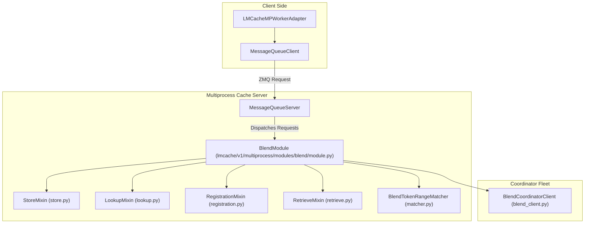
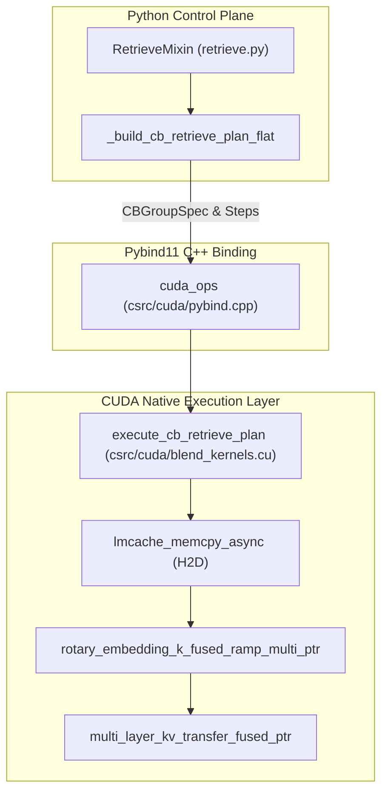
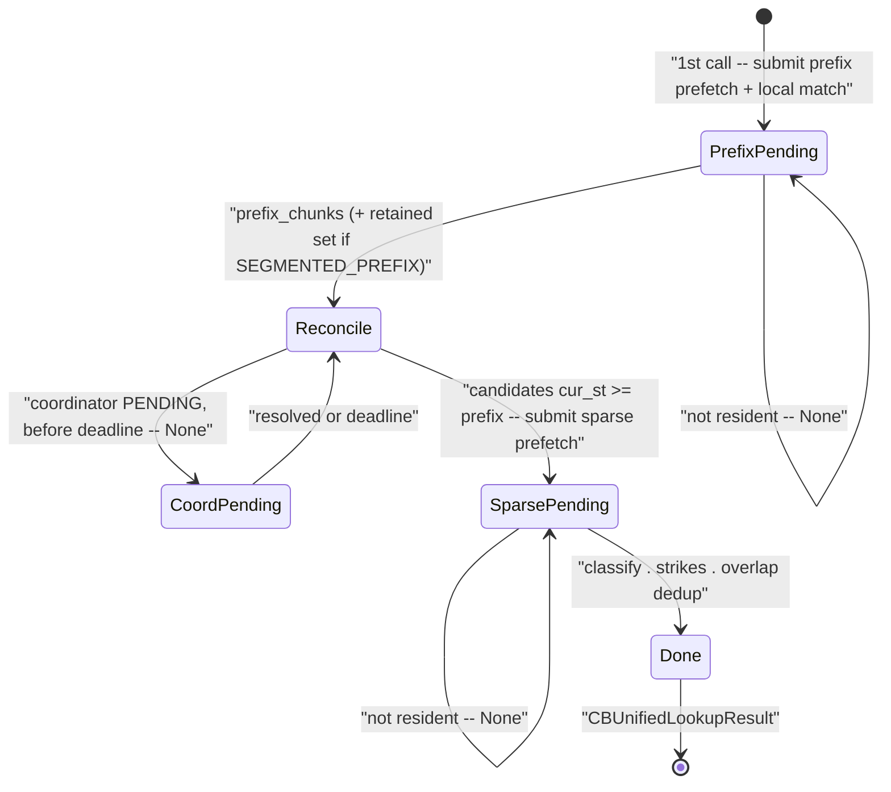
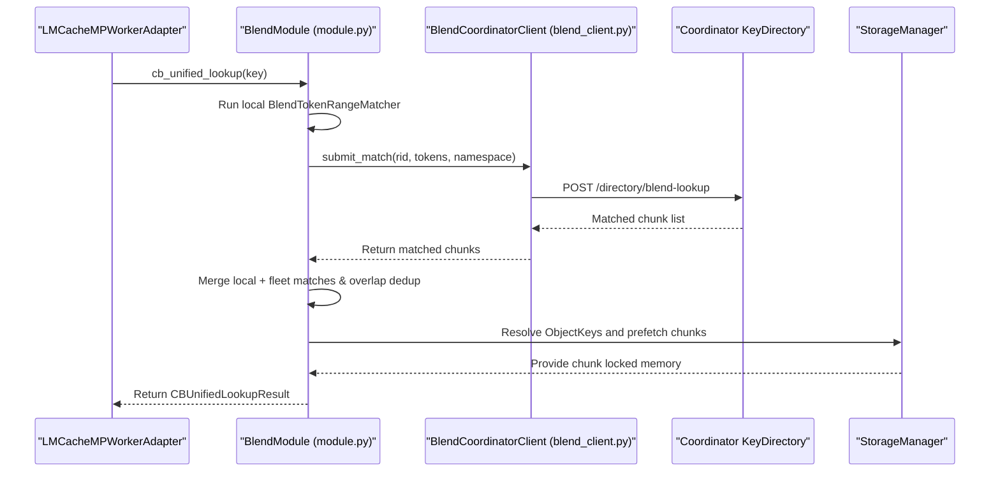

<!-- source: DeepWiki mcp.deepwiki.com · repo LMCache/LMCache · extra page BlendEngine and Content-Based Caching · fetched 2026-10-21 -->

# BlendEngine and Content-Based Caching

Relevant source files

The following files were used as context for generating this wiki page:

- [benchmarks/microbenchmark/bitmap_ops_benchmark.py](benchmarks/microbenchmark/bitmap_ops_benchmark.py)
- [csrc/cuda/blend_kernels.cu](csrc/cuda/blend_kernels.cu)
- [csrc/cuda/blend_kernels.cuh](csrc/cuda/blend_kernels.cuh)
- [csrc/cuda/dispatch_utils.h](csrc/cuda/dispatch_utils.h)
- [csrc/cuda/pos_kernels.cu](csrc/cuda/pos_kernels.cu)
- [csrc/cuda/pos_kernels.cuh](csrc/cuda/pos_kernels.cuh)
- [csrc/cuda/pybind.cpp](csrc/cuda/pybind.cpp)
- [csrc/lmcache_native/bitmap.h](csrc/lmcache_native/bitmap.h)
- [csrc/lmcache_native/fold.cpp](csrc/lmcache_native/fold.cpp)
- [csrc/lmcache_native/fold.h](csrc/lmcache_native/fold.h)
- [docs/design/v1/distributed/bitmap_ops/README.md](docs/design/v1/distributed/bitmap_ops/README.md)
- [docs/design/v1/multiprocess/modules/blend.md](docs/design/v1/multiprocess/modules/blend.md)
- [lmcache/v1/distributed/bitmap_ops/__init__.py](lmcache/v1/distributed/bitmap_ops/__init__.py)
- [lmcache/v1/distributed/bitmap_ops/fold.py](lmcache/v1/distributed/bitmap_ops/fold.py)
- [lmcache/v1/multiprocess/modules/blend/lookup.py](lmcache/v1/multiprocess/modules/blend/lookup.py)
- [lmcache/v1/multiprocess/modules/blend/module.py](lmcache/v1/multiprocess/modules/blend/module.py)
- [lmcache/v1/multiprocess/modules/blend/registration.py](lmcache/v1/multiprocess/modules/blend/registration.py)
- [lmcache/v1/multiprocess/modules/blend/reorder.py](lmcache/v1/multiprocess/modules/blend/reorder.py)
- [lmcache/v1/multiprocess/modules/blend/retrieve.py](lmcache/v1/multiprocess/modules/blend/retrieve.py)
- [lmcache/v1/multiprocess/modules/blend/rope.py](lmcache/v1/multiprocess/modules/blend/rope.py)
- [lmcache/v1/multiprocess/modules/blend/store.py](lmcache/v1/multiprocess/modules/blend/store.py)
- [lmcache/v1/multiprocess/transport/grpc_impl/protos/blend_service.proto](lmcache/v1/multiprocess/transport/grpc_impl/protos/blend_service.proto)
- [tests/v1/distributed/test_bitmap_ops.py](tests/v1/distributed/test_bitmap_ops.py)
- [tests/v1/multiprocess/test_blend_observability.py](tests/v1/multiprocess/test_blend_observability.py)
- [tests/v1/multiprocess/test_blend_reorder.py](tests/v1/multiprocess/test_blend_reorder.py)
- [tests/v1/multiprocess/test_blend_retrieve.py](tests/v1/multiprocess/test_blend_retrieve.py)
- [tests/v1/multiprocess/test_blend_rope.py](tests/v1/multiprocess/test_blend_rope.py)
- [tests/v1/multiprocess/test_blend_store.py](tests/v1/multiprocess/test_blend_store.py)

## Purpose and Scope

This page details the architecture and implementation of the `BlendEngine`, focusing on content-based caching (CBC) within LMCache's multiprocess cache server environment. It covers critical blend modules (`BlendModule`, mixins), asynchronous fingerprint registration, blend kernels, the blend lookup client, and sub-sequence matching for non-prefix reuse.

Sources: `lmcache/v1/multiprocess/modules/blend/module.py:56-62](), `lmcache/v1/multiprocess/modules/blend/store.py:41-81](), `lmcache/v1/multiprocess/modules/blend/lookup.py:91-117](), `lmcache/v1/multiprocess/modules/blend/retrieve.py:1-179]()

---

## Content-Based Caching Overview

Content-Based Caching (CBC) departs from traditional prefix caching by enabling KV cache reuse anywhere within a request, based on matching token sub-sequences rather than fixed prefix positions.

Key innovations include:

1. **Rolling Fingerprint Hashes:** Tokens are fingerprinted via rolling hash algorithms that slide over token sequences, capturing content signatures at arbitrary alignments.
2. **Asynchronous Fingerprint Registration:** The `StoreMixin` enqueues chunk fingerprints via the device host-func dispatcher (`CB_FINGERPRINTS_KIND`), ordering registrations after L1 commits without blocking driver threads (`[lmcache/v1/multiprocess/modules/blend/store.py:61-161]()`).
3. **Local Fingerprint Matcher:** The `BlendTokenRangeMatcher` indexes these fingerprints for efficient lookup within a single multiprocess cache server.
4. **Sparse Prefetch and Re-RoPE:** Once matches are found, sparse prefetch combines block-wise memory fetches, followed by re-RoPE transformations handled during retrieval (`_CBRopeState` encapsulates parameters) (`[lmcache/v1/multiprocess/modules/blend/rope.py:30-49]()`).
5. **Fleet-Wide Lookup Support:** The `BlendCoordinatorClient` queries a coordinator service to discover chunks cached anywhere in a fleet.

Sources: `lmcache/v1/multiprocess/modules/blend/store.py:61-161](), `lmcache/v1/multiprocess/modules/blend/rope.py:30-49]()

---

## BlendEngine Architecture and Code Entity Mapping

The diagram below maps natural language concepts of the BlendEngine and content-based caching system to concrete code entities across LMCache components, bridging natural language spaces to code identifiers.

*Title*: **BlendEngine System to Code Entity Mapping**

Sources: `lmcache/v1/multiprocess/modules/blend/module.py:56-62](), `lmcache/v1/multiprocess/modules/blend/store.py:41-81](), `lmcache/v1/multiprocess/modules/blend/lookup.py:91-117](), `lmcache/v1/multiprocess/modules/blend/registration.py:36-67](), `lmcache/v1/multiprocess/modules/blend/retrieve.py:99-118]()

---

## Blend Modules and Mixin Architecture

The server-side `BlendModule` (`[lmcache/v1/multiprocess/modules/blend/module.py:56-62]`) composes multiple mixins driving the CBC lifecycle:

- **`StoreMixin` (`[lmcache/v1/multiprocess/modules/blend/store.py:41-161]()`)**: Shadows `STORE` operations. Delegates KV writes to `LMCacheDrivenTransferModule`, then enqueues chunk hashes on worker 0 for asynchronous fingerprint registration ordered after the L1 commit.
- **`LookupMixin`**: Implements `CB_UNIFIED_LOOKUP` FSM handling prefix legs, local fingerprint matching, coordinator queries, and sparse leg aggregation.
- **`RegistrationMixin` (`[lmcache/v1/multiprocess/modules/blend/registration.py:36-67]()`)**: Manages rotary position embedding (`_CBRopeState`) registration and unregistration.
- **`RetrieveMixin` (`[lmcache/v1/multiprocess/modules/blend/retrieve.py:99-118]()`)**: Implements `CB_RETRIEVE_PRE_COMPUTED` for plan-then-execute KV retrieval, staging slot buffers, and calling native CUDA scatter/re-RoPE routines.

Sources: `lmcache/v1/multiprocess/modules/blend/module.py:56-62](), `lmcache/v1/multiprocess/modules/blend/store.py:41-161](), `lmcache/v1/multiprocess/modules/blend/registration.py:36-67](), `lmcache/v1/multiprocess/modules/blend/retrieve.py:99-118]()

---

## Blend Kernels and Native Execution

Native CUDA kernels underpin blend operations for GPU efficiency, exposed via Pybind11 bindings (`[csrc/cuda/pybind.cpp:31-140]()`) and specialized fold/unfold modules (`[lmcache/v1/distributed/bitmap_ops/fold.py:1-65]()`).

Key kernel functionalities include:
- **Fold/Unfold Operations (`[lmcache/v1/distributed/bitmap_ops/fold.py:92-164]()`)**: Combines per-group presence bitmaps across sliding window constraints and object groups to compute model-wide hit lengths and generate retain masks.
- **Retrieve Plans (`[csrc/cuda/blend_kernels.cuh:24-102]()`)**: `CBGroupSpec`, `CBRetrieveStep`, and `execute_cb_retrieve_plan` encapsulate slot-mapping device buffers and invariant specs for native execution (`[csrc/cuda/blend_kernels.cu:12-165]()`).

*Title*: **Retrieve and Native Plan Execution Flow to Code Entities**

Sources: `csrc/cuda/pybind.cpp:31-140](), `csrc/cuda/blend_kernels.cuh:24-102](), `csrc/cuda/blend_kernels.cu:12-166](), `lmcache/v1/distributed/bitmap_ops/fold.py:92-164]()

---

## Blend Lookup Client and Unified Lookup FSM

The `BlendCoordinatorClient` manages asynchronous communication with the fleet-wide coordinator. Concurrently, `LookupMixin` coordinates unified lookups using `_CBUnifiedJob` states (`[lmcache/v1/multiprocess/modules/blend/lookup.py:56-90]()`).

*Title*: **Unified Lookup Execution FSM**

Sources: `lmcache/v1/multiprocess/modules/blend/lookup.py:56-117]()

---

## Sub-Sequence Matching and Asynchronous Fingerprint Registration

Sub-sequence matching enables non-prefix KV cache reuse. `StoreMixin` enqueues fingerprint jobs via `_fingerprint_queue` (`[lmcache/v1/multiprocess/modules/blend/store.py:41-154]()`), which are drained by a background worker (`_drain_fingerprint_queue`) calling `BlendTokenRangeMatcher.on_new_token_hashes` (`[tests/v1/multiprocess/test_blend_store.py:37-99]()`).

Sources: `lmcache/v1/multiprocess/modules/blend/store.py:41-154](), `tests/v1/multiprocess/test_blend_store.py:37-99]()

---

## Fleet-Wide CacheBlend Lookup Flow

The following sequence diagram illustrates the integration of local fingerprint matching, coordinator lookups, and sparse prefetch operations:

*Title*: **Fleet-Wide CacheBlend Lookup Execution Flow**

Sources: `lmcache/v1/multiprocess/modules/blend/lookup.py:91-165]()

---

## Data Structures and Configuration

| Type | Description | File Reference |
|---|---|---|
| `CBMatchResult` | Matched token sub-sequence segments with query/stored offsets and chunk hash | `[lmcache/v1/multiprocess/custom_types.py:31-33]()` |
| `_CBRopeState` | Per-instance re-RoPE rotary embedding state and rotation windows | `[lmcache/v1/multiprocess/modules/blend/rope.py:30-49]()` |
| `CBGroupSpec` | Per-kernel-group invariants for native plan execution | `[csrc/cuda/blend_kernels.cuh:24-56]()` |
| `CBRetrieveStep` | One batch of tmp slots: H2D staging, then re-RoPE, then scatter | `[csrc/cuda/blend_kernels.cuh:78-82]()` |

Sources: `lmcache/v1/multiprocess/custom_types.py:31-33](), `lmcache/v1/multiprocess/modules/blend/rope.py:30-49](), `csrc/cuda/blend_kernels.cuh:24-82]()

---

# Summary

The `BlendEngine` and content-based caching subsystem extends LMCache to support high-performance KV cache reuse for arbitrary token sub-sequences. By combining asynchronous fingerprint registration, local range matching, fleet-wide coordinator lookups, and GPU-optimized native re-RoPE and scatter plans, LMCache achieves high cache hit rates and lower serving latency for LLM workloads.

---

# References

- `lmcache/v1/multiprocess/modules/blend/module.py:1-160`
- `lmcache/v1/multiprocess/modules/blend/store.py:1-161`
- `lmcache/v1/multiprocess/modules/blend/lookup.py:1-165`
- `lmcache/v1/multiprocess/modules/blend/retrieve.py:1-179`
- `lmcache/v1/multiprocess/modules/blend/registration.py:1-162`
- `lmcache/v1/multiprocess/modules/blend/rope.py:1-130`
- `lmcache/v1/distributed/bitmap_ops/fold.py:1-164`
- `csrc/cuda/blend_kernels.cuh:1-102`
- `csrc/cuda/blend_kernels.cu:1-166`
- `csrc/cuda/pybind.cpp:31-140`
- `tests/v1/multiprocess/test_blend_store.py:1-99`

---

