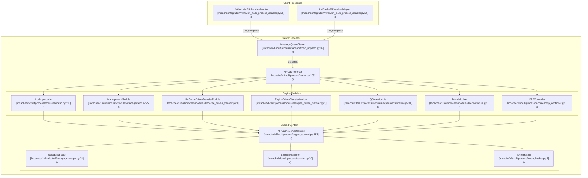
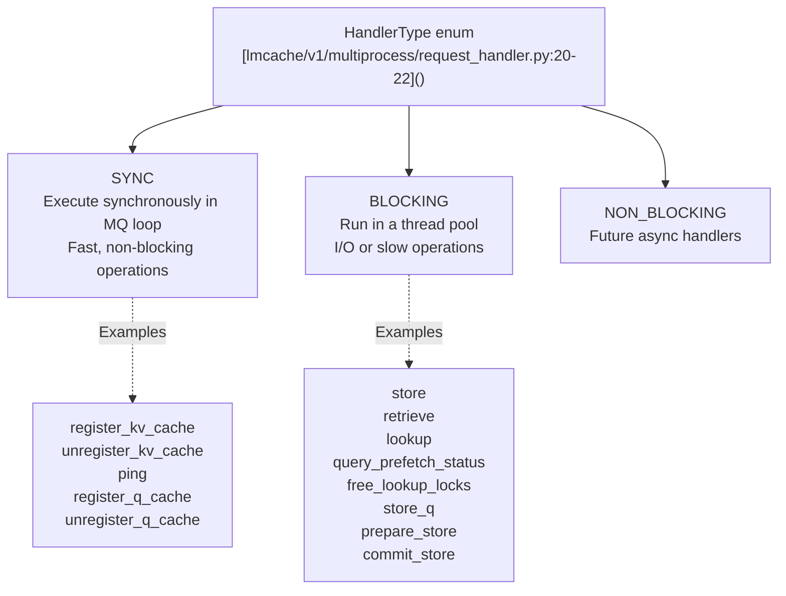
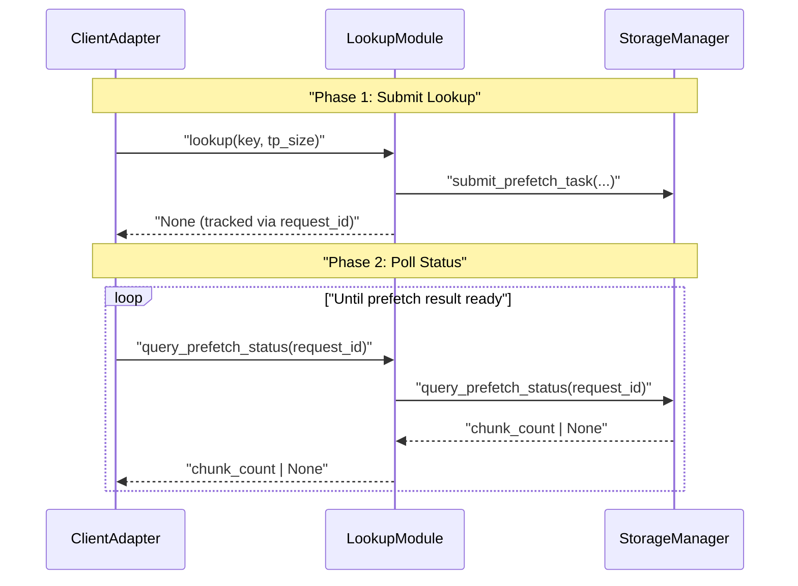

<!-- source: DeepWiki mcp.deepwiki.com · repo LMCache/LMCache · extra page MPCacheEngine and Request Handlers · fetched 2026-10-21 -->

# MPCacheEngine and Request Handlers

Relevant source files

The following files were used as context for generating this wiki page:

- [.buildkite/k3_tests/multiprocess/scripts/stop-processes.py](.buildkite/k3_tests/multiprocess/scripts/stop-processes.py)
- [.buildkite/k3_tests/multiprocess/scripts/tests/test_stop_processes.py](.buildkite/k3_tests/multiprocess/scripts/tests/test_stop_processes.py)
- [.buildkite/k3_tests/multiprocess/scripts/workloads/vllm/fault-tolerance.sh](.buildkite/k3_tests/multiprocess/scripts/workloads/vllm/fault-tolerance.sh)
- [docs/design/v1/multiprocess/transport/request_transport.md](docs/design/v1/multiprocess/transport/request_transport.md)
- [docs/source/cli/server.rst](docs/source/cli/server.rst)
- [lmcache/v1/multiprocess/config.py](lmcache/v1/multiprocess/config.py)
- [lmcache/v1/multiprocess/custom_types.py](lmcache/v1/multiprocess/custom_types.py)
- [lmcache/v1/multiprocess/engine_context.py](lmcache/v1/multiprocess/engine_context.py)
- [lmcache/v1/multiprocess/http_server.py](lmcache/v1/multiprocess/http_server.py)
- [lmcache/v1/multiprocess/modules/lookup.py](lmcache/v1/multiprocess/modules/lookup.py)
- [lmcache/v1/multiprocess/request_handler.py](lmcache/v1/multiprocess/request_handler.py)
- [lmcache/v1/multiprocess/rpc.py](lmcache/v1/multiprocess/rpc.py)
- [lmcache/v1/multiprocess/server.py](lmcache/v1/multiprocess/server.py)
- [lmcache/v1/multiprocess/session.py](lmcache/v1/multiprocess/session.py)
- [lmcache/v1/multiprocess/transport/grpc_impl/method_registry.py](lmcache/v1/multiprocess/transport/grpc_impl/method_registry.py)
- [lmcache/v1/multiprocess/transport/grpc_impl/protos/extension_service.proto](lmcache/v1/multiprocess/transport/grpc_impl/protos/extension_service.proto)
- [lmcache/v1/multiprocess/transport/grpc_impl/protos/kv_event_service.proto](lmcache/v1/multiprocess/transport/grpc_impl/protos/kv_event_service.proto)
- [lmcache/v1/multiprocess/transport/grpc_impl/protos/management_service.proto](lmcache/v1/multiprocess/transport/grpc_impl/protos/management_service.proto)
- [lmcache/v1/multiprocess/transport/zmq_impl/mq.py](lmcache/v1/multiprocess/transport/zmq_impl/mq.py)
- [tests/v1/multiprocess/test_cache_server.py](tests/v1/multiprocess/test_cache_server.py)
- [tests/v1/multiprocess/test_config.py](tests/v1/multiprocess/test_config.py)
- [tests/v1/multiprocess/test_custom_types.py](tests/v1/multiprocess/test_custom_types.py)
- [tests/v1/multiprocess/test_ext_server_module.py](tests/v1/multiprocess/test_ext_server_module.py)
- [tests/v1/multiprocess/test_free_locks.py](tests/v1/multiprocess/test_free_locks.py)
- [tests/v1/multiprocess/test_lookup_wait_prefetch.py](tests/v1/multiprocess/test_lookup_wait_prefetch.py)
- [tests/v1/multiprocess/test_mq.py](tests/v1/multiprocess/test_mq.py)
- [tests/v1/multiprocess/test_mq_handler_helpers.py](tests/v1/multiprocess/test_mq_handler_helpers.py)
- [tests/v1/multiprocess/test_session.py](tests/v1/multiprocess/test_session.py)
- [tests/v1/multiprocess/test_unified_touch.py](tests/v1/multiprocess/test_unified_touch.py)

## Purpose and Scope

This page details the `MPCacheServer` (historically and internally referred to as `MPCacheEngine`) and its request handling architecture. It describes the multiprocess server's modular design, focusing on key server modules—including `lookup`, `management`, `transfer`, `qstore`, and `blend`—and explains the request handling protocol. The page also covers session lifecycle management, including the use of the `RequestType` protocol and session tracking components.

The topics covered include:
- Modular architecture of the MP server with pluggable engine modules.
- Request handler types and registration (`HandlerType`).
- Store, retrieve, and lookup request semantics.
- Session tracking and management for per-request state via `Session` and `SessionManager`.

For more information on related components, see linked pages for the ZMQ message queue server [3.3 Multi-Process Cache Server](), the blend engine [3.3.3 BlendEngine and Content-Based Caching](), and the `CudaIPCWrapper` for CUDA zero-copy transfers [3.3.2 CUDA IPC and Zero-Copy Transfer]().

Sources: [docs/source/mp/index.rst:106-134](), [lmcache/v1/multiprocess/server.py:65-143](), [lmcache/v1/multiprocess/request_handler.py:20-30](), [lmcache/v1/multiprocess/modules/lookup.py:103-187](), [lmcache/v1/multiprocess/session.py:30-55]()

---

## MPCacheServer Overview

### Architecture and Components

The `MPCacheServer` class orchestrates a set of specialized engine modules that collectively serve GPU KV cache requests from multiple worker and scheduler processes [lmcache/v1/multiprocess/server.py:103-122](). It holds a shared `MPCacheServerContext` encapsulating common infrastructure such as the `StorageManager`, `SessionManager`, and `TokenHasher` [lmcache/v1/multiprocess/server.py:115-126]().

Components integrated into the server include:

- **LookupModule**: Orchestrates prefix cache lookups with asynchronous prefetch and lock management [lmcache/v1/multiprocess/modules/lookup.py:115-143]().
- **ManagementModule**: Handles registration, shutdown, periodic ping, and liveness of worker instances [lmcache/v1/multiprocess/server.py:79-91]().
- **Transfer Modules**: Two modes implemented—
  - `LMCacheDrivenTransferModule` for server-driven data movement [lmcache/v1/multiprocess/modules/lmcache_driven_transfer.py:1-68]().
  - `EngineDrivenTransferModule` for engine-driven gather/scatter copies [lmcache/v1/multiprocess/modules/engine_driven_transfer.py:1-62]().
- **QStoreModule**: Supports paged Q ring buffer storage for intermediate models [lmcache/v1/multiprocess/modules/experimental/qstore.py:46-54]().
- **BlendModule**: Implements blending of KV cache segments enabling non-prefix reuse and approximate caching [lmcache/v1/multiprocess/config.py:58-82]().
- **P2PController**: Manages peer discovery and serves distributed lookup requests among multiple MP servers for P2P cache sharing [lmcache/v1/multiprocess/modules/p2p_controller.py:1-71]().

All these modules interact with the shared context and participate in handling various request types defined by the transport protocols. Incoming requests are dispatched by the underlying message queue server to the appropriate module and handler [lmcache/v1/multiprocess/server.py:103-180]().

Title: MPCacheServer Architecture and Code Entities

Sources: [docs/source/mp/index.rst:106-134](), [lmcache/v1/multiprocess/server.py:103-126](), [lmcache/v1/multiprocess/engine_context.py:183-210](), [lmcache/v1/multiprocess/transport/zmq_impl/mq.py:35-36]()

### Module Initialization and State

The server initializes its engine modules according to configuration options (`MPServerConfig`) covering engine type and transfer mode [lmcache/v1/multiprocess/server.py:182-189](), [lmcache/v1/multiprocess/config.py:25-90](). The `_build_modules()` function adds appropriate module instances:
- Basic modules such as `LookupModule` and `ManagementModule` are always present [lmcache/v1/multiprocess/modules/lookup.py:115-143]().
- Transfer modules are added depending on whether transfer mode is `lmcache_driven` or `engine_driven` [lmcache/v1/multiprocess/config.py:83-89]().
- Experimental modules like `QStoreModule` and `BlendModule` are conditionally included [lmcache/v1/multiprocess/config.py:58-82](), [lmcache/v1/multiprocess/modules/experimental/qstore.py:46-54]().
- The `P2PController` is enabled if configured with a peer advertise URL [lmcache/v1/multiprocess/config.py:100-102]().

Sources: [lmcache/v1/multiprocess/server.py:182-189](), [lmcache/v1/multiprocess/config.py:25-102]()

---

## Request Handler Type System

Request handlers are decorated functions registered as responders to specific requests identified by request operations. The execution model is classified using the `HandlerType` enum defined in `lmcache.v1.multiprocess.request_handler` [lmcache/v1/multiprocess/request_handler.py:20-22]():

- `SYNC`: Run synchronously in the message loop (fast, non-blocking operations).
- `BLOCKING`: Run in a dedicated thread pool (for I/O-bound or slow operations).
- `NON_BLOCKING`: Planned extension for asynchronous handlers.

Title: Request Handler Execution Model

Sources: [lmcache/v1/multiprocess/request_handler.py:20-30](), [tests/v1/multiprocess/test_mq.py:78-109]()

---

## Registration and Unregistration Handlers

### `REGISTER_KV_CACHE` and `UNREGISTER_KV_CACHE`

Synchronous requests that register a GPU KV cache tensor set from a worker engine or unregister it, establishing CUDA IPC handles for zero-copy GPU memory access [tests/v1/multiprocess/test_mq_handler_helpers.py:39-106]().
- **Parameters (`REGISTER_KV_CACHE`)**: `gpu_id`, `kv_cache`, `model_name`, `world_size`, `engine_type`, `layout_hints`, `engine_group_infos`.
- **Handler Type**: `SYNC`

Sources: [tests/v1/multiprocess/test_mq_handler_helpers.py:39-106]()

### `REGISTER_Q_CACHE` and `UNREGISTER_Q_CACHE`

Similar to KV cache registration but handles paged Q ring buffer storage for intermediate models using `QStoreModule` [lmcache/v1/multiprocess/modules/experimental/qstore.py:46-54]().
- **Handler Type**: `SYNC`

Sources: [lmcache/v1/multiprocess/modules/experimental/qstore.py:46-54]()

---

## Store and Retrieve Handlers

### `STORE` and `STORE_Q`

Stores KV cache or Q ring buffer blocks into backend storage [tests/v1/multiprocess/test_mq_handler_helpers.py:114-141]().
- **Parameters**: `key` (`IPCCacheServerKey`), `gpu_id`, `gpu_block_ids`, `ipc_handle` (CUDA event IPC handle).
- **Returns**: Tuple of `(event handle bytes, success boolean)` [tests/v1/multiprocess/test_mq_handler_helpers.py:126-128]().
- **Handler Type**: `BLOCKING`

Sources: [tests/v1/multiprocess/custom_types.py:27-194](), [tests/v1/multiprocess/test_mq_handler_helpers.py:114-141]()

### `RETRIEVE`

Retrieves KV cache blocks from storage back to GPU memory [tests/v1/multiprocess/test_mq_handler_helpers.py:148-183]().
- **Parameters**: `key`, `gpu_id`, `gpu_block_ids`, `event_handler`, `skip_first_n_tokens`.
- **Returns**: Tuple of `(event handle bytes, success boolean)` [tests/v1/multiprocess/test_mq_handler_helpers.py:165-167]().
- **Handler Type**: `BLOCKING`

Sources: [tests/v1/multiprocess/test_mq_handler_helpers.py:148-183]()

---

## Lookup Handlers and Two-Phase Lookup

### Two-Phase Lookup Protocol

The lookup process is asynchronous and managed by `LookupModule`:
1. **Phase 1 — Lookup (Prefetch Submission)**: The client calls `lookup` with the cache key, which submits a prefetch task to the storage manager and registers the job under `key.request_id` [lmcache/v1/multiprocess/modules/lookup.py:146-173]().
2. **Phase 2 — Polling Status**: The client polls `query_prefetch_status` or `wait_prefetch_status` using the request ID until prefetch completes [tests/v1/multiprocess/test_cache_server.py:156-179]().

Title: Two-Phase Lookup Sequence

Sources: [lmcache/v1/multiprocess/modules/lookup.py:146-187](), [tests/v1/multiprocess/test_cache_server.py:156-179]()

---

## Session Handling

Session management tracks per-request state such as accumulated token sequences, chunk hashes, and lookup lock metadata in `Session` and `SessionManager` [lmcache/v1/multiprocess/session.py:30-55]().

### `Session`

The `Session` dataclass maintains [lmcache/v1/multiprocess/session.py:31-55]():
- Full token ID sequence for the request (`token_ids`) [lmcache/v1/multiprocess/session.py:40]().
- Precomputed chunk hashes (`chunk_hashes`) [lmcache/v1/multiprocess/session.py:41]().
- Rolling hash state (`last_prefix_hash`, `num_chunks_processed`) [lmcache/v1/multiprocess/session.py:42-43]().
- Lookup metadata including locked groups, hit chunks, and associated IPC key [lmcache/v1/multiprocess/session.py:45-48]().
- Thread safety via an internal threading lock [lmcache/v1/multiprocess/session.py:34-35]().

### `IPCCacheServerKey`

`IPCCacheServerKey` is the inter-process cache request key carrying model-level identifiers (`model_name`, `world_size`), worker ID, token range (`start`, `end`), full token sequence, request ID, and cache salt [lmcache/v1/multiprocess/custom_types.py:27-61]().

Sources: [lmcache/v1/multiprocess/session.py:30-55](), [lmcache/v1/multiprocess/custom_types.py:27-61]()

---

