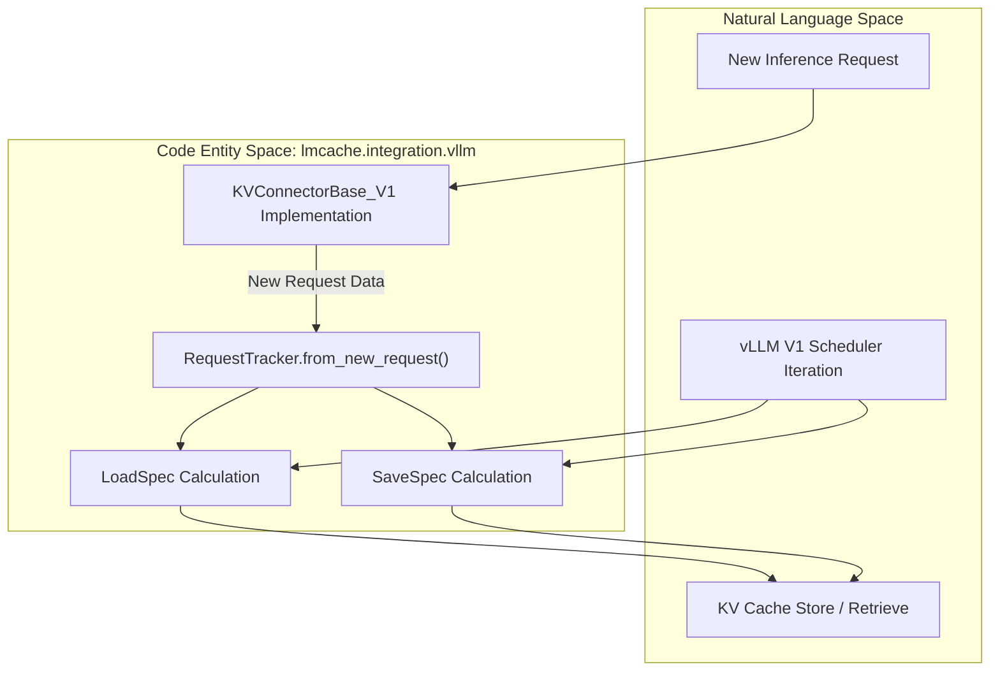
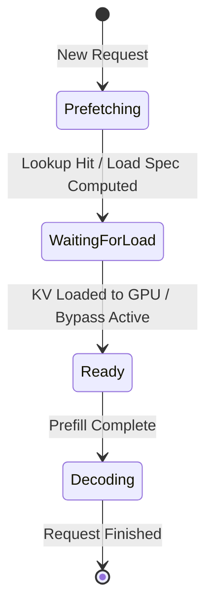
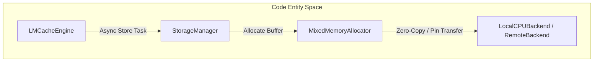

<!-- source: DeepWiki mcp.deepwiki.com · repo LMCache/LMCache · extra page Request Lifecycle and Tracking · fetched 2026-10-21 -->

# Request Lifecycle and Tracking

<details>
<summary>Relevant source files</summary>

The following files were used as context for generating this wiki page:

- [lmcache/integration/vllm/utils.py](lmcache/integration/vllm/utils.py)
- [lmcache/integration/vllm/vllm_v1_adapter.py](lmcache/integration/vllm/vllm_v1_adapter.py)
- [lmcache/utils.py](lmcache/utils.py)
- [lmcache/v1/cache_engine.py](lmcache/v1/cache_engine.py)
- [lmcache/v1/config.py](lmcache/v1/config.py)
- [lmcache/v1/lookup_client/abstract_client.py](lmcache/v1/lookup_client/abstract_client.py)
- [lmcache/v1/lookup_client/chunk_statistics_lookup_client.py](lmcache/v1/lookup_client/chunk_statistics_lookup_client.py)
- [lmcache/v1/lookup_client/factory.py](lmcache/v1/lookup_client/factory.py)
- [lmcache/v1/lookup_client/hit_limit_lookup_client.py](lmcache/v1/lookup_client/hit_limit_lookup_client.py)
- [lmcache/v1/lookup_client/lmcache_async_lookup_client.py](lmcache/v1/lookup_client/lmcache_async_lookup_client.py)
- [lmcache/v1/lookup_client/lmcache_lookup_client.py](lmcache/v1/lookup_client/lmcache_lookup_client.py)
- [lmcache/v1/lookup_client/lmcache_lookup_client_bypass.py](lmcache/v1/lookup_client/lmcache_lookup_client_bypass.py)
- [lmcache/v1/lookup_client/mooncake_lookup_client.py](lmcache/v1/lookup_client/mooncake_lookup_client.py)
- [lmcache/v1/offload_server/zmq_server.py](lmcache/v1/offload_server/zmq_server.py)
- [lmcache/v1/rpc_utils.py](lmcache/v1/rpc_utils.py)
- [lmcache/v1/token_database.py](lmcache/v1/token_database.py)
- [tests/v1/lookup_client/test_chunk_statistics_lookup_client.py](tests/v1/lookup_client/test_chunk_statistics_lookup_client.py)
- [tests/v1/test_token_database.py](tests/v1/test_token_database.py)

</details>


## Purpose and Scope

This page details the request lifecycle tracking mechanisms within LMCache, focusing on vLLM V1 integration. It explains the core data structures used to track inference requests (`RequestTracker`, `LoadSpec`, `SaveSpec`, `DisaggSpec`), how load and save specifications are calculated during scheduling, request state transitions, and lazy offload policies governing memory movement between GPU and CPU cache tiers.

Sources: [lmcache/integration/vllm/vllm_v1_adapter.py:64-197]()

---

## Request Tracking Components

LMCache manages per-request metadata and tracking using dedicated data classes defined in the vLLM V1 adapter module.

### RequestTracker

The `RequestTracker` class maintains the active state of an inference request during prompt prefill and streaming decode phases. It aggregates token IDs, vLLM block IDs, multimodal features, and request-specific configurations [lmcache/integration/vllm/vllm_v1_adapter.py:104-139]().

```python
@dataclass
class RequestTracker:
    req_id: str
    prompt_len: int
    token_ids: list[int]
    allocated_block_ids: list[int]
    num_saved_tokens: int = 0
    disagg_spec: Optional[DisaggSpec] = None
    mm_hashes: Optional[list[str]] = None
    mm_positions: Optional[list["PlaceholderRange"]] = None
    request_configs: Optional[dict] = None
    is_decode_phase = False
    skip_save: bool = False
    num_lmcache_cached_tokens: int = 0
```

Sources: [lmcache/integration/vllm/vllm_v1_adapter.py:104-139]()

### LoadSpec and SaveSpec

To coordinate cache loading and saving operations between vLLM's scheduler and LMCache's storage engine, LMCache computes `LoadSpec` and `SaveSpec` structures [lmcache/integration/vllm/vllm_v1_adapter.py:66-81]():

- `LoadSpec`: Specifies the number of tokens cached locally in vLLM (`vllm_cached_tokens`), the number cached in LMCache (`lmcache_cached_tokens`), and whether the scheduler permits loading (`can_load`).
- `SaveSpec`: Specifies leading tokens to skip (`skip_leading_tokens`) and whether saving is permitted (`can_save`).

```python
@dataclass
class LoadSpec:
    vllm_cached_tokens: int
    lmcache_cached_tokens: int
    can_load: bool

@dataclass
class SaveSpec:
    skip_leading_tokens: int
    can_save: bool
```

Sources: [lmcache/integration/vllm/vllm_v1_adapter.py:66-81]()

---

## Request Lifecycle Architecture

The following diagram illustrates how incoming requests are converted into `RequestTracker` instances and evaluated against the token database and LMCache storage backends.



*Figure 1: Component Architecture Bridging Request Lifecycle to Code Entities*

Sources: [lmcache/integration/vllm/vllm_v1_adapter.py:104-197]()

---

## Request State Transitions and Calculation

During each scheduling step, requests transition through states determined by local vLLM hit counts, LMCache lookup results, and block allocations.



*Figure 2: Request State Machine during Inference*

Sources: [lmcache/integration/vllm/vllm_v1_adapter.py:104-197](), [lmcache/v1/lookup_client/lmcache_async_lookup_client.py:159-189]()

---

## Lazy Offload Policies

LMCache incorporates lazy offload policies to optimize memory movement between GPU HBM and CPU/remote storage tiers. Instead of eagerly offloading every completed token block, offload tasks are deferred and managed via asynchronous workers and backpressure mechanisms.



*Figure 3: Lazy Offload Data Flow and Tier Coordination*

Sources: [lmcache/v1/cache_engine.py:83-140](), [lmcache/v1/storage_backend/storage_manager.py]()

---

# Summary

This page covered the request lifecycle and tracking mechanisms in LMCache:
- Core tracking primitives including `RequestTracker`, `LoadSpec`, and `SaveSpec`.
- Integration points with vLLM V1 scheduling and lookup clients.
- State machines governing request execution phases.
- Lazy offload policies balancing GPU memory pressure and asynchronous cache persistence.

Sources: [lmcache/integration/vllm/vllm_v1_adapter.py:64-197](), [lmcache/v1/cache_engine.py:83-140]()

---

