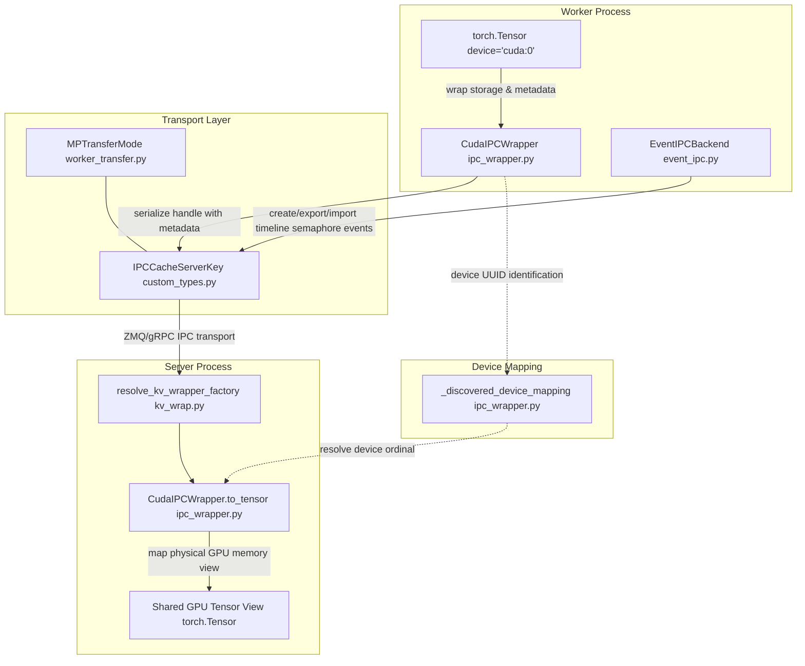
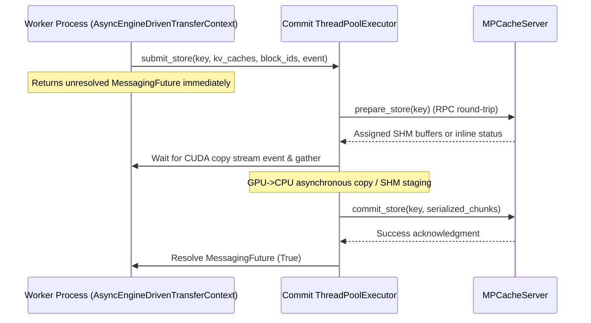

<!-- source: DeepWiki mcp.deepwiki.com · repo LMCache/LMCache · extra page CUDA IPC and Zero-Copy Transfer · fetched 2026-10-21 -->

# CUDA IPC and Zero-Copy Transfer

Relevant source files

The following files were used as context for generating this wiki page:

- [docs/design/ARCHITECTURE_MULTI_HARDWARE.md](docs/design/ARCHITECTURE_MULTI_HARDWARE.md)
- [docs/design/v1/distributed/storage_manager.md](docs/design/v1/distributed/storage_manager.md)
- [docs/design/v1/multiprocess/device_ipc_wrapper_design.md](docs/design/v1/multiprocess/device_ipc_wrapper_design.md)
- [docs/design/v1/multiprocess/engine_driven_transfer_design.md](docs/design/v1/multiprocess/engine_driven_transfer_design.md)
- [docs/design/v1/platform/device_ops_design.md](docs/design/v1/platform/device_ops_design.md)
- [docs/design/v1/platform/devices/npu/README.md](docs/design/v1/platform/devices/npu/README.md)
- [docs/source/developer_guide/extending_lmcache/adding_a_new_device_backend.rst](docs/source/developer_guide/extending_lmcache/adding_a_new_device_backend.rst)
- [docs/source/mp/request_transport.rst](docs/source/mp/request_transport.rst)
- [lmcache/v1/multiprocess/modules/engine_driven_transfer.py](lmcache/v1/multiprocess/modules/engine_driven_transfer.py)
- [lmcache/v1/multiprocess/modules/lmcache_driven_transfer.py](lmcache/v1/multiprocess/modules/lmcache_driven_transfer.py)
- [lmcache/v1/multiprocess/modules/server_transfer.py](lmcache/v1/multiprocess/modules/server_transfer.py)
- [lmcache/v1/multiprocess/transfer_context/__init__.py](lmcache/v1/multiprocess/transfer_context/__init__.py)
- [lmcache/v1/multiprocess/transfer_context/async_engine_driven.py](lmcache/v1/multiprocess/transfer_context/async_engine_driven.py)
- [lmcache/v1/multiprocess/transfer_context/base.py](lmcache/v1/multiprocess/transfer_context/base.py)
- [lmcache/v1/multiprocess/transfer_context/shm.py](lmcache/v1/multiprocess/transfer_context/shm.py)
- [lmcache/v1/multiprocess/transfer_context/worker_transfer.py](lmcache/v1/multiprocess/transfer_context/worker_transfer.py)
- [lmcache/v1/platform/base/ipc_wire.py](lmcache/v1/platform/base/ipc_wire.py)
- [lmcache/v1/platform/base/ipc_wrapper.py](lmcache/v1/platform/base/ipc_wrapper.py)
- [lmcache/v1/platform/devices/cpu/shm.py](lmcache/v1/platform/devices/cpu/shm.py)
- [lmcache/v1/platform/devices/cuda/ipc_wrapper.py](lmcache/v1/platform/devices/cuda/ipc_wrapper.py)
- [lmcache/v1/platform/devices/musa/ipc_wrapper.py](lmcache/v1/platform/devices/musa/ipc_wrapper.py)
- [lmcache/v1/platform/devices/npu/__init__.py](lmcache/v1/platform/devices/npu/__init__.py)
- [lmcache/v1/platform/devices/npu/cache_context.py](lmcache/v1/platform/devices/npu/cache_context.py)
- [lmcache/v1/platform/devices/npu/device_ops.py](lmcache/v1/platform/devices/npu/device_ops.py)
- [lmcache/v1/platform/devices/npu/event_ipc.py](lmcache/v1/platform/devices/npu/event_ipc.py)
- [lmcache/v1/platform/devices/npu/ipc_wrapper.py](lmcache/v1/platform/devices/npu/ipc_wrapper.py)
- [lmcache/v1/platform/kv_wrap.py](lmcache/v1/platform/kv_wrap.py)
- [tests/v1/distributed/test_memory_capacity.py](tests/v1/distributed/test_memory_capacity.py)
- [tests/v1/distributed/test_multi_l1.py](tests/v1/distributed/test_multi_l1.py)
- [tests/v1/multiprocess/test_async_engine_driven_transfer_context.py](tests/v1/multiprocess/test_async_engine_driven_transfer_context.py)
- [tests/v1/multiprocess/test_engine_driven_async_copy_lifetime.py](tests/v1/multiprocess/test_engine_driven_async_copy_lifetime.py)
- [tests/v1/multiprocess/test_engine_driven_device_dispatch.py](tests/v1/multiprocess/test_engine_driven_device_dispatch.py)
- [tests/v1/multiprocess/test_engine_driven_transfer.py](tests/v1/multiprocess/test_engine_driven_transfer.py)
- [tests/v1/multiprocess/test_event_ipc_handle_path.py](tests/v1/multiprocess/test_event_ipc_handle_path.py)
- [tests/v1/multiprocess/test_l1_owner_completion.py](tests/v1/multiprocess/test_l1_owner_completion.py)
- [tests/v1/multiprocess/test_lmcache_driven_transfer_skip.py](tests/v1/multiprocess/test_lmcache_driven_transfer_skip.py)
- [tests/v1/platform/devices/cuda/test_cuda_ipc_wrapper.py](tests/v1/platform/devices/cuda/test_cuda_ipc_wrapper.py)
- [tests/v1/platform/devices/cuda/test_vmm_ipc_wrapper.py](tests/v1/platform/devices/cuda/test_vmm_ipc_wrapper.py)
- [tests/v1/platform/devices/musa/test_musa_mp_handle.py](tests/v1/platform/devices/musa/test_musa_mp_handle.py)
- [tests/v1/platform/devices/npu/test_npu_cache_context.py](tests/v1/platform/devices/npu/test_npu_cache_context.py)
- [tests/v1/platform/devices/npu/test_npu_ipc_wrapper.py](tests/v1/platform/devices/npu/test_npu_ipc_wrapper.py)

This page documents the CUDA Inter-Process Communication (IPC) mechanism and zero-copy tensor transfer system used in LMCache's multiprocess cache server. This enables GPU tensors to be shared between the vLLM worker processes and the LMCache server process without copying data, significantly reducing memory overhead and latency.

## Purpose and Scope

The CUDA IPC and Zero-Copy Transfer system in LMCache provides the following core functionalities:

1. **`DeviceIPCWrapper` and Subclasses**: Encapsulates device-agnostic and CUDA IPC handle sharing for GPU tensor storage (`CudaIPCWrapper`, `RawCudaIPCWrapper`, `VmmCudaIPCWrapper`, and `CpuShmTensorWrapper`) to enable zero-copy access across processes `[docs/design/v1/multiprocess/device_ipc_wrapper_design.md:1-50]()`.

2. **GPU Tensor Sharing**: Supports sharing GPU tensors through IPC handles representing the tensor's storage, shape, dtype, and device identification, even for raw CUDA allocations `[docs/design/v1/multiprocess/device_ipc_wrapper_design.md:1-25]()`.

3. **Timeline Semaphore Event IPC**: Uses cross-process compatible CUDA timeline semaphore events to synchronize asynchronous GPU tensor transfers between worker and server `[lmcache/v1/platform/base/event_ipc.py:1-60]()`.

4. **Shared Memory (SHM) Transfer Contexts**: Supports CPU-side zero-copy transfers using POSIX shared memory as an alternative for CPU-only or non-CUDA workers `[lmcache/v1/multiprocess/transfer_context/base.py:1-120]()`.

5. **Worker-Driven and LMCache-Driven Transfer Contexts**: Implements flexible transfer modes via `MPTransferMode` with enforced routing to either worker-driven gather/scatter or LMCache-driven IPC zero-copy paths `[lmcache/v1/multiprocess/transfer_context/worker_transfer.py:48-161]()`.

Sources:  
[docs/design/v1/multiprocess/device_ipc_wrapper_design.md:1-50](),  
[lmcache/v1/multiprocess/transfer_context/worker_transfer.py:48-161](),  
[lmcache/v1/platform/base/event_ipc.py:1-60]()

---

## CUDA IPC Architecture Overview

CUDA IPC in LMCache enables zero-copy GPU tensor sharing by passing serialized CUDA IPC storage handles and synchronizing access through device events. The worker GPU tensors are wrapped with a `CudaIPCWrapper` which extracts IPC handles and related metadata. These wrapped objects are serialized via message serialization rules and communicated to the LMCache server process, where they are converted back into GPU tensor views mapping the same physical memory `[docs/design/v1/multiprocess/device_ipc_wrapper_design.md:1-45]()`.

The device UUID mapping solves the heterogeneity of device ordinal numbering across processes—e.g., due to differences in environment variable settings such as `CUDA_VISIBLE_DEVICES`—ensuring the correct GPU ordinal is used in the receiving process `[docs/design/v1/multiprocess/device_ipc_wrapper_design.md:35-40]()`.

Cross-process synchronization is orchestrated via timeline semaphore events, exported and imported via IPC handles, enabling asynchronous coordination of copy operations across GPU streams `[lmcache/v1/platform/base/event_ipc.py:20-60]()`.

### Data Flow Diagram Mapping Natural Language Concepts to Code Entities

Sources:  
[docs/design/v1/multiprocess/device_ipc_wrapper_design.md:1-45](),  
[lmcache/v1/multiprocess/transfer_context/worker_transfer.py:111-161]()

---

## `DeviceIPCWrapper` and Subclasses

The underlying base class `DeviceIPCWrapper` (defined in `lmcache/v1/platform/base/ipc_wrapper.py`) provides the shared contract for all KV-cache IPC serializers, enabling non-CUDA and CUDA wrappers to share a unified hierarchy `[docs/design/v1/multiprocess/device_ipc_wrapper_design.md:17-42]()`.

### Core Attributes and Hierarchy

| Wrapper Class | Device Type | Transport Mechanism | Reconstruction Method |
|---|---|---|---|
| `CudaIPCWrapper` | `cuda` | PyTorch `_share_cuda_()` storage handle | `_new_shared_cuda` + `set_()` `[docs/design/v1/multiprocess/device_ipc_wrapper_design.md:50-55]()` |
| `RawCudaIPCWrapper` | `cuda` | `cudaIpcGetMemHandle` (raw pointers) | `cudaIpcOpenMemHandle` -> CuPy -> DLPack `[docs/design/v1/multiprocess/device_ipc_wrapper_design.md:50-55]()` |
| `CpuShmTensorWrapper` | `cpu` | POSIX `shm_open` shared memory | `mmap` same segment `[docs/design/v1/multiprocess/device_ipc_wrapper_design.md:50-55]()` |
| `MusaIPCWrapper` | `musa` | TorchMUSA IPC API | `torch.musa.ipc.export_tensor` + `open_tensor` `[docs/design/v1/multiprocess/device_ipc_wrapper_design.md:50-55]()` |

### Key Operations

- `DeviceIPCWrapper` subclasses populate `dtype`, `shape`, `stride`, `storage_offset`, and `device_uuid` during initialization `[docs/design/v1/multiprocess/device_ipc_wrapper_design.md:35-38]`.
- `to_tensor()` is an abstract method implemented by each subclass to rebuild the logical tensor view from local resources `[docs/design/v1/multiprocess/device_ipc_wrapper_design.md:38-41]`.
- Serialization relies on typed MessagePack descriptors from `lmcache/v1/platform/base/ipc_wire.py`, avoiding unsafe `pickle.loads` calls during `REGISTER_KV_CACHE` steps `[docs/design/v1/multiprocess/device_ipc_wrapper_design.md:38-45, 92-100]()`.

Sources:  
[docs/design/v1/multiprocess/device_ipc_wrapper_design.md:1-60]()

---

## Device UUID Mapping

Due to potential differences in device ordinal numbering across processes, LMCache relies on CUDA device UUIDs to identify GPUs uniquely `[docs/design/v1/multiprocess/device_ipc_wrapper_design.md:35-40]()`.

### Device Mapping Details

- The global device discovery routines inspect device UUID strings to map them to local device indices.
- This mapping ensures that when the server receives an IPC handle referencing a specific device UUID, it correctly maps it to its local device ordinal, avoiding device mismatch across container or multi-GPU environments.
- Access to the mapping table is protected by internal thread locks to guarantee safe concurrent reads/writes during worker registrations.

Sources:  
[docs/design/v1/multiprocess/device_ipc_wrapper_design.md:35-45]()

---

## Transfer Context and Registration

The worker-side transfer context determines how KV caches are transferred between worker and server. LMCache supports multiple modes via `MPTransferMode`:

| Mode | Description |
|---|---|
| `AUTO` | Dispatches based on tensor device type; CUDA tensors use IPC path, else fallback `[lmcache/v1/multiprocess/transfer_context/worker_transfer.py:48-55]()` |
| `ENGINE_DRIVEN` | Workers gather/scatter KV data to/from CPU memory and serialize it `[lmcache/v1/multiprocess/transfer_context/worker_transfer.py:93-118]()` |
| `LMCACHE_DRIVEN` | Workers use CUDA IPC or POSIX SHM zero-copy wrappers with event IPC synchronization `[lmcache/v1/multiprocess/transfer_context/worker_transfer.py:139-160]()` |

### Mode Resolution and Construction

- `_resolve_mode()` coerces strings to proper `MPTransferMode` enum values, favoring the environment variable `LMCACHE_MP_TRANSFER_MODE` if no override is given `[lmcache/v1/multiprocess/transfer_context/worker_transfer.py:121-137]()`.
- `_build_lmcache_driven_context()` verifies the device supports IPC wrapper factories and event IPC features before creating a zero-copy-enabled context `[lmcache/v1/multiprocess/transfer_context/worker_transfer.py:139-160]()`.
- `_build_engine_driven_context()` selects asynchronous (`AsyncEngineDrivenTransferContext`) or synchronous (`EngineDrivenTransferContext`) engine-driven context depending on device capabilities `[lmcache/v1/multiprocess/transfer_context/worker_transfer.py:93-119]()`.

Sources:  
[lmcache/v1/multiprocess/transfer_context/worker_transfer.py:48-161]()

---

## Timeline Semaphore Event IPC

LMCache supports a timeline semaphore based event IPC backend for CUDA and accelerator GPUs, implemented via protocols in `EventIPCBackend` `[lmcache/v1/platform/base/event_ipc.py:1-60]()`. This backend is critical for synchronization between processes that cannot share standard CUDA event handles, e.g., isolated or containerized environments.

### Key Properties

- Uses hardware-specific driver API calls to create memory-backed timeline semaphores that can be shared across processes `[tests/v1/multiprocess/test_event_ipc_handle_path.py:20-60]()`.
- Supports asynchronous recording and waiting on device streams using timeline semaphore increments and waits, enabling synchronization with no host blocking `[tests/v1/multiprocess/test_event_ipc_handle_path.py:110-184]()`.
- Events are exported to shareable IPC handles that can be imported by other processes to create synchronized event objects `[tests/v1/multiprocess/test_event_ipc_handle_path.py:38-46]()`.

### Event Lifecycle API

1. **Create Event**: Allocate timeline semaphore and backing memory `[tests/v1/multiprocess/test_event_ipc_handle_path.py:32-36]()`.
2. **Record Event**: Enqueue semaphore increment on a device stream `[tests/v1/multiprocess/test_event_ipc_handle_path.py:47-49]()`.
3. **Export Event**: Serialize semaphore IPC handle for sharing `[tests/v1/multiprocess/test_event_ipc_handle_path.py:38-41]()`.
4. **Import Event**: Deserializes semaphore handle into a local event object `[tests/v1/multiprocess/test_event_ipc_handle_path.py:42-46]()`.
5. **Wait Event**: Enqueue waiting operation on a device stream for the semaphore value `[tests/v1/multiprocess/test_event_ipc_handle_path.py:50-52]()`.

Sources:  
[lmcache/v1/platform/base/event_ipc.py:1-60](),  
[tests/v1/multiprocess/test_event_ipc_handle_path.py:20-184]()

---

## Worker-Driven and Asynchronous Transfer Contexts

The worker manages KV cache transfer through the `TransferContext` abstraction. The `LMCacheDrivenTransferContext` subclass applies for zero-copy IPC-enabled devices, while `AsyncEngineDrivenTransferContext` handles asynchronous background execution for engine-driven modes `[lmcache/v1/multiprocess/transfer_context/worker_transfer.py:93-160]`, `[lmcache/v1/multiprocess/transfer_context/async_engine_driven.py:33-66]`.

### Sequence Diagram of Worker-Driven Async Store Operation

Sources:  
[lmcache/v1/multiprocess/transfer_context/async_engine_driven.py:33-106](),  
[tests/v1/multiprocess/test_async_engine_driven_transfer_context.py:134-147]()

---

# Summary

This section describes the LMCache IPC zero-copy system allowing efficient sharing and synchronization of GPU KV cache tensors across process boundaries.

| Area | Key Classes/Functions | File References |
|---|---|---|
| Device IPC Wrappers | `DeviceIPCWrapper`, `CudaIPCWrapper`, `RawCudaIPCWrapper`, `CpuShmTensorWrapper` | `docs/design/v1/multiprocess/device_ipc_wrapper_design.md` |
| Event IPC Interface | `EventIPCBackend` (protocol), `_FakeEventBackend` | `lmcache/v1/platform/base/event_ipc.py` |
| Worker Transfer Context | `MPTransferMode`, `LMCacheDrivenTransferContext`, `AsyncEngineDrivenTransferContext` | `lmcache/v1/multiprocess/transfer_context/worker_transfer.py`, `async_engine_driven.py` |

Sources:  
[docs/design/v1/multiprocess/device_ipc_wrapper_design.md:1-100](),  
[lmcache/v1/multiprocess/transfer_context/worker_transfer.py:48-161]()

---

