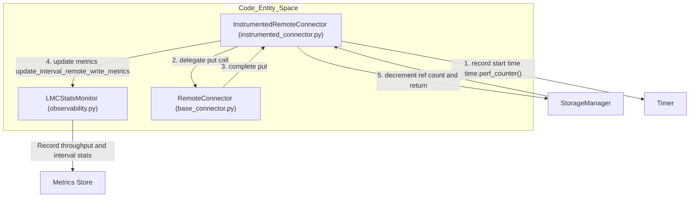
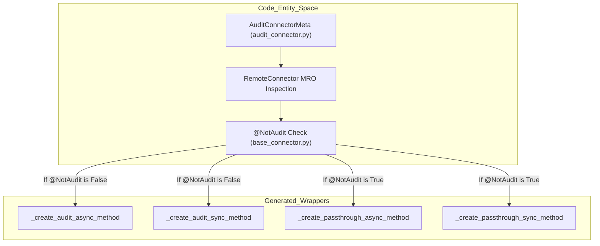

<!-- source: DeepWiki mcp.deepwiki.com · repo LMCache/LMCache · extra page Connector Wrappers and Instrumentation · fetched 2026-10-21 -->

# Connector Wrappers and Instrumentation

Relevant source files

The following files were used as context for generating this wiki page:

- [docs/source/kv_cache/storage_backends/mooncake.rst](docs/source/kv_cache/storage_backends/mooncake.rst)
- [examples/kv_cache_reuse/remote_backends/mooncakestore/README.md](examples/kv_cache_reuse/remote_backends/mooncakestore/README.md)
- [examples/kv_cache_reuse/remote_backends/mooncakestore/mooncake.yaml](examples/kv_cache_reuse/remote_backends/mooncakestore/mooncake.yaml)
- [lmcache/v1/storage_backend/connector/__init__.py](lmcache/v1/storage_backend/connector/__init__.py)
- [lmcache/v1/storage_backend/connector/audit_connector.py](lmcache/v1/storage_backend/connector/audit_connector.py)
- [lmcache/v1/storage_backend/connector/base_connector.py](lmcache/v1/storage_backend/connector/base_connector.py)
- [lmcache/v1/storage_backend/connector/blackhole_connector.py](lmcache/v1/storage_backend/connector/blackhole_connector.py)
- [lmcache/v1/storage_backend/connector/fs_connector.py](lmcache/v1/storage_backend/connector/fs_connector.py)
- [lmcache/v1/storage_backend/connector/instrumented_connector.py](lmcache/v1/storage_backend/connector/instrumented_connector.py)
- [lmcache/v1/storage_backend/connector/lm_connector.py](lmcache/v1/storage_backend/connector/lm_connector.py)
- [lmcache/v1/storage_backend/connector/mock_connector.py](lmcache/v1/storage_backend/connector/mock_connector.py)
- [lmcache/v1/storage_backend/connector/mooncakestore_connector.py](lmcache/v1/storage_backend/connector/mooncakestore_connector.py)
- [tests/v1/storage_backend/test_audit_connector.py](tests/v1/storage_backend/test_audit_connector.py)

This page explains the decorator pattern implementations (`InstrumentedRemoteConnector` and `AuditConnector`) used within LMCache to wrap remote storage connectors (`RemoteConnector`). These wrappers provide observability, metrics collection, and auditing capabilities while delegating actual data operations to underlying storage backend implementations.

---

## Overview

LMCache relies on two primary connector wrappers that extend the abstract base class `RemoteConnector` defined in `[lmcache/v1/storage_backend/connector/base_connector.py:31-34]()`:

| Wrapper Class | Purpose | Reference File and Lines |
|---|---|---|
| `InstrumentedRemoteConnector` | Adds performance metrics, operation duration tracking, and throughput measurement | `[lmcache/v1/storage_backend/connector/instrumented_connector.py:16-193]()` |
| `AuditConnector` | Adds detailed logging, auditing, and optional checksum verification via a custom metaclass | `[lmcache/v1/storage_backend/connector/audit_connector.py:21-361]()` |

Both wrapper classes encapsulate a reference to an underlying `RemoteConnector` implementation and intercept storage API methods such as `put`, `get`, `batched_put`, and `batched_get`.

Sources:  
`[lmcache/v1/storage_backend/connector/base_connector.py:31-34]`  
`[lmcache/v1/storage_backend/connector/instrumented_connector.py:16-193]`  
`[lmcache/v1/storage_backend/connector/audit_connector.py:21-362]`

---

## InstrumentedRemoteConnector

The `InstrumentedRemoteConnector` class `[lmcache/v1/storage_backend/connector/instrumented_connector.py:16-20]()` instruments remote storage operations by measuring operation latency and tracking data throughput, reporting these metrics to the singleton `LMCStatsMonitor` instance `[lmcache/v1/storage_backend/connector/instrumented_connector.py:22-24]`.

### Implementation Details

- It holds a private attribute `_connector` pointing to the wrapped `RemoteConnector` instance `[lmcache/v1/storage_backend/connector/instrumented_connector.py:22-23]`.
- Before executing operations like `put` or `get`, it captures a high-resolution performance counter via `time.perf_counter()` `[lmcache/v1/storage_backend/connector/instrumented_connector.py:29]`.
- Upon completion, it computes the elapsed duration and updates interval statistics via `LMCStatsMonitor.update_interval_remote_time_to_put()` and `update_interval_remote_write_metrics()` `[lmcache/v1/storage_backend/connector/instrumented_connector.py:36-38]`.
- Reference counting on `MemoryObj` instances is managed safely; for instance, `memory_obj.ref_count_down()` is ensured in a `finally` block during `put` operations `[lmcache/v1/storage_backend/connector/instrumented_connector.py:30-34]`.
- Non-instrumented helper methods and capability flags (such as `support_ping()`, `support_batched_put()`, etc.) are transparently delegated to the underlying connector `[lmcache/v1/storage_backend/connector/instrumented_connector.py:72-113]`.

### Diagram: Instrumented Connector Operation Flow

Title: "InstrumentedRemoteConnector Operation Flow"

Sources:  
`[lmcache/v1/storage_backend/connector/instrumented_connector.py:16-193]`  
`[lmcache/v1/storage_backend/connector/base_connector.py:31-34]`

---

## AuditConnector and Metaclass Generation

The `AuditConnector` class provides execution auditing, logging, and data integrity verification for remote storage operations `[lmcache/v1/storage_backend/connector/audit_connector.py:21-361]`.

### Dynamic Method Wrapping with Metaclass

`AuditConnector` utilizes a custom metaclass `AuditConnectorMeta` that dynamically generates wrapper methods for all methods defined in the `RemoteConnector` abstract base class `[lmcache/v1/storage_backend/connector/audit_connector.py:21-24]`:

- It traverses the Method Resolution Order (MRO) of `RemoteConnector` to discover all callable methods `[lmcache/v1/storage_backend/connector/audit_connector.py:31-36]`.
- Methods decorated with the `@NotAudit` decorator (`[lmcache/v1/storage_backend/connector/base_connector.py:22-28]()`) are wrapped with lightweight passthrough methods that bypass logging `[lmcache/v1/storage_backend/connector/audit_connector.py:53-61]`.
- Non-excluded methods receive audit wrapper functions (`_create_audit_async_method` or `_create_audit_sync_method`) that record execution start, duration, success, or failure with structured log messages `[lmcache/v1/storage_backend/connector/audit_connector.py:63-70]`.
- Abstract methods on the class are dynamically satisfied by these generated wrappers, clearing `__abstractmethods__` upon initialization `[lmcache/v1/storage_backend/connector/audit_connector.py:75-78]`.

### Diagram: Audit Metaclass Method Wrapper Generation

Title: "AuditConnectorMeta Dynamic Method Generation"

Sources:  
`[lmcache/v1/storage_backend/connector/audit_connector.py:21-81]`  
`[lmcache/v1/storage_backend/connector/base_connector.py:22-28]`

---

## Base Connector Utilities

The abstract class `RemoteConnector` defines common attributes and utility methods shared across all storage connectors and their wrappers:

- **Metadata Initialization**: Sets up shape metadata (`meta_shapes`), dtypes (`meta_dtypes`), memory formats (`meta_fmt`), and chunk sizes (`full_chunk_size_bytes`) using `init_remote_metadata_info()` `[lmcache/v1/storage_backend/connector/base_connector.py:36-83]`.
- **`reshape_partial_chunk`**: Reshapes tensor objects during partial reads so that tensor dimensions correspond precisely to the number of bytes read (`bytes_read`), ensuring downstream buffer compatibility `[lmcache/v1/storage_backend/connector/base_connector.py:85-138]`.
- **`NotAudit` Decorator**: Marks specific connector helper methods to bypass audit logging overhead `[lmcache/v1/storage_backend/connector/base_connector.py:22-28]`.

Sources:  
`[lmcache/v1/storage_backend/connector/base_connector.py:22-138]`

---

## Summary

LMCache's connector wrapper architecture uses decorators and dynamic metaclass generation to inject monitoring (`InstrumentedRemoteConnector`) and auditing (`AuditConnector`) into arbitrary storage backends without altering their underlying protocol implementations.

Sources:  
`[lmcache/v1/storage_backend/connector/instrumented_connector.py:16-193]`  
`[lmcache/v1/storage_backend/connector/audit_connector.py:21-362]`  
`[lmcache/v1/storage_backend/connector/base_connector.py:22-138]`

---

