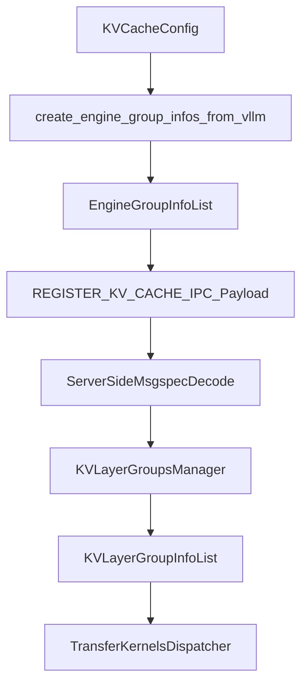
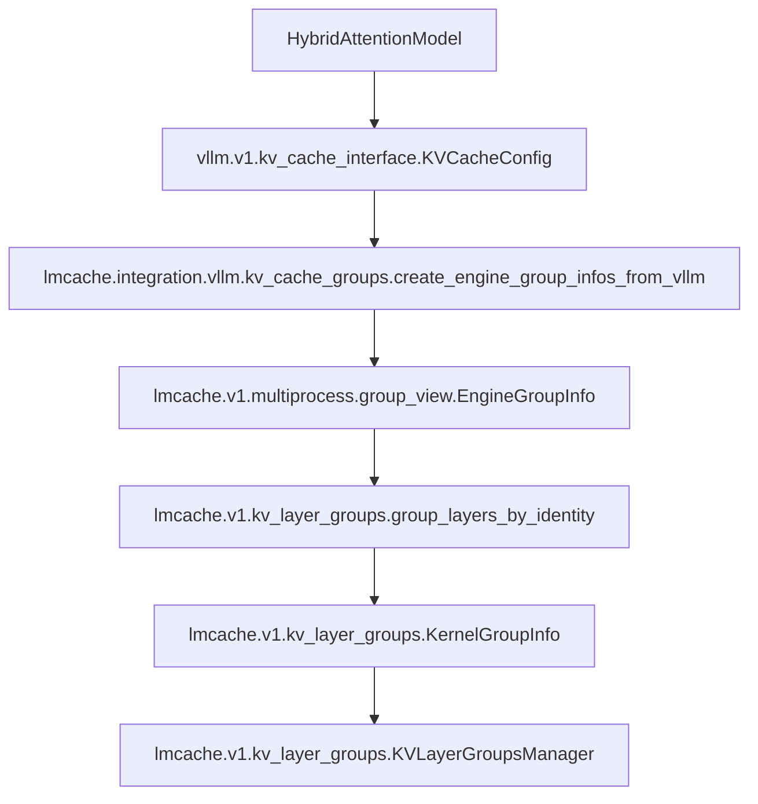

<!-- source: DeepWiki mcp.deepwiki.com · repo LMCache/LMCache · extra page Hybrid KV Cache Groups and Layer Groups · fetched 2026-10-21 -->

# Hybrid KV Cache Groups and Layer Groups

Relevant source files

The following files were used as context for generating this wiki page:

- [docs/design/integration/vllm/kv_cache_group_edits.md](docs/design/integration/vllm/kv_cache_group_edits.md)
- [docs/design/v1/mp_coordinator/blend_index.md](docs/design/v1/mp_coordinator/blend_index.md)
- [docs/source/mp/chunk_size_negotiation.rst](docs/source/mp/chunk_size_negotiation.rst)
- [docs/source/mp/hybrid_models.rst](docs/source/mp/hybrid_models.rst)
- [docs/source/recipes/deepseek_v41_flash.rst](docs/source/recipes/deepseek_v41_flash.rst)
- [docs/source/recipes/glm5_3.rst](docs/source/recipes/glm5_3.rst)
- [docs/source/recipes/kimi_k3.rst](docs/source/recipes/kimi_k3.rst)
- [docs/source/recipes/kimi_linear.rst](docs/source/recipes/kimi_linear.rst)
- [docs/source/recipes/qwen3_5.rst](docs/source/recipes/qwen3_5.rst)
- [docs/source/recipes/qwen3_8_flash_next.rst](docs/source/recipes/qwen3_8_flash_next.rst)
- [lmcache/integration/vllm/kv_cache_group_edits.py](lmcache/integration/vllm/kv_cache_group_edits.py)
- [lmcache/integration/vllm/kv_cache_groups.py](lmcache/integration/vllm/kv_cache_groups.py)
- [lmcache/v1/gpu_connector/kv_format/contiguity.py](lmcache/v1/gpu_connector/kv_format/contiguity.py)
- [lmcache/v1/kv_layer_groups.py](lmcache/v1/kv_layer_groups.py)
- [lmcache/v1/multiprocess/group_view.py](lmcache/v1/multiprocess/group_view.py)
- [tests/v1/gpu_connector/test_utils_shape_desc.py](tests/v1/gpu_connector/test_utils_shape_desc.py)
- [tests/v1/test_kv_cache_groups.py](tests/v1/test_kv_cache_groups.py)
- [tests/v1/test_kv_layer_groups_manager.py](tests/v1/test_kv_layer_groups_manager.py)
- [tests/v1/test_vllm_kv_cache_group_edits.py](tests/v1/test_vllm_kv_cache_group_edits.py)
- [tests/v1/test_vllm_kv_cache_groups.py](tests/v1/test_vllm_kv_cache_groups.py)

This page details the implementation and usage of hybrid KV cache groups and layer groups within LMCache, focusing on its integration with vLLM. It covers how LMCache handles models with interleaved attention types, the concept of `kv_layer_groups`, vLLM KV cache group edits, and support for hybrid/DCP (Distributed Cache Partitioning) models, including the group views used for hybrid attention models.

## Purpose and Scope

Modern large language models often employ hybrid attention mechanisms, such as interleaving sliding-window attention with full attention layers, Mamba/GDN linear attention, or sparse-MLA. This poses challenges for KV cache management, as different layers may have distinct caching requirements, page layouts, and block structures. LMCache addresses this by introducing concepts like "engine KV cache groups" and "LMCache KV groups" to efficiently manage and transfer KV cache data for these complex models. This page explains how LMCache identifies, groups, and processes these diverse KV cache structures, particularly in the context of vLLM integration.

Sources:
- [docs/source/mp/hybrid_models.rst:4-11]()
- [lmcache/integration/vllm/kv_cache_group_edits.py:2-12]()

## Hybrid Attention Models Overview

Some models interleave multiple attention types across their layers, commonly combining sliding-window attention with full attention, recurrent state caches, or indexer layers [docs/source/mp/hybrid_models.rst:4-7](). vLLM handles these with its hybrid KV cache manager, which partitions the model's layers into multiple KV cache groups, one for each attention behavior [docs/source/mp/hybrid_models.rst:6-7](). The `LMCacheMPConnector` supports these hybrid models by storing and retrieving KV cache for each group, ensuring prefix caching and KV reuse function seamlessly [docs/source/mp/hybrid_models.rst:9-11]().

LMCache automatically detects a model's KV cache groups during registration [docs/source/mp/hybrid_models.rst:110-111](). The `LMCacheMPConnector` advertises hybrid support to vLLM, ensuring vLLM's hybrid KV cache manager remains enabled without requiring manual fallback flags [docs/source/mp/hybrid_models.rst:113-118]().

Examples of validated hybrid-attention architectures include:
*   Gemma 3 & Gemma 4 (Sliding-window + full) [docs/source/mp/hybrid_models.rst:29-34]()
*   gpt-oss (Sliding-window + full) [docs/source/mp/hybrid_models.rst:35-37]()
*   Qwen3.5 / Qwen3.6 / Qwen3.8 series (Mamba / GDN + full) [docs/source/mp/hybrid_models.rst:38-40]()
*   Qwen3.8-Flash-Next (GDN linear-attention + QSA sparse full) [docs/source/mp/hybrid_models.rst:41-43]()
*   Kimi-Linear / Kimi K3 (KDA linear-attention + MLA full) [docs/source/mp/hybrid_models.rst:44-49]()
*   DeepSeek-V4-Flash / DeepSeek-V4.1-Flash (Sparse-MLA, multiple KV groups) [docs/source/mp/hybrid_models.rst:50-55]()
*   GLM 5.1 / 5.2 / 5.3 (Dynamic Sparse Attention) [docs/source/mp/hybrid_models.rst:56-61]()
*   MiniMax-M3 (Sparse attention + lightning indexer) [docs/source/mp/hybrid_models.rst:62-64]()

Sources:
- [docs/source/mp/hybrid_models.rst:4-11]()
- [docs/source/mp/hybrid_models.rst:29-64]()
- [docs/source/mp/hybrid_models.rst:110-118]()

## Core Concepts and Group Views

LMCache distinguishes between several key concepts for managing hybrid KV caches:

*   **Engine KV cache group**: A group defined by the serving engine (e.g., vLLM's `KVCacheConfig.kv_cache_groups`). Each represents a distinct paged-block address space where block IDs are meaningful only within that group [docs/design/integration/vllm/kv_cache_group_edits.py:8-10]().
*   **`EngineGroupInfo`**: LMCache's engine-neutral, `msgspec`-encoded record of an engine KV cache group [lmcache/v1/multiprocess/group_view.py:2-16](), [lmcache/v1/multiprocess/group_view.py:26-66](). It contains `engine_group_id`, `layer_indices`, `tokens_per_block`, `sw_size_tokens`, `extra_object_group_tag`, and `recurrent_state`.
*   **`KVLayerGroupInfo` (KernelGroupInfo)**: The server's runtime transfer-kernel dispatch unit [lmcache/v1/kv_layer_groups.py:158-172](). It is built from `EngineGroupInfo`s and the actual tensors, containing layer indices, `PageBufferShapeDesc`, dtype, and block metrics.
*   **`KernelGroupIdentity`**: A `NamedTuple` that uniquely identifies a set of kernel-equivalent layers [lmcache/v1/kv_layer_groups.py:59-66](). This identity determines which layers can be grouped together for a single kernel launch.

### `EngineGroupInfo` Structure

The `EngineGroupInfo` class [lmcache/v1/multiprocess/group_view.py:26-66]() is a frozen `msgspec.Struct` that describes one LMCache KV group:
*   `engine_group_id`: The ID of the engine group these layers belong to (dense integer starting from 0) [lmcache/v1/multiprocess/group_view.py:36-39]().
*   `layer_indices`: A tuple of registered KV tensor indices assigned to this group [lmcache/v1/multiprocess/group_view.py:40-42]().
*   `tokens_per_block`: Logical tokens covered by one paged chunk of this engine group [lmcache/v1/multiprocess/group_view.py:44-50]().
*   `sw_size_tokens`: Sliding window size in tokens, or `-1` for non-sliding-window attention [lmcache/v1/multiprocess/group_view.py:52-54]().
*   `extra_object_group_tag`: Connector-private extra-group tag under `--separate-object-groups` [lmcache/v1/multiprocess/group_view.py:56-60]().
*   `recurrent_state`: Boolean indicating if pages hold recurrent state snapshots (Mamba/GDN) rather than attention KV [lmcache/v1/multiprocess/group_view.py:62-66]().

Sources:
- [docs/source/mp/hybrid_models.rst:4-11]()
- [lmcache/v1/multiprocess/group_view.py:26-66]()
- [lmcache/v1/kv_layer_groups.py:59-66]()
- [lmcache/v1/kv_layer_groups.py:158-172]()

## vLLM KV Cache Group Edits

LMCache applies specialized edits to vLLM KV cache group specifications for Mamba-hybrid and sub-paged models via `lmcache/integration/vllm/kv_cache_group_edits.py` [lmcache/integration/vllm/kv_cache_group_edits.py:2-12](). These edits reinterpret registered tensors for correctness without memory copies.

### Applied Edits

1.  **Mamba State Pages**: Mamba / linear-attention layers register `[conv_state, ssm_state]` as two tensors packed contiguously into one page. The edit reinterprets each page as a single `bf16` tensor shaped `(num_blocks, 2, block_size, 1, head_size)` over the same storage [docs/design/integration/vllm/kv_cache_group_edits.md:39-48]().
2.  **Sub-paged Full Attention**: vLLM inflates logical block sizes across hybrid groups while hardware backends use smaller kernel block sizes. The edit re-views the tensor as `(num_kernel_pages / k, 2, logical_block_size, 1, head_size)` or via the rank-4 layout `(num_blocks, num_kv_heads, block_size, 2 * head_size)` [docs/design/integration/vllm/kv_cache_group_edits.md:49-108]().
3.  **Sub-paged MLA**: Re-pages MLA-style caches (rank-3 or rank-4 head/state major layouts) matching `spec.num_states` while preserving declared slot compression [docs/design/integration/vllm/kv_cache_group_edits.md:109-124]().

### Startup Validation

`validate_kv_cache_groups` rejects group specs that the transfer path cannot serve, such as `CrossAttentionSpec` and Mamba groups with `mamba_cache_mode` other than `"align"` or `"all"` [lmcache/integration/vllm/kv_cache_group_edits.py:129-170]().

Sources:
- [lmcache/integration/vllm/kv_cache_group_edits.py:2-12]()
- [lmcache/integration/vllm/kv_cache_group_edits.py:129-170]()
- [docs/design/integration/vllm/kv_cache_group_edits.md:39-124]()

## Data Flow and Registration

Title: HybridKVGroupRegistrationDataFlow

Sources:
- [lmcache/integration/vllm/kv_cache_groups.py:2-2]()
- [lmcache/v1/multiprocess/group_view.py:26-35]()
- [lmcache/v1/kv_layer_groups.py:158-172]()

## Store, Retrieve, and Slicing Operations

During store and retrieve operations, vLLM reports block IDs per engine group. The worker adapter re-indexes these block IDs to match the `EngineGroupInfo` order using `expand_engine_block_ids` [lmcache/v1/multiprocess/group_view.py:144-163]().

### Scratch Specs and Token Slicing
Certain vLLM specs are marked `prefix_cacheable = False` (e.g., `CircularBufferSpec` and `KpoolTailSpec`). These are **scratch specs** that cover 0 tokens (`tokens_per_block = 0`) and are automatically skipped by LMCache during serialization and lookup [lmcache/integration/vllm/kv_cache_groups.py:35-54](). 

Block IDs are sliced per group according to `tokens_per_block` using group view utilities [lmcache/v1/multiprocess/group_view.py:144-163](). Cross-layer KV sharing models (e.g., Gemma 4) leave shared layers unregistered, tagging them with `EXCLUDED_ENGINE_GROUP` [lmcache/v1/kv_layer_groups.py:75-75]().

Sources:
- [lmcache/integration/vllm/kv_cache_groups.py:35-54]()
- [lmcache/v1/multiprocess/group_view.py:144-163]()
- [lmcache/v1/kv_layer_groups.py:75-75]()

## Natural Language Space to Code Entity Mapping

Title: HybridKVGroupCodeEntityMapping

Sources:
- [lmcache/integration/vllm/kv_cache_groups.py:2-2]()
- [lmcache/v1/multiprocess/group_view.py:26-35]()
- [lmcache/v1/kv_layer_groups.py:59-66]()
- [lmcache/v1/kv_layer_groups.py:78-155]()
- [lmcache/v1/kv_layer_groups.py:158-172]()

---

