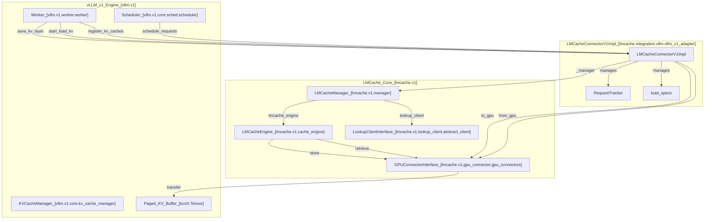
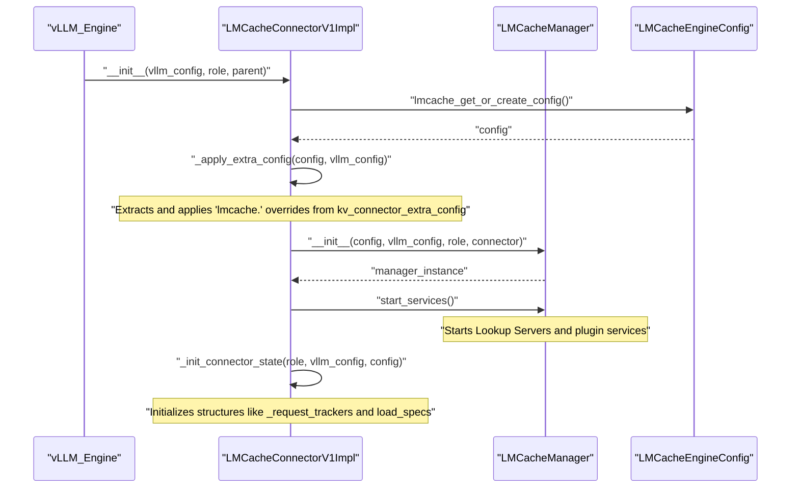
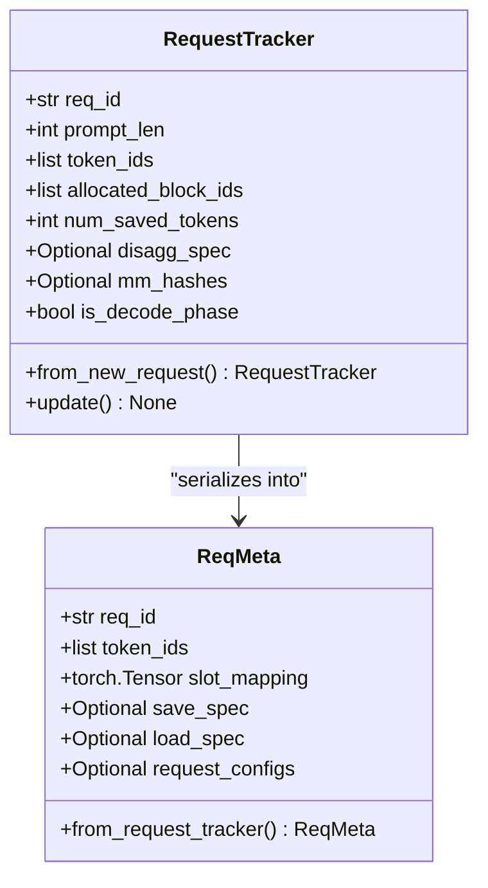
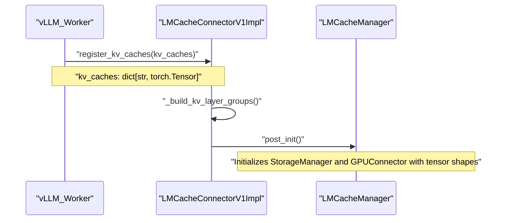

<!-- source: DeepWiki mcp.deepwiki.com · repo LMCache/LMCache · extra page LMCacheConnectorV1Impl · fetched 2026-10-21 -->

# LMCacheConnectorV1Impl

Relevant source files

The following files were used as context for generating this wiki page:

- [lmcache/integration/vllm/utils.py](lmcache/integration/vllm/utils.py)
- [lmcache/integration/vllm/vllm_v1_adapter.py](lmcache/integration/vllm/vllm_v1_adapter.py)
- [lmcache/utils.py](lmcache/utils.py)
- [lmcache/v1/cache_engine.py](lmcache/v1/cache_engine.py)
- [lmcache/v1/config.py](lmcache/v1/config.py)
- [lmcache/v1/lookup_client/abstract_client.py](lmcache/v1/lookup_client/abstract_client.py)
- [lmcache/v1/lookup_client/chunk_statistics_lookup_client.py](lmcache/v1/lookup_client/chunk_statistics_lookup_client.py)
- [lmcache/v1/lookup_client/factory.py](lmcache/v1/lookup_client/factory.py)
- [lmcache/v1/lookup_client/hit_limit_lookup_client.py](lmcache/v1/lookup_client/hit_limit_lookup_client.py)
- [lmcache/v1/lookup_client/lmcache_async_lookup_client.py](lmcache/v1/lookup_client/lmcache_async_lookup_client.py)
- [lmcache/v1/lookup_client/lmcache_lookup_client.py](lmcache/v1/lookup_client/lmcache_lookup_client.py)
- [lmcache/v1/lookup_client/lmcache_lookup_client_bypass.py](lmcache/v1/lookup_client/lmcache_lookup_client_bypass.py)
- [lmcache/v1/lookup_client/mooncake_lookup_client.py](lmcache/v1/lookup_client/mooncake_lookup_client.py)
- [lmcache/v1/offload_server/zmq_server.py](lmcache/v1/offload_server/zmq_server.py)
- [lmcache/v1/rpc_utils.py](lmcache/v1/rpc_utils.py)
- [lmcache/v1/token_database.py](lmcache/v1/token_database.py)
- [tests/v1/lookup_client/test_chunk_statistics_lookup_client.py](tests/v1/lookup_client/test_chunk_statistics_lookup_client.py)
- [tests/v1/test_token_database.py](tests/v1/test_token_database.py)

## Purpose and Scope

**LMCacheConnectorV1Impl** serves as the core adapter class implementing the `KVConnectorBase_V1` interface for vLLM's v1 KV cache transfer mechanism [lmcache/integration/vllm/vllm_v1_adapter.py:14-18](). It bridges vLLM's scheduler and execution workers with LMCache's underlying cache engine (`LMCacheEngine`) [lmcache/v1/cache_engine.py:83](). The scope of this page covers the class implementation details, its interface methods, request lifecycle tracking structures, tensor registration, and asynchronous load/save operation pipelines.

---

## Purpose and Integration Architecture

The connector operates under two distinct execution contexts defined by vLLM's `KVConnectorRole` [lmcache/integration/vllm/vllm_v1_adapter.py:17]():
- **Scheduler Role (`KVConnectorRole.SCHEDULER`)**: Executes within the vLLM scheduler process to manage prefix cache hit lookups, request state tracking via `RequestTracker`, and metadata packaging (`ReqMeta`) [lmcache/integration/vllm/vllm_v1_adapter.py:104](), [lmcache/integration/vllm/vllm_v1_adapter.py:268]().
- **Worker Role (`KVConnectorRole.WORKER`)**: Executes within each vLLM model worker process to register GPU KV caches (`register_kv_caches`) [lmcache/integration/vllm/vllm_v1_adapter.py:731](), initialize the `LMCacheManager` [lmcache/v1/manager.py:48](), and execute asynchronous KV tensor retrievals (`start_load_kv`) [lmcache/integration/vllm/vllm_v1_adapter.py:741]() and saves (`save_kv_layer`) [lmcache/integration/vllm/vllm_v1_adapter.py:979]().

### System Architecture and Code Entity Mapping

Title: Component Mapping between vLLM V1 and LMCache Engine

Sources: [lmcache/integration/vllm/vllm_v1_adapter.py:438-483](), [lmcache/v1/cache_engine.py:83-112](), [lmcache/integration/vllm/vllm_v1_adapter.py:731-738]()

---

## Class Structure and Initialization

### Constructor and Role-Based Setup

The `LMCacheConnectorV1Impl.__init__()` method performs role-dependent configuration loading and service initialization [lmcache/integration/vllm/vllm_v1_adapter.py:438-567]():
1. Loads the base configuration via `lmcache_get_or_create_config()` [lmcache/integration/vllm/utils.py:163]().
2. Parses any `kv_connector_extra_config` parameters prefixed with `lmcache.` to apply runtime overrides using `validate_and_set_config_value` [lmcache/v1/config_base.py:31]().
3. Instantiates `LMCacheManager` with the respective `KVConnectorRole` [lmcache/v1/manager.py:48]().
4. Initializes tracking dictionaries and container state variables depending on whether it runs on the scheduler or the worker.

| Constructor Component | Scheduler Role (`KVConnectorRole.SCHEDULER`) | Worker Role (`KVConnectorRole.WORKER`) |
|-----------------------|-------------------------------------------|----------------------------------------|
| `LMCacheManager`      | Configured for query/lookup operations only | Full engine and GPU connector lifecycle |
| `_request_trackers`   | Active `dict[str, RequestTracker]` tracking state | `None` (unused) |
| `kv_caches`           | `None` | Maps layer names to pinned GPU `torch.Tensor` KV buffers |
| `load_specs`          | Manages loading requirements | Tracks layerwise load execution state |

### Initialization Sequence

Title: LMCacheConnectorV1Impl Initialization Sequence

Sources: [lmcache/integration/vllm/vllm_v1_adapter.py:438-567](), [lmcache/integration/vllm/utils.py:163-181]()

---

## Request Tracking Data Structures

`RequestTracker` manages the state of individual active requests on the scheduler side [lmcache/integration/vllm/vllm_v1_adapter.py:104](). It tracks token IDs, prompt lengths, allocated block IDs, multimodal features, and metadata configurations [lmcache/integration/vllm/vllm_v1_adapter.py:104-140](). 

`ReqMeta` is constructed via `ReqMeta.from_request_tracker()` to serialize request metadata across process boundaries to the model workers [lmcache/integration/vllm/vllm_v1_adapter.py:268-354]().

Title: RequestTracker and ReqMeta Structure

Sources: [lmcache/integration/vllm/vllm_v1_adapter.py:104-145](), [lmcache/integration/vllm/vllm_v1_adapter.py:268-354]()

---

## KV Cache Registration

### Method: `register_kv_caches`

The `register_kv_caches` method is invoked by the vLLM worker process during model initialization [lmcache/integration/vllm/vllm_v1_adapter.py:731-738](). It takes a dictionary of layer names mapping to pinned GPU `torch.Tensor` objects, enabling subsequent device-to-host and host-to-device transfers.

Title: KV Cache Registration Sequence

Sources: [lmcache/integration/vllm/vllm_v1_adapter.py:568-588](), [lmcache/integration/vllm/vllm_v1_adapter.py:731-738]()

---

## Load and Save Orchestration

### Worker-Side Cache Load: `start_load_kv`

The `start_load_kv` method implements the interface for loading KV cache data for incoming requests [lmcache/integration/vllm/vllm_v1_adapter.py:741-872](). Depending on whether `use_layerwise` configuration is enabled [lmcache/v1/config.py:121](), it retrieves data layer-by-layer or via bulk retrieval calls through `LMCacheEngine.retrieve_layer` or `LMCacheEngine.retrieve` [lmcache/v1/cache_engine.py:408]().

### Worker-Side Cache Save: `save_kv_layer`

`save_kv_layer` is called during prefill iterations across transformer layers, initiating asynchronous transfers from GPU tensors to CPU/remote storage backends via `LMCacheEngine.store_layer` [lmcache/integration/vllm/vllm_v1_adapter.py:979-1054](), [lmcache/v1/cache_engine.py:346]().

Sources: [lmcache/integration/vllm/vllm_v1_adapter.py:741-872](), [lmcache/integration/vllm/vllm_v1_adapter.py:979-1054](), [lmcache/v1/cache_engine.py:346-440]()

---

## Multimodal and Blending Integration

- **Multimodal Hashing**: Input token IDs are processed using `apply_mm_hashes_to_token_ids` to embed modal-specific placeholder hashes into the key derivation stream [lmcache/integration/vllm/vllm_v1_adapter.py:364-373](), [lmcache/integration/vllm/utils.py:35]().
- **Cache Blending**: When `enable_blending` is enabled in `LMCacheEngineConfig` [lmcache/v1/config.py:137](), the connector builds an `LMCBlenderBuilder` and initializes a `SegmentTokenDatabase` to support partial prefix and content-based cache reuse [lmcache/v1/cache_engine.py:45](), [lmcache/v1/token_database.py:64]().

Sources: [lmcache/integration/vllm/vllm_v1_adapter.py:364-373](), [lmcache/integration/vllm/utils.py:35](), [lmcache/v1/config.py:137](), [lmcache/v1/cache_engine.py:45](), [lmcache/v1/token_database.py:64-73]()

---

## Summary of Key Methods

| Method | Role | Purpose | Reference |
|---|---|---|---|
| `get_num_new_matched_tokens` | Scheduler | Query LMCache via lookup client to calculate matching prefix token count | [lmcache/integration/vllm/vllm_v1_adapter.py:644-672]() |
| `build_connector_meta` | Scheduler | Serialize `ReqMeta` containing slot mapping and load/save specs | [lmcache/integration/vllm/vllm_v1_adapter.py:686-729]() |
| `start_load_kv` | Worker | Initiate cache retrieval via LMCache engine (layerwise or bulk) | [lmcache/integration/vllm/vllm_v1_adapter.py:741-872]() |
| `wait_for_layer_load` | Worker | Await and synchronize asynchronous layer load generator pipelines | [lmcache/integration/vllm/vllm_v1_adapter.py:874-910]() |
| `save_kv_layer` | Worker | Trigger asynchronous layerwise GPU-to-CPU cache storage | [lmcache/integration/vllm/vllm_v1_adapter.py:979-1054]() |
| `wait_for_save` | Worker | Synchronize and finalize pending cache save operations | [lmcache/integration/vllm/vllm_v1_adapter.py:1056-1081]() |

Sources: [lmcache/integration/vllm/vllm_v1_adapter.py:644-729](), [lmcache/integration/vllm/vllm_v1_adapter.py:741-910](), [lmcache/integration/vllm/vllm_v1_adapter.py:979-1081]()

---

