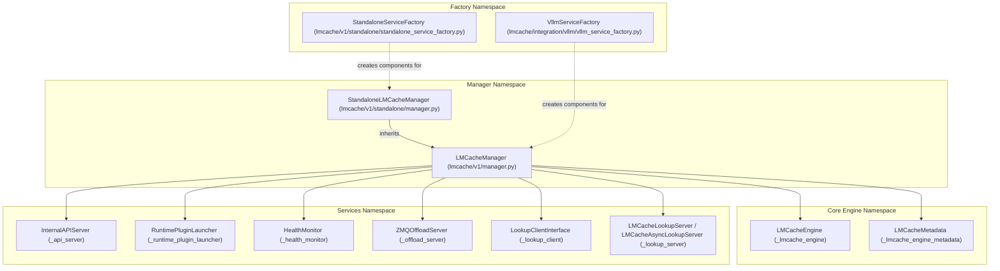
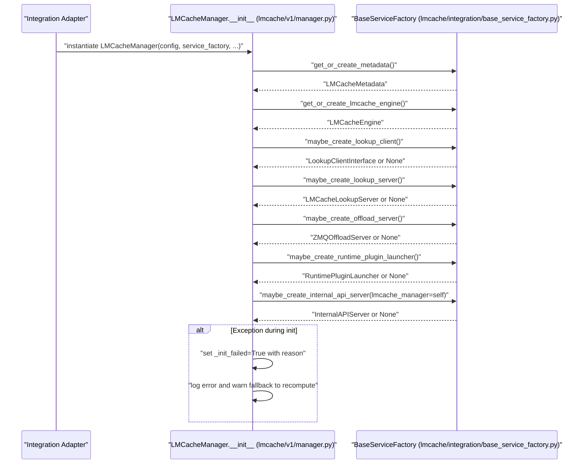
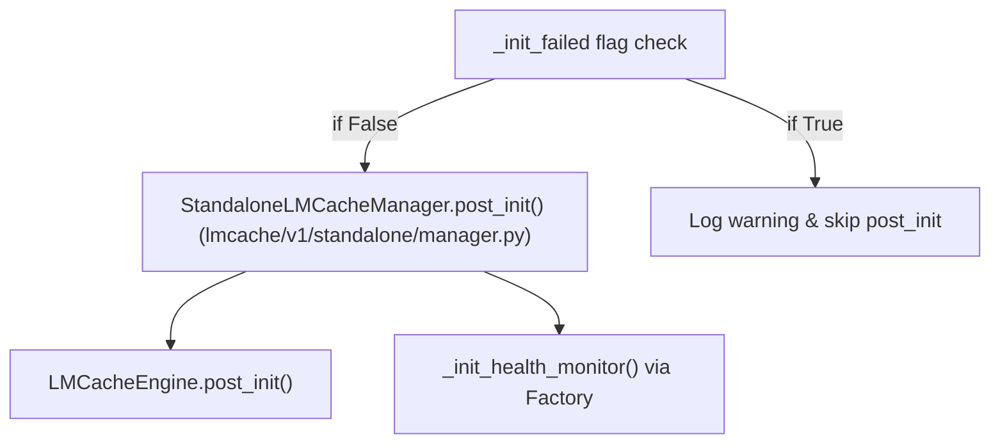
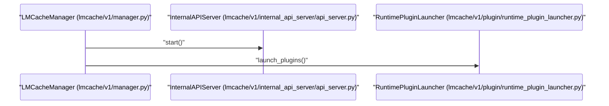

<!-- source: DeepWiki mcp.deepwiki.com · repo LMCache/LMCache · extra page LMCacheManager and Initialization · fetched 2026-10-21 -->

# LMCacheManager and Initialization

Relevant source files

The following files were used as context for generating this wiki page:

- [docs/source/internal_api_server/vllm_apis.rst](docs/source/internal_api_server/vllm_apis.rst)
- [lmcache/integration/vllm/vllm_service_factory.py](lmcache/integration/vllm/vllm_service_factory.py)
- [lmcache/v1/internal_api_server/vllm/bypass_api.py](lmcache/v1/internal_api_server/vllm/bypass_api.py)
- [lmcache/v1/internal_api_server/vllm/hot_cache_api.py](lmcache/v1/internal_api_server/vllm/hot_cache_api.py)
- [lmcache/v1/internal_api_server/vllm/lookup_api.py](lmcache/v1/internal_api_server/vllm/lookup_api.py)
- [lmcache/v1/manager.py](lmcache/v1/manager.py)
- [lmcache/v1/standalone/manager.py](lmcache/v1/standalone/manager.py)
- [lmcache/v1/standalone/standalone_service_factory.py](lmcache/v1/standalone/standalone_service_factory.py)
- [tests/v1/internal_api_server/test_hot_cache_api.py](tests/v1/internal_api_server/test_hot_cache_api.py)
- [tests/v1/internal_api_server/test_lookup_api.py](tests/v1/internal_api_server/test_lookup_api.py)
- [tests/v1/test_manager.py](tests/v1/test_manager.py)

## Purpose and Scope

`LMCacheManager` is the central orchestrator responsible for managing the lifecycle and initialization of all LMCache internal components. It serves as an abstraction layer between the integration adapters (such as vLLM or standalone runners) and the lower-level LMCache implementation, providing a unified management interface. It handles the creation, initialization, and shutdown of the primary components including the cache engine, lookup clients and servers, internal API server for monitoring, health monitors, offload server, and runtime plugin launchers.

This page explains the singleton-like pattern of `LMCacheManager`, how components are initialized via the `BaseServiceFactory` pattern, the post-initialization lifecycle phase, and the management of services through `start_services()`.

Sources: [lmcache/v1/manager.py:1-54](), [lmcache/integration/vllm/vllm_service_factory.py:39-60](), [lmcache/v1/standalone/manager.py:22-80]()

---

## LMCacheManager Role and Components

`LMCacheManager` encapsulates the lifecycle management of multiple LMCache components and decouples the integration adapter from their complexity. It relies on a pluggable factory pattern with different `BaseServiceFactory` implementations (`VllmServiceFactory` for vLLM integrations and `StandaloneServiceFactory` for standalone mode) to tailor component creation to the runtime role and environment.

### Principal Components Managed by `LMCacheManager`

- **`LMCacheEngine`**: The core KV cache engine responsible for caching and retrieval operations [lmcache/v1/manager.py:48]().
- **`LMCacheMetadata`**: Stores model metadata such as worker IDs, kv_cache shape, and dtype [lmcache/v1/manager.py:26]().
- **`LookupClientInterface`**: Client-side component for distributed cache hits (only in scheduler role) [lmcache/v1/manager.py:49]().
- **Lookup Server** (`LMCacheLookupServer` or async variants): Handles prefix-based cache lookups (worker role) [lmcache/v1/manager.py:49]().
- **`ZMQOffloadServer`**: A server component to handle asynchronous offloads of cached KV tensors [lmcache/v1/manager.py:50]().
- **`InternalAPIServer`**: FastAPI-based HTTP server exposing internal APIs for stats, configuration, and management [lmcache/v1/manager.py:51]().
- **`RuntimePluginLauncher`**: Component managing external plugin processes for telemetry or cache warming [lmcache/v1/manager.py:52]().
- **`HealthMonitor`**: Monitors system components health and coordinates recovery [lmcache/v1/manager.py:53]().

These components are instantiated, stored, and exposed as read-only properties on the `LMCacheManager` instance, enabling safe access and management by integration adapters.

**Diagram: LMCacheManager Component Hierarchy**

Sources: [lmcache/v1/manager.py:40-162](), [lmcache/v1/standalone/manager.py:22-63](), [lmcache/integration/vllm/vllm_service_factory.py:39-160](), [lmcache/v1/standalone/standalone_service_factory.py:24-86]()

---

## Initialization via Service Factory Pattern

The initialization process of `LMCacheManager` leverages a pluggable `BaseServiceFactory` interface that abstracts creation of LMCache components depending on the integration and runtime role (e.g., scheduler or worker).

During `LMCacheManager.__init__()`, the following factory methods are called sequentially to construct components [lmcache/v1/manager.py:92-103]():

1. `get_or_create_metadata()`: Provides the `LMCacheMetadata` instance describing model and parallelism info [lmcache/v1/manager.py:93]().
2. `get_or_create_lmcache_engine()`: Creates or fetches the singleton `LMCacheEngine` instance [lmcache/v1/manager.py:94]().
3. `maybe_create_lookup_client()`: Creates a lookup client for scheduler roles if applicable [lmcache/v1/manager.py:95]().
4. `maybe_create_lookup_server()`: Creates a lookup server for worker roles if applicable [lmcache/v1/manager.py:96]().
5. `maybe_create_offload_server()`: Initializes the offload server for async offloading [lmcache/v1/manager.py:97]().
6. `maybe_create_runtime_plugin_launcher()`: Creates the plugin launcher to start custom plugins [lmcache/v1/manager.py:98-100]().
7. `maybe_create_internal_api_server()`: Starts the internal HTTP API server for monitoring and management [lmcache/v1/manager.py:101-103]().

If any component creation raises an exception, it is caught, logged, and causes the manager to mark initialization as failed (`_init_failed = True`). This graceful fallback enables degraded operational modes such as forcing cache bypass or recompute-only behavior [lmcache/v1/manager.py:104-111]().

**Diagram: LMCacheManager Initialization Sequence Using Service Factory**

Sources: [lmcache/v1/manager.py:56-112](), [lmcache/v1/manager.py:91-103]()

---

## Post-Initialization and Health Monitoring

After all components are initialized and the runtime framework has registered KV caches (e.g., the GPU cache tensors), `LMCacheManager.post_init()` finalizes the setup process. This method is typically called once all workers or standalone runners complete initial engine registration.

Steps performed in `post_init()`:

- Calls `self._lmcache_engine.post_init()` to start any background tasks, initialize internal storage managers, and begin async event loops required by the engine [lmcache/v1/standalone/manager.py:73-75]().
- Initializes the `HealthMonitor` component using the service factory, which monitors the health and liveness of LMCache components at runtime [lmcache/v1/standalone/manager.py:77-78]().
- If initialization failed earlier, this step is skipped and any failure is logged [lmcache/v1/standalone/manager.py:64-70]().

Sources: [lmcache/v1/manager.py:181-184](), [lmcache/v1/standalone/manager.py:64-80]()

---

## Service Lifecycle Management

`LMCacheManager` provides lifecycle control for the hosted components through methods and properties, enabling integration adapters to start services and inspect internal state safely [lmcache/v1/manager.py:165-180]().

### `start_services()`

This method starts services that require active runtime loops post-creation [lmcache/v1/manager.py:165-180]():

- Starts the `InternalAPIServer`, enabling HTTP endpoints for cache stats, configuration, and management [lmcache/v1/manager.py:175-176]().
- Launches runtime plugins via the `RuntimePluginLauncher` [lmcache/v1/manager.py:178-179]().

Both components are optional and started only if created by the factory.

### Property Accessors

All major components have read-only properties for safe external access [lmcache/v1/manager.py:115-162]():

| Property | Description |
|---|---|
| `lmcache_engine` | Returns the main `LMCacheEngine` instance [lmcache/v1/manager.py:116-118]() |
| `lmcache_engine_metadata` | Provides metadata about model and parallelism [lmcache/v1/manager.py:121-123]() |
| `lookup_client` | Lookup client interface (scheduler role) [lmcache/v1/manager.py:126-128]() |
| `lookup_server` | Lookup server instance (worker role) [lmcache/v1/manager.py:130-136]() |
| `offload_server` | ZMQ offload server instance [lmcache/v1/manager.py:138-140]() |
| `api_server` | Internal API HTTP server instance [lmcache/v1/manager.py:143-145]() |
| `health_monitor` | Runtime system health monitor [lmcache/v1/manager.py:147-150]() |
| `kv_caches` | Dictionary of currently loaded KV caches via connector [lmcache/v1/manager.py:153-156]() |
| `config` | `LMCacheEngineConfig` instance [lmcache/v1/manager.py:158-161]() |

Sources: [lmcache/v1/manager.py:115-180]()

---

## Summary

`LMCacheManager` is the central singleton-like manager for all LMCache internal components. It uses a factory pattern to modularly create role-specific components, manages initialization and error handling, provides a post-initialization phase for background services and health monitoring, and exposes controlled service lifecycle management methods. 

Integration adapters (such as vLLM or standalone runners) use `LMCacheManager` to abstract away the complex construction and coordination of the cache engine, lookup clients/servers, API servers, and runtime plugins, enabling a robust and extensible caching backend.

This modular pattern supports different runtime modes (scheduler, worker, standalone) transparently, offering a unified and maintainable interface for LMCache internal coordination.

---

# References

- `lmcache/v1/manager.py` Lines 1–184
- `lmcache/v1/standalone/manager.py` Lines 22–81
- `lmcache/integration/vllm/vllm_service_factory.py` Lines 1–185
- `lmcache/v1/standalone/standalone_service_factory.py`
- `lmcache/integration/base_service_factory.py`

---

