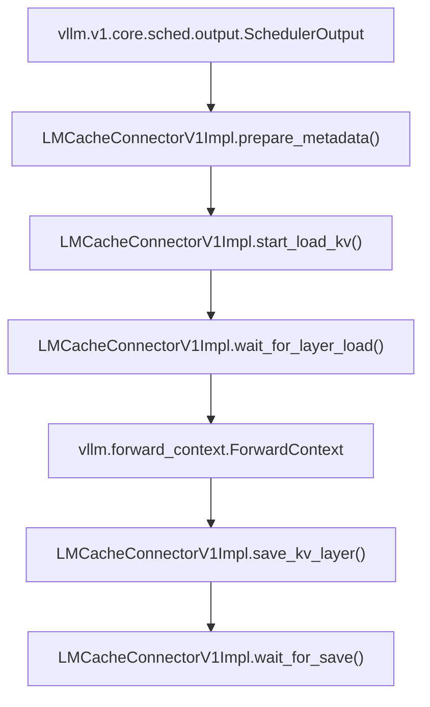
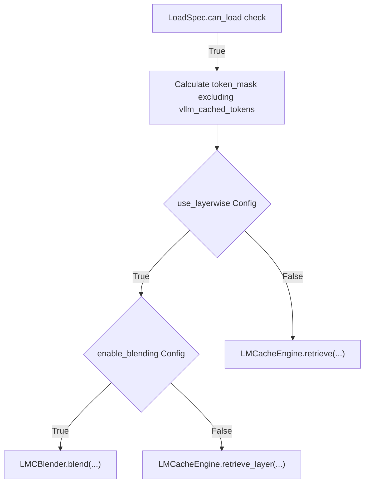
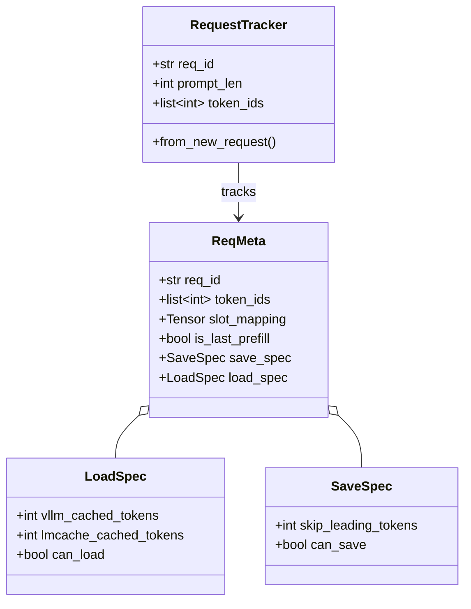
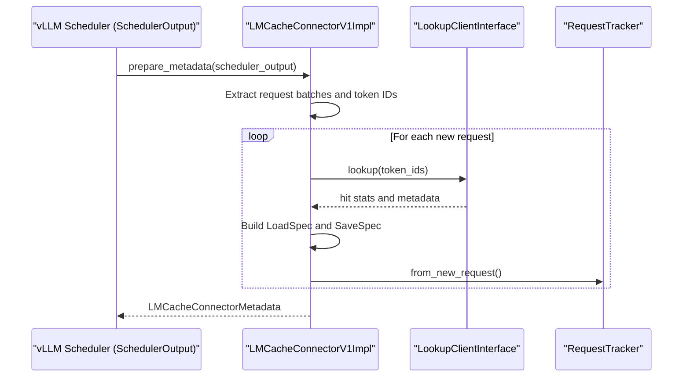

<!-- source: DeepWiki mcp.deepwiki.com · repo LMCache/LMCache · extra page Load and Save Operations · fetched 2026-10-21 -->

# Load and Save Operations

<details>
<summary>Relevant source files</summary>

The following files were used as context for generating this wiki page:

- [lmcache/integration/vllm/utils.py](lmcache/integration/vllm/utils.py)
- [lmcache/integration/vllm/vllm_v1_adapter.py](lmcache/integration/vllm/vllm_v1_adapter.py)
- [lmcache/utils.py](lmcache/utils.py)
- [lmcache/v1/cache_engine.py](lmcache/v1/cache_engine.py)
- [lmcache/v1/config.py](lmcache/v1/config.py)
- [lmcache/v1/lookup_client/abstract_client.py](lmcache/v1/lookup_client/abstract_client.py)
- [lmcache/v1/lookup_client/chunk_statistics_lookup_client.py](lmcache/v1/lookup_client/chunk_statistics_lookup_client.py)
- [lmcache/v1/lookup_client/factory.py](lmcache/v1/lookup_client/factory.py)
- [lmcache/v1/lookup_client/hit_limit_lookup_client.py](lmcache/v1/lookup_client/hit_limit_lookup_client.py)
- [lmcache/v1/lookup_client/lmcache_async_lookup_client.py](lmcache/v1/lookup_client/lmcache_async_lookup_client.py)
- [lmcache/v1/lookup_client/lmcache_lookup_client.py](lmcache/v1/lookup_client/lmcache_lookup_client.py)
- [lmcache/v1/lookup_client/lmcache_lookup_client_bypass.py](lmcache/v1/lookup_client/lmcache_lookup_client_bypass.py)
- [lmcache/v1/lookup_client/mooncake_lookup_client.py](lmcache/v1/lookup_client/mooncake_lookup_client.py)
- [lmcache/v1/offload_server/zmq_server.py](lmcache/v1/offload_server/zmq_server.py)
- [lmcache/v1/rpc_utils.py](lmcache/v1/rpc_utils.py)
- [lmcache/v1/token_database.py](lmcache/v1/token_database.py)
- [tests/v1/lookup_client/test_chunk_statistics_lookup_client.py](tests/v1/lookup_client/test_chunk_statistics_lookup_client.py)
- [tests/v1/test_token_database.py](tests/v1/test_token_database.py)

</details>


This page documents the KV cache load and save operations implemented in LMCache’s vLLM V1 integration layer (`lmcache/integration/vllm/vllm_v1_adapter.py`) [lmcache/integration/vllm/vllm_v1_adapter.py:1-197](). These methods orchestrate the movement of KV cache data between LMCache’s multi-tier storage backends and vLLM’s paged GPU memory buffers. Understanding these methods is crucial for grasping how `LMCacheConnectorV1Impl` seamlessly fetches and stores KV cache during inference requests, especially with performance optimizations like layerwise pipelining.

## Purpose and Scope

Load and save operations form the critical data-path bridge between vLLM’s execution engine and LMCache. This page covers:

- **Load operations**: `start_load_kv` and `wait_for_layer_load` methods that initiate and synchronize retrieval of cached KV tensors from LMCache into vLLM buffers [lmcache/integration/vllm/vllm_v1_adapter.py:736-959]().
- **Save operations**: `save_kv_layer` and `wait_for_save` methods that extract updated KV tensors and asynchronously store them into LMCache storage backends [lmcache/integration/vllm/vllm_v1_adapter.py:962-1106]().
- **Key data structures**: `LoadSpec`, `SaveSpec`, and `RequestTracker` which govern cache eligibility and transfer details [lmcache/integration/vllm/vllm_v1_adapter.py:65-197]().
- **Layerwise pipelining**: Handling iterative and overlapped load/save of individual model layers to hide latency [lmcache/v1/cache_engine.py:171-172]().
- **Interaction patterns**: How these methods use concurrency, generators, and metadata to serve low-latency KV cache operations [lmcache/integration/vllm/vllm_v1_adapter.py:736-1120]().

Sources: [lmcache/integration/vllm/vllm_v1_adapter.py:65-197](), [lmcache/v1/cache_engine.py:83-115]()

---

## Overview

The integration adapter class `LMCacheConnectorV1Impl` hooks into vLLM’s request execution lifecycle and manages bulk KV cache transfers through `LMCacheEngine` [lmcache/integration/vllm/vllm_v1_adapter.py:736-1120](). The connector uses request metadata (`ReqMeta`), load/save specs (`LoadSpec`, `SaveSpec`), and a `RequestTracker` to determine cache targets, initiate asynchronous retrievals, obtain updated KV tensors from GPU, and dispatch asynchronous saves [lmcache/integration/vllm/vllm_v1_adapter.py:65-197]().

### Diagram: Connector Execution Flow to Code Entities



*Figure: Mapping of high-level runtime phases to specific methods in `LMCacheConnectorV1Impl` and vLLM context classes.*

Sources: [lmcache/integration/vllm/vllm_v1_adapter.py:736-1120]()

---

## Load Operations

Load operations retrieve cached KV tensors from LMCache storage backends (such as `LocalCPUBackend`, `LocalDiskBackend`, or `RemoteBackend`) and copy them into vLLM’s pre-allocated GPU buffers for model attention key-value cache reuse [lmcache/v1/storage_backend/__init__.py:111-168]().

### `start_load_kv` Method

The `start_load_kv` method is called early in the execution step to initiate cache retrieval [lmcache/integration/vllm/vllm_v1_adapter.py:736-750]().

#### Responsibilities

1. Iterate through request metadata (`ReqMeta`) to find requests with `LoadSpec.can_load == True` [lmcache/integration/vllm/vllm_v1_adapter.py:736-750]().
2. Calculate a `token_mask` that excludes tokens already cached locally in vLLM (`vllm_cached_tokens`) [lmcache/integration/vllm/vllm_v1_adapter.py:772-785]().
3. Fetch KV cache tensors by invoking `LMCacheEngine.retrieve()` for standard bulk loads or `LMCacheEngine.retrieve_layer()` to get a generator when `use_layerwise=True` [lmcache/v1/cache_engine.py:171-172]().

#### Diagram: Load Decision Logic in Code



*Figure: Conditional branching within `start_load_kv` dispatching to standard retrieval, layerwise generators, or `LMCBlender`.*

Sources: [lmcache/integration/vllm/vllm_v1_adapter.py:772-830](), [lmcache/v1/cache_engine.py:83-98]()

---

### `wait_for_layer_load` Method

The `wait_for_layer_load` method synchronizes and controls layerwise retrieval [lmcache/integration/vllm/vllm_v1_adapter.py:939-959]().

```python
def wait_for_layer_load(self, layer_name: str) -> None:
```

#### Behavior

- Advances layerwise load iterators by calling `next()` on stored coroutine/generator handles for each active request [lmcache/integration/vllm/vllm_v1_adapter.py:939-949]().
- Blocks execution until the current layer’s KV tensor blocks are successfully loaded into GPU `block_tables`.
- On the final layer, confirms that all requested tokens have been fully loaded [lmcache/integration/vllm/vllm_v1_adapter.py:953-959]().

Sources: [lmcache/integration/vllm/vllm_v1_adapter.py:939-959]()

---

## Save Operations

Save operations extract updated KV cache layers from GPU memory and asynchronously write them back into LMCache storage backends [lmcache/v1/cache_engine.py:83-115]().

### `save_kv_layer` Method

The `save_kv_layer` method handles persistence of KV tensors for a given attention layer [lmcache/integration/vllm/vllm_v1_adapter.py:962-1010]().

```python
def save_kv_layer(
    self,
    layer_name: str,
    kv_layer: torch.Tensor,
    attn_metadata: "AttentionMetadata",
    **kwargs,
) -> None:
```

#### Responsibilities

1. Check if caching is permitted via `SaveSpec.can_save` for the request [lmcache/integration/vllm/vllm_v1_adapter.py:975-977]().
2. Extract KV tensors from GPU memory using `GPUConnectorInterface` specialized logic [lmcache/v1/cache_engine.py:113-115]().
3. Forward the resulting `MemoryObj` representing the KV layer data to the asynchronous `StorageManager` pipeline for persistence [lmcache/v1/cache_engine.py:179-180]().

Sources: [lmcache/integration/vllm/vllm_v1_adapter.py:962-1010](), [lmcache/v1/cache_engine.py:113-180]()

---

### `wait_for_save` Method

The `wait_for_save` method blocks until all outstanding save operations complete [lmcache/integration/vllm/vllm_v1_adapter.py:1068-1106]().

```python
def wait_for_save(self) -> None:
```

#### Behavior

- Iterates through active asynchronous layerwise save futures or tasks [lmcache/integration/vllm/vllm_v1_adapter.py:1068-1106]().
- Cleans up internal tracking state upon completion [lmcache/integration/vllm/vllm_v1_adapter.py:1068-1106]().

Sources: [lmcache/integration/vllm/vllm_v1_adapter.py:1068-1106]()

---

## Request Metadata Structures

Caching operations rely on metadata classes that dictate token eligibility and transfer metrics [lmcache/integration/vllm/vllm_v1_adapter.py:65-197]().

### LoadSpec & SaveSpec Attributes

| Field               | Type    | Description                                          |
|---------------------|---------|------------------------------------------------------|
| `vllm_cached_tokens` | `int`   | Tokens already cached inside vLLM local cache       |
| `lmcache_cached_tokens` | `int` | Tokens cached and retrievable in LMCache             |
| `can_load`          | `bool`  | Flag whether cache load is allowed for this request   |
| `skip_leading_tokens`| `int`   | Number of tokens leading in prompt to skip on save   |
| `can_save`          | `bool`  | Flag whether cache save is allowed for this request  |

Sources: [lmcache/integration/vllm/vllm_v1_adapter.py:65-81]()

---

### RequestTracker Class Hierarchy



*Figure: Class diagram showing `RequestTracker`, `ReqMeta`, `LoadSpec`, and `SaveSpec` relationships.*

Sources: [lmcache/integration/vllm/vllm_v1_adapter.py:65-197]()

---

## Interaction with vLLM Scheduler

Load and save operations are driven by metadata prepared from scheduler outputs [lmcache/integration/vllm/vllm_v1_adapter.py:1116-1318]().

### Diagram: Metadata Preparation Sequence



*Figure: Sequence of calls during `prepare_metadata` where lookup responses construct `LoadSpec`, `SaveSpec`, and `RequestTracker` instances.*

Sources: [lmcache/integration/vllm/vllm_v1_adapter.py:1116-1318]()

---

## Configuration Parameters Controlling Load/Save Behavior

| Parameter           | Class/Module           | Default | Description                                            |
|---------------------|-----------------------|---------|--------------------------------------------------------|
| `use_layerwise`     | `LMCacheEngineConfig`  | `False` | Enable iterative layerwise pipelined KV cache transfer |
| `save_decode_cache` | `LMCacheEngineConfig`  | `False` | Persist KV cache even during decode phases              |
| `enable_async_loading` | `LMCacheEngine`      | `False` | Enable non-blocking asynchronous prefetch loads         |

Sources: [lmcache/v1/config.py:121-130](), [lmcache/v1/cache_engine.py:168]()

# End of 3.1.3 Load and Save Operations

---

