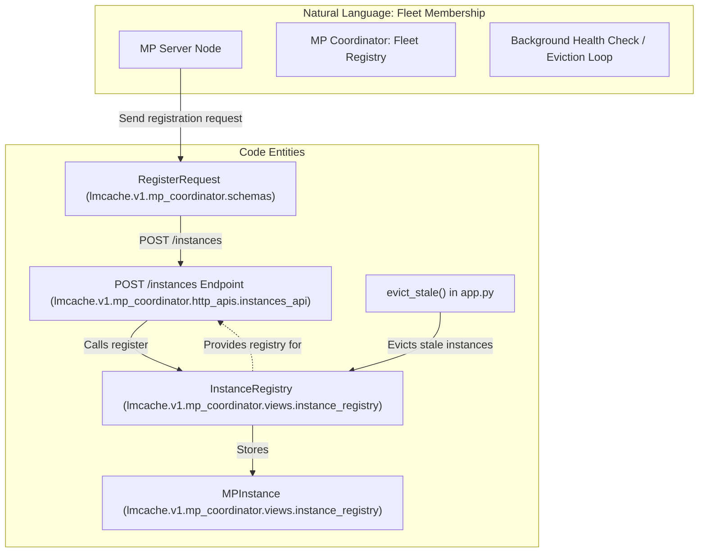
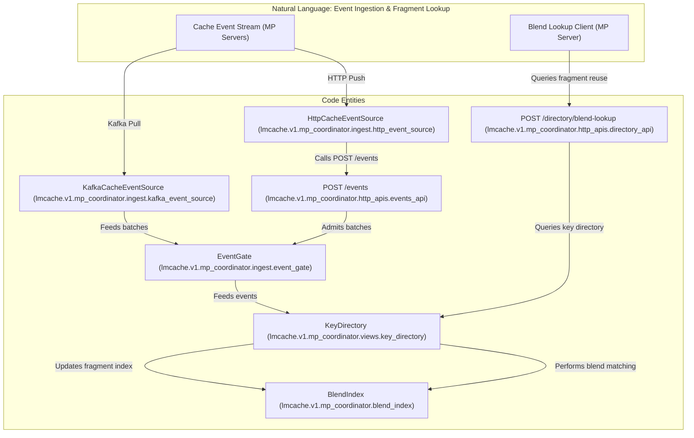
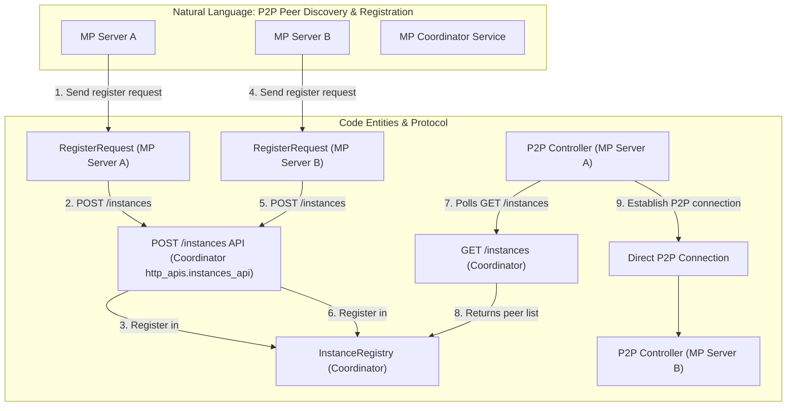
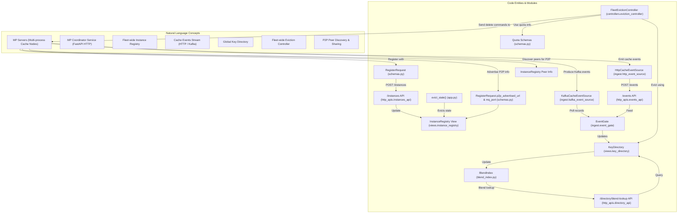

<!-- source: DeepWiki mcp.deepwiki.com · repo LMCache/LMCache · extra page MP Coordinator and Multi-Server Fleet · fetched 2026-10-21 -->

# MP Coordinator and Multi-Server Fleet

Relevant source files

The following files were used as context for generating this wiki page:

- [docs/design/v1/mp_coordinator/README.md](docs/design/v1/mp_coordinator/README.md)
- [docs/design/v1/mp_coordinator/cache_events.md](docs/design/v1/mp_coordinator/cache_events.md)
- [docs/design/v1/mp_coordinator/ingest.md](docs/design/v1/mp_coordinator/ingest.md)
- [docs/design/v1/mp_coordinator/observability.md](docs/design/v1/mp_coordinator/observability.md)
- [docs/design/v1/mp_coordinator/views/key_directory.md](docs/design/v1/mp_coordinator/views/key_directory.md)
- [docs/source/cli/coordinator.rst](docs/source/cli/coordinator.rst)
- [docs/source/mp/coordinator.rst](docs/source/mp/coordinator.rst)
- [docs/source/mp/observability/metrics.rst](docs/source/mp/observability/metrics.rst)
- [lmcache/cli/commands/coordinator.py](lmcache/cli/commands/coordinator.py)
- [lmcache/v1/mp_coordinator/__main__.py](lmcache/v1/mp_coordinator/__main__.py)
- [lmcache/v1/mp_coordinator/api.py](lmcache/v1/mp_coordinator/api.py)
- [lmcache/v1/mp_coordinator/app.py](lmcache/v1/mp_coordinator/app.py)
- [lmcache/v1/mp_coordinator/cache_events.py](lmcache/v1/mp_coordinator/cache_events.py)
- [lmcache/v1/mp_coordinator/config.py](lmcache/v1/mp_coordinator/config.py)
- [lmcache/v1/mp_coordinator/http_apis/dependencies.py](lmcache/v1/mp_coordinator/http_apis/dependencies.py)
- [lmcache/v1/mp_coordinator/http_apis/directory_api.py](lmcache/v1/mp_coordinator/http_apis/directory_api.py)
- [lmcache/v1/mp_coordinator/http_apis/instances_api.py](lmcache/v1/mp_coordinator/http_apis/instances_api.py)
- [lmcache/v1/mp_coordinator/ingest/event_broadcaster.py](lmcache/v1/mp_coordinator/ingest/event_broadcaster.py)
- [lmcache/v1/mp_coordinator/ingest/event_gate.py](lmcache/v1/mp_coordinator/ingest/event_gate.py)
- [lmcache/v1/mp_coordinator/ingest/kafka_event_source.py](lmcache/v1/mp_coordinator/ingest/kafka_event_source.py)
- [lmcache/v1/mp_coordinator/observability.py](lmcache/v1/mp_coordinator/observability.py)
- [lmcache/v1/mp_coordinator/registrar.py](lmcache/v1/mp_coordinator/registrar.py)
- [lmcache/v1/mp_coordinator/schemas.py](lmcache/v1/mp_coordinator/schemas.py)
- [lmcache/v1/mp_coordinator/views/key_directory.py](lmcache/v1/mp_coordinator/views/key_directory.py)
- [tests/cli/commands/test_coordinator.py](tests/cli/commands/test_coordinator.py)
- [tests/v1/mp_coordinator/conftest.py](tests/v1/mp_coordinator/conftest.py)
- [tests/v1/mp_coordinator/fake_kafka.py](tests/v1/mp_coordinator/fake_kafka.py)
- [tests/v1/mp_coordinator/persistence/test_checkpoint.py](tests/v1/mp_coordinator/persistence/test_checkpoint.py)
- [tests/v1/mp_coordinator/test_api.py](tests/v1/mp_coordinator/test_api.py)
- [tests/v1/mp_coordinator/test_cache_events.py](tests/v1/mp_coordinator/test_cache_events.py)
- [tests/v1/mp_coordinator/test_config.py](tests/v1/mp_coordinator/test_config.py)
- [tests/v1/mp_coordinator/test_directory_api.py](tests/v1/mp_coordinator/test_directory_api.py)
- [tests/v1/mp_coordinator/test_event_broadcaster.py](tests/v1/mp_coordinator/test_event_broadcaster.py)
- [tests/v1/mp_coordinator/test_event_gate.py](tests/v1/mp_coordinator/test_event_gate.py)
- [tests/v1/mp_coordinator/test_kafka_event_sink.py](tests/v1/mp_coordinator/test_kafka_event_sink.py)
- [tests/v1/mp_coordinator/test_kafka_event_source.py](tests/v1/mp_coordinator/test_kafka_event_source.py)
- [tests/v1/mp_coordinator/test_key_directory.py](tests/v1/mp_coordinator/test_key_directory.py)
- [tests/v1/mp_coordinator/test_main.py](tests/v1/mp_coordinator/test_main.py)
- [tests/v1/mp_coordinator/test_observability.py](tests/v1/mp_coordinator/test_observability.py)
- [tests/v1/mp_coordinator/test_registrar.py](tests/v1/mp_coordinator/test_registrar.py)

## Purpose and Scope

The **MP Coordinator** is a standalone FastAPI service (`lmcache coordinator`) that acts as the centralized control plane for a fleet of LMCache multi-process (MP) servers deployed across multiple nodes [docs/source/mp/coordinator.rst:4-7](), [docs/design/v1/mp_coordinator/README.md:3-8](). While each MP server manages its local KV cache independently, the coordinator provides fleet-wide instance registry, heartbeat tracking, a global key directory (tracking chunk placements across all servers), cache event aggregation (via HTTP or Kafka transports), an eviction controller implementing quota-aware fleet-level L2 eviction, and supports P2P sharing discovery for cross-server KV transfers.

This architecture enables coordinated cache management, capacity enforcement, cross-node reuse via CacheBlend fragment lookup, and multi-node fleet observability.

Sources: [docs/source/mp/coordinator.rst:4-7](), [docs/design/v1/mp_coordinator/README.md:3-8]()

---

## Fleet Architecture and Instance Registry

The coordinator maintains a **fleet-wide instance registry** of all active MP servers via the `InstanceRegistry` read model [docs/design/v1/mp_coordinator/README.md:78](). Each MP server registers itself on startup by sending a `POST /instances` request with its identity, HTTP endpoint (`ip` and `http_port`), optional metadata, and P2P transfer parameters (`p2p_advertised_url` and `mq_port`) [docs/design/v1/mp_coordinator/README.md:29](), [lmcache/v1/mp_coordinator/schemas.py:75-99](). Servers then send periodic heartbeats via `PUT /instances/{id}/heartbeat` to signal continued liveness [docs/design/v1/mp_coordinator/README.md:30](). 

The coordinator runs a **background health eviction loop** (`evict_stale` function in `lmcache/v1/mp_coordinator/app.py`) that periodically checks for servers whose heartbeats have expired past the configured `instance_timeout`, removing them from the fleet registry to keep membership accurate and up-to-date [docs/source/mp/coordinator.rst:51-54](), [lmcache/v1/mp_coordinator/app.py:75-90]().

Each registered server's information is kept in an `MPInstance` object that records identifying data and P2P parameters, enabling the coordinator and other fleet components to route requests and manage peer discovery [docs/design/v1/mp_coordinator/README.md:78]().

### Instance Registration Workflow Diagram

Sources: [lmcache/v1/mp_coordinator/app.py:74-90](), [lmcache/v1/mp_coordinator/schemas.py:75-92](), [docs/design/v1/mp_coordinator/README.md:99-129]()

---

## Global Key Directory and Cache Events

A critical coordinator component is the **Key Directory** (`KeyDirectory`), which maintains the global view of where KV cache chunks are stored across the MP server fleet [lmcache/v1/mp_coordinator/views/key_directory.py:2-8](). It consumes ordered **cache event batches** (`CacheEventBatch`) emitted by the MP servers whenever keys are stored, accessed, deleted, or moved [lmcache/v1/mp_coordinator/views/key_directory.py:143-147]().

MP servers deliver these cache events via the `POST /events` REST API using `HttpCacheEventSource`, or optionally through durable Kafka event streams via `KafkaCacheEventSource` when `--event-transport kafka` is configured [docs/source/mp/coordinator.rst:129-150](), [docs/design/v1/mp_coordinator/README.md:68-72](), [docs/design/v1/mp_coordinator/ingest.md:76-101](). Upon ingestion, the coordinator’s ingest subsystem admits events through an `EventGate` that ensures sequencing, deduplication, and fencing by server incarnation [docs/design/v1/mp_coordinator/README.md:68](), [docs/design/v1/mp_coordinator/ingest.md:42-51]().

The Key Directory maintains index maps of `ObjectKey` placements, associating keys with instances, tiers, storage backends, and sizes, enabling precise lookups of which server(s) hold each cached item [lmcache/v1/mp_coordinator/views/key_directory.py:67-141]().

When CacheBlend fragment reuse is enabled (`--enable-blend-lookup`), the coordinator builds and queries a **BlendIndex** that indexes cached chunk content, allowing MP servers to query for re-usable fragments anywhere in the fleet to improve cross-request cache hits [docs/source/mp/coordinator.rst:81-86](), [lmcache/v1/mp_coordinator/blend_index.py](), [lmcache/v1/mp_coordinator/views/key_directory.py:171-192]().

### Kafka Ingest Pipeline

When `--event-transport kafka` is specified, the coordinator replaces the non-durable `POST /events` push interface with `KafkaCacheEventSource` [docs/source/mp/coordinator.rst:129-135](), [docs/design/v1/mp_coordinator/ingest.md:87-101](). 
- A dedicated background poll thread consumes `CacheEventsRequest` JSON envelopes from `--kafka-topic` across configured `--kafka-bootstrap-servers` [docs/source/mp/coordinator.rst:136-144](), [docs/design/v1/mp_coordinator/ingest.md:87-95]().
- Records are keyed by `instance_id` to guarantee per-instance stream ordering within Kafka partitions [docs/design/v1/mp_coordinator/ingest.md:91-93]().
- A `StreamPosition` tracker records partition read offsets upon successful gate admission, synchronizing cursor state inside coordinator checkpoints [docs/design/v1/mp_coordinator/ingest.md:94-111](). Consumer group offset auto-commit is disabled (`enable.auto.commit: False`) to prevent out-of-sync message skipping after restarts [docs/design/v1/mp_coordinator/ingest.md:112-121]().

### Cache Event Ingestion and Fragment Lookup Diagram

Sources: [lmcache/v1/mp_coordinator/app.py:122-136](), [docs/design/v1/mp_coordinator/README.md:68-78](), [docs/design/v1/mp_coordinator/ingest.md:20-101](), [lmcache/v1/mp_coordinator/views/key_directory.py:1-30]()

---

## Eviction Controller and L2 Usage Tracking

The coordinator governs the fleet-wide usage of L2 cache capacity through the `FleetEvictionController` [docs/design/v1/mp_coordinator/README.md:85](). This controller continuously monitors per-tenant (`cache_salt`) L2 usage against set quotas configured via REST endpoints, and triggers eviction cycles when usage exceeds a safety watermark [docs/source/mp/coordinator.rst:61-70]().

Eviction cycles consult the global key directory’s LRU caches and pin state to select keys for deletion, then issue `DELETE` requests to the respective MP servers holding those keys, enforcing quota limits on the entire fleet cohesively [docs/design/v1/mp_coordinator/README.md:34-36, 47-53]().

Key aspects:
- **Quota Management**: Operators configure per-tenant quotas (`PUT /quota/{cache_salt}`), which the eviction controller enforces [docs/design/v1/mp_coordinator/README.md:35](), [lmcache/v1/mp_coordinator/schemas.py:127-137]().
- **Eviction Loop**: Running periodically every few seconds (configurable via `--eviction-check-interval`), the controller selects a fraction (`--eviction-ratio`) of tracked keys to evict until usage falls below the trigger watermark (`--trigger-watermark`) [docs/source/mp/coordinator.rst:61-70]().

Sources: [lmcache/v1/mp_coordinator/controllers/eviction_controller.py:1-40](), [lmcache/v1/mp_coordinator/schemas.py:127-137](), [docs/design/v1/mp_coordinator/README.md:35-52]()

---

## P2P Sharing Between MP Servers

Peer-to-peer (P2P) KV cache sharing allows MP servers to directly transfer cached data fragments among themselves, enabling faster lookups and load balancing without routing everything through the coordinator [docs/source/mp/coordinator.rst:4-7]().

The MP Coordinator facilitates this by maintaining a **registry of P2P-capable MP instances**, which advertise their P2P endpoint URLs (`p2p_advertised_url`) and messaging queue ports (`mq_port`) upon registration [lmcache/v1/mp_coordinator/schemas.py:86-91](). Other MP servers use this registry to discover live peers for low-latency RDMA or high-throughput TCP connections for KV chunk transfers.

The coordinator itself does not store any cached data or orchestrate transfers directly; it acts as the authoritative **peer discovery and fleet membership service**, keeping peer lists consistent and providing this data via REST queries [docs/design/v1/mp_coordinator/README.md:12-19]().

### P2P Peer Discovery Flow Diagram

Sources: [docs/source/mp/coordinator.rst:4-7](), [lmcache/v1/mp_coordinator/schemas.py:98-99]()

---

## Controller Extension Seam

The MP Coordinator’s architecture is modular and extendable through **controllers** that augment core fleet management behaviors [docs/design/v1/mp_coordinator/README.md:82-88](). A controller implements the `Controller` base class and interacts with shared views and services on the coordinator [docs/source/mp/coordinator.rst:167]().

Users can load out-of-tree controllers by specifying import paths in the `controller_packages` field of the JSON `--extra-config` option [docs/source/mp/coordinator.rst:104-112](). This design allows introducing features like custom eviction policies, warm prefetch schedulers, or other fleet-wide management tasks without modifying core coordinator code.

Controllers access the shared models via the `CoordinatorContext` supplied in HTTP API endpoints, supporting composability [lmcache/v1/mp_coordinator/http_apis/dependencies.py]().

Sources: [docs/source/mp/coordinator.rst:104-133](), [lmcache/v1/mp_coordinator/http_apis/dependencies.py]()

---

## Configuration Reference

The MP Coordinator is configured exclusively via CLI flags, handled by the frozen dataclass `MPCoordinatorConfig` [docs/source/mp/coordinator.rst:35-36](), [lmcache/v1/mp_coordinator/config.py:54-119](). Key configuration options include HTTP bind address, eviction timing parameters, chunking and hashing algorithms, checkpointing paths, and instrumentation flags.

| Flag | Default | Description |
| :--- | :--- | :--- |
| `--host` | `0.0.0.0` | Bind address for the coordinator HTTP server. |
| `--port` | `9300` | HTTP server listen port. |
| `--instance-timeout` | `30.0` | Seconds without heartbeat before instance considered stale and evicted. |
| `--health-check-interval` | `10.0` | Interval for health sweep evictions; set 0 to disable. |
| `--eviction-check-interval` | `5.0` | Interval between L2 eviction cycles; 0 disables eviction loop. |
| `--eviction-ratio` | `0.2` | Fraction of tracked keys evicted per cycle. |
| `--trigger-watermark` | `1.0` | Quota usage fraction that triggers eviction. |
| `--chunk-size` | `256` | Tokens per chunk, must match MP servers. |
| `--hash-algorithm` | `blake3` | Token hashing algorithm for pins, must match MP servers. |
| `--enable-blend-lookup` | `False` | Enables CacheBlend fragment content indexing. |
| `--blend-probe-stride` | `1` | Stride between CacheBlend match probes when lookup enabled. |
| `--checkpoint-path` | `""` | Path for checkpointing coordinator derived state. |
| `--checkpoint-interval` | `60.0` | Seconds between checkpoint writes. |
| `--metadata-path` | `""` | Path for persistent operator-set metadata (pins, quotas). |
| `--extra-config` | `{}` | JSON dict for additional out-of-tree controller settings. |
| `--timeout-keep-alive` | `10` | Seconds to keep idle HTTP connections alive. |
| `--disable-metrics` | `False` | Disable OpenTelemetry metrics. |
| `--otlp-endpoint` | `None` | OTLP gRPC endpoint for pushing metrics; disables local `/metrics`. |
| `--event-transport` | `http` | Event transport (`http` or `kafka`). |
| `--kafka-bootstrap-servers` | `""` | Kafka bootstrap servers for kafka event source. |
| `--kafka-topic` | `lmcache-cache-events` | Kafka topic for cache events. |
| `--kafka-group-id` | `lmcache-coordinator` | Kafka consumer group ID. |

These flags are parsed and validated in `MPCoordinatorConfig` defined in `lmcache/v1/mp_coordinator/config.py` and configured via the CLI command `coordinator` implemented in `lmcache/cli/commands/coordinator.py`.

Sources: [lmcache/v1/mp_coordinator/config.py:54-142](), [lmcache/cli/commands/coordinator.py:20-200]()

---

# Summary Mermaid Diagram: MP Coordinator Components and Data Flow

Sources:  
- [docs/source/mp/coordinator.rst:1-174]()  
- [docs/design/v1/mp_coordinator/README.md:1-135]()  
- [lmcache/v1/mp_coordinator/app.py:1-155]()  
- [lmcache/v1/mp_coordinator/schemas.py:1-203]()  
- [lmcache/v1/mp_coordinator/config.py:1-142]()  
- [lmcache/cli/commands/coordinator.py:1-200]()  
- [lmcache/v1/mp_coordinator/http_apis/cache_api.py:1-182]()  
- [docs/design/v1/mp_coordinator/ingest.md:1-123]()

---

