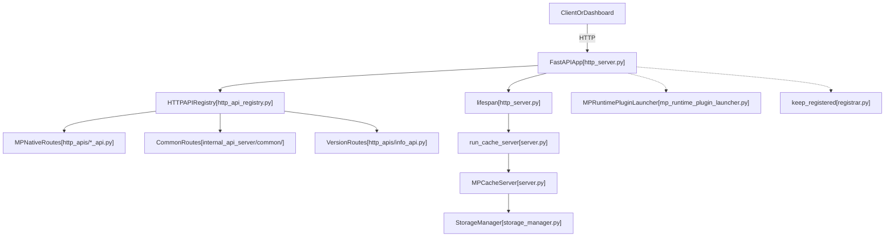
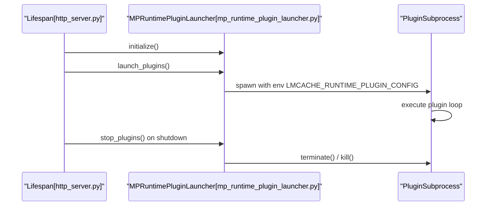

<!-- source: DeepWiki mcp.deepwiki.com · repo LMCache/LMCache · extra page MP HTTP API and Frontend Dashboard · fetched 2026-10-21 -->

# MP HTTP API and Frontend Dashboard

Relevant source files

The following files were used as context for generating this wiki page:

- [docs/design/v1/multiprocess/http_api_extension.md](docs/design/v1/multiprocess/http_api_extension.md)
- [docs/design/v1/multiprocess/mp_runtime_plugin.md](docs/design/v1/multiprocess/mp_runtime_plugin.md)
- [docs/source/getting_started/quickstart/standalone_starter.rst](docs/source/getting_started/quickstart/standalone_starter.rst)
- [docs/source/mp/http_api.rst](docs/source/mp/http_api.rst)
- [lmcache/v1/internal_api_server/api_server.py](lmcache/v1/internal_api_server/api_server.py)
- [lmcache/v1/internal_api_server/common/run_script_api.py](lmcache/v1/internal_api_server/common/run_script_api.py)
- [lmcache/v1/internal_api_server/utils.py](lmcache/v1/internal_api_server/utils.py)
- [lmcache/v1/internal_api_server/vllm/cache_api.py](lmcache/v1/internal_api_server/vllm/cache_api.py)
- [lmcache/v1/mp_coordinator/controllers/eviction_controller.py](lmcache/v1/mp_coordinator/controllers/eviction_controller.py)
- [lmcache/v1/mp_coordinator/http_apis/cache_api.py](lmcache/v1/mp_coordinator/http_apis/cache_api.py)
- [lmcache/v1/multiprocess/cache_control/key_resolver.py](lmcache/v1/multiprocess/cache_control/key_resolver.py)
- [lmcache/v1/multiprocess/cache_control/prefetch_service.py](lmcache/v1/multiprocess/cache_control/prefetch_service.py)
- [lmcache/v1/multiprocess/http_apis/cache_api.py](lmcache/v1/multiprocess/http_apis/cache_api.py)
- [lmcache/v1/multiprocess/http_apis/common_api.py](lmcache/v1/multiprocess/http_apis/common_api.py)
- [lmcache/v1/multiprocess/http_apis/schemas.py](lmcache/v1/multiprocess/http_apis/schemas.py)
- [lmcache/v1/multiprocess/mp_runtime_plugin_launcher.py](lmcache/v1/multiprocess/mp_runtime_plugin_launcher.py)
- [lmcache/v1/multiprocess/transport/zmq_impl/client.py](lmcache/v1/multiprocess/transport/zmq_impl/client.py)
- [lmcache/v1/standalone/__init__.py](lmcache/v1/standalone/__init__.py)
- [lmcache/v1/utils/json_utils.py](lmcache/v1/utils/json_utils.py)
- [lmcache/v1/utils/router_discovery.py](lmcache/v1/utils/router_discovery.py)
- [tests/v1/internal_api_server/test_cache_clear.py](tests/v1/internal_api_server/test_cache_clear.py)
- [tests/v1/internal_api_server/test_kvcache_check_api.py](tests/v1/internal_api_server/test_kvcache_check_api.py)
- [tests/v1/internal_api_server/test_per_instance_app.py](tests/v1/internal_api_server/test_per_instance_app.py)
- [tests/v1/mp_coordinator/test_cache_api.py](tests/v1/mp_coordinator/test_cache_api.py)
- [tests/v1/mp_coordinator/test_eviction_controller.py](tests/v1/mp_coordinator/test_eviction_controller.py)
- [tests/v1/multiprocess/http_apis/__init__.py](tests/v1/multiprocess/http_apis/__init__.py)
- [tests/v1/multiprocess/http_apis/test_cache_api.py](tests/v1/multiprocess/http_apis/test_cache_api.py)
- [tests/v1/multiprocess/http_apis/test_common_api.py](tests/v1/multiprocess/http_apis/test_common_api.py)
- [tests/v1/multiprocess/test_engine_passthroughs.py](tests/v1/multiprocess/test_engine_passthroughs.py)
- [tests/v1/multiprocess/test_http_api_registry.py](tests/v1/multiprocess/test_http_api_registry.py)
- [tests/v1/multiprocess/test_http_server.py](tests/v1/multiprocess/test_http_server.py)
- [tests/v1/multiprocess/test_worker_liveness.py](tests/v1/multiprocess/test_worker_liveness.py)

## Purpose and Scope

This page documents the FastAPI HTTP frontend exposed by the `lmcache server` command in LMCache Multi-Process (MP) mode [docs/source/mp/index.rst:54-56](). This frontend provides an administrative and diagnostic API for monitoring and controlling the LMCache MP server, which is the standalone caching service used by vLLM and other serving engines to manage KV caches across processes. The page outlines the HTTP API endpoints, modular route discovery via `HTTPAPIRegistry` [docs/source/mp/http_api.rst:10-35](), server configuration options via `MPServerConfig` [lmcache/v1/multiprocess/config.py:52-159](), the mechanism for runtime plugin execution via `MPRuntimePluginLauncher`, integration with the MP Coordinator for fleet-wide heartbeat and registration, and the internal API server infrastructure managed by `InternalAPIServer` [lmcache/v1/internal_api_server/api_server.py:40-134]().

Sources: `[docs/source/mp/index.rst:53-61]()`, `[docs/source/cli/server.rst:4-41]()`, `[lmcache/v1/multiprocess/config.py:52-159]()`, `[docs/source/mp/http_api.rst:1-39]`, `[lmcache/v1/internal_api_server/api_server.py:40-134]()`

---

## System Architecture and Route Discovery

The LMCache HTTP server is implemented as a FastAPI application in `lmcache/v1/multiprocess/http_server.py` that wraps around the core multiprocess cache components. It runs alongside the MP cache server backend, which can use either ZMQ or gRPC for request transport [docs/source/mp/index.rst:10-11](). The HTTP server lifecycle is managed by a FastAPI lifespan context manager (`lifespan`), which handles engine initialization, background plugin launching, and coordinator registration [tests/v1/multiprocess/test_http_server.py:32-74](). In non-MP modes, `InternalAPIServer` [lmcache/v1/internal_api_server/api_server.py:40-134]() manages embedded endpoints using `APIRegistry` [lmcache/v1/internal_api_server/api_registry.py]().

### Route Discovery via `HTTPAPIRegistry`

Routes are assembled from three distinct sources, merged into one FastAPI application by `HTTPAPIRegistry` at startup [docs/source/mp/http_api.rst:13-35]():
1. **MP-native routes**: Modules named `*_api.py` under `lmcache/v1/multiprocess/http_apis/` exposing a module-level `router` (`fastapi.APIRouter`) [docs/source/mp/http_api.rst:16-20]().
2. **Shared common routes**: Aggregated from `lmcache/v1/internal_api_server/common/`, forwarding diagnostics like `/env`, `/loglevel`, `/metrics`, `/threads`, and `/run_script` [docs/source/mp/http_api.rst:21-29]().
3. **Re-exported version routes**: From `info_api.py`, including `/version`, `/lmc_version`, and `/commit_id` [docs/source/mp/http_api.rst:30-34]().

### Architecture Diagram

Title: "MP HTTP Server Route Discovery and Component Architecture"

Sources: `[docs/source/mp/http_api.rst:10-35]`, `[lmcache/v1/multiprocess/http_server.py:1-181]`, `[lmcache/v1/internal_api_server/api_server.py:40-134]()`

---

## HTTP API Endpoints and Operational Surface

The HTTP API provides endpoints for liveness, inspection, cache management, quota management, runtime L2 reconfiguration, and script execution [docs/source/mp/http_api.rst:69-206](). Handlers for cache objects and prefetches delegate directly to typed services such as `ObjectService` and `PrefetchService` [lmcache/v1/multiprocess/http_apis/cache_api.py:58-137](). Dangerous diagnostic endpoints like `POST /run_script` use strict sandboxing and enforce `run_script_api_enabled` [lmcache/v1/internal_api_server/common/run_script_api.py:31-57]().

### Core Endpoint Summary

| Endpoint | Method | Purpose | Source Module / Implementation |
| :--- | :--- | :--- | :--- |
| `/` | GET | Static liveness ping (does not touch engine). | `info_api.py` |
| `/healthcheck` | GET | K8s liveness/readiness probe; returns `503` until engine is initialized. | `info_api.py` |
| `/status` | GET | Detailed engine snapshot (L1, L2, registered contexts, sessions). | `status_api.py` |
| `/config` | GET | Dump merged server configuration objects. | `config_api.py` |
| `/config/adapters` | GET | Enumerate live cache adapters. | `config_api.py` |
| `/cache/objects` | GET/DELETE | Paginate or delete resident objects in L1/L2. | `cache_api.py` [lmcache/v1/multiprocess/http_apis/cache_api.py:58-99]() |
| `/cache/prefetches` | POST/GET | Warm L1 by loading token sequences from L2 ahead of traffic. | `cache_api.py` [lmcache/v1/multiprocess/http_apis/cache_api.py:107-137]() |
| `/cache/clear` | POST | Force-clear a tier's resident cache. | `cache_api.py` [lmcache/v1/multiprocess/http_apis/cache_api.py:160-172]() |
| `/quota` | GET/PUT/DELETE | Manage `cache_salt` quotas and live usage. | `quota_api.py` |
| `/reconfigure/{backend}/l2/*` | GET/POST | Runtime-manageable L2 adapters and operations. | `reconfigure_api.py` |
| `/run_script` | POST | Execute uploaded Python script in-process (disabled by default). | `run_script_api.py` [lmcache/v1/internal_api_server/common/run_script_api.py:47-109]() |

Sources: `[docs/source/mp/http_api.rst:87-206]()`, `[lmcache/v1/multiprocess/http_apis/cache_api.py:58-172]()`, `[lmcache/v1/internal_api_server/common/run_script_api.py:47-109]()`

---

## Server Configuration Options

The HTTP frontend server settings are governed by `MPServerConfig` and `InternalAPIServer` properties [docs/source/mp/configuration.rst:50-159](), [lmcache/v1/internal_api_server/api_server.py:40-60]().

### Configuration Parameters

- `--http-host`: Host address to bind the HTTP server (default: `127.0.0.1`) [docs/source/mp/http_api.rst:50-53]().
- `--http-port`: Port to bind the HTTP server (default: `8080`) [docs/source/mp/http_api.rst:54-56]().
- `--run-script-api-enabled`: Enable the `POST /run_script` HTTP endpoint executing caller-supplied Python in-process (default: `False`) [docs/source/mp/configuration.rst:155-159]().
- `--script-allowed-imports`: Space-separated list of Python module names that scripts posted to `/run_script` are allowed to import [docs/source/mp/configuration.rst:151-154]().
- `--runtime-plugin-locations`: Paths to runtime plugin scripts or directories launched alongside the server [docs/source/mp/configuration.rst:139-144]().
- `internal_api_server_enabled`: Boolean flag governing the embedded API server lifecycle within engine instances [lmcache/v1/internal_api_server/api_server.py:64-77]().

Sources: `[docs/source/mp/configuration.rst:50-159]()`, `[docs/source/mp/http_api.rst:40-67]()`, `[lmcache/v1/internal_api_server/api_server.py:40-77]()`

---

## Runtime Plugins (`MPRuntimePluginLauncher`)

Runtime plugins allow executing custom background scripts or daemons alongside the LMCache MP server process [docs/source/mp/configuration.rst:139-149](). They are managed by `MPRuntimePluginLauncher`.

### Plugin Flow Diagram

Title: "Runtime Plugin Lifecycle and Subprocess Execution"

Sources: `[docs/source/mp/configuration.rst:139-149]`, `[lmcache/v1/multiprocess/http_server.py:68-181]`

---

## Lifecycle Management (`lifespan` and `InternalAPIServer`)

The HTTP server lifecycle is orchestrated via an asynchronous context manager (`lifespan`) in `lmcache/v1/multiprocess/http_server.py`:
1. **Startup**: Parses configuration, runs `run_cache_server()` to initialize the ZMQ/gRPC request server and engine, builds `MPHTTPContext`, launches runtime plugins, and starts background coordinator registration tasks (`keep_registered`) [tests/v1/multiprocess/test_http_server.py:32-74]().
2. **Shutdown**: Cancels background tasks, closes client connections, stops runtime plugins, and terminates the core cache server and event bus [tests/v1/multiprocess/test_http_server.py:72-74]().
3. **Internal API Server**: Managed independently via `InternalAPIServer.start()` and `InternalAPIServer.stop()`, supporting TCP ports or Unix Domain Sockets (`uds`) with uvicorn integration [lmcache/v1/internal_api_server/api_server.py:40-134]().

Sources: `[lmcache/v1/multiprocess/http_server.py:1-181]`, `[tests/v1/multiprocess/test_http_server.py:32-154]`, `[lmcache/v1/internal_api_server/api_server.py:40-134]()`

---

## Summary

The LMCache MP HTTP API exposed via `lmcache server` provides a modular FastAPI frontend for administration, cache monitoring, prefetching, and diagnostics. Through `HTTPAPIRegistry` [docs/source/mp/http_api.rst:13-35]() and `InternalAPIServer` [lmcache/v1/internal_api_server/api_server.py:40-134](), route aggregation supports both native MP endpoints and shared internal server components. Integration with the MP Coordinator, runtime plugins, and comprehensive endpoints enable robust multi-process management.

Sources: `[docs/source/mp/index.rst:53-61]`, `[docs/source/mp/http_api.rst:1-206]`, `[lmcache/v1/multiprocess/http_server.py:1-181]`, `[lmcache/v1/internal_api_server/api_server.py:40-134]()`

---

