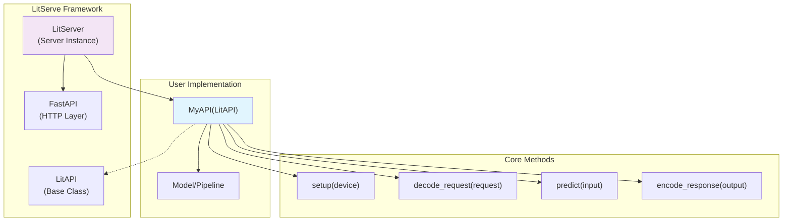
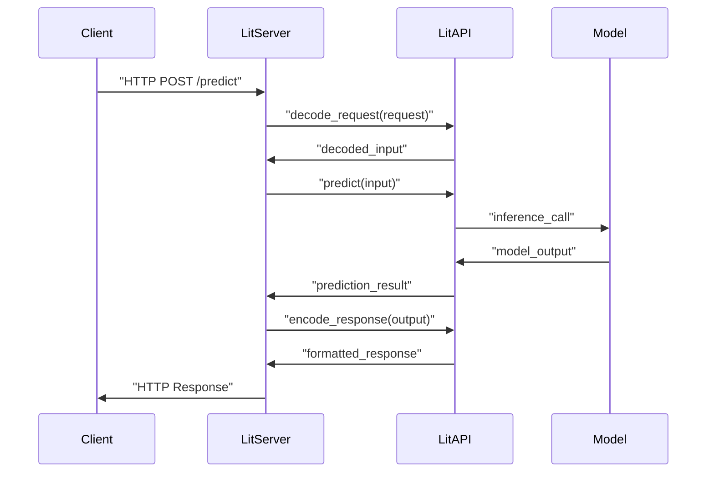

<!-- source: DeepWiki mcp.deepwiki.com · repo Lightning-AI/LitServe · page 1.1 Installation & Quick Start · fetched 2026-10-21 -->

# Installation & Quick Start

<details>
<summary>Relevant source files</summary>

The following files were used as context for generating this wiki page:

- [README.md](README.md)
- [pyproject.toml](pyproject.toml)
- [src/litserve/__about__.py](src/litserve/__about__.py)
- [src/litserve/python_client.py](src/litserve/python_client.py)
- [tests/conftest.py](tests/conftest.py)
- [tests/e2e/test_e2e.py](tests/e2e/test_e2e.py)
- [tests/simple_server.py](tests/simple_server.py)
- [tests/simple_server_diff_port.py](tests/simple_server_diff_port.py)
- [tests/unit/test_cli.py](tests/unit/test_cli.py)
- [tests/unit/test_mcp.py](tests/unit/test_mcp.py)

</details>


This page provides installation instructions and basic examples to get started with LitServe. It covers installing the framework, creating your first API, and running a basic server. For detailed API specifications and advanced features, see [API Specifications](#3) and [Advanced Features](#4).

## Installation

### Requirements

LitServe requires Python 3.10 or higher and runs on Linux, macOS, and Windows.

**Sources:** [pyproject.toml:14]()

### Install via pip

Install the latest stable version:

```bash
pip install litserve
```

This installs core dependencies:
- `fastapi>=0.112` - HTTP framework
- `pyzmq>=22.0.0` - High-performance message transport
- `uvicorn[standard]>=0.29.0` - ASGI server

**Sources:** [README.md:75-79](), [pyproject.toml:31-35]()

### Verify Installation

```python
import litserve as ls
print(ls.__version__)
```

**Sources:** [src/litserve/__about__.py:14]()

## Core Concepts

LitServe is built around two main abstractions that work together to create AI inference servers:

### Core Architecture



**Sources:** [tests/simple_server.py:20-32](), [README.md:75-96]()

### Request Processing Flow



**Sources:** [tests/simple_server.py:24-31](), [README.md:84-90]()

## Your First Server

### Example 1: Multi-Model Inference Pipeline

This example demonstrates using multiple models in a single inference pipeline:

```python
import litserve as ls

# Define the API by extending LitAPI
class InferenceEngine(ls.LitAPI):
    def setup(self, device):
        # Initialize any number of models, databases, etc.
        self.text_model = lambda x: x**2
        self.vision_model = lambda x: x**3

    def predict(self, request):
        x = request["input"]    
        # Perform calculations using both models
        a = self.text_model(x)
        b = self.vision_model(x)
        c = a + b
        return {"output": c}

if __name__ == "__main__":
    # Configure server with batching, streaming, GPU support, etc.
    server = ls.LitServer(InferenceEngine(), accelerator="auto")
    server.run(port=8000)
```

**Sources:** [README.md:87-108]()

### Example 2: AI Agent with External API

This example shows building an agent that fetches data and queries an LLM:

```python
import re, requests, openai
import litserve as ls

class NewsAgent(ls.LitAPI):
    def setup(self, device):
        self.openai_client = openai.OpenAI(api_key="OPENAI_API_KEY")

    def predict(self, request):
        website_url = request.get("website_url", "https://text.npr.org/")
        website_text = re.sub(r'<[^>]+>', ' ', requests.get(website_url).text)

        # Ask the LLM about the news
        llm_response = self.openai_client.chat.completions.create(
           model="gpt-3.5-turbo", 
           messages=[{"role": "user", "content": f"Based on this, what is the latest: {website_text}"}],
        )
        output = llm_response.choices[0].message.content.strip()
        return {"output": output}

if __name__ == "__main__":
    server = ls.LitServer(NewsAgent())
    server.run(port=8000)
```

**Sources:** [README.md:128-151]()

### Key Components

LitServe consists of two main abstractions:

| Component | Purpose | When It Runs |
|-----------|---------|--------------|
| `LitAPI` | Base class defining inference logic | Extended by user |
| `LitServer` | HTTP server that orchestrates workers | Instantiated once |
| `setup(device)` | Initialize models, load weights | Once per worker on startup |
| `predict(x)` | Core inference computation | Every request |
| `decode_request(request)` | Parse HTTP request (optional) | Every request |
| `encode_response(output)` | Format HTTP response (optional) | Every request |

**Sources:** [tests/simple_server.py:20-32](), [tests/conftest.py:43-54]()

## Running the Server

### Local Development

Start the server directly with Python:

```bash
python server.py
```

The server starts on `http://127.0.0.1:8000` by default and automatically generates a `client.py` file for testing.

**Sources:** [README.md:116-118](), [tests/e2e/test_e2e.py:64-69]()

### Using the Lightning CLI

Alternative deployment using Lightning tooling:

```bash
# Local deployment with Lightning tooling
lightning deploy server.py

# Deploy to Lightning AI cloud with autoscaling
lightning deploy server.py --cloud
```

**Sources:** [README.md:110-114](), [README.md:202-204]()

### Generated Client File

LitServe automatically creates a `client.py` file when the server starts, which you can use immediately:

```bash
python client.py
```

This provides a quick way to test your API. The generated file is a template that you can customize.

**Sources:** [tests/e2e/test_e2e.py:66-69](), [src/litserve/python_client.py:1-8]()

## Testing Your Server

### Method 1: Auto-Generated Client

Use the automatically generated `client.py`:

```bash
python client.py
```

Expected output:
```
Status: 200
Response:
 {"output":16.0}
```

**Sources:** [tests/e2e/test_e2e.py:66-69](), [src/litserve/python_client.py:1-8]()

### Method 2: curl

Test the `/predict` endpoint directly:

```bash
curl -X POST http://127.0.0.1:8000/predict \
     -H "Content-Type: application/json" \
     -d '{"input": 4.0}'
```

Expected response:
```json
{"output": 16.0}
```

**Sources:** [README.md:122-124](), [tests/e2e/test_e2e.py:87-89]()

### Method 3: Python Requests Library

For programmatic testing:

```python
import requests

response = requests.post(
    "http://127.0.0.1:8000/predict", 
    json={"input": 4.0}
)
print(f"Status: {response.status_code}")
print(f"Response: {response.json()}")
```

**Sources:** [tests/e2e/test_e2e.py:87-89]()

### Method 4: News Agent Example

For the news agent from Example 2:

```bash
curl -X POST http://127.0.0.1:8000/predict \
     -H "Content-Type: application/json" \
     -d '{"website_url": "https://text.npr.org/"}'
```

**Sources:** [README.md:152-155]()

## Server Configuration

### Basic Configuration

The `LitServer` constructor accepts various configuration parameters:

```python
server = ls.LitServer(
    InferencePipeline(),
    accelerator="auto",    # Device selection: "auto", "cpu", "cuda", "mps"
    devices=1,             # Number of devices to use
    timeout=10,            # Request timeout in seconds
    workers_per_device=1   # Workers per device for parallelism
)
```

**Sources:** [tests/simple_server.py:35](), [tests/conftest.py:130]()

### Common Parameters

| Parameter | Description | Default | Example |
|-----------|-------------|---------|---------|
| `accelerator` | Device type | `"auto"` | `"cpu"`, `"cuda"`, `"mps"` |
| `devices` | Number of devices | `1` | `1`, `2`, `4` |
| `timeout` | Request timeout (seconds) | `30` | `10`, `60` |
| `workers_per_device` | Workers per device | `1` | `2`, `4` |
| `max_batch_size` | Enable batching | `1` | `8`, `16`, `32` |
| `batch_timeout` | Max batch wait time | `0.0` | `0.05`, `0.1` |

**Sources:** [tests/conftest.py:130]()

### Port Configuration

Specify a custom port when running the server:

```python
server.run(port=8080)
```

The default port is `8000`.

**Sources:** [tests/simple_server_diff_port.py:34](), [tests/e2e/test_e2e.py:72-82]()

### Configuration Examples

#### GPU Server
```python
server = ls.LitServer(
    MyAPI(),
    accelerator="cuda",
    devices=2
)
```

#### Batched Server
```python
api = MyAPI(max_batch_size=16, batch_timeout=0.05)
server = ls.LitServer(api, accelerator="auto")
```

**Sources:** [tests/conftest.py:130]()

## Next Steps

- For detailed API customization, see [LitAPI](#2.1)
- For server configuration options, see [LitServer](#2.2)
- For OpenAI-compatible APIs, see [OpenAI Chat Completions API](#3.1)
- For production deployment guides, see [Docker Deployment](#4.6)

**Sources:** [README.md:147-158]()

---

