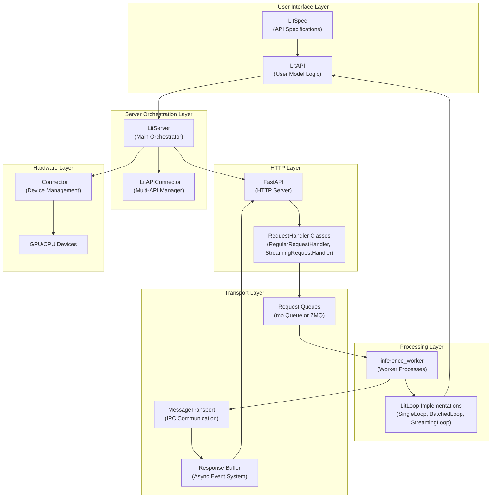
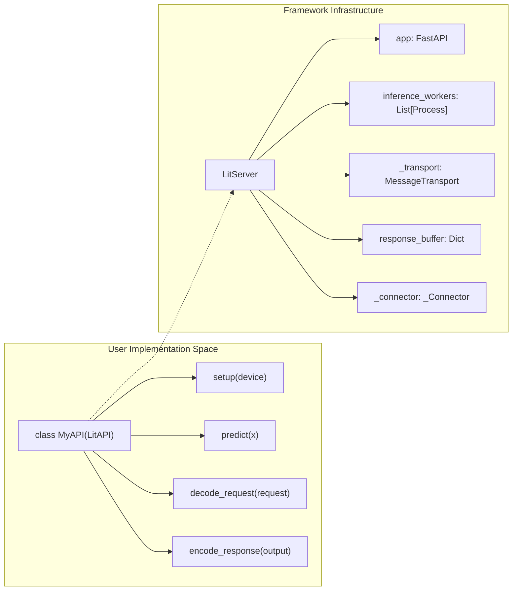
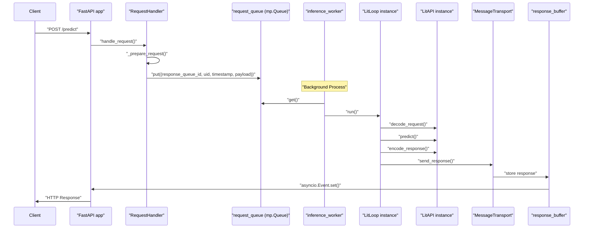
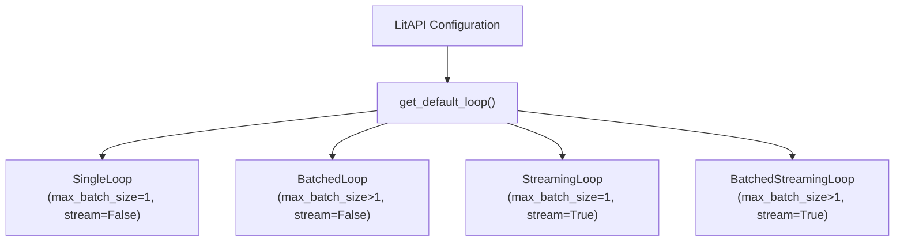
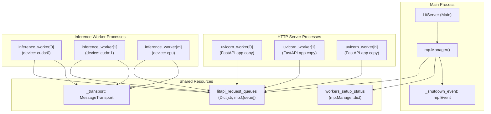
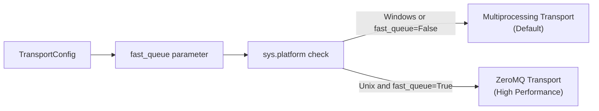
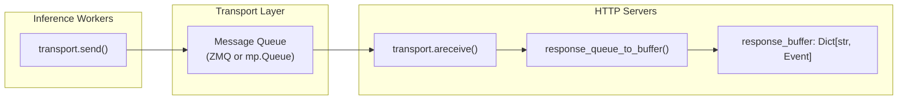
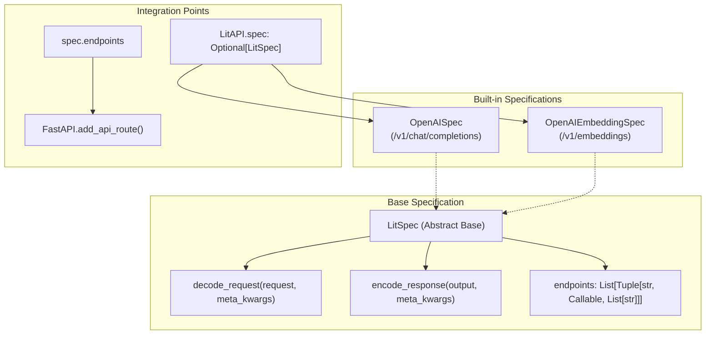

<!-- source: DeepWiki mcp.deepwiki.com · repo Lightning-AI/LitServe · page 1.2 Architecture Overview · fetched 2026-10-21 -->

# Architecture Overview

Relevant source files

The following files were used as context for generating this wiki page:

- [README.md](README.md)
- [src/litserve/server.py](src/litserve/server.py)
- [tests/conftest.py](tests/conftest.py)
- [tests/e2e/test_e2e.py](tests/e2e/test_e2e.py)

This document explains the overall system architecture of LitServe, including its core components, request processing pipeline, and multi-process execution model. LitServe is designed as a high-performance AI model serving framework that transforms AI models into production-ready APIs with automatic scaling, batching, streaming, and multi-GPU support.

For specific implementation details of core classes, see [LitAPI](#2.1) and [LitServer](#2.2). For processing strategies, see [Processing Loops](#2.3). For API compatibility layers, see [API Specifications](#3).

## System Components Overview

LitServe consists of several key architectural layers that work together to provide high-performance AI model serving:

**Sources:** [src/litserve/server.py:1-1439](), [src/litserve/api.py:1-404](), [src/litserve/specs/base.py:1-85]()

## Core Architecture Pattern

LitServe follows a two-tier abstraction pattern where users implement `LitAPI` for model logic while `LitServer` handles all infrastructure concerns:

The `LitAPI` class provides required methods (`setup`, `predict`) and optional methods for customization. The `LitServer` class manages the complete serving infrastructure including HTTP handling, worker processes, and inter-process communication.

**Sources:** [src/litserve/api.py:32-404](), [src/litserve/server.py:384-1439]()

## Request Processing Pipeline

LitServe implements a multi-stage request processing pipeline that handles HTTP requests through worker processes:

### HTTP Request Flow

**Sources:** [src/litserve/server.py:302-382](), [src/litserve/server.py:794-827]()

### Processing Loop Integration

The system supports multiple processing strategies through the `LitLoop` abstraction, automatically selected based on API configuration:

**Sources:** [src/litserve/api.py:376-381]()

## Multi-Process Architecture

LitServe uses a multi-process architecture to achieve high performance and fault isolation:

### Process Structure

### Worker Launch Configuration

The system calculates worker distribution based on hardware configuration:

| Configuration | Example Result |
|---|---|
| `accelerator="cuda", devices=2, workers_per_device=2` | `["cuda:0", "cuda:0", "cuda:1", "cuda:1"]` |
| `accelerator="cpu", workers_per_device=4` | `["cpu", "cpu", "cpu", "cpu"]` |
| `accelerator="auto", devices="auto"` | Auto-detected based on available hardware |

**Sources:** [src/litserve/server.py:780-793](), [src/litserve/server.py:1033-1048](), [src/litserve/server.py:1324-1330]()

## Transport Layer

The transport layer handles inter-process communication between HTTP servers and inference workers through the `MessageTransport` abstraction:

### Transport Configuration

### Message Flow

The transport layer manages asynchronous message passing with response buffering:

**Sources:** [src/litserve/server.py:772-773](), [src/litserve/server.py:790-792](), [src/litserve/server.py:127-177]()

## API Specifications System

LitServe supports multiple API specifications through the `LitSpec` abstraction, enabling compatibility with standard APIs like OpenAI:

### Specification Architecture

### Specification Setup Process

When a `LitAPI` has an associated `LitSpec`, the server performs additional setup:

1. **Pre-setup**: `spec.pre_setup(lit_api)` configures the specification
2. **Server setup**: `spec.setup(server)` connects spec to server resources  
3. **Endpoint registration**: `spec.endpoints` are registered with FastAPI
4. **Request override**: Spec's `decode_request`/`encode_response` override API methods

**Sources:** [src/litserve/specs/base.py:21-85](), [src/litserve/server.py:992-1001](), [src/litserve/api.py:329-340]()

---

