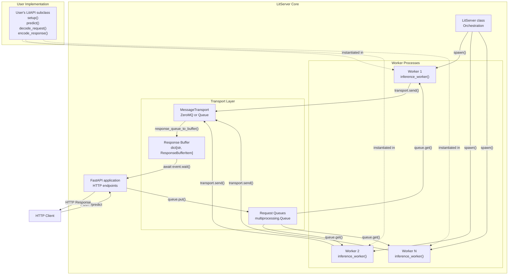
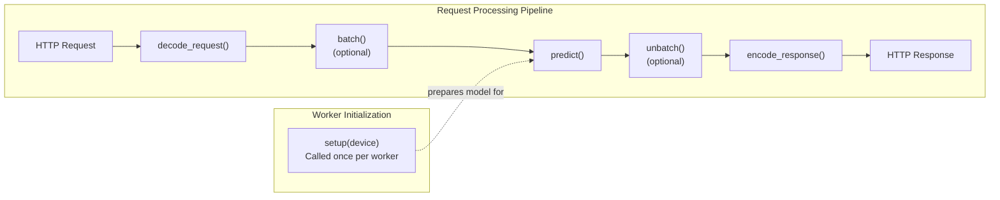
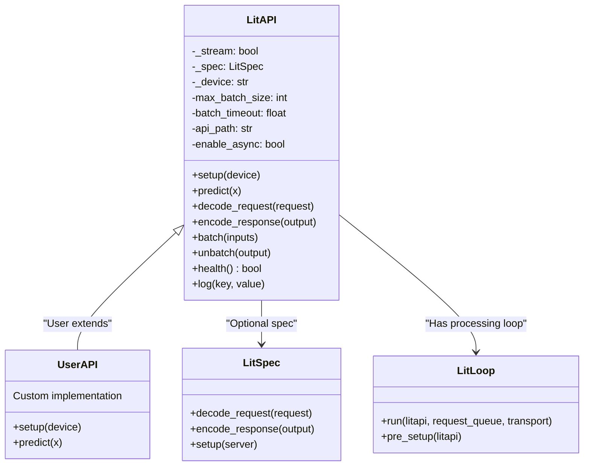
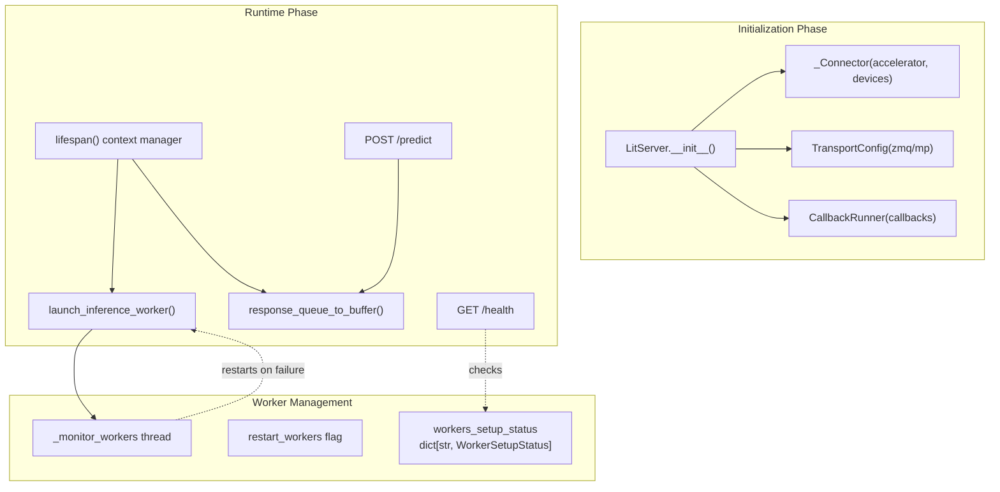
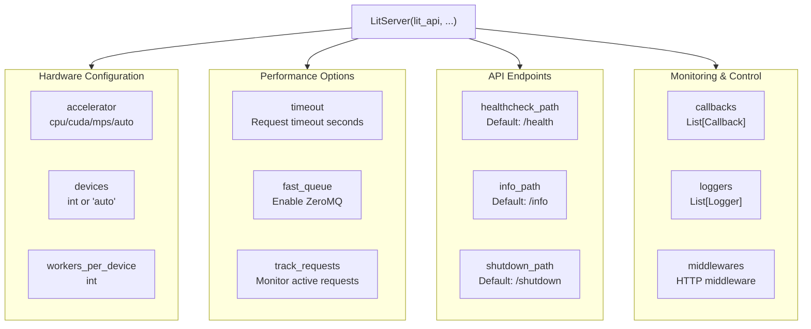
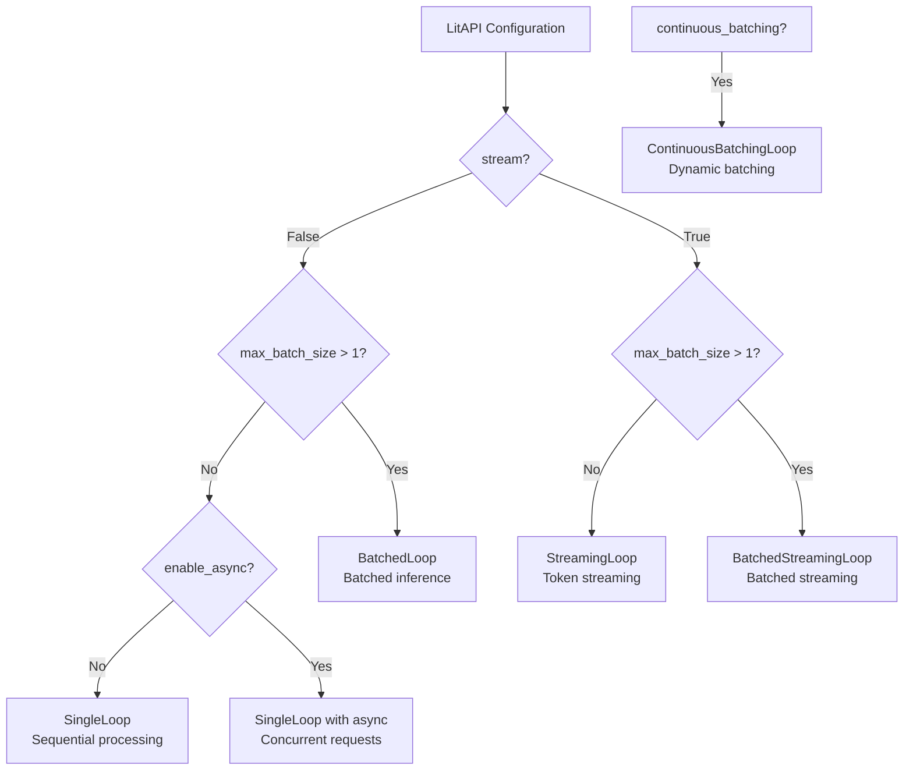
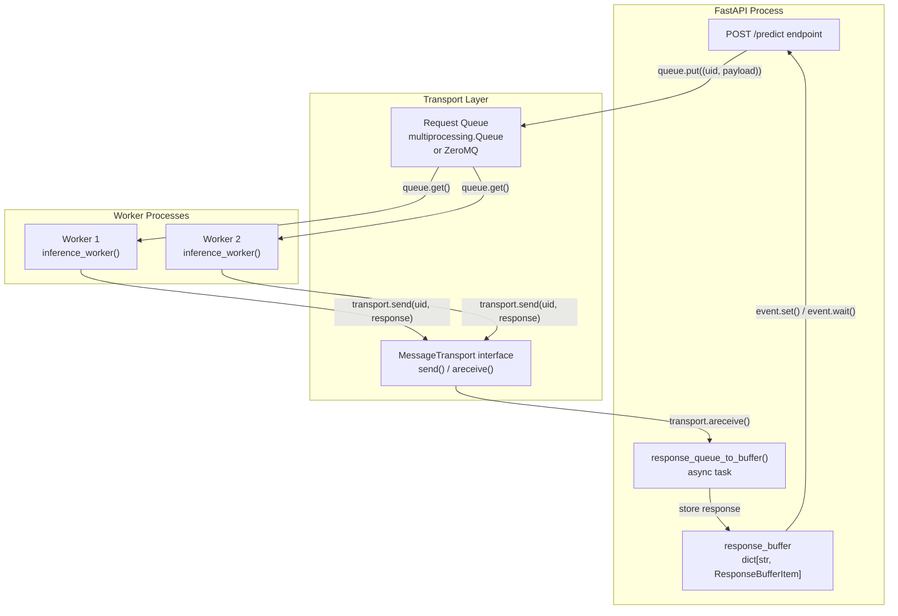
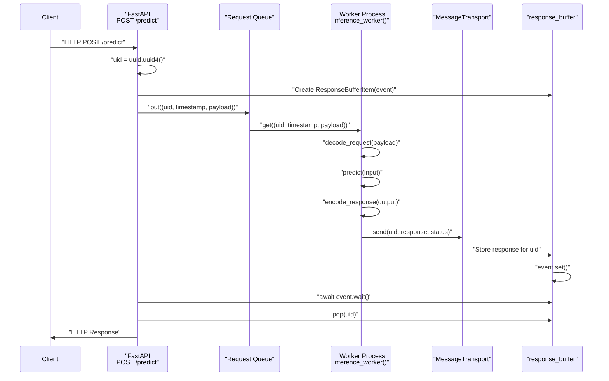
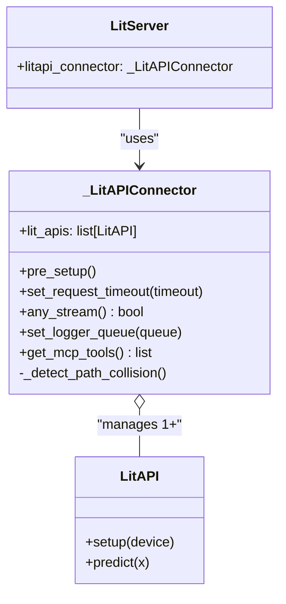
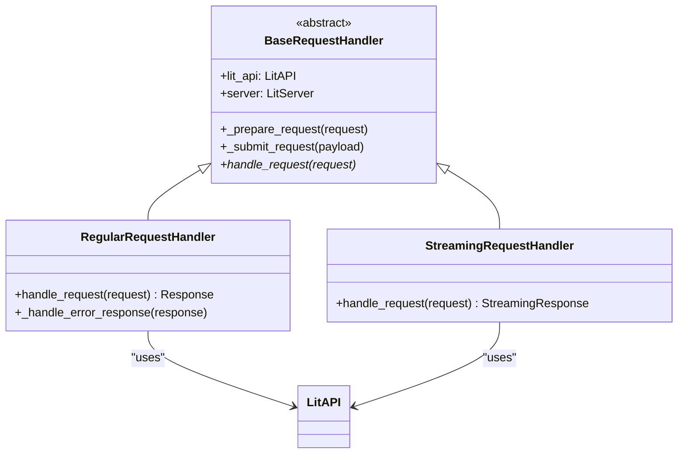

<!-- source: DeepWiki mcp.deepwiki.com · repo Lightning-AI/LitServe · page 2 Core Concepts · fetched 2026-10-21 -->

# Core Concepts

<details>
<summary>Relevant source files</summary>

The following files were used as context for generating this wiki page:

- [README.md](README.md)
- [src/litserve/api.py](src/litserve/api.py)
- [src/litserve/server.py](src/litserve/server.py)
- [src/litserve/specs/base.py](src/litserve/specs/base.py)
- [tests/conftest.py](tests/conftest.py)
- [tests/e2e/test_e2e.py](tests/e2e/test_e2e.py)

</details>


This page introduces the fundamental abstractions that form the foundation of LitServe: `LitAPI`, `LitServer`, processing loops, and the transport layer. These components work together to transform AI models into production-ready inference servers.

**Scope**: This page provides a conceptual overview of the core system architecture. For implementation details, see:
- [LitAPI](#2.1) - Deep dive into the API abstraction
- [LitServer](#2.2) - Server configuration and lifecycle
- [Processing Loops](#2.3) - Request processing patterns
- [Transport Layer & IPC](#2.4) - Inter-process communication

## System Architecture Overview

LitServe is built on a multi-process architecture where user-defined inference logic (`LitAPI`) runs in separate worker processes orchestrated by a central server (`LitServer`). This design enables parallel inference execution, hardware acceleration, and automatic optimizations.



**Sources**: [src/litserve/server.py:405-657](), [src/litserve/loops/base.py:1-50]()

## The LitAPI Abstraction

`LitAPI` is the abstract base class that defines the inference pipeline. Users subclass it to implement model-specific logic while LitServe handles infrastructure concerns.

### LitAPI Methods and Lifecycle



**Key Methods**:

| Method | Required | Purpose | Called When |
|--------|----------|---------|-------------|
| `setup(device)` | Yes | Load model and resources | Worker process starts |
| `predict(x)` | Yes | Run inference | Every request |
| `decode_request(request)` | No | Transform HTTP to model input | Every request (before predict) |
| `encode_response(output)` | No | Transform model output to HTTP | Every request (after predict) |
| `batch(inputs)` | No | Combine multiple inputs | When `max_batch_size > 1` |
| `unbatch(output)` | No | Split batched output | When `max_batch_size > 1` |

**Configuration Properties**:

```python
# From src/litserve/api.py:139-149
LitAPI(
    max_batch_size=1,        # Enable batching (> 1)
    batch_timeout=0.0,       # Max wait time for batch
    api_path="/predict",     # HTTP endpoint path
    stream=False,            # Enable streaming responses
    enable_async=False,      # Enable async methods
    spec=None,              # API specification (e.g., OpenAISpec)
    loop=None               # Custom processing loop
)
```

**Sources**: [src/litserve/api.py:33-130](), [src/litserve/api.py:139-194](), [src/litserve/api.py:245-346]()

### LitAPI Class Hierarchy



**Sources**: [src/litserve/api.py:33-448]()

## The LitServer Orchestrator

`LitServer` is responsible for server initialization, worker management, queue setup, and HTTP endpoint registration. It transforms a `LitAPI` instance into a running inference server.

### LitServer Architecture



**Key Components**:

| Component | Type | Purpose | Location |
|-----------|------|---------|----------|
| `_Connector` | Class | Hardware detection and device management | [src/litserve/connector.py]() |
| `TransportConfig` | Class | Configure IPC mechanism (ZeroMQ/Queue) | [src/litserve/transport/factory.py]() |
| `CallbackRunner` | Class | Execute lifecycle callbacks | [src/litserve/callbacks/base.py]() |
| `inference_worker` | Function | Worker process entry point | [src/litserve/loops/base.py]() |
| `workers_setup_status` | Dict | Track worker initialization state | [src/litserve/server.py:846]() |

**Sources**: [src/litserve/server.py:405-830](), [src/litserve/server.py:831-901]()

### LitServer Configuration



**Configuration Parameters**:

- **Hardware**: Controls device allocation and worker spawning ([src/litserve/server.py:659-686]())
- **Performance**: Optimizations for throughput and latency ([src/litserve/server.py:665-678]())
- **Endpoints**: Customize server endpoints ([src/litserve/server.py:666-669]())
- **Monitoring**: Lifecycle hooks and metrics ([src/litserve/server.py:674-677]())

**Sources**: [src/litserve/server.py:659-830]()

## Processing Loops

Processing loops implement the request processing logic. LitServe automatically selects the appropriate loop based on `LitAPI` configuration (`stream`, `max_batch_size`, `enable_async`).

### Loop Selection Logic



**Loop Types**:

| Loop Class | Batching | Streaming | Async | Use Case |
|------------|----------|-----------|-------|----------|
| `SingleLoop` | No | No | Optional | Simple request-response |
| `BatchedLoop` | Yes | No | No | GPU batch inference |
| `StreamingLoop` | No | Yes | Optional | Token-by-token generation |
| `BatchedStreamingLoop` | Yes | Yes | No | Batched streaming (LLMs) |
| `ContinuousBatchingLoop` | Dynamic | Yes | No | Advanced LLM serving |

**Sources**: [src/litserve/loops/loops.py](), [src/litserve/api.py:419-425]()

### Loop Execution Flow

```mermaid
sequenceDiagram
    participant Queue as "Request Queue<br/>multiprocessing.Queue"
    participant Loop as "LitLoop<br/>(SingleLoop/BatchedLoop/etc.)"
    participant LitAPI as "LitAPI Instance"
    participant Transport as "MessageTransport"
    
    loop Request Processing
        Queue->>Loop: "queue.get()"
        Note over Loop: "Extract uid, timestamp, payload"
        
        Loop->>LitAPI: "decode_request(payload)"
        LitAPI-->>Loop: "decoded_input"
        
        alt Batching Enabled
            Loop->>Loop: "Collect batch"
            Loop->>LitAPI: "batch(inputs)"
            LitAPI-->>Loop: "batched_input"
        end
        
        Loop->>LitAPI: "predict(input)"
        LitAPI-->>Loop: "output"
        
        alt Batching Enabled
            Loop->>LitAPI: "unbatch(output)"
            LitAPI-->>Loop: "individual_outputs"
        end
        
        Loop->>LitAPI: "encode_response(output)"
        LitAPI-->>Loop: "response"
        
        Loop->>Transport: "send(uid, response, status)"
    end
```

**Sources**: [src/litserve/loops/base.py:1-100]()

## Transport Layer and IPC

The transport layer manages communication between the FastAPI process and worker processes. It handles request distribution and response collection using queues and message passing.

### Transport Components



**Key Classes**:

| Class | Location | Purpose |
|-------|----------|---------|
| `ResponseBufferItem` | [src/litserve/utils.py]() | Container for response data and synchronization |
| `MessageTransport` | [src/litserve/transport/base.py]() | Abstract transport interface |
| `TransportConfig` | [src/litserve/transport/factory.py]() | Factory for creating transport instances |

**Sources**: [src/litserve/server.py:97-191](), [src/litserve/transport/]()

### ResponseBufferItem Structure

```python
# Response coordination object
# From src/litserve/utils.py
class ResponseBufferItem:
    event: asyncio.Event          # Signal when response ready
    response: Optional[tuple]     # Non-streaming response
    response_queue: deque         # Streaming response chunks
    worker_id: Optional[int]      # Which worker handled request
```

The `ResponseBufferItem` enables async coordination between the FastAPI process and worker processes:

1. FastAPI creates an entry with a unique `uid` before submitting request
2. Worker processes send responses via transport with the `uid`
3. `response_queue_to_buffer()` task receives responses and populates the buffer
4. FastAPI awaits the `event` to be set, then retrieves the response

**Sources**: [src/litserve/utils.py](), [src/litserve/server.py:97-131]()

## Request Flow Through the System



**Key Steps**:

1. **Request Submission**: FastAPI handler generates UID and queues request ([src/litserve/server.py:294-309]())
2. **Worker Processing**: Worker dequeues, processes through LitAPI pipeline ([src/litserve/loops/base.py]())
3. **Response Transport**: Worker sends response with UID via transport ([src/litserve/loops/base.py]())
4. **Response Collection**: Async task receives and buffers responses ([src/litserve/server.py:133-191]())
5. **Response Return**: FastAPI awaits event and returns to client ([src/litserve/server.py:316-342]())

**Sources**: [src/litserve/server.py:280-397](), [src/litserve/loops/base.py]()

## _LitAPIConnector Helper

The `_LitAPIConnector` class manages one or more `LitAPI` instances, providing utilities for setup, validation, and configuration management.



**Key Methods**:

- `pre_setup()`: Initializes all LitAPI instances before workers spawn ([src/litserve/server.py:247-253]())
- `set_request_timeout(timeout)`: Validates and applies timeout configuration ([src/litserve/server.py:254-261]())
- `any_stream()`: Checks if any API uses streaming ([src/litserve/server.py:265-266]())
- `_detect_path_collision()`: Ensures no duplicate API paths ([src/litserve/server.py:240-245]())

**Multi-API Support**: When multiple `LitAPI` instances are provided, each gets its own endpoint and can have different configurations (batching, streaming, etc.).

**Sources**: [src/litserve/server.py:208-278]()

## Request Handler Pattern

LitServe uses separate handlers for regular and streaming requests, following a strategy pattern:



**Handler Selection**: Based on `lit_api.stream`:
- `stream=False` → `RegularRequestHandler` returns complete response ([src/litserve/server.py:316-368]())
- `stream=True` → `StreamingRequestHandler` returns `StreamingResponse` ([src/litserve/server.py:370-397]())

**Sources**: [src/litserve/server.py:280-397]()

## Summary

The core concepts of LitServe work together to provide a scalable inference serving framework:

1. **LitAPI**: User-defined inference logic with standardized lifecycle methods
2. **LitServer**: Orchestrates workers, queues, and HTTP endpoints
3. **Processing Loops**: Automatically selected based on configuration to handle request patterns
4. **Transport Layer**: Efficient IPC using queues and async coordination

This architecture enables:
- Parallel inference across multiple workers
- Automatic batching and streaming
- Hardware acceleration (GPU, MPS)
- Async request handling
- Minimal user code changes

For detailed information on each component, see the child pages: [LitAPI](#2.1), [LitServer](#2.2), [Processing Loops](#2.3), and [Transport Layer & IPC](#2.4).

**Sources**: [src/litserve/server.py:1-1333](), [src/litserve/api.py:1-448](), [README.md:1-278]()

---

