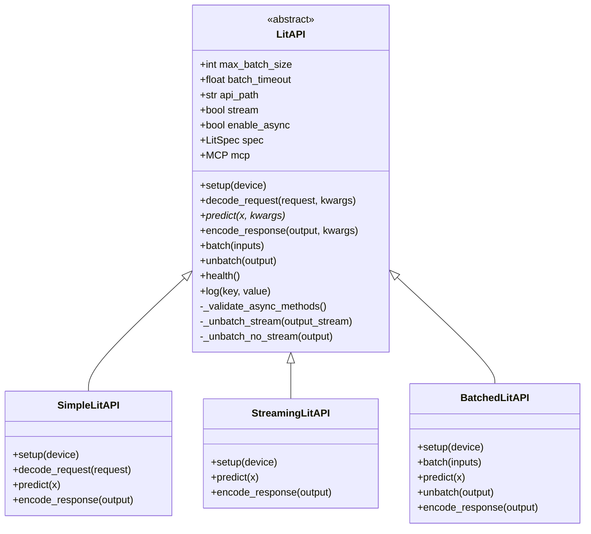
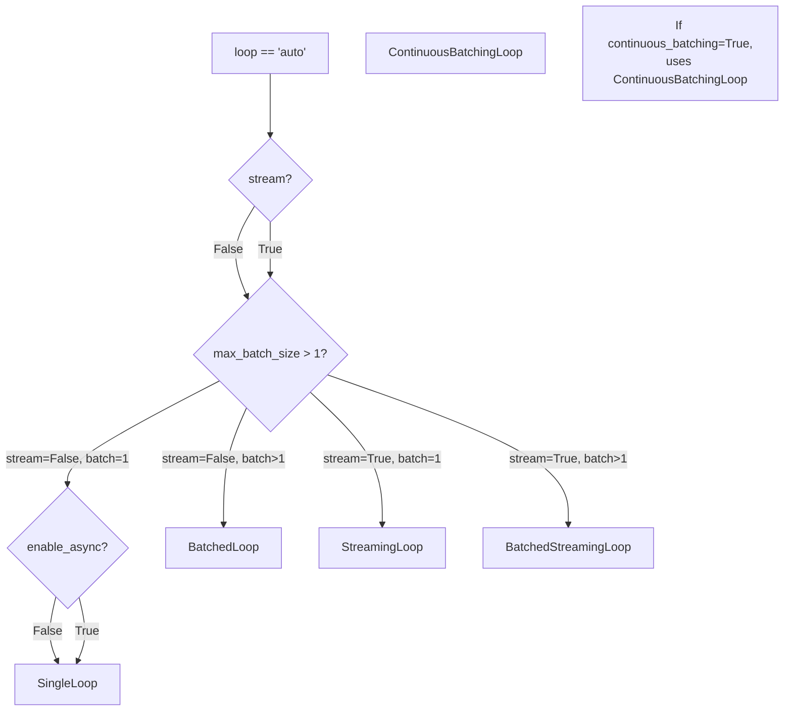

<!-- source: DeepWiki mcp.deepwiki.com · repo Lightning-AI/LitServe · page 2.1 LitAPI · fetched 2026-10-21 -->

# LitAPI

<details>
<summary>Relevant source files</summary>

The following files were used as context for generating this wiki page:

- [README.md](README.md)
- [src/litserve/api.py](src/litserve/api.py)
- [src/litserve/specs/base.py](src/litserve/specs/base.py)
- [tests/conftest.py](tests/conftest.py)
- [tests/e2e/test_e2e.py](tests/e2e/test_e2e.py)

</details>


## Purpose and Scope

This page documents the `LitAPI` class, the core abstraction users extend to define model serving logic in LitServe. `LitAPI` provides a structured interface for implementing the complete inference pipeline: model initialization, request decoding, prediction, and response encoding. It handles automatic optimization selection based on configuration (batching, streaming, async processing) without requiring users to manage infrastructure details.

For information about how `LitAPI` instances are orchestrated by the server, see [LitServer](#2.2). For details on processing loop selection and execution, see [Processing Loops](#2.3). For API specification customization (e.g., OpenAI compatibility), see [API Specifications](#3).

## Class Overview

`LitAPI` is an abstract base class defined in [src/litserve/api.py:33]() that users extend to implement custom inference logic. The class uses a metaclass `_TimedInitMeta` for performance monitoring during initialization.



**Sources:** [src/litserve/api.py:33-448](), [tests/conftest.py:43-101]()

## Core Request Processing Workflow

The `LitAPI` methods are called in a specific sequence by the processing loop to handle each request. The exact flow depends on configuration (batching, streaming) but follows this general pattern:

```mermaid
sequenceDiagram
    participant Loop as "Processing Loop"
    participant API as "LitAPI Instance"
    participant Model as "User Model"
    
    Note over Loop,Model: "One-time setup per worker"
    Loop->>API: "setup(device)"
    API->>Model: "Load model to device"
    Model-->>API: "Model ready"
    
    Note over Loop,Model: "Per-request processing"
    Loop->>API: "decode_request(request, **kwargs)"
    API-->>Loop: "decoded_input"
    
    alt Batching enabled (max_batch_size > 1)
        Loop->>API: "batch([input1, input2, ...])"
        API-->>Loop: "batched_input"
    end
    
    Loop->>API: "predict(input, **kwargs)"
    API->>Model: "Run inference"
    Model-->>API: "raw_output"
    
    alt Streaming (stream=True)
        API-->>Loop: "yield token1"
        API-->>Loop: "yield token2"
        API-->>Loop: "yield tokenN"
    else Non-streaming
        API-->>Loop: "output"
    end
    
    alt Batching enabled
        Loop->>API: "unbatch(output)"
        API-->>Loop: "[output1, output2, ...]"
    end
    
    Loop->>API: "encode_response(output, **kwargs)"
    API-->>Loop: "http_response"
```

**Sources:** [src/litserve/api.py:40-44](), [README.md:87-108]()

## Initialization and Configuration

The `__init__` method [src/litserve/api.py:139-194]() accepts configuration parameters that control processing behavior:

| Parameter | Type | Default | Description |
|-----------|------|---------|-------------|
| `max_batch_size` | `int` | `1` | Maximum number of requests to batch together. Must be > 0. |
| `batch_timeout` | `float` | `0.0` | Maximum wait time (seconds) to fill a batch. Must be >= 0. |
| `api_path` | `str` | `"/predict"` | URL endpoint path. Must start with `/`. |
| `stream` | `bool` | `False` | Enable streaming responses via generators. |
| `loop` | `Union[str, LitLoop]` | `"auto"` | Processing loop selection. Use `"auto"` for automatic selection. |
| `spec` | `Optional[LitSpec]` | `None` | API specification for protocol compatibility (e.g., `OpenAISpec`). |
| `mcp` | `Optional[MCP]` | `None` | Model Context Protocol integration for tool registration. |
| `enable_async` | `bool` | `False` | Enable async/await for concurrent processing. |

Configuration validation occurs during initialization [src/litserve/api.py:152-193]():
- Validates `max_batch_size > 0` and `batch_timeout >= 0`
- Warns if `batch()` and `unbatch()` are implemented but `max_batch_size == 1`
- Validates `api_path` starts with `/`
- Validates async method implementations if `enable_async=True`

**Sources:** [src/litserve/api.py:139-194](), [src/litserve/api.py:195-243]()

## Required Methods

### setup(device)

Called once per worker to initialize resources. This is where models should be loaded and moved to the appropriate device.

```python
def setup(self, device):
    """Setup the model so it can be called in `predict`."""
    # Load model, connect to databases, initialize resources
    pass
```

**Method signature:** [src/litserve/api.py:245-247]()

**Parameters:**
- `device` (str): Device identifier (e.g., `"cuda:0"`, `"cpu"`, `"mps:0"`)

**Usage:** Models should be loaded here, not in `__init__`, to ensure proper device placement in multi-worker environments.

**Example from tests:** [tests/conftest.py:44-45]()
```python
def setup(self, device):
    self.model = lambda x: x**2
```

### predict(x, **kwargs)

Runs model inference. Must be implemented by all subclasses. For streaming APIs, this should be a generator that yields outputs incrementally.

```python
def predict(self, x, **kwargs):
    """Run the model on the input and return or yield the output."""
    raise NotImplementedError("predict is not implemented")
```

**Method signature:** [src/litserve/api.py:270-282]()

**Parameters:**
- `x`: Input data (decoded from request). For batched APIs, this is a batched input.
- `**kwargs`: Additional context populated by specs

**Returns:**
- Non-batched, non-streaming: Single output
- Batched, non-streaming: List/array where each element corresponds to one input
- Streaming: Generator yielding output tokens/chunks

**Important:** When batching is enabled (`max_batch_size > 1`), `predict` receives batched input and must return a list-like structure with one output per input [src/litserve/api.py:272-279]().

**Sources:** [src/litserve/api.py:270-282](), [tests/conftest.py:50-51](), [tests/conftest.py:64-66]()

## Optional Methods

### decode_request(request, **kwargs)

Transforms the HTTP request payload into model input format. If not implemented, returns the request unchanged. If a `LitSpec` is configured, delegates to `spec.decode_request()`.

**Method signature:** [src/litserve/api.py:249-253]()

**Default behavior:** Returns request as-is or delegates to spec

**Example:** [tests/conftest.py:47-48]()
```python
def decode_request(self, request: Request):
    return request["input"]
```

### encode_response(output, **kwargs)

Transforms model output into HTTP response format. For streaming APIs, should yield formatted chunks. If a `LitSpec` is configured, delegates to `spec.encode_response()`.

**Method signature:** [src/litserve/api.py:337-345]()

**Default behavior:** Returns output as-is or delegates to spec

**Example:** [tests/conftest.py:53-54]()
```python
def encode_response(self, output) -> Response:
    return {"output": output}
```

### batch(inputs)

Combines multiple inputs into a single batched input for efficient GPU processing. Default implementation handles PyTorch tensors and NumPy arrays via `torch.stack()` or `numpy.stack()`.

**Method signature:** [src/litserve/api.py:255-268]()

**Default behavior:** 
- Detects PyTorch tensors via `__torch_function__` and applies `torch.stack()`
- Detects NumPy arrays by class name and applies `numpy.stack()`
- Otherwise returns input list unchanged

### unbatch(output)

Splits batched output back into individual outputs. Must match the batching strategy. For streaming APIs, uses `_unbatch_stream()`. For non-streaming, uses `_unbatch_no_stream()`.

**Method signature:** [src/litserve/api.py:314-335]()

**Default behavior:** Set during `pre_setup()` [src/litserve/api.py:372-375]()
- Streaming: `_unbatch_stream()` yields lists from each output chunk
- Non-streaming: `_unbatch_no_stream()` converts output to list with warnings for incorrect types

**Important:** When batching, `predict` must return a list-like structure. Common mistakes warned by `_unbatch_no_stream()` [src/litserve/api.py:284-308]():
- Returning a dict with arrays instead of list of dicts
- Returning a string instead of list of strings
- Returning a set instead of list

**Correct batched output format:**
```python
# Correct: List of individual outputs
[output1, output2, output3]

# Incorrect: Dict with batched values
{"key1": [val1, val2, val3], "key2": [val4, val5, val6]}

# Correct alternative: List of dicts
[{"key1": val1, "key2": val4}, {"key1": val2, "key2": val5}, {"key1": val3, "key2": val6}]
```

**Sources:** [src/litserve/api.py:314-335](), [src/litserve/api.py:284-312]()

### health()

Custom health check for the `/health` endpoint. Can be synchronous or asynchronous. Default returns `True`.

**Method signature:** [src/litserve/api.py:404-417]()

**Returns:** `bool` or `Awaitable[bool]` - `True` if healthy, `False` otherwise

**Usage:** Extend to check model availability, external service connectivity, or resource constraints.

## Properties and Accessors

### Device Management

The `device` property [src/litserve/api.py:362-368]() is set by the server to indicate which device this worker is assigned to.

### Stream Property

The `stream` property [src/litserve/api.py:354-360]() controls whether the API uses streaming responses. Can be set directly or via `LitSpec`.

### Loop Selection

The `loop` property [src/litserve/api.py:419-429]() returns the processing loop. If set to `"auto"`, automatically selects the appropriate loop based on `stream`, `max_batch_size`, and `enable_async` using `get_default_loop()` [src/litserve/api.py:421-424]().



**Sources:** [src/litserve/api.py:419-429]()

### API Path

The `api_path` property [src/litserve/api.py:439-447]() returns the endpoint path. If a `LitSpec` is configured, returns `spec.api_path`, otherwise returns the configured `_api_path`.

### Spec Property

The `spec` property [src/litserve/api.py:431-437]() provides access to the configured `LitSpec` instance for API protocol customization.

## Logging and Monitoring

The `log(key, value)` method [src/litserve/api.py:387-396]() enables metrics tracking within API methods. Logs are queued to `_logger_queue` [src/litserve/api.py:382-385]() for collection by the server.

**Usage:**
```python
def predict(self, x):
    start = time.time()
    output = self.model(x)
    self.log("inference_time", time.time() - start)
    return output
```

If no logger is configured, emits a warning [src/litserve/api.py:389-395]().

**Sources:** [src/litserve/api.py:382-396]()

## Async Method Validation

When `enable_async=True`, the `_validate_async_methods()` method [src/litserve/api.py:195-243]() enforces async compatibility:

**Validation rules:**

| Method | Requirement | Error Type |
|--------|-------------|------------|
| `predict` | Must be async generator or async function | Error (raises `ValueError`) |
| `decode_request` | Should be async function or async generator | Warning (auto-asyncified) |
| `encode_response` | Should be async function or async generator | Warning (auto-asyncified) |

**Checks:** [src/litserve/api.py:201-217]()
- `asyncio.iscoroutinefunction()` - async function
- `inspect.isasyncgenfunction()` - async generator

**Error handling:** [src/litserve/api.py:219-243]()
- Warnings are emitted via `warnings.warn()`
- Errors are collected and raised as a single `ValueError` with all violations

**Sources:** [src/litserve/api.py:195-243]()

## Lifecycle and Pre-Setup

The `pre_setup(spec)` method [src/litserve/api.py:370-380]() is called by the server before worker initialization to configure internal state:

1. **Set default unbatch implementation** [src/litserve/api.py:372-375]():
   - `_default_unbatch = _unbatch_stream` if streaming
   - `_default_unbatch = _unbatch_no_stream` if non-streaming

2. **Configure spec** [src/litserve/api.py:377-380]():
   - Assigns spec to `_spec`
   - Sets `spec._max_batch_size`
   - Calls `spec.pre_setup(self)`

**Sources:** [src/litserve/api.py:370-380]()

## Internal Methods and Utilities

### format_encoded_response(data)

Formats the encoded response for wire transmission [src/litserve/api.py:347-352]():
- Dicts: Serialized to JSON with newline
- Pydantic BaseModels: Serialized via `model_dump_json()` with newline
- Other types: Returned as-is

### Continuous Batching Methods

For continuous batching loop support, subclasses must implement:
- `has_active_requests()` [src/litserve/api.py:398-399](): Returns whether there are in-flight requests
- `has_capacity()` [src/litserve/api.py:401-402](): Returns whether the API can accept more requests

These raise `NotImplementedError` by default and are only required for continuous batching.

**Sources:** [src/litserve/api.py:347-352](), [src/litserve/api.py:398-402]()

## Usage Patterns

### Basic Synchronous API

```python
# From tests/conftest.py:43-54
class SimpleLitAPI(LitAPI):
    def setup(self, device):
        self.model = lambda x: x**2
    
    def decode_request(self, request: Request):
        return request["input"]
    
    def predict(self, x):
        return self.model(x)
    
    def encode_response(self, output) -> Response:
        return {"output": output}
```

### Streaming API

```python
# From tests/conftest.py:57-72
class SimpleStreamAPI(LitAPI):
    def setup(self, device) -> None:
        self.sentence = "LitServe is streaming output"
    
    def decode_request(self, request: Request) -> str:
        return request["prompt"]
    
    def predict(self, x) -> Generator:
        output = f"prompt={x} generated_output={self.sentence}".split()
        yield from output
    
    def encode_response(self, output: Generator) -> Generator:
        for out in output:
            yield out.lower()
```

### Batched Streaming API

```python
# From tests/conftest.py:75-100
class SimpleBatchedStreamAPI(LitAPI):
    def setup(self, device) -> None:
        self.sentence = "LitServe is streaming output"
    
    def decode_request(self, request: Request) -> str:
        return request["prompt"]
    
    def batch(self, inputs):
        return inputs
    
    def predict(self, x) -> Generator:
        n = len(x)
        output = self.sentence.split()
        responses = [x]
        for out in output:
            responses.append([out] * n)
        yield from responses
    
    def encode_response(self, output: Generator) -> Generator:
        for out in output:
            yield [e.lower() for e in out]
    
    def unbatch(self, output):
        yield from output
```

**Sources:** [tests/conftest.py:43-101](), [README.md:87-117]()

## Integration with LitSpec

When a `LitSpec` is provided [src/litserve/api.py:158-159](), the spec's `stream` property overrides the API's stream setting. The spec can also override `decode_request` and `encode_response` to implement protocol-specific transformations (e.g., OpenAI format).

The `_spec` property is checked in:
- `decode_request()` [src/litserve/api.py:251-252](): Delegates to `spec.decode_request()` if spec exists
- `encode_response()` [src/litserve/api.py:343-344](): Delegates to `spec.encode_response()` if spec exists
- `api_path` property [src/litserve/api.py:441-442](): Returns `spec.api_path` if spec exists

**Sources:** [src/litserve/api.py:249-253](), [src/litserve/api.py:337-345](), [src/litserve/api.py:439-447]()

## MCP Integration

When an `MCP` instance is provided [src/litserve/api.py:191-193](), it is connected to the API via `mcp._connect(self)`. This enables Model Context Protocol tool registration for AI assistant integration.

**Sources:** [src/litserve/api.py:191-193]()

---

