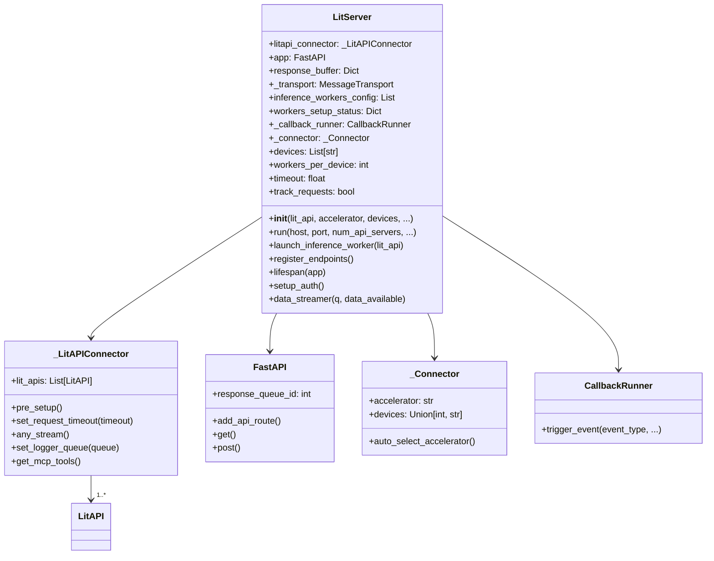
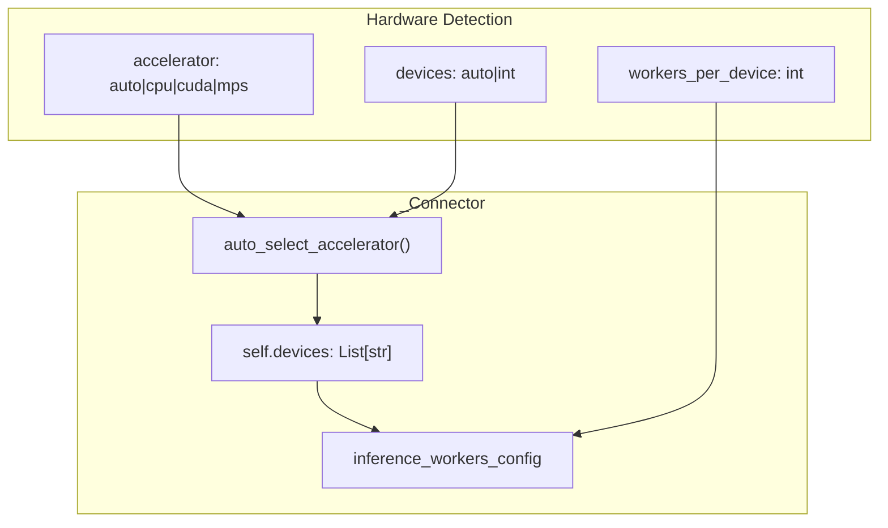
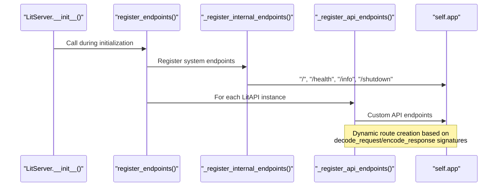
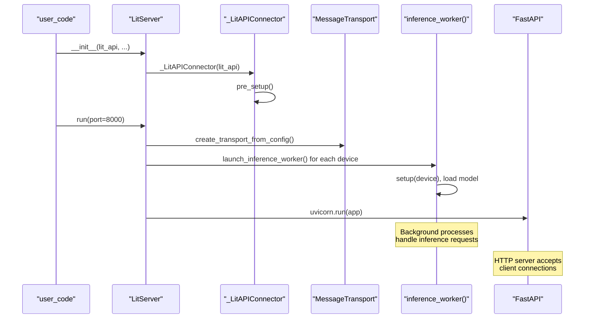
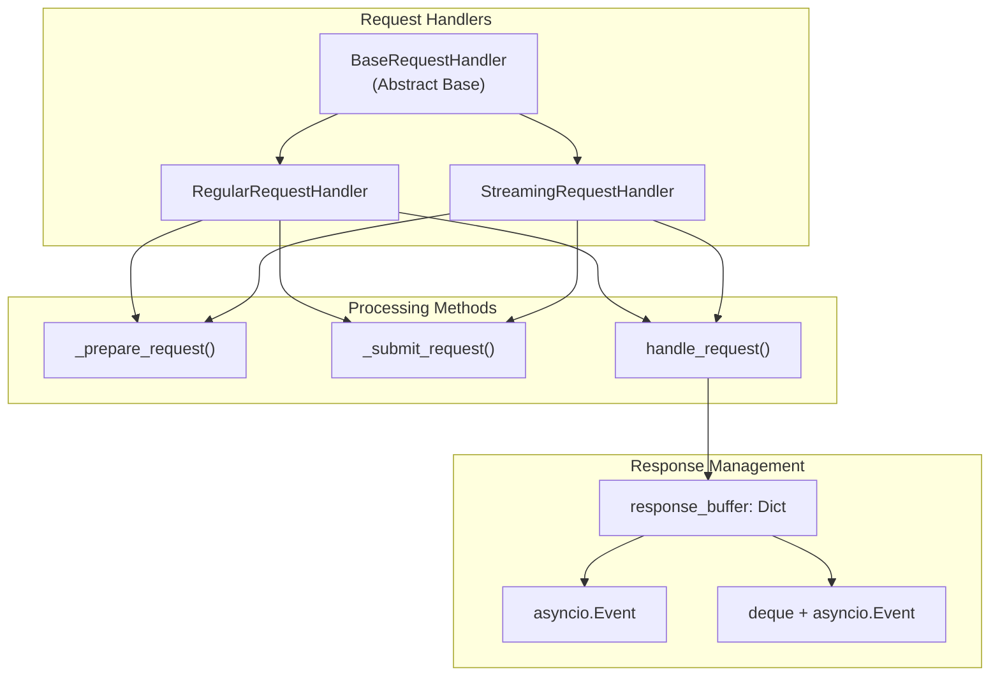
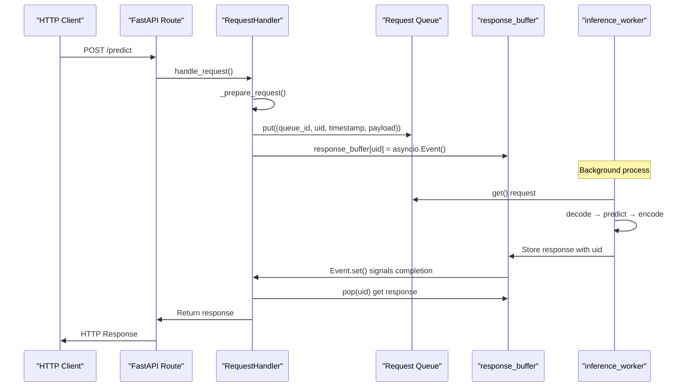
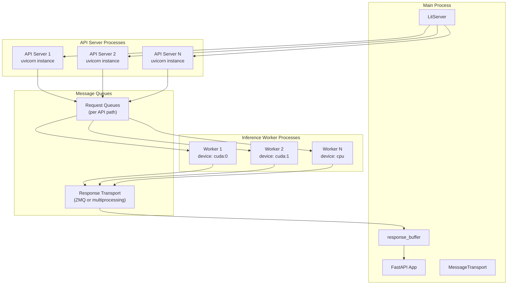

<!-- source: DeepWiki mcp.deepwiki.com · repo Lightning-AI/LitServe · page 2.2 LitServer · fetched 2026-10-21 -->

# LitServer

<details>
<summary>Relevant source files</summary>

The following files were used as context for generating this wiki page:

- [README.md](README.md)
- [src/litserve/api.py](src/litserve/api.py)
- [src/litserve/server.py](src/litserve/server.py)
- [src/litserve/specs/base.py](src/litserve/specs/base.py)
- [tests/conftest.py](tests/conftest.py)
- [tests/e2e/test_e2e.py](tests/e2e/test_e2e.py)

</details>


LitServer is the main orchestrator class that transforms AI models into production-ready APIs with automatic scaling, batching, streaming, and multi-GPU support. It manages the complete server lifecycle, from initialization and worker process coordination to HTTP request handling and graceful shutdown.

This document covers LitServer's core functionality, configuration options, HTTP endpoints, and lifecycle management. For information about implementing model logic and custom specifications, see [LitAPI](#2.1) and [API Specifications](#3). For details about processing strategies and loops, see [Processing Loops](#2.3).

## Core Architecture & Responsibilities

LitServer serves as the central orchestrator that coordinates multiple components to provide a complete AI serving solution. It manages worker processes, handles HTTP routing through FastAPI, and provides production features like health checks, monitoring, and graceful shutdown.

### LitServer Class Structure



Sources: [src/litserve/server.py:384-793]()

### Component Responsibilities

| Component | Responsibility | Code Reference |
|-----------|---------------|----------------|
| `LitServer` | Main orchestrator, lifecycle management | [src/litserve/server.py:384]() |
| `_LitAPIConnector` | Manages one or more `LitAPI` instances | [src/litserve/server.py:194-264]() |
| `FastAPI` | HTTP server and routing | [src/litserve/server.py:753]() |
| `_Connector` | Hardware detection and device management | [src/litserve/server.py:770]() |
| `CallbackRunner` | Event handling and middleware | [src/litserve/server.py:771]() |
| `MessageTransport` | Inter-process communication | [src/litserve/server.py:51]() |

Sources: [src/litserve/server.py:194-793]()

## Configuration System

LitServer provides extensive configuration options for production deployments, organized into logical categories for hardware, performance, security, and monitoring.

### Hardware Configuration



Sources: [src/litserve/server.py:633-634](), [src/litserve/server.py:780-792]()

Key hardware configuration parameters:

- `accelerator`: Hardware type detection (`"auto"`, `"cpu"`, `"cuda"`, `"mps"`)
- `devices`: Number or selection of devices to use
- `workers_per_device`: Parallel worker processes per device

The `_Connector` class handles automatic hardware detection and creates device identifiers like `"cuda:0"`, `"cuda:1"` for GPU allocation.

### Performance & Scaling Configuration

| Parameter | Type | Default | Purpose |
|-----------|------|---------|---------|
| `timeout` | `float \| bool` | `30` | Request timeout in seconds |
| `fast_queue` | `bool` | `False` | Enable ZeroMQ for high throughput |
| `track_requests` | `bool` | `False` | Monitor active request counts |
| `max_payload_size` | `str \| int` | `None` | Maximum request size limit |

Sources: [src/litserve/server.py:636](), [src/litserve/server.py:648](), [src/litserve/server.py:644](), [src/litserve/server.py:643]()

### API Endpoint Configuration

```python
# Default endpoint paths
healthcheck_path: str = "/health"      # Health check endpoint
info_path: str = "/info"              # Server information
shutdown_path: str = "/shutdown"       # Graceful shutdown
enable_shutdown_api: bool = False      # Enable remote shutdown
disable_openapi_url: bool = False      # Disable OpenAPI schema
```

Sources: [src/litserve/server.py:637-640](), [src/litserve/server.py:649]()

## HTTP Endpoints

LitServer automatically registers several types of HTTP endpoints to provide a complete API server experience.

### Endpoint Registration Architecture



Sources: [src/litserve/server.py:792](), [src/litserve/server.py:947-961]()

### System Endpoints

| Endpoint | Method | Purpose | Code Reference |
|----------|--------|---------|----------------|
| `/` | GET | Basic server status | [src/litserve/server.py:904-906]() |
| `/health` | GET | Worker readiness check | [src/litserve/server.py:908-918]() |
| `/info` | GET | Server configuration info | [src/litserve/server.py:920-934]() |
| `/shutdown` | POST | Graceful shutdown (optional) | [src/litserve/server.py:938-945]() |

### Health Check Implementation

The health endpoint performs comprehensive status verification:

```python
@self.app.get(self.healthcheck_path, dependencies=[Depends(self.setup_auth())])
async def health(request: Request) -> Response:
    nonlocal workers_ready
    if not workers_ready:
        workers_ready = all(v == WorkerSetupStatus.READY for v in self.workers_setup_status.values())
    
    lit_api_health_status = all(lit_api.health() for lit_api in self.litapi_connector)
    if workers_ready and lit_api_health_status:
        return Response(content="ok", status_code=200)
    
    return Response(content="not ready", status_code=503)
```

Sources: [src/litserve/server.py:908-918]()

### API Endpoint Registration

For each `LitAPI` instance, LitServer dynamically creates endpoints based on method signatures:

```python
def _register_api_endpoints(self, lit_api: LitAPI, request_type, response_type):
    # Create handlers based on streaming capability
    handler = StreamingRequestHandler(lit_api, self) if lit_api.stream else RegularRequestHandler(lit_api, self)
    
    # Create endpoint function
    async def endpoint_handler(request: request_type) -> response_type:
        return await handler.handle_request(request, request_type)
    
    # Register with FastAPI
    self.app.add_api_route(
        lit_api.api_path,
        endpoint_handler,
        methods=["POST"],
        dependencies=[Depends(self.setup_auth())]
    )
```

Sources: [src/litserve/server.py:965-983]()

## Lifecycle Management

LitServer manages a complex multi-process lifecycle involving worker coordination, transport setup, and graceful shutdown handling.

### Server Startup Sequence



Sources: [src/litserve/server.py:1200-1290]()

### Worker Process Management

The `launch_inference_worker` method creates one worker process per configured device:

```python
def launch_inference_worker(self, lit_api: LitAPI):
    process_list = []
    endpoint = lit_api.api_path.split("/")[-1]
    
    for worker_id, device in enumerate(self.inference_workers_config):
        self.workers_setup_status[f"{endpoint}_{worker_id}"] = WorkerSetupStatus.STARTING
        
        ctx = mp.get_context("spawn")
        process = ctx.Process(
            target=inference_worker,
            args=(
                lit_api,
                device,
                worker_id,
                self._get_request_queue(lit_api.api_path),
                self._transport,
                self.workers_setup_status,
                self._callback_runner,
            ),
        )
        process.start()
        process_list.append(process)
    return process_list
```

Sources: [src/litserve/server.py:794-827]()

### FastAPI Lifespan Management

The `lifespan` context manager coordinates startup and shutdown:

```python
@asynccontextmanager
async def lifespan(self, app: FastAPI):
    loop = asyncio.get_running_loop()
    
    # Start response buffer task
    future = response_queue_to_buffer(
        transport, self.response_buffer, app.response_queue_id, self.litapi_connector
    )
    task = loop.create_task(future)
    
    try:
        yield  # Server runs here
    finally:
        # Trigger shutdown callbacks
        self._callback_runner.trigger_event(EventTypes.ON_SERVER_END.value, litserver=self)
        
        # Cancel and cleanup tasks
        task.cancel()
        await asyncio.wait_for(task, timeout=1.0)
```

Sources: [src/litserve/server.py:829-866]()

## Request Processing Pipeline

LitServer implements a sophisticated request handling system that supports both regular and streaming responses through dedicated handler classes.

### Request Handler Architecture



Sources: [src/litserve/server.py:266-382]()

### Request Processing Flow



Sources: [src/litserve/server.py:271-299](), [src/litserve/server.py:302-353]()

### Response Buffer Management

The response buffer handles both regular and streaming responses:

```python
async def response_queue_to_buffer(
    transport: MessageTransport,
    response_buffer: Dict[str, Union[Tuple[deque, asyncio.Event], asyncio.Event]],
    consumer_id: int,
    litapi_connector: "_LitAPIConnector",
):
    stream = litapi_connector.any_stream()
    if stream:
        # Handle streaming responses with deque
        while True:
            result = await transport.areceive(consumer_id)
            uid, (*response, _) = result
            stream_response_buffer, event = response_buffer[uid]
            stream_response_buffer.append(response)
            event.set()
    else:
        # Handle regular responses with direct assignment
        while True:
            result = await transport.areceive(consumer_id)
            uid, (*response, _) = result
            event = response_buffer.pop(uid)
            response_buffer[uid] = response
            event.set()
```

Sources: [src/litserve/server.py:127-177]()

## Multi-Process Architecture

LitServer employs a multi-process architecture to achieve high performance and isolation between the HTTP server and inference workers.

### Process Architecture Diagram



Sources: [src/litserve/server.py:1200-1290](), [src/litserve/server.py:794-827]()

### Worker Configuration and Device Assignment

Each worker process is assigned to a specific device based on the configuration:

```python
# Device configuration calculation
if accelerator == "cpu":
    self.devices = [accelerator]
elif accelerator in ["cuda", "mps"]:
    device_list = devices if isinstance(devices, int) else range(devices)
    self.devices = [self.device_identifiers(accelerator, device) for device in device_list]

# Worker process configuration
self.inference_workers_config = self.devices * self.workers_per_device
```

This creates worker assignments like:
- 2 GPUs × 3 workers = `["cuda:0", "cuda:0", "cuda:0", "cuda:1", "cuda:1", "cuda:1"]`
- 1 CPU × 4 workers = `["cpu", "cpu", "cpu", "cpu"]`

Sources: [src/litserve/server.py:782-791]()

### Message Transport Configuration

LitServer supports two transport mechanisms for inter-process communication:

| Transport | Use Case | Configuration |
|-----------|----------|---------------|
| Multiprocessing | Default, cross-platform | `fast_queue=False` |
| ZeroMQ | High throughput (>100 RPS) | `fast_queue=True` |

```python
self.transport_config = TransportConfig(transport_config="zmq" if self.use_zmq else "mp")
```

Sources: [src/litserve/server.py:791](), [src/litserve/server.py:743-745]()

---

