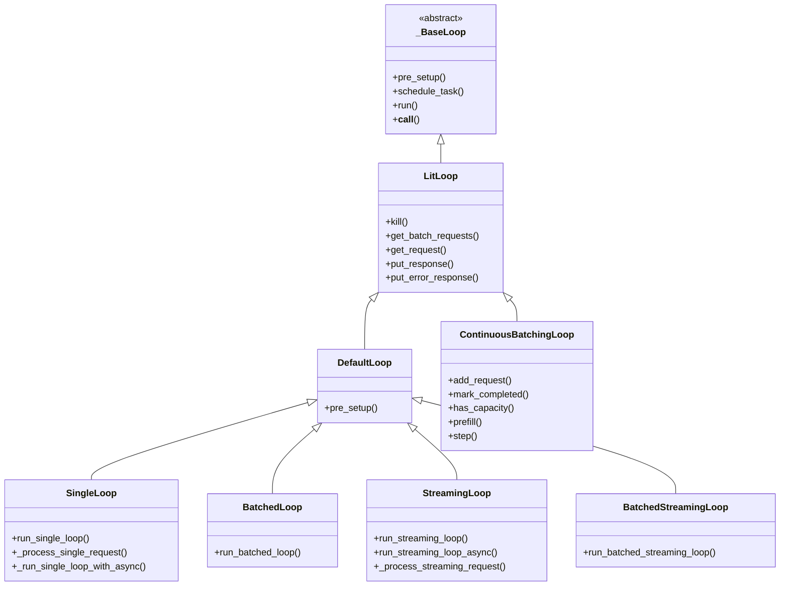
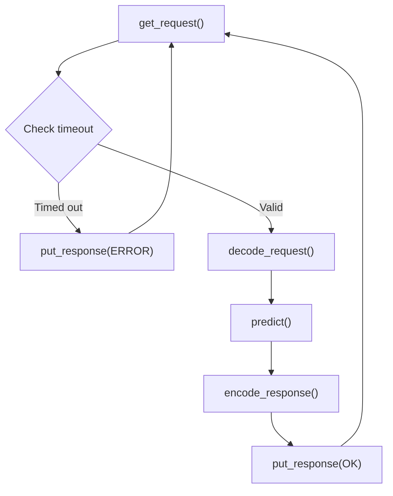
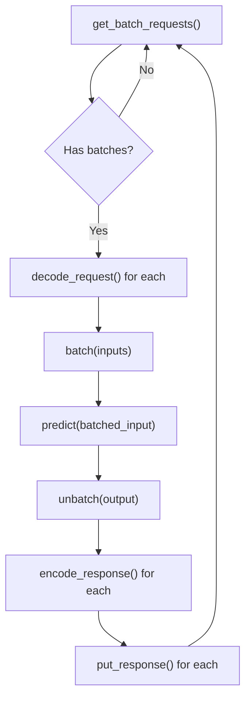
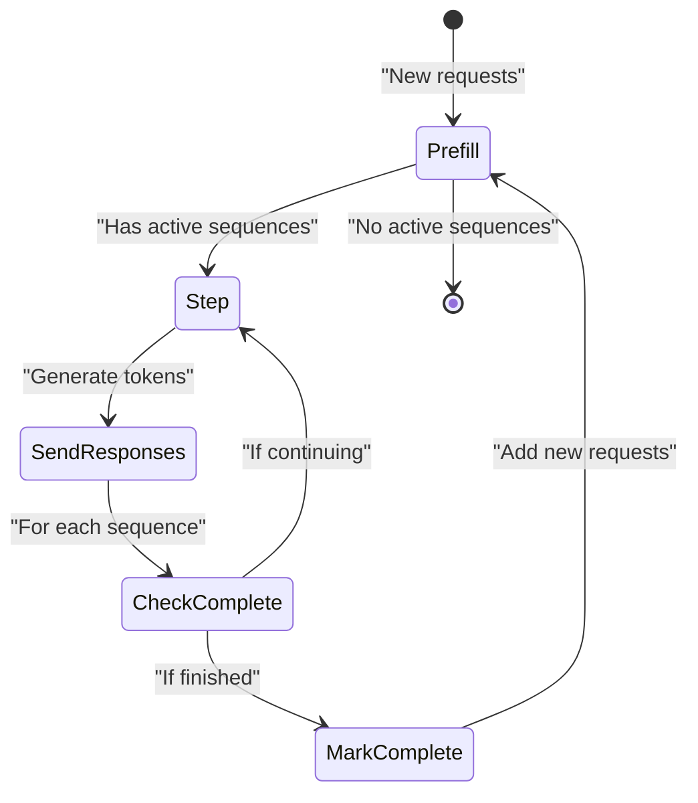
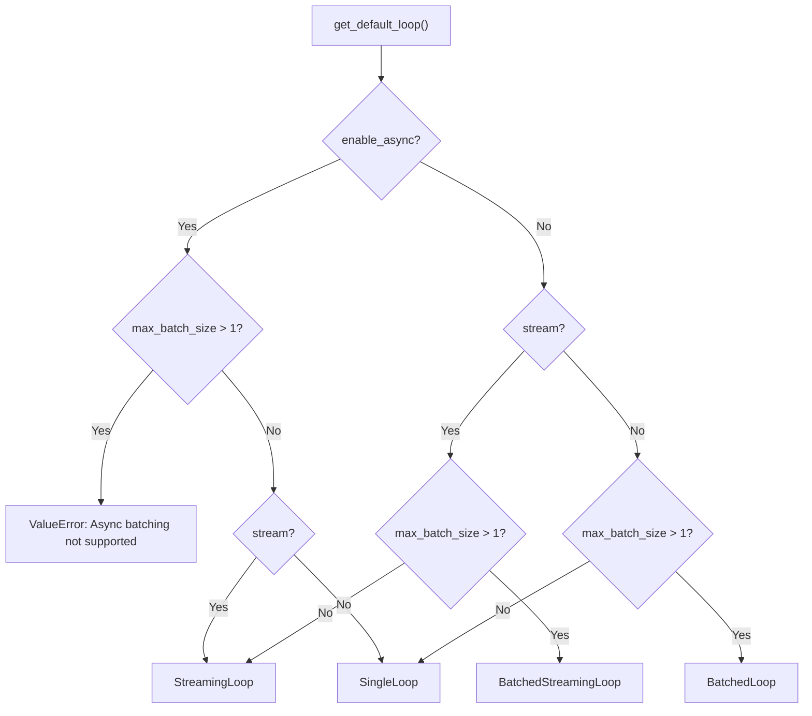
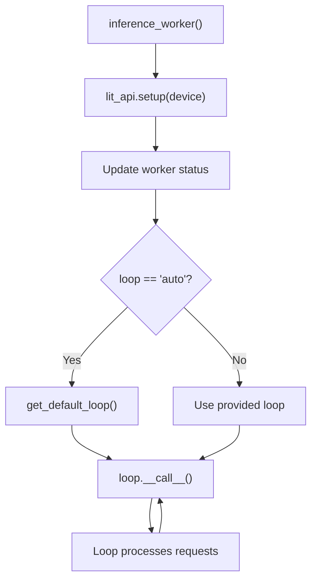

<!-- source: DeepWiki mcp.deepwiki.com · repo Lightning-AI/LitServe · page 2.3 Processing Loops · fetched 2026-10-21 -->

# Processing Loops

<details>
<summary>Relevant source files</summary>

The following files were used as context for generating this wiki page:

- [src/litserve/loops/base.py](src/litserve/loops/base.py)
- [src/litserve/loops/continuous_batching_loop.py](src/litserve/loops/continuous_batching_loop.py)
- [src/litserve/loops/loops.py](src/litserve/loops/loops.py)
- [src/litserve/loops/simple_loops.py](src/litserve/loops/simple_loops.py)
- [src/litserve/loops/streaming_loops.py](src/litserve/loops/streaming_loops.py)

</details>


Processing loops are the core execution engines that orchestrate request processing in LitServe. They manage the flow of requests through the LitAPI hooks and handle different processing strategies including single request processing, batching, streaming, and continuous batching. Each loop implements a specific request processing pattern optimized for different use cases.

For information about the LitAPI hooks that loops execute, see [LitAPI](#2.1). For details about the transport layer that loops use for communication, see [Transport Layer](#2.4).

## Loop Architecture

Processing loops form a hierarchical inheritance structure that provides both flexibility and code reuse. The base classes define common functionality while specific loop implementations handle different processing patterns.

### Loop Inheritance Hierarchy



**Sources:** [src/litserve/loops/base.py:145-438](), [src/litserve/loops/simple_loops.py:32-414](), [src/litserve/loops/streaming_loops.py:32-388](), [src/litserve/loops/continuous_batching_loop.py:53-295]()

## Request Processing Flow

All loops follow a similar pattern for processing requests, executing LitAPI hooks in a predefined order. The exact flow varies based on whether batching and streaming are enabled.

### Standard Processing Pipeline

```mermaid
sequenceDiagram
    participant RQ as request_queue
    participant Loop as "Processing Loop"
    participant API as LitAPI
    participant CB as CallbackRunner
    participant T as MessageTransport
    
    RQ->>Loop: "get request"
    Note over Loop: "Check timeout"
    
    Loop->>CB: "BEFORE_DECODE_REQUEST"
    Loop->>API: "decode_request(x_enc)"
    API-->>Loop: "decoded input"
    Loop->>CB: "AFTER_DECODE_REQUEST"
    
    alt Batching Enabled
        Loop->>API: "batch(inputs)"
        API-->>Loop: "batched input"
    end
    
    Loop->>CB: "BEFORE_PREDICT"
    Loop->>API: "predict(input)"
    API-->>Loop: "model output"
    Loop->>CB: "AFTER_PREDICT"
    
    alt Batching Enabled
        Loop->>API: "unbatch(output)"
        API-->>Loop: "individual outputs"
    end
    
    Loop->>CB: "BEFORE_ENCODE_RESPONSE"
    Loop->>API: "encode_response(output)"
    API-->>Loop: "encoded response"
    Loop->>CB: "AFTER_ENCODE_RESPONSE"
    
    Loop->>T: "put_response()"
```

**Sources:** [src/litserve/loops/simple_loops.py:74-109](), [src/litserve/loops/simple_loops.py:329-375]()

## Loop Types

LitServe provides several built-in loop implementations, each optimized for specific processing patterns and requirements.

### Standard Loops

| Loop Type | Use Case | Max Batch Size | Streaming | Async Support |
|-----------|----------|----------------|-----------|---------------|
| `SingleLoop` | Individual request processing | 1 | No | Yes |
| `BatchedLoop` | Batch processing for efficiency | >1 | No | No |
| `StreamingLoop` | Real-time response streaming | 1 | Yes | Yes |
| `BatchedStreamingLoop` | Batch processing with streaming | >1 | Yes | No |

### SingleLoop

The `SingleLoop` processes one request at a time and supports both synchronous and asynchronous execution. When `enable_async=True`, it can handle multiple requests concurrently using asyncio tasks.



**Sources:** [src/litserve/loops/simple_loops.py:32-287]()

### BatchedLoop

The `BatchedLoop` collects multiple requests into batches before processing, improving throughput for ML models that benefit from batch inference.



**Sources:** [src/litserve/loops/simple_loops.py:289-414]()

### Streaming Loops

Streaming loops handle generator-based responses for real-time output delivery, supporting both individual and batched processing patterns.

**Sources:** [src/litserve/loops/streaming_loops.py:32-388]()

### Continuous Batching Loop

The `ContinuousBatchingLoop` implements advanced batching for iterative generation tasks, managing active sequences and their state across multiple generation steps.



**Sources:** [src/litserve/loops/continuous_batching_loop.py:53-295]()

## Loop Selection

LitServe automatically selects the appropriate loop based on configuration parameters. The selection logic in `get_default_loop()` considers streaming, batching, and async requirements.

### Automatic Loop Selection Logic



**Sources:** [src/litserve/loops/loops.py:29-58]()

## Context Injection

Processing loops support context injection, allowing LitAPI methods to access request-specific context data when needed.

### Context Flow

The `_inject_context()` and `_async_inject_context()` functions automatically inject context parameters into LitAPI methods that declare a `context` parameter in their signature.

```mermaid
sequenceDiagram
    participant Loop
    participant Injector as "_inject_context"
    participant API as "LitAPI Method"
    participant Spec as "LitSpec"
    
    Loop->>Spec: "populate_context(context, request)"
    Loop->>Injector: "_inject_context(context, method, args)"
    Injector->>Injector: "inspect.signature(method)"
    
    alt Method has context parameter
        Injector->>API: "method(*args, context=context)"
    else No context parameter
        Injector->>API: "method(*args)"
    end
    
    API-->>Injector: "result"
    Injector-->>Loop: "result"
```

**Sources:** [src/litserve/loops/base.py:44-91]()

## Worker Integration

Processing loops run within worker processes managed by the inference worker system. Each worker executes a single loop instance that processes requests from a shared queue.

### Worker Lifecycle



**Sources:** [src/litserve/loops/loops.py:61-103]()

## Error Handling

All loops implement comprehensive error handling for different failure scenarios, including request timeouts, processing errors, and system interruptions.

### Error Response Types

| Error Type | HTTP Status | Response Method |
|------------|-------------|-----------------|
| Request Timeout | 504 | `put_response()` with `HTTPException(504)` |
| Processing Error | 500 | `put_error_response()` with pickled exception |
| HTTP Exception | Variable | `put_response()` with `PickleableHTTPException` |

**Sources:** [src/litserve/loops/simple_loops.py:57-73](), [src/litserve/loops/base.py:310-319]()

## Custom Loop Implementation

To implement a custom processing loop, extend the `_BaseLoop` class and implement the required methods. The loop must handle request retrieval, processing, and response delivery.

### Required Methods

- `run()`: Main processing logic
- `pre_setup()`: Validation and initialization (optional)
- `schedule_task()`: Background task setup for async loops (optional)

The custom loop should follow the established patterns for error handling, context injection, and callback triggering to maintain compatibility with the LitServe framework.

**Sources:** [src/litserve/loops/base.py:145-262]()

---

