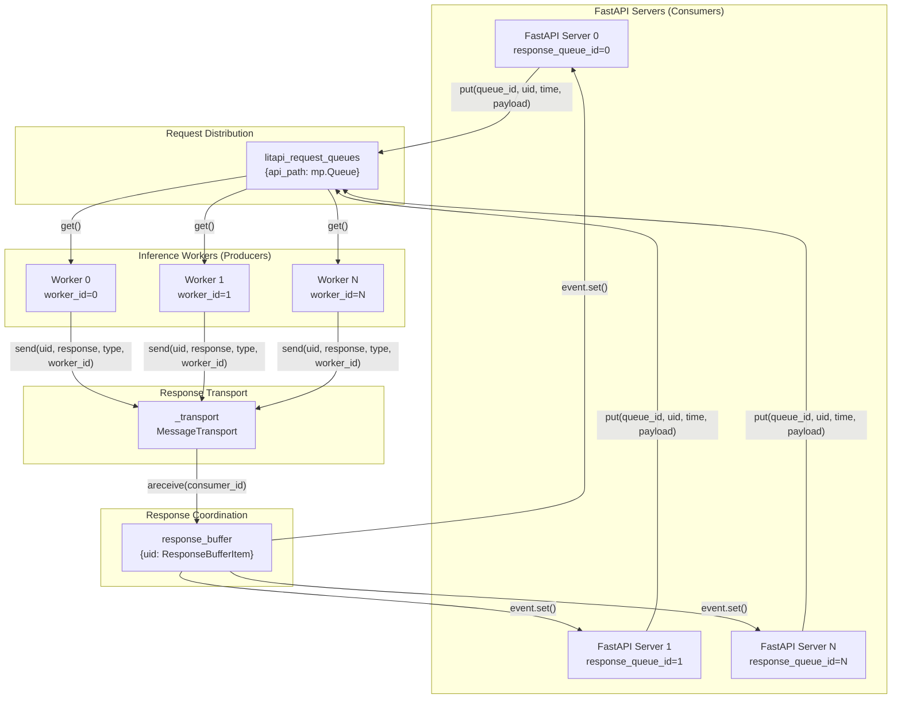
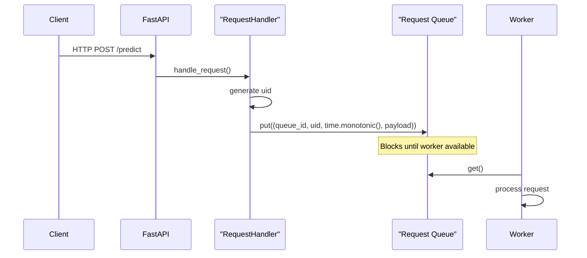
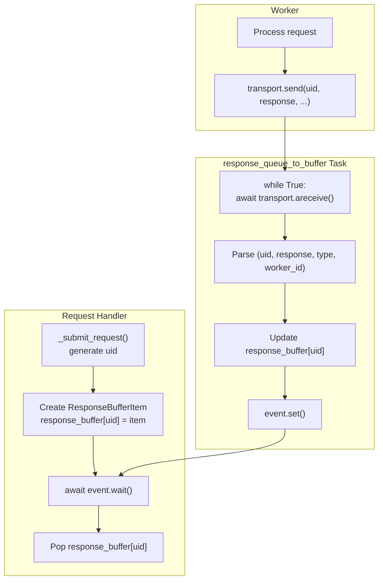
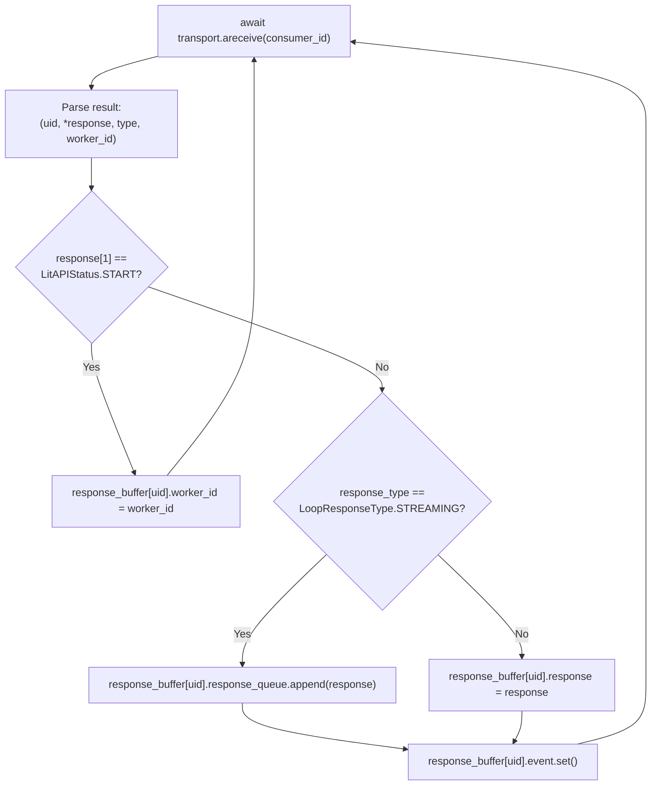
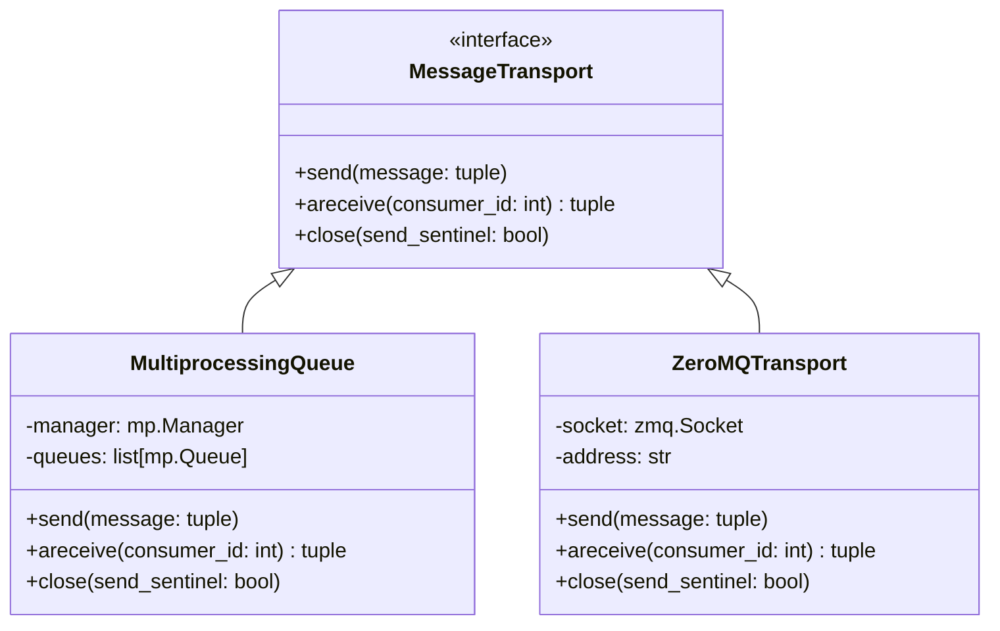
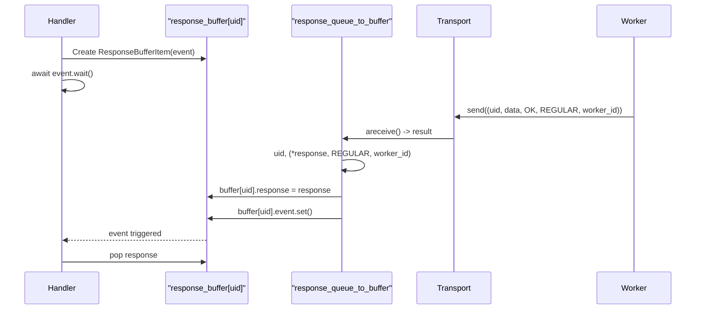
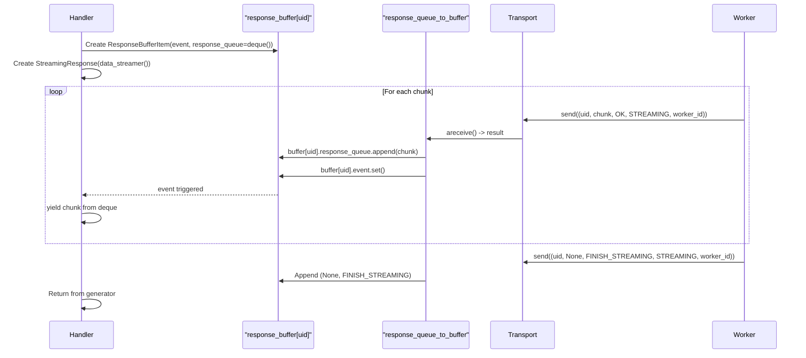
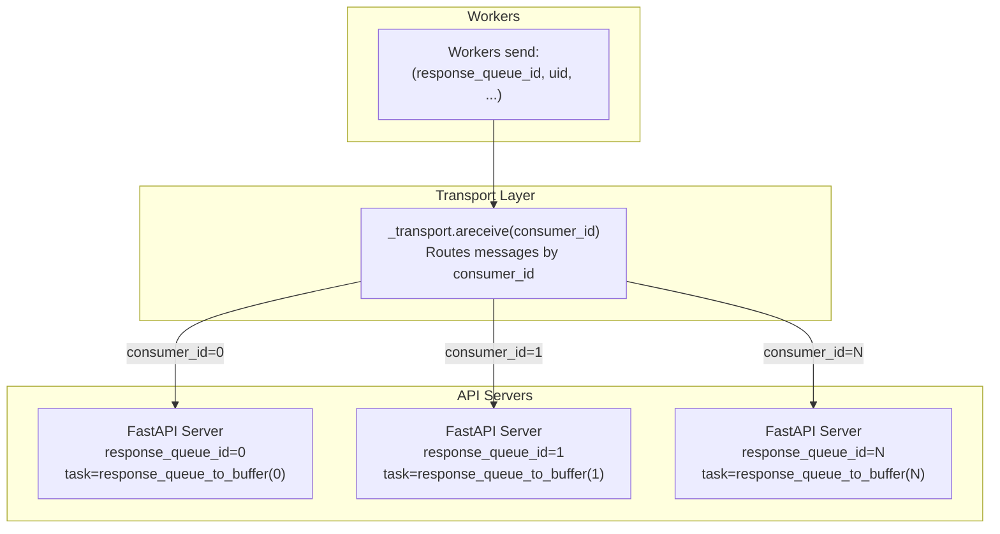
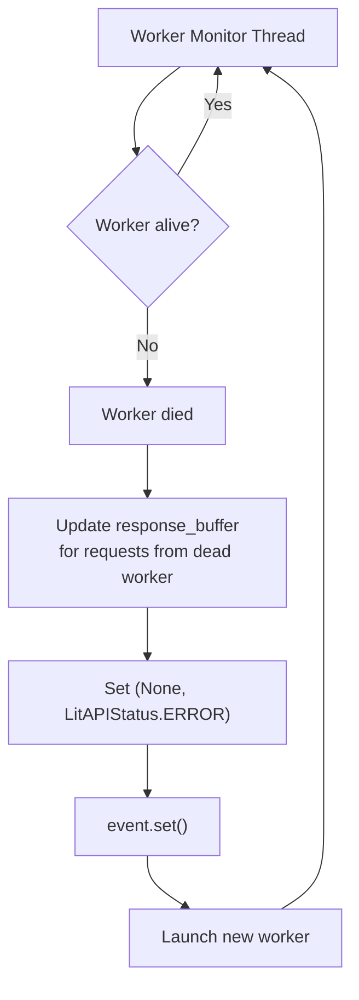

<!-- source: DeepWiki mcp.deepwiki.com · repo Lightning-AI/LitServe · page 2.4 Transport Layer & IPC · fetched 2026-10-21 -->

# Transport Layer & IPC

<details>
<summary>Relevant source files</summary>

The following files were used as context for generating this wiki page:

- [src/litserve/server.py](src/litserve/server.py)
- [src/litserve/utils.py](src/litserve/utils.py)

</details>


## Purpose and Scope

The Transport Layer & IPC (Inter-Process Communication) system manages message passing between LitServe's HTTP servers and inference workers. It provides a queue-based architecture for distributing requests to workers and coordinating responses back to FastAPI endpoints. This layer abstracts the underlying IPC mechanism (multiprocessing.Queue or ZeroMQ) and handles both streaming and non-streaming response patterns.

For worker lifecycle management, see [Worker Management](#2.5). For processing loop details, see [Processing Loops](#2.3).

**Sources:** [src/litserve/server.py:54](), [src/litserve/transport/factory.py]()

## Architecture Overview

The transport layer implements a multi-producer, multi-consumer queue system where FastAPI servers submit requests to shared queues, workers process them, and responses flow back through a transport layer to response buffers.



**Sources:** [src/litserve/server.py:98-191](), [src/litserve/server.py:806](), [src/litserve/server.py:1113-1128]()

## Transport Configuration

Transport configuration is managed through the `TransportConfig` class and factory pattern. The system supports two transport backends: multiprocessing.Queue (default) and ZeroMQ (fast_queue).

```mermaid
graph LR
    subgraph "Configuration"
        TC["TransportConfig<br/>transport_config: str<br/>manager: mp.Manager<br/>num_consumers: int"]
    end
    
    subgraph "Factory"
        Factory["create_transport_from_config()"]
    end
    
    subgraph "Implementations"
        MPQueue["MultiprocessingQueue<br/>manager.Queue()"]
        ZMQ["ZeroMQTransport<br/>ipc://path"]
    end
    
    TC -->|"config"| Factory
    Factory -->|"if 'mp'"| MPQueue
    Factory -->|"if 'zmq'"| ZMQ
    
    MPQueue -->|"implements"| MTI["MessageTransport"]
    ZMQ -->|"implements"| MTI
```

| Parameter | Type | Description |
|-----------|------|-------------|
| `transport_config` | `str` | Backend type: `"mp"` or `"zmq"` |
| `manager` | `mp.Manager` | Multiprocessing manager instance |
| `num_consumers` | `int` | Number of FastAPI server processes |

The transport is initialized in `LitServer._init_manager()`:

[src/litserve/server.py:1113-1128]()
```python
def _init_manager(self, num_api_servers: int):
    manager = mp.Manager()
    self.transport_config.manager = manager
    self.transport_config.num_consumers = num_api_servers
    # ...
    self._transport = create_transport_from_config(self.transport_config)
    return manager
```

The `use_zmq` flag controls backend selection:

[src/litserve/server.py:804](), [src/litserve/server.py:826]()

**Sources:** [src/litserve/server.py:54](), [src/litserve/server.py:804-826](), [src/litserve/server.py:1113-1128]()

## Request Queue System

Request queues are per-API-path, shared multiprocessing queues that distribute work to inference workers. Each `LitAPI` instance gets its own queue identified by `api_path`.

### Queue Creation

[src/litserve/server.py:1120-1122]()
```python
for lit_api in self.litapi_connector:
    self.litapi_request_queues[lit_api.api_path] = manager.Queue()
```

### Request Submission

Requests are submitted with a tuple containing: `(response_queue_id, uid, timestamp, payload)`



The submission logic in `BaseRequestHandler._submit_request()`:

[src/litserve/server.py:294-309]()
```python
async def _submit_request(self, payload: dict) -> tuple[str, asyncio.Event]:
    request_queue = self.server._get_request_queue(self.lit_api.api_path)
    response_queue_id = self.server.app.response_queue_id
    uid = str(uuid.uuid4())
    
    self.server._callback_runner.trigger_event(
        EventTypes.ON_REQUEST.value,
        active_requests=self.server.active_requests,
        litserver=self.server,
    )
    
    request_queue.put((response_queue_id, uid, time.monotonic(), payload))
    logger.debug(f"Submitted request uid={uid}")
    return uid, response_queue_id
```

**Sources:** [src/litserve/server.py:294-309](), [src/litserve/server.py:1120-1122](), [src/litserve/server.py:1043-1044]()

## Response Buffer System

The response buffer coordinates asynchronous response delivery from workers back to FastAPI handlers. Each request gets a `ResponseBufferItem` stored by its unique ID (`uid`).

### ResponseBufferItem Structure

[src/litserve/utils.py:352-357]()
```python
@dataclasses.dataclass
class ResponseBufferItem:
    event: asyncio.Event          # Signals response availability
    response_queue: Optional[deque] = None  # For streaming responses
    worker_id: Optional[int] = None        # Tracks which worker processed
    response: Optional[Any] = None         # For regular responses
```

| Field | Type | Purpose |
|-------|------|---------|
| `event` | `asyncio.Event` | Synchronization primitive; set when response is ready |
| `response_queue` | `Optional[deque]` | Accumulates streaming response chunks |
| `worker_id` | `Optional[int]` | Identifies the worker that processed the request |
| `response` | `Optional[Any]` | Stores the complete response for non-streaming |

### Response Buffer Flow



**Sources:** [src/litserve/utils.py:352-357](), [src/litserve/server.py:328-342](), [src/litserve/server.py:379-392]()

## Async Coordination with response_queue_to_buffer

The `response_queue_to_buffer()` function is a long-lived async task that continuously pulls messages from the transport and updates the response buffer. One task runs per FastAPI server process.

### Task Lifecycle

[src/litserve/server.py:902-939]()
```python
@asynccontextmanager
async def lifespan(self, app: FastAPI):
    loop = asyncio.get_running_loop()
    
    transport = self._transport
    future = response_queue_to_buffer(
        transport,
        self.response_buffer,
        app.response_queue_id,
        self.litapi_connector,
    )
    task = loop.create_task(future, name=f"response_queue_to_buffer-{app.response_queue_id}")
    
    try:
        yield
    finally:
        task.cancel()
        await asyncio.wait_for(task, timeout=1.0)
```

### Response Processing Logic

The function handles three response types:



The implementation for streaming responses:

[src/litserve/server.py:147-169]()
```python
stream = litapi_connector.any_stream()
if stream:
    while True:
        try:
            result = await transport.areceive(consumer_id)
            if result is None:
                continue
            
            uid, (*response, response_type, worker_id) = result
            
            if response[1] == LitAPIStatus.START:
                response_buffer[uid].worker_id = int(worker_id)
                continue
            
            response_buffer[uid].response_queue.append(response)
            response_buffer[uid].event.set()
        except asyncio.CancelledError:
            logger.debug("Response queue to buffer task was cancelled")
            break
```

**Sources:** [src/litserve/server.py:133-191](), [src/litserve/server.py:902-939]()

## MessageTransport Interface

The `MessageTransport` abstract base class defines the IPC contract. All transport implementations must provide `send()`, `areceive()`, and `close()` methods.



### Transport Selection

| Backend | Flag | Use Case | Platform Support |
|---------|------|----------|------------------|
| multiprocessing.Queue | `fast_queue=False` | General purpose, <100 RPS | All platforms |
| ZeroMQ | `fast_queue=True` | High throughput, >100 RPS | Linux, macOS |

[src/litserve/server.py:773-775]()
```python
if sys.platform == "win32" and fast_queue:
    warnings.warn("ZMQ is not supported on Windows with LitServe. Disabling ZMQ.")
    fast_queue = False
```

**Sources:** [src/litserve/server.py:54](), [src/litserve/server.py:773-775](), [src/litserve/server.py:826]()

## Message Format

Messages passed through the transport layer follow a structured tuple format that includes routing information, response data, and metadata.

### Request Message Format

Sent from FastAPI to workers via request queue:

```
(response_queue_id: int, uid: str, timestamp: float, payload: dict)
```

| Field | Type | Purpose |
|-------|------|---------|
| `response_queue_id` | `int` | Identifies which FastAPI server to return to |
| `uid` | `str` | Unique request identifier (UUID4) |
| `timestamp` | `float` | `time.monotonic()` for timeout tracking |
| `payload` | `dict` | Decoded request data |

### Response Message Format

Sent from workers to FastAPI via transport:

```
(uid: str, response_data: Any, status: LitAPIStatus, response_type: LoopResponseType, worker_id: int)
```

| Field | Type | Values | Purpose |
|-------|------|--------|---------|
| `uid` | `str` | UUID4 | Matches request to response |
| `response_data` | `Any` | Encoded response | Actual response payload |
| `status` | `LitAPIStatus` | `OK`, `ERROR`, `FINISH_STREAMING`, `START` | Response status |
| `response_type` | `LoopResponseType` | `STREAMING`, `REGULAR` | Determines buffer handling |
| `worker_id` | `int` | Worker index | For monitoring and debugging |

### Status Codes

[src/litserve/utils.py:51-56]()
```python
class LitAPIStatus:
    START = "START"                    # Worker starting to process
    OK = "OK"                          # Successful response
    ERROR = "ERROR"                    # Error occurred
    FINISH_STREAMING = "FINISH_STREAMING"  # End of stream
```

**Sources:** [src/litserve/server.py:307](), [src/litserve/server.py:113](), [src/litserve/utils.py:51-60]()

## Streaming vs Regular Response Handling

The transport layer handles streaming and regular responses differently based on the `response_type` field.

### Regular Response Pattern



[src/litserve/server.py:170-191]()

### Streaming Response Pattern



[src/litserve/server.py:147-169]()

**Sources:** [src/litserve/server.py:133-191](), [src/litserve/server.py:370-396](), [src/litserve/server.py:945-966]()

## Consumer ID and Multi-Server Architecture

LitServe supports multiple FastAPI server processes, each identified by a `response_queue_id` (also called `consumer_id`). This enables parallel HTTP request handling.



### Assignment During Server Creation

[src/litserve/server.py:1444-1450]()
```python
for response_queue_id in range(num_uvicorn_servers):
    self.app.response_queue_id = response_queue_id
    for lit_api in self.litapi_connector:
        if lit_api.spec:
            lit_api.spec.response_queue_id = response_queue_id
```

Each FastAPI server process runs its own `response_queue_to_buffer()` task that only receives messages addressed to its `consumer_id`.

**Sources:** [src/litserve/server.py:1444-1492](), [src/litserve/server.py:133-137](), [src/litserve/server.py:1113-1128]()

## Transport Cleanup and Shutdown

Proper transport cleanup is critical during server shutdown to avoid hanging processes or lost messages.

### Shutdown Sequence

[src/litserve/server.py:1130-1184]()
```python
def _perform_graceful_shutdown(
    self,
    manager: mp.Manager,
    uvicorn_workers: dict[str, Union[mp.Process, threading.Thread]],
    shutdown_reason: str = "normal",
):
    logger.info("Shutting down LitServe...")
    
    # Handle transport closure based on shutdown reason
    if shutdown_reason == "keyboard_interrupt":
        logger.debug("KeyboardInterrupt detected - skipping transport cleanup to avoid hanging")
        self._transport.close(send_sentinel=False)
    else:
        self._transport.close(send_sentinel=True)
```

The `send_sentinel` parameter controls whether the transport sends sentinel values to unblock waiting consumers:

| Shutdown Reason | `send_sentinel` | Rationale |
|-----------------|-----------------|-----------|
| `"normal"` | `True` | Clean shutdown, send sentinels to unblock consumers |
| `"keyboard_interrupt"` | `False` | Avoid hang during forced shutdown |

### Transport Close Behavior

The `MessageTransport.close()` method:
1. Stops accepting new messages
2. Optionally sends sentinel values to all consumers
3. Closes underlying sockets/queues
4. Releases resources

**Sources:** [src/litserve/server.py:1130-1184](), [src/litserve/server.py:90-125]() (in test utils)

## Worker Restart and Transport Recovery

When `restart_workers=True`, the transport layer supports recovering from worker failures by tracking which worker processed each request.



[src/litserve/server.py:1534-1548]()
```python
for uid, resp in self.response_buffer.items():
    if resp.worker_id is None or resp.worker_id != worker_id:
        continue
    
    if resp.event.is_set():
        continue
    
    resp.response = (None, LitAPIStatus.ERROR)
    
    if resp.response_queue is not None:
        resp.response_queue.append((None, LitAPIStatus.ERROR))
    
    resp.event.set()
```

The `worker_id` field in `ResponseBufferItem` enables this tracking:

[src/litserve/server.py:115-117](), [src/litserve/server.py:157-159]()

**Sources:** [src/litserve/server.py:1509-1561](), [src/litserve/server.py:115-117](), [src/litserve/utils.py:352-357]()

---

