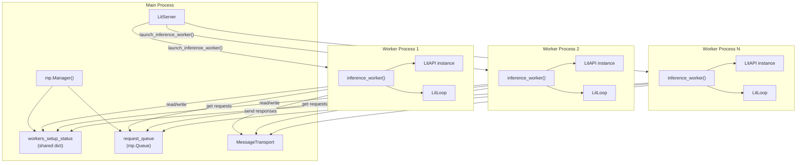
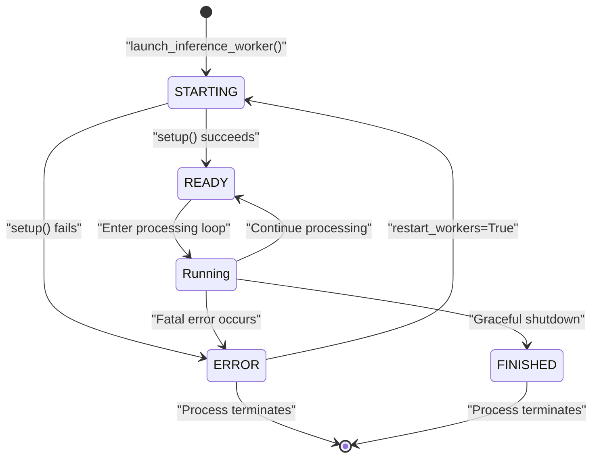
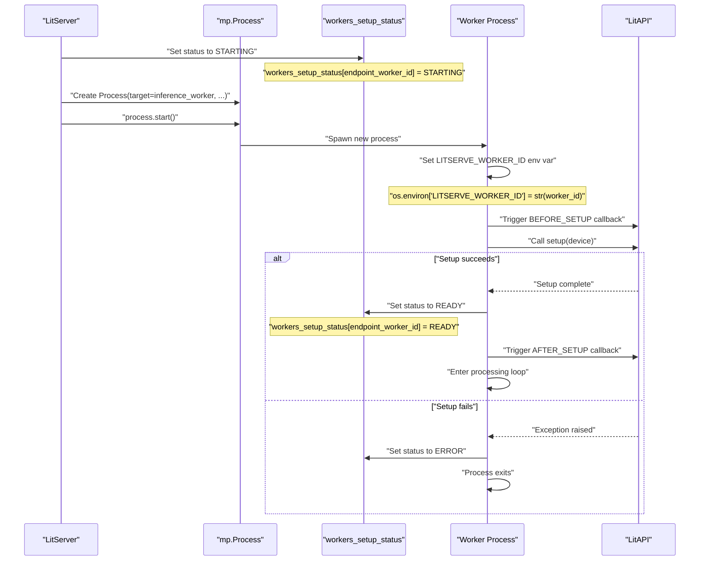
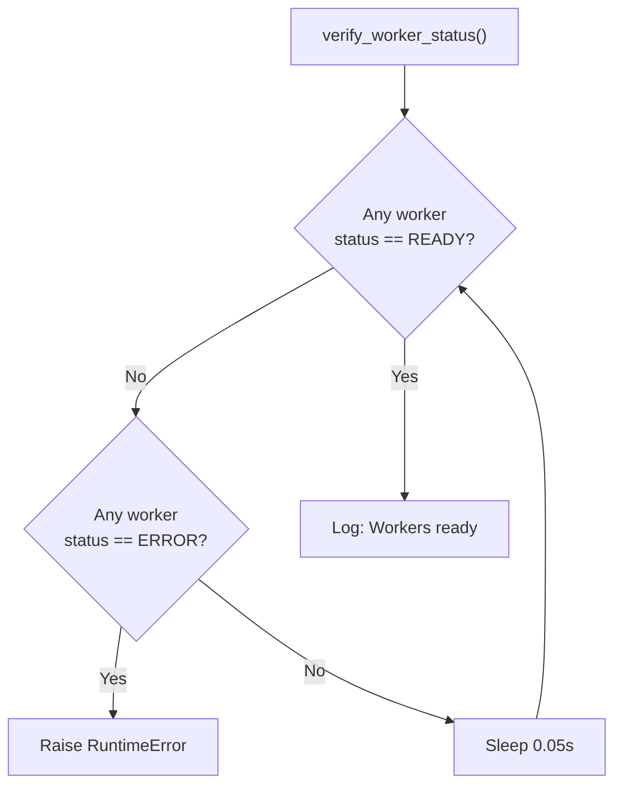
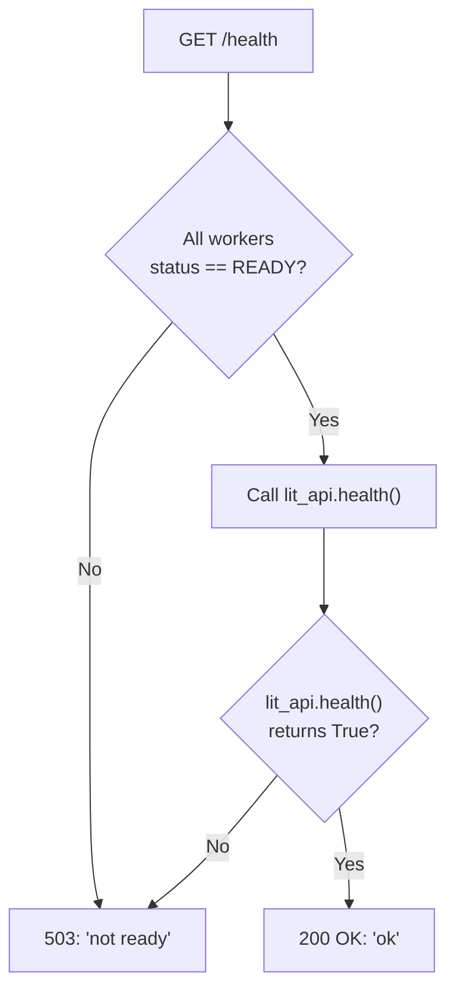
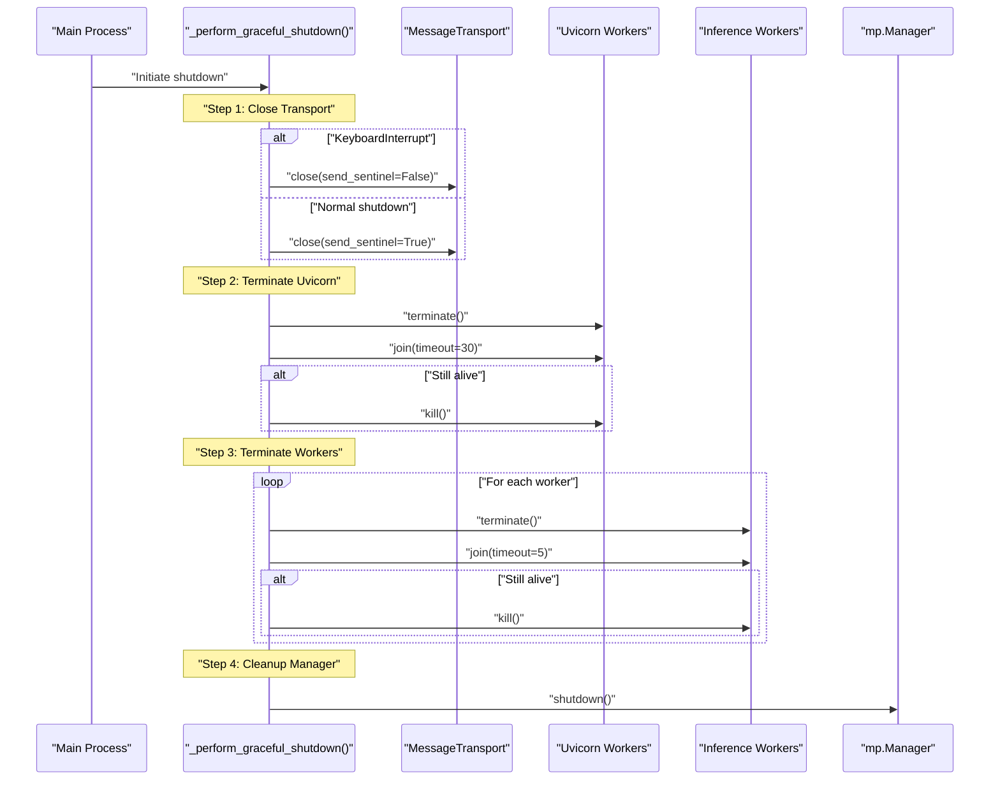
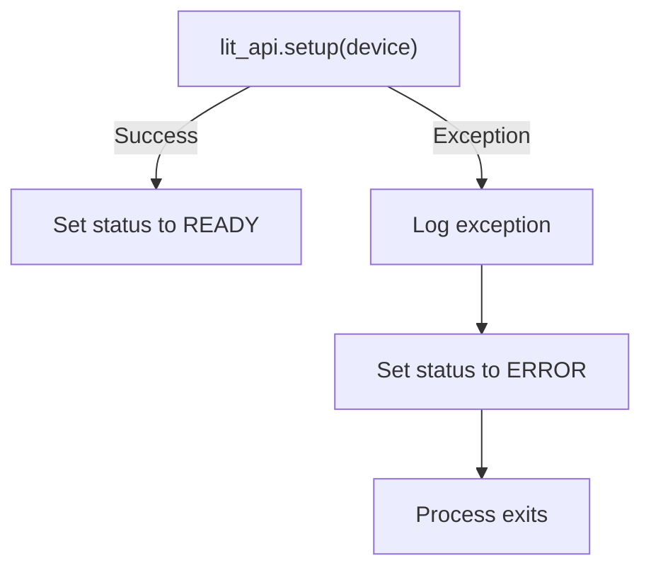

<!-- source: DeepWiki mcp.deepwiki.com · repo Lightning-AI/LitServe · page 2.5 Worker Management · fetched 2026-10-21 -->

# Worker Management

<details>
<summary>Relevant source files</summary>

The following files were used as context for generating this wiki page:

- [src/litserve/loops/continuous_batching_loop.py](src/litserve/loops/continuous_batching_loop.py)
- [src/litserve/loops/loops.py](src/litserve/loops/loops.py)
- [src/litserve/server.py](src/litserve/server.py)
- [src/litserve/utils.py](src/litserve/utils.py)

</details>


Worker management encompasses the lifecycle, status tracking, health monitoring, and error handling of worker processes in LitServe. Workers are isolated processes that execute model inference operations on designated devices. This system ensures reliable, concurrent request processing with automatic failure recovery.

For configuration of hardware and devices, see [Hardware Acceleration & Device Management](#4.2). For the processing logic that runs within workers, see [Processing Loops](#2.3).

---

## Worker Process Architecture

Worker processes are spawned using Python's multiprocessing module with the "spawn" context. Each worker runs the [`inference_worker`]() function, which initializes the `LitAPI` instance and enters a request processing loop.

**Worker Process Structure**



**Sources:** [src/litserve/server.py:831-865](), [src/litserve/server.py:867-900](), [src/litserve/loops/loops.py:61-108]()

---

## Worker Lifecycle

Workers progress through distinct lifecycle stages, from creation to termination. The lifecycle is coordinated between the main process and worker processes using shared state.

### Lifecycle States

The `WorkerSetupStatus` enum defines the possible worker states:

| State | Value | Description |
|-------|-------|-------------|
| `STARTING` | `"starting"` | Worker process has been spawned but not yet initialized |
| `READY` | `"ready"` | Worker has completed setup and is ready to process requests |
| `ERROR` | `"error"` | Worker encountered an error during setup and cannot serve requests |
| `FINISHED` | `"finished"` | Worker has completed execution and terminated |

**Sources:** [src/litserve/utils.py:137-142]()

### Lifecycle State Machine



**Sources:** [src/litserve/loops/loops.py:79-90](), [src/litserve/utils.py:137-142]()

### Worker Spawning

Worker processes are spawned by `LitServer.launch_inference_worker()` or `LitServer.launch_single_inference_worker()`. Each worker is assigned a unique `worker_id` and a specific device for model execution.

**Spawning Process:**

1. **Status Initialization**: Worker status is set to `WorkerSetupStatus.STARTING` in the shared dict
2. **Process Creation**: A new process is created using `mp.get_context("spawn").Process()`
3. **Argument Passing**: The worker receives:
   - `lit_api`: The LitAPI instance to serve
   - `device`: Device identifier (e.g., "cuda:0", "cpu")
   - `worker_id`: Unique integer identifier
   - `request_queue`: Queue for receiving requests
   - `transport`: MessageTransport for sending responses
   - `workers_setup_status`: Shared dict for status tracking
   - `callback_runner`: For triggering lifecycle callbacks
   - `restart_workers`: Boolean flag for automatic restarts
4. **Process Start**: The process is started and added to the worker list



**Sources:** [src/litserve/server.py:831-865](), [src/litserve/server.py:867-900](), [src/litserve/loops/loops.py:71-90]()

### Worker Initialization

Within each worker process, the `inference_worker()` function performs initialization:

1. **Environment Setup**: Sets `LITSERVE_WORKER_ID` environment variable
2. **Pre-Setup Callback**: Triggers `EventTypes.BEFORE_SETUP`
3. **LitAPI Setup**: Calls `lit_api.setup(device)` to load models and resources
4. **Error Handling**: Catches setup exceptions and updates status to `ERROR`
5. **Post-Setup Callback**: Triggers `EventTypes.AFTER_SETUP`
6. **Status Update**: Sets worker status to `READY` in shared dict
7. **Loop Entry**: Selects and enters the appropriate `LitLoop` for processing requests

**Sources:** [src/litserve/loops/loops.py:71-108]()

---

## Worker Status Tracking

LitServe tracks worker status using a shared dictionary managed by `multiprocessing.Manager()`. This enables the main process to monitor worker health and coordinate startup.

### Status Dictionary Structure

The `workers_setup_status` dictionary uses keys in the format `"{endpoint}_{worker_id}"` to uniquely identify each worker:

```python
workers_setup_status = {
    "predict_0": WorkerSetupStatus.READY,
    "predict_1": WorkerSetupStatus.READY,
    "embed_0": WorkerSetupStatus.READY,
    "classify_0": WorkerSetupStatus.ERROR,
}
```

**Key Components:**
- **Key Format**: `"{endpoint}_{worker_id}"` where endpoint is derived from `lit_api.api_path.split("/")[-1]`
- **Value**: One of the `WorkerSetupStatus` enum values
- **Shared Access**: Both main process and worker processes can read/write

**Sources:** [src/litserve/server.py:846](), [src/litserve/server.py:881]()

### Status Verification

The main process verifies worker readiness using `verify_worker_status()`:

**Verification Logic:**



This method polls the status dictionary until at least one worker becomes ready or any worker enters error state. It prevents the server from accepting requests before workers are initialized.

**Sources:** [src/litserve/server.py:1106-1111]()

### Manager Initialization

The multiprocessing manager is initialized in `_init_manager()`:

1. **Manager Creation**: Creates `mp.Manager()` instance
2. **Transport Configuration**: Assigns manager to transport config
3. **Status Dictionary**: Creates shared `manager.dict()` for status tracking
4. **Shutdown Event**: Creates `manager.Event()` for coordinating shutdown
5. **Request Queues**: Creates `manager.Queue()` for each unique API path
6. **Logger Queue**: Creates queue if loggers are configured
7. **Transport Creation**: Instantiates the message transport

**Sources:** [src/litserve/server.py:1113-1128]()

---

## Worker Monitoring and Health

LitServe provides mechanisms for monitoring worker health and automatically recovering from failures.

### Health Check Endpoint

The `/health` endpoint (configurable via `healthcheck_path`) verifies worker readiness:

**Health Check Flow:**



The health check performs two-level verification:
1. **Worker Status**: All workers must have `status == WorkerSetupStatus.READY`
2. **LitAPI Health**: Each `lit_api.health()` method must return `True` (or await if async)

**Sources:** [src/litserve/server.py:977-998]()

### Automatic Worker Restart

When `restart_workers=True`, workers automatically restart on fatal errors. This is implemented through the loop's error handling mechanism.

**Restart Mechanism:**

When a worker encounters an unrecoverable error in the processing loop:
1. The loop checks `loop._restart_workers` flag
2. If enabled, the worker exits with `os._exit(1)`
3. The exit code signals the main process to spawn a replacement worker
4. The new worker follows the standard initialization sequence

**Worker Restart Flow:**

```mermaid
sequenceDiagram
    participant Worker as "Worker Process"
    participant Loop as "LitLoop"
    participant Main as "Main Process"
    participant Monitor as "Worker Monitor"
    
    Worker->>Loop: "Process requests"
    Loop->>Loop: "Fatal error occurs"
    
    alt "restart_workers=True"
        Loop->>Worker: "os._exit(1)"
        Worker-->>Main: "Process exits"
        Monitor->>Monitor: "Detect worker death"
        Monitor->>Main: "launch_single_inference_worker()"
        Main->>Worker: "Spawn new worker"
        Worker->>Worker: "Initialize and setup"
    else "restart_workers=False"
        Loop->>Worker: "Log error and exit normally"
        Worker-->>Main: "Process exits"
    end
```

**Sources:** [src/litserve/server.py:685](), [src/litserve/server.py:809](), [src/litserve/server.py:859](), [src/litserve/server.py:894]()

### Worker Monitoring Thread

The `_start_worker_monitoring()` method spawns a background thread that continuously monitors worker processes and restarts failed workers.

**Monitoring Logic:**

1. **Polling**: Checks worker process `is_alive()` status every `monitor_interval` seconds (default: 2)
2. **Failure Detection**: If a worker process is not alive, it's marked for restart
3. **Restart**: Spawns a new worker using `launch_single_inference_worker()`
4. **Logging**: Records worker deaths and restarts
5. **Termination**: Stops monitoring when `_shutdown_event` is set

**Sources:** [src/litserve/server.py:1290-1340]()

---

## Worker Process Management

### Device Assignment

Each worker is assigned to a specific device during initialization. The device assignment is determined by `inference_workers_config`, which is computed as:

```python
self.inference_workers_config = self.devices * self.workers_per_device
```

For example, with `devices=["cuda:0", "cuda:1"]` and `workers_per_device=2`:
```python
inference_workers_config = ["cuda:0", "cuda:0", "cuda:1", "cuda:1"]
```

Worker 0 and 1 use "cuda:0", while worker 2 and 3 use "cuda:1".

**Sources:** [src/litserve/server.py:825]()

### Request Queue Association

Each unique `api_path` gets its own request queue:

```python
for lit_api in self.litapi_connector:
    self.litapi_request_queues[lit_api.api_path] = manager.Queue()
```

All workers serving the same `LitAPI` share the same request queue, enabling automatic load balancing.

**Sources:** [src/litserve/server.py:1121-1122]()

### Worker Process Attributes

| Attribute | Description |
|-----------|-------------|
| `target` | `inference_worker` function |
| `args` | Tuple of worker configuration |
| `name` | `"inference-worker"` |
| `daemon` | False (default) |

The worker process is not daemonized, allowing it to create its own child processes if needed.

**Sources:** [src/litserve/server.py:849-862]()

---

## Graceful Shutdown

Worker shutdown is coordinated through the `_perform_graceful_shutdown()` method, which ensures clean termination of all processes.

### Shutdown Sequence



**Sources:** [src/litserve/server.py:1130-1184]()

### Shutdown Phases

#### Phase 1: Transport Closure

The transport is closed first to stop workers from sending responses:
- **Keyboard Interrupt**: `send_sentinel=False` to avoid hanging
- **Normal Shutdown**: `send_sentinel=True` to signal workers cleanly

#### Phase 2: Uvicorn Termination

Uvicorn server processes (or threads) are terminated:
1. Call `terminate()` on each Uvicorn worker
2. Wait up to `uvicorn_graceful_timeout` seconds (default: 30)
3. Force kill with `kill()` if still alive

#### Phase 3: Inference Worker Termination

Inference workers are terminated:
1. Call `terminate()` on each worker process
2. Wait up to 5 seconds per worker
3. Force kill with `kill()` if still alive
4. Log each worker's termination status

#### Phase 4: Manager Cleanup

Finally, the multiprocessing manager is shut down to release shared resources.

**Sources:** [src/litserve/server.py:1136-1184]()

### Shutdown Event

The `_shutdown_event` (a `multiprocessing.Event`) coordinates shutdown across processes:

- **Set by**: Shutdown endpoint (if enabled) or KeyboardInterrupt handler
- **Checked by**: Worker monitoring thread to stop polling
- **Purpose**: Signal that the server is shutting down

**Sources:** [src/litserve/server.py:807](), [src/litserve/server.py:1118]()

---

## Worker Error Handling

Workers handle errors at multiple levels to ensure robust operation.

### Setup Errors

Errors during `lit_api.setup()` are caught in `inference_worker()`:



When setup fails:
1. Exception is logged with traceback
2. Worker status is set to `WorkerSetupStatus.ERROR`
3. Worker process exits immediately
4. Main process detects error via `verify_worker_status()`
5. Server startup fails with `RuntimeError`

**Sources:** [src/litserve/loops/loops.py:80-85]()

### Runtime Errors

Errors during request processing are handled by the loop implementation:

1. **Error Capture**: Exception is caught in the loop
2. **Error Encoding**: Exception is serialized (pickled if necessary)
3. **Error Response**: Sent to client via transport with `LitAPIStatus.ERROR`
4. **Worker State**: 
   - If `restart_workers=False`: Worker continues processing
   - If `restart_workers=True`: Worker exits with `os._exit(1)`

**Sources:** Processing loop error handling varies by loop type. See [Processing Loops](#2.3) for details.

### Error Response Propagation

Errors are communicated from workers to the main process:

1. **Serialization**: Convert exception to `PickleableHTTPException` if needed
2. **Transport**: Send via `MessageTransport` with error status
3. **Buffer**: Store in `response_buffer` with `LitAPIStatus.ERROR`
4. **Handler**: Request handler detects error status and raises `HTTPException`

**Sources:** [src/litserve/utils.py:63-77](), [src/litserve/server.py:336-367]()

---

## Worker Configuration Summary

### Key Configuration Parameters

| Parameter | Default | Description |
|-----------|---------|-------------|
| `workers_per_device` | 1 | Number of worker processes per device |
| `devices` | "auto" | Device count or "auto" for all available |
| `accelerator` | "auto" | Hardware type: "cpu", "cuda", "mps", or "auto" |
| `restart_workers` | False | Enable automatic worker restart on failure |
| `timeout` | 30 | Request timeout in seconds |

**Sources:** [src/litserve/server.py:659-685]()

### Worker Count Calculation

Total number of workers = `len(devices) * workers_per_device`

Examples:
- CPU with `workers_per_device=4`: 4 workers on CPU
- 2 GPUs with `workers_per_device=2`: 4 workers total (2 per GPU)
- 4 GPUs with `workers_per_device=1`: 4 workers total (1 per GPU)

**Sources:** [src/litserve/server.py:825]()

---

